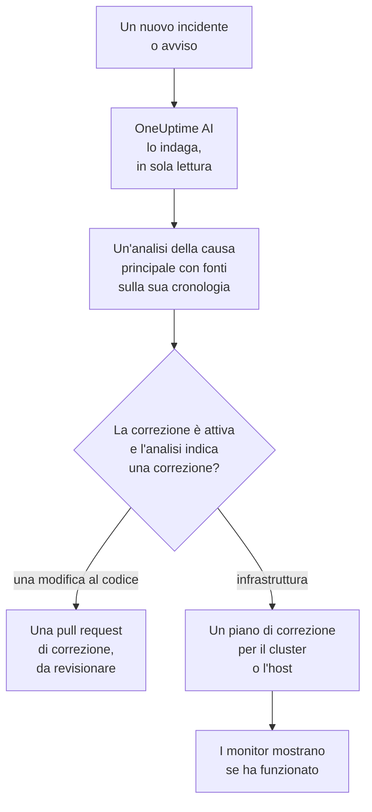
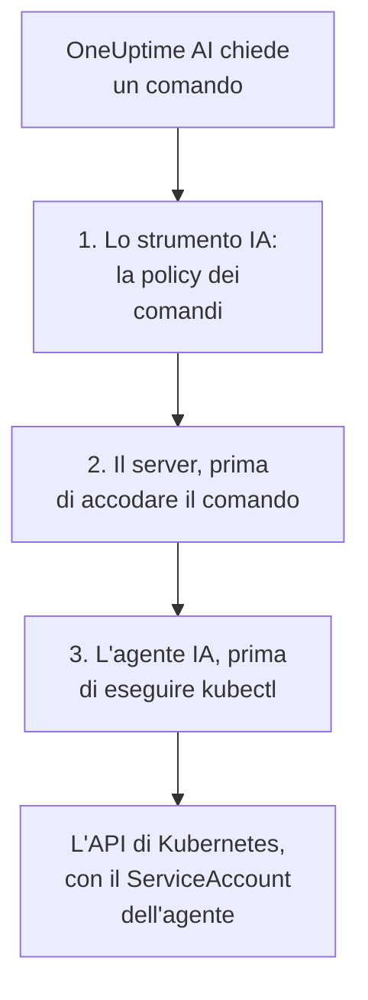

# AI SRE

OneUptime AI è il tuo Site Reliability Engineer basato sull'IA. Non appena viene dichiarato un nuovo incidente o avviso, si attiva, lo indaga sulla tua telemetria (log, metriche, trace, eccezioni, monitor e modifiche recenti) e pubblica un'analisi della causa principale con fonti sulla cronologia dell'incidente o dell'avviso, di solito prima che la persona reperibile abbia finito di leggere la notifica.

Ogni affermazione dell'analisi riporta una citazione che rimanda ai dati esatti che la supportano, e l'indagine stessa è **rigorosamente in sola lettura**: mentre indaga, OneUptime AI non può mai modificare nulla nel tuo progetto.

:::cards
- [Come funziona](#come-funziona): Da un nuovo incidente a un'analisi con fonti, e a una correzione quando la consenti.
- [Abilitare le indagini IA](#abilitare-le-indagini-ia): Gli interruttori e ciò che richiedono.
- [Accesso al cluster: lascia che OneUptime AI esegua kubectl](#accesso-al-cluster-lascia-che-oneuptime-ai-esegua-kubectl): Indagare, e correggere, dentro Kubernetes.
- [Controllo dei costi](#controllo-dei-costi): Limiti per gli incidenti, per gli avvisi e per l'intero progetto.
:::

## Come funziona

OneUptime AI fa tre cose per un nuovo incidente o avviso, e ognuna ha il proprio interruttore:

- **Indaga** (attivo per impostazione predefinita). Legge la tua telemetria, e i cluster e gli host in cui gira un agente IA, e pubblica un'analisi della causa principale con fonti. Un'indagine non modifica nulla.
- **Corregge** (disattivato per impostazione predefinita). Quando la correzione è attiva, un'analisi sicura diventa una correzione: una pull request per una modifica al tuo codice, oppure un piano di comandi per un cluster o un host, eseguito come consente l'agente IA di quel cluster o host.
- **Impara.** Le pagine AI Insights dicono che cosa continua ad andare storto, ricavandolo da tutto ciò che è stato registrato.



Un'analisi che non trova alcuna causa viene pubblicata in silenzio, senza avvisare nessuno (vedi [Modalità silenziosa](#modalità-silenziosa)), e senza una causa non viene corretto nulla.

## Che cosa pubblica l'indagine

Quando un'indagine termina, OneUptime AI pubblica un'analisi della causa principale con queste sezioni:

- **Summary**: una o due frasi che una persona avvisata può leggere in cinque secondi.
- **Most likely root cause**: l'ipotesi, con la sola sicurezza che le prove consentono, e ogni affermazione fattuale citata. Se la telemetria non basta, l'IA lo dice chiaramente ed elenca che cosa ha verificato invece di tirare a indovinare.
- **Evidence**: i risultati principali che supportano o escludono l'ipotesi, ciascuno citato.
- **Suggested next steps**: azioni concrete per la persona reperibile.

Per gli incidenti, l'analisi viene pubblicata nel feed dell'incidente **e** come nota interna dell'incidente (dove collaborano i soccorritori). Per gli avvisi, viene pubblicata nel feed dell'avviso.

Mentre l'indagine è in corso, il passaggio **Indagine** della scheda **OneUptime AI** dell'incidente o dell'avviso la racconta in tempo reale (quali strumenti sono stati eseguiti, che cosa hanno trovato e quanto hanno impiegato), così puoi vederla ragionare. Se un'indagine non riesce, il passaggio mostra il motivo dell'errore invece di un vuoto silenzioso.

La scheda mostra in due passaggi che cosa ha fatto OneUptime AI, ciascuno con il suo stato accanto al titolo: **Indagine**, che cosa è stato trovato, poi **Rimedio**, che cosa si sta facendo per correggerlo (vedi [Cosa ha fatto il rimedio automatico](#cosa-ha-fatto-il-rimedio-automatico)). Quando l'indagine ha prodotto il report, il suo passaggio si richiude sul riepilogo del report: **Mostra il report completo** apre il report, le prove e l'attività, e il giudizio su di esso, come fa **Visualizza il report completo** nell'intestazione della pagina.

Un'indagine prosegue finché non ha finito: non ha **alcun limite di tempo** né un piccolo budget di query, quindi può eseguire ogni query e ogni comando kubectl o di infrastruttura di cui ha bisogno. Un output di comando lungo (un `kubectl describe node` di un nodo molto carico, i log di un pod) non viene mai troncato: OneUptime AI lo legge una pagina alla volta. Se vuoi uno stop netto, imposta un **limite di tempo per le indagini** per tipo di segnale (vedi **Controllo dei costi** più sotto).

### Quando i registri non avevano niente da dire

Un'indagine che non ha potuto determinare una causa, e non ha trovato alcuna riga di registro in nessuna delle sue ricerche, dice perché sulla scheda **OneUptime AI**, sotto il suo rapporto, con la strada da seguire:

- **Nessun registro da leggere**: nessun registro è arrivato a OneUptime dall'ora prima dell'inizio dell'incidente o dell'avviso. **Configura i registri** apre la guida alla configurazione dei registri: invia i registri dei tuoi servizi a OneUptime e la prossima indagine potrà usarli.
- **Nessun registro su questo incidente** (per un avviso, **Nessun registro su questo avviso**): dei registri sono arrivati a OneUptime, e nessuna ricerca dell'indagine ha trovato nulla al riguardo. **Configura i registri** aiuta quando un servizio coinvolto non invia ancora i suoi registri, e **Trova i fallimenti non registrati** apre **Log → IA**, che trova i fallimenti che il tuo codice non registra e aggiunge la registrazione con una pull request.

OneUptime lo decide da ciò che sa, mai da ciò che dice l'analisi: lo stesso verdetto verificato dal server della [modalità silenziosa](#modalità-silenziosa), le ricerche nei registri dell'indagine stessa, e una lettura che verifica se un registro ha raggiunto il progetto in quel periodo. Un'indagine che ha trovato la causa, o una riga di registro, non dice niente del genere.

## Che cosa legge un'indagine

Un'indagine parte dall'incidente o dall'avviso e dall'infrastruttura a cui è collegato: gli host, gli host Docker e Podman, i cluster Kubernetes, i database e i servizi che i suoi monitor sorvegliano. Un monitor di sito web, API o sintetico sorveglia ciò a cui lo colleghi in **Monitor → Panoramica → Risorse collegate**: collegalo quindi agli host che servono ciò che controlla, e ogni indagine dei suoi incidenti partirà da lì. Prima di tutto questo, legge il [contesto IA](/docs/ai/ai-context) del progetto: ciò che il tuo team ha scritto per OneUptime AI sui vostri sistemi, con le note delle regole IA che corrispondono.

- Gli avvisi su quell'infrastruttura aperti nei 30 minuti prima dell'incidente, o ancora aperti, dal più recente, come l'avviso di CPU alta dell'host dietro un sito lento. Gli avvisi privati sono esclusi.
- Le metriche proprie dell'infrastruttura, lette come le leggono le persone. Le metriche di host come `system.cpu.utilization` e `system.memory.utilization` sono riportate una volta per stato, e gli stati sommano al 100%, quindi una media su tutti non dice nulla. OneUptime AI le legge uno stato alla volta (la CPU occupata è user più system), e qualsiasi metrica per container, per punto di montaggio o per qualsiasi altro attributo.
- I container di un host Docker o Podman: i più carichi per CPU, memoria o riavvii, e quelli che hanno smesso di inviare dati. Un container fermo non invia nulla invece di zero, quindi i numeri dell'intero host lo nascondono.
- Le modifiche registrate nelle 2 ore prima dell'incidente o dell'avviso (deploy, rollout di Kubernetes, modifiche di configurazione e le correzioni eseguite da OneUptime) e quali di esse la telemetria dei suoi servizi rende sospette: un servizio peggiorato in modo misurabile subito dopo una modifica. Vedi [Deploy e modifiche](/docs/telemetry/change-events).

L'attività dell'indagine nella scheda **OneUptime AI** dice quanti avvisi aperti o recenti ha letto e su quali risorse.

### Ricontrollato quando si apre un nuovo avviso

Un'indagine parte nel momento in cui viene dichiarato un incidente, e un avviso di host che richiede qualche minuto di metriche può aprirsi dopo. Quando si apre un avviso sull'infrastruttura collegata all'incidente entro 30 minuti dall'incidente, dopo che l'indagine l'ha letta, e l'incidente è ancora aperto, OneUptime AI ricontrolla l'incidente un'altra volta con quell'avviso in mano. La nuova analisi inizia con **Checked again** e l'avviso che ha portato al controllo, e lo dice anche la sua attività. Se una regola IA ha fatto attendere OneUptime AI prima di indagare l'incidente, quei minuti si contano invece da quando la sua indagine è terminata (vedi [Attendere prima di indagare](#attendere-prima-di-indagare)).

Accade al massimo una volta per incidente, con gli stessi interruttori e limiti di una nuova indagine: **Abilita IA**, _Indaga sui nuovi incidenti_, i crediti IA e i limiti giornalieri e di concorrenza. Non c'è nulla da attivare. Un controllo di follow-up non riesegue mai la correzione automatica e non viene mai ricontrollato a sua volta, e l'indagine di un avviso non viene ricontrollata.

## Parla con OneUptime AI dell'incidente

La scheda **OneUptime AI** termina con una conversazione, **Ask OneUptime AI**, condivisa da tutti coloro che possono vedere l'incidente o l'avviso. È un'unica scheda qualunque cosa sia successa sopra: sotto un report fai domande di approfondimento, e quando non è stata eseguita alcuna indagine automatica (o si è fermata prima del report) il primo suggerimento è **Qual è la causa principale?**, che fa indagare OneUptime AI su richiesta. I suggerimenti seguono lo stato dell'incidente o dell'avviso: dopo il riconoscimento nessuno propone più di riconoscerlo, e dopo la risoluzione chiedono com'è andata la risposta e cosa ne eviterebbe la ripetizione.

- **Fai domande di approfondimento**: "quali pod usano più memoria?", "che cosa è cambiato subito prima che iniziasse?", "c'è altro di coinvolto?". OneUptime AI parte dal suo report, interroga dati aggiornati (ed esegue comandi kubectl o di infrastruttura in sola lettura dove ha accesso, sui cluster e sulle risorse che puoi vedere) e cita ogni affermazione.
- **Chiedigli di agire**: "conferma questo incidente", "pubblica un aggiornamento di stato che dice che stiamo indagando", "avvisa la reperibilità del database", "alza la gravità". Usa le stesse azioni di Chiedi all'IA e agisce sempre **con i tuoi permessi**, quindi non può mai fare più di quanto potresti fare tu.
- **Scegli come agisce** con l'interruttore nella casella del messaggio, che accanto spiega cosa significa la modalità scelta: _Auto-run_ (quella predefinita: agisce subito su una richiesta chiara), _Ask to act_ (mostra prima una scheda di approvazione, che chiunque sull'incidente può approvare o rifiutare) oppure _Sola lettura_.
- **Un'unica conversazione condivisa.** Ogni domanda mostra chi l'ha posta, tutti vedono la stessa conversazione in tempo reale e chiunque può fermare una risposta in corso. Grafici e tabelle di una risposta vengono mostrati a chi ha fatto la domanda; tutti gli altri vedono la risposta con le fonti. Ogni risposta elenca le sue **Fonti**, e una fonte con una pagina propria (log, metriche, un monitor) la apre. Una conversazione lunga si apre sui messaggi più recenti, con un pulsante sopra (per esempio **Show 6 earlier messages**) che riporta il resto.

Un incidente o un avviso che OneUptime AI non ha indagato né corretto perché l'IA era disattivata per esso — disattivata per il progetto, _Indaga sui nuovi incidenti_ (o sugli avvisi) disattivato alla sua creazione, nessuna regola IA che indaga corrispondente o la gravità sotto il minimo — riceve invece una scheda di una riga: **L'indagine IA è disattivata** (o **L'IA è disattivata per questo progetto**, finché lo è; **L'indagine IA era disattivata** quando è di nuovo attiva) e il perché. La sua freccia, **Cosa puoi fare**, apre cosa attivare, con un link a dove si cambia per chi può cambiarlo e chi può cambiarlo per tutti gli altri; una modifica vale solo per i nuovi incidenti e avvisi, non per questo. Finché l'IA è attiva, **Ask OneUptime AI** sulla riga apre la conversazione, e una conversazione che qualcuno ha già iniziato compare da sola sotto la riga. Il passaggio **Rimedio** della scheda è allora richiuso nella riga: la riga dice perché non è stato corretto nulla.

## Abilitare le indagini IA

Le indagini autonome sono **attive per impostazione predefinita nei nuovi progetti**. Lo sono anche le bozze di post-mortem e gli AI Insights. La correzione parte disattivata, e le pull request che ne fanno parte si aprono solo finché è attiva (vedi [Correzioni automatiche del codice](#correzioni-automatiche-del-codice)). Un progetto creato prima di questa impostazione predefinita mantiene la propria; attiva le indagini come al passaggio 3, oppure con **Attiva** nella pagina **Agente IA** di un qualsiasi cluster Kubernetes (Project Owner o Project Admin). Per verificarle o modificarle:

:::steps
1. **Configura un provider LLM.** Le installazioni self-hosted usano la propria chiave (o girano completamente isolate con Ollama in locale): vedi [Provider LLM](/docs/ai/llm-provider). Gli utenti di OneUptime Cloud possono usare il provider globale preconfigurato, fatturato come token IA a consumo, quindi il progetto ha bisogno di crediti IA: un proprietario del progetto o chi ha **Manage Billing** li aggiunge in **Impostazioni del progetto → IA → Crediti IA**, dove la **Ricarica automatica** evita che si esauriscano.
2. **Assicurati che l'IA sia abilitata per il progetto** (lo è per impostazione predefinita): **Abilita IA**, in **Impostazioni del progetto → IA → AI Features**.
3. **Scegli per tipo di segnale** (entrambi attivi nei nuovi progetti):
   - Incidenti: **Incidenti → IA → Impostazioni**: attiva _Indaga sui nuovi incidenti_.
   - Avvisi: **Avvisi → IA → Impostazioni**: attiva _Indaga sui nuovi avvisi_.
:::

Ogni comportamento dell'IA su queste pagine è un interruttore che si salva non appena lo sposti; non c'è un pulsante Salva. La pagina degli incidenti ne ha tre, sotto **Cosa fa OneUptime AI**: _Indaga sui nuovi incidenti_, _Correggi automaticamente i nuovi incidenti_ e _Scrivi una bozza di post-mortem quando un incidente viene risolto_. La pagina degli avvisi ha gli stessi, senza il post-mortem. _Correggi automaticamente i nuovi incidenti_ (e _Correggi automaticamente i nuovi avvisi_) parte **disattivato**, anche nei nuovi progetti: permette a OneUptime AI di modificare la tua infrastruttura, quindi è il progetto ad attivarlo; vedi [Quali incidenti vengono indagati e corretti](#quali-incidenti-vengono-indagati-e-corretti). Le pull request che apre, una correzione del tuo codice e la telemetria che mancava a un'indagine, ne fanno parte, e ogni regola IA le stabilisce: senza regole si aprono entrambe, e una regola può disattivarne una qualsiasi in **Altri campi** (vedi [Correzioni automatiche del codice](#correzioni-automatiche-del-codice)). I Project Owner e i Project Admin possono modificarli; per tutti gli altri ogni interruttore è bloccato e indica il permesso di cui ha bisogno.

Le pagine dicono due cose solo quando sono vere. Se **Abilita IA** è disattivato, su di esse non viene eseguito nulla, e la pagina lo dice in alto, con l'interruttore Abilita IA stesso per chi può modificarlo (i Project Owner e chiunque abbia Manage Billing); a tutti gli altri viene detto chi può farlo. Se il progetto non ha alcun provider LLM che OneUptime AI possa usare (nessuno, oppure provider ma nessuno impostato come predefinito), la pagina dice anche questo, con un link a **Impostazioni del progetto → IA → Provider LLM**. Su OneUptime Cloud il provider globale conta, quindi lì non viene detto nulla.

Incidenti e avvisi si configurano in modo indipendente, così puoi dare a ogni tipo di segnale il proprio limite di concorrenza, il budget giornaliero di token, il budget delle attività di correzione e le proprie regole. Nessuno di questi limiti si applica finché non lo imposti: sono raccolti sotto **Altre impostazioni** in fondo a ogni pagina; vedi **Controllo dei costi** più sotto. Modificare un'impostazione IA degli avvisi non modifica l'impostazione corrispondente degli incidenti, e viceversa.

La correzione si basa sulle indagini: finché **Correggi automaticamente i nuovi incidenti** (o gli avvisi) è attivo, un'indagine che individua con sicurezza una modifica al codice di un repository apre automaticamente una pull request di correzione; vedi **Correzioni automatiche del codice** più sotto.

## Accesso al cluster: lascia che OneUptime AI esegua kubectl

Di base, un'indagine può usare solo la telemetria che i tuoi agenti inviano. Per un segnale Kubernetes spesso non basta: "pod bloccati in Pending" è un problema di scheduling che si diagnostica descrivendo il pod e leggendone gli eventi, non guardando una metrica. L'**Agente IA Kubernetes** permette a OneUptime AI di fare esattamente questo e, se lo consenti, di correggere ciò che trova.

La pagina di ogni cluster ha una sezione **IA** nel menu laterale:

- **Agente**: la pagina **Agente IA** del cluster: se l'agente è connesso, cosa può fare l'IA sul cluster e tutto ciò che richiede attenzione, ciascuno con il passaggio che lo risolve. La stessa spiegazione compare nel pannello di indagine dell'incidente quando l'IA ha dovuto indagare solo con i dati di OneUptime.
- **Informazioni**: la pagina **Insight IA** del cluster: che cosa OneUptime AI ha scoperto sul cluster, cosa continua ad andare storto e perché, e che cosa fare (vedi [Cosa ha imparato l'IA su un cluster](#cosa-ha-imparato-lia-su-un-cluster)).
- **Registri**: la pagina **Registri IA** del cluster: tutto ciò che OneUptime AI ha fatto sul cluster, dal più recente (vedi [Tutto ciò che l'IA ha fatto su un cluster](#tutto-ciò-che-lia-ha-fatto-su-un-cluster)).

La **Panoramica** del cluster termina con una scheda **Agente IA** che riassume la pagina dell'agente IA: se l'agente è connesso, se **Indaga con kubectl** è attivo, come vengono eseguite le correzioni (**Disattivato**, **Chiedi l'approvazione**, **Automatico** o **Salta l'approvazione**) e che cosa richiede attenzione, con un link alla pagina dell'agente IA, dove si modificano.

### L'agente IA Kubernetes: attivo per impostazione predefinita, in sola lettura

Il chart dell'[agente Kubernetes di OneUptime](/docs/telemetry/kubernetes-agent) esegue l'agente IA Kubernetes per impostazione predefinita: un piccolo pod (`component=ai-agent`, immagine `oneuptime/kubernetes-ai-agent`) con un ServiceAccount in **sola lettura**. Si connette con la chiave API che il chart usa già, quindi nella dashboard non c'è nulla da configurare: entro un minuto la pagina dell'agente IA del cluster lo mostra come **Connesso** e **Indaga con kubectl** è attivo, a meno che qualcuno abbia già scelto lì delle impostazioni IA per il cluster, che restano come sono.

Su un agente installato prima che esistesse l'agente IA Kubernetes, aggiorna prima l'indice dei chart, poi esegui l'aggiornamento:

```bash
helm repo update
helm upgrade kubernetes-agent oneuptime/kubernetes-agent \
  --namespace oneuptime-agent --reset-then-reuse-values \
  --set aiAgent.enabled=true
```

`kubernetes-agent` in `oneuptime-agent` sono il nome della release e il namespace usati dalle istruzioni di installazione della dashboard; se hai installato l'agente con altri nomi, usa i tuoi (`helm list -A | grep kubernetes-agent` li mostra). Senza `helm repo update`, Helm può risolvere il chart da cui hai installato, che non conosce `aiAgent` e fallisce con `Additional property aiAgent is not allowed`. Su un OneUptime self-hosted, aggiorna OneUptime prima del chart: vedi [Aggiornare l'agente](/docs/telemetry/kubernetes-agent#aggiornare-lagent). Per eseguire il chart senza l'agente IA, passa `--set aiAgent.enabled=false`.

**Testa la connessione**, nel menu **⋯** accanto allo stato dell'agente nella pagina dell'agente IA, esegue `kubectl version` e `kubectl auth can-i --list` tramite l'agente e mostra i risultati: che cosa può raggiungere e che cosa può fare. Se la pagina dice che l'agente non è connesso, leggi il suo log con `kubectl logs -n oneuptime-agent -l component=ai-agent --tail=100`. Una chiave con un **Nome del servizio fissato** non può registrare l'agente: dai al chart una chiave che non ce l'abbia. Quando il server rifiuta una registrazione, il log dice se il rifiuto si risolverà da solo (un pod precedente dell'agente che si segnala ancora, o il vecchio Runner nel cluster che si sta ancora spegnendo durante un aggiornamento) oppure che cosa cambiare. **Reimposta l'agente**, nello stesso menu, fa dimenticare al server la chiave dell'agente una volta che confermi; il pod si riconnette da solo entro pochi minuti.

L'agente IA Kubernetes non è un Runner e non compare mai in Runbook → Agenti di runbook. Usa sempre e solo il proprio ServiceAccount, quindi OneUptime non gli consegna mai una credenziale, non viene mai usato come host Bash/SSH per i runbook e non viene mai accettato come Runner dei comandi di una regola IA.

### Cosa può fare l'IA: lo decide l'agente

Ciò che OneUptime AI può fare su un cluster si imposta dove gira l'agente, nel chart, con due valori:

- `aiAgent.investigation`: `true`: l'IA può eseguire kubectl in sola lettura sul cluster mentre indaga. `false`: indaga comunque, con i dati che OneUptime ha già.
- `aiAgent.fixes`: come l'IA applica una correzione: `off`, `ask-for-approval`, `automatic` o `bypass-approval` (vedi [Come funzionano le correzioni](#come-funzionano-le-correzioni)). Ogni livello tranne `off` concede all'agente IA l'accesso in scrittura; con `off` non ne ha alcuno e rifiuta lui stesso ogni scrittura.

L'agente IA comunica entrambi a OneUptime a ogni heartbeat, e OneUptime li applica al cluster. **Cosa può fare l'IA**, nella pagina dell'agente IA del cluster, li mostra (**Attivato** e il livello delle correzioni, in verde quando sono attivi) senza modo di modificarli lì; **Cambia** mostra ogni opzione con l'esatto `helm upgrade` che la imposta. Una modifica fatta altrove (nella pagina dell'agente IA, tramite l'API o Terraform) viene rifiutata finché è l'agente a impostarli.

Una release che non imposta nessuno dei due valori lascia che l'agente usi i suoi valori predefiniti (indagine attiva; correzioni disattivate, oppure ask-for-approval con il vecchio `aiAgent.remediation.enabled=true`). OneUptime applica questi valori predefiniti solo a un cluster le cui impostazioni IA nessuno ha scelto nella sua pagina dell'agente IA: le impostazioni scelte lì restano come sono, e la pagina mostra il comando che le sposta nel chart. Lo stesso vale per un cluster il cui agente IA è troppo vecchio per comunicarle: aggiornare il chart con i due valori le sposta.

### Lasciare che l'IA corregga ciò che trova

Le correzioni restano disattivate finché non le attivi con `aiAgent.fixes`, che concede anche all'agente IA l'accesso in scrittura, idealmente solo nei namespace che l'IA può correggere e con le operazioni sui nodi disattivate:

```bash
helm repo update
helm upgrade kubernetes-agent oneuptime/kubernetes-agent \
  --namespace oneuptime-agent --reset-then-reuse-values \
  --set aiAgent.enabled=true \
  --set aiAgent.investigation=true \
  --set aiAgent.fixes=ask-for-approval \
  --set "aiAgent.remediation.namespaces={web,api}" \
  --set aiAgent.remediation.nodeOperations=false
```

Oppure su tutto il cluster:

```bash
helm repo update
helm upgrade kubernetes-agent oneuptime/kubernetes-agent \
  --namespace oneuptime-agent --reset-then-reuse-values \
  --set aiAgent.enabled=true \
  --set aiAgent.investigation=true \
  --set aiAgent.fixes=ask-for-approval \
  --set-json 'aiAgent.remediation.namespaces=[]'
```

Sostituisci `{web,api}` con i namespace che l'IA può correggere. Ogni namespace elencato deve esistere già: il chart crea un RoleBinding in ciascuno e non crea mai un namespace, quindi uno mancante fa fallire l'intera installazione o l'intero aggiornamento (collector compreso) con `namespaces "api" not found`. Crealo prima, oppure toglilo dall'elenco; togli un namespace dall'elenco prima di eliminarlo. Omettere il flag in un aggiornamento mantiene l'elenco salvato nella release, quindi per tornare a tutto il cluster passa `--set-json 'aiAgent.remediation.namespaces=[]'` (Helm 3.10+), come fa il secondo comando, e non `={}`, che Helm legge come un nome vuoto e il chart rifiuta. `--set aiAgent.remediation.namespaces=null` non azzera un elenco salvato con `--reuse-values`: Helm mantiene l'elenco salvato. `aiAgent.remediation.nodeOperations=false` tiene le correzioni lontane dai nodi; impostalo a `true` per consentire all'IA di isolare, ripristinare, svuotare e contrassegnare con taint i nodi (un drain, un taint o un patch di un nodo aspetta comunque una persona).

Usa `automatic` o `bypass-approval` al posto di `ask-for-approval` per più autonomia, e `--set aiAgent.fixes=off` per disattivare di nuovo le correzioni, il che rimuove anche l'accesso in scrittura. Le correzioni richiedono anche due interruttori del progetto. **Correggi automaticamente i nuovi incidenti** (in **Incidenti → IA → Impostazioni**) e **Correggi automaticamente i nuovi avvisi** (in **Avvisi → IA → Impostazioni**) partono disattivati: finché uno non è attivo, non viene corretto nulla di nuovo di quel tipo. **Abilita IA** (**Impostazioni del progetto → IA → AI Features**) è attivo a meno che qualcuno non l'abbia disattivato; disattiva tutta l'IA del progetto, qualunque cosa dica la configurazione di un agente.

### Su quali incidenti agiscono le correzioni di un cluster

Finché **Correggi automaticamente i nuovi incidenti** è attivo e non è configurata alcuna regola IA, OneUptime AI corregge ogni nuovo incidente a cui è collegato il cluster, nella modalità impostata dalla pagina del suo agente IA, e lo stesso per gli avvisi con **Correggi automaticamente i nuovi avvisi**. Con le regole, corregge solo gli incidenti a cui corrisponde una regola che corregge con OneUptime AI (vedi [Quali incidenti vengono indagati e corretti](#quali-incidenti-vengono-indagati-e-corretti)). Ciò a cui non è collegato non lo tocca, per quanto chiaramente la causa si trovi nel cluster. Un incidente o un avviso è collegato a un cluster quando:

- la telemetria da cui è nato nomina il cluster (un monitor di metriche, log o trace sui dati del cluster);
- il suo monitor è un monitor Kubernetes del cluster;
- il suo monitor è collegato al cluster in **Monitor → Panoramica → Risorse collegate**, il modo per collegare un monitor di sito web, di API o sintetico al cluster che serve ciò che controlla;
- Chiedi all'IA lo ha dichiarato nella pagina del cluster, o lo ha collegato al cluster quando gli è stato chiesto;
- qualcuno ha scelto il cluster in **Altre risorse interessate** al momento della dichiarazione (scegliere un monitor collegato lo aggiunge lì per te).

Ogni incidente e ogni avviso indica nel passaggio **Rimedio** della sua scheda **OneUptime AI** se era collegato a un cluster e che cosa hanno fatto le correzioni del cluster; vedi [Cosa ha fatto il rimedio automatico](#cosa-ha-fatto-il-rimedio-automatico). Lo stesso vale per una risorsa di infrastruttura e il suo agente IA.

### Chi può modificarlo

Finché è l'agente IA Kubernetes a impostare indagine e correzioni, le modifica chi può modificare i valori del chart sul cluster; OneUptime rifiuta una modifica fatta altrove. Le regole seguenti valgono per ciò che resta in OneUptime (l'allowlist di kubectl e il collegamento al precedente Runner nel cluster) e per indagine e correzioni su un cluster le cui impostazioni sono ancora impostate in OneUptime (vedi [Cosa può fare l'IA: lo decide l'agente](#cosa-può-fare-lia-lo-decide-lagente)).

Attivare le correzioni (qualsiasi passaggio da **Disattivato** a un'altra modalità) e allentarle (passare ad **Automatico** o **Salta l'approvazione**, scrivere l'allowlist di kubectl o collegare un Runner) richiede un Project Owner, un Project Admin o il permesso **Edit AI Rule**, le stesse persone che possono creare una regola IA che corregge senza chiedere. **Reimposta l'agente** richiede le stesse persone che attivano le correzioni. Restringerle (**Disattivato**, tornare a **Chiedi l'approvazione**, svuotare l'allowlist o rimuovere il collegamento del Runner) è aperto a chiunque possa modificare il cluster, così come **Testa la connessione** e approvare una correzione che OneUptime AI propone per esso. Tutto questo richiede il permesso di modificare proprio quel cluster: un permesso limitato ad alcune etichette, o ai cluster che appartengono a te o ai tuoi team, raggiunge solo quei cluster, e una voce di blocco con etichette toglie i cluster che le portano.

### Che cosa può eseguire un'indagine

Con l'accesso, un'indagine esegue kubectl in **sola lettura** tramite l'agente IA (`get`, `describe`, `logs`, `events`, `top`, `rollout status/history`, `auth can-i`), tutti i comandi di cui ha bisogno, e cita ogni comando come qualsiasi altra prova. L'output non viene mai troncato: l'agente ne conserva fino a un megabyte, e OneUptime AI legge un output lungo una pagina alla volta. Tre controlli indipendenti la mantengono in sola lettura: la policy che classifica ogni comando, il server che rifiuta di accodare qualsiasi altra cosa per un'indagine e l'agente IA, che ricontrolla la stessa policy prima di avviare kubectl. "Sola lettura: nei tuoi sistemi non è stato modificato nulla" resta letteralmente vero.



### Come funzionano le correzioni

Le **Correzioni** nella pagina dell'agente IA hanno quattro impostazioni (il valore `aiAgent.fixes` del chart: `off`, `ask-for-approval`, `automatic`, `bypass-approval`):

- **Disattivato**: l'IA si limita a indagare.
- **Chiedi l'approvazione**: dopo l'analisi della causa principale, OneUptime AI fa una diagnosi con kubectl e compone il più piccolo piano kubectl che affronta la causa, per esempio `kubectl rollout restart deployment/web -n web`. Il piano compare sull'incidente con la sua motivazione, l'effetto atteso e il rollback; una persona lo approva con un clic, e OneUptime esegue esattamente quei comandi. Se i monitor non si riprendono, viene eseguito il rollback e OneUptime AI compone un altro piano, di nuovo da approvare, con il tentativo fallito davanti, così da seguire un approccio diverso o dire che cosa dovrebbe guardare una persona.
- **Automatico**: le modifiche sicure vengono eseguite da sole; una modifica più rischiosa mai. Quando il giro ha trovato solo correzioni più rischiose, si chiude proponendo esattamente quelle per l'approvazione con un clic. Quando ha eseguito anche una correzione sicura, quella più rischiosa resta nell'analisi e viene proposta solo se la verifica mostra che la correzione sicura non ha fatto riprendere i monitor, dal giro di follow-up, che chiede l'approvazione. Inserisci la forma di un comando più rischioso nell'allowlist della pagina dell'agente IA e verrà eseguito da solo anche lui. La modalità automatica risolve anche il segnale non appena la verifica conferma che i monitor si sono ripresi, ed è limitata da un interruttore di sicurezza a tre correzioni non presidiate per cluster all'ora: oltre questa soglia, o mentre un altro giro non presidiato di OneUptime AI sta ancora modificando o verificando lo stesso cluster, un giro propone il proprio piano per l'approvazione invece di eseguirlo.
- **Salta l'approvazione**: l'IA non chiede. Ogni modifica che la policy consente, comprese quelle più rischiose, viene eseguita da sola, così come il giro di follow-up dopo una verifica fallita; il segnale si risolve da solo non appena la verifica conferma la ripresa. Ciò che richiede una persona in ogni modalità (più sotto) la aspetta comunque. Un giro propone il proprio piano per l'approvazione invece di eseguirlo, e spiega perché sull'incidente, anche quando:
  - l'interruttore di sicurezza orario (tre correzioni non presidiate per cluster all'ora) è scattato, o non può essere verificato;
  - un altro giro non presidiato di OneUptime AI sta ancora modificando lo stesso cluster, o vi sta ancora verificando una correzione (un avviso e un incidente dello stesso monitor sono il caso tipico), oppure questo non può essere verificato;
  - è il giro di follow-up dopo una correzione il cui rollback non è terminato.

**Prima il rollback.** Quando OneUptime ha segnato un rollout Kubernetes del cluster come sospetto per l'incidente (vedi [Deploy e modifiche](/docs/telemetry/change-events)), OneUptime AI prova a farne il rollback prima di qualsiasi altra correzione. OneUptime costruisce il `kubectl rollout undo` a partire dalla modifica registrata, mai da ciò che scrive il modello, e il comando viene eseguito, o attende l'approvazione, come qualsiasi modifica sicura nella modalità del cluster. Il rollback non viene proposto quando il Deployment è cambiato di nuovo dopo quel rollout, perché annullarlo annullerebbe allora la modifica successiva.

**Workload dichiarati da Argo CD, Flux o Helm.** Molti cluster dichiarano i propri workload in git e lasciano che Argo CD o Flux lo applichino, oppure li installano con Helm, e una modifica kubectl a ciò che vi è dichiarato non dura: Argo CD la ripristina in pochi secondi quando l'Application ha il self-heal attivo (altrimenti alla sincronizzazione successiva), Flux alla riconciliazione successiva e una release Helm all'aggiornamento successivo. Per questo, prima che OneUptime AI esegua o proponga una modifica kubectl, OneUptime legge con kubectl in sola lettura, tramite l'agente IA del cluster, l'oggetto che modifica (per un ReplicaSet, il suo Deployment) e chi lo dichiara: Argo CD (l'annotazione `argocd.argoproj.io/tracking-id`, l'etichetta `argocd.argoproj.io/instance` o il suo field manager), Flux (le etichette `kustomize.toolkit.fluxcd.io/*` o `helm.toolkit.fluxcd.io/*`) o una release Helm (l'annotazione `meta.helm.sh/release-name` o l'etichetta `app.kubernetes.io/managed-by: Helm`). Una modifica che Argo CD o Flux ripristinano (`rollout undo`, compreso il rollback prima di tutto, `scale` quando git fissa il numero di repliche, `set image/env/resources`, `patch`, l'eliminazione di un workload) non viene mai eseguita da sola, in nessuna modalità, Salta l'approvazione e l'allowlist comprese: viene proposta per l'approvazione con un clic come **correzione temporanea**, e il piano indica la correzione duratura, la stessa modifica in git (il manifest, i values di Helm o l'overlay Kustomize da cui nasce il workload). Argo CD e Helm lasciano stare ciò che git non dichiara, come un `rollout restart`, un `rollout pause` o un'annotazione aggiunta, quindi una modifica del genere viene eseguita come prevede la modalità del cluster. Una Kustomization di Flux rimuove anche questo alla riconciliazione successiva, quindi lì anche una pausa, un'etichetta o un'annotazione sono una correzione temporanea. Con Flux un riavvio viene comunque eseguito come prevede la modalità: quando Flux rimuove la sua annotazione i pod si riavviano ancora una volta, ma il riavvio non viene annullato. L'eliminazione di un pod che non funziona viene eseguita come prevede la modalità, chiunque dichiari il workload: git non dichiara mai un pod, e il suo ReplicaSet lo sostituisce. Una release Helm ripristina una modifica solo all'aggiornamento successivo, quindi lì la modifica viene eseguita anch'essa come prevede la modalità del cluster, e il piano dice che è temporanea.

**La verifica si accorge di una correzione ripristinata.** OneUptime legge l'oggetto che una correzione kubectl modifica subito prima e subito dopo la sua esecuzione, e di nuovo ogni due o tre minuti finché la finestra di verifica è aperta. Una correzione tornata ai valori precedenti (ripristinata da Argo CD, Flux, un aggiornamento Helm, un operatore o un autoscaler) fa fallire subito la verifica, e la nota dice chi l'ha ripristinata e dove va la modifica duratura. Il suo rollback non viene eseguito: il cluster l'ha già annullata, e annullarla di nuovo potrebbe riapplicare la correzione. Una modifica che Argo CD o Flux ripristinano viene giudicata alla fine della sua finestra, e non già quando i monitor si riprendono. Un riavvio non lascia nulla da osservare: i suoi pod sono stati sostituiti, qualunque cosa accada poi alla sua annotazione.

Una modifica **sicura** riguarda esattamente un oggetto con nome: `rollout restart/undo/pause/resume`, `scale` (verso qualsiasi valore tranne 0), l'eliminazione di un pod con nome, `cordon`/`uncordon`, e `label`/`annotate` su un Pod, Deployment, StatefulSet, DaemonSet, ReplicaSet, Job o CronJob con nome e una chiave ordinaria (non una riservata come `*.kubernetes.io/…` o `*.k8s.io/…`). Tutto il resto che la policy consente è **più rischioso**: gli stessi verbi su un tipo senza nome (`rollout restart deployment`), su più oggetti, con un selettore o con `--all`; `scale` a 0; l'eliminazione di un job; `taint`; `drain`; `patch`; `set image/env/resources`; `create`; l'eliminazione con `--force`; e label o annotazioni su qualsiasi altro tipo o con una chiave riservata.

Alcuni limiti valgono in **ogni** modalità, Salta l'approvazione compresa, e nessuna voce dell'allowlist li cambia:

- Una scrittura in **kube-system**, **kube-public** o **kube-node-lease** richiede sempre una persona. Una risorsa personalizzata viene giudicata in base al namespace in cui è scritta, anche quando il suo nome sembra un tipo integrato a livello di cluster (`nodes.example.com`, `namespaces.example.com`).
- Un `drain`, un `taint` o un `patch` di un nodo richiede sempre una persona. Svuotare un nodo sfratta i pod di ogni namespace (i tre qui sopra e quello dell'agente compresi), e un taint `NoExecute` li sfratta allo stesso modo, che lo imposti `kubectl taint` o un `patch` del nodo.
- L'agente IA non modifica mai nulla nel proprio namespace (una correzione lì potrebbe ridurre a zero l'agente Kubernetes, o l'agente IA stesso), né nulla al di fuori dei namespace in cui il suo chart gli consente di scrivere (`aiAgent.remediation.namespaces`), né un nodo quando il suo chart ha disattivato le operazioni sui nodi (`aiAgent.remediation.nodeOperations=false`). OneUptime ricava questo perimetro da ciò che l'agente IA comunica e rifiuta una correzione del genere quando OneUptime AI la propone e di nuovo quando qualcuno la approva, quindi non raggiunge mai l'agente IA come correzione fallita; anche l'agente IA la rifiuta, prima di avviare `kubectl`.
- I comandi distruttivi (più sotto) non vengono mai eseguiti, nemmeno con l'approvazione di una persona.

L'allowlist della modalità automatica viene confrontata parola per parola con il comando analizzato, non come testo libero: `*` sta per esattamente una parola (un'immagine, un nome), mai per oggetti, flag o un secondo `-n` in più, e ogni flag usato dal comando deve essere scritto nella voce. `kubectl set image deployment/web * -n web` consente una nuova immagine per `web` in `web`, nient'altro. Una voce deve scrivere per esteso il suo verbo (e il sottocomando di `rollout`, `set` o `create`) invece di usare `*` al suo posto, e deve avere più di una parola dopo il `kubectl` iniziale facoltativo; una voce che viola queste regole, come `scale` o `kubectl *`, non potrebbe mai pre-approvare una modifica e viene rifiutata al salvataggio.

:::details I comandi che non vengono mai eseguiti, e come viene letto un comando
Alcuni comandi non vengono **mai** eseguiti, qualunque sia la modalità e anche con l'approvazione di una persona. La policy dei comandi li rifiuta, e viene applicata tre volte (dallo strumento del server, dal punto di passaggio obbligato in cui il server accoda e dall'agente IA prima di avviare `kubectl`): `exec`, `attach`, `cp`, `port-forward`, `proxy`, `debug`, `run`, `edit`, `apply`, `replace`, `diff`, i plugin di kubectl e qualsiasi altro verbo non presente nel suo elenco, qualsiasi input da file (`-f`, `-k`) o formato di output che legge un file (`-o jsonpath-file=`, `-o go-template-file=`, `-o custom-columns-file=`, `--template`, e un `-o jsonpath`/`go-template`/`custom-columns` da solo senza il suo modello in linea), i flag di credenziali, di impersonificazione (`--as`, `--as-group`, `--as-uid`, `--as-user-extra`), di selezione del cluster, `--kuberc`, di API grezza e di log dettagliato, gli oggetti Secret con **qualsiasi** verbo (OneUptime AI non legge, modifica, elimina né crea mai un Secret, e `create secret`, `create token` e `set env --resolve` vengono rifiutati con essi), tutto ciò che concede RBAC (`create role`, `create clusterrole`, `create rolebinding`, `create clusterrolebinding`, `set subject`), `certificate approve`, `set serviceaccount`, `create deployment`, `create cronjob` o `create job` con `--image` (`create job --from=cronjob/…` resta una modifica più rischiosa), `expose --overrides` o `--override-type` (l'override può far creare a kubectl un Job, un ClusterRoleBinding o qualsiasi altro tipo di oggetto invece di un Service), un corpo di `patch` che non sia JSON (kubectl lo leggerebbe come YAML, i cui tag possono scrivere un campo che nessun controllo vede), le patch che modificano il ServiceAccount, i volumi o le impostazioni di sicurezza di un modello di pod (porte dell'host, l'esclusione dal namespace utente `hostUsers` e la classe di runtime `runtimeClassName` comprese), le patch che sostituiscono un'intera parte di un modello di pod invece di impostarne dei campi (uno strategic-merge `$patch: replace`, un merge patch che imposta un'intera lista `containers`, o un JSON patch che sostituisce o rimuove la specifica del pod), che eliminerebbero quelle impostazioni senza nominarle, una label o un'annotazione su oggetti Namespace scelti con `--all` o un selettore invece che per nome, qualsiasi scrittura (`patch`, `label`, `annotate`, `set`) su oggetti RBAC, CustomResourceDefinition, APIService, configurazioni di webhook di ammissione o policy di ammissione, le scritture con `--all-namespaces`, `delete --all`, e l'eliminazione di namespace, nodi, volumi, CRD o ruoli di cluster. I flag vengono analizzati come li analizza kubectl, così un flag o un tipo vietato non può nascondersi dietro un altro: i flag brevi combinati vengono separati lettera per lettera (`-As` viene rilevato), i flag con valore facoltativo (`--cascade`, `--dry-run`, `--validate`) non inghiottono mai la parola successiva, e ogni flag tranne `-n`/`--namespace`, `--request-timeout` e `--match-server-version` deve venire dopo il verbo (e dopo il sottocomando di `rollout`, `set`, `create`, `auth`, `cluster-info` e `top`), perché kubectl sceglie il comando prima di analizzare i flag. L'agente IA include il proprio kubectl con versione fissa (v1.36.5) e disattiva kuberc, così un file kuberc non può aggiungere valori predefiniti o alias a un comando dopo che la policy lo ha controllato. Passa a ogni comando un kubeconfig privato per il proprio ServiceAccount che punta al file del token montato, mai una copia del token.
:::

### Che cosa limita l'RBAC dell'agente IA, e che cosa no

:::details Che cosa concede l'RBAC del chart
L'RBAC del chart è un livello separato dalla policy, e limita **dove** l'agente IA può scrivere, non che cosa può fare una scrittura. L'accesso in sola lettura (get/list/watch, log dei pod) è concesso su tutto il cluster. `aiAgent.remediation.enabled` aggiunge patch/update su Deployment, StatefulSet, DaemonSet, ReplicaSet e la loro sottorisorsa scale, Job, CronJob, Pod e HPA; create su Job e HPA; e delete solo su Pod e Job. `aiAgent.remediation.nodeOperations` (attivo per impostazione predefinita) aggiunge cordon, uncordon, taint e drain sui nodi, su tutto il cluster; impostalo a `false` e il chart non concede alcun RBAC sui nodi e lo comunica all'agente IA (`ONEUPTIME_KUBECTL_ALLOW_NODE_OPERATIONS=false`), che allora rifiuta cordon, uncordon, drain, taint e label/annotate/patch su un nodo prima di avviare kubectl; e, poiché l'agente IA comunica l'interruttore, OneUptime rifiuta una correzione del genere già quando viene proposta o approvata. Non concede mai Secret, `exec`, `attach`, `port-forward`, token di ServiceAccount, impersonificazione, CRD o scritture RBAC, quindi eliminare qualsiasi altro tipo, o applicare una label a un Service, una ConfigMap, un Ingress, un Namespace o un PVC, fallisce sul server API con `Forbidden` anche quando una persona l'ha approvato. I due livelli non sono copie l'uno dell'altro: per l'RBAC, `apply`, `edit`, `replace`, le scritture con `--all-namespaces` e `delete --all` sono normali chiamate patch, update e delete, e solo la policy le ferma.
:::

:::warning Che cosa significa l'accesso in scrittura
Sii però consapevole di che cosa significa quell'accesso in scrittura: **patch/update su workload, pod e CronJob, e create su Job, in un namespace equivale a eseguire qualsiasi immagine come qualsiasi ServiceAccount di quel namespace e a leggerne i Secret.** Un modello di pod può nominare qualsiasi immagine, ServiceAccount e volume di Secret, e l'RBAC non ha un verbo "patch, ma non il modello di pod": il fatto che nessuna regola nomini `exec` o i Secret non cambia nulla. Per questo la policy rifiuta di cambiare con quale ServiceAccount, impostazioni di sicurezza, volumi, comando o collegamento ai Secret gira un pod (patch di sicurezza del modello di pod, patch che sostituiscono la specifica del pod o un'intera lista `containers`, `set serviceaccount`, `create … --image`, `expose --overrides`, corpi di patch non JSON), per questo i namespace protetti richiedono sempre una persona, e per questo esiste `aiAgent.remediation.namespaces`. La policy **non** rifiuta di cambiare un'immagine: `set image`, o un patch di un campo immagine, è una modifica più rischiosa (la nuova immagine gira con il ServiceAccount del workload, con i suoi Secret) che approva una persona, a meno che il cluster salti le approvazioni o che la sua allowlist nomini il comando. Senza `aiAgent.remediation.namespaces`, il ruolo di scrittura è collegato su tutto il cluster (kube-system, kube-public, kube-node-lease e il namespace dell'agente compresi, perché l'RBAC non può escludere namespace da un collegamento su tutto il cluster), e lì sono la policy e l'agente IA a tenere la linea, non l'RBAC. Con esso, il chart collega il ruolo esattamente nei namespace che elenchi, OneUptime rifiuta una scrittura altrove quando viene proposta o approvata, e l'agente IA la rifiuta di nuovo prima di avviare kubectl.
:::

### Cosa ha imparato l'IA su un cluster

La pagina **Insight IA** del cluster (IA → Informazioni) ti dice che cosa vale la pena sapere sul cluster in base agli ultimi 30 giorni: non un registro di ciò che l'IA ha fatto, ma ciò che ha scoperto:

- **Cosa ha trovato OneUptime AI**: le poche cose che contano di più, la più importante per prima, ciascuna con gli incidenti e gli avvisi dietro e un passo successivo:
  - un problema che continua a ripresentarsi: con quale frequenza (conta ogni incidente e ogni avviso che ha generato, indagato o no) e quale parte del totale rappresenta, se è nuovo questa settimana o sta peggiorando, l'ora del giorno in cui tende a iniziare (nel tuo fuso orario), le parti del cluster che colpisce, che cosa ha trovato l'ultima indagine e il primo passo suggerito dal suo report;
  - una correzione che non ha risolto il suo problema, e le correzioni in attesa della tua approvazione;
  - un rischio individuato prima che qualcuno venisse avvisato: un [insight](#insight-rilevamento-proattivo) aperto di gravità High o Medium sulla telemetria del cluster stesso;
  - il nodo, il pod, il namespace o il workload dietro diversi problemi distinti, con il link alla sua pagina nel cluster;
  - ciò che l'IA ha corretto da sola e se la correzione ha tenuto, e, quando il tuo team ha approvato ogni correzione proposta dall'IA, il fatto che l'IA potrebbe applicare da sola correzioni come queste;
  - un problema che continuava a ripresentarsi e che si è fermato dopo una correzione.

  Quando non spicca nulla, la pagina lo dice.
- **Altri problemi**: tutto il resto che l'IA ha esaminato, raggruppato in base a ciò che lo ha generato (un monitor è un problema, per quanti pod o nodi sia scattato), il più frequente per primo: con quale frequenza, quali namespace, workload, pod o nodi colpisce, che cosa ha trovato e suggerisce l'ultima indagine, che fine hanno fatto le correzioni proposte dall'IA e che cosa hanno detto dei risultati il tuo team e la valutazione. Un problema emerso più di una volta è contrassegnato come **Ricorrente**, **Nuovo questa settimana** o **Sta peggiorando**.
- **Dove si verificano i problemi**: le parti del cluster emerse più spesso, e in quanti problemi distinti.
- **Individuato prima che qualcuno venisse avvisato**: gli altri insight aperti che i rilevatori hanno registrato sulla telemetria del cluster stesso.
- **Cosa ha fatto OneUptime AI qui**: la nota a piè di pagina: quante indagini, correzioni e comandi ci sono stati e quanti sono falliti, le indagini al giorno, dove sono finite le correzioni proposte dall'IA e se quelle applicate hanno risolto il problema, e che cosa è andato storto nel lavoro dell'IA stessa (indagini fallite, comandi che l'agente non ha mai preso in carico, risultati respinti dal tuo team), ciascuno con dove guardare.

Con **Abilita IA** disattivato per il progetto, o senza un provider LLM che OneUptime AI possa usare, la pagina lo dice in alto: non viene indagato nulla di nuovo, quindi non compare nulla di nuovo.

Tutto ciò che c'è nella pagina proviene da ciò che OneUptime ha già registrato (gli incidenti e gli avvisi, le loro indagini e le conclusioni, i giudizi su di esse, le correzioni e i comandi) e per costruirla non viene chiamato alcun modello: le parole che sono dell'IA stessa (un risultato, un passo suggerito) le ha scritte l'indagine che li ha trovati, e vengono mostrate come sue. Chiunque possa vedere il cluster può vedere la pagina, e questa nomina solo gli incidenti e gli avvisi che quella persona può leggere.

### Tutto ciò che l'IA ha fatto su un cluster

La pagina **Registri IA** del cluster (IA → Registri) è il registro di tutto ciò che OneUptime AI ha fatto lì, dal più recente: ogni indagine con il suo incidente o avviso e il suo riepilogo, ogni correzione proposta o eseguita con il suo stato, e ogni comando kubectl (di indagine o di correzione) con il comando, il suo stato e quando è stato eseguito. Il riepilogo di un'indagine è il suo TL;DR o, quando non è stato possibile scrivere un TL;DR, il riepilogo con cui si apre il suo report. Questa pagina si chiamava prima AI Insights; un segnalibro del suo vecchio indirizzo ora apre la pagina AI Insights, che rimanda qui.

### Tramite il precedente Runner nel cluster

I cluster configurati con un chart precedente (`aiAccess.enabled=true`) raggiungono OneUptime AI tramite il precedente Runner nel cluster finché il chart non viene aggiornato. L'aggiornamento sostituisce quel Runner con l'agente IA Kubernetes e ne riporta le impostazioni: vedi [Aggiornare l'agente](/docs/telemetry/kubernetes-agent#aggiornare-lagent).

Un Runner fuori dal cluster non lo raggiunge più: lo faceva con una credenziale di runbook Kubernetes, e le credenziali dei runbook sono state rimosse. Un cluster che non esegue il chart dell'agente Kubernetes ottiene il kubectl di OneUptime AI installandolo: l'agente IA Kubernetes del chart è la via d'accesso.

## Accesso all'infrastruttura: Docker, Podman, Swarm, Proxmox, VMware, Ceph, database e host

Lo stesso tipo di accesso esiste per il resto della tua infrastruttura. Un agente IA di risorsa (immagine `oneuptime/resource-ai-agent`) gira accanto al collector di un host Docker o Podman, di un cluster Docker Swarm, di un cluster Proxmox, di un VMware vCenter, di un cluster Ceph o di un server di database (oppure da solo su un host Linux) e consente a OneUptime AI di eseguire lì comandi in sola lettura mentre indaga (`docker logs`, `pvesh get`, `govc vm.info`, `ceph health detail`, un catalogo fisso di diagnostiche di database, `systemctl status`, `journalctl`, …) e, solo quando avvii l'agente con `ONEUPTIME_AI_ALLOW_WRITES=true` e un livello di correzioni (`ONEUPTIME_AI_FIXES`), di applicare correzioni con le stesse quattro modalità e gli stessi tre controlli di un cluster Kubernetes. Come per un cluster, ciò che l'IA può fare su una risorsa del genere si imposta dove gira il suo agente (`ONEUPTIME_AI_INVESTIGATION`, `ONEUPTIME_AI_FIXES`) e viene mostrato in sola lettura nella pagina del suo agente IA. Ognuna di queste risorse ha le stesse pagine **Agente IA**, **Informazioni** e **Registri**. Un account cloud (un account AWS, una sottoscrizione Azure o un progetto Google Cloud) non ha bisogno di alcun agente per essere indagato, perché OneUptime lo legge in tempo reale tramite la sua connessione in sola lettura, e riceve le sue correzioni da un agente IA cloud che un solo comando dalla pagina dell'account avvia nell'account. Vedi [Agenti IA per l'infrastruttura](/docs/ai/infrastructure-ai-agents) per come installarli, che cosa può eseguire ciascuno e il loro modello di sicurezza.

## Modalità silenziosa

Un'indagine che non riesce a determinare una causa pubblica la sua analisi sulla cronologia **senza** notificare il tuo workspace Slack/Teams né la reperibilità. Una non-risposta non dovrebbe mai avvisare nessuno: l'analisi è lì quando qualcuno guarda, ma nessuno viene svegliato per un "non conclusivo". Le analisi sicure notificano il workspace normalmente.

Se un'analisi conta come sicura lo decide un segnale verificato dal server, non ciò che dice il testo dell'analisi: un'indagine che non ha raccolto prove (nessuna query di telemetria riuscita, nessuna citazione) viene sempre trattata come non conclusiva, e negli altri casi un controllo separato e vincolato classifica l'analisi. Se quel controllo stesso fallisce, OneUptime AI pende dalla parte della notifica: la modalità silenziosa fallisce facendo più rumore, mai in silenzio.

## Correzioni automatiche del codice

Un'analisi sicura che raccomanda una modifica al codice di un repository può andare un passo oltre la notifica: apre la correzione. Le pull request di correzione fanno parte della correzione: si aprono solo finché **Correggi automaticamente i nuovi incidenti** (in **Incidenti → IA → Impostazioni**) o **Correggi automaticamente i nuovi avvisi** (in **Avvisi → IA → Impostazioni**) è attivo, e la correzione parte **disattivata**, anche nei nuovi progetti. Senza regole IA si aprono per ogni indagine che ne ha i requisiti; con le regole, ogni regola lo decide per ciò che vi corrisponde, con **Pull request di correzione** in **Altri campi**, attivo in una nuova regola. Non si apre nulla finché il progetto non ha un repository collegato e un Runner con la capacità di correzione del codice. Un'indagine che ne ha i requisiti accoda automaticamente la stessa attività di correzione di **Apri la pull request di correzione** nel passaggio **Rimedio** della scheda: un'attività dell'agente IA che trasforma l'analisi pubblicata in una pull request, pronta per la revisione. Il passaggio la offre in base alla stessa raccomandazione, mai per le analisi il cui rimedio è operativo, solo infrastrutturale, esterno, un rifiuto previsto, un errore dell'utente o non conclusivo, e dice perché OneUptime AI non l'ha aperta da sola: correzione disattivata, nessuna regola IA che corregge corrispondente, **Pull request di correzione** disattivato nelle regole che corrispondono, nessun repository collegato consentito dalle regole, o la quota giornaliera di pull request di correzione esaurita.

Le **Pull request di telemetria**, accanto in **Altri campi** di una regola e attive anch'esse in una nuova regola, sono pensate per le indagini che finiscono senza conclusione perché mancavano i log, i trace o le metriche di cui avevano bisogno: OneUptime AI apre una pull request che aggiunge quella strumentazione ai percorsi di codice coinvolti, perché il tuo team la revisioni. Richiedono un repository collegato (vedi [Collegare un repository](/docs/ai/ai-agent#collegare-un-repository)), e anch'esse si aprono solo finché la correzione è attiva.

Una pull request non cambia nulla finché il tuo team non la unisce, ma la correzione fa di più che aprirle. Per avere le pull request senza che OneUptime AI modifichi i tuoi cluster o i tuoi host, attiva la correzione, lascia le **Correzioni** disattivate nella pagina **Agente IA** di ogni cluster Kubernetes e di ogni host (disattivato è il loro valore predefinito) e non aggiungere alcuna regola IA: con la correzione attiva e senza regole, OneUptime AI corregge solo dove lo consente la pagina di un agente IA. Con le regole impostate, una pull request si apre solo per un incidente (o un avviso) che corrisponde a una regola, quando una regola corrispondente ha quella pull request attiva, e solo nei repository di codice indicati dalle regole corrispondenti; una regola corrispondente che non ne indica nessuno consente tutti i repository collegati.

Tramite l'API o Terraform, la correzione è il campo `enableAutomaticIncidentRemediation` del progetto (`enableAutomaticAlertRemediation` per gli avvisi), e ogni regola IA ha `openCodeFixPullRequests` e `openTelemetryPullRequests`, entrambi `true` se non li imposti, e `codeRepositories`, vuoto per tutti i repository collegati. I campi del progetto che prima contenevano le due pull request non esistono più; vedi [la nota di aggiornamento](/docs/installation/upgrading#gli-interruttori-delle-pull-request-sono-passati-alle-regole-di-rimedio-automatico).

La stessa classificazione vincolata e verificata dal server che decide la sicurezza decide anche se una modifica al repository è opportuna. Solo una classificazione positiva come correzione del codice propone o apre automaticamente la pull request. Un'indagine che non ha raccolto prove verificate dal server, che raccomanda un rimedio non di codice o la cui classificazione è fallita non ne apre mai una: la creazione delle PR fallisce sempre verso il non fare nulla. Tutto il resto corrisponde al pulsante manuale: la pull request si apre pronta per la revisione, richiede un repository collegato e un Runner con la capacità di correzione del codice, conta per il limite giornaliero di attività di correzione di quel tipo di segnale e per il limite di PR aperte del repository quando uno dei due è impostato, e per ogni incidente o avviso può essere attiva al massimo un'attività di correzione alla volta. L'indagine stessa resta in sola lettura: la correzione viene eseguita come un'attività dell'agente separata e completamente registrata. Vedi [Codice](/docs/ai/ai-agent) per come funzionano le pull request di correzione, compresa la verifica di build e test eseguita prima dell'apertura di ogni pull request.

**Verificato in produzione.** Unire una correzione non risolve l'eccezione; eseguirla sì. Una volta unita una correzione dell'IA per un'eccezione, OneUptime attende un deploy registrato del servizio dell'eccezione che contenga il commit della correzione (vedi [Deploy e modifiche](/docs/telemetry/change-events)) e poi osserva l'eccezione in quel deploy. Se l'eccezione si ripresenta, la correzione viene segnata come **Si verifica ancora dopo la correzione** e l'eccezione viene riaperta. Se resta assente per almeno un giorno, e abbastanza a lungo che al ritmo della settimana prima della correzione si sarebbe verificata almeno 3 volte, la correzione viene segnata come **Corretto in produzione** e l'eccezione viene risolta. Una correzione che nessun deploy registrato contiene entro 14 giorni, o un'eccezione troppo rara perché 7 giorni tranquilli significhino qualcosa, viene segnata come **Non verificato in produzione**. L'attività di correzione dell'eccezione mostra quale di questi casi vale.

**Le altre correzioni sono giudicate su ciò che correggono.** Una correzione di una traccia lenta o di un insight di latenza, una correzione della causa principale trovata da un'indagine e un miglioramento della telemetria attendono lo stesso deploy e vengono poi giudicati in base a ciò per cui servivano:

- **Un'operazione lenta** — il suo p99 nella correzione distribuita rispetto alla settimana prima dell'unione, dopo che la correzione è stata in esecuzione un giorno su almeno 100 span, letto nella versione del deploy quando la telemetria del servizio la riporta. Almeno un quinto più veloce è **Più veloce in produzione**, e l'insight di latenza che ha chiesto la correzione viene risolto; per nulla più veloce è **Ancora lento dopo la correzione**, e l'insight richiede di nuovo attenzione.
- **La causa principale di un incidente o di un avviso** — il monitor che lo ha generato. Ogni incidente o avviso che genera dopo il deploy è **Si è ripresentato dopo la correzione**, annotato nel feed di entrambi; tranquillo per un giorno, e abbastanza a lungo che al suo ritmo dei 30 giorni prima della correzione ne avrebbe generati 3, è **Corretto in produzione**, annotato nel feed dell'incidente indagato. Finché uno dei suoi incidenti resta aperto un monitor non ne genera altri, quindi quel tempo non conta.
- **Telemetria, logging o tracing mancanti** — ciò che le modifiche della correzione aggiungono e che la settimana prima dell'unione non conteneva: il nome di uno span, la chiave di un attributo, il messaggio di un log. Appena una parte arriva dalla correzione distribuita, o un servizio che non inviava né span né log inizia a inviarli, e la correzione è in esecuzione da un giorno, è **Arriva in produzione**; un servizio che inviava regolarmente span o log e dopo il deploy non ne invia più è **Telemetria interrotta dopo la correzione**.

Una correzione di cui non si può dire nulla entro 7 giorni dal suo deploy (14 per la causa principale di un incidente) è **Non verificato in produzione**. Code mostra il verdetto di ogni pull request di correzione, così come i registri IA dell'incidente e l'insight che ha chiesto la correzione.

## Quali incidenti vengono indagati e corretti

Due interruttori nella pagina delle impostazioni IA di ogni tipo di segnale decidono che cosa fa OneUptime AI da solo con un nuovo incidente: _Indaga sui nuovi incidenti_ (attivo per impostazione predefinita) e _Correggi automaticamente i nuovi incidenti_ (disattivato per impostazione predefinita); gli avvisi hanno la loro coppia. Le **Regole IA**, raccolte sotto **Altre impostazioni** nella stessa pagina, restringono entrambi: su quali nuovi incidenti lavora OneUptime AI e che cosa fa con ciascuno. La maggior parte dei progetti non ne ha bisogno.

- Senza regole, OneUptime AI indaga subito su ogni nuovo incidente e, finché _Correggi automaticamente i nuovi incidenti_ è attivo, corregge ognuno sui cluster Kubernetes e sugli host a cui è collegato, nella modalità impostata dalla pagina dell'agente IA di ciascuno, e può scegliere il runbook del progetto adatto, che ti propone per l'approvazione.
- Con le regole, OneUptime AI indaga solo sugli incidenti che corrispondono ad almeno una regola abilitata, e corregge solo quelli a cui corrisponde una regola che corregge, ciascuno come dicono le regole corrispondenti. Gli altri lo dicono: un incidente fuori dalle regole nella sua scheda **OneUptime AI** (**This incident was outside the AI rules that investigate at creation**), dove puoi comunque chiedere a OneUptime AI di lui, e uno a cui hanno corrisposto solo regole che non correggono nel suo passaggio **Rimedio**. Le regole che non si possono leggere non fermano mai un'indagine: l'incidente viene indagato come se non ce ne fossero. Quando ogni regola abilitata dice **Non correggere**, non si corregge nulla, e _Correggi automaticamente i nuovi incidenti_ lo dice sotto il suo interruttore.

Una regola IA pone tre domande, una per passaggio:

1. **Corrispondenza**: a quali incidenti corrisponde: **Tutti gli incidenti**, da cui parte una nuova regola, oppure **Solo gli incidenti che soddisfano le condizioni** su monitor, gravità, label, label dei monitor, titolo e descrizione, le stesse condizioni delle altre regole per incidenti e avvisi del progetto.
2. **Indagare**: quando OneUptime AI indaga su ciò a cui la regola corrisponde: **Subito**, oppure **Solo se ancora aperto dopo un'attesa** (vedi [Attendere prima di indagare](#attendere-prima-di-indagare)).
3. **Correzione**: che cosa fa OneUptime AI dopo aver indagato. **Non correggere**: pubblica ciò che trova e non cambia nulla. **Chiedi prima di correggere**: non viene eseguito nulla finché qualcuno non approva la correzione con un clic. **Correggi senza chiedere**: OneUptime AI corregge subito ovunque le impostazioni dell'agente IA lo consentano (un cluster o un host impostato per chiedere l'approvazione la chiede comunque) e avvia i runbook che hai scelto. Una nuova regola chiede prima di correggere.

Non c'è correzione senza indagine, quindi ogni regola creata nella dashboard indaga. Una regola che era una regola di rimedio automatico prima che i due tipi di regola diventassero uno, o che un client API o Terraform crea senza dirlo, può solo correggere: la sua colonna **Indaga e corregge** dice **Non indaga**, il suo passaggio **Indagare** lo dice, e **Indaga anche** la rende una regola come le altre. Una regola così non decide mai quali incidenti vengono indagati: OneUptime AI indaga su ciò a cui corrisponde quando lo fa un'altra regola, o quando nessuna regola abilitata indaga. Una regola che non indaga né corregge viene rifiutata.

OneUptime AI corregge tramite l'agente IA sul cluster o sull'host che l'incidente colpisce, con il runbook del progetto adatto, se ce n'è uno, e con una pull request quando la correzione è una modifica al tuo codice. Ciò che la maggior parte delle regole non cambia mai è raccolto in **Altri campi**, alla fine dell'ultimo passaggio della regola; i runbook, il Runner e le due pull request riguardano solo una regola che corregge:

- **Repository di codice**: i repository che OneUptime AI può leggere mentre indaga e corregge, e in cui può aprire pull request. Se non ne è scelto nessuno (**Tutti i repository collegati**), può usare tutti i repository collegati al progetto.
- **Server MCP**: i [server MCP esterni](/docs/ai/external-mcp-servers) che OneUptime AI può usare per la regola: solo i loro strumenti che leggono mentre indaga, e anche gli altri quando corregge. Se non ne è scelto nessuno (**Tutti i server MCP**), può usare tutti i server attivi del progetto, e ogni modifica fatta tramite essi attende l'approvazione; scegline alcuni per fargli usare solo quelli e per consentire a una regola che corregge senza chiedere di apportarne le modifiche da sola.
- **Provider LLM**: il provider LLM che OneUptime AI usa per la regola: l'indagine, e i runbook che sceglie, i comandi che compone, le sue correzioni tramite server MCP, le sue pull request e il lavoro dell'agente IA sul cluster o sull'host. Se non ne scegli nessuno, è il provider predefinito del progetto, altrimenti quello globale (vedi [Quale provider LLM usa una regola](#quale-provider-llm-usa-una-regola)). Una regola che corregge soltanto ed è impostata su **Eseguili ogni volta** non usa l'IA, quindi non ne ha.
- **Runbook**: i runbook che OneUptime AI può eseguire per la regola. Se non ne scegli nessuno (**Qualsiasi runbook**), può scegliere qualsiasi runbook abilitato del progetto; scegline alcuni perché esegua solo quelli. Un runbook che sceglie tra tutti viene sempre proposto per l'approvazione. Uno che sceglie tra i runbook della regola parte subito per una regola che corregge senza chiedere, a meno che un'altra regola corrispondente chieda prima, l'agente IA stia già correggendo l'incidente su un cluster o un host, o la regola abbia già avviato il massimo di runbook che può avviare in un'ora.
- **Eseguili ogni volta**: la regola avvia ogni runbook che nomina per ogni incidente a cui corrisponde, ogni volta allo stesso modo, invece di lasciar decidere OneUptime AI. Compare non appena la regola nomina dei runbook.
- **Runner**: dove OneUptime AI esegue comandi Bash per la regola. Elenca i tuoi Runner e **Runner globale**: una nuova regola parte dal Runner predefinito del progetto, il primo dell'elenco, o da **Runner globale** quando il progetto non ne ha uno predefinito. Un Runner globale è condiviso da tutti i progetti e non esegue mai una shell, quindi su **Runner globale** OneUptime AI non esegue comandi Bash propri per la regola; scegli uno dei tuoi Runner perché li esegua all'interno della tua rete. In un progetto che non usa i Runner globali, o su un server che non ne esegue nessuno, il campo mostra invece **Nessun Runner**. I comandi sul cluster Kubernetes o sull'host interessato passano sempre dal suo agente IA, qualunque cosa scelga la regola. È la scelta di uno dei tuoi Runner a permettere a OneUptime AI di eseguirvi comandi: un Runner non ha un interruttore per questo.
- **Pull request di correzione** e **Pull request di telemetria**: se OneUptime AI apre una pull request di correzione, o una che aggiunge la telemetria mancante, per gli incidenti che corrispondono alla regola (vedi [Correzioni automatiche del codice](#correzioni-automatiche-del-codice)). Entrambe sono attive in una nuova regola.

Quando corrispondono più regole, vengono eseguite tutte: OneUptime AI indaga sull'incidente una volta, dopo la più breve delle loro attese, e lo corregge una volta, e ogni regola che esegue i suoi runbook ogni volta li esegue. Se una regola corrispondente che corregge con OneUptime AI chiede prima di correggere, ogni correzione di OneUptime AI per l'incidente chiede prima, e la sua riga nel passaggio **Rimedio** nomina quella regola. Una regola corrispondente che non corregge non aggiunge nulla alla correzione.

Una regola salvata prima che le regole venissero semplificate continua a fare ciò che faceva. Una che faceva comporre all'IA comandi sui Runner, o scegliere uno dei runbook del progetto, compare come **OneUptime AI: comandi sui Runner** o **OneUptime AI: sceglie un runbook** e continua a farlo; non attiva le correzioni di cluster e host né le fa chiedere. Le sue altre impostazioni (l'allowlist dei comandi, i Runner dei comandi, la finestra di verifica) restano, e si impostano tramite l'API o Terraform. Modificandola si vede cosa fa, e **Correggi come una nuova regola** la fa correggere come una nuova regola, chiedendo prima finché non scegli diversamente.

Tramite l'API, una regola IA è un `AutoRemediationRule`, in `/api/auto-remediation-rule`: la route, i permessi e gli ID che avevano le regole di rimedio automatico. `investigates` e `fixes` dicono che cosa fa (`false` e `true` se non li imposti, così un client più vecchio crea ancora regole che correggono soltanto), e `onlyIfOpenAfterMinutes` è la sua attesa. In Terraform è `oneuptime_ai_rule`; `oneuptime_auto_remediation_rule` funziona ancora, ma è deprecato. La route e la risorsa Terraform proprie delle regole di indagine non esistono più: vedi [la nota di aggiornamento](/docs/installation/upgrading#le-regole-di-indagine-e-le-regole-di-rimedio-automatico-sono-ora-regole-ia).

**I comandi sui Runner.** Un comando che OneUptime AI compone per una regola che sceglie un **Runner**, o per una regola salvata per comporre comandi sui Runner, è un comando Bash che viene eseguito sull'host di quel Runner, con ciò che l'host può raggiungere. OneUptime AI non compone più comandi SSH: uno così raggiungeva un altro host con una credenziale dei runbook, e le credenziali dei runbook sono state rimosse, quindi un piano salvato che ne contiene ancora uno non viene approvato e non viene mai eseguito. Un comando kubectl viene eseguito tramite l'agente IA Kubernetes del cluster, o il suo precedente Runner nel cluster, con il suo ServiceAccount (vedi [Accesso al cluster](#accesso-al-cluster-lascia-che-oneuptime-ai-esegua-kubectl)).

### Quale provider LLM usa una regola

Ogni regola di OneUptime AI (regole IA e regole di post-mortem) può scegliere, in **Altri campi**, il **Provider LLM** che OneUptime AI usa per ciò che la regola avvia: uno dei provider propri del progetto o uno globale. La maggior parte delle regole non ne sceglie nessuno. Ciò che una regola avvia usa, in quest'ordine:

1. il provider che la regola sceglie;
2. in sua assenza, il provider predefinito del progetto, quello impostato come predefinito in **Impostazioni del progetto → IA → Provider LLM**;
3. senza un predefinito, il provider globale.

Un campo vuoto indica il provider che rappresenta, e lo fa anche la riga ripiegata **Altri campi** della regola quando c'è più di un provider tra cui scegliere.

- **Tutto ciò che la regola avvia.** Il provider di una regola IA scrive l'indagine, il nuovo controllo quando si apre un nuovo avviso e la valutazione quando l'incidente viene risolto; anche **Indaga ora**, e chiedere a OneUptime AI di avviare un'indagine, lo usano. Per una regola che corregge, elabora anche le correzioni della regola e apre le sue pull request, e un round successivo di una correzione usa il provider del round precedente. Il provider di una regola di post-mortem scrive la bozza e ne sceglie il modello.
- **Più regole.** Quando corrispondono più regole che indagano, decide la prima di esse per nome che sceglie un provider. Quando corrispondono più regole che correggono, ciascuna elabora le proprie correzioni con il proprio provider, e ciò che condividono (il lavoro dell'agente IA sul cluster o sull'host e le pull request) usa la prima di esse per nome che ne sceglie uno. Una regola corrispondente che non ne sceglie nessuno non nasconde mai la scelta di un'altra. Per un post-mortem, la regola che decide i modelli decide il provider.
- **Un provider che non si può più usare.** Eliminare un provider lo toglie da ogni regola che lo aveva scelto. Il lavoro messo in coda prima, e un provider che il progetto non può più usare, ripiegano sul provider predefinito del progetto, altrimenti su quello globale. Un provider globale pagato con i crediti IA ripiega solo sul provider predefinito proprio del progetto quando i crediti sono esauriti o il limite giornaliero di spesa IA del progetto lo ferma; senza un predefinito proprio, il lavoro si ferma.
- **L'esecuzione dice quale.** Un'esecuzione la cui regola ha scelto un provider dice nella sua attività quale provider ha usato, o quale ha usato al suo posto e perché. Una bozza di post-mortem lo dice nel feed dell'incidente.
- **Chi può sceglierne uno.** Scegliere un provider richiede il permesso di leggere i provider LLM del progetto. Un ruolo personalizzato che modifica le regole ma non legge alcun provider non può sceglierne uno, e una modifica che fa mantiene il provider scelto dalla regola.

Tramite l'API o Terraform, il provider di ogni regola è il suo `llmProviderId`, vuoto per nessuno, e un'esecuzione IA registra il provider scelto dalla sua regola nel proprio `llmProviderId`.

### Attendere prima di indagare

Molti incidenti finiscono nel giro di pochi minuti: un controllo che oscilla, un deploy che si riprende da solo. Una regola IA può far attendere OneUptime AI prima che indaghi gli incidenti a cui corrisponde, e indagare solo quelli ancora aperti alla fine dell'attesa. In **Quando indagare**, ogni regola sceglie una di due risposte:

- **Subito**: OneUptime AI parte non appena l'incidente viene dichiarato. Una nuova regola parte da qui, e ogni regola salvata prima che le regole potessero attendere lo mantiene.
- **Solo se ancora aperto dopo un'attesa**: OneUptime AI attende per il valore **Attesa (minuti)** della regola, da 1 a 1440 (un giorno), contato da quando l'incidente viene dichiarato. Un incidente risolto durante l'attesa non viene indagato, e la sua scheda **OneUptime AI** dice perché: **Resolved before the investigation started**. Nell'API e in Terraform l'attesa è il campo `onlyIfOpenAfterMinutes` della regola; vuoto significa nessuna attesa.

Mentre un incidente attende, la sua scheda **OneUptime AI** mostra **In attesa** e l'ora in cui OneUptime AI lo indagherà se è ancora aperto, e la colonna **Indaga e corregge** della tabella delle regole dice quando indaga ogni regola. Chi può modificare l'incidente può avviare l'indagine prima con **Indaga ora** sulla scheda, oppure chiedendo a OneUptime AI di avviarla. Parte subito, qualunque cosa dicano le regole, la soglia di gravità o il periodo di attesa, purché l'IA sia attiva, abbia un provider LLM e crediti IA, e nessun limite sia stato raggiunto.

- **Più regole.** Quando corrispondono più regole abilitate, decide l'attesa più breve, e una regola corrispondente che indaga subito significa subito.
- **Cambiamenti durante l'attesa.** Quando gravità, etichette, monitor, titolo o descrizione dell'incidente cambiano mentre attende, l'attesa segue le regole a cui corrisponde in quel momento: una gravità la cui regola attende meno, o per niente, fa finire l'attesa prima.
- **Quando l'attesa finisce.** L'incidente viene controllato come uno nuovo: gli interruttori, le regole, la soglia di gravità, il periodo di attesa e i limiti. Se le regole a cui corrisponde ora attendono più a lungo, continua ad attendere fino ad allora. Se non corrisponde più ad alcuna regola, o qualcos'altro lo ferma, non viene indagato, e la sua scheda dice perché, con l'indicazione **Decisione registrata alla fine dell'attesa**.
- **La correzione non aspetta.** Il rimedio automatico parte quando l'incidente viene dichiarato, come quando non viene accodata alcuna indagine, e l'indagine dopo l'attesa non lo avvia mai di nuovo (vedi [Il rimedio automatico aspetta l'analisi](#il-rimedio-automatico-aspetta-lanalisi)).
- **Un nuovo avviso dopo.** Il controllo di follow-up conta i suoi 30 minuti da quando l'indagine è terminata, non da quando l'incidente è stato dichiarato (vedi [Ricontrollato quando si apre un nuovo avviso](#ricontrollato-quando-si-apre-un-nuovo-avviso)).

Gli avvisi funzionano allo stesso modo, in **Avvisi → IA → Impostazioni**, contando da quando l'avviso viene creato.

## Il rimedio automatico aspetta l'analisi

Quando il progetto corregge automaticamente i nuovi incidenti o avvisi (**Correggi automaticamente i nuovi incidenti** e **Correggi automaticamente i nuovi avvisi**, con le regole IA sotto **Altre impostazioni** in **Incidenti → IA → Impostazioni** e **Avvisi → IA → Impostazioni**), la correzione aspetta l'indagine, **prima l'analisi della causa**:

- Quando un nuovo incidente o avviso **accoda un'indagine IA**, il rimedio automatico per quell'incidente o avviso viene rinviato finché l'indagine non **si conclude**, con qualsiasi esito finale: l'analisi viene pubblicata, l'esecuzione fallisce dopo i suoi tentativi, scade in coda o diventa obsoleta. Solo allora vengono eseguite le regole IA, così il pianificatore del rimedio ha sempre come input l'analisi della causa principale pubblicata invece di gareggiare con essa.
- Quando **non viene accodata alcuna indagine** (indagini disattivate, oppure una soglia di gravità, un periodo di attesa o un budget che hai impostato l'ha esclusa), il rimedio scatta subito alla creazione dell'incidente o dell'avviso, esattamente come prima. Il rimedio automatico non dipende mai dall'abilitazione della corsia delle indagini IA.
- Quando una regola IA fa **attendere OneUptime AI prima di indagare** (vedi [Attendere prima di indagare](#attendere-prima-di-indagare)), il rimedio non attende con essa: scatta alla creazione dell'incidente o dell'avviso, come quando non viene accodata alcuna indagine.
- Un incidente o un avviso **creato già risolto** non viene né indagato né corretto: era finito prima di essere registrato. La sua scheda **OneUptime AI** lo dice, e puoi comunque chiedere a OneUptime AI di lui. Vedi [Dichiarato già confermato o risolto](/docs/incidents/declaring-incidents#dichiarato-già-riconosciuto-o-risolto).

Un'indagine che fallisce, scade o diventa obsoleta libera comunque il rimedio: il rinvio ritarda il rimedio finché l'esito non è noto; non lo annulla mai.

Mentre il rimedio aspetta, il passaggio **Rimedio** lo dice (**In attesa**) e mostra che cosa è successo una volta conclusa l'indagine.

Il rimedio automatico dipende da due interruttori. **Correggi automaticamente i nuovi incidenti** (o gli avvisi), disattivato finché il progetto non lo attiva: con esso disattivato, nessun nuovo incidente (o avviso) viene corretto. E **Abilita IA** (**Impostazioni del progetto → IA → AI Features**), l'interruttore principale dell'IA del progetto: con esso disattivato, non viene eseguita alcuna regola IA (nemmeno una che avvia un runbook senza IA) e non viene corretto alcun cluster né alcuna risorsa.

## Cosa ha fatto il rimedio automatico

Il passaggio **Rimedio** della scheda **OneUptime AI** di ogni incidente e di ogni avviso dice che cosa ne ha fatto il rimedio automatico, anche quando non ha fatto nulla, e il suo stato dice a che punto è la correzione prima di leggere una riga: tra gli altri **In attesa**, **Correzione in corso…**, **Attende la tua approvazione**, **Corretto**, **Non ha funzionato**, **Richiede attenzione**, **Disattivato** o **Non tentato**. Ogni volta che il motore valuta l'incidente o l'avviso, registra una riga per ogni modo in cui può essere corretto:

- **Ogni cluster Kubernetes a cui è collegato**: OneUptime AI ha avviato una correzione (e se chiede l'approvazione o procede da sola); le correzioni sono disattivate sul cluster; le correzioni sono attive ma bloccate, con il motivo e il passo successivo indicato dalla pagina dell'agente IA del cluster; il cluster ha già una correzione in corso per esso; oppure la correzione non è potuta partire.
- **Ogni risorsa di infrastruttura a cui è collegato**: lo stesso, più il fatto che un'altra risorsa collegata ha ricevuto l'unica correzione IA che un incidente riceve.
- **Le regole IA**: con regole configurate, nessuna ha corrisposto (e quante ne sono state verificate), o hanno corrisposto solo regole che non correggono, quindi non è stato corretto nulla; oppure che cosa ha fatto ogni regola corrispondente: ha fatto correggere l'incidente da OneUptime AI (chiedendo prima o no), ha proposto o avviato un runbook, ha fatto comporre comandi o scegliere un runbook all'IA, oppure non ci è riuscita, e perché.
- **Il progetto**: **Correggi automaticamente i nuovi incidenti** (o gli avvisi) è disattivato; **Abilita IA** è disattivato, quindi non viene eseguito nulla; l'incidente ha già il numero massimo di correzioni che può ricevere; oppure la valutazione si è fermata per un errore.

Quando l'incidente non è collegato ad alcun cluster né ad alcuna risorsa di infrastruttura, il passaggio lo dice in una riga (il motivo più comune per cui non è stato corretto nulla), con cosa fare: aggiungi in **Risorse interessate** l'host, il cluster o il database a cui si riferisce, e OneUptime AI riprova finché l'incidente è aperto, come farebbe per uno nuovo. Un incidente con dei monitor riceve anche un link a ciascuno di essi, dove puoi collegarli a ciò che sorvegliano così che il prossimo incidente che generano sia collegato. Ogni riga rimanda a dove si modifica: la pagina dell'agente IA del cluster o della risorsa, le impostazioni IA dell'incidente (o dell'avviso), dove si trovano il suo interruttore di correzione e le sue regole, **Abilita IA** o i provider LLM. Un incidente o un avviso creato prima che questo venisse registrato dice **Non tentato**, a meno che sia stato proposto qualcosa. Quando l'IA era del tutto disattivata per un incidente, la riga della scheda **OneUptime AI** dice perché non è stato corretto nulla, e il passaggio **Rimedio** vi è richiuso.

Una decisione viene presa una volta, con le impostazioni del progetto in quel momento: un interruttore attivato più tardi non torna sugli incidenti già aperti. Una volta attivato un interruttore del genere, la riga dice che era disattivato quando OneUptime AI ha controllato e che ora è attivo, e su un incidente aperto per cui non è stato corretto nulla, **Riprova** decide di nuovo con le impostazioni di adesso, come per un nuovo incidente. Chiunque possa modificare l'incidente può premerlo. Non viene offerto mentre una correzione è in preparazione o attende l'approvazione, né mentre la correzione attende l'indagine, e subito dopo un controllo di OneUptime AI ti chiede di riprovare tra un momento.

Quando l'indagine trova la causa nel codice, il passaggio dice che cosa ne è venuto fuori: la pull request di correzione che OneUptime AI sta scrivendo o ha aperto, con un link a essa in Code; l'unico passaggio di configurazione che manca, come **Collega un repository**; oppure **Apri la pull request di correzione**, con il motivo per cui OneUptime AI non l'ha aperta da sola (vedi [Correzioni automatiche del codice](#correzioni-automatiche-del-codice)).

## OneUptime AI risponde per primo

Una regola di reperibilità per incidenti o avvisi può lasciare che OneUptime AI prenda per primo la chiamata. In **Altri campi**, rispondi a **Quando deve chiamare questa regola?** con **Dopo un tentativo di OneUptime AI**. Quando OneUptime AI può correggere ciò di cui tratta un incidente o un avviso corrispondente, le policy della regola attendono mentre l'IA indaga, corregge e verifica la correzione, al massimo per il tempo impostato in **Attendi OneUptime AI fino a (minuti)**: 10 minuti di predefinito, da 1 a 30. Se la correzione dell'IA viene verificata, OneUptime AI risolve il record e nessuno viene chiamato.

Altrimenti la regola chiama subito, e il feed del record spiega perché, quando una persona ha creato il record, ha la gravità più alta del progetto, nei 5 minuti precedenti si sono aperti 3 o più altri avvisi e incidenti, il progetto ha un piano inferiore a Growth (nessuno vedrebbe lì una chiamata trattenuta), OneUptime AI non può indagarlo o correggerlo automaticamente, nessun monitor è collegato, oppure nessun cluster Kubernetes o risorsa collegati ha un agente IA impostato su **Automatico** o **Salta l'approvazione**.

Mentre l'IA trattiene una chiamata, la scheda **OneUptime AI** dice quando inizia la chiamata, con **Chiama ora** per chi vuole subito una persona; è bloccato, con il motivo, per chi non può chiamare tramite le policy di reperibilità. Ogni minuto OneUptime controlla ogni chiamata trattenuta dall'IA e inizia subito a chiamare, spiegando perché, quando:

- l'indagine non parte, attende una regola IA o non termina;
- l'IA non trova una correzione che può eseguire da sola, oppure la correzione richiede l'approvazione di una persona;
- la correzione dell'IA non riporta i monitor in funzione;
- qualcuno preme **Chiama ora**, il record raggiunge la gravità più alta o si aprono molti record insieme;
- l'IA o la correzione automatica viene disattivata, oppure la regola non lascia più rispondere per prima l'IA.

I log di esecuzione della policy dicono come è finita ogni attesa. Tramite API o Terraform, il `whenToPage` della regola è `After OneUptime AI` e il suo `aiHoldTimeInMinutes` è il tempo di attesa.

## Cosa ha imparato OneUptime AI, e tutto ciò che ha fatto

La sezione **IA** dei menu laterali di Incidenti e Avvisi si apre su due pagine che ripercorrono ciò che OneUptime AI ha fatto per quel tipo di segnale. Nessuna delle due modifica nulla: entrambe mostrano solo ciò che è stato registrato, e solo per gli incidenti (o gli avvisi) che puoi vedere.

- **Informazioni** (**Incidenti → IA → Informazioni**, **Avvisi → IA → Informazioni**): la stessa pagina AI Insights di un cluster (vedi [Cosa ha imparato l'IA su un cluster](#cosa-ha-imparato-lia-su-un-cluster)), sugli incidenti (o gli avvisi) degli ultimi 30 giorni, ricavata sul server da ciò che è stato registrato:
  - **Cosa ha trovato OneUptime AI**: le poche cose che contano di più, ciascuna con gli incidenti dietro e un passo successivo: un incidente che continua a ripresentarsi (con quale frequenza e quale parte del totale rappresenta, se è nuovo questa settimana o sta peggiorando, quando tende a iniziare, i monitor che lo hanno generato, che cosa ha trovato l'IA e il passo che suggerisce), una correzione che non è servita o che aspetta l'approvazione, gli incidenti che l'IA non ha esaminato e perché (con la strada verso l'impostazione che lo decide, per chi può modificarla), il servizio o il monitor dietro diversi problemi distinti, ciò che l'IA ha corretto da sola e, quando il tuo team ha approvato ogni correzione proposta dall'IA, il modo per lasciare che l'IA applichi da sola correzioni come queste.
  - **Altri problemi**: il resto di ciò che l'IA ha esaminato, raggruppato per il monitor che lo ha generato (per titolo quando non c'è), il più frequente per primo: con quale frequenza, i monitor dietro, quali host, pod o altre parti colpisce, che cosa ha trovato e suggerisce l'ultima indagine, che fine hanno fatto le correzioni proposte dall'IA e che cosa hanno pensato dei risultati il tuo team e la valutazione automatica.
  - **Monitor che continuano a fallire** e **Servizi che continuano a fallire**: i monitor dietro il maggior numero di incidenti dei 30 giorni, e i servizi coinvolti nel maggior numero di incidenti, indagati o no.
  - **Cosa ha fatto OneUptime AI qui**: la nota a piè di pagina: quante indagini ci sono state e quanti degli incidenti creati nei 30 giorni l'IA ha indagato, le correzioni e i comandi e quanti sono falliti, le indagini al giorno, dove sono finite le correzioni e le pull request di correzione, e perché l'IA non ha indagato gli altri, con la strada verso le impostazioni IA che lo decidono.

  Vedere i numeri delle correzioni richiede il permesso di leggere i suggerimenti del rimedio automatico; senza di esso vengono omessi, non mostrati come zero.
- **Registri** (**Incidenti → IA → Registri**, **Avvisi → IA → Registri**): ogni indagine, correzione, pull request di correzione e comando, dal più recente, ciascuno collegato al suo incidente o avviso. Il riepilogo di un'indagine è il suo TL;DR o, quando non è stato possibile scrivere un TL;DR, il riepilogo con cui si apre il suo report. Filtralo su un tipo, e usa **Carica voci precedenti** per tornare indietro. I comandi richiedono il permesso di leggere i job dei Runner, e le correzioni quello di leggere i suggerimenti del rimedio automatico; la pagina dice quali tipi omette per il tuo ruolo.

Le impostazioni IA e le regole IA si trovavano prima in `…/settings/ai` e `…/settings/auto-remediation-rules`, e poi le regole in `…/ai/auto-remediation-rules`; quegli indirizzi funzionano ancora e aprono **IA → Impostazioni**, dove ora si trovano le regole, sotto **Altre impostazioni**.

## Controllo dei costi

Ogni limite qui sotto è facoltativo, e nessuno si applica finché non lo imposti: con l'indagine automatica attiva, ogni nuovo incidente e avviso viene indagato, qualunque sia la sua gravità, e nulla limita quante indagini o attività di correzione vengono eseguite. Il volume degli avvisi può essere molto più alto di quello degli incidenti, quindi questi sono i controlli a cui ricorrere quando vuoi un tetto.

Sono raccolti sotto **Altre impostazioni** in fondo alla pagina delle impostazioni IA di ogni tipo di segnale, insieme alle regole IA (vedi [Quali incidenti vengono indagati e corretti](#quali-incidenti-vengono-indagati-e-corretti)) e, nella pagina degli incidenti, alle regole post-mortem (vedi [Post-mortem automatico](#post-mortem-automatico)), in **Incidenti → IA → Impostazioni** e **Avvisi → IA → Impostazioni**, in tre sezioni che si modificano ciascuna in una pagina: **Quali incidenti vengono indagati** (o avvisi: la soglia di gravità e il periodo di attesa), **Limiti delle indagini** (il limite di concorrenza e il limite di tempo) e **Limiti giornalieri** (i limiti di token e di attività di correzione). Chiusa, **Altre impostazioni** nomina le sue tabelle di regole e le tre sezioni e dice che cosa fanno i valori predefiniti (ogni incidente o avviso viene indagato, qualunque sia la sua gravità, ognuno viene corretto finché la correzione è attiva, ogni incidente risolto riceve una bozza di post-mortem, e nulla limita quanto fa OneUptime AI) e, non appena viene impostata una regola o un limite, mostra la tabella o la sezione che lo contiene. Aperta, è un'unica scheda: ogni tabella e ogni gruppo di limiti ne è una sezione, con il proprio titolo e il proprio pulsante **Modifica** o **Crea**, separata dalla successiva da un divisore.

| Controllo | Comportamento |
| --- | --- |
| Soglia di gravità | Vengono indagati solo gli incidenti o gli avvisi pari o superiori a una gravità minima. Non impostato (il valore predefinito) significa **ogni gravità**. |
| Periodo di attesa per una nuova indagine | Un incidente o un avviso ripetuto di un monitor indagato entro il periodo di attesa non viene indagato di nuovo: resta valida la prima analisi. Non impostato (il valore predefinito) o 0 significa **nessun periodo di attesa**: ogni incidente e avviso viene indagato. Al massimo 1440 minuti (un giorno). |
| Limite di concorrenza | Quante indagini di questo tipo di segnale vengono eseguite contemporaneamente. Incidenti e avvisi hanno pool separati. Non impostato (il valore predefinito) significa **nessun limite**: ogni indagine parte subito. Un limite che imposti vale almeno 1, senza massimo; solo allora le indagini in coda aspettano uno slot libero, e scadono dopo 30 minuti. |
| Limite di tempo per le indagini | Facoltativo. Ferma un'indagine dopo questo numero di minuti e riporta ciò che ha trovato. Non impostato (il valore predefinito) significa **nessun limite di tempo**: l'indagine prosegue finché non ha finito, con la sola protezione contro i cicli fuori controllo di 100 chiamate LLM e 300 chiamate agli strumenti. Un'indagine completata consuma inoltre una minuscola chiamata di classificazione della sicurezza (al massimo 20 token di output), misurata e conteggiata nel limite giornaliero di token. |
| Limite giornaliero di token | Numero massimo facoltativo di token per giorno UTC per il lavoro autonomo dell'IA legato a questo tipo di segnale, comprese indagini, rimedio e attività di correzione di follow-up. L'uso di incidenti e avvisi viene conteggiato separatamente. Quando un limite viene raggiunto, si mette in pausa solo il lavoro dell'IA di quel tipo di segnale fino al giorno successivo: la chat IA interattiva non viene mai bloccata. Non impostato (il valore predefinito) significa **nessun limite**; imposta **0** per mettere in pausa quella corsia. |
| Limite giornaliero di attività di correzione | Numero massimo di attività di correzione legate a incidenti o avvisi create per giorno UTC. Ogni tipo di segnale ha il proprio limite. Non impostato (il valore predefinito) significa **nessun limite**; imposta 0 per mettere in pausa le attività di correzione di quella corsia. |

Il lavoro dell'IA al di fuori di incidenti e avvisi (il triage degli insight e le attività di correzione per eccezioni, insight e regressioni delle prestazioni) non ha un'impostazione propria né alcuno dei limiti della tabella; vi si applicano solo i limiti giornalieri del progetto stesso (più sotto). Le sue pull request contano per **Numero massimo di pull request di correzione aperte** di un repository, in **Altre impostazioni** nella pagina **Impostazioni** del repository: **Pull request di correzione IA** è su **Nessun limite** finché non scegli **Un limite**, oppure **Nessuno**, che blocca le pull request di correzione IA su quel repository.

### Come vengono contati i token

Ogni limite di token di questa pagina conta i token di una chiamata in base a quanto costano, e lo stesso fanno i Registri IA e, su OneUptime Cloud, i crediti IA. Un token che il modello legge per la prima volta, e ogni token che scrive, conta come uno. Un'indagine o una risposta di Chiedi all'IA è fatta di molte chiamate, e ogni chiamata invia di nuovo l'intera conversazione: il provider serve la parte che ha già visto dalla sua cache dei prompt, a una frazione del prezzo. Un token letto da quella cache, o scritto in essa, conta per quanto il modello della chiamata lo fa pagare rispetto a un token nuovo: su Claude e sui modelli attuali di OpenAI un token letto conta come un decimo di token (un ventesimo su Claude Opus 5.5 e Sonnet 5.5, la metà su gpt-4o), e un token scritto nella cache di Anthropic, o in quella di OpenAI da GPT-5.6, come uno e un quarto. Un modello di cui OneUptime non conosce il prezzo della cache conta un token letto come un decimo di token e uno scritto come uno e un quarto.

I Registri IA (**Impostazioni del progetto → IA → Registri IA**) elencano ogni chiamata con i token che contano e, sotto, quanti token ha usato in tutto e quanti di essi sono arrivati dalla cache o vi sono stati scritti. Con Anthropic, Claude in Microsoft Foundry compreso, OneUptime contrassegna per la cache il prompt di sistema, gli strumenti e la conversazione, così ogni chiamata di un'indagine legge dalla cache tutto ciò che precede i suoi risultati degli strumenti più recenti. OpenAI e Azure OpenAI mettono in cache da soli un prompt ripetuto.

### I limiti giornalieri del progetto stesso

Al di sopra di ogni limite della tabella, un progetto può limitare quanto OneUptime AI usa in un giorno, qualunque cosa stia facendo: Chiedi all'IA, indagini, bozze di post-mortem, pull request di correzione, triage degli insight, workflow, runbook e domande in Slack o Microsoft Teams allo stesso modo. I limiti si trovano in **Impostazioni del progetto → IA → AI Features**, raccolti sotto **Altre impostazioni**, nella sezione **Limiti giornalieri**:

- **Limite giornaliero di token IA**: il massimo di token che l'IA del progetto può usare ogni giorno, tramite qualsiasi provider LLM.
- **Limite giornaliero di spesa IA (USD)**, su OneUptime Cloud: il massimo di crediti IA, in dollari USA interi, che l'IA del progetto può spendere ogni giorno. Conta solo l'IA fatturata sui crediti IA del progetto, quindi non ferma mai l'IA che gira sul provider LLM del progetto stesso. Le installazioni self-hosted non fatturano l'IA, quindi non lo offrono.

Non impostato (il valore predefinito) significa **nessun limite**. Un limite è un numero intero pari almeno a 1; per disattivare l'IA, usa **Abilita IA**. Un giorno è un giorno UTC, come per i limiti di incidenti e avvisi: l'uso si conta dalla mezzanotte UTC, e il conteggio riparte alla mezzanotte UTC successiva. Chiusa, la sezione dice che cosa si applica e quanto ha usato oggi l'IA, per esempio "Al massimo 200.000 token al giorno. Usati oggi: 45.210 token." Solo un proprietario del progetto o chi ha **Manage Billing** può modificare i limiti: le stesse persone che possono disattivare l'IA.

Una volta raggiunto un limite, il nuovo lavoro dell'IA si ferma fino alla mezzanotte UTC. Una chiamata già in corso termina, e ogni chiamata successiva viene rifiutata con una frase che dice quale limite è stato raggiunto, quanto è stato usato, e chi può modificarlo e dove: "A project owner or someone with Manage Billing can raise or remove the limit in Project Settings → AI → AI Features → More settings." Chiedi all'IA, un pulsante **Generate with AI**, un workflow, un passaggio di runbook, e Slack e Microsoft Teams rispondono con quella frase, e ogni chiamata rifiutata compare nei Registri IA (**Impostazioni del progetto → IA → Registri IA**) con lo stato **Budget Exceeded**. Le indagini automatiche, le bozze di post-mortem e il triage degli insight non vengono avviati affatto. Un incidente o un avviso creato nel frattempo lo dice nella sua scheda dell'indagine IA, con un link ai limiti per le persone che possono modificarli. I limiti giornalieri di token di incidenti e avvisi continuano ad applicarsi sotto quello del progetto: l'IA si ferma a quello che viene raggiunto per primo.

#### Quando viene raggiunto un limite

**I proprietari del progetto ricevono un'email.** La prima volta che un limite ferma OneUptime AI in un giorno UTC, ogni proprietario del progetto riceve un'email: quale limite, quanto il progetto ne ha usato oggi, quando si azzera, e un link a **Impostazioni del progetto → IA → AI Features**, dove può alzarlo o rimuoverlo. Arriva una volta al giorno per ogni limite: il limite di token e il limite di spesa inviano ciascuno la propria, e quel giorno non viene inviato altro, per quante chiamate vengano rifiutate. È la stessa email che i proprietari ricevono sulla fatturazione, e compare come quelle nei log email del progetto.

**Gli incidenti e gli avvisi saltati vengono indagati dopo l'azzeramento.** Un incidente o un avviso che non è stato indagato perché un limite era stato raggiunto viene indagato non appena il limite non ferma più l'IA: dopo la mezzanotte UTC, o non appena un proprietario alza o rimuove il limite. Solo finché è ancora aperto e ha meno di un giorno, e una sola volta. Si applicano le impostazioni del momento, come per un nuovo incidente o avviso: finché Abilita IA o l'indagine automatica è disattivata, non c'è un provider LLM o un credito IA, oppure è raggiunto il limite giornaliero di token di incidenti o avvisi, continua ad aspettare; la soglia di gravità e il periodo di attesa possono ancora escluderlo, e allora la sua scheda dice perché. Un record risolto nel frattempo, o per cui qualcuno ha chiesto nel frattempo a OneUptime AI di indagare, non viene indagato di nuovo. Ne vengono ripresi alcuni ogni cinque minuti, i più recenti per primi, e solo finché la coda delle indagini del progetto non ha nient'altro in attesa, così i nuovi incidenti e avvisi passano avanti; se il limite viene raggiunto di nuovo, gli altri aspettano l'azzeramento successivo.

### Quando i crediti IA si esauriscono

Su OneUptime Cloud, OneUptime AI sul provider globale viene pagato con i crediti IA del progetto, in **Impostazioni del progetto → IA → Crediti IA**. Che cosa succede quando si esauriscono dipende dalla **Ricarica automatica**, nella stessa pagina:

- **Ricarica automatica attiva**: la chiamata IA che trova per prima i crediti esauriti aggiunge l'importo impostato per la ricarica automatica, addebitandolo sulla carta del progetto, e poi viene eseguita. Le chiamate che arrivano nello stesso momento addebitano la carta una sola volta. Attivare la ricarica automatica mentre i crediti sono sotto la sua soglia li aggiunge subito, come fa la ricarica automatica del saldo di SMS e chiamate.
- **Ricarica automatica disattivata**: OneUptime AI si ferma. Ogni chiamata IA viene rifiutata indicando chi può aggiungere crediti, e dove: "A project owner or someone with Manage Billing can add AI credits in Project Settings → AI → AI Credits." Ogni chiamata rifiutata compare nei Registri IA (**Impostazioni del progetto → IA → Registri IA**) con lo stato **Insufficient Balance**. Le indagini automatiche e le bozze di post-mortem non vengono avviate, e le pagine degli agenti IA e Codice dicono che il progetto ha esaurito i crediti IA.
- **La ricarica automatica non è riuscita ad addebitare la carta** (non c'è un metodo di pagamento, o la carta è stata rifiutata): OneUptime AI si ferma allo stesso modo, e i proprietari ricevono l'email che dice che la ricarica non è riuscita. La ricarica automatica riprova con la carta un'ora dopo. Aggiungere crediti a mano, o salvare di nuovo la ricarica automatica, riprova subito. Fino ad allora **Crediti IA** lo dice in alto a tutti quelli che la aprono: a un proprietario del progetto o a chi ha **Manage Billing** viene chiesto di controllare il metodo di pagamento o di aggiungere crediti, e a tutti gli altri viene detto chi può farlo.

**I proprietari del progetto ricevono un'email** la prima volta che OneUptime AI si ferma per mancanza di crediti: quando termina la chiamata che spende gli ultimi, o quando una chiamata IA viene rifiutata o un'indagine viene saltata. L'email dice che cosa fare e rimanda a **Crediti IA**. Arriva una volta ogni volta che i crediti si esauriscono; dopo aver aggiunto crediti, il successivo esaurimento ne invia un'altra.

## Fiducia e sicurezza

- **Sola lettura, sempre.** Le indagini autonome vengono eseguite con un insieme selezionato di strumenti in sola lettura (query su metriche, log, trace, eccezioni e modifiche, compreso `baseline_anomaly`, che valuta una metrica rispetto al suo intervallo normale appreso per ogni ora della settimana). L'IA non può confermare, risolvere, avvisare né modificare nulla da un'indagine.
- **Le citazioni vengono generate lato server** a partire da chiamate agli strumenti effettivamente eseguite: il modello non può inventare una citazione a dati che non ha mai letto.
- **Traccia di audit completa.** Ogni indagine viene registrata come un'esecuzione IA con una traccia ordinata di eventi (ogni chiamata LLM e ogni chiamata a uno strumento), e ogni chiamata LLM viene misurata nella pagina dei Registri IA (**Impostazioni del progetto → IA → Registri IA**) con il numero di token e il costo.
- **I segreti vengono oscurati** nei risultati degli strumenti prima che qualcosa venga inviato all'LLM (token, credenziali, schemi di chiavi).
- **Le immagini restano fuori da ciò che legge il modello.** Un'immagine incorporata nel testo di un incidente o di un avviso - lo screenshot di un monitor sintetico nella descrizione, un'immagine incollata in una nota - sono centinaia di kilobyte di base64 che il modello non può leggere e che verrebbero fatturati a ogni chiamata. Al suo posto c'è una breve nota, come `[image omitted: JPEG, 340 KB]`, e l'attività dell'indagine dice che cosa è stato omesso. Una descrizione, una causa principale o una nota più lunga di 4.000 caratteri viene tagliata allo stesso modo, e termina con una nota che dice quanto manca (16.000 caratteri in una bozza di post-mortem o di nota). Le persone continuano a vedere ogni immagine: cambia solo ciò che legge il modello.
- **Self-hosted = nessuna uscita di dati verso terzi.** Con il tuo provider LLM (compreso Ollama in locale), la telemetria non lascia mai la tua infrastruttura.
- **Ciò che scrive non agisce su nulla.** OneUptime AI scrive a partire dalla tua telemetria, e la telemetria può contenere testo pensato per pilotarla. Ovunque vada il suo Markdown - il report nel feed e la nota interna, una bozza di post-mortem, le note, gli aggiornamenti di stato e le descrizioni degli incidenti che scrive, e le sue risposte in Slack e Microsoft Teams - mantiene titoli, elenchi, tabelle e codice, ma una menzione Slack come `<!channel>` al suo interno non notifica nessuno, un'immagine viene mostrata come un link, un link mostra le sue parole e il suo indirizzo così come sono scritti (un indirizzo nudo resta un link che mostra dove porta), e un tag HTML viene mostrato come testo.

## Post-mortem automatico

Indipendentemente dalle indagini, OneUptime AI può scrivere automaticamente una bozza di post-mortem quando un incidente viene risolto. Ha un interruttore tutto suo (**Scrivi una bozza di post-mortem quando un incidente viene risolto**, nella pagina delle impostazioni IA degli incidenti, **Incidenti → IA → Impostazioni**), così puoi indagare senza scrivere bozze, o scrivere bozze senza indagare. È **attivo per impostazione predefinita nei nuovi progetti**; un progetto creato prima di questa impostazione predefinita mantiene la propria. La bozza non sovrascrive mai una nota di post-mortem esistente, e non viene scritta in un post-mortem per cui **Pubblica nella pagina di stato** è già attivo: lì finirebbe sulla pagina di stato senza revisione, e gli iscritti ne verrebbero informati. È scritta con il provider LLM del progetto, o con quello scelto dalla regola di post-mortem che corrisponde (vedi [Quale provider LLM usa una regola](#quale-provider-llm-usa-una-regola)), e compare nella scheda post-mortem dell'incidente per la revisione da parte di una persona.

Le **Regole post-mortem**, raccolte sotto **Altre impostazioni** nella stessa pagina, decidono quali incidenti risolti ricevono una bozza e quali modelli di post-mortem può seguire. Senza regole, ogni incidente risolto ne riceve una, secondo lo schema standard di OneUptime AI. Con le regole, decide la prima regola abilitata che corrisponde all'incidente, partendo dall'alto dell'elenco; un incidente a cui non corrisponde nessuna regola non riceve una bozza, e nessun incidente la riceve finché le regole non si possono leggere. Vedi [Scegliere quali incidenti ricevono una bozza, e il suo modello](/docs/incidents/postmortems#scegliere-quali-incidenti-ricevono-una-bozza-e-il-suo-modello).

## Insight: rilevamento proattivo

Le indagini reagiscono a incidenti e avvisi. Gli **Insight IA** cercano i problemi prima che qualcuno venga avvisato: ogni 15 minuti, rilevatori deterministici scandagliano la tua telemetria alla ricerca di guai che non hanno (ancora) fatto scattare un monitor. Non c'è **alcuna IA nel ciclo di sorveglianza**: i rilevatori sono controlli statistici con soglie fisse, quindi la parte sempre attiva della funzione non consuma token e non può inventarsi un risultato. Le soglie sono volutamente prudenti: un insight significa che qualcosa si è davvero mosso, non che un numero ha oscillato.

Che cosa sorvegliano i rilevatori:

| Rilevatore | Scatta quando | Gravità |
| ------------------------- | ------------------------------------------------------------------------------------------------------------------------------------------------------------------------------------------------------------------------------------------------------------------------------------------ | ------------------------------------------------------------------------------------------------------- |
| Nuove eccezioni | Un'eccezione vista per la prima volta nelle ultime 24 ore si è già verificata 3+ volte | Medium; High da 50+ occorrenze |
| Picchi di eccezioni | Un'eccezione già nota balza a 10+ occorrenze nell'ultima ora, a 5×+ il suo ritmo orario normale, compresa un'eccezione a lungo dormiente che si risveglia | Medium; High da 10× |
| Picchi di log di errore | Il volume di log Error/Fatal dell'intero progetto raggiunge 100+ nell'ultima ora, a 3×+ la media oraria del giorno precedente; l'insight nomina i servizi che contribuiscono di più | Medium; High da 10× |
| Regressioni di latenza delle trace | La latenza p99 di un servizio nell'ultima ora è di almeno 1 secondo e 2×+ la sua p99 delle 24 ore precedenti, con traffico sufficiente a renderla significativa. Il rilevatore approfondisce una trace lenta rappresentativa e registra ciò che ha trovato (schemi di query N+1, span lenti dominanti) come prova sull'insight | Medium; High da 4× |
| Deriva delle metriche | La media di una metrica questa settimana si è spostata del 50%+ rispetto alla stessa metrica della settimana scorsa | Sempre Low: la direzione della deriva non dice nulla sul fatto che il cambiamento sia negativo, quindi la deriva non viene mai corretta automaticamente |
| Regressioni dopo i deploy | Un servizio è peggiorato in modo misurabile nei 30 minuti dopo un deploy registrato rispetto ai 30 minuti prima, secondo le soglie con cui un'indagine segna una modifica come sospetta (vedi [Deploy e modifiche](/docs/telemetry/change-events)). L'insight indica il deploy: la sua versione, il suo commit e che cosa si è mosso | Medium; High quando si sono mossi due segnali o è fallito un decimo degli span |

Ogni risultato diventa un **insight** in una casella di posta tranquilla: **Prodotti → AI → Insights** nella dashboard. La casella si apre con ciò che conviene guardare per primo: il risultato aperto che conta di più (il più grave, il visto più di recente) con la conclusione del suo triage, il servizio dietro la maggior parte dei risultati aperti quando uno spicca, e quanti sono nuovi questa settimana. Gli insight **non avvisano mai nessuno e non aprono mai incidenti**; aspettano che qualcuno guardi. Un risultato ricorrente aggiorna il suo insight esistente (ultimo avvistamento, numero di occorrenze) invece di accumulare duplicati, un risultato che chiudi resta fuori dalla tua casella per 7 giorni, e ogni scansione registra al massimo 10 nuovi insight per progetto.

Quando è configurato un provider LLM, ogni nuovo insight riceve anche un'**analisi di triage**: un'indagine IA in sola lettura e con fonti (lo stesso motore, la stessa traccia di audit e lo stesso budget per esecuzione delle indagini autonome) che valuta la probabile causa principale, il raggio d'impatto e l'unica azione successiva che vale la pena intraprendere. Il triage degli insight non è legato a un incidente o a un avviso, quindi non consuma mai il budget di token degli incidenti né quello degli avvisi. Il risultato viene salvato nella pagina dell'insight. Senza un provider ottieni comunque gli insight; salti solo il triage dell'IA.

Facoltativamente, OneUptime AI può anche aprire una **pull request di correzione** per i tipi di insight con le prove più solide: eccezioni nuove e in picco (tramite la pipeline esistente di correzione delle eccezioni) e regressioni di latenza delle trace (basate sulle prove degli span registrate sull'insight). I picchi di log di errore, la deriva delle metriche e le regressioni dopo i deploy non vengono mai corretti automaticamente. Ogni PR di correzione automatica si apre pronta per la revisione e richiede la revisione di una persona: l'unione automatica non esiste. Il lavoro dell'IA al di fuori di incidenti e avvisi non ha un limite giornaliero di attività di correzione, quindi l'unico tetto che queste pull request incontrano è il limite di PR aperte del repository, se ne imposti uno. Finché la sezione IA propria delle Eccezioni è attiva, le eccezioni nuove e in forte aumento vengono invece analizzate e corrette lì, come dicono le sue regole IA: vedere [Tracciamento delle eccezioni](/docs/telemetry/exceptions#trovare-e-correggere-le-eccezioni-nuove-e-in-aumento-con-lia).

Tutte e tre le impostazioni sono **attive per impostazione predefinita nei nuovi progetti** (un progetto creato prima di questa impostazione predefinita mantiene la propria), in **Prodotti → AI → Insights → Impostazioni**. Ognuna è un interruttore che si salva non appena lo sposti:

1. **Monitora la telemetria alla ricerca di problemi**: attiva il ciclo di sorveglianza, la casella di posta e il triage.
2. **Apri una pull request di correzione quando un insight indica il tuo codice**: attiva la creazione di attività di correzione per gli insight idonei. Richiede la stessa configurazione del flusso manuale "Fix with AI": un repository collegato e un provider LLM.
3. **Archivia le eccezioni previste**: i gruppi di eccezioni che il triage classifica come rifiuti previsti (accessi rifiutati, limiti del piano, scanner che fanno scattare validazioni intenzionali) vengono archiviati, così smettono di comparire come non risolti. Gli errori degli utenti e le condizioni dell'infrastruttura non lo sono mai, e puoi ripristinare un gruppo archiviato dalla scheda **Archiviato**.

Con **Abilita IA** disattivato, gli insight vengono comunque trovati (i rilevatori non usano l'IA), ma nessuno viene sottoposto a triage, archiviato o corretto; la pagina delle impostazioni lo dice in alto. Senza un provider LLM che OneUptime AI possa usare, dice che gli insight non vengono sottoposti a triage.

Ogni insight ha i pulsanti **Conferma** e **Chiudi**: usali anche quando non intervieni sul risultato. I tuoi voti di conferma e chiusura sono il modo in cui si misura la precisione di ogni rilevatore, ed è questa precisione misurata a decidere quali tipi di insight si guadagnano più automazione nel tempo. Chiudere tiene anche lo stesso risultato fuori dalla tua casella per i 7 giorni successivi.

## Requisiti e limiti

- Deve essere configurato un provider LLM (specifico del progetto o il provider globale del cloud).
- Le indagini scattano solo su incidenti e avvisi **appena creati**: attivare gli interruttori non indaga sui segnali passati.
- Il controllo `baseline_anomaly` ha bisogno di circa due settimane di storico delle metriche prima che le sue baseline per ora della settimana siano affidabili; prima di allora segnala "insufficient baseline data" invece di tirare a indovinare.
- Su OneUptime Cloud con il provider globale, le indagini consumano token IA a consumo (vedi **Impostazioni del progetto → IA → Crediti IA**). Usa la chiave del tuo provider per un uso non a consumo, oppure limita quanto l'IA può spendere ogni giorno con un limite giornaliero di spesa IA (Impostazioni del progetto → IA → AI Features → Altre impostazioni).

## Risoluzione dei problemi

:::details Un incidente non è stato indagato
La sua scheda **OneUptime AI** dice perché: l'IA è disattivata per il progetto, non c'è un provider LLM o un credito IA, è stato raggiunto un limite, l'incidente era fuori dalle regole IA o sotto la soglia di gravità, il suo monitor era stato indagato entro il periodo di attesa, è stato creato già risolto, oppure è stato risolto durante l'attesa di una regola IA. Finché una regola fa attendere OneUptime AI, la scheda dice invece quando lo indagherà. Chiedi a OneUptime AI nella scheda di indagarlo ora. Quando l'IA era disattivata per l'incidente e non è stato corretto nulla, la scheda è una sola riga: apri **Cosa puoi fare** sulla scheda per vedere cosa attivare.
:::

:::details L'analisi dice che non è riuscita a trovare una causa
L'indagine ha trovato troppe poche prove: dice che cosa ha verificato. Assicurati che il servizio invii i log, i trace o le metriche in cui si vedrebbe la causa, e dai al cluster o all'host un agente IA così che OneUptime AI possa guardarci dentro. Finché la correzione è attiva, OneUptime AI apre una pull request che aggiunge ciò che mancava, a meno che le regole IA corrispondenti non disattivino **Pull request di telemetria**.
:::

:::details Non è stato corretto nulla
Il passaggio **Rimedio** della scheda **OneUptime AI** dell'incidente ha una riga per ogni modo in cui avrebbe potuto essere corretto, con il motivo per cui non lo è stato e un link a dove si modifica: correzione disattivata, nessun cluster o host collegato all'incidente, correzioni disattivate nella pagina dell'agente IA, oppure nessuna regola IA corrispondente. Un interruttore attivato da allora dice che ora è attivo: premi **Riprova**. Quando l'IA era del tutto disattivata per l'incidente, lo dice invece la riga della scheda.
:::

:::details OneUptime AI ha smesso di funzionare per oggi
Si è esaurito un limite giornaliero o i crediti IA. Il rifiuto dice quale e chi può modificarlo; vedi [Controllo dei costi](#controllo-dei-costi).
:::

## Passi successivi

:::cards
- [Agenti IA per l'infrastruttura](/docs/ai/infrastructure-ai-agents): Lascia che OneUptime AI guardi dentro Docker, Proxmox, VMware, Ceph, i database e gli host.
- [Codice](/docs/ai/ai-agent): Come viene scritta e verificata una pull request di correzione.
- [Chiedi all'IA](/docs/ai/ask-ai): Chiedi qualsiasi cosa sul tuo progetto, da qualsiasi pagina.
:::
