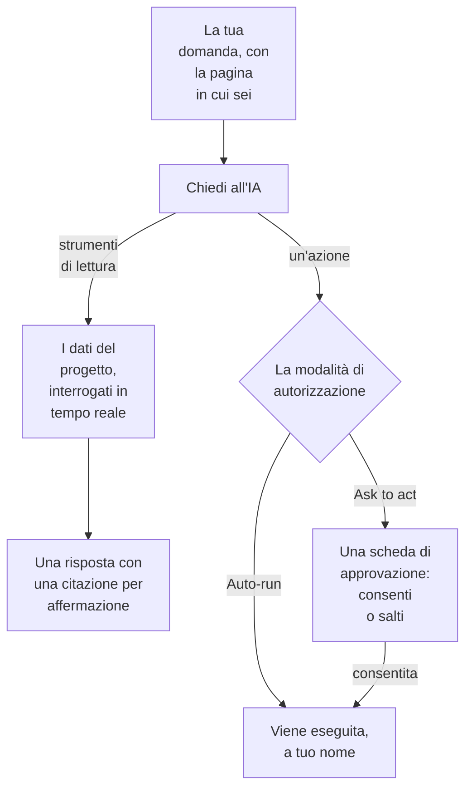

# Chiedi all'IA

Chiedi all'IA è la chat di OneUptime sui dati del tuo progetto. Chiedile di log, tracce, metriche, eccezioni, incidenti, avvisi, monitor, reperibilità, pagine di stato, SLO, runbook o flussi di lavoro: interroga il progetto in tempo reale, accompagna ogni affermazione con una citazione e, quando glielo permetti, agisce per te.

:::cards
- [Aprire Chiedi all'IA](#aprire-chiedi-allia): Dall'intestazione, dalla tastiera, da un grafico o dal menu dei prodotti.
- [Cosa può vedere](#cosa-può-vedere): I dati che legge per risponderti.
- [Azioni e modalità di autorizzazione](#azioni-e-modalità-di-autorizzazione): Scegli se può agire e quando chiede prima.
- [Le azioni sono fatte a tuo nome](#le-azioni-sono-fatte-a-tuo-nome): I tuoi permessi, il tuo nome su ogni modifica.
:::

## Come risponde Chiedi all'IA

Chiedi all'IA risponde solo con ciò che restituiscono i suoi strumenti: esegue query sul tuo progetto invece di rispondere a memoria. Ogni fatto di una risposta ha un chip di citazione che mostra la query alla base e apre i dati letti. Quando le chiedi di cambiare qualcosa, la modalità di autorizzazione della conversazione decide se ti chiede prima. Prima della tua domanda, legge il [contesto IA](/docs/ai/ai-context) del progetto: ciò che il tuo team ha scritto per OneUptime AI sui vostri sistemi.

In modalità **Sola lettura** le azioni non vengono mai offerte al modello, quindi la conversazione si limita a leggere.

## Domande su OneUptime

Chiedi all'IA risponde anche a domande su OneUptime stesso: «Come ricevo un SMS quando il mio sito va giù?», «Che cos'è un episodio?», «Dove aggiungo un secondo numero di telefono?». Risponde da questa documentazione, la copia servita dal tuo OneUptime: funziona senza accesso a Internet e non invia nulla in posti nuovi. Legge una pagina nella tua lingua quando è tradotta, cita pagina e sezione per ogni passaggio e, invece di tirare a indovinare, dice quando la documentazione non tratta qualcosa.

Una risposta a un «come faccio» termina con un pulsante che apre la pagina del tuo progetto in cui lo fai, come **Crea monitor** o **Metodi di notifica**. Apre solo pagine che OneUptime ha: quelle che trova la ricerca (`Ctrl` + `K`).

## Aprire Chiedi all'IA

| Dove | Come |
| --- | --- |
| Qualsiasi pagina | Fai clic su **Chiedi all'IA** nell'intestazione, oppure premi `Ctrl` + `I` (`Cmd` + `I` su un Mac). Mentre scrivi in una casella di testo o in un editor, quei tasti restano la scorciatoia del corsivo dell'editor. |
| La palette dei comandi | Premi `Ctrl` + `K` (`Cmd` + `K` su un Mac) e scegli **Chiedi all'IA**. |
| Un pattern di errore dei log, o i risultati di un grafico | Fai clic su **Spiega con l'IA**: Chiedi all'IA si apre con le prove sotto forma di domanda che puoi modificare prima di inviarla. |
| Il menu dei prodotti | Apri **Prodotti → IA → Chat**. Chiedi all'IA si apre accanto alla pagina in cui eri. Ogni conversazione ha un proprio indirizzo, così puoi salvarla nei preferiti e tornarci. |

Chiedi all'IA si apre sul lato della finestra, e la pagina gli fa spazio: dietro non resta nascosto nulla, così puoi continuare a lavorare sulla pagina, passare ad altre pagine e chiedere di nuovo. Trascina il bordo per allargarlo o restringerlo. Premi `Esc` al suo interno, o fai di nuovo clic su **Chiedi all'IA**, per restituire alla pagina tutta la finestra. Quando è aperto, `Ctrl` + `I` (`Cmd` + `I` su un Mac) passa dalla pagina alla casella in cui scrivi, e da lì lo chiude. La conversazione resta dove l'hai lasciata: riapri Chiedi all'IA per continuare. Se la chiudi mentre sta ancora rispondendo, un promemoria nell'angolo ti dice quando la risposta è pronta, e la apre. Su un tablet o un telefono, dove non c'è spazio per entrambi, si apre sopra la pagina, e su un telefono occupa tutto lo schermo.

Su un incidente o un avviso, la scheda **OneUptime AI** ha una conversazione tutta sua, **Chiedi a OneUptime AI**, condivisa con chiunque possa vedere quell'incidente o quell'avviso: vedi [Parlare dell'incidente con OneUptime AI](/docs/ai/ai-sre#parla-con-oneuptime-ai-dellincidente).

## Cosa può vedere

Chiedi all'IA legge il progetto con i tuoi permessi, quindi vede ciò che puoi vedere tu e niente di più.

| Area | Cosa legge Chiedi all'IA |
| --- | --- |
| Telemetria | Ricerca e istogrammi dei log, aggregazioni di tracce e alberi di span, metriche, eccezioni, eventi di sicurezza, real user monitoring e Web Vitals, modifiche recenti e controlli delle anomalie rispetto a baseline apprese. |
| Infrastruttura | Host, Docker, Podman, Kubernetes, Docker Swarm, Proxmox, VMware vCenter, Ceph, array di storage, funzioni serverless, ambienti cloud, flotte IoT e dispositivi di rete: cosa c'è nell'inventario, lo stato di connessione segnalato, le tendenze delle metriche, il numero di log per gravità e i riepiloghi delle operazioni delle tracce. Una query copre sia la telemetria che nomina un servizio sia quella che nomina una risorsa di infrastruttura. |
| Risposta agli incidenti | Incidenti e avvisi, con filtri di stato ("cosa è attivo adesso?"), le loro cronologie di attività (cambi di stato, note interne e pubbliche, il feed) e i proprietari, e una ricerca negli incidenti passati per riutilizzare come sono stati risolti. |
| Reperibilità | Chi è reperibile adesso, le policy e le catene di escalation, e se le chiamate recenti sono state recapitate e confermate. |
| Il lavoro dell'IA stessa | I risultati delle indagini di AI SRE e di AI Insights, così "cosa ha trovato l'IA?" ha risposta dall'analisi pubblicata invece di essere ricostruito da capo. |
| Piattaforma | Monitor (con filtri di stato), manutenzione programmata, pagine di stato e i loro annunci, SLO, runbook, esecuzioni dei flussi di lavoro, salute delle sonde, team e il codice dei repository collegati su GitHub, GitLab, Forgejo, Gitea e Azure DevOps (vedi [Cosa legge l'IA in un repository Git](/docs/ai/ai-agent#cosa-legge-lia-in-un-repository-git)). |

## Contesto della pagina

Chiedi all'IA sa da quale pagina l'hai aperta. Sulla pagina di un incidente, "perché è successo?" significa quell'incidente: l'area di scrittura mostra un chip con l'oggetto della pagina, e le domande che suggerisce sono quelle di quella pagina. Rimuovi il chip per chiedere di tutto il progetto, e rimettilo allo stesso modo. Apri Chiedi all'IA su un'altra pagina e il contesto ti segue. La conversazione ricorda anche il suo primo oggetto sul server, così una domanda di giorni dopo capisce ancora "questo incidente".

Su un incidente, un avviso, un monitor o un evento di manutenzione, le domande seguono anche lo stato di quel record, letto ogni volta che Chiedi all'IA si apre su di esso. Un incidente risolto chiede com'è andata la risposta e cosa impedirebbe che si ripeta, un avviso risolto se era un problema reale e quanto spesso scattano avvisi come quello, e un monitor non operativo chiede perché. Un evento di manutenzione non ancora iniziato chiede se i suoi monitor sono sani prima che inizi, e uno terminato se sono tornati alla normalità.

Gli elenchi dell'infrastruttura e le pagine delle risorse propongono domande per il tipo di risorsa che stai guardando. Apri un cluster Kubernetes e chiedi "Quali metriche sono cambiate nelle ultime 24 ore?", oppure apri un host Docker e chiedi "Riassumi la gravità dei log e gli errori delle tracce delle ultime sei ore." I link alle prove riportano alla pagina della risorsa. Le letture rispettano i tuoi permessi su progetto, risorse e telemetria, comprese le restrizioni per proprietario ed etichette.

Sulla pagina di un elemento figlio, il contesto registra anche il pod, il container, la VM, il processo o l'altro elemento che hai selezionato. Gli strumenti dell'infrastruttura leggono la telemetria della risorsa padre; non possono misurare un elemento figlio dal solo nome. Chiedi all'IA lo dice, e non indovina un namespace Kubernetes che la pagina non indica. Uno stato di connessione non è la salute di un carico di lavoro, e la telemetria mancante non significa che una risorsa stia bene.

## Comandi sulla tua infrastruttura

Aperto sulla pagina di una risorsa il cui agente IA è connesso (un host, un host Docker o Podman, un cluster Docker Swarm, un cluster Proxmox, un VMware vCenter, un cluster Ceph, un server di database o un cluster Kubernetes), Chiedi all'IA vi esegue comandi tramite quell'agente quando lo chiedi: "esegui `uptime` su questo host" oppure "mostra le ultime 100 righe di `journalctl -u nginx`". Risponde con ciò che è tornato, citato come qualsiasi altra prova. Aperto su un incidente o un avviso, raggiunge le risorse collegate.

- Esegue solo i comandi in sola lettura che un'indagine IA può eseguire su quel tipo di risorsa (vedi [Agenti IA per l'infrastruttura](/docs/ai/infrastructure-ai-agents)), quanti ne servono alla risposta, controllati da OneUptime e di nuovo dall'agente, in ogni modalità di autorizzazione. Una modifica tramite l'agente, come il riavvio di un servizio, non viene mai eseguita da Chiedi all'IA: ti dà invece il comando esatto, e l'agente apporta modifiche solo quando OneUptime AI risolve un incidente o un avviso, secondo le impostazioni delle correzioni della risorsa stessa. Le azioni proprie di Chiedi all'IA, come l'esecuzione di un runbook, seguono la modalità di autorizzazione della conversazione, descritta più sotto.
- Raggiunge solo le risorse che puoi vedere, e solo finché l'indagine IA è attiva per la risorsa.
- Quando non può eseguire un comando lì (nessun agente è connesso, l'agente è offline o l'indagine IA è disattivata per la risorsa), lo dice, insieme a cosa cambiare, e risponde invece con i dati del tuo progetto.

## Azioni e modalità di autorizzazione

Ogni conversazione ha una modalità di autorizzazione, che scegli nell'area di scrittura, accanto alla casella in cui scrivi:

| Modalità | Cosa succede |
| --- | --- |
| **Chiedi prima di agire** | La predefinita. Chiedi all'IA propone ogni azione su una scheda di approvazione, e nulla viene eseguito finché non scegli **Consenti** o **Salta** per quell'azione, oppure **Nega tutto**. |
| **Esecuzione automatica** | Le azioni vengono eseguite appena il modello le chiede, sempre entro i limiti del tuo ruolo. Usala con cautela. |
| **Sola lettura** | Le azioni non vengono offerte al modello: Chiedi all'IA può solo leggere. |

Cosa può fare Chiedi all'IA quando una modalità lo consente:

- Creare un incidente o un avviso, confermare o risolvere incidenti e avvisi, e cambiare la gravità di un incidente.
- Collegare un incidente o un avviso all'infrastruttura e ai servizi a cui si riferisce. Un incidente o un avviso che crea nella pagina di una risorsa, come quella di un host, viene collegato a quella risorsa, e la scheda di approvazione indica cosa collega ogni azione. OneUptime AI indaga e corregge ciò a cui un incidente o un avviso è collegato.
- Registrare un problema di cui qualcuno si sta già occupando, o che è già finito: un incidente o un avviso che crea può partire già riconosciuto o risolto, e allora non chiama nessuno. La scheda di approvazione dice quale dei due. Vedi [Dichiarato già riconosciuto o risolto](/docs/incidents/declaring-incidents#dichiarato-già-riconosciuto-o-risolto).
- Pubblicare una nota interna su un incidente o un avviso. Le note interne non compaiono mai su una pagina di stato.
- Pubblicare un aggiornamento di stato pubblico su un incidente. È un'azione a parte, perché avvisa gli iscritti alla pagina di stato.
- Chiamare una policy di reperibilità, eseguire un runbook o avviare un'indagine IA su un incidente o un avviso.
- Impostare tutto a partire da una frase: un monitor di sito web o di API, chi viene chiamato, una pagina di stato e i monitor che mostra, tutto su un'unica scheda di approvazione. Vedi [Impostare tutto](#impostare-tutto).
- Proporre una modifica al codice: fare un commit su un nuovo branch di un repository su GitHub, GitLab, Forgejo o Gitea e aprire una pull request (una merge request su GitLab). Non scrive mai sul branch predefinito né su uno protetto, quindi è sempre una persona a fare il merge della modifica. Ask AI scrive ogni file per intero, partendo dal file com'era quando lo ha letto l'ultima volta, e legge il branch principale di un repository, a meno che non gliene venga chiesto un altro. Se un file è cambiato sul branch dopo che Ask AI lo ha letto, la scheda lo nomina prima che tu approvi il commit o la pull request, per esempio "Questo file è cambiato su fix/login dopo che l'IA l'ha letto, e la versione dell'IA annulla quella modifica: src/billing/charge.ts." La scheda nomina anche un file che Ask AI ha letto solo su un altro branch, dove è diverso, un file che Ask AI non ha mai letto ma sostituisce, e un file che OneUptime non è riuscito a controllare. Ask AI legge un file lungo un pezzo alla volta, quindi la scheda nomina anche un file di cui Ask AI ha letto solo una parte, per esempio "L'IA ha letto solo una parte di questo file, e la sua versione lo sostituisce per intero: src/billing/charge.ts." Quando Ask AI ha letto tutto il file, in una lettura o in più, la scheda non ne dice nulla. Una risposta successiva ha le parole delle precedenti, non i file che hanno letto, quindi la scheda nomina anche un file che Ask AI ha letto solo in una risposta precedente, per esempio "L'IA ha letto questo file in una risposta precedente e non ne ha più il testo, e la sua versione lo sostituisce per intero: src/billing/charge.ts." Una risposta molto lunga lascia fuori anche i suoi risultati più vecchi, per restare entro ciò che il modello può considerare in una volta, quindi la scheda nomina anche un file che Ask AI ha letto in precedenza nella stessa risposta se quel risultato è stato lasciato fuori, per esempio "L'IA ha letto questo file in precedenza in questa risposta e non ne ha più il testo, e la sua versione lo sostituisce per intero: src/billing/charge.ts." Se Ask AI ha letto il file in più parti e non le ha più tutte, la scheda lo dice, per esempio "L'IA ha letto questo file e non ne ha più una parte del testo, e la sua versione lo sostituisce per intero: src/billing/charge.ts." Quando Ask AI rilegge il file nella risposta che lo modifica, la scheda non ne dice nulla. Un file nuovo non conta mai. Per mantenere ciò che ha cambiato qualcun altro, salta l'azione e chiedi ad Ask AI di rileggere i file. In Esecuzione automatica, dove nessuno approva le azioni, Ask AI non fa una modifica del genere: rilegge i file e fa la sua modifica su di essi come sono ora. Se un file cambia mentre la scheda ti aspetta, approvarla non cambia nulla, e Ask AI propone di nuovo la modifica. Una pull request che approvi comunque elenca quei file nella sua descrizione, per chi la revisiona. Ad Ask AI non vengono mai mostrati i valori che sembrano segreti o dati personali, come indirizzi IP, indirizzi email e chiavi: al loro posto legge un segnaposto come `[redacted-ip]`. Per questo la scheda nomina anche un file in cui la versione di Ask AI scrive segnaposto del genere, per esempio "Alcuni valori che sembrano segreti o dati personali sono stati nascosti all'IA, e la sua versione di questo file scrive dei segnaposto al loro posto: config/servers.ts." Un segnaposto che il file sul branch contiene già non conta. Ask AI non può riscrivere quei valori, quindi in Esecuzione automatica non fa quella modifica e ti dice invece cosa cambiare.

Chiedi un incidente quando gli utenti sono colpiti, e un avviso quando qualcosa richiede prima l'attenzione del tuo team, come la memoria di un host che continua a salire. Entrambi vengono creati una volta e non sorvegliano nulla: per essere avvisato ogni volta che la memoria di un host supera il 75%, crea un [monitor host](/docs/monitor/host-monitor#modelli-di-avviso-pronti) dal suo modello per la memoria, con il 75% come soglia. Chiedi all'IA imposta solo monitor di siti web e di API (vedi [Impostare tutto](#impostare-tutto)). Se gliene chiedi di un altro tipo, lo dice, controlla il valore attuale e propone di creare un avviso se è già oltre.

## Le azioni sono fatte a tuo nome

Ogni azione di Chiedi all'IA è fatta a tuo nome: fa la stessa modifica che fa la dashboard per la stessa azione, con i tuoi permessi nel progetto, e la modifica viene attribuita a te. Confermare un incidente dalla chat crea lo stesso cambio di stato del pannello di stato dell'incidente, quindi la cronologia e il feed dell'incidente mostrano che sei stato tu a cambiarne lo stato. Una chiamata inviata dalla chat ti mostra come chi l'ha avviata.

- **Cosa serve a ogni azione.** Il permesso che la dashboard chiede per la stessa modifica. Creare un incidente o un avviso richiede il permesso di crearli: un ruolo che possa farlo, oppure **Create Incident** o **Create Alert** in un ruolo personalizzato. Confermare o risolvere un incidente richiede il permesso di cambiarne lo stato: **Proprietario del progetto**, **Amministratore del progetto**, **Membro del progetto**, **Amministratore degli incidenti** e **Membro degli incidenti**, oppure **Create Incident State Timeline** in un ruolo personalizzato; un avviso richiede lo stesso permesso per gli avvisi (**Create Alert State Timeline**). Creare un incidente o un avviso che parte già riconosciuto o risolto richiede entrambi: il permesso di crearlo e il permesso di cambiarne lo stato. Chiamare una policy di reperibilità richiede il permesso di eseguirla (**Execute On-Call Policies**), ed eseguire un runbook richiede il permesso di avviare esecuzioni di runbook: un ruolo che esegue runbook, per i runbook raggiunti dalle sue etichette, oppure **Create Runbook Execution** in un ruolo personalizzato, che raggiunge ogni runbook del progetto. Cambiare la gravità di un incidente, avviare un'indagine IA su un incidente o un avviso e scrivere codice in un repository collegato richiedono il permesso di modificare quell'incidente, avviso o repository. Un'azione che non puoi fare viene rifiutata, e l'IA ti dice quale permesso serve. Se hai il permesso ma un team di cui fai parte lo blocca, l'IA te lo dice: un blocco su alcune etichette rifiuta quell'azione in Chiedi all'IA per ogni record, non solo per i record con quelle etichette.
- **Quali record.** Quelli che puoi modificare, come in tutto OneUptime: con un ruolo limitato ad alcune etichette, o ai record di cui sei proprietario, un'azione su qualsiasi altro record non cambia nulla. Un runbook viene eseguito solo quando il tuo permesso di avviare esecuzioni di runbook lo raggiunge. Su OneUptime Cloud, un'azione che il piano del progetto non include viene rifiutata indicando il piano necessario.
- **Quando un'azione viene rifiutata.** Non cambia nulla, e l'IA ti dice chiaramente che l'azione non è stata eseguita, e perché, invece di riprovarla. Tra i passaggi della risposta, quello dell'azione dice che non è stata eseguita, e perché: il tuo ruolo non lo consente, un team di cui fai parte lo blocca, oppure il piano del progetto non lo include.
- **Slack, Microsoft Teams e le indagini IA.** Le risposte dell'IA in Slack e Microsoft Teams, e le indagini IA autonome, si limitano a leggere: non fanno nessuna di queste azioni. Se le chiedi una modifica, l'IA ti dice come farla dalla chat: `/oneuptime incident` dichiara un incidente, `/oneuptime incident 42` mostra l'incidente 42 con i suoi pulsanti, `/oneuptime page` chiama qualcuno (in Microsoft Teams, le stesse parole scritte al bot di OneUptime), e i pulsanti dei messaggi di OneUptime agiscono anch'essi a tuo nome (vedi [Slack](/docs/workspace-connections/slack#agire-su-incidenti-avvisi-ed-eventi-da-slack) e [Microsoft Teams](/docs/workspace-connections/microsoft-teams#agire-su-incidenti-avvisi-ed-eventi-da-microsoft-teams)). Per qualsiasi altra modifica, rimanda con un link a Chiedi all'IA, che propone la modifica perché tu la approvi. Se chiedi nel canale di un incidente o di un avviso, intende quell'incidente o quell'avviso.

## Impostare tutto

Chiedi all'IA imposta, a partire da una frase, ciò che impostano le configurazioni guidate: «Monitora example.com ogni minuto e mandami un SMS se va giù».

- **Un piano, un'approvazione.** Chiedi all'IA propone ogni parte su un'unica scheda di approvazione, ciascuna in parole semplici: un monitor di sito web o di API, la prima policy di reperibilità del progetto, una pagina di stato e i monitor che mostra. La scheda termina con «Non cambia nient'altro.». Scegli **Salta** su qualsiasi parte che non vuoi ed esegui il resto. Prima non viene creato nulla.
- **Chiede sempre.** L'impostazione attende la tua approvazione in ogni modalità, **Esecuzione automatica** compresa, perché crea cose che chiamano le persone e che vedono i tuoi clienti. **Sola lettura** non la offre.
- **I record delle configurazioni guidate.** Il monitor è quello che **Sapere quando il mio sito web o la mia API non funziona** crea per lo stesso indirizzo: i valori predefiniti di Crea monitor, che apre un incidente quando l'indirizzo non risponde o risponde con un errore, controllato ogni 5 minuti a meno che tu non chieda un altro degli intervalli di Crea monitor. È tuo, quindi ricevi un'email quando il suo stato cambia. La pagina di stato è quella che **Pubblica una pagina di stato** crea: pubblica non appena viene creata, mostra lo stato, la disponibilità e lo storico di ogni monitor.
- **Chi viene chiamato.** In un progetto che non chiama ancora nessuno, Chiedi all'IA propone la prima policy di reperibilità del progetto, «Default on-call policy», che chiama te, e i membri e i team che indichi, per ogni nuovo incidente e ogni nuovo avviso. Un progetto che chiama già delle persone mantiene le proprie policy e regole di reperibilità, e Chiedi all'IA lo dice invece di crearne un'altra.
- **Cosa manca.** Chiedi all'IA non aggiunge mai un numero di telefono né l'app mobile: li aggiungi e li verifichi tu in **Impostazioni utente → Metodi di notifica**. Se chiedi di ricevere SMS senza un numero verificato, la scheda lo dice e la risposta collega la pagina. Una parte che Chiedi all'IA non può creare non viene proposta, ad esempio quando il tuo ruolo non lo consente, l'indirizzo non è un indirizzo o i monitor non esistono: la risposta dice cosa serve.
- **Cosa serve a ogni parte.** Un monitor richiede il permesso di creare monitor. Le chiamate richiedono il permesso di creare policy di reperibilità, le loro regole di escalation e regole di reperibilità per incidenti e avvisi. Una pagina di stato richiede il permesso di creare pagine di stato e di aggiungervi monitor. Valgono i limiti del piano del progetto, come nelle configurazioni guidate.
- **Poi provalo.** Quando il piano è stato eseguito, ogni scheda apre ciò che è stato creato, e **Testa questa policy** (o **Inviami una chiamata di test**, per un monitor da solo) sotto la risposta invia una chiamata di test che confermi dal messaggio. Se una parte non riesce, la risposta dice cosa è stato creato e cosa no.
- **Chi viene avvisato.** Chiedi «chi viene avvisato quando example.com va giù?» e Chiedi all'IA risponde dalla stessa catena che mostra la pagina del monitor, indicando ogni interruzione.

## Guidare una conversazione

- **Fermala.** Mentre Chiedi all'IA lavora, il pulsante di invio diventa un pulsante di arresto. Ferma un'esecuzione in qualsiasi momento e chiedi subito altro.
- **Segui il suo lavoro.** Mentre risponde, una riga dice cosa sta facendo ora, per esempio cercare nei log. Fai clic sul numero di passaggi accanto per vedere ogni passaggio.
- **Scegli il modello.** Quando il progetto può usare più di un provider LLM, il selettore del provider nell'area di scrittura elenca i provider LLM del progetto e quelli globali, con il predefinito contrassegnato. Una nuova conversazione usa il predefinito.
- **Valuta una risposta.** **Buona risposta** e **Risposta scarsa** vengono salvati con il messaggio, così la qualità delle risposte si può misurare nel tempo.
- **Guarda il costo.** Sotto ogni risposta, le sue fonti si aprono sulle query che ha eseguito, e quelle della risposta più recente dicono anche quante query ha eseguito, i token e il costo. Ogni chip di citazione in una risposta apre i dati alla base.
- **Tieni una copia.** **Scarica conversazione** salva il thread con **Scarica come Markdown**, da leggere o incollare in un ticket, oppure con **Scarica come PDF**, da consegnare a qualcuno.
- **Riprendi da dove avevi lasciato.** **Tutte le conversazioni**, nell'intestazione di Chiedi all'IA, elenca le tue conversazioni, dalla più recente, per riaprirle o eliminarle. L'inizio di una nuova conversazione mostra le ultime tre.

## Requisiti

- **Un provider LLM.** Chiedi all'IA usa il provider LLM predefinito del progetto (vedi [Provider LLM](/docs/ai/llm-provider)). Su OneUptime Cloud funziona subito con il provider globale, pagato con i crediti IA del progetto; un'installazione self-hosted configura un provider, oppure le variabili d'ambiente del provider globale. Le risposte sono buone quanto il modello: un piccolo modello self-hosted senza chiamate agli strumenti affidabili risponde male.
- **Il piano Growth, su OneUptime Cloud.** Un progetto con un piano inferiore vede che l'IA non è inclusa nel suo piano, con un link a **Impostazioni del progetto → Fatturazione e fatture → Fatturazione**.
- **L'IA attiva per il progetto.** **Abilita IA**, in **Impostazioni del progetto → IA → Funzionalità IA**, spegne ogni funzione IA del progetto, Chiedi all'IA compresa. È attiva a meno che qualcuno non l'abbia spenta.

Chiedi all'IA conta nei limiti giornalieri di IA del progetto quando il progetto li imposta (Impostazioni del progetto → IA → AI Features → Altre impostazioni): quando uno viene raggiunto, Chiedi all'IA mostra una frase che dice quale limite è stato raggiunto, che OneUptime AI riparte a mezzanotte UTC e chi può alzare o rimuovere il limite. I proprietari del progetto ricevono un'email la prima volta che un limite viene raggiunto ogni giorno. I limiti giornalieri di incidenti e avvisi non fermano mai Chiedi all'IA. Vedi [i limiti giornalieri del progetto](/docs/ai/ai-sre#i-limiti-giornalieri-del-progetto-stesso).

## Risoluzione dei problemi

:::details Chiedi all'IA dice che l'IA non è disponibile
Chiedi all'IA dice il motivo prima che tu scriva: il piano del progetto non include l'IA, **Abilita IA** è spenta, oppure il progetto non ha un provider LLM. Ogni avviso rimanda alla pagina in cui si cambia.
:::

:::details Un'azione è stata rifiutata
Chiedi all'IA dice quale permesso serve all'azione, o quale team la blocca. Chiedi a qualcuno che può fare la modifica, oppure chiedi a un proprietario del progetto di dare il permesso al tuo ruolo. Non è stato cambiato nulla.
:::

:::details Le risposte sono vaghe o non usano mai dati
Controlla il modello dietro il provider. Chiedi all'IA ha bisogno di un modello che chiami gli strumenti in modo affidabile; i piccoli modelli locali spesso rispondono senza eseguire nemmeno una query. Vedi [Provider LLM](/docs/ai/llm-provider).
:::

## Prossimi passi

:::cards
- [AI SRE](/docs/ai/ai-sre): Lascia che OneUptime AI indaghi su ogni nuovo incidente e avviso.
- [Provider LLM](/docs/ai/llm-provider): Scegli il modello usato da Chiedi all'IA e dalle altre funzioni IA.
- [Server MCP](/docs/ai/mcp-server): Chiedi di OneUptime da Claude, Cursor o VS Code.
:::
