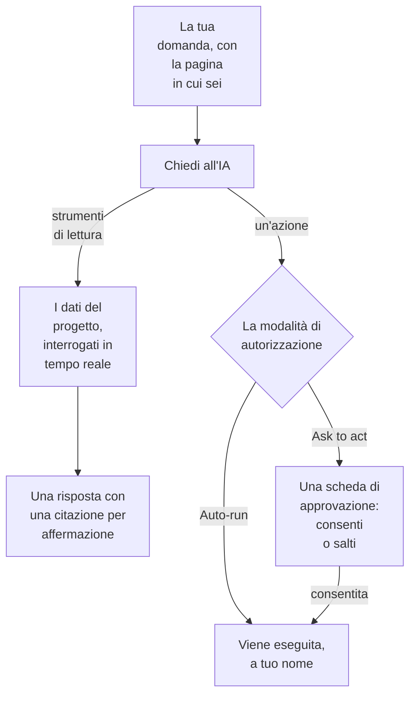

# Chiedi all'IA

Chiedi all'IA è la chat di OneUptime sui dati del tuo progetto. Chiedile di log, tracce, metriche, eccezioni, incidenti, avvisi, monitor, reperibilità, pagine di stato, SLO, runbook o flussi di lavoro: interroga il progetto in tempo reale, accompagna ogni affermazione con una citazione e, quando glielo permetti, agisce per te.

:::cards
- [Aprire Chiedi all'IA](#aprire-chiedi-allia): Dall'intestazione, dalla tastiera, da un grafico o dalla sua pagina.
- [Cosa può vedere](#cosa-può-vedere): I dati che legge per risponderti.
- [Azioni e modalità di autorizzazione](#azioni-e-modalità-di-autorizzazione): Scegli se può agire e quando chiede prima.
- [Le azioni sono fatte a tuo nome](#le-azioni-sono-fatte-a-tuo-nome): I tuoi permessi, il tuo nome su ogni modifica.
:::

## Come risponde Chiedi all'IA

Chiedi all'IA risponde solo con ciò che restituiscono i suoi strumenti: esegue query sul tuo progetto invece di rispondere a memoria. Ogni fatto di una risposta ha un chip di citazione che mostra la query alla base e apre i dati letti. Quando le chiedi di cambiare qualcosa, la modalità di autorizzazione della conversazione decide se ti chiede prima. Prima della tua domanda, legge il [contesto IA](/docs/ai/ai-context) del progetto: ciò che il tuo team ha scritto per OneUptime AI sui vostri sistemi.

In modalità **Sola lettura** le azioni non vengono mai offerte al modello, quindi la conversazione si limita a leggere.

## Aprire Chiedi all'IA

| Dove | Come |
| --- | --- |
| Qualsiasi pagina | Fai clic su **Ask AI** nell'intestazione, oppure premi `Ctrl` + `I` (`Cmd` + `I` su un Mac). Mentre scrivi in una casella di testo o in un editor, quei tasti restano la scorciatoia del corsivo dell'editor. |
| La palette dei comandi | Premi `Ctrl` + `K` (`Cmd` + `K` su un Mac) e scegli **Ask AI**. |
| Un pattern di errore dei log, o i risultati di un grafico | Fai clic su **Explain with AI**: Chiedi all'IA si apre con le prove sotto forma di domanda che puoi modificare prima di inviarla. |
| La sua pagina | Apri **Prodotti → AI → Chat** per uno spazio di lavoro a pagina intera. Lì ogni conversazione ha un proprio indirizzo, così puoi salvare un thread nei preferiti o incollarlo nel canale di un incidente. |

Su un incidente o un avviso, la scheda **AI Investigation** ha una conversazione tutta sua, **Ask OneUptime AI**, condivisa con chiunque possa vedere quell'incidente o quell'avviso: vedi [Parlare dell'incidente con OneUptime AI](/docs/ai/ai-sre#parla-con-oneuptime-ai-dellincidente).

## Cosa può vedere

Chiedi all'IA legge il progetto con i tuoi permessi, quindi vede ciò che puoi vedere tu e niente di più.

| Area | Cosa legge Chiedi all'IA |
| --- | --- |
| Telemetria | Ricerca e istogrammi dei log, aggregazioni di tracce e alberi di span, metriche, eccezioni, eventi di sicurezza, real user monitoring e Web Vitals, modifiche recenti e controlli delle anomalie rispetto a baseline apprese. |
| Infrastruttura | Host, Docker, Podman, Kubernetes, Docker Swarm, Proxmox, VMware vCenter, Ceph, array di storage, funzioni serverless, ambienti cloud, flotte IoT e dispositivi di rete: cosa c'è nell'inventario, lo stato di connessione segnalato, le tendenze delle metriche, il numero di log per gravità e i riepiloghi delle operazioni delle tracce. Una query copre sia la telemetria che nomina un servizio sia quella che nomina una risorsa di infrastruttura. |
| Risposta agli incidenti | Incidenti e avvisi, con filtri di stato ("cosa è attivo adesso?"), le loro cronologie di attività (cambi di stato, note interne e pubbliche, il feed) e i proprietari, e una ricerca negli incidenti passati per riutilizzare come sono stati risolti. |
| Reperibilità | Chi è reperibile adesso, le policy e le catene di escalation, e se le chiamate recenti sono state recapitate e confermate. |
| Il lavoro dell'IA stessa | I risultati delle indagini di AI SRE e di AI Insights, così "cosa ha trovato l'IA?" ha risposta dall'analisi pubblicata invece di essere ricostruito da capo. |
| Piattaforma | Monitor (con filtri di stato), manutenzione programmata, pagine di stato e i loro annunci, SLO, runbook, esecuzioni dei flussi di lavoro, salute delle sonde, team e il codice dei repository collegati. |

## Contesto della pagina

Chiedi all'IA sa da quale pagina l'hai aperta. Sulla pagina di un incidente, "perché è successo?" significa quell'incidente, e l'area di scrittura mostra un chip con l'oggetto della pagina; rimuovilo per chiedere di tutto il progetto. Se passi a un'altra pagina con il pannello aperto, il contesto ti segue. La conversazione ricorda anche il suo primo oggetto sul server, così una domanda di giorni dopo capisce ancora "questo incidente".

Gli elenchi dell'infrastruttura e le pagine delle risorse propongono domande per il tipo di risorsa che stai guardando. Apri un cluster Kubernetes e chiedi "Quali metriche sono cambiate nelle ultime 24 ore?", oppure apri un host Docker e chiedi "Riassumi la gravità dei log e gli errori delle tracce delle ultime sei ore." I link alle prove riportano alla pagina della risorsa. Le letture rispettano i tuoi permessi su progetto, risorse e telemetria, comprese le restrizioni per proprietario ed etichette.

Sulla pagina di un elemento figlio, il contesto registra anche il pod, il container, la VM, il processo o l'altro elemento che hai selezionato. Gli strumenti dell'infrastruttura leggono la telemetria della risorsa padre; non possono misurare un elemento figlio dal solo nome. Chiedi all'IA lo dice, e non indovina un namespace Kubernetes che la pagina non indica. Uno stato di connessione non è la salute di un carico di lavoro, e la telemetria mancante non significa che una risorsa stia bene.

## Comandi sulla tua infrastruttura

Aperto sulla pagina di una risorsa il cui agente IA è connesso (un host, un host Docker o Podman, un cluster Docker Swarm, un cluster Proxmox, un VMware vCenter, un cluster Ceph, un server di database o un cluster Kubernetes), Chiedi all'IA vi esegue comandi tramite quell'agente quando lo chiedi: "esegui `uptime` su questo host" oppure "mostra le ultime 100 righe di `journalctl -u nginx`". Risponde con ciò che è tornato, citato come qualsiasi altra prova. Aperto su un incidente o un avviso, raggiunge le risorse collegate.

- Esegue solo i comandi in sola lettura che un'indagine IA può eseguire su quel tipo di risorsa (vedi [Agenti IA per l'infrastruttura](/docs/ai/infrastructure-ai-agents)), al massimo 30 per una risposta tramite ogni tipo di agente, controllati da OneUptime e di nuovo dall'agente, in ogni modalità di autorizzazione. Una modifica tramite l'agente, come il riavvio di un servizio, non viene mai eseguita da Chiedi all'IA: ti dà invece il comando esatto, e l'agente apporta modifiche solo quando OneUptime AI risolve un incidente o un avviso, secondo le impostazioni delle correzioni della risorsa stessa. Le azioni proprie di Chiedi all'IA, come l'esecuzione di un runbook, seguono la modalità di autorizzazione della conversazione, descritta più sotto.
- Raggiunge solo le risorse che puoi vedere, e solo finché l'indagine IA è attiva per la risorsa.
- Quando non può eseguire un comando lì (nessun agente è connesso, l'agente è offline o l'indagine IA è disattivata per la risorsa), lo dice, insieme a cosa cambiare, e risponde invece con i dati del tuo progetto.

## Azioni e modalità di autorizzazione

Ogni conversazione ha una modalità di autorizzazione, che scegli nell'area di scrittura, accanto alla casella in cui scrivi:

| Modalità | Cosa succede |
| --- | --- |
| **Ask to act** | La predefinita. Chiedi all'IA propone ogni azione su una scheda di approvazione, e nulla viene eseguito finché non scegli **Allow** o **Salta** per quell'azione, oppure **Deny all**. |
| **Auto-run** | Le azioni vengono eseguite appena il modello le chiede, sempre entro i limiti del tuo ruolo. Usala con cautela. |
| **Sola lettura** | Le azioni non vengono offerte al modello: Chiedi all'IA può solo leggere. |

Cosa può fare Chiedi all'IA quando una modalità lo consente:

- Creare un incidente, confermare o risolvere incidenti e avvisi, e cambiare la gravità di un incidente.
- Pubblicare una nota interna su un incidente o un avviso. Le note interne non compaiono mai su una pagina di stato.
- Pubblicare un aggiornamento di stato pubblico su un incidente. È un'azione a parte, perché avvisa gli iscritti alla pagina di stato.
- Chiamare una policy di reperibilità, eseguire un runbook o avviare un'indagine IA su un incidente o un avviso.
- Proporre una modifica al codice: fare un commit su un nuovo branch di un repository collegato e aprire una pull request. Non scrive mai sul branch predefinito né su uno protetto, quindi è sempre una persona a fare il merge della modifica.

## Le azioni sono fatte a tuo nome

Ogni azione di Chiedi all'IA è fatta a tuo nome: fa la stessa modifica che fa la dashboard per la stessa azione, con i tuoi permessi nel progetto, e la modifica viene attribuita a te. Confermare un incidente dalla chat crea lo stesso cambio di stato del pannello di stato dell'incidente, quindi la cronologia e il feed dell'incidente mostrano che sei stato tu a cambiarne lo stato. Una chiamata inviata dalla chat ti mostra come chi l'ha avviata.

- **Cosa serve a ogni azione.** Il permesso che la dashboard chiede per la stessa modifica. Confermare o risolvere un incidente richiede il permesso di cambiarne lo stato: **Project Owner**, **Project Admin**, **Project Member**, **Incident Admin** e **Incident Member**, oppure **Create Incident State Timeline** in un ruolo personalizzato; un avviso richiede lo stesso permesso per gli avvisi (**Create Alert State Timeline**). Chiamare una policy di reperibilità richiede il permesso di eseguirla (**Create On-Call Duty Policy Execution Log**), ed eseguire un runbook richiede il permesso di avviare esecuzioni di runbook: un ruolo che esegue runbook, per i runbook raggiunti dalle sue etichette, oppure **Create Runbook Execution** in un ruolo personalizzato, che raggiunge ogni runbook del progetto. Cambiare la gravità di un incidente, avviare un'indagine IA su un incidente o un avviso e scrivere codice in un repository collegato richiedono il permesso di modificare quell'incidente, avviso o repository. Un'azione che non puoi fare viene rifiutata, e l'IA ti dice quale permesso serve. Se hai il permesso ma un team di cui fai parte lo blocca, l'IA te lo dice: un blocco su alcune etichette rifiuta quell'azione in Chiedi all'IA per ogni record, non solo per i record con quelle etichette.
- **Quali record.** Quelli che puoi modificare, come in tutto OneUptime: con un ruolo limitato ad alcune etichette, o ai record di cui sei proprietario, un'azione su qualsiasi altro record non cambia nulla. Un runbook viene eseguito solo quando il tuo permesso di avviare esecuzioni di runbook lo raggiunge. Su OneUptime Cloud, un'azione che il piano del progetto non include viene rifiutata indicando il piano necessario.
- **Quando un'azione viene rifiutata.** Non cambia nulla, e l'IA ti dice chiaramente che l'azione non è stata eseguita, e perché, invece di riprovarla.
- **Slack, Microsoft Teams e le indagini IA.** Le risposte dell'IA in Slack e Microsoft Teams, e le indagini IA autonome, si limitano a leggere: non fanno nessuna di queste azioni. Per agire da Slack o Microsoft Teams, usa i pulsanti dei messaggi di OneUptime, che agiscono anch'essi a tuo nome (vedi [Slack](/docs/workspace-connections/slack#agire-su-incidenti-avvisi-ed-eventi-da-slack) e [Microsoft Teams](/docs/workspace-connections/microsoft-teams#agire-su-incidenti-avvisi-ed-eventi-da-microsoft-teams)).

## Guidare una conversazione

- **Fermala.** Mentre Chiedi all'IA lavora, il pulsante di invio diventa un pulsante di arresto. Ferma un'esecuzione in qualsiasi momento e chiedi subito altro.
- **Scegli il modello.** Il selettore del provider nell'area di scrittura elenca i provider LLM del progetto e quelli globali, con il predefinito contrassegnato. Una nuova conversazione usa il predefinito.
- **Valuta una risposta.** **Good answer** e **Poor answer** vengono salvati con il messaggio, così la qualità delle risposte si può misurare nel tempo.
- **Guarda il costo.** Il piè di pagina della risposta più recente mostra il costo, i token e quante query ha eseguito, e ogni query è un chip di citazione che apre i dati alla base.
- **Tieni una copia.** **Download conversation** salva il thread con **Download as Markdown**, da leggere o incollare in un ticket, oppure con **Download as PDF**, da consegnare a qualcuno.

## Requisiti

- **Un provider LLM.** Chiedi all'IA usa il provider LLM predefinito del progetto (vedi [Provider LLM](/docs/ai/llm-provider)). Su OneUptime Cloud funziona subito con il provider globale, pagato con i crediti IA del progetto; un'installazione self-hosted configura un provider, oppure le variabili d'ambiente del provider globale. Le risposte sono buone quanto il modello: un piccolo modello self-hosted senza chiamate agli strumenti affidabili risponde male.
- **Il piano Growth, su OneUptime Cloud.** Un progetto con un piano inferiore vede che l'IA non è inclusa nel suo piano, con un link a **Impostazioni del progetto → Fatturazione e fatture → Fatturazione**.
- **L'IA attiva per il progetto.** **Abilita IA**, in **Impostazioni del progetto → IA → AI Features**, spegne ogni funzione IA del progetto, Chiedi all'IA compresa. È attiva a meno che qualcuno non l'abbia spenta.

Chiedi all'IA conta nei limiti giornalieri di IA del progetto quando il progetto li imposta (Impostazioni del progetto → IA → AI Features → Altre impostazioni): quando uno viene raggiunto, Chiedi all'IA mostra una frase che dice quale limite è stato raggiunto, che OneUptime AI riparte a mezzanotte UTC e chi può alzare o rimuovere il limite. I proprietari del progetto ricevono un'email la prima volta che un limite viene raggiunto ogni giorno. I limiti giornalieri di incidenti e avvisi non fermano mai Chiedi all'IA. Vedi [i limiti giornalieri del progetto](/docs/ai/ai-sre#i-limiti-giornalieri-del-progetto-stesso).

## Risoluzione dei problemi

:::details Chiedi all'IA dice che l'IA non è disponibile
Il pannello dice il motivo prima che tu scriva: il piano del progetto non include l'IA, **Abilita IA** è spenta, oppure il progetto non ha un provider LLM. Ogni avviso rimanda alla pagina in cui si cambia.
:::

:::details Un'azione è stata rifiutata
Chiedi all'IA dice quale permesso serve all'azione, o quale team la blocca. Chiedi a qualcuno che può fare la modifica, oppure chiedi a un proprietario del progetto di dare il permesso al tuo ruolo. Non è stato cambiato nulla.
:::

:::details Le risposte sono vaghe o non usano mai dati
Controlla il modello dietro il provider. Chiedi all'IA ha bisogno di un modello che chiami gli strumenti in modo affidabile; i piccoli modelli locali spesso rispondono senza eseguire nemmeno una query. Vedi [Provider LLM](/docs/ai/llm-provider).
:::

## Prossimi passi

:::cards
- [AI SRE](/docs/ai/ai-sre): Lascia che OneUptime AI indaghi su ogni nuovo incidente e avviso.
- [Provider LLM](/docs/ai/llm-provider): Scegli il modello usato da Chiedi all'IA e dalle altre funzioni IA.
- [Server MCP](/docs/ai/mcp-server): Chiedi di OneUptime da Claude, Cursor o VS Code.
:::
