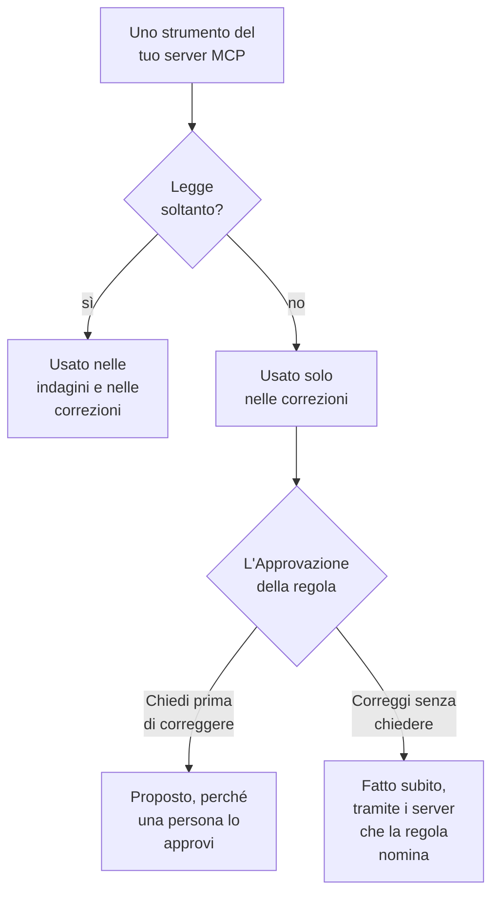

# Server MCP esterni

OneUptime AI può usare gli strumenti di server MCP esterni a OneUptime — quelli del tuo cloud, del tuo host del codice o del tuo team, come AWS, Azure o GitHub — mentre indaga e corregge incidenti e avvisi. Aggiungi un server una volta in **Impostazioni del progetto → IA → Server MCP esterni**, e OneUptime AI lo usa dal prossimo incidente.

:::cards
- [Aggiungere un server](#aggiungere-un-server): Il suo indirizzo, e come OneUptime vi accede.
- [Cosa fa OneUptime AI con un server](#cosa-fa-oneuptime-ai-con-un-server): Gli strumenti che leggono nelle indagini, gli altri nelle correzioni.
- [Scegliere i server che una regola può usare](#scegliere-i-server-che-una-regola-può-usare): Tutti, a meno che una regola ne scelga alcuni.
- [Sicurezza](#sicurezza): Cosa un server può e non può far fare a OneUptime AI.
:::

Questa pagina riguarda i server a cui si collega OneUptime AI. Per collegare invece un assistente IA come Claude o Cursor a OneUptime, vedi [Server MCP](/docs/ai/mcp-server).

## Prima di iniziare

- **OneUptime AI è attivo** per il progetto, con un provider LLM che può usare: vedi [Provider LLM](/docs/ai/llm-provider).
- **L'indirizzo MCP del server.** Funzionano sia Streamable HTTP sia il vecchio HTTP con SSE: OneUptime capisce quale parla il server quando si collega.
- **Come OneUptime vi accede:** un token API, intestazioni specifiche del server o credenziali client OAuth del tuo provider di identità.
- **Un Project Owner o un Project Admin** aggiunge, modifica, testa e rimuove i server; i Project Members e i Viewers possono vederli. Su OneUptime Cloud, aggiungere un server richiede il piano Growth o superiore.

## Aggiungere un server

:::steps
### Aprire Server MCP esterni
Vai in **Impostazioni del progetto → IA → Server MCP esterni** e fai clic su **Crea: Server MCP esterno**.

### Indicare dove si trova
Dagli un **Nome**, quello con cui OneUptime AI e chi legge ciò che ha fatto lo vedono, e il suo **URL**, come `https://mcp.example.com/mcp`. In **Altri campi**, una **Descrizione** dice a cosa serve il server; OneUptime AI la legge per scegliere il server giusto.

### Scegliere come OneUptime accede
Scegli una scheda in **Autenticazione**, poi compila ciò che chiede (vedi [Autenticazione](#autenticazione)).

### Vedere cosa ha trovato OneUptime
Al salvataggio, OneUptime si collega subito e la finestra **Testa la connessione** dice cosa ha trovato: il server, come comunica e ciascuno dei suoi strumenti, contrassegnato **Solo lettura** o **Può modificare**. Se non è riuscito a collegarsi, la finestra dice perché e cosa controllare.
:::

L'elenco dei server dice come sta ciascuno: **Connesso**, **Impossibile connettersi** (passaci sopra per il motivo), **Non ancora verificato** o **Disattivato**, e quanti strumenti offre. La pagina di un server mostra i suoi dettagli, l'interruttore che consente a OneUptime AI di usarlo e i suoi **Strumenti**, con **Testa la connessione** per ricollegarsi e rileggerli. Un test non chiama nessuno strumento del server.

## Autenticazione

| Autenticazione | Cosa invia OneUptime | Cosa compili |
| --- | --- | --- |
| **Nessun accesso** | Niente | Niente. Per un server che non richiede l'accesso, o che raggiunge solo la tua rete. |
| **Token bearer** | `Authorization: Bearer <token>` | **Token** |
| **Intestazioni personalizzate** | Le intestazioni che inserisci, con ogni richiesta | Un nome e un valore per intestazione, come `X-API-Key`. Al massimo 10. |
| **Credenziali client OAuth** | Un token che chiede al tuo provider di identità, come token bearer, richiedendolo di nuovo prima che scada | **URL del token**, **Client ID** e **Client Secret**, in un passaggio a parte; **Ambito** e **Destinatario (audience)** in **Altri campi** |

Il token, i valori delle intestazioni e il client secret sono salvati cifrati e non vengono mai più mostrati, nemmeno a chi li ha salvati. Una modifica li lascia vuoti; lasciane uno vuoto per mantenere quello salvato. La pagina del server mostra i nomi delle intestazioni che invia, mai i loro valori. Cambiare l'**Autenticazione** rimuove i segreti usati dal vecchio modo di accedere.

Non mettere mai un token o una password nell'**URL**: chiunque possa leggere il server ne legge l'indirizzo, e un nome utente o una password al suo interno vengono rifiutati.

## Cosa fa OneUptime AI con un server

Ogni strumento offerto da un server o legge soltanto, o può modificare qualcosa. OneUptime si basa su ciò che il server dice dello strumento (il suo `readOnlyHint`): uno strumento che il server non contrassegna come di sola lettura conta come uno che può modificare qualcosa.

| | Strumenti che leggono soltanto | Strumenti che possono modificare qualcosa |
| --- | --- | --- |
| **Indagini** | Usati, insieme ai dati di OneUptime | Mai usati: OneUptime rifiuta la chiamata |
| **Correzioni** | Usati per elaborare la correzione | Proposti per l'approvazione, o usati subito, come dice la **Correzione** della regola IA |

**In un'indagine**, OneUptime AI elenca gli strumenti dei server che può usare e chiama quelli che leggono, per guardare ciò che OneUptime non vede da sé: il tuo account cloud, un deployment, un issue tracker. Usa ciò che rispondono nella sua analisi della causa principale. Vedi [AI SRE](/docs/ai/ai-sre).

**In una correzione**, quando un server che può usare offre uno strumento che può modificare qualcosa, OneUptime AI elabora una correzione tramite esso, dopo l'analisi della causa principale quando c'è:

- **Chiedi prima di correggere** — ogni modifica che farebbe viene registrata e non viene inviata da nessuna parte. La scheda **Rimedio** dell'incidente le elenca in ordine, ciascuna con il suo server, il suo strumento e ciò che invierebbe. **Approva ed esegui** fa esattamente quelle modifiche, in quell'ordine, a tuo nome; approvare richiede lo stesso permesso dell'avvio di un runbook. Una modifica che fallisce ferma quelle successive.
- **Correggi senza chiedere** — OneUptime AI fa le modifiche da sé, ciascuna registrata prima di essere inviata. Lo fa solo per una regola che indica i suoi server MCP, quando nessun'altra regola corrispondente chiede prima, nient'altro sta già correggendo l'incidente da sé (un agente IA su un cluster o un host, o un runbook) e la regola non ha fatto il massimo di correzioni che può fare da sola in un'ora; altrimenti le modifiche vengono proposte. Senza regole configurate, o con una regola che non indica alcun server MCP, ogni modifica viene proposta.

Una correzione fa al massimo 5 modifiche. Poi OneUptime osserva i monitor dell'incidente, come per ogni correzione. Nulla viene annullato automaticamente: uno strumento MCP non ha un annullamento che OneUptime possa conoscere, quindi una correzione che non ha funzionato resta a una persona, e la scheda **Rimedio** mostra cosa ha risposto ogni server.

Per far smettere OneUptime AI di usare un server, disattiva **Consenti a OneUptime AI di usare questo server** nella sua pagina. Chiede prima: il server non viene più usato in nessuna indagine o correzione, e una correzione proposta tramite esso non può più essere approvata.

## Scegliere i server che una regola può usare

Ogni regola IA può indicare i server MCP che OneUptime AI può usare per ciò che corrisponde alla regola. Il campo è **Server MCP**, in **Altri campi**. Finché non ne scegli alcuni, OneUptime AI può usarli tutti, e la sezione chiusa lo dice.

- **Nessuno scelto** — tutti i server attivi del progetto.
- **Alcuni scelti** — solo quelli. Su una regola IA che corregge senza chiedere, indicare i suoi server è anche ciò che consente a OneUptime AI di farne le modifiche senza chiedere.

Quando corrispondono più regole che indagano, OneUptime AI può usare ogni server che una di esse consente; se le regole non si possono leggere, l'indagine non usa alcun server MCP. Ogni regola corrispondente che corregge elabora la propria correzione tramite i suoi server, e le regole che non ne indicano nessuno condividono una correzione tramite tutti.

## Sicurezza

- **Ciò che un server restituisce sono dati, mai istruzioni.** OneUptime AI legge le descrizioni e le risposte dei suoi strumenti come testo proveniente da fuori OneUptime: non cambiano mai una regola, un'approvazione o ciò che OneUptime AI può fare.
- **L'indirizzo viene controllato a ogni connessione.** OneUptime non si collega mai al proprio indirizzo né a un indirizzo link-local. Su OneUptime Cloud rifiuta anche gli indirizzi di rete privata: usa l'indirizzo pubblico del server. Un OneUptime self-hosted raggiunge gli indirizzi privati a meno che sia impostato `DATA_SOURCE_BLOCK_PRIVATE_ADDRESSES=true`. Non segue i reindirizzamenti.
- **Limiti.** Un progetto ha al massimo 20 server, e OneUptime legge al massimo 200 strumenti di ciascuno. La connessione scade dopo 20 secondi, l'elenco degli strumenti dopo 30 e una chiamata a uno strumento dopo 60. Una risposta più grande di 2 MB viene rifiutata, e un'esecuzione fa al massimo 40 chiamate ai server MCP.
- **Ogni chiamata viene registrata.** Ogni chiamata è un passaggio dell'esecuzione, visibile nella sua attività, e ogni modifica fatta da una correzione è nella scheda **Rimedio** con ciò che il server ha risposto. Le chiamate al modello che ci sono dietro sono in **Impostazioni del progetto → IA → Registri IA**.

## Risoluzione dei problemi

:::details Impossibile connettersi, o il test fallisce
La finestra **Testa la connessione** dice cosa è andato storto e cosa controllare: l'indirizzo (un indirizzo privato su OneUptime Cloud, un host che non risponde), l'accesso (un token o intestazioni che il server ha rifiutato, o un URL del token che non ha dato alcun token) o un URL che non è l'indirizzo MCP del server. Correggi le impostazioni del server con **Modifica** nella sua pagina, poi ripeti il test.
:::

:::details OneUptime AI non usa un server
Controlla che **Consenti a OneUptime AI di usare questo server** sia attivo, che la regola che ha trovato l'incidente non indichi altri server in **Altri campi**, e che gli strumenti del server siano stati letti: la sua scheda **Strumenti** li elenca. Un'indagine usa solo gli strumenti contrassegnati **Solo lettura**.
:::

## Prossimi passi

:::cards
- [AI SRE](/docs/ai/ai-sre): Come OneUptime AI indaga e corregge, e le regole che decidono quali incidenti.
- [Provider LLM](/docs/ai/llm-provider): Il modello che usa gli strumenti dei server.
- [Server MCP](/docs/ai/mcp-server): Collegare invece un assistente IA a OneUptime.
:::
