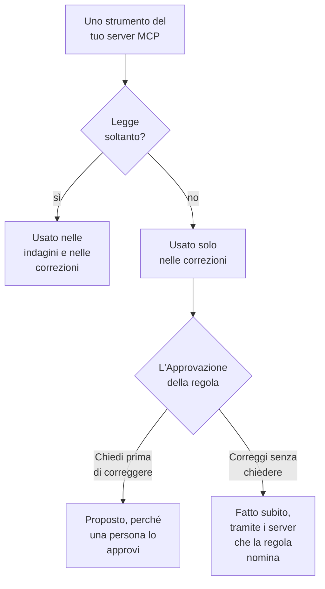

# Server MCP esterni

OneUptime AI può usare gli strumenti di server MCP esterni a OneUptime — quelli del tuo cloud, del tuo host del codice o del tuo team, come AWS, Azure o GitHub — in Chiedi all'IA, nelle sue risposte in Slack e Microsoft Teams, e mentre indaga e corregge incidenti e avvisi. Aggiungi un server una volta in **Impostazioni del progetto → IA → Server MCP esterni**, e OneUptime AI lo usa dalla tua prossima domanda e dal prossimo incidente.

:::cards
- [Aggiungere un server](#aggiungere-un-server): Il suo indirizzo, e come OneUptime vi accede.
- [Cosa fa OneUptime AI con un server](#cosa-fa-oneuptime-ai-con-un-server): Gli strumenti che leggono nelle indagini, gli altri nelle correzioni.
- [Contrassegnare uno strumento come di sola lettura](#contrassegnare-uno-strumento-come-di-sola-lettura): Quando il server non lo dice, come quello di kAgent.
- [In Chiedi all'IA](#in-chiedi-allia): Chiedile di elencare gli strumenti di un server o di usarne uno; una modifica attende la tua approvazione.
- [In Slack e Microsoft Teams](#in-slack-e-microsoft-teams): Gli strumenti che leggono, per la persona che ha chiesto.
- [Scegliere i server che una regola può usare](#scegliere-i-server-che-una-regola-può-usare): Tutti, a meno che una regola ne scelga alcuni.
- [Sicurezza](#sicurezza): Cosa un server può e non può far fare a OneUptime AI.
:::

Questa pagina riguarda i server a cui si collega OneUptime AI. Per collegare invece un assistente IA come Claude o Cursor a OneUptime, vedi [Server MCP](/docs/ai/mcp-server).

## Prima di iniziare

- **OneUptime AI è attivo** per il progetto, con un provider LLM che può usare: vedi [Provider LLM](/docs/ai/llm-provider).
- **L'indirizzo MCP del server.** Funzionano sia Streamable HTTP sia il vecchio HTTP con SSE: OneUptime capisce quale parla il server quando si collega.
- **Come OneUptime vi accede:** un token API, intestazioni specifiche del server o credenziali client OAuth del tuo provider di identità.
- **Un Project Owner o un Project Admin** aggiunge, modifica, testa e rimuove i server; i Membri del progetto e i Visualizzatori possono vederli. Su OneUptime Cloud, aggiungere un server richiede il piano Growth o superiore.

## Aggiungere un server

:::steps
### Aprire Server MCP esterni
Vai in **Impostazioni del progetto → IA → Server MCP esterni** e fai clic su **Crea: Server MCP esterno**.

### Indicare dove si trova
Dagli un **Nome**, quello con cui OneUptime AI e chi legge ciò che ha fatto lo vedono, e il suo **URL**, come `https://mcp.example.com/mcp`. In **Altri campi**, una **Descrizione** dice a cosa serve il server; OneUptime AI la legge per scegliere il server giusto.

### Scegliere come OneUptime accede
Scegli una scheda in **Autenticazione**, poi compila ciò che chiede (vedi [Autenticazione](#autenticazione)).

### Vedere cosa ha trovato OneUptime
Al salvataggio, OneUptime si collega subito e la finestra **Testa la connessione** dice cosa ha trovato: il server, come comunica e ciascuno dei suoi strumenti, contrassegnato **Solo lettura** o **Può modificare**. Se non è riuscito a collegarsi, la finestra dice perché e cosa controllare.
:::

L'elenco dei server dice come sta ciascuno: **Connesso**, **Impossibile connettersi** (passaci sopra per il motivo), **Non ancora verificato** o **Disattivato**, e quanti strumenti offre. La pagina di un server mostra i suoi dettagli, l'interruttore che consente a OneUptime AI di usarlo e i suoi **Strumenti**, con **Testa la connessione** per ricollegarsi e rileggerli. Un test non chiama nessuno strumento del server.

## Autenticazione

| Autenticazione | Cosa invia OneUptime | Cosa compili |
| --- | --- | --- |
| **Nessun accesso** | Niente | Niente. Per un server che non richiede l'accesso, o che raggiunge solo la tua rete. |
| **Token bearer** | `Authorization: Bearer <token>` | **Token** |
| **Intestazioni personalizzate** | Le intestazioni che inserisci, con ogni richiesta | Un nome e un valore per intestazione, come `X-API-Key`. Al massimo 10. |
| **Credenziali client OAuth** | Un token che chiede al tuo provider di identità, come token bearer, richiedendolo di nuovo prima che scada | **URL del token**, **Client ID** e **Client Secret**, in un passaggio a parte; **Ambito** e **Destinatario (audience)** in **Altri campi** |

Il token, i valori delle intestazioni e il client secret sono salvati cifrati e non vengono mai più mostrati, nemmeno a chi li ha salvati. Una modifica li lascia vuoti; lasciane uno vuoto per mantenere quello salvato. La pagina del server mostra i nomi delle intestazioni che invia, mai i loro valori. Cambiare l'**Autenticazione** rimuove i segreti usati dal vecchio modo di accedere.

Non mettere mai un token o una password nell'**URL**: chiunque possa leggere il server ne legge l'indirizzo, e un nome utente o una password al suo interno vengono rifiutati.

## Cosa fa OneUptime AI con un server

Ogni strumento offerto da un server o legge soltanto, o può modificare qualcosa. OneUptime si basa su ciò che il server dice dello strumento (il suo `readOnlyHint`): uno strumento che il server non contrassegna come di sola lettura conta come uno che può modificare qualcosa, a meno che un Amministratore del progetto non lo contrassegni come di sola lettura (vedi [Contrassegnare uno strumento come di sola lettura](#contrassegnare-uno-strumento-come-di-sola-lettura)). Alcuni server non contrassegnano nessuno dei loro strumenti: finché qualcuno non ne contrassegna uno, un'indagine non ha nessuno dei loro strumenti da usare, e in Chiedi all'IA ogni chiamata a uno di essi attende la tua approvazione.

| | Strumenti che leggono soltanto | Strumenti che possono modificare qualcosa |
| --- | --- | --- |
| **Indagini** | Usati, insieme ai dati di OneUptime | Mai usati: OneUptime rifiuta la chiamata |
| **Correzioni** | Usati per elaborare la correzione | Proposti per l'approvazione, o usati subito, come dice la **Correzione** della regola IA |
| **Chiedi all'IA** | Usati quando lo chiedi | Usati una volta che approvi ogni chiamata |
| **Slack e Microsoft Teams** | Usati quando lo chiedi | Mai usati: lì non c'è una scheda di approvazione, quindi OneUptime AI ti rimanda a Chiedi all'IA |

**In un'indagine**, OneUptime AI elenca gli strumenti dei server che può usare e chiama quelli che leggono, per guardare ciò che OneUptime non vede da sé: il tuo account cloud, un deployment, un issue tracker. Usa ciò che rispondono nella sua analisi della causa principale. Vedi [AI SRE](/docs/ai/ai-sre).

**In una correzione**, quando un server che può usare offre uno strumento che può modificare qualcosa, OneUptime AI elabora una correzione tramite esso, dopo l'analisi della causa principale quando c'è:

- **Chiedi prima di correggere** — ogni modifica che farebbe viene registrata e non viene inviata da nessuna parte. Il passaggio **Rimedio** della scheda **OneUptime AI** dell'incidente le riassume in una frase, e **Rivedi e approva** le elenca in ordine, ciascuna con il suo server, il suo strumento e ciò che invierebbe. **Approva ed esegui** fa esattamente quelle modifiche, in quell'ordine, a tuo nome; approvare richiede lo stesso permesso dell'avvio di un runbook. Una modifica che fallisce ferma quelle successive.
- **Correggi senza chiedere** — OneUptime AI fa le modifiche da sé, ciascuna registrata prima di essere inviata. Lo fa solo per una regola che indica i suoi server MCP, quando nessun'altra regola corrispondente chiede prima, nient'altro sta già correggendo l'incidente da sé (un agente IA su un cluster o un host, o un runbook) e la regola non ha fatto il massimo di correzioni che può fare da sola in un'ora; altrimenti le modifiche vengono proposte. Senza regole configurate, o con una regola che non indica alcun server MCP, ogni modifica viene proposta.

Una correzione fa al massimo 5 modifiche. Poi OneUptime osserva i monitor dell'incidente, come per ogni correzione. Nulla viene annullato automaticamente: uno strumento MCP non ha un annullamento che OneUptime possa conoscere, quindi una correzione che non ha funzionato resta a una persona, e il passaggio **Rimedio** mostra cosa ha risposto ogni server.

Per far smettere OneUptime AI di usare un server, disattiva **Consenti a OneUptime AI di usare questo server** nella sua pagina. Chiede prima: il server non viene più usato in nessuna indagine o correzione, e una correzione proposta tramite esso non può più essere approvata.

## Contrassegnare uno strumento come di sola lettura

Alcuni server non dicono nulla sul fatto che i loro strumenti leggano soltanto. Il server di strumenti di kAgent non dice nulla di nessuno dei suoi strumenti, `k8s_get_resources` compreso, quindi OneUptime AI tratta ciascuno come uno che può modificare qualcosa. Quando sai che uno strumento legge soltanto, un Proprietario del progetto o un Amministratore del progetto può contrassegnarlo come di sola lettura, e OneUptime AI lo usa allora come tale: nelle indagini e nelle correzioni, in Slack e Microsoft Teams, e in Chiedi all'IA senza scheda di approvazione.

:::steps
### Aprire la scheda Strumenti del server
Vai in **Impostazioni del progetto → IA → Server MCP esterni** e apri il server. La sua scheda **Strumenti** indica di quanti dei suoi strumenti il server non dice nulla.

### Scegliere uno strumento
Fai clic su **Contrassegna come di sola lettura** accanto allo strumento. La finestra mostra cosa fa lo strumento secondo il server e gli argomenti che accetta, e cosa significa contrassegnarlo.

### Contrassegnare lo strumento
Fai clic su **Contrassegna come di sola lettura** nella finestra. Lo strumento ora mostra **Solo lettura**, con chi lo ha contrassegnato e quando.
:::

- **Uno strumento alla volta.** Niente contrassegna più strumenti insieme.
- **Solo uno strumento su cui il suo server non dice nulla.** Uno strumento che il server contrassegna come uno che può modificare qualcosa (`readOnlyHint: false` o `destructiveHint: true`) non può essere contrassegnato. Alcune librerie MCP scrivono così per ogni strumento che il loro autore non ha contrassegnato: mcp-go lo fa, quindi il server di strumenti di kAgent nella versione 0.2 lo dice di ogni strumento. Dalla versione 0.3 in poi non dice nulla, e i suoi strumenti possono essere contrassegnati.
- **Mai uno strumento che chiaramente modifica qualcosa.** Uno strumento il cui nome dice che modifica qualcosa (come `delete`, `apply`, `create`, `update` o `restart`), uno che esegue un comando che gli viene dato e uno con un argomento che può attivare una modifica (come `should_install` o `dry_run`) non possono essere contrassegnati, e la loro riga dice perché. Questi controlli colgono solo i casi evidenti: leggi cosa fa uno strumento prima di contrassegnarlo.
- **Un contrassegno smette di valere quando il server cambia lo strumento.** Conserva il nome, la descrizione e lo schema di input dello strumento così come OneUptime li ha letti. OneUptime AI rilegge gli strumenti a ogni esecuzione: se il server ha cambiato uno di questi elementi, dopo un aggiornamento per esempio, lo strumento torna a contare come uno che può modificare qualcosa, finché qualcuno non lo contrassegna di nuovo. La sua riga dice che il server lo ha cambiato, con **Contrassegna di nuovo**. kAgent riscrive la descrizione del suo `k8s_generate_resource` a ogni avvio, quindi un contrassegno su quello strumento decade ogni volta che kAgent si riavvia.
- **Chi e quando vengono registrati.** Ogni strumento contrassegnato mostra chi lo ha contrassegnato e quando. Con i [log di audit](/docs/configuration/audit-logs) attivi, il contrassegno di uno strumento e la rimozione di un contrassegno finiscono nel log di audit del progetto. **Rimuovi contrassegno** fa sì che OneUptime AI torni subito a chiedere prima di usare lo strumento.

I Membri del progetto e i Visualizzatori vedono quali strumenti sono contrassegnati, e da chi.

## In Chiedi all'IA

Chiedi all'IA, e la conversazione sotto la scheda **OneUptime AI** di un incidente o di un avviso, possono usare ogni server attivo, per la persona che chiede. Chiedi «Quali strumenti ha AWS?» e OneUptime AI li elenca, ciascuno contrassegnato in base a ciò che può fare; chiedigli di usarne uno, indicando il suo server e il suo nome, e lo chiama e risponde con ciò che è tornato.

- **Gli strumenti che leggono soltanto** vengono eseguiti subito, in ogni modalità di autorizzazione: quelli che il server contrassegna come di sola lettura, e quelli che un Amministratore del progetto ha contrassegnato.
- **Qualsiasi altro strumento** ti aspetta, anche in **Esecuzione automatica**: la scheda di approvazione nomina il server e lo strumento e mostra esattamente cosa viene inviato, e nulla raggiunge il server finché non lo consenti. Una conversazione in **Sola lettura** non ne offre mai.
- **Decidono i tuoi permessi.** Usare un server richiede ciò che serve per leggere i server MCP esterni del progetto; approvare una modifica tramite uno di essi richiede il permesso di avviare esecuzioni di runbook, come approvare una correzione tramite server MCP. Una chiamata rifiutata dice perché, e non invia nulla.

I server che una regola IA indica sono quelli che OneUptime AI usa da sé, per ciò che corrisponde alla regola; in Chiedi all'IA, il server lo scegli tu.

## In Slack e Microsoft Teams

Anche le risposte di OneUptime AI in Slack e Microsoft Teams possono usare ogni server attivo, per la persona che ha chiesto. Chiedi «Quali strumenti ha Kubernetes?» o «Usa il server Kubernetes per elencare i pod in shop», con il nome del tuo server, e risponde con ciò che restituiscono gli strumenti del server.

- **Solo gli strumenti che leggono.** Quelli che il server contrassegna come di sola lettura, e quelli che un Amministratore del progetto ha contrassegnato. Un'app di chat non ha una scheda di approvazione, quindi lì non viene mai usato nessun altro strumento: se gliene chiedi uno, OneUptime AI lo dice e rimanda a Chiedi all'IA, dove approvi ogni chiamata.
- **Come la persona che ha chiesto.** La risposta viene eseguita come l'account OneUptime a cui è collegato il tuo account Slack o Microsoft Teams, con i suoi permessi: chi ha un account che non può leggere i server MCP esterni del progetto non riceve nessuno strumento MCP. A un account non collegato viene chiesto di collegarsi prima, e non riceve risposta finché non lo è.
- **Tutti nella conversazione leggono la risposta**, con ciò che vi hanno restituito gli strumenti dei server. Chiedi in un messaggio diretto tutto ciò che solo tu dovresti vedere.

## Scegliere i server che una regola può usare

Ogni regola IA può indicare i server MCP che OneUptime AI può usare per ciò che corrisponde alla regola. Il campo è **Server MCP**, in **Altri campi**. Finché non ne scegli alcuni, OneUptime AI può usarli tutti, e la sezione chiusa lo dice.

- **Nessuno scelto** — tutti i server attivi del progetto.
- **Alcuni scelti** — solo quelli. Su una regola IA che corregge senza chiedere, indicare i suoi server è anche ciò che consente a OneUptime AI di farne le modifiche senza chiedere.

Quando corrispondono più regole che indagano, OneUptime AI può usare ogni server che una di esse consente; se le regole non si possono leggere, l'indagine non usa alcun server MCP. Un'indagine che qualcuno avvia su un incidente o un avviso a cui non corrisponde nessuna regola può usarli tutti. Ogni regola corrispondente che corregge elabora la propria correzione tramite i suoi server, e le regole che non ne indicano nessuno condividono una correzione tramite tutti.

## Sicurezza

- **Ciò che un server restituisce sono dati, mai istruzioni.** OneUptime AI legge le descrizioni e le risposte dei suoi strumenti come testo proveniente da fuori OneUptime: non cambiano mai una regola, un'approvazione o ciò che OneUptime AI può fare.
- **Uno strumento riceve solo ciò che accetta.** OneUptime invia a uno strumento solo gli argomenti che il suo schema nomina; tutto il resto che OneUptime AI ha scritto resta in OneUptime.
- **L'interruttore Abilita IA ferma ogni chiamata.** Con **Abilita IA** disattivato, OneUptime non invia nulla a un server: nessuna chiamata di un'indagine, di una correzione, di Chiedi all'IA, di Slack o di Microsoft Teams, nemmeno una che una persona ha già approvato.
- **L'indirizzo viene controllato a ogni connessione.** OneUptime non si collega mai al proprio indirizzo né a un indirizzo link-local. Su OneUptime Cloud rifiuta anche gli indirizzi di rete privata: usa l'indirizzo pubblico del server. Un OneUptime self-hosted raggiunge gli indirizzi privati a meno che sia impostato `DATA_SOURCE_BLOCK_PRIVATE_ADDRESSES=true`. Non segue i reindirizzamenti.
- **Limiti.** Un progetto ha al massimo 20 server, e OneUptime legge al massimo 200 strumenti di ciascuno. La connessione scade dopo 20 secondi, l'elenco degli strumenti dopo 30 e una chiamata a uno strumento dopo 60. Una risposta più grande di 2 MB viene rifiutata. Le chiamate di un'esecuzione ai server MCP contano nei limiti per esecuzione del progetto, quando li imposta.
- **Ogni chiamata viene registrata.** Ogni chiamata è un passaggio dell'esecuzione, visibile nella sua attività (in Chiedi all'IA, tra i passaggi della risposta), e ogni modifica fatta da una correzione è nel passaggio **Rimedio** con ciò che il server ha risposto. Una risposta in Slack o Microsoft Teams nomina tra le sue fonti ogni server e ogni strumento che ha letto. Le chiamate al modello che ci sono dietro sono in **Impostazioni del progetto → IA → Log IA**.

## Risoluzione dei problemi

:::details Impossibile connettersi, o il test fallisce
La finestra **Testa la connessione** dice cosa è andato storto e cosa controllare: l'indirizzo (un indirizzo privato su OneUptime Cloud, un host che non risponde), l'accesso (un token o intestazioni che il server ha rifiutato, o un URL del token che non ha dato alcun token) o un URL che non è l'indirizzo MCP del server. Correggi le impostazioni del server con **Modifica** nella sua pagina, poi ripeti il test.
:::

:::details OneUptime AI non usa un server
Controlla che **Consenti a OneUptime AI di usare questo server** sia attivo, e che gli strumenti del server siano stati letti: la sua scheda **Strumenti** li elenca, ciascuno contrassegnato **Solo lettura** o **Può modificare**, e **Testa la connessione** li rilegge. Poi chiedi a Chiedi all'IA «Quali strumenti ha AWS?», con il nome del tuo server: li elenca, o dice perché non può raggiungere il server o non può usarlo. Per un'indagine, controlla anche che la regola che ha trovato l'incidente non indichi altri server in **Altri campi**: un'indagine usa solo gli strumenti contrassegnati **Solo lettura**, quindi un server che non contrassegna nessuno dei suoi strumenti non gliene dà nessuno da usare, finché un Amministratore del progetto non contrassegna quelli che leggono soltanto (vedi [Contrassegnare uno strumento come di sola lettura](#contrassegnare-uno-strumento-come-di-sola-lettura)).
:::

:::details Uno strumento che ho contrassegnato come di sola lettura attende di nuovo l'approvazione
Il suo server lo ha cambiato da quando è stato contrassegnato: la sua riga nella scheda **Strumenti** lo dice, e **Testa la connessione** mostra cosa legge ora OneUptime. Controlla cosa è cambiato nella finestra che apre **Contrassegna di nuovo**, e contrassegnalo di nuovo se legge ancora soltanto. Uno strumento che il suo server ora contrassegna come uno che può modificare qualcosa non può essere contrassegnato di nuovo.
:::

## Prossimi passi

:::cards
- [AI SRE](/docs/ai/ai-sre): Come OneUptime AI indaga e corregge, e le regole che decidono quali incidenti.
- [Provider LLM](/docs/ai/llm-provider): Il modello che usa gli strumenti dei server.
- [Server MCP](/docs/ai/mcp-server): Collegare invece un assistente IA a OneUptime.
:::
