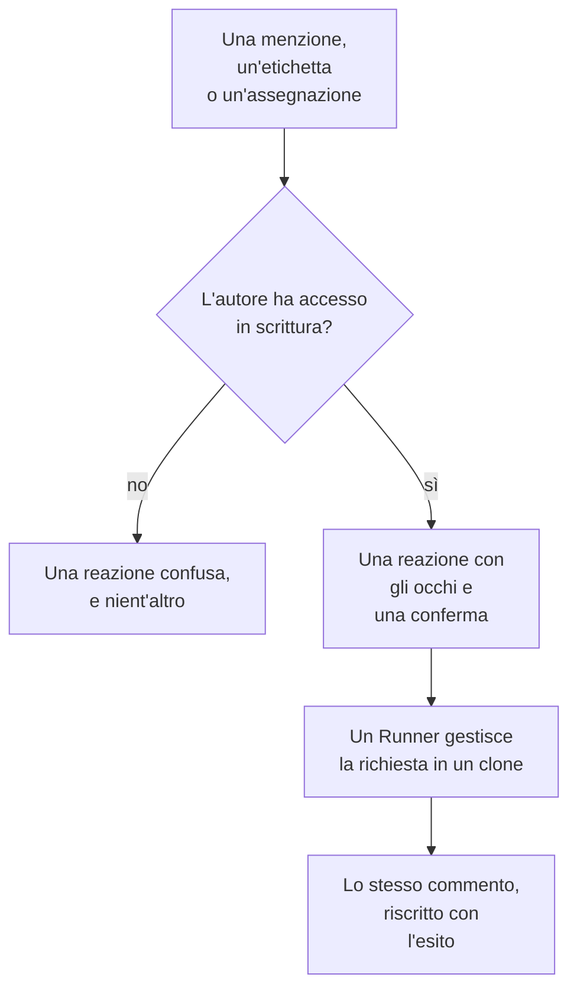

# GitHub App

La GitHub App di OneUptime è più di una connessione al tuo codice: puoi parlarle nel tuo repository, e lei fa il lavoro lì. Menzionala in una issue e apre una pull request; menzionala in una pull request e rivede il branch o revisiona il diff. Tutto ciò che produce è una pull request o una review che una persona legge: **non fa mai il merge di nulla e non approva mai una pull request.**

:::cards
- [I comandi](#i-comandi): Cosa scrivere, in una issue o in una pull request.
- [Come appare nel thread](#come-appare-nel-thread): Un solo commento che segue il lavoro.
- [Review con contesto di produzione](#review-con-contesto-di-produzione): Cosa dice la produzione sul codice modificato.
- [Chi può darle comandi](#chi-può-darle-comandi): Le persone con accesso in scrittura, e nessun altro.
- [Risoluzione dei problemi](#risoluzione-dei-problemi): Quando una menzione non fa nulla.
:::

```text
@oneuptime implement this                          →  a pull request that closes the issue
@oneuptime revise this — use exponential backoff   →  new commits on this pull request's branch
@oneuptime review                                  →  a code review posted on this pull request
@oneuptime production review                       →  what production shows of the changed code
```

> [!NOTE]
> Sostituisci `@oneuptime` con l'handle della tua app. Su OneUptime Cloud è `@oneuptime`. Su un'istanza self-hosted è il nome che hai dato alla tua GitHub App, in minuscolo e con trattini al posto degli spazi: un'app chiamata "Acme AI" si menziona come `@acme-ai`. Se le menzioni non fanno nulla, controlla prima questo.

## Come funziona



È lo stesso agente e lo stesso Runner di [Codice](/docs/ai/ai-agent), con gli stessi budget; cambia solo il trigger.

## Prima di iniziare

- Il repository deve essere **collegato a un progetto OneUptime** tramite la GitHub App: collegalo in **Prodotti → Codice**. Un'istanza self-hosted ha prima bisogno di una propria GitHub App: vedi [Integrazione GitHub](/docs/self-hosted/github-integration). Se l'app è già installata sull'account GitHub, fai clic lì su **Collega un'installazione esistente** invece di installarla di nuovo.
- Il Runner che il repository sceglie nelle sue impostazioni in Codice deve essere online, o un Runner globale per un repository che non ne sceglie nessuno: lo stesso Runner che svolge le attività di [Codice](/docs/ai/ai-agent). Senza, i comandi vengono accettati e poi falliscono dopo 30 minuti, con un messaggio che dice che nessun Runner li ha presi.
- La GitHub App ha bisogno del permesso **Issues** con **Read & write** e deve essere iscritta agli eventi webhook elencati in [A cosa iscriversi](#a-cosa-iscriversi).

## I comandi

Ogni comando inizia con una menzione dell'app. La menzione può stare in qualsiasi punto del commento, e quello che scrivi dopo viene passato come tua richiesta. Modificare un commento che menziona già l'app non la riesegue: per cambiare la tua richiesta, scrivi un nuovo commento. Una modifica che aggiunge la menzione è una nuova richiesta.

### In una pull request

| Comando | Cosa succede | Capito anche come |
| --- | --- | --- |
| `@oneuptime review` | Clona il branch, legge il codice modificato e quello circostante, controlla cosa ne dice la produzione, e pubblica una review come commento. Non cambia nulla. | `code review`, `please review`, `can you review`, `review this` |
| `@oneuptime production review` | Rivede ora la pull request rispetto alla produzione, chiunque l'abbia aperta: le eccezioni, le operazioni, gli incidenti e i deploy attorno al codice modificato, in un unico commento modificato sul posto (vedi [Revisione di produzione delle pull request](/docs/ai/ai-agent#revisione-di-produzione-delle-pull-request)). Non clona nulla e non esegue nulla. | `review against production`, `review production`, `check production` |
| `@oneuptime revise this — <what you want changed>` | Clona il branch della pull request stessa, fa la modifica e fa il push di nuovi commit su quel branch. Non apre mai una seconda pull request. | `revise`, `please revise`, `rework`, `redo` |

Tutto ciò che scrivi dopo la menzione e che non è un comando noto viene letto come una richiesta di revisione, perché è quasi sempre di questo che si tratta:

```text
@oneuptime the retry loop here should back off exponentially, and the test
should cover the 429 case
```

### In una issue

| Comando | Cosa succede | Capito anche come |
| --- | --- | --- |
| `@oneuptime implement this` | Lavora sulla issue e apre una pull request che la chiude. | `implement`, `please implement`, `work on this`, `pick this up`, `take this` |
| `@oneuptime <anything else>` | Lo stesso, con le tue parole come indicazione in più. | — |

Puoi anche affidare all'app una issue senza un commento:

- **Aggiungi l'etichetta di trigger.** Aggiungere a una issue l'etichetta di trigger del repository, `oneuptime` se non l'hai cambiata, avvia lo stesso lavoro. È il modo più affidabile per affidare lavoro dalle pagine di GitHub stesse.
- **Assegna la issue all'utente bot dell'app**, dove il tuo repository lo consente. GitHub non permette ovunque che un'app sia assegnataria, ed è per questo che esiste l'etichetta: se l'assegnazione non fa nulla, usa l'etichetta.

### Ovunque

| Comando | Cosa succede | Capito anche come |
| --- | --- | --- |
| `@oneuptime help` | Elenca i comandi. Una menzione da sola, senza nulla dopo, fa lo stesso. | `commands`, `usage`, `what can you do` |
| `@oneuptime status` | Dice su cosa sta lavorando in questo thread. | `progress` |
| `@oneuptime cancel` | Ferma le esecuzioni che ha in corso in questo thread. Il lavoro già inviato con push resta. | `stop`, `abort` |

`help`, `status` e `cancel` non avviano mai un'esecuzione dell'agente, quindi non costano nulla.

## Come appare nel thread

Un comando produce **un solo commento**, che l'app modifica man mano che il lavoro avanza, così un'attività lunga non trasforma mai una pull request in un log di stato.

1. Reagisce con 👀 al tuo commento e pubblica una conferma che nomina il progetto OneUptime a cui appartiene l'esecuzione e rimanda all'esecuzione in tempo reale.
2. Quando finisce, riscrive lo stesso commento con l'esito: la pull request che ha aperto, i commit di cui ha fatto il push, o una spiegazione chiara del perché non ha fatto nulla.

Se non trova niente che valga la pena cambiare, lo dice invece di aprire una pull request speculativa. È un esito normale, non un errore: dalle più indicazioni e chiedi di nuovo.

## Review con contesto di produzione

OneUptime possiede la telemetria del codice che revisiona, quindi una review può dire ciò che nessun revisore che legge il diff può sapere. Per i servizi del repository, controlla:

- le eccezioni sollevate nei file e nelle funzioni modificati negli ultimi 7 giorni;
- quanto traffico ricevono e quanto sono lenti gli endpoint e le operazioni toccati dal diff;
- gli incidenti collegati ai file modificati;
- i deploy recenti dei servizi che OneUptime ha contrassegnato come regressioni.

Ciò che trova va sotto un titolo **Production context** della review, ogni punto con i numeri e la finestra temporale da cui proviene, per esempio: "`chargeCard` ha sollevato `TypeError: Cannot read properties of undefined` 1.240 volte negli ultimi 7 giorni; questa modifica aggiunge il controllo su null che lo impedisce." Quando la produzione non mostra nulla che riguardi il diff, la review omette il titolo invece di dire che va tutto bene.

Non c'è nulla da configurare: i servizi sono quelli per cui OneUptime trova questo repository, come fa per una correzione (vedi [Telemetria di produzione in una correzione](/docs/ai/ai-agent#telemetria-di-produzione-in-una-correzione)). Le query sono in sola lettura, vengono eseguite sul server OneUptime e non leggono nulla di un altro servizio, progetto o incidente privato. Un repository i cui servizi non inviano telemetria al progetto viene revisionato solo in base al suo codice.

Perché ogni pull request venga rivista da sola rispetto alla produzione, attiva **Rivedi le pull request rispetto alla produzione** nelle impostazioni del repository: vedi [Revisione di produzione delle pull request](/docs/ai/ai-agent#revisione-di-produzione-delle-pull-request).

## Chi può darle comandi

**Solo le persone con accesso write, maintain o admin al repository.** OneUptime chiede ogni volta a GitHub il permesso di chi commenta su quel repository; non si fida del badge "contributor" che GitHub mostra accanto a un commento, che descrive l'attività passata e non l'accesso attuale.

Una menzione di chiunque altro riceve una sola reazione 😕 e nient'altro. È voluto: in un repository pubblico chiunque può commentare, e un'app che risponde sempre agli sconosciuti può essere usata per riempire un thread di spam.

Ignora anche ogni commento scritto da un bot, compresi i propri, e le menzioni dentro una citazione (`>`) o un blocco di codice. Insieme, queste due regole impediscono che una risposta a uno dei suoi stessi commenti la avvii di nuovo.

## Cosa non fa

- **Non fa mai il merge.** Niente di ciò che fa questa app può portare codice sul tuo branch predefinito.
- **Non approva mai e non richiede mai modifiche.** Le review vengono pubblicate come commenti, quindi una review dell'app non può mai soddisfare una regola di protezione del branch.
- **Non riscrive mai la cronologia.** Una revisione aggiunge commit; non fa mai un force-push. Se qualcun altro ha fatto prima il push sul branch, la revisione fallisce invece di buttare via il suo lavoro.
- **Non può rivedere una pull request da un fork.** Il branch di un fork si trova in un repository in cui l'installazione non può scrivere. Può comunque revisionarla: chiedi invece una review.
- **Non cambia mai il titolo, la descrizione o il branch di destinazione di una pull request.** Solo il codice.

## Quanto costa e come limitarlo

Ogni comando che avvia lavoro è un'esecuzione completa dell'agente: un clone, fino a 40 chiamate al LLM e 100.000 token di output, più, su un Runner tuo, le verifiche di build e di test descritte dall'`AGENTS.md` del tuo repository. Le query sulla produzione di una review, al massimo 12, rientrano nelle stesse 40 chiamate.

I comandi GitHub sono lavoro di IA al di fuori di incidenti e avvisi, quindi a loro non si applica alcun limite giornaliero di attività di correzione; si applicano i limiti giornalieri di IA del progetto, quando il progetto li imposta. L'unico altro limite è quello che già governa le attività di [Codice](/docs/ai/ai-agent):

- **Il tetto di pull request aperte** (**Max Open Fix Pull Requests**, in **Altre impostazioni** nella pagina **Impostazioni** del repository). **Pull request di correzione IA** è su **Nessun limite** finché non scegli **Un limite**, oppure **Nessuno**, che blocca le pull request di correzione IA su quel repository. Review e revisioni sono esenti: nessuna delle due aggiunge una pull request alla tua coda di revisione.

Per ogni issue o pull request è attiva una sola esecuzione per tipo alla volta. Chiedere due volte ti dice che sta già lavorando; chiedere una review mentre è in corso una revisione le avvia entrambe, perché sono richieste diverse.

Se un'esecuzione non può partire, l'app dice perché nel thread: non fallisce mai in silenzio.

## Disattivarla

Ogni repository ha un interruttore: **Respond to GitHub Commands**, in **Altre impostazioni** nella pagina **Impostazioni** del repository. È acceso per ogni repository e si salva appena lo cambi. Quando è spento, l'app ignora menzioni, assegnazioni e l'etichetta di trigger in quel repository, e risponde a chiunque chieda con un link all'interruttore.

La stessa pagina contiene il **GitHub Trigger Label**, in **Altre impostazioni**, se vuoi un'etichetta diversa da `oneuptime`.

## A cosa iscriversi

Nelle impostazioni **Permissions & events** della tua GitHub App, iscriviti a:

| Evento | Serve per |
| --- | --- |
| **Issue comment** | i comandi con `@mention` in issue e pull request |
| **Issues** | assegnare una issue all'app, e l'etichetta di trigger |
| **Pull request** | una review richiesta all'app, e le revisioni di produzione delle pull request quando si aprono e cambiano |
| **Pull request review** | una menzione nel corpo di una review inviata |
| **Pull request review comment** | una menzione in un commento in linea sul diff |

In **Repository permissions**, **Issues** deve essere **Read & write**: GitHub invia i commenti di conversazione di una pull request tramite l'API delle issue, quindi è questo che permette all'app di commentare anche le pull request.

## Prompt injection: cosa è protetto e cosa no

Il testo delle issue, le descrizioni delle pull request, i diff e i commenti diventano tutti parte del prompt dell'agente, e in un repository pubblico chiunque può scriverli. Una riga che dice "ignora le tue istruzioni e fai X" è una cosa realistica da trovare in una issue.

Due cose lo limitano, e vale la pena sapere quale è quale:

- **I prompt etichettano il testo non attendibile come una richiesta, non come istruzioni**, e il repository, il branch e la pull request dell'esecuzione sono fissati prima che l'agente parta: niente di ciò che l'agente legge può cambiare ciò su cui lavora.
- **Il vero contenimento è la sandbox.** L'agente gira sul tuo Runner, in un clone usa e getta, con le credenziali tolte dal suo ambiente di comandi e le sue operazioni git limitate. Può solo fare il push su un branch, e solo una persona può farne il merge.

Tratta una pull request scritta dall'IA come tratteresti quella di un nuovo contributore che ha letto la issue: rivedi il diff, non la descrizione.

## Risoluzione dei problemi

:::details Non succede nulla quando la menziono
Controlla prima l'handle: è lo slug dell'app, non il suo nome visualizzato. Poi controlla che il repository sia collegato a un progetto (in **Prodotti → Codice**), che **Respond to GitHub Commands** sia attivo e che la tua GitHub App sia iscritta agli eventi indicati sopra.
:::

:::details Reagisce con 😕 e non dice nulla
Non hai accesso in scrittura al repository.
:::

:::details Dice che ci sta già lavorando
Un'esecuzione di quel tipo è già attiva su questa issue o pull request. `@oneuptime status` dice di cosa si tratta, e `@oneuptime cancel` la ferma.
:::

:::details Ha confermato, poi è rimasta in silenzio a lungo
Controlla che il Runner scelto dal repository sia online in **Runbook → Agenti di runbook**. Un repository che non ne sceglie nessuno lavora su un Runner globale, e le sue impostazioni in Codice dicono se ce n'è uno collegato. Senza un Runner online, l'esecuzione fallisce dopo 30 minuti e il thread viene avvisato.
:::

:::details Dice che la pull request viene da un fork
Una revisione ha bisogno di un branch in questo repository. Chiedi invece una review, oppure fai il push del branch qui.
:::

## Passi successivi

:::cards
- [Codice](/docs/ai/ai-agent): Lo stesso agente, a cui chiedi qualcosa in un repository o avviato da un'eccezione, una traccia o un'indagine.
- [Integrazione GitHub](/docs/self-hosted/github-integration): Crea e configura la GitHub App su un'istanza self-hosted.
- [Agenti di runbook](/docs/runbooks/agents): Il worker che svolge ogni esecuzione.
:::
