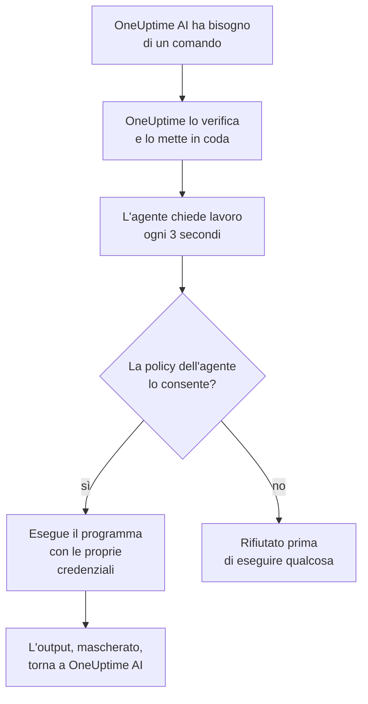

# Agenti IA per l'infrastruttura

OneUptime AI può guardare oltre la tua telemetria mentre indaga su un incidente o un avviso. Un piccolo agente installato accanto a una delle tue risorse (un host Docker o Podman, un cluster Docker Swarm, un cluster Proxmox, un VMware vCenter, un cluster Ceph, un server di database o un host Linux) esegue i comandi in sola lettura che OneUptime AI richiede, come `docker logs --tail 200 web`, `pvesh get /cluster/status`, `ceph health detail`, `db long-queries --min-seconds 30` o `journalctl -u nginx -n 200 --no-pager`, e ne restituisce l'output, così l'analisi della causa principale cita quello che dice la risorsa stessa. Se lo consenti, lo stesso agente applica anche correzioni (riavviare un container, avviare una VM, rimettere un OSD come in), ognuna classificata in un livello da una policy dei comandi e, salvo tua diversa scelta, approvata prima da una persona.

Questi agenti sono gli **agenti IA di risorsa**. La pagina di ogni risorsa nella dashboard ha una sezione **IA** con tre pagine:

- **Informazioni**: ciò che OneUptime AI ha scoperto sulla risorsa negli ultimi 30 giorni, cioè i problemi che continuano a ripresentarsi e perché, con quello che l'IA ha trovato e il passo che suggerisce, le parti della risorsa dietro la maggior parte di essi, le correzioni che non sono servite o che attendono l'approvazione, ciò che l'IA ha corretto da sola e i rischi individuati prima che qualcuno venisse allertato, con quello che l'IA stessa ha fatto lì come nota a piè di pagina. Funziona come quella di un cluster: vedi [Cosa ha imparato l'IA su un cluster](/docs/ai/ai-sre#cosa-ha-imparato-lia-su-un-cluster).
- **Registri**: tutto ciò che OneUptime AI ha fatto sulla risorsa, dal più recente: ogni indagine con il suo incidente o avviso e il suo riepilogo, ogni correzione proposta o eseguita e ogni comando inviato tramite l'agente. (Questa pagina prima si chiamava Informazioni.)
- **Agente IA**: se l'agente è connesso, cosa può fare l'IA sulla risorsa (indagare, e come vengono eseguite le correzioni), tutto ciò che richiede attenzione con il passo che lo risolve e, nel menu **⋯** accanto allo stato dell'agente, **Testa la connessione** e **Reimposta l'agente**.

La **Panoramica** della risorsa termina con una scheda **Agente IA** che riassume la pagina dell'agente IA: se l'agente è connesso, se l'indagine è attiva, come vengono eseguite le correzioni (**Disattivato**, **Chiedi l'approvazione**, **Automatico** o **Salta l'approvazione**) e cosa richiede attenzione, con un link alla pagina dell'agente IA, dove si modificano.

:::cards
- [Risorse supportate](#risorse-supportate): Otto tipi di risorsa, un'unica immagine.
- [Installare un agente IA](#installare-un-agente-ia): Accanto a un collector che già esegui, o su un host Linux.
- [Come funzionano le correzioni](#come-funzionano-le-correzioni): Cosa può essere eseguito da solo, cosa attende una persona e cosa non viene mai eseguito.
- [Modello di sicurezza](#modello-di-sicurezza): Tre controlli su ogni comando, e nessuna credenziale da OneUptime.
:::

## Come funziona

L'agente non attende mai una connessione da OneUptime: contatta OneUptime, chiede lavoro ed esegue solo ciò che la propria copia della policy dei comandi consente, con le credenziali che ha già.



## Il rapporto con l'agente IA di Kubernetes

I cluster Kubernetes hanno un proprio agente, l'agente IA di Kubernetes, installato dal chart Helm dell'agente Kubernetes: vedi [Accesso al cluster: lascia che OneUptime AI esegua kubectl](/docs/ai/ai-sre#accesso-al-cluster-lascia-che-oneuptime-ai-esegua-kubectl). Nulla in questa pagina lo modifica. Gli agenti IA di risorsa seguono lo stesso schema:

- **Gli stessi livelli e le stesse modalità.** Ogni comando è **Read**, **SafeWrite**, **RiskyWrite** o **Denied**, e le correzioni sono **Disattivato**, **Chiedi l'approvazione**, **Automatico** o **Salta l'approvazione**, con lo stesso significato che hanno su un cluster.
- **Gli stessi tre controlli.** La stessa policy dei comandi viene applicata dagli strumenti IA di OneUptime, di nuovo quando OneUptime mette in coda il comando, e ancora dall'agente prima di eseguire qualsiasi cosa.
- **La stessa regola sulle credenziali.** L'agente usa solo ciò che gli danno il suo ambiente e i suoi mount. OneUptime non gli invia mai una credenziale.
- **Gli stessi valori predefiniti.** Le indagini IA sono attive per impostazione predefinita: una risorsa parte con l'indagine attiva e le correzioni disattivate, come un cluster, così OneUptime AI indaga con il suo agente non appena si connette e non cambia nulla finché qualcuno non consente le correzioni (vedi [Connettersi a OneUptime](#connettersi-a-oneuptime)).

Cosa cambia:

- **Un'unica immagine per ogni risorsa.** `oneuptime/resource-ai-agent` serve tutti e otto i tipi di risorsa, e `ONEUPTIME_AI_AGENT_RESOURCE_TYPE` indica quale serve un agente. Gira accanto al collector della risorsa come un container in più, non da un chart Helm.
- **L'accesso in scrittura è una variabile d'ambiente.** È `ONEUPTIME_AI_ALLOW_WRITES=true` sull'agente a permettergli di applicare correzioni, e `ONEUPTIME_AI_WRITE_TARGETS` limita quali container, servizi, VM, OSD, sessioni o unit possono toccare. Su un cluster se ne occupano l'RBAC del chart e `aiAgent.remediation.namespaces`.

Come l'agente IA di Kubernetes, un agente IA di risorsa non è un Runner. Non compare mai in Runbook → Agenti di runbook e non viene mai usato come host Bash o SSH per i runbook.

## Risorse supportate

| Risorsa | `ONEUPTIME_AI_AGENT_RESOURCE_TYPE` | Agente | Si registra come (la variabile del collector) | Esegue | Raggiunge la risorsa tramite |
| -------------------- | ---------------------------------- | --------------------- | ----------------------------------------------------------------------------------------------- | -------------------------------------------------------------------------------------------------------------------------------------------------- | -------------------------------------------------------------------------- |
| Host Docker | `docker` | Agente IA Docker | `DOCKER_HOST_NAME` | `docker` | il socket Docker, `/var/run/docker.sock` |
| Host Podman | `podman` | Agente IA Podman | `PODMAN_HOST_NAME` | `docker`, tramite l'API compatibile con Docker di Podman | il socket Podman, `/run/podman/podman.sock` |
| Cluster Docker Swarm | `docker-swarm` (o `swarm`) | Agente IA Docker Swarm | `DOCKER_SWARM_CLUSTER_NAME` | `docker` | il socket Docker di un nodo manager |
| Cluster Proxmox | `proxmox` | Agente IA Proxmox | `PROXMOX_CLUSTER_NAME` | comandi `pvesh`, inviati all'API di Proxmox VE (nell'agente non c'è alcun binario `pvesh`) | `https://PVE_HOST:8006/api2/json`, con un token API di Proxmox |
| VMware vCenter | `vmware` (o `vcenter`) | Agente IA VMware | `VMWARE_VCENTER_NAME` | `govc` | l'API di vCenter, con un utente vSphere |
| Cluster Ceph | `ceph` | Agente IA Ceph | `CEPH_CLUSTER_NAME` | `ceph` | i monitor, con un `ceph.conf` e il keyring del client proprio dell'agente |
| Server di database | `database` (o `db`) | Agente IA per database | `DATABASE_SERVER_ID`, oppure `DATABASE_SYSTEM` + `DATABASE_SERVER_ADDRESS` + `DATABASE_SERVER_PORT` | `db`: un'operazione da un catalogo fisso di diagnostica, mai SQL | il driver proprio del database, con un login del database |
| Host | `host` | Agente IA dell'host | `HOST_NAME` (vuoto: il nome host dell'host stesso) | `systemctl`, `journalctl`, `df`, `free`, `uptime`, `ps`, `ss`, `ip`, `dmesg`, `lsblk`, `cat`, `top`, `uname`, `hostnamectl`, `timedatectl`, `kill` | `nsenter` nei namespace dell'host, da un container privilegiato |

Server di database: l'agente IA per database ha diagnostica per PostgreSQL, MySQL (e MariaDB e Percona Server), Redis (e Valkey, KeyDB e Dragonfly) e MongoDB. Per qualsiasi altro motore non esegue nulla e lo indica nella pagina dell'agente IA del database.

**Testa la connessione**, nel menu **⋯** accanto allo stato dell'agente nella pagina dell'agente IA, esegue questi comandi in sola lettura tramite l'agente e ne mostra l'output nella scheda dell'agente:

| Risorsa | Cosa esegue Testa la connessione |
| -------------------- | ---------------------------------------------------- |
| Host Docker | `docker version`, `docker info` |
| Host Podman | `docker version`, `docker info` |
| Cluster Docker Swarm | `docker version`, `docker node ls` |
| Cluster Proxmox | `pvesh get /version`, `pvesh get /cluster/status` |
| VMware vCenter | `govc about` |
| Cluster Ceph | `ceph health`, `ceph versions` |
| Server di database | `db ping`, `db version` |
| Host | `uptime`, `systemctl list-units --failed --no-pager` |

Su un worker Docker Swarm `docker node ls` fallisce: l'agente IA Docker Swarm deve girare su un nodo manager. Uno avviato su un worker non si registra per il cluster finché il suo nodo non diventa manager, e il programma di installazione di Docker Swarm lo esclude su un nodo che non è manager.

## Installare un agente IA

Ogni agente IA di risorsa è la stessa immagine, `oneuptime/resource-ai-agent:release`. Non richiede nulla nella dashboard: una volta avviato, si registra presso OneUptime e compare nella pagina dell'agente IA della risorsa entro un minuto.

### Accanto a un collector

Per Docker, Podman, Docker Swarm, Proxmox, VMware, Ceph e i server di database, l'agente gira accanto al collector che usi già per quella risorsa e ne condivide il `.env`: ha già `ONEUPTIME_URL`, la chiave di ingestione e il nome della risorsa. Il `docker-compose.yml` di ogni collector include l'agente come un servizio in più, e il suo `install.sh` lo avvia.

| Risorsa | Collector | Servizio dell'agente IA (e container) | Dove si configura |
| -------------------- | ----------------------------------------------------------- | --------------------------------- | ------------------------------------------------------------------------------------- |
| Host Docker | [Agent Docker](/docs/telemetry/docker-host#agente-ia) | `oneuptime-docker-ai-agent` | `agents/DockerAgent/docker-compose.yml`; `install.sh` lo avvia come secondo container |
| Host Podman | [Agent Podman](/docs/telemetry/podman-host#agente-ia) | `oneuptime-podman-ai-agent` | `agents/PodmanAgent/docker-compose.yml`; `install.sh` lo avvia come secondo container |
| Cluster Docker Swarm | [Agent Docker Swarm](/docs/telemetry/docker-swarm#agente-ia) | `oneuptime-docker-swarm-ai-agent` | `agents/DockerSwarmAgent/docker-compose.yml`, su un nodo manager |
| Cluster Proxmox | [Agent Proxmox](/docs/telemetry/proxmox#agente-ia) | `oneuptime-proxmox-ai-agent` | `agents/ProxmoxAgent/docker-compose.yml` |
| VMware vCenter | [Agent VMware](/docs/telemetry/vmware#agente-ia) | `oneuptime-vmware-ai-agent` | `agents/VMwareAgent/docker-compose.yml` |
| Cluster Ceph | [Agent Ceph](/docs/telemetry/ceph#agente-ia) | `oneuptime-ceph-ai-agent` | `agents/CephAgent/docker-compose.yml`, con il client Ceph proprio dell'agente in `./ceph` |
| Server di database | [Agent per database](/docs/telemetry/databases#agente-ia) | `oneuptime-database-ai-agent` | `agents/DatabaseAgent/docker-compose.yml` |

Un collector installato prima che esistesse l'agente IA non lo esegue ancora. Esegui di nuovo il suo `install.sh`: ora avvia anche l'agente IA (i programmi di installazione di Proxmox, VMware, Ceph, database e Docker Swarm scaricano il `docker-compose.yml` attuale, che contiene il servizio dell'agente IA). Se gestisci i file da solo, aggiungi il servizio dal `docker-compose.yml` del collector al tuo ed esegui `docker compose up -d`. La pagina dell'agente IA della risorsa mostra il servizio esatto per quella risorsa, con il nome già compilato.

Senza i programmi di installazione, l'agente IA Docker è un solo `docker run`:

```bash
docker run -d \
  --name oneuptime-docker-ai-agent \
  --user 0:0 \
  --restart unless-stopped \
  --read-only --tmpfs /tmp \
  -v /var/run/docker.sock:/var/run/docker.sock:ro \
  -e ONEUPTIME_URL="https://oneuptime.com" \
  -e ONEUPTIME_SERVICE_TOKEN="YOUR_TELEMETRY_INGESTION_TOKEN" \
  -e ONEUPTIME_AI_AGENT_RESOURCE_TYPE=docker \
  -e DOCKER_HOST_NAME="my-docker-host" \
  oneuptime/resource-ai-agent:release
```

`DOCKER_HOST_NAME` deve essere il nome che riporta l'Agent Docker. I programmi di installazione di Docker e Podman accettano `--no-ai-agent` (o `ONEUPTIME_INSTALL_AI_AGENT=false`) per escludere l'agente IA, e lo stesso vale per quello di Docker Swarm. Per eseguire in seguito un collector senza di esso, elimina il suo servizio dell'agente IA da `docker-compose.yml`, oppure rimuovi il suo container con `docker rm -f`.

### Agente IA dell'host

Un host Linux che invia dati tramite il [Collector OpenTelemetry sull'host](/docs/telemetry/host-otel-collector) non ha alcun container OneUptime accanto a cui mettersi, quindi l'agente IA dell'host ha un proprio programma di installazione (`agents/HostAIAgent`):

```bash
curl -fsSL https://raw.githubusercontent.com/OneUptime/oneuptime/master/agents/HostAIAgent/install.sh -o install.sh
sudo bash install.sh
```

Chiede il tuo URL di OneUptime, la chiave di ingestione della telemetria del progetto e il nome dell'host, scrive `/opt/oneuptime-host-ai-agent/.env` e `docker-compose.yml` e avvia il container `oneuptime-host-ai-agent`. Aggiungi `--systemd` per eseguirlo invece sotto la unit systemd `oneuptime-host-ai-agent`. Richiede Docker (il motore di sistema, non Docker rootless) con il plugin Compose; Podman in modalità rootful può eseguire lo stesso container.

L'agente IA dell'host esegue i **programmi dell'host stesso**: ogni comando viene eseguito come `nsenter --target 1 --mount --uts --ipc --net --pid -- PROGRAM ARGS`, che entra nei namespace dell'init dell'host. Questo richiede `pid: host`, `privileged: true` e root: vedi [Il socket Docker e l'agente IA dell'host sono root sull'host](#il-socket-docker-e-lagente-ia-dellhost-sono-root-sullhost). Lascia `HOST_NAME` vuoto per usare il nome host della macchina, che è quello che il collector riporta come `host.name` a meno che tu non l'abbia cambiato; altrimenti impostalo sul nome mostrato in **Host**.

### Connettersi a OneUptime

L'agente si registra con **la stessa identità che riporta il collector** (`DOCKER_HOST_NAME`, `PROXMOX_CLUSTER_NAME`, `CEPH_CLUSTER_NAME`, …; `ONEUPTIME_AI_AGENT_RESOURCE_NAME` la sostituisce), così serve esattamente la risorsa creata dalla telemetria del collector. Quando OneUptime non ha ancora una risorsa con quel nome, la registrazione la crea, quindi un nome diverso da quello del collector ti dà una seconda risorsa vuota invece di un errore. Un database si registra tramite `DATABASE_SERVER_ID` quando è impostato, altrimenti tramite motore, indirizzo e porta; un `DATABASE_SERVER_ID` che non è un database di questo progetto viene rifiutato.

Se il collector usa ancora il suo nome predefinito (`docker-host`, `podman-host`, `docker-swarm`, `proxmox-cluster`, `vmware-vcenter`, `ceph`), ogni risorsa installata con quel valore predefinito confluisce nella stessa risorsa in OneUptime, e i comandi destinati a essa potrebbero raggiungere una qualsiasi di loro. L'agente lo segnala con un avviso nel suo log; dai a ogni risorsa un nome univoco, sia sul collector sia sull'agente.

Si autentica con la chiave di ingestione della telemetria del progetto (la prima impostata tra `ONEUPTIME_API_KEY`, `ONEUPTIME_TELEMETRY_INGESTION_KEY` e `ONEUPTIME_SERVICE_TOKEN`, che i collector impostano già) e riceve una chiave tutta sua. Tutte le sue chiamate sono `POST` HTTPS a `<ONEUPTIME_URL>/resource-ai-agent-ingest/…`: si registra una volta all'avvio, invia un heartbeat ogni 30 secondi (risulta online per 5 minuti dopo l'ultimo), chiede lavoro ogni 3 secondi e si disconnette quando si ferma. Un secondo agente con la stessa identità viene rifiutato finché il primo è online: un container che si ferma in modo pulito si disconnette, quindi il suo sostituto viene ammesso subito, e dopo un crash o un kill il sostituto prende il suo posto non appena il vecchio non ha inviato nulla per 40 secondi dal primo rifiuto. Se viene ancora rifiutato dopo 10 minuti, un altro agente attivo usa la stessa identità: l'agente registra un errore che lo dice e chiede solo ogni 5 minuti, finché non dai a ogni risorsa il suo nome o non fermi l'altro agente. Un progetto ammette al massimo 250 agenti IA di risorsa, e al massimo 30 nuovi si registrano ogni ora. Raggiunti i 250, gli agenti di cui non si hanno notizie da 7 giorni vengono rimossi per fare posto a uno nuovo (la risorsa mantiene le sue impostazioni IA, e un agente del genere che ritorna si registra semplicemente di nuovo).

L'**Indagine** è attiva per ogni risorsa fin dall'inizio, così OneUptime AI indaga con l'agente non appena si connette. Oltre a questo, ciò che l'IA può fare sulla risorsa è un'impostazione propria dell'agente (vedi [Cosa può fare l'IA, deciso dall'agente](#cosa-può-fare-lia-deciso-dallagente)). Un agente che non indica nessuna delle due impostazioni usa i suoi valori predefiniti: attiva l'**indagine** per la sua risorsa e, se consente le scritture (`ONEUPTIME_AI_ALLOW_WRITES=true`), imposta le **Correzioni** su **Chiedi l'approvazione**, altrimenti su **Disattivato**. I suoi valori predefiniti valgono solo per una risorsa le cui impostazioni IA nessuno ha scelto nella pagina dell'agente IA: le impostazioni che qualcuno vi ha salvato restano come sono finché la configurazione dell'agente non le indica, quindi una risorsa il cui interruttore **Indagare** è stato spento da qualcuno resta spenta. Un agente precedente a queste impostazioni non ne riporta nessuna, e la pagina dell'agente IA le imposta, come prima.

**Reimposta l'agente**, nello stesso menu **⋯** della pagina dell'agente IA, fa dimenticare a OneUptime la chiave dell'agente una volta che confermi; chiunque la possedesse resta bloccato, e l'agente vero si registra di nuovo entro pochi minuti. L'agente richiede un server OneUptime della stessa versione della sua immagine, o più recente.

### Cosa può fare l'IA, deciso dall'agente

L'indagine e le correzioni si impostano dove gira l'agente (nel `.env` che condivide con il collector, o nell'ambiente del suo container) e OneUptime le segue:

| Variabile | Predefinito | Cosa fa |
| ---------------------------- | ------- | ----------------------------------------------------------------------------------------------------------------------------------------------------------------------------------------------------------------------------------------------------- |
| `ONEUPTIME_AI_INVESTIGATION` | vuoto | `true` consente all'IA di eseguire i comandi in sola lettura qui sotto mentre indaga; `false` la limita ai dati che OneUptime ha già. Vuoto: attiva. |
| `ONEUPTIME_AI_FIXES` | vuoto | Come l'IA può applicare una correzione: `off`, `ask-for-approval`, `automatic` o `bypass-approval` (vedi [Modalità di correzione](#modalità-di-correzione)). Qualsiasi modalità diversa da `off` richiede anche `ONEUPTIME_AI_ALLOW_WRITES=true`, e `off` mantiene l'agente in sola lettura anche con essa. Vuoto: `ask-for-approval` quando l'agente consente le scritture, altrimenti `off`. |

Per esempio, per lasciare che l'IA applichi correzioni con una persona che approva ciascuna:

```bash
ONEUPTIME_AI_INVESTIGATION=true
ONEUPTIME_AI_FIXES=ask-for-approval
ONEUPTIME_AI_ALLOW_WRITES=true
```

Poi riavvia l'agente (`docker compose up -d`, oppure esegui di nuovo l'`install.sh` del collector con questi valori impostati per un host Docker o Podman). L'agente li riporta entrambi quando si registra e a ogni heartbeat, e OneUptime li applica subito alla risorsa. La pagina dell'agente IA della risorsa li mostra quindi in sola lettura: **Cambia** mostra queste righe per l'opzione che scegli invece di salvare qualcosa, e OneUptime rifiuta una modifica fatta altrove (l'API, Terraform, un amministratore principale) finché l'agente li imposta. L'elenco dei comandi consentiti resta sulla pagina. Un valore che l'agente non riesce a leggere lascia quell'impostazione disattivata, e l'agente registra quale.

## Cosa può eseguire un'indagine

Un'indagine esegue sempre e solo comandi **Read**: osservano la risorsa e non cambiano nulla. OneUptime AI vede le risorse collegate all'incidente o all'avviso (tramite i loro monitor e la loro telemetria, al massimo 10 per segnale) il cui agente IA è connesso e il cui interruttore **Indagare** è attivo, ed esegue tutti i comandi di cui l'indagine ha bisogno (fino a 200 per indagine, una protezione contro un ciclo fuori controllo), ognuno citato come qualsiasi altra prova. Ogni comando è un programma con i suoi argomenti, mai tramite una shell, quindi pipe, redirezioni, `;`, `&&`, `$(…)` e `sudo` vengono rifiutati con un messaggio che lo dice. Un comando ha 30 secondi per impostazione predefinita e al massimo 2 minuti, e il suo output è limitato a 1024 KB sull'agente. Nulla di quell'output viene tagliato prima di OneUptime AI: un output lungo viene mostrato una pagina alla volta (i primi 40.000 caratteri, poi il resto su richiesta). Se un agente non preleva un comando, OneUptime AI smette di inviare comandi a quella risorsa per il resto dell'indagine.

Cosa può leggere ogni tipo di risorsa è indicato qui sotto. È lo stesso elenco che riceve l'IA stessa; tutto ciò che non vi compare viene rifiutato.

### Host Docker e Podman

- Container: `docker ps -a` (anche `-q`, `-n`, `-l`, `-s`, `--no-trunc`, `--filter`, `--format json`), `docker container inspect web`, `docker inspect --type container web`, `docker top web`, `docker port web`, `docker diff web`. I valori d'ambiente nell'output di inspect tornano mascherati.
- Log e attività: `docker logs --tail 200 web` o `docker logs --since 30m web`; è obbligatorio un `--tail` di al massimo 2000 o un `--since` (senza `--tail`, `--since` deve essere una durata di al massimo 24h), e `-f` non è mai consentito; `docker stats --no-stream`; `docker events --since 30m --until 0s` (entrambi i limiti obbligatori, `--until` come durata, così la finestra si chiude sempre nel passato).
- Il motore: `docker info`, `docker version`, `docker system df` (`-v` solo come tabella: `-v --format json` stampa la riga di comando di ogni passaggio di build), `docker images`, `docker image inspect nginx:1.27`, `docker network ls`, `docker network inspect bridge`, `docker volume ls`, `docker volume inspect data`.
- Solo `--format json` (o `table` per gli elenchi), mai un template Go, e nessuno dei flag globali di docker (`-H`, `--context`, `--config`, …): punterebbero la CLI verso un altro motore.

Un host Podman esegue la stessa CLI `docker` e la stessa policy, tramite l'API compatibile con Docker di Podman.

### Cluster Docker Swarm

- Nodi: `docker node ls`, `docker node ps node-1`, `docker node inspect node-1 --pretty`.
- Servizi: `docker service ls`, `docker service ps web --no-trunc`, `docker service inspect web --pretty` (i valori d'ambiente tornano mascherati), `docker service logs --tail 200 web` (è obbligatorio un `--tail` di al massimo 2000 o un `--since`, che da solo deve essere una durata di al massimo 24h; mai `-f`).
- Stack: `docker stack ls`, `docker stack ps shop`, `docker stack services shop`.
- Il motore del manager stesso: `docker ps -a`, `docker container inspect web`, `docker logs --tail 200 web`, `docker stats --no-stream`, `docker info`, `docker version`, `docker network ls` e il resto delle letture di un host Docker.

### Cluster Proxmox

Nell'agente non c'è `pvesh`. Un comando si scrive con la grammatica di `pvesh` (`get` o `ls` e un percorso dell'API, con le opzioni come `--name value`) e l'agente lo trasforma esattamente in un `GET` all'API di Proxmox VE con il proprio token. `--output-format json|json-pretty|text` sceglie l'output; le query string non sono accettate, e una scrittura deve indicare il suo nodo (mai `localhost`).

- Il cluster: `pvesh get /version`, `pvesh get /cluster/status`, `pvesh get /cluster/resources --type vm`, `pvesh get /cluster/ha/status/current`, `pvesh get /cluster/log --max 50`, `pvesh get /cluster/tasks`, `pvesh get /nodes` e gli elenchi di replica, backup, pool e storage.
- Un nodo: `pvesh get /nodes/pve1/status`, `pvesh get /nodes/pve1/services`, `pvesh get /nodes/pve1/storage`, `pvesh get /nodes/pve1/disks/list`, `pvesh get /nodes/pve1/rrddata --timeframe hour`, più la sua rete, la sua replica, gli aggiornamenti APT e lo stato di Ceph.
- Task e log: `pvesh get /nodes/pve1/tasks --errors 1 --limit 20`, lo stato e il log di un task, `pvesh get /nodes/pve1/syslog --limit 200`, `pvesh get /nodes/pve1/journal --lastentries 200`.
- Guest (`qemu` per le VM, `lxc` per i container): `pvesh get /nodes/pve1/qemu`, `pvesh get /nodes/pve1/lxc`, `pvesh get /nodes/pve1/qemu/101/status/current`, `pvesh get /nodes/pve1/qemu/101/config` (i segreti come le password di cloud-init tornano mascherati), le modifiche in sospeso, gli snapshot, `pvesh get /nodes/pve1/qemu/101/rrddata --timeframe hour` e le informazioni del guest agent QEMU come `pvesh get /nodes/pve1/qemu/101/agent/get-fsinfo`.
- Mai: nulla sotto `/access` (utenti, token API, ACL), le console (`vncproxy`, `termproxy`, `spiceproxy`), il monitor QEMU, le chiamate exec e sui file del guest agent.

### VMware vCenter

Prima viene il comando, poi i suoi flag, poi i nomi o i percorsi d'inventario (govc ignora i flag scritti dopo un argomento); `-dc DATACENTER` sceglie un datacenter.

- `govc about`, `govc datacenter.info`, `govc ls /DC/vm`, `govc find . -type m -runtime.powerState poweredOff`: la versione e l'inventario del vCenter (`find` filtra solo su nomi, tipi, stato di salute e proprietà di runtime; `ls -json` viene rifiutato, perché carica tutte le proprietà di ogni oggetto che elenca).
- `govc vm.info web-01`, `govc host.info esx-01`, `govc datastore.info datastore1`, `govc pool.info /DC/host/cluster1/Resources`: stato di alimentazione, host, sistema operativo guest, indirizzo IP, VMware Tools, capacità. `vm.info` è solo testo: `-json` e `-e` vengono rifiutati perché stampano la `extraConfig` della VM, dove si trovano i dati di cloud-init e le password.
- `govc events -n 50 /DC/vm/web-01`, `govc tasks -n 50`: eventi e task recenti (al massimo 500, mai `-f`).
- `govc metric.sample -n 12 /DC/vm/web-01 cpu.usage.average`, `govc metric.ls /DC/vm/web-01`, `govc object.collect -s /DC/vm/web-01 runtime.powerState` (solo proprietà di runtime e di salute), `govc host.service.ls -host esx-01`, `govc host.date.info -host esx-01`, `govc tags.ls`.
- Mai: i flag di connessione, credenziali, TLS e debug (`-u`, `-k`, `-cert`, `-debug`, `-dump`, …), le operazioni sul guest (`guest.*`), l'accesso ai file dei datastore, `esxcli`, `env` e qualsiasi comando non elencato.

### Cluster Ceph

- Il cluster: `ceph status` (o `ceph -s`), `ceph health detail`, `ceph df detail`, `ceph versions`, `ceph progress`, `ceph quorum_status`, `ceph log last 100`.
- Gli OSD: `ceph osd tree`, `ceph osd df`, `ceph osd perf`, `ceph osd stat`, `ceph osd dump`, `ceph osd blocked-by`, `ceph osd find 3`, `ceph osd metadata 3`, `ceph osd ok-to-stop 3`, `ceph osd safe-to-destroy 3`.
- Pool e placement group: `ceph osd pool ls detail`, `ceph osd pool stats`, `ceph osd pool get rbd size`, `ceph pg stat`, `ceph pg dump_stuck`, `ceph pg 1.2f query`, `ceph pg ls-by-osd 3`.
- Daemon, crash e cephadm: `ceph mon stat`, `ceph mgr services`, `ceph mgr module ls`, `ceph fs status`, `ceph mds stat`, `ceph balancer status`, `ceph crash ls`, `ceph crash stat`, `ceph orch ps`, `ceph orch ls`, `ceph orch host ls`, `ceph orch device ls`.
- Aggiungi `--format json` (o `-f json`, `json-pretty`, `plain`) per un output strutturato. Nessun'altra opzione è accettata (mai `-c`, `--keyring`, `--id`, `--admin-daemon`, `-i`, `-o` o `-w`), e `auth`, `config-key`, `config`, `tell` e `daemon` non vengono mai eseguiti.

### Server di database

`db` non è un programma: indica un'operazione da un catalogo fisso di diagnostica, che l'agente esegue tramite il driver proprio del database in una sessione in sola lettura, con un limite di tempo su ogni istruzione. OneUptime AI non scrive mai SQL, un comando Redis o codice della shell di MongoDB. I flag esistono solo in forma lunga (`--limit 20` o `--limit=20`).

- `db ping`, `db version`: se il server risponde, la sua versione e il suo uptime.
- `db sessions --limit 20` (anche `--state active`, `--user`, `--database`; `db current-ops` è equivalente): le sessioni e cosa esegue ciascuna.
- `db long-queries --min-seconds 30`, `db blocking`, `db locks`: le istruzioni lente, e chi attende un lock e chi lo detiene.
- `db replication`, `db connections`, `db database-sizes`, `db table-sizes --limit 20`, `db top-statements --limit 10`: il ritardo di replica, le connessioni rispetto al limite, dove vanno lo spazio e il tempo.
- `db settings work_mem` (o tutte le impostazioni): mai un'impostazione di credenziali come `requirepass`.
- Report del motore: `db slowlog`, `db info memory`, `db innodb-status`, `db memory`, `db keyspace`.

Il testo delle query nell'output è normalizzato (ogni letterale stringa e numerico diventa `?`), quindi i dati dei tuoi clienti in un'istruzione non raggiungono mai OneUptime.

### Host

- Servizi: `systemctl status nginx --no-pager -n 50`, `systemctl is-active nginx`, `systemctl list-units --failed --no-pager`, `systemctl list-timers --all`, `systemctl show nginx -p ActiveState,SubState,Result,NRestarts` (`-p` è obbligatorio, e sono consentite solo proprietà dello stato della unit: mai `Environment` e mai un file di unit).
- Log: `journalctl -u nginx -n 200 --no-pager`; ogni lettura richiede `-n` (al massimo 2000) o `--since`, mai `-f`; inoltre `-p err`, `-k`, `-b`, `--until`, `-g`, `-t`, `-o short-iso|json`; `journalctl --list-boots`, `journalctl --disk-usage`.
- Risorse: `uptime`, `free -m`, `df -h`, `df -i`, `lsblk -f`, `uname -a`, `hostnamectl`, `timedatectl`, `dmesg -T --level=err,warn`.
- Processi: `ps aux --sort=-%cpu`, `top -b -n 1 -o %MEM`. Le password nelle righe di comando tornano mascherate.
- Rete: `ss -tulpn`, `ss -s`, `ip -br addr`, `ip route`, `ip route get 1.1.1.1`.
- Contatori del kernel: `cat /proc/loadavg`, `cat /proc/meminfo`, `cat /proc/pressure/memory`, `cat /etc/os-release`; `cat` legge solo un breve elenco di file in `/proc` e `/etc/os-release`, nient'altro.
- Un programma per comando, indicato senza percorso: mai una shell, `sudo` o qualsiasi altro programma.

## Come funzionano le correzioni

Le correzioni restano disattivate finché non le attivi, e per farlo servono due impostazioni sull'agente: `ONEUPTIME_AI_FIXES` impostato su una modalità diversa da `off` (vedi [Cosa può fare l'IA, deciso dall'agente](#cosa-può-fare-lia-deciso-dallagente)) e `ONEUPTIME_AI_ALLOW_WRITES=true` (vedi [Accesso in scrittura sull'agente](#accesso-in-scrittura-sullagente)). Una sola delle due non cambia nulla. Un agente precedente a `ONEUPTIME_AI_FIXES` prende invece le **Correzioni** dalla pagina dell'agente IA della risorsa. Le correzioni richiedono anche che l'IA sia abilitata per il progetto (**Abilita IA** in Impostazioni del progetto → IA → AI Features), cosa che vale a meno che qualcuno non l'abbia disattivata.

### Modalità di correzione

Le correzioni hanno le stesse quattro modalità di un cluster Kubernetes; `ONEUPTIME_AI_FIXES` le scrive `off`, `ask-for-approval`, `automatic` e `bypass-approval`:

- **Disattivato**: l'IA si limita a indagare.
- **Chiedi l'approvazione**: dopo l'analisi della causa principale, OneUptime AI fa una diagnosi con comandi di lettura e compone il più piccolo piano che affronta la causa, per esempio `docker restart web`. Il piano compare sull'incidente o sull'avviso con la sua motivazione, l'effetto previsto e il rollback; una persona lo approva con un clic, e OneUptime esegue esattamente quei comandi.
- **Automatico**: le modifiche sicure (**SafeWrite**) vengono eseguite da sole; una modifica più rischiosa (**RiskyWrite**) viene proposta per l'approvazione, a meno che l'elenco dei comandi consentiti della risorsa non ne indichi la forma esatta.
- **Salta l'approvazione**: ogni modifica che la policy consente, comprese quelle più rischiose, viene eseguita da sola. Ciò che richiede sempre una persona continua ad attenderne una.

Dopo l'esecuzione di una correzione, OneUptime osserva i monitor dell'incidente o dell'avviso. Se non si riprendono, viene eseguito il rollback del piano e OneUptime AI compone un altro piano, con il tentativo fallito davanti: al massimo due giri per incidente o avviso. In modalità **Automatico** quel secondo giro chiede l'approvazione; con **Salta l'approvazione** viene eseguito anch'esso da solo. Le correzioni non presidiate hanno un interruttore di sicurezza a tre per risorsa all'ora: oltre quel limite, o mentre un altro giro non presidiato di OneUptime AI sta ancora modificando o verificando la stessa risorsa, un giro propone il suo piano per l'approvazione invece di eseguirlo.

Un incidente o un avviso ha una sola corsia di correzione IA. Quando è collegato a un cluster Kubernetes con le correzioni attive, viene eseguito il giro del cluster e nessun giro di risorsa. Altrimenti il giro va alla prima risorsa collegata con le correzioni attive e un agente pronto, in questo ordine: host Docker, host Podman, cluster Docker Swarm, cluster Proxmox, VMware vCenter, cluster Ceph, server di database, host. Il giro modifica solo quella risorsa.

### Sicuro, più rischioso e mai

| Livello | Cosa significa | Viene eseguito |
| -------------- | ------------------------------------------------------------------------------------------------------------------------------------- | ------------------------------------------------------------------------------------------------------------ |
| **Read** | Osserva la risorsa e non cambia nulla | Nelle indagini e nei giri di correzione, sempre |
| **SafeWrite** | Una modifica reversibile a esattamente un oggetto con nome: riavviare un container, avviare una VM, rimettere un OSD come in, riavviare una unit | Da sola in **Automatico** e **Salta l'approvazione**; dopo l'approvazione in **Chiedi l'approvazione** |
| **RiskyWrite** | Una modifica che può mettere fuori servizio qualcosa o cambiare ciò che gira: fermare, terminare, spegnere, scalare a zero, una nuova immagine, più oggetti insieme | Da sola in **Salta l'approvazione**, o in **Automatico** quando l'elenco dei consentiti la indica; altrimenti dopo l'approvazione |
| **Denied** | Tutto il resto, soprattutto qualsiasi cosa esegua codice, elimini dati, legga credenziali o che la policy non conosce | Mai, nemmeno quando una persona la approva |

Alcune modifiche più rischiose **richiedono sempre una persona** in ogni modalità, Salta l'approvazione compresa, e nessuna voce dell'elenco dei consentiti cambia questo: sono indicate come tali nelle tabelle qui sotto.

### Correzioni sugli host Docker e Podman

| | Comandi |
| ------------------- | ----------------------------------------------------------------------------------------------------------------------------------------------------------------------------------------------------------------------------------------------------------------------------------------------------- |
| **Sicuro** | `docker restart web` (`-t 30` va bene), `docker start web`, `docker unpause web`: un container |
| **Più rischioso** | `docker stop web`, `docker kill -s TERM web` (TERM, INT, HUP, QUIT, USR1, USR2 o KILL), `docker pause web`, `docker update --memory 1g web` (anche `--memory-swap`, `--memory-reservation`, `--cpus`, `--cpu-shares`, `--restart`, `--pids-limit`) e `docker restart web api` (più container) |
| **Sempre una persona** | — |
| **Mai** | `docker exec web sh`, `docker run nginx`, `docker rm web`, `docker system prune`, `docker cp web:/etc/passwd .`, `docker compose up -d`, create, build, pull, push, login, commit, save, load, le modifiche a reti e volumi, i comandi swarm e qualsiasi altro flag di `update` |

### Correzioni sui cluster Docker Swarm

| | Comandi |
| ------------------- | --------------------------------------------------------------------------------------------------------------------------------------------------------------------------------------------------------------------------------------------------------------------------------------------------------------------------------------- |
| **Sicuro** | `docker service update --force web` (un riavvio graduale), `docker service rollback web`, `docker service scale web=3` (a 1 o più): un servizio |
| **Più rischioso** | `docker service scale web=0`, `docker service update --image nginx:1.27 web`, `docker service update --replicas 5 web`, `docker service update --limit-memory 1g web` (anche i limiti di CPU, le prenotazioni e la policy di aggiornamento), `docker node update --availability active node-1` |
| **Sempre una persona** | `docker node update --availability drain node-1`, `docker node update --availability pause node-1` |
| **Mai** | `docker service rm web`, `docker stack deploy -c stack.yml shop`, `docker secret ls`, `docker node rm node-1`, `docker service update --env-add A=b web` (ambiente, mount, secret, reti, porte, utente), le config, la promozione e le etichette dei nodi, e `docker restart web`: modificare un container sul manager non è una correzione Swarm |

Subito prima che una modifica venga eseguita, gli agenti IA Docker, Podman e Docker Swarm cercano il suo obiettivo sul motore e rifiutano una modifica il cui obiettivo la rende più di quanto dica il suo livello: fermare o terminare un container avviato con `--rm` (docker lo eliminerebbe insieme ai suoi volumi anonimi), avviare un container occasionale fermo creato da `docker compose run` (il suo job verrebbe eseguito di nuovo) e qualsiasi aggiornamento, scalatura o rollback di un servizio job di Swarm (`replicated-job` o `global-job`: ognuno esegue di nuovo il job). Una modifica del genere viene lasciata a una persona, chiunque l'abbia approvata.

### Correzioni sui cluster Proxmox

Una correzione è `create` e un percorso dell'API: un `POST` all'API di Proxmox VE. `{type}` è `qemu` per una VM e `lxc` per un container. L'agente segue il task avviato da una correzione finché non si ferma, quindi un guest che non si avvia viene segnalato come una correzione fallita, con il log del task.

| | Comandi |
| ------------------- | -------------------------------------------------------------------------------------------------------------------------------------------------------------------------------------------------------------------------------------------------------------------------------------------------------------------------------------------------------------------------------------------------------------------------------------------------------------------------------------------------------------------------- |
| **Sicuro** | `pvesh create /nodes/pve1/qemu/101/status/start`, `pvesh create /nodes/pve1/lxc/102/status/start`, `pvesh create /nodes/pve1/qemu/101/status/resume`, `pvesh create /nodes/pve1/qemu/101/status/reboot`: un guest |
| **Più rischioso** | `pvesh create /nodes/pve1/qemu/101/status/shutdown`, `pvesh create /nodes/pve1/qemu/101/status/stop`, `pvesh create /nodes/pve1/qemu/101/status/suspend`, `pvesh create /nodes/pve1/qemu/101/status/reset` e `pvesh create /nodes/pve1/services/pveproxy/restart` (avvio, riavvio o ricaricamento di pveproxy, pvedaemon, pvestatd, pve-ha-lrm, pve-ha-crm, spiceproxy, pvescheduler, pve-firewall, chrony, cron o postfix) |
| **Sempre una persona** | `pvesh create /nodes/pve1/qemu/101/migrate --target pve2`, `pvesh create /nodes/pve1/services/corosync/restart` (e l'avvio, il riavvio o il ricaricamento di `pve-cluster`) |
| **Mai** | `pvesh set /nodes/pve1/qemu/101/config --memory 4096` (qualsiasi modifica di configurazione), `pvesh delete /nodes/pve1/qemu/101`, `pvesh create /nodes/pve1/services/pveproxy/stop` (fermare un servizio del nodo), `pvesh create /nodes/pve1/status --command reboot` (riavvio o spegnimento del nodo), `pvesh create /nodes/pve1/stopall`, `pvesh create /nodes/pve1/qemu/101/snapshot --snapname before`, `pvesh get /access/users`, `pvesh create /nodes/pve1/qemu/101/vncproxy`, `pvesh create /nodes/pve1/qemu/101/agent/exec --command ls` |

### Correzioni su VMware vCenter

Ogni VM viene indicata con esattezza, meglio se con il suo percorso d'inventario completo, perché govc applica un nome semplice a ogni VM che lo porta, in qualsiasi cartella, e ogni host ESXi solo con il suo nome, perché un percorso può indicare un intero cluster. Niente caratteri jolly né riferimenti a oggetti gestiti (`vm-42`), e i flag prima dei nomi.

| | Comandi |
| ------------------- | -------------------------------------------------------------------------------------------------------------------------------------------------------------------------------------------------------------------------------------------------------------------------------------------------------------------------------------------------------------- |
| **Sicuro** | `govc vm.power -on /DC/vm/web-01`, `govc vm.power -r /DC/vm/web-01` (un riavvio ordinato del guest tramite VMware Tools): una VM, indicata con il suo percorso d'inventario |
| **Più rischioso** | `govc vm.power -s web-01` (spegnimento del guest), `govc vm.power -off web-01`, `govc vm.power -reset web-01`, `govc vm.power -suspend web-01` (`-force` solo con `-off` o `-reset`), `govc vm.power -on web-01 web-02` (più VM), `govc vm.power -on web-01` (un nome semplice: ogni VM chiamata web-01), `govc host.maintenance.exit esx-01` |
| **Sempre una persona** | `govc vm.migrate -host esx-02 web-01`, `govc host.maintenance.enter esx-01` |
| **Mai** | `govc vm.destroy web-01` (e create, clone, change, register), `govc snapshot.create -vm web-01 before`, `govc guest.run -vm web-01 ls`, `govc vm.info -e web-01`, `govc env`, `govc host.esxcli -host esx-01 system version get`, dispositivi e dischi, l'accesso ai file dei datastore, l'aggiunta, la rimozione, il riavvio e lo spegnimento degli host, permessi, ruoli, sessioni e licenze |

### Correzioni sui cluster Ceph

Ogni correzione indica un OSD (`3` o `osd.3`), un PG (`1.2f`), un daemon (come lo elenca `ceph orch ps`), un servizio o un report di crash.

| | Comandi |
| ------------------- | -------------------------------------------------------------------------------------------------------------------------------------------------------------------------------------------------------------------------------------------------------------------------------------------------------------------------------------------- |
| **Sicuro** | `ceph osd in 3`, `ceph osd unset noout` (anche norebalance, nobackfill, norecover, noscrub, nodeep-scrub, pause), `ceph orch daemon restart osd.3`, `ceph pg scrub 1.2f`, `ceph pg deep-scrub 1.2f` e l'archiviazione di un report di crash |
| **Più rischioso** | `ceph osd out 3`, `ceph osd down 3`, `ceph osd set noout`, `ceph osd reweight 3 0.8`, `ceph pg repair 1.2f`, `ceph mgr fail`, `ceph orch daemon stop osd.3`, `ceph orch restart rgw.default`, `ceph crash archive-all`, `ceph balancer on` |
| **Sempre una persona** | `ceph osd set pause` (ferma tutto l'I/O dei client), `ceph osd pool set rbd size 3` (e `min_size`) |
| **Mai** | `ceph osd purge 3` (e destroy, rm, lost, le modifiche alla mappa CRUSH), `ceph osd pool delete rbd` (e la creazione, la ridenominazione o qualsiasi altra impostazione dei pool), `ceph auth ls`, `ceph config-key ls`, `ceph tell osd.3 injectargs --debug-osd 20`, `ceph --id admin status`, `config`, `daemon`, le modifiche a fs e mon, `mgr module enable`, `orch apply`, `crash rm` |

### Correzioni sui server di database

`12345` qui sotto è un id di sessione come lo stampa `db sessions`: il pid di PostgreSQL, l'id della processlist di MySQL, l'id del client Redis o l'opid di MongoDB. L'agente cerca prima la sessione e non tocca mai la propria connessione, un thread del server o di replica, né una sessione che non esiste.

| | Comandi |
| ------------------- | ----------------------------------------------------------------------------------------------------------------------------------------------------------------------------------------------------- |
| **Sicuro** | `db cancel-query 12345`: annulla l'istruzione che una sessione sta eseguendo; la sessione resta connessa (PostgreSQL, MySQL/MariaDB, MongoDB) |
| **Più rischioso** | `db terminate-session 12345`: disconnette una sessione ed esegue il rollback della sua transazione aperta (PostgreSQL, MySQL/MariaDB, Redis) |
| **Sempre una persona** | — |
| **Mai** | `db query "SELECT 1"`, `db sql DROP TABLE users`: niente SQL, nessuna modifica alle impostazioni (`ALTER SYSTEM`, `SET GLOBAL`, `CONFIG SET`), nessun `FLUSHALL`, nessuno `SHUTDOWN`, nessuna modifica a schema, dati, utenti o replica |

### Correzioni sugli host

Le unit si indicano con il loro nome completo: `systemctl restart nginx` riavvia `nginx.service`.

| | Comandi |
| ------------------- | -------------------------------------------------------------------------------------------------------------------------------------------------------------------------------------------------------------------------------------------------------------------------------------------------------------------------------------------------------------------- |
| **Sicuro** | `systemctl restart nginx`, `systemctl start nginx`, `systemctl reload nginx`, `systemctl reset-failed nginx` (anche `try-restart` e `reload-or-restart`): una unit di tipo service, socket, timer o path |
| **Più rischioso** | `systemctl stop nginx`, `systemctl restart nginx php-fpm` (più unit), `journalctl --vacuum-size=500M` (anche `--vacuum-time`, `--vacuum-files`) e `systemctl reset-failed` senza una unit |
| **Sempre una persona** | `systemctl restart sshd` e qualsiasi altra modifica a una unit protetta (ssh, `systemd-*`, udev, dbus, polkit, NetworkManager, networking, getty e autovt, docker, containerd, podman, kubelet, il firewall, `user@` e le unit di aggiornamento dei pacchetti come `apt-daily-upgrade` e `unattended-upgrades`), `systemctl restart docker`, `systemctl restart local-fs.target` (qualsiasi unit `.target`, `.mount`, `.automount` o `.swap`), `kill -TERM 4242` (inviare un segnale a un processo) |
| **Mai** | `systemctl enable nginx` (e disable, mask, edit), `systemctl daemon-reload`, `systemctl reboot` (e poweroff, halt, suspend, rescue e le loro unit come `reboot.target` e `runlevel6.target`), `systemctl start debug-shell` (una shell di root senza password), `systemctl cat nginx`, `systemctl show nginx -p Environment`, `journalctl -f -u nginx`, `ip link set eth0 down`, `kill -9 1`, `cat /etc/shadow`, `bash -c uptime`, `sudo systemctl restart nginx`, `dmesg --clear`, `ss -K` |

### L'elenco dei comandi consentiti

In modalità **Automatico**, l'**Elenco dei comandi consentiti** della risorsa, nella pagina dell'agente IA, permette ai comandi più rischiosi che indichi di essere eseguiti senza approvazione. Viene confrontato parola per parola con il comando, non come testo:

- `*` sta per esattamente **una parola intera** (un nome, un id, un valore), mai per parte di una parola né per parole o flag in più. `docker update --memory * web` consente qualsiasi limite di memoria per `web`; `docker stop web-*` non corrisponde a nulla, perché `*` non sta mai per parte di una parola.
- Ogni parola del comando deve essere nella voce, flag compresi, e la voce deve avere almeno due parole dopo il programma. `*` non può stare per il verbo: `docker *` e `docker * web` vengono rifiutati quando li salvi.
- Una voce che non può mai pre-approvare una modifica viene rifiutata: un comando in sola lettura (le letture non richiedono mai approvazione), un comando che la policy nega o uno per un altro tipo di risorsa. Un elenco contiene al massimo 50 voci di al massimo 500 caratteri.
- Una voce con un `*` al posto dell'obiettivo (`docker stop *` pre-approva l'arresto di **ogni** container) ti chiede una conferma prima di essere salvata.
- Un percorso Proxmox è una sola parola, quindi non può contenere un `*`: scrivi una voce per guest, come `pvesh create /nodes/pve1/qemu/100/status/shutdown`.
- Nulla nell'elenco dei consentiti scavalca una modifica che richiede sempre una persona, né un comando che la policy nega.

Una voce valida per risorsa: `docker stop web` (Docker e Podman), `docker service update --image nginx:1.27 web` (Docker Swarm), `pvesh create /nodes/pve1/qemu/100/status/shutdown` (Proxmox), `govc vm.power -off web-01` (VMware), `ceph osd out 3` (Ceph), `db terminate-session 12345` (database), `systemctl stop nginx` (host).

### Chi può modificarlo

Finché l'agente imposta l'indagine e le correzioni, queste si modificano dove gira, chiunque tu sia, e quanto segue vale solo per l'elenco dei comandi consentiti. Per un agente precedente a queste impostazioni, che le lascia alla pagina dell'agente IA: attivare le correzioni (qualsiasi passaggio da **Disattivato**, verso **Chiedi l'approvazione** compreso) e allentarle (passare ad **Automatico** o **Salta l'approvazione**, o aggiungere una voce all'elenco dei consentiti) richiede un Project Owner, un Project Admin o il permesso **Edit AI Rule**, cioè le stesse persone che possono creare una regola IA che corregge senza chiedere. **Reimposta l'agente** richiede le stesse persone. Restringere (**Disattivato**, una modalità meno autonoma, rimuovere voci dall'elenco dei consentiti) e l'interruttore **Indagare** sono aperti a chiunque possa modificare la risorsa, così come **Testa la connessione** e approvare una correzione che OneUptime AI propone per essa. Tutto questo richiede il permesso di modificare proprio quella risorsa: un permesso limitato ad alcune etichette, o alle risorse che appartengono a te o ai tuoi team, raggiunge solo quelle risorse, e una voce di blocco con etichette toglie le risorse che le portano.

## Accesso in scrittura sull'agente

Qualunque cosa dica la pagina dell'agente IA, l'agente stesso rifiuta ogni modifica a meno che non sia stato avviato con l'accesso in scrittura. Decide il suo ambiente:

| Variabile | Predefinito | Cosa fa |
| -------------------------------- | ------- | -------------------------------------------------------------------------------------------------------------------------------------------------------------------------------------------------------------------------------------------------- |
| `ONEUPTIME_AI_ALLOW_WRITES` | `false` | È `true` a permettere all'agente di eseguire modifiche. Qualsiasi altro valore (non impostato, `false`, un refuso, `yes`) lo mantiene in sola lettura, e l'agente registra un avviso per un valore che non è né `true` né `false`. |
| `ONEUPTIME_AI_WRITE_TARGETS` | vuoto | Glob separati da virgole degli obiettivi che una modifica può toccare; `*` corrisponde a qualsiasi sequenza di caratteri, e il confronto distingue maiuscole e minuscole. Vuoto significa qualsiasi obiettivo tranne quelli protetti. Quando è impostata, una modifica che non indica i suoi obiettivi viene rifiutata. |
| `ONEUPTIME_AI_PROTECTED_TARGETS` | vuoto | Glob separati da virgole degli obiettivi che OneUptime AI non deve mai modificare, oltre a quelli che l'agente protegge da sé. Il confronto non distingue maiuscole e minuscole. |

Impostale nel `.env` che l'agente condivide con il collector (o nell'ambiente del suo container) e riavvialo con `docker compose up -d`. Un elenco con più di 64 voci, o con una voce più lunga di 256 caratteri, mantiene l'agente in sola lettura finché non viene corretto.

L'agente riporta queste impostazioni a OneUptime a ogni heartbeat, quindi OneUptime rifiuta già una correzione che ne esce quando OneUptime AI la propone, e di nuovo quando qualcuno la approva: non raggiunge mai l'agente come correzione fallita. Anche l'agente la rifiuta, prima di eseguire qualsiasi cosa.

### Obiettivi di scrittura per risorsa

| Risorsa | Gli obiettivi di una modifica, come li vede `ONEUPTIME_AI_WRITE_TARGETS` | Esempio |
| ----------------------- | ---------------------------------------------------------------------------------------------------------------------------------------------------------------------------------------------------- | ----------------------- |
| Host Docker e Podman | nomi o id dei container, come li scrive il comando | `web-*,api-*` |
| Cluster Docker Swarm | nomi dei servizi (`web`, non `web=3`) e nomi dei nodi | `web_*,api_*` |
| Cluster Proxmox | il VMID di un guest (`101`); un servizio del nodo come `<node>/<service>` (`pve1/pveproxy`) | `100,101,pve1/pveproxy` |
| VMware vCenter | nomi di VM e di host o percorsi d'inventario, esattamente come li scrive il comando; elenca entrambe le forme se usi i percorsi | `web-*,/DC/vm/web/*` |
| Cluster Ceph | `osd.3` (che il comando abbia scritto `3` o `osd.3`), un nome di pool, un id di PG, un nome di daemon, un nome di servizio, `mgr.NAME`, `crash/ID` e `cluster` per le modifiche a livello di cluster come `ceph osd set noout` | `osd.*,cluster` |
| Server di database | `session:<id>` | `session:*` |
| Host | nomi completi delle unit (`nginx.service`), `pid:<pid>` per un processo, `journal` per una pulizia del journal | `nginx.service,app-*` |

### Cosa protegge l'agente da sé

OneUptime AI non modifica mai l'agente stesso né ciò in cui gira, qualunque cosa dica `ONEUPTIME_AI_WRITE_TARGETS`:

- **Docker, Podman e Docker Swarm:** il container dell'agente stesso (per nome e per id) e il suo servizio Swarm, e i container degli agenti Docker, Podman e Docker Swarm di OneUptime, cioè i collector, il poller dell'inventario Swarm e i loro agenti IA. Finché l'agente non ha trovato il proprio container, rifiuta ogni modifica.
- **VMware vCenter:** la VM che porta il nome dell'host in `VCENTER_ENDPOINT` (e il suo nome breve), di norma l'appliance vCenter stessa, qualunque sia il percorso d'inventario con cui un comando la indica. L'agente conosce l'appliance solo con quel nome: quando `VCENTER_ENDPOINT` è un indirizzo IP (in quel caso l'agente avvisa all'avvio), o la VM dell'appliance ha un altro nome, inserisci quella VM in `ONEUPTIME_AI_PROTECTED_TARGETS`.
- **Server di database:** la sessione dell'agente stesso.
- **Host:** ogni unit di OneUptime (`oneuptime-*`, compresa quella dell'agente IA dell'host), il collector OpenTelemetry (`otelcol-contrib.service`, `otelcol.service`), il motore Docker in cui gira (`docker.service`, `docker.socket`, `containerd.service`), più il processo dell'agente stesso e i processi sopra di esso.
- **Proxmox:** l'agente non può sapere in quale guest gira. Se gira in una VM o in un container dello stesso cluster, inserisci quel VMID in `ONEUPTIME_AI_PROTECTED_TARGETS`; fai lo stesso con la VM dell'agente su VMware.

## Credenziali e privilegio minimo

L'agente usa solo le credenziali del proprio ambiente e dei propri mount, per lo più quelle del collector, dallo stesso `.env`. Un job che porta con sé una credenziale viene rifiutato: OneUptime non ne invia mai. Qualunque cosa consenta la policy dei comandi, la risorsa stessa lascia fare all'agente solo ciò che quella credenziale permette, quindi la credenziale è il limite invalicabile. Dai alle indagini un'identità in sola lettura, e alle correzioni un'identità separata con esattamente i diritti di cui hanno bisogno.

| Risorsa | Cosa usa l'agente | Per le indagini | Per le correzioni |
| ---------------------------- | --------------------------------------------------------------------------------------------------------------------------------------------------------------------------------------------------------------------------------------- | --------------------------------------------------------------------- | ---------------------------------------------------------------------------------------------------------------------------------------------------------------------------------------------------------------------------- |
| Docker, Podman, Docker Swarm | Il socket del motore, montato nel container (`DOCKER_HOST` ne cambia la posizione) | Non esiste un socket in sola lettura: lascia `ONEUPTIME_AI_ALLOW_WRITES` non impostato | `ONEUPTIME_AI_WRITE_TARGETS` sui container o servizi che l'IA può modificare |
| Cluster Proxmox | `PVE_API_TOKEN_ID` / `PVE_API_TOKEN_SECRET` (il token del collector), oppure `ONEUPTIME_AI_PVE_API_TOKEN_ID` / `ONEUPTIME_AI_PVE_API_TOKEN_SECRET` se impostati; `PVE_HOST`, `PVE_PORT`, `PVE_VERIFY_SSL`, `PVE_CA_FILE` | Il token `PVEAuditor` del collector | Un token proprio dell'agente con `VM.PowerMgmt` (per esempio il ruolo `PVEVMUser`) su `/vms`, o meglio su un pool o su singoli VMID; `Sys.Modify` su un nodo solo se l'IA può riavviare i servizi del nodo |
| VMware vCenter | `VCENTER_USERNAME` / `VCENTER_PASSWORD` (l'utente del collector), oppure `ONEUPTIME_AI_VCENTER_USERNAME` / `ONEUPTIME_AI_VCENTER_PASSWORD` se impostati; `VCENTER_ENDPOINT`, `VCENTER_INSECURE_SKIP_VERIFY`, `VCENTER_CA_FILE`, `GOVC_DATACENTER` | L'utente del collector con il ruolo **Read-Only** | Un utente proprio dell'agente con `VirtualMachine.Interact.PowerOn`, `PowerOff`, `Reset` e `Suspend`, concessi solo sulle cartelle che l'IA può correggere; `Host.Config.Maintenance` e i privilegi di migrazione solo se vuoi quelle correzioni |
| Cluster Ceph | Il keyring del suo client, `client.oneuptime-ai`, e un `ceph.conf` minimo, montati in `/etc/ceph` (`CEPH_CLIENT_ID`, `CEPH_CONF`, `CEPH_KEYRING`) | `mon 'allow r' mgr 'allow r' osd 'allow r'`, mai il keyring di amministrazione | Le cap di lettura più voci `allow command` esattamente per le correzioni (il README dell'agente Ceph le elenca) |
| Server di database | `DATABASE_USERNAME` / `DATABASE_PASSWORD` (il login del collector), oppure `ONEUPTIME_AI_DATABASE_USERNAME` / `ONEUPTIME_AI_DATABASE_PASSWORD` se impostati; `DATABASE_ENDPOINT` e le impostazioni TLS | Il login di monitoraggio del collector (`pg_monitor` su PostgreSQL) | Un login proprio dell'agente che possa inviare segnali ad altre sessioni: `pg_signal_backend` (PostgreSQL), `CONNECTION_ADMIN` (MySQL 8), `+client\|kill` (ACL di Redis), l'azione `killop` (MongoDB) |
| Host | Nulla: gira con privilegi come root nei namespace dell'host | Lascia `ONEUPTIME_AI_ALLOW_WRITES` non impostato | `ONEUPTIME_AI_WRITE_TARGETS` sulle unit che l'IA può modificare |

I README dei collector riportano i comandi esatti: i comandi `pveum` per un token di correzione Proxmox ([ProxmoxAgent](https://github.com/OneUptime/oneuptime/tree/master/agents/ProxmoxAgent)), il ruolo vSphere per le correzioni ([VMwareAgent](https://github.com/OneUptime/oneuptime/tree/master/agents/VMwareAgent)), le cap Ceph di lettura e di correzione ([CephAgent](https://github.com/OneUptime/oneuptime/tree/master/agents/CephAgent)) e i grant del database per ogni motore ([DatabaseAgent](https://github.com/OneUptime/oneuptime/tree/master/agents/DatabaseAgent)).

## Modello di sicurezza

### Tre punti di controllo

Ogni comando è un elenco di argomenti, mai una riga di shell, e la stessa policy dei comandi (una copia in OneUptime, una copia identica byte per byte nell'agente) ne decide il livello in tre punti:

1. **Gli strumenti di OneUptime AI.** Lo strumento di indagine rifiuta tutto ciò che non è un Read; gli strumenti di correzione rifiutano i comandi Denied, applicano la modalità, l'elenco dei consentiti e l'accesso in scrittura riportato dall'agente, e inviano all'approvazione una modifica che richiede una persona.
2. **Quando OneUptime lo mette in coda.** Ogni comando viene verificato di nuovo: un comando Denied viene rifiutato, un'indagine può mettere in coda solo Read, la risorsa deve appartenere a questo progetto e il suo agente essere online, l'interruttore di indagine o di correzione deve essere attivo, il job non può portare alcuna credenziale, e una modifica deve rientrare nell'accesso in scrittura riportato dall'agente. Un progetto può mettere in coda al massimo 240 comandi di indagine e 30 comandi di correzione all'ora.
3. **Sull'agente, prima che venga eseguito qualcosa.** L'agente rifiuta un job che non sia un comando IA per la propria risorsa (l'identità con cui si è registrato e il suo id OneUptime), un programma che la sua risorsa non esegue, un comando che la sua policy nega o classifica più in alto del livello inviato da OneUptime, tutto ciò che non è un Read in un'indagine, e una modifica finché `ONEUPTIME_AI_ALLOW_WRITES` non è `true` o al di fuori dei suoi obiettivi di scrittura.

### Come viene eseguito un comando

- Un programma, come elenco di argomenti, mai tramite una shell: pipe, redirezioni, `;`, `&&` e `$(…)` vengono rifiutati prima che venga eseguito qualcosa, e lo stesso vale per `sudo`.
- Un ambiente costruito per quel solo comando: nulla di ciò che appartiene all'agente (né la sua chiave di ingestione, né le sue impostazioni proxy) raggiunge il programma, e `docker`, `govc` e `ceph` ricevono per quel solo comando una home directory privata e vuota sotto `/tmp`. La CLI `docker` riceve un `DOCKER_CONFIG` privato e vuoto, così nessun contesto o credential helper può cambiare dove punta; `govc` riceve le sue credenziali nel proprio ambiente, mai sulla riga di comando; `ceph` riceve `--conf`, `--keyring` e `--id` propri dell'agente, e un comando non può sceglierne altri.
- Un limite di tempo (al massimo 2 minuti), dopo il quale il programma viene terminato; output limitato a 50 KB.
- I segreti nell'output (valori d'ambiente in `docker inspect`, password di cloud-init di Proxmox, chiavi, token e password in log e righe di comando) vengono mascherati sull'agente prima che l'output lo lasci, e di nuovo da OneUptime prima di essere archiviati o mostrati al modello.
- I container girano con un filesystem root in sola lettura. Gli agenti IA di Proxmox, VMware, Ceph e database girano come UID 1000 senza alcuna capability.

### Il socket Docker e l'agente IA dell'host sono root sull'host

Abbi ben chiaro cosa hanno in mano due di questi agenti:

- **Il socket di Docker e Podman è root sull'host.** Chiunque possa parlargli può avviare un container privilegiato che monta il filesystem dell'host. Montarlo in sola lettura (`:ro`) non cambia nulla: un processo può comunque connettersi a un socket su un mount in sola lettura, e ogni chiamata API passa. Su un manager Docker Swarm il socket controlla l'intero swarm. Gli agenti IA Docker, Podman e Docker Swarm girano come root perché il socket appartiene a root.
- **L'agente IA dell'host è root sull'host.** Gira con privilegi, come root, nel namespace PID dell'host, ed entra nei namespace dell'host per ogni comando.

Per nessuno dei due esiste una credenziale più granulare, quindi per questi quattro agenti il limite sono la policy dei comandi, `ONEUPTIME_AI_ALLOW_WRITES` e `ONEUPTIME_AI_WRITE_TARGETS`, non l'account. La policy non esegue mai `exec`, `run`, `rm`, `prune`, una shell o un programma fuori dal suo elenco, e l'agente non modifica mai sé stesso né il suo collector. Se è più fiducia di quanta vuoi riporre, lascia `ONEUPTIME_AI_ALLOW_WRITES` non impostato (le indagini funzionano comunque) oppure non eseguire l'agente su quell'host.

### Cosa OneUptime non invia mai

OneUptime invia a un agente un comando (il programma, i suoi argomenti e il suo livello) e nient'altro. Non invia mai una password, un token, una chiave o un'impostazione di connessione; un job che ne porta una viene rifiutato quando viene messo in coda, quando l'agente lo preleva, e dall'agente stesso. La chiave propria dell'agente viene generata alla registrazione e se ne conserva solo l'hash. L'API di OneUptime mostra un agente solo alle persone che possono leggere la sua risorsa.

## Risoluzione dei problemi

### Log e stato

Inizia dal log dell'agente, poi dal suo stato. Ogni agente risponde sulla porta `3877` (l'agente IA di Kubernetes usa la 3876, così entrambi possono girare sulla stessa macchina), solo su `127.0.0.1` della propria rete (`ONEUPTIME_AI_AGENT_HEALTH_HOST=0.0.0.0` lo espone su tutte le interfacce, per pubblicare la porta), con `/status/live`, `/status/ready` (nessuno dei due attende OneUptime) e `/status`: se si è registrato, la risorsa che serve, il suo ultimo heartbeat e l'ultimo errore, se riesce a raggiungere la risorsa e, se no, perché, e se il tuo OneUptime è troppo vecchio per lui:

```bash
docker logs --tail 100 oneuptime-docker-ai-agent
docker exec oneuptime-docker-ai-agent wget -qO- http://127.0.0.1:3877/status
```

Usa il nome del container della tua risorsa: `oneuptime-docker-ai-agent`, `oneuptime-podman-ai-agent` (con `podman` invece di `docker`), `oneuptime-docker-swarm-ai-agent`, `oneuptime-proxmox-ai-agent`, `oneuptime-vmware-ai-agent`, `oneuptime-ceph-ai-agent`, `oneuptime-host-ai-agent`. Il servizio dell'agente per database non ha un nome di container fisso, quindi usa `docker compose logs --tail=100 oneuptime-database-ai-agent` e `docker compose exec oneuptime-database-ai-agent wget -qO- http://127.0.0.1:3877/status` in `/opt/oneuptime-database-agent`. L'agente IA dell'host usa la rete dell'host, quindi `curl -s http://127.0.0.1:3877/status` funziona sull'host stesso.

Un'impostazione mancante non fa andare in crash l'agente: resta attivo e sano, indica cosa manca nel suo log e in `/status`, e non fa nient'altro, così il container non si riavvia mai in un ciclo.

### Errori comuni

| Cosa vedi | Cosa fare |
| ------------------------------------------------------------------------------------- | --------------------------------------------------------------------------------------------------------------------------------------------------------------------------- |
| `ONEUPTIME_AI_AGENT_RESOURCE_TYPE is not set` (o un'altra impostazione obbligatoria) | Impostala nel `.env` che l'agente condivide con il collector, poi `docker compose up -d`. |
| `This OneUptime server does not have the resource AI agent API` | Aggiorna OneUptime, o esegui la versione dell'immagine dell'agente che corrisponde al tuo server. L'agente ricontrolla ogni 5 minuti. |
| `OneUptime refused the agent's API key` | Usa una chiave di ingestione della telemetria del progetto che non sia vincolata. |
| `OneUptime refused the registration: …` | Leggi il resto della riga: un tipo di risorsa sconosciuto, un'identità vuota o troppo lunga, un `DATABASE_SERVER_ID` di un altro progetto o il limite di agenti del progetto. |
| `Waiting for this …'s previous AI agent to go offline` | Il vecchio container non si è disconnesso (un crash o un kill), quindi il nuovo prende il suo posto non appena il vecchio non ha inviato nulla per 40 secondi. Se dura di più, un altro agente usa questa identità. |
| Un avviso che il nome è quello predefinito del collector | Dai alla risorsa un nome univoco sul collector e sull'agente. |
| `The agent cannot reach this … right now` | Controlla il mount del socket, l'indirizzo, le credenziali o il keyring che il messaggio indica. La pagina dell'agente IA mostra lo stesso motivo. |
| `Refused by the …: … this agent is read-only` | Imposta `ONEUPTIME_AI_ALLOW_WRITES=true` e `ONEUPTIME_AI_FIXES` su una modalità diversa da `off`, poi riavvia l'agente. |
| `ONEUPTIME_AI_FIXES="…" is not one of …, so AI fixes stay off` | Usa `off`, `ask-for-approval`, `automatic` o `bypass-approval` (e `true` o `false` per `ONEUPTIME_AI_INVESTIGATION`); fino ad allora quell'impostazione resta disattivata. |
| `ONEUPTIME_AI_FIXES=…, but … is not "true": the agent stays read-only` | Imposta anche `ONEUPTIME_AI_ALLOW_WRITES=true`, oppure `ONEUPTIME_AI_FIXES=off`. |
| Un salvataggio rifiutato perché ciò che OneUptime AI può fare è impostato dall'agente | L'agente imposta l'indagine e le correzioni: modificale dove gira. **Cambia** nella pagina dell'agente IA mostra le righe per ogni opzione. |
| Una correzione rifiutata come `outside the targets` o perché l'agente protegge un obiettivo (`protects`) | Modifica `ONEUPTIME_AI_WRITE_TARGETS` o `ONEUPTIME_AI_PROTECTED_TARGETS`, oppure lascia quella modifica a una persona. |
| `OneUptime sent … as …, but this agent's policy reads it as …` | L'agente e OneUptime eseguono versioni diverse: esegui la versione dell'immagine dell'agente che corrisponde al tuo server. |
| `pipes and redirects are not supported; run one command` | È previsto: i comandi non passano mai da una shell. Il rifiuto dice a OneUptime AI di eseguire un comando alla volta. |
| `Killed (timeout …)` | La risorsa non ha risposto in tempo; senza alcun output, l'agente non riesce a raggiungerla: controlla la rete tra i due. |
| Un errore di Proxmox, vCenter, Ceph o del database che dice che manca un privilegio, un ruolo o una cap | La credenziale è il limite invalicabile: concedi ciò che indica il messaggio (vedi [Credenziali e privilegio minimo](#credenziali-e-privilegio-minimo)), oppure lascia quella modifica a una persona. |

I README degli agenti per [Proxmox](https://github.com/OneUptime/oneuptime/tree/master/agents/ProxmoxAgent), [VMware](https://github.com/OneUptime/oneuptime/tree/master/agents/VMwareAgent), [Ceph](https://github.com/OneUptime/oneuptime/tree/master/agents/CephAgent) e [database](https://github.com/OneUptime/oneuptime/tree/master/agents/DatabaseAgent), e quello dell'[agente IA dell'host](https://github.com/OneUptime/oneuptime/tree/master/agents/HostAIAgent), hanno una tabella di risoluzione dei problemi per i propri errori di connessione.

## Cosa non è coperto

I cluster Kubernetes usano l'agente IA di Kubernetes. Le funzioni serverless e le altre risorse cloud, le flotte IoT e i dispositivi di rete non hanno un agente IA: agire su di essi richiede credenziali cloud o del dispositivo, che OneUptime AI usa solo tramite un Runner che esegui tu.

## Passaggi successivi

:::cards
- [AI SRE](/docs/ai/ai-sre): Cosa fa OneUptime AI con un incidente e come si decidono le correzioni.
- [Agent Docker](/docs/telemetry/docker-host): Installa il collector accanto a cui gira l'agente IA Docker.
- [Collector OpenTelemetry sull'host](/docs/telemetry/host-otel-collector): Fai inviare i dati a un host Linux, poi aggiungi l'agente IA dell'host.
:::
