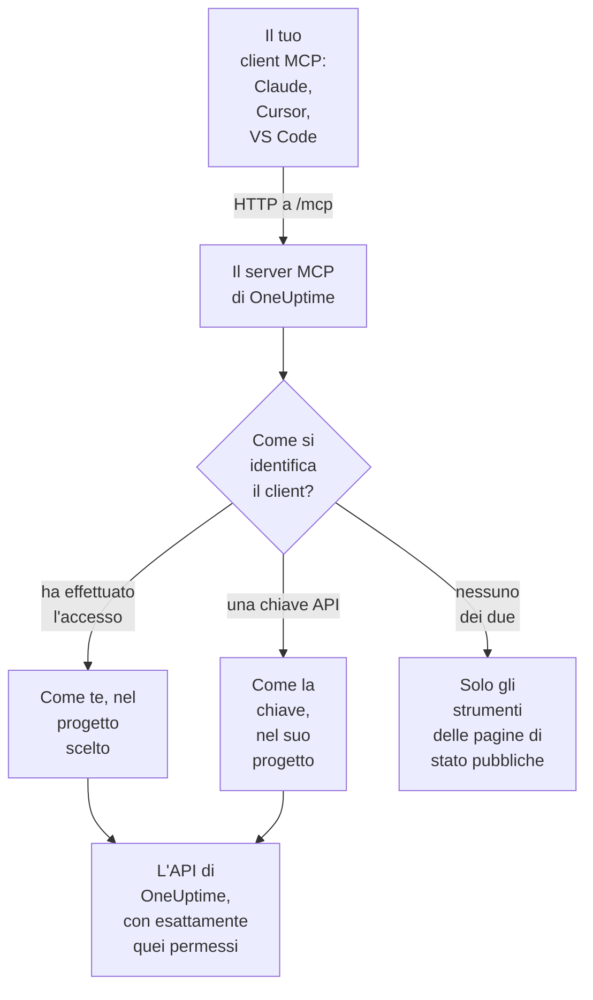

# Server MCP

Il server MCP di OneUptime permette a un assistente IA di lavorare direttamente con il tuo progetto OneUptime. Collega Claude, Cursor, VS Code con GitHub Copilot o qualsiasi altro client del Model Context Protocol (MCP), e chiedigli di esaminare un incidente, interrogare log e tracce, confermare un avviso o configurare un monitor: chiama gli strumenti di OneUptime con i tuoi permessi, o con quelli di una chiave API.

:::cards
- [Collegare un client](#collegare-un-client): Dai al tuo client l'indirizzo del server ed effettua l'accesso.
- [Accedere con OneUptime](#accedere-con-oneuptime): Cosa può fare un client collegato e come scollegarlo.
- [Ottenere la tua chiave API](#ottenere-la-tua-chiave-api): Per un agente che gira senza supervisione.
- [Risoluzione dei problemi](#risoluzione-dei-problemi): Problemi di accesso, di permessi e di connessione.
:::

Questa pagina riguarda gli assistenti IA che si collegano a OneUptime. Per far usare invece a OneUptime AI gli strumenti di altri server MCP, come quelli di AWS o GitHub, vedi [Server MCP esterni](/docs/ai/external-mcp-servers).

## Come funziona

Il server MCP fa parte di ogni istanza OneUptime, su `/mcp` allo stesso indirizzo della dashboard, e usa il trasporto streamable HTTP. Non c'è nulla da installare.

- **OneUptime Cloud**: `https://oneuptime.com/mcp`
- **Self-hosted**: `https://your-oneuptime-domain.com/mcp`



Il server è senza stato: non emette id di sessione e ogni richiesta è indipendente, quindi funziona dietro i bilanciatori di carico e con più repliche.

## Cosa coprono gli strumenti

- **Monitor**: creare e configurare monitor, controllarne lo stato e rivederne la cronologia.
- **Risposta agli incidenti**: creare, confermare e risolvere incidenti, aggiungere note interne o pubbliche e seguirli fino alla risoluzione.
- **Avvisi**: confermare e risolvere avvisi, aggiungere note e gestire stati e gravità degli avvisi.
- **Team e reperibilità**: gestire team e criteri di reperibilità.
- **Pagine di stato**: gestire le pagine di stato e pubblicare annunci.
- **Manutenzione programmata**: creare e gestire eventi di manutenzione.
- **Telemetria**: interrogare log, metriche, tracce, eccezioni, log dei monitor, eventi di sicurezza e altro, in sola lettura.

Ci sono strumenti per creare, leggere, elencare, aggiornare, eliminare e contare per 32 tipi di record, strumenti per elencare e contare per 9 tipi di telemetria, e strumenti pensati per la risposta agli incidenti. Gli strumenti in sola lettura hanno `readOnlyHint`, ogni strumento che modifica qualcosa ha `destructiveHint` e solo gli strumenti delle pagine di stato pubbliche hanno `openWorldHint`, così un client può eseguire da solo le chiamate in sola lettura e chiederti conferma prima di qualsiasi modifica. Una chiamata a uno strumento fallita torna come risultato dello strumento (`isError: true`) con uno `statusCode`, i dettagli e un suggerimento, non come errore del protocollo MCP, così l'agente può leggere l'errore e correggersi.

## Prima di iniziare

- Un'istanza OneUptime: OneUptime Cloud o self-hosted.
- Un client MCP, come Claude Code, Claude, VS Code con GitHub Copilot o Cursor.
- Un account OneUptime con cui accedere, oppure una chiave API OneUptime per un agente che gira senza supervisione. Gli strumenti delle pagine di stato pubbliche non richiedono né l'uno né l'altra.
- Su OneUptime Cloud, il piano Growth o superiore: collegare un client MCP è disponibile negli stessi piani delle chiavi API.

## Collegare un client

Dai al client l'indirizzo del server e nient'altro. La prima volta che gli servono i tuoi dati, apre OneUptime nel tuo browser per farti accedere (vedi [Accedere con OneUptime](#accedere-con-oneuptime)). Su un'istanza self-hosted, usa `https://your-oneuptime-domain.com/mcp` al posto di `https://oneuptime.com/mcp`.

:::tabs
@tab Claude Code
```bash
claude mcp add --transport http oneuptime https://oneuptime.com/mcp
```
Poi esegui `/mcp` dentro Claude Code e scegli **oneuptime** per accedere.
@tab Claude
In Claude, apri **Customize → Connectors**, scegli **Add custom connector** e inserisci `https://oneuptime.com/mcp`. Claude ti chiede di accedere a OneUptime la prima volta che gli servono i tuoi dati.
@tab VS Code
Aggiungi questo alla tua configurazione MCP (vedi [VS Code con GitHub Copilot](#vs-code-con-github-copilot) per sapere dove si trova). VS Code apre OneUptime per farti accedere quando avvii il server:
```json
{
  "servers": {
    "oneuptime": {
      "type": "http",
      "url": "https://oneuptime.com/mcp"
    }
  }
}
```
@tab Cursor
```json
{
  "mcpServers": {
    "oneuptime": {
      "url": "https://oneuptime.com/mcp"
    }
  }
}
```
:::

Qualsiasi altro client che supporta l'autorizzazione MCP funziona allo stesso modo: dagli l'indirizzo e scopre da solo tutto il resto. Vedi [Accedere (OAuth 2.1)](#accedere-oauth-21) per il protocollo.

Anche la dashboard ha questi passaggi, con l'indirizzo della tua istanza già inserito: **Impostazioni del progetto → IA → Server MCP**. E da qualsiasi risorsa (un monitor, un incidente, una pagina di stato e così via), espandi **Sviluppatori** nel suo menu laterale e scegli **Assistenti IA**: quella pagina suggerisce anche prompt che nominano la risorsa e il suo ID, così l'assistente la trova subito. Per una risorsa per cui il server MCP non ha ancora strumenti, come un workflow, la pagina mostra come un assistente in grado di eseguire comandi può lavorarci tramite l'API REST.

## Accedere con OneUptime

Il modo più semplice per collegarsi è dare al tuo client MCP l'indirizzo del server e nient'altro. La prima volta che al client servono i tuoi dati, apre una pagina di OneUptime nel tuo browser:

:::steps
1. Accedi a OneUptime, se non l'hai già fatto.
2. Scegli il progetto in cui il client deve lavorare.
3. Scegli **Lettura e scrittura** oppure **Sola lettura**.
4. Fai clic su **Autorizza**.
:::

Il client agisce quindi come te in quel progetto. Non c'è nessuna chiave API da creare, copiare o ruotare, e nulla di segreto viene salvato in un file di configurazione.

Cosa può fare un client collegato:

- **Ha i tuoi permessi, e mai di più.** Quello che i tuoi team ti permettono di fare nel progetto è quello che può fare il client. Se il tuo ruolo cambia o lasci il progetto, vale dalla richiesta successiva del client. Lasciare il progetto scollega anche il client: la sua autorizzazione viene eliminata, e lo ricolleghi se rientri nel progetto.
- **Sola lettura significa sola lettura.** Un client autorizzato in sola lettura può usare gli strumenti `get_`, `list_` e `count_`. Gli strumenti che creano, aggiornano, eliminano, confermano o risolvono vengono rifiutati, dal server MCP e dall'API di OneUptime dietro di esso. Non puoi mai dare a un client più accesso di quanto ne abbia chiesto.
- **Vale per un solo progetto.** Per usare un secondo progetto, collega di nuovo il client e scegli quel progetto.
- **Funziona solo tramite il server MCP.** Il token di accesso del client è accettato dall'endpoint MCP e da nessun'altra parte. Non può essere usato per chiamare direttamente l'API REST di OneUptime.
- **Gli amministratori dell'istanza non ricevono un trattamento speciale.** Un client collegato da un amministratore principale ha ciò che i team di quella persona gli concedono nel progetto, non un accesso a tutta l'istanza.

### Gestire i client collegati

Ogni client collegato tramite accesso è elencato in **Impostazioni del progetto → IA → Server MCP**, sotto **Client MCP connessi**, con chi lo ha collegato, cosa può fare e quando è stato usato l'ultima volta. Vedi i client che hai collegato tu; i proprietari e gli amministratori del progetto vedono quelli di tutti.

Fai clic su **Disconnetti** per disconnettere un client. Smette subito di funzionare.

Un client resta collegato finché viene usato. Uno che non viene usato da 30 giorni deve accedere di nuovo.

### Controllare chi può collegare client

Per impostazione predefinita, ogni membro del progetto può collegare un client MCP. Per impedirlo ai membri di un team, apri la pagina **Autorizzazioni** del team, apri **Altre impostazioni** in fondo e aggiungi il permesso **Authorize MCP Client** in **Blocca autorizzazioni**. I client che quei membri avevano già collegato smettono subito di funzionare.

Se il progetto richiede il single sign-on, accedi al progetto con SSO nel tuo browser prima di autorizzare un client. La connessione del client dura quanto quell'accesso SSO; quando scade, o il provider SSO con cui hai effettuato l'accesso viene disattivato o eliminato, collega di nuovo il client.

Su OneUptime Cloud, collegare un client MCP è disponibile negli stessi piani delle chiavi API (Growth e superiori).

Nell'Enterprise Edition, ogni modifica fatta da un client collegato viene registrata nel log di audit a nome della persona che lo ha collegato, con il nome del client. Le modifiche fatte con una chiave API mostrano il nome della chiave.

## Ottenere la tua chiave API

Usa una chiave API per un agente che gira senza supervisione, come un job pianificato o una pipeline di CI, dove non c'è nessuno per accedere.

:::steps
### Crea la chiave

Vai in **Impostazioni del progetto → Avanzato → Chiavi API** e fai clic su **Crea: Chiave API**. Dalle un nome, come "MCP Server".

### Scegli cosa può fare

In **Accesso**, scegli **Visualizzatore** per un agente che legge soltanto, oppure **Amministratore del progetto** per uno che crea, aggiorna ed elimina anche (vedi [Permessi delle chiavi API](#permessi-delle-chiavi-api)).

### Copia la chiave

Fai clic su **Crea: Chiave API**: si apre la pagina della chiave. Copia la chiave da lì.
:::

Le chiavi API appartengono a un progetto: il server MCP prende il progetto dalla chiave, così gli strumenti di creazione non hanno mai bisogno di un argomento `projectId`.

> [!WARNING]
> Non dare mai una chiave master a un agente IA. Una chiave API master di OneUptime è accettata anche in questa intestazione e concede accesso da amministratore a tutta l'istanza. Usa sempre una chiave API di progetto con il minimo che serve all'agente: una chiave in sola lettura basta per tutti gli strumenti `get_`, `list_` e `count_`.

## Collegarsi con una chiave API

Invia la chiave nell'intestazione `x-api-key`. A una richiesta che porta una chiave API non viene mai chiesto di accedere. Su un'istanza self-hosted, usa il tuo dominio al posto di `oneuptime.com`.

:::tabs
@tab Claude Code
```bash
claude mcp add --transport http oneuptime https://oneuptime.com/mcp --header "x-api-key: your-api-key-here"
```
@tab Claude Desktop
Aggiungi questo a `claude_desktop_config.json`, in `~/Library/Application Support/Claude/` su macOS, `%APPDATA%\Claude\` su Windows o `~/.config/Claude/` su Linux:
```json
{
  "mcpServers": {
    "oneuptime": {
      "transport": "streamable-http",
      "url": "https://oneuptime.com/mcp",
      "headers": {
        "x-api-key": "your-api-key-here"
      }
    }
  }
}
```
@tab VS Code
La variabile di input con `"password": true` chiede la chiave all'avvio del server, invece di tenerla in chiaro:
```json
{
  "servers": {
    "oneuptime": {
      "type": "http",
      "url": "https://oneuptime.com/mcp",
      "headers": {
        "x-api-key": "${input:oneuptime-api-key}"
      }
    }
  },
  "inputs": [
    {
      "type": "promptString",
      "id": "oneuptime-api-key",
      "description": "OneUptime API Key",
      "password": true
    }
  ]
}
```
@tab Cursor
```json
{
  "mcpServers": {
    "oneuptime": {
      "url": "https://oneuptime.com/mcp",
      "headers": {
        "x-api-key": "your-api-key-here"
      }
    }
  }
}
```
:::

## VS Code con GitHub Copilot

VS Code 1.99 e versioni successive supportano in modo nativo i server MCP in GitHub Copilot Chat.

:::steps
### Verifica cosa ti serve

VS Code 1.99 o successivo, con l'estensione GitHub Copilot installata e con l'accesso effettuato, e GitHub Copilot Chat attivo.

### Apri la configurazione MCP

Premi `Ctrl+Shift+P` (`Cmd+Shift+P` su macOS), digita "MCP: Open User Configuration" e premi Invio. Si apre, o viene creato, il file `mcp.json`. Per un solo workspace, crea invece `.vscode/mcp.json` al suo interno.

### Aggiungi OneUptime

Incolla la configurazione di VS Code qui sopra: quella senza chiave, per accedere, o quella con una chiave API.

### Avvia il server

Premi `Ctrl+Shift+P` (`Cmd+Shift+P` su macOS), digita "MCP: List Servers" e scegli **oneuptime** per avviarlo. VS Code ti chiede la prima volta di fidarti del server, e poi di accedere o di inserire la tua chiave API.

### Chiedi a Copilot

Apri GitHub Copilot Chat in modalità agente e chiedi, per esempio, "Quali monitor ho in OneUptime?", "Mostrami gli incidenti recenti" o "Crea un nuovo monitor per https://example.com".
:::

## Autenticazione

Il server MCP funziona in tre modi.

### Strumenti pubblici (nessuna autenticazione richiesta)

Senza una chiave API né un accesso, un client può usare gli strumenti pubblici:

- **`oneuptime_help`**: aiuto e indicazioni sugli strumenti MCP di OneUptime
- **`oneuptime_list_resources`**: le risorse e cosa puoi fare con ciascuna
- **`get_public_status_page_overview`**: la panoramica di una pagina di stato pubblica
- **`get_public_status_page_incidents`**: gli incidenti di una pagina di stato pubblica
- **`get_public_status_page_scheduled_maintenance`**: i suoi eventi di manutenzione programmata
- **`get_public_status_page_announcements`**: i suoi annunci

Gli strumenti delle pagine di stato pubbliche accettano l'ID di una pagina di stato (un UUID) o il suo nome di dominio. Per usare solo questi, collegati con l'indirizzo e senza credenziali:

```json
{
  "mcpServers": {
    "oneuptime": {
      "transport": "streamable-http",
      "url": "https://oneuptime.com/mcp"
    }
  }
}
```

I proprietari di una pagina di stato possono disattivare l'accesso MCP per quella pagina: sulla pagina di stato, apri **MCP** nella sezione **IA** del suo menu laterale e disattiva **Abilita server MCP**. L'interruttore si salva appena viene spostato. L'accesso MCP è attivo per impostazione predefinita. Finché è disattivato, i quattro strumenti `get_public_status_page_*` restituiscono un errore per quella pagina di stato; il sito della pagina di stato, il suo feed RSS e la sua API JSON pubblica non ne risentono, e gli strumenti delle pagine di stato che richiedono l'accesso (`get_status_page`, `list_status_pages` e così via) continuano a funzionare per il progetto della pagina.

### Accedere (OAuth 2.1)

Ogni altro strumento deve sapere chi sta chiamando. Un client che non invia credenziali e ne chiama uno riceve `401 Unauthorized` con un'intestazione `WWW-Authenticate` che punta ai metadati della risorsa protetta del server. È il segnale a cui un client MCP reagisce per farti accedere; `initialize`, `tools/list` e gli strumenti pubblici non lo chiedono mai.

Il server implementa la [specifica di autorizzazione MCP](https://modelcontextprotocol.io/specification/latest/basic/authorization):

- **Flusso**: authorization code OAuth 2.1 con PKCE (solo `S256`). I token di accesso vengono inviati come `Authorization: Bearer`.
- **Discovery**: metadati della risorsa protetta (RFC 9728) e metadati del server di autorizzazione (RFC 8414). L'emittente e la risorsa sono entrambi `https://<host>/mcp`.
- **Identità del client**: un Client ID Metadata Document (l'ID del client è un URL `https` che il server recupera), oppure la registrazione dinamica dei client (RFC 7591). Nessun client deve essere registrato da un amministratore.
- **Ambiti**: `mcp:read` per gli strumenti `get_`, `list_` e `count_`; `mcp:write` aggiunge ogni strumento che modifica qualcosa e include `mcp:read`. Un token in sola lettura che chiama uno strumento di scrittura riceve `403` con `error="insufficient_scope"`.
- **Durata dei token**: un token di accesso dura un'ora. Un refresh token dura 30 giorni e viene sostituito a ogni utilizzo; usare un refresh token già sostituito chiude la connessione.
- **Indicatori di risorsa** (RFC 8707): un token viene emesso per `https://<host>/mcp` e non è accettato da nessun'altra parte.
- **Revoca** (RFC 7009): revocare uno dei due token chiude la connessione.

### Chiave API

Un agente che gira senza supervisione invia una chiave API di OneUptime in una di queste intestazioni:

- `x-api-key`: la tua chiave API di OneUptime
- `Authorization`: un token bearer con la tua chiave API (ad es. `Bearer your-api-key-here`)

Lo schema `Bearer` non distingue tra maiuscole e minuscole. A una richiesta che porta una chiave API non viene mai chiesto di accedere.

Su OneUptime Cloud, le chiavi API funzionano solo finché il progetto è su **Growth** o superiore. Al di sotto, ogni strumento che richiede la chiave risponde `402` con un messaggio che nomina il piano, e all'agente viene detto di non riprovare. Non viene eliminato nulla: la chiave torna a funzionare così com'è appena il progetto torna su Growth, senza nulla da ricollegare. Un client collegato tramite accesso agisce come una persona e continua a funzionare ([Chiavi API e SCIM sotto il loro piano](/docs/api-reference/api-reference#chiavi-api-e-scim-sotto-il-loro-piano)).

## Endpoint disponibili

| Endpoint | Metodo | Descrizione |
| --- | --- | --- |
| `/mcp` | POST | Richieste JSON-RPC per le chiamate agli strumenti e altre operazioni |
| `/mcp` | GET | Senza un'intestazione SSE `Accept`: una breve descrizione JSON del server. Con una: `405`, perché il server senza stato non offre uno stream SSE autonomo (i client che seguono la specifica proseguono senza) |
| `/mcp` | DELETE | Non fa nulla: il server è senza stato, quindi non c'è nessuna sessione da chiudere |
| `/mcp/health` | GET | Controllo dello stato |
| `/mcp/tools` | GET | L'elenco degli strumenti, come semplice REST |

I client MCP che effettuano l'accesso usano anche gli endpoint OAuth qui sotto. Un client li trova da solo; sono elencati per chi scrive un client o configura un proxy.

| Endpoint | Metodo | Descrizione |
| --- | --- | --- |
| `/mcp/.well-known/oauth-protected-resource` | GET | Metadati della risorsa protetta (RFC 9728). Anche su `/.well-known/oauth-protected-resource/mcp` |
| `/.well-known/oauth-authorization-server/mcp` | GET | Metadati del server di autorizzazione (RFC 8414). Anche su `/mcp/.well-known/oauth-authorization-server` |
| `/mcp/oauth/authorize` | GET | Endpoint di autorizzazione: dove il client manda il tuo browser per accedere |
| `/mcp/oauth/token` | POST | Endpoint dei token: scambia un codice di autorizzazione o un refresh token |
| `/mcp/oauth/register` | POST | Registrazione dinamica dei client (RFC 7591) |
| `/mcp/oauth/revoke` | POST | Revoca dei token (RFC 7009) |

Per verificare che il server sia in esecuzione, ed elencarne gli strumenti:

```bash
curl https://oneuptime.com/mcp/health
curl https://oneuptime.com/mcp/tools
```

## Strumenti per la risposta agli incidenti

Oltre agli strumenti per ogni tipo di record, il server ha strumenti pensati per rispondere a incidenti e avvisi:

- **`acknowledge_incident`** / **`resolve_incident`**: portare un incidente allo stato Acknowledged o Resolved del progetto, come fa il pulsante della dashboard
- **`acknowledge_alert`** / **`resolve_alert`**: lo stesso per gli avvisi
- **`add_incident_note`**: aggiungere una nota a un incidente con `visibility: "internal"` (solo il team, il predefinito) o `visibility: "public"` (pubblicata sulla pagina di stato). Markdown è supportato
- **`add_alert_note`**: aggiungere una nota interna a un avviso

Un ciclo tipico: `list_incidents` → `acknowledge_incident` → indagare con `list_logs` → `add_incident_note` (pubblica) → `resolve_incident`.

Lo strumento **`oneuptime_whoami`** restituisce il progetto a cui appartengono le tue credenziali (il suo ID e il suo nome). Per un client che ha effettuato l'accesso, dice anche con quale utente è collegato e se può apportare modifiche. È una buona prima chiamata perché un agente si orienti, e poiché gli strumenti di creazione prendono `projectId` dalle credenziali, l'agente non deve mai passare un ID di progetto.

## Interrogare la telemetria

Log, metriche, tracce (span), eccezioni, log dei monitor e gli altri tipi di telemetria sono disponibili come strumenti `list_` e `count_` in sola lettura (`list_logs`, `list_metrics`, `list_spans`, `list_exception_instances`, `list_monitor_logs` e i loro gemelli `count_`). La telemetria arriva tramite OpenTelemetry, quindi non ci sono strumenti di creazione.

Interroga sempre la telemetria con un intervallo di tempo. Un campo di query accetta un valore o un oggetto operatore:

```json
{
  "query": {
    "time": { "_type": "GreaterThan", "value": "2026-07-04T00:00:00.000Z" }
  },
  "sort": { "time": "DESC" },
  "limit": 50
}
```

Gli operatori sono `EqualTo`, `NotEqual`, `IsNull`, `NotNull`, `EqualToOrNull`, `GreaterThan`, `LessThan`, `GreaterThanOrEqual`, `LessThanOrEqual`, `InBetween`, `Search` e `Includes`. I valori di ordinamento sono `"ASC"` o `"DESC"`.

## Selezione dei campi e paginazione

Gli strumenti `get_` e `list_` accettano un array `select` facoltativo di nomi di campo. Per impostazione predefinita tornano tutti i campi leggibili tranne quelli pesanti (colonne JSON, testo molto lungo e HTML), che vanno richiesti in `select`.

Gli strumenti di elenco paginano con `limit` (10 per impostazione predefinita, 100 al massimo) e `skip`, e ogni risposta di elenco dice esattamente cosa ha restituito:

```json
{
  "returnedCount": 10,
  "totalCount": 42,
  "skip": 0,
  "limit": 10,
  "hasMore": true,
  "data": ["..."]
}
```

## Esempi d'uso

### Domande di tutti i giorni

```text
"What's the current status of all my monitors?"
"Show me incidents from the last 24 hours"
"List the teams in this project"
"Show me our on-call policies"
```

### Monitor e incidenti

```text
"Create a new website monitor for https://example.com that checks every 5 minutes"
"Set up an API monitor for https://api.example.com/health with a 30-second timeout"
"Disable the monitor for staging.example.com while we're doing maintenance"
"Create a high-priority incident for the database outage affecting user authentication"
"Add a note to incident #123 saying 'Database connection restored, monitoring for stability'"
"Mark incident #456 as resolved"
```

### Pagine di stato

```text
"Update our status page to show 'Investigating Payment Issues' for the payment service"
"Create a status page announcement about scheduled maintenance this weekend"
```

### Interrogazioni di pagine di stato pubbliche (nessuna chiave API richiesta)

Queste funzionano senza credenziali, con i soli strumenti delle pagine di stato pubbliche:

```text
"What's the current status of status.example.com?"
"Show me recent incidents from the OneUptime status page"
"Are there any scheduled maintenance events on status.acme.com?"
"Get the latest announcements from my public status page with ID abc123-..."
```

### Più passaggi insieme

```text
"Create a scheduled maintenance window for Saturday 2-4 AM, disable all monitors for api.example.com during that time, and update the status page"
"Show me all monitors that have been down in the last hour, create incidents for any that don't already have one"
```

## Permessi delle chiavi API

| Cosa fa l'agente | Scegli in **Accesso** |
| --- | --- |
| Legge soltanto | **Visualizzatore**, oppure aggiungi permessi di lettura nella pagina della chiave |
| Crea, aggiorna ed elimina anche | **Amministratore del progetto**, oppure aggiungi il ruolo Project Admin nella pagina della chiave |

Dai a ogni chiave il minimo che le serve, ruota le chiavi regolarmente, tieni una chiave separata per ogni ambiente e controlla in OneUptime cosa fa ogni chiave.

## Configurazione self-hosted

L'accesso funziona da subito su un'istanza self-hosted. Due impostazioni lo cambiano:

| Variabile d'ambiente | Valore Helm | Cosa fa |
| --- | --- | --- |
| `DISABLE_MCP_OAUTH` | `mcpOAuth.disabled` | Impostala su `true` per disattivare l'accesso. Gli endpoint OAuth non vengono più serviti e il server MCP accetta solo chiavi API. Non viene eliminato nulla; i client collegati tornano a funzionare quando viene riattivato. |
| `DISABLE_MCP_OAUTH_CLIENT_ID_METADATA_DOCUMENTS` | `mcpOAuth.disableClientIdMetadataDocuments` | Impostala su `true` su un'istanza che non può raggiungere internet. Un client può identificarsi con un URL che OneUptime recupera; con questa impostazione, i client si registrano invece direttamente presso la tua istanza, il che non richiede nessuna richiesta in uscita. |

Se usi un tuo reverse proxy davanti a OneUptime, inoltra `/.well-known/oauth-protected-resource` e `/.well-known/oauth-authorization-server` (e tutto ciò che sta sotto) a OneUptime insieme a `/mcp`. L'ingress incluso lo fa già.

Il server costruisce ogni URL OAuth dalle impostazioni `HOST` e `HTTP_PROTOCOL`, quindi devono corrispondere all'indirizzo che le persone usano per raggiungere la tua istanza.

## Risoluzione dei problemi

### Problemi di accesso

- **Il client non mi chiede mai di accedere**: il client potrebbe non supportare l'autorizzazione MCP, oppure essere configurato con un'intestazione della chiave API, che ha la precedenza. Rimuovi l'intestazione per accedere invece.
- **Il mio progetto è disattivato nella pagina di autorizzazione**: la pagina spiega perché accanto al nome del progetto: il piano del progetto non include il collegamento di client MCP, il progetto richiede SSO e questo browser non vi ha effettuato l'accesso con SSO, oppure il tuo team non può collegare client.
- **Uno strumento viene rifiutato come "read-only"**: il client è stato autorizzato in sola lettura. Collegalo di nuovo e scegli **Lettura e scrittura**.
- **Il client ha smesso di funzionare**: è stato scollegato, non è stato usato per 30 giorni, sei stato rimosso dal progetto, oppure l'accesso SSO del progetto è scaduto o il suo provider è stato disattivato. Collegalo di nuovo.
- **Self-hosted - il client dice di non trovare il server di autorizzazione**: controlla che `HOST` e `HTTP_PROTOCOL` corrispondano al tuo indirizzo pubblico e che il tuo proxy inoltri i percorsi `/.well-known/oauth-*`.

### Errori di permessi

La chiave API, o per un client che ha effettuato l'accesso il tuo account, ha bisogno dei permessi giusti: accesso in lettura per elencare i record, in scrittura per crearli e aggiornarli, e in eliminazione per rimuoverli.

### Problemi di connessione

Controlla che l'indirizzo di OneUptime sia corretto e raggiungibile, che la chiave API sia valida e che l'endpoint di stato risponda (vedi [Endpoint disponibili](#endpoint-disponibili)).

### Chiave API non valida

- Controlla la chiave API nelle tue impostazioni di OneUptime, senza spazi o caratteri in più
- Controlla che la chiave non sia scaduta
- Su OneUptime Cloud, un `402` che dice che le chiavi API richiedono il piano Growth significa che il progetto è al di sotto: aggiorna il piano del progetto in **Impostazioni del progetto → Fatturazione e fatture → Fatturazione**, e la stessa chiave torna a funzionare

### Errori di sessione

Il server MCP è senza stato: non emette né traccia id di sessione, quindi ogni richiesta funziona su qualsiasi replica. Un client che invia un'intestazione `mcp-session-id` di una versione precedente del server può ometterla; viene ignorata. Aggiorna una vecchia configurazione del client che si aspetta che il server restituisca un id di sessione.

## Risorse disponibili

| Area | Record con strumenti per creare, leggere, elencare, aggiornare, eliminare e contare |
| --- | --- |
| Monitoraggio | Monitor, Monitor Status, Monitor Status Event |
| Incidenti | Incident, Incident State, Incident Severity, Incident State Timeline, Incident Public Note, Incident Internal Note, Incident Alert, Postmortem Status |
| Avvisi | Alert, Alert State, Alert Severity, Alert State Timeline, Alert Internal Note |
| Pagine di stato | Status Page, Status Page Announcement |
| Manutenzione programmata | Scheduled Maintenance Event, Scheduled Maintenance State, Scheduled Maintenance State Timeline |
| Team e reperibilità | Team, On-Call Policy |
| Etichette | Label |
| Sicurezza | Security Case, Security Case Evidence, Security Case Note, Security Case Priority, Security Case Status, Security Case Task, Security Detection, Security Playbook |

| Area | Telemetria con soli strumenti per elencare e contare |
| --- | --- |
| Osservabilità | Log, Metric, Span, Exception Instance, Monitor Log |
| Sicurezza | Security Event, Threat Intel Indicator |
| Modifiche e costi | Change Event, Kubernetes Cost Allocation |

Gli strumenti hanno nomi in snake case: `create_incident`, `get_incident`, `list_incidents`, `update_incident`, `delete_incident` e `count_incidents`, oppure `list_logs` e `count_spans` per la telemetria.

## Passi successivi

:::cards
- [Chiedi all'IA](/docs/ai/ask-ai): Chiedi del tuo progetto direttamente dentro OneUptime.
- [Riferimento API di OneUptime](/docs/api-reference/api-reference): L'API REST dietro ogni strumento.
- [Permessi](/docs/permissions/index): Cosa può fare un ruolo, un team o una chiave API.
:::
