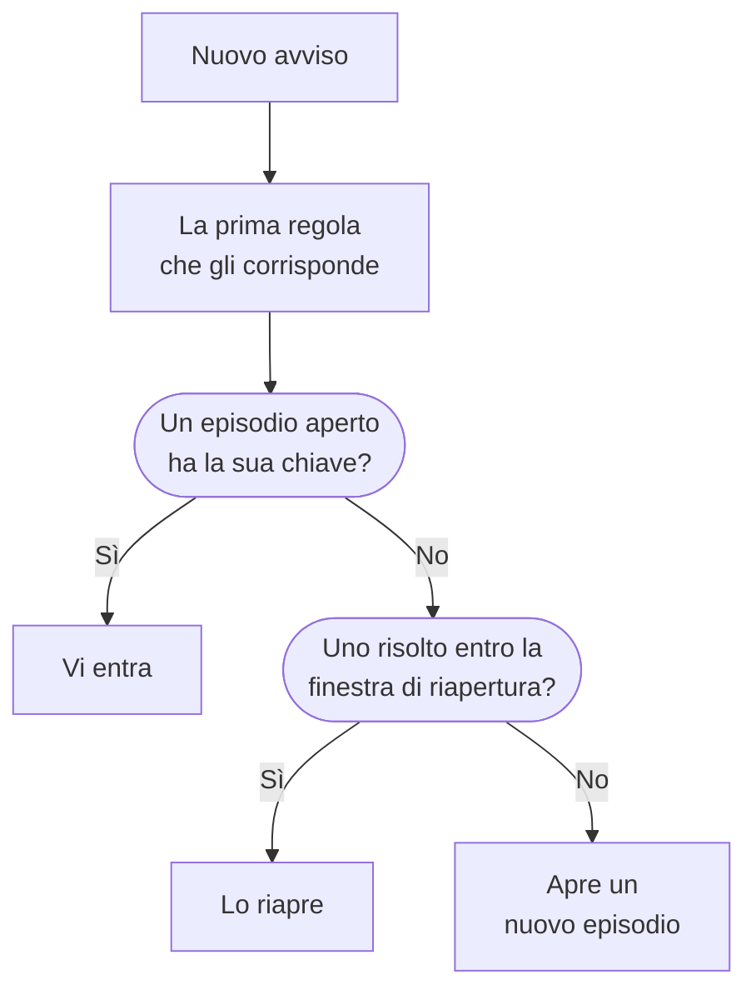

# Episodi di avvisi e regole di raggruppamento

Quando un database cade, venti monitor possono sollevare venti avvisi in pochi minuti. Un episodio li riunisce in un unico record che il vostro team riconosce e risolve insieme, e una regola di raggruppamento decide quali avvisi ne fanno parte. Questa pagina mostra come funziona il raggruppamento, come impostare una regola e come si comporta un episodio una volta aperto.

:::cards
- [Come funziona il raggruppamento](#come-funziona-il-raggruppamento): Regole, chiavi di raggruppamento e finestre temporali.
- [Creare una regola di raggruppamento](#creare-una-regola-di-raggruppamento): Da un modello con un clic, o la vostra.
- [Come si comporta un episodio](#come-si-comporta-un-episodio): La sua gravità, i suoi stati e quando si risolve.
- [Chi chiama un episodio](#chi-chiama-un-episodio): Le policy di reperibilità della regola e quelle degli avvisi stessi.
:::

## Come funziona il raggruppamento

Il raggruppamento gira una volta per ogni nuovo avviso, subito dopo l'esecuzione delle sue policy di reperibilità. L'avviso viene confrontato con le vostre regole di raggruppamento abilitate, dall'alto verso il basso dell'elenco, e la prima regola che gli corrisponde decide il suo episodio. Un avviso a cui non corrisponde nessuna regola resta da solo.



- **Le condizioni della regola** decidono a quali avvisi si applica. Una regola senza condizioni si applica a ogni nuovo avviso.
- **La chiave di raggruppamento** decide quali avvisi condividono un episodio: quelli con lo stesso monitor, la stessa gravità, lo stesso titolo, o qualunque combinazione la regola usi per raggruppare. Una regola che non raggruppa per nulla mette in un solo episodio ogni avviso a cui corrisponde.
- **La finestra temporale** decide per quanto tempo un episodio continua ad accettare avvisi. Se è attiva, un avviso entra solo se arriva entro la finestra dall'ultimo avviso dell'episodio. Se è disattivata, gli avvisi corrispondenti continuano a entrare finché l'episodio non è risolto.

Il raggruppamento avviene quando un avviso viene creato. Una regola aggiunta oggi raggruppa gli avvisi creati dopo di essa; non raggruppa di nuovo quelli già presenti.

> [!NOTE]
> Un avviso creato già riconosciuto può entrare in un episodio aperto ma non ne apre mai uno, e un avviso creato risolto non viene raggruppato affatto. Vedere [Creato già riconosciuto o risolto](/docs/alerts/index#creato-già-riconosciuto-o-risolto).

## Creare una regola di raggruppamento

Andate in **Avvisi → Regole → Regole di raggruppamento**. La sezione **Regole** del menu laterale parte compressa, quindi espandetela prima.

### Partire da un modello

Un progetto senza regole di raggruppamento vede quattro regole pronte invece di un elenco vuoto; quando avete già delle regole, **Crea da modello** sulla scheda le apre. **Aggiungi regola** ne salva una con un solo clic, abilitata, in fondo all'elenco e valida per ogni nuovo avviso. Modificatela poi come qualsiasi altra regola.

| Modello                                             | Raggruppa                                                                 | Finestra temporale |
| --------------------------------------------------- | ------------------------------------------------------------------------- | ------------------ |
| **Raggruppa gli avvisi dello stesso monitor**       | Un episodio per monitor                                                   | 30 minuti          |
| **Raggruppa gli avvisi che avvengono insieme**      | Un episodio condiviso, qualunque sia il monitor                           | 10 minuti          |
| **Raggruppa gli avvisi per gravità**                | Un episodio per gravità                                                   | 30 minuti          |
| **Raggruppa le ripetizioni dello stesso avviso**    | Un episodio per titolo dell'avviso, ignorando numeri e maiuscole          | 1 ora              |

### Creare la vostra

:::steps
#### Rispondere a come raggruppare

Fate clic su **Crea regola personalizzata** sotto i modelli, o su **Crea regola di raggruppamento degli avvisi** sulla scheda quando avete già delle regole. Nel passaggio **Raggruppamento**, **Raggruppa gli avvisi per** pone una sola domanda: **Monitor**, **Tutto insieme**, **Gravità**, **Titolo** o **Personalizzato**. Il **Nome** segue la vostra risposta finché non ne scrivete uno vostro.

#### Impostare la finestra temporale

**Raggruppa solo gli avvisi che arrivano ravvicinati** è attivo, con una finestra di 30 minuti. Cambiate i minuti, o disattivatelo per tenere aperto un episodio finché non viene risolto.

#### Combinare i campi, per Personalizzato

**Personalizzato** aggiunge un passaggio **Raggruppa per** con cinque interruttori: **Raggruppa per monitor**, **Raggruppa per gravità avviso**, **Raggruppa per titolo avviso**, **Raggruppa per etichette avviso** e **Raggruppa per etichette monitor**. Le etichette raggruppano in base al loro insieme esatto.

#### Restringere il campo

In **Quali avvisi**, **Tutti gli avvisi**, da cui parte una nuova regola, raggruppa ogni nuovo avviso. Per restringerla, scegliete **Solo gli avvisi che soddisfano le condizioni** e aggiungete condizioni su monitor, gravità, etichette, titoli e descrizioni. Poi fate clic su **Crea regola di raggruppamento degli avvisi**.
:::

Tutto il resto che una regola può fare è compresso sotto **Altri campi**, alla fine del passaggio **Raggruppamento**, in tre gruppi. Da compresso, la sua intestazione nomina ciò che contiene e dice il valore di ogni impostazione usata dalla regola, così modificare una regola non nasconde mai ciò che fa.

| Gruppo                             | Impostazioni                                                                                               |
| ---------------------------------- | ---------------------------------------------------------------------------------------------------------- |
| **Reperibilità e proprietà**       | **Policy di reperibilità** da eseguire quando la regola apre un episodio, e **Proprietari dell'episodio**. |
| **Ciclo di vita dell'episodio**    | **Riapri gli episodi risolti di recente**, **Attendi prima di risolvere un episodio** e **Risolvi gli episodi inattivi**, ciascuno un interruttore con i suoi minuti. |
| **Dettagli**                       | La **Descrizione** della regola, il **Template di titolo episodio**, il **Template di descrizione episodio** e le **Etichette episodio**. |

Le regole vengono controllate dall'alto verso il basso dell'elenco, e vince la prima corrispondenza: trascinate una regola per cambiarne la posizione. Mettete le regole specifiche sopra quelle generiche. La colonna **Raggruppamento** dell'elenco dice in una frase che cosa fa ogni regola, ad esempio «Un episodio per monitor».

## Titoli degli episodi

Senza un template, un episodio prende il nome dal monitor del suo primo avviso, o dai primi 50 caratteri del titolo dell'avviso quando questo non ha un monitor. Con un **Template di titolo episodio** o un **Template di descrizione episodio**, queste variabili vengono compilate. Digitate `{{` in uno dei due campi per sceglierne una.

| Variabile              | Compilata con                                                                                  |
| ---------------------- | ---------------------------------------------------------------------------------------------- |
| `{{alertTitle}}`       | Il titolo del primo avviso.                                                                    |
| `{{alertDescription}}` | La descrizione del primo avviso.                                                               |
| `{{alertSeverity}}`    | La gravità del primo avviso.                                                                   |
| `{{monitorName}}`      | Il nome del monitor del primo avviso.                                                          |
| `{{alertCount}}`       | Quanti avvisi contiene l'episodio, riscritto quando gli avvisi entrano o escono.               |

Una variabile per cui il primo avviso non ha un valore, o che non è in questo elenco, viene omessa. Quando il primo avviso è privato, `{{alertTitle}}` e `{{alertDescription}}` riportano «Private alert», perché l'episodio non è privato.

## Come si comporta un episodio

Un episodio attraversa i vostri stati di avviso, lo stesso elenco usato dagli avvisi, e ha i propri proprietari, note, causa principale e note di rimedio.

- **La sua gravità sale con i suoi avvisi.** Parte con la gravità del suo primo avviso, e prende quella di qualsiasi avviso più grave che vi entra, dove «più grave» significa più in alto in **Avvisi → Impostazioni → Gravità avviso**.
- **Il suo stato sposta i suoi avvisi.** Riconoscete o risolvete un episodio, o portatelo in uno stato vostro, e ogni avviso al suo interno si sposta con lui, tranne un avviso già in quello stato o oltre.
- **Si risolve da solo** quando ogni avviso al suo interno è risolto. **Attendi prima di risolvere un episodio** lo tiene prima aperto per quei minuti, nel caso un avviso ritorni.
- **Può riaprirsi.** Con **Riapri gli episodi risolti di recente** attivo, un avviso corrispondente che arriva nei minuti successivi alla risoluzione dell'episodio lo riapre, invece di aprirne un altro. È l'unico passo indietro lungo l'elenco degli stati, e non riapre gli avvisi dell'episodio.

> [!WARNING]
> **Risolvi gli episodi inattivi** risolve un episodio quando nessun nuovo avviso vi è entrato per i minuti che impostate, e risolve anche ogni avviso ancora aperto al suo interno. Usatelo per il rumore che siete certi non richieda risposta.

## Chi chiama un episodio

Le policy di reperibilità proprie di un avviso vengono eseguite quando viene creato, prima del raggruppamento, che entri o meno in un episodio. Un episodio aggiunge le sue:

```mermaid title="Un avviso che apre un episodio chiama due volte; uno che vi entra, una volta"
flowchart TB
    alert["Nuovo avviso"] --> own["Le policy proprie<br/>dell'avviso partono"]
    own --> grouped{"Raggruppamento"}
    grouped -->|"Apre un episodio"| ep["Partono anche le<br/>policy dell'episodio"]
    grouped -->|"Entra in un episodio"| none["Non parte altro"]
```

- **Un nuovo episodio** esegue le **Policy di reperibilità** della regola, più quelle di qualsiasi regola corrispondente nella scheda **Episode Rules** di **Avvisi → Regole → Regole di reperibilità**.
- **Un avviso che entra in un episodio aperto** esegue solo le proprie policy. Quelle dell'episodio non vengono eseguite di nuovo.
- **Rispondere alla chiamata di un episodio** riconosce l'episodio, e con esso ogni avviso al suo interno.

> [!TIP]
> Per chiamare una volta per problema anziché una volta per avviso, mettete le policy di reperibilità sulle vostre regole di raggruppamento e toglietele dagli avvisi: dai criteri del monitor, dal modulo di creazione e dalle vostre regole di reperibilità degli avvisi.

Anche i proprietari dell'episodio vengono informati: **Episodio di avviso creato**, **Stato dell'episodio di avviso modificato** e **Avviso aggiunto all'episodio di avviso** sono attivi via e-mail per impostazione predefinita, in **Impostazioni utente → Impostazioni notifiche**, nella scheda **Avvisi**. I **Proprietari dell'episodio** della regola diventano proprietari di ogni episodio che apre, e vengono notificati come qualsiasi altro proprietario.

## Creare un episodio a mano

:::steps
### Aprire il modulo

Andate in **Avvisi → Tutti gli episodi** e fate clic su **Crea episodio**. Si apre il modulo **Crea nuovo episodio di avviso**.

### Descrivere l'episodio

In **Dettagli episodio**, compilate il **Titolo** e, se volete, una **Gravità avviso** e una **Descrizione**. **Stato iniziale** ed **Etichette** si trovano in **Altri campi**.

### Scegliere chi viene chiamato e chi ne è proprietario

In **Reperibilità e proprietari**, scegliete una **Policy di reperibilità** da eseguire quando l'episodio viene creato, e i suoi **Proprietari**. Poi fate clic su **Crea episodio**.

Ogni team di cui siete membri è a un clic sotto **Proprietari**, e il riepilogo elenca le regole del proprietario che ne aggiungeranno altri.

### Aggiungere gli avvisi

Aprite la pagina **Avvisi dei membri** dell'episodio, fate clic su **Aggiungi avvisi** e selezionate gli avvisi che ne fanno parte, quanti ve ne servono in una volta. Per partire invece dagli avvisi, selezionateli nell'elenco **Avvisi** e scegliete **Aggiungi a un nuovo episodio** in **Azioni di massa** (vedi [Episodi](/docs/incidents/episodes)).
:::

Un episodio creato da voi non ha una regola di raggruppamento, quindi l'elenco mostra la sua **Regola di raggruppamento** come **Manuale**, e non gli si applica nessuna impostazione del ciclo di vita. Si risolve comunque da solo quando ogni avviso al suo interno è risolto.

## Che cosa mostra ogni pagina di un episodio

| Sezione del menu laterale | Pagine                                                                      |
| ------------------------- | --------------------------------------------------------------------------- |
| **Panoramica** | **Panoramica**, **Cronologia stato** |
| **Indagine** | **Descrizione**, **Causa principale**, **Note di rimedio** |
| **Team** | **Proprietari** |
| **Avvisi** | **Avvisi dei membri** |
| **Note** | **Note private** |
| **Sviluppatori** | **Terraform**, **API**, **Assistenti IA** |
| **Avanzato** | **Registri di audit**, **Elimina episodio** |

**Sviluppatori** e **Avanzato** partono compresse. Nella **Panoramica**, l'intestazione indica i **Proprietari** dell'episodio, prima i team, e il primo riquadro, **Creato**, dice quando è stato creato l'episodio — **Automaticamente**, quando l'ha aperto una regola di raggruppamento. La scheda **Cosa è successo** apre la pagina — la descrizione dell'episodio e la sua **Causa principale** — poi **Alerts in this episode** e il **Feed episodio**, accanto alla scheda **Dettagli episodio**: il suo numero, stato, gravità, numero di avvisi, regola di raggruppamento e policy di reperibilità. La sua intestazione ha **Riconosci** e **Risolvi**, e **Sposta l'episodio in** nel menu **⋯**.

**Avvisi → Episodi attivi** elenca gli episodi non ancora risolti, e il badge accanto li conta.

## Risoluzione dei problemi

:::details Un nuovo avviso non è entrato nell'episodio che mi aspettavo
Controllate, in ordine: che la regola sia abilitata; che nessuna regola sopra di essa abbia corrisposto prima all'avviso; che l'avviso soddisfi le condizioni della regola; che abbia la stessa chiave di raggruppamento degli avvisi dell'episodio, ad esempio lo stesso monitor; e, con la finestra temporale attiva, che sia arrivato entro la finestra dall'ultimo avviso dell'episodio. Un avviso creato già riconosciuto non apre mai un episodio, e uno creato risolto non viene mai raggruppato.
:::

:::details Siamo stati chiamati due volte per un solo problema
È stata eseguita la policy di reperibilità propria dell'avviso, e anche quella del nuovo episodio. Tenete le policy sulla regola di raggruppamento, e toglietele dai criteri, dal modulo o dalle regole di reperibilità dell'avviso.
:::

:::details Un episodio si è risolto da solo
Ogni avviso al suo interno era risolto, quindi l'episodio si è risolto al termine dell'attesa. Quando **Risolvi gli episodi inattivi** è attivo, risolve anche un episodio che non ha ricevuto nuovi avvisi per quel tempo.
:::

## Passi successivi

:::cards
- [Regole e impostazioni degli avvisi](/docs/alerts/settings): Le altre regole che agiscono sui nuovi avvisi ed episodi.
- [Stati e gravità degli avvisi](/docs/alerts/states-and-severities): Gli stati che un episodio attraversa.
- [Regole di escalation](/docs/on-call/escalation-rules): Come le policy eseguite da un episodio chiamano le persone.
- [Impostazioni e automazione degli incidenti](/docs/incidents/settings): Le regole di raggruppamento per gli incidenti.
:::
