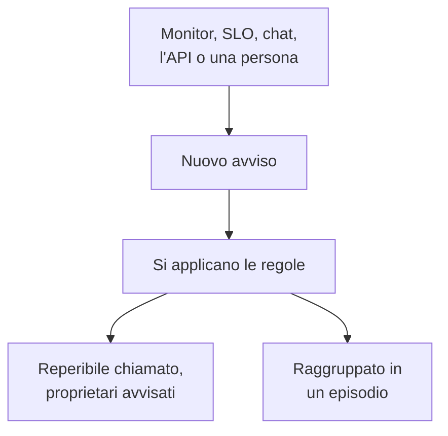

# Panoramica degli avvisi

Un avviso segnala al vostro team un problema da esaminare prima che gli utenti se ne accorgano: un disco che si sta riempiendo, un certificato in scadenza, un tasso di errori che cresce piano piano. Può chiamare chi è reperibile e notificare i suoi proprietari, ma non compare mai su una pagina di stato e non avvisa mai i vostri iscritti. Questa pagina spiega da dove arrivano gli avvisi, dove si trovano nella dashboard e come il vostro team li gestisce.

:::cards
- [Avvisi e incidenti](#avvisi-e-incidenti): Che cosa dovrebbe essere un problema, e come i due si collegano.
- [Da dove arrivano gli avvisi](#da-dove-arrivano-gli-avvisi): Monitor, SLO, chat, l'API o a mano.
- [Creare un avviso a mano](#creare-un-avviso-a-mano): Due passaggi nella dashboard.
- [Rispondere a un avviso](#rispondere-a-un-avviso): Riconoscerlo, risolverlo o dichiarare un incidente.
:::

## Come funziona

La maggior parte degli avvisi viene sollevata da un monitor i cui criteri corrispondono. Alcuni arrivano da uno SLO che consuma il suo budget di errori, da una regola di sicurezza, da una chiamata inviata da Slack o Microsoft Teams, o da una persona. Comunque arrivi, un avviso è sempre lo stesso record, e su di esso girano le stesse regole.

- **Le regole lo modellano.** Le regole di privacy, del proprietario, delle etichette e di reperibilità girano nel momento in cui un avviso viene creato, e le regole di runbook avviano le procedure corrispondenti. Vedere [Regole e impostazioni degli avvisi](/docs/alerts/settings).
- **Le policy di reperibilità chiamano le persone.** Le policy che l'avviso indica, più quelle aggiunte dalle sue regole di reperibilità, chiamano le loro persone finché qualcuno non riconosce l'avviso.
- **Gli episodi raggruppano il rumore.** Una regola di raggruppamento mette gli avvisi correlati in un episodio, così venti avvisi di un disservizio diventano una sola cosa da gestire. Vedere [Episodi di avvisi e regole di raggruppamento](/docs/alerts/episodes).

## Avvisi e incidenti

Entrambi registrano un problema, ed entrambi possono chiamare chi è reperibile. Ciò che cambia è chi viene colpito dal problema.

|                                  | Avviso                                                 | Incidente                                         |
| -------------------------------- | ------------------------------------------------------ | ------------------------------------------------- |
| **Che cos'è**                    | Un problema che il vostro team deve esaminare prima che gli utenti ne risentano | Un problema che colpisce i vostri utenti, come un disservizio |
| **Sulle pagine di stato**        | Mai                                                    | Può comparire, e avvisa gli iscritti              |
| **Note**                         | Note private, solo per il vostro team                  | Note pubbliche per i clienti, e note private      |
| **Stati iniziali**               | **Identificato**, **Riconosciuto**, **Risolto**          | **Identificato**, **Riconosciuto**, **Risolto**     |
| **Gravità iniziali**             | **Alto**, **Basso**                                      | Critical Incident, Major Incident, Minor Incident |
| **Numeri in un nuovo progetto**  | `ALT-42`, e `AE-42` per gli episodi                    | `INC-42`, e `IE-42` per gli episodi               |

Sollevate un avviso quando il vostro team deve guardare prima che qualcuno all'esterno noti qualcosa, e dichiarate un incidente quando gli utenti ne risentono. Se un avviso si rivela parte di un disservizio, dichiarate un incidente a partire da esso, o collegatelo all'incidente che lo spiega: vedere [Avvisi collegati](/docs/incidents/linked-alerts).

## Da dove arrivano gli avvisi

- **I criteri di un monitor.** Nelle **Azioni** di un criterio, attivate **Quando i filtri corrispondono, crea un avviso.** e compilate l'avviso che crea: **Titolo dell'avviso** e **Gravità**, poi, ciascuno compresso, **Descrizione**, **Proprietà ed etichette**, **Reperibilità** e **Altri campi**, che contiene **Risoluzione automatica dell'avviso**, **Avviso privato** e **Note di rimedio**. Un criterio mantiene un solo avviso aperto alla volta, uno per serie su un monitor che raggruppa per un campo, e **Risoluzione automatica dell'avviso** lo risolve quando il criterio smette di corrispondere. Vedere [Creare un monitor](/docs/monitor/create-monitor) e [Modelli di incidenti e avvisi](/docs/monitor/incident-alert-templating).
- **A mano.** Fate clic su **Crea avviso** nell'elenco degli avvisi, o nella scheda **Avvisi** di un monitor, di un host, di un dispositivo di rete o di un'altra risorsa, che sceglie quella risorsa per voi. Vedere [Creare un avviso a mano](#creare-un-avviso-a-mano).
- **Il tasso di consumo di uno SLO.** Una regola sul tasso di consumo può creare un avviso quando uno SLO spende il suo budget di errori troppo in fretta. Vedere [Avvisi e incidenti di tasso di consumo](/docs/slo/burn-rate-alerts).
- **Siti di rete ed eventi di sicurezza.** Un sito di rete impostato per avvisare quando non è in salute apre un avviso quando il suo riepilogo smette di essere operativo, e anche le vostre regole di rilevamento degli eventi di sicurezza aprono avvisi. Vedere [Siti di rete (riepilogo dello stato e uptime)](/docs/monitor/network-sites) e [Eventi di sicurezza (SIEM)](/docs/telemetry/security-events).
- **Una chiamata.** `/oneuptime page` in Slack o Microsoft Teams apre un avviso il cui titolo è il vostro messaggio, e chiama le persone che indicate. I blocchi di chiamata di un workflow fanno lo stesso con il titolo e il messaggio che fornite loro. Vedere [Chiamare qualcuno da Slack](/docs/workspace-connections/slack#chiamare-qualcuno-da-slack) e [Paging](/docs/workflows/components#paging).
- **L'API, Terraform e i workflow.** Gli avvisi sono una risorsa come le altre: `/api/alert`, la risorsa Terraform `oneuptime_alert` e il passaggio **Create One Alert** di un workflow.

## Dove si trovano gli avvisi nella dashboard

Aprite **Avvisi** dal menu **Prodotti** nella barra superiore. L'elenco degli avvisi si trova in `/dashboard/{projectId}/alerts`, e il suo menu laterale raccoglie tutto ciò che riguarda gli avvisi:

| Sezione            | Che cosa ci fate                                                                                                          |
| ------------------ | ------------------------------------------------------------------------------------------------------------------------- |
| **Avvisi**         | **Tutti gli avvisi** e **Avvisi attivi**, il cui badge rosso conta gli avvisi non ancora risolti.                          |
| **Episodi** | **Tutti gli episodi** e **Episodi attivi**: avvisi correlati, raggruppati in un unico problema su cui lavorare. |
| **IA**             | **Informazioni**, **Registri** e **Impostazioni**: che cosa OneUptime AI ha imparato dai vostri avvisi, tutto ciò che ha fatto e che cosa può fare. |
| **Area di lavoro** | **Slack** e **Microsoft Teams**, a seconda di ciò che il progetto ha collegato, o **Collega Slack o Teams** quando non ne ha nessuno. |
| **Regole**         | **Regole di raggruppamento**, **Regole di reperibilità**, **Regole del proprietario**, **Regole di runbook**, **Regole di privacy**, **Regole etichette**, **Reminder Rules**. |
| **Impostazioni**   | **Stato avviso**, **Gravità avviso**, **Modelli di note**, **Campi personalizzati**, **Misurazioni**, **Appartenenza agli episodi**, **Numerazione**. |

**Avvisi** ed **Episodi** sono aperte; **IA**, **Area di lavoro**, **Regole**, **Impostazioni** e **Sviluppatori** partono compresse, e una sezione si apre da sola quando siete su una delle sue pagine. La configurazione degli avvisi sta qui, non nelle **Impostazioni del progetto**.

L'elenco mostra **Numero dell'avviso**, **Titolo**, **Stato**, **Gravità**, **Risorse interessate** (prima il monitor dell'avviso), **Creato**, **Durata**, **Etichette** e **Proprietari**. Selezionate gli avvisi per agire su più avvisi alla volta: **Riconosci**, **Risolvi**, **Cambia stato**, **Cambia gravità**, **Assegna a me**, **Aggiungi proprietario**, **Rimuovi proprietario**, **Aggiungi etichette**, **Rimuovi etichette**, **Collega a incidente**, **Dichiara incidente** o eliminarli.

Il menu **⋯** in fondo alla riga di ogni avviso fa lo stesso per quel solo avviso: **Riconosci** e **Risolvi** finché l'avviso può fare quel passo, **Cambia stato**, **Cambia gravità**, **Assegna a me** finché non ne siete proprietari e **Aggiungi proprietario** per affidarlo a qualcun altro.

## Creare un avviso a mano

:::steps
### Aprire il modulo

Andate in **Avvisi → Tutti gli avvisi** e fate clic su **Crea avviso**. Il modulo **Crea nuovo avviso** si apre sul primo passaggio, **Dettagli dell'avviso**.

### Descrivere l'avviso

Compilate il **Titolo** e scegliete una **Gravità avviso**; entrambi sono obbligatori. Aggiungete una **Descrizione** se aiuta. In **Altri campi**, compresso, potete scegliere uno **Stato iniziale**, aggiungere **Etichette** o attivare **Avviso privato**. Lì trovate anche **Proprietari**: diventate comunque proprietari dell'avviso che create, e ogni team di cui siete membri è a un clic sotto il selettore. Un amministratore principale, che gestisce l'intera installazione, è l'unica eccezione: non diventa proprietario di ciò che crea.

### Scegliere che cosa riguarda e chi viene chiamato

Fate clic su **Avanti** per arrivare a **Risorse e reperibilità**. Scegliete il **Monitor** a cui si riferisce e, in **Altre risorse interessate**, qualsiasi altra risorsa coinvolta, come host, dispositivi di rete, cluster Kubernetes o servizi. In **Policy di reperibilità**, scegliete le policy da eseguire quando l'avviso viene creato.

### Crearlo

Fate clic su **Avanti** per controllare il riepilogo, poi su **Crea avviso**. Si apre la pagina dell'avviso, e le regole iniziano a girare. Nel riepilogo, la riga **Proprietari** elenca ogni regola del proprietario che aggiungerà qualcuno, e chi: vedete [Chi ne sarà proprietario](/docs/incidents/declaring-incidents#chi-ne-sarà-proprietario).
:::

Lasciate vuoto **Stato iniziale** e l'avviso parte da dove parte ogni nuovo avviso: dal vostro stato di creazione, **Identificato** in un nuovo progetto. Scegliere uno stato successivo registra un avviso di cui qualcuno si sta già occupando, o che è già concluso; vedere [Creato già riconosciuto o risolto](#creato-già-riconosciuto-o-risolto).

## Che cosa succede quando viene creato un avviso

Nel momento in cui un avviso viene creato, OneUptime esegue questi passaggi, in quest'ordine:

1. **Riceve un numero e uno stato.** Il numero dell'avviso viene da un contatore per progetto ed è mostrato con il vostro prefisso (`ALT-42`). L'avviso parte dal vostro stato di creazione, a meno che il modulo, l'API o un workflow non ne abbia scelto un altro.
2. **Le regole di privacy girano per prime**, così tutto ciò che viene dopo sa se l'avviso è privato.
3. **Il feed e i vostri strumenti di chat lo vengono a sapere.** Una voce **Avviso creato** viene scritta in **Avviso Feed**, e i canali indicati dalle vostre regole di Slack e Microsoft Teams vengono informati; una regola può creare un canale per l'avviso.
4. **Vengono aggiunti proprietari ed etichette**: quelli indicati dai criteri del monitor o dalla richiesta, poi quelli delle regole del proprietario e delle etichette che corrispondono.
5. **Le regole di reperibilità aggiungono le loro policy**, poi le regole di runbook avviano i runbook corrispondenti.
6. **Le policy di reperibilità vengono eseguite.** Ogni policy dell'avviso chiama le sue persone in parallelo; se una fallisce, le altre non si fermano.
7. **Le regole di raggruppamento lo mettono in un episodio**, quando una corrisponde. Vedere [Episodi di avvisi e regole di raggruppamento](/docs/alerts/episodes).
8. **I promemoria vengono pianificati**, quando corrisponde una regola di promemoria, e **OneUptime AI** indaga sull'avviso quando **Indaga sui nuovi avvisi** è attivo in **Avvisi → IA → Impostazioni**, e lo corregge quando **Correggi automaticamente i nuovi avvisi** è attivo. Vedere [AI SRE](/docs/ai/ai-sre).

Un job in background informa i proprietari dell'avviso entro un minuto, e il trigger di workflow **On Create Alert** avvia ogni workflow costruito su di esso.

### Creato già riconosciuto o risolto

Un avviso che parte da uno stato successivo registra un problema di cui qualcuno si sta già occupando, quindi non viene trattato come una nuova emergenza:

- **Nel vostro stato riconosciuto o oltre**, non viene eseguita nessuna policy di reperibilità. L'avviso conserva le sue policy, e il suo feed spiega in una riga perché nessuno è stato chiamato. Può unirsi a un episodio aperto, ma non ne apre mai uno, perché chiamerebbe tramite le policy dell'episodio.
- **Nel vostro stato risolto o oltre**, l'avviso è concluso: non viene raggruppato in un episodio, nessun runbook né rimedio automatico agisce su di esso, OneUptime AI non indaga su di esso e non viene creato alcun canale Slack o Microsoft Teams per esso.

Le sue regole, i suoi proprietari, il suo feed e il suo primo stato avvengono comunque in entrambi i casi. Gli incidenti seguono la stessa regola: vedere [Dichiarato già riconosciuto o risolto](/docs/incidents/declaring-incidents#dichiarato-già-riconosciuto-o-risolto).

## Rispondere a un avviso

Aprite l'avviso. La sua intestazione mostra il suo stato, la sua gravità, da quanto tempo dura, i suoi proprietari e il monitor e l'episodio a cui appartiene, con i pulsanti che servono al vostro prossimo passo:

- **Riconosci** dice che qualcuno se ne sta occupando. Impedisce alle policy di reperibilità dell'avviso di chiamare il livello successivo.
- **Risolvi** lo chiude. L'avviso lascia **Avvisi attivi**, e i suoi promemoria si fermano.
- **Cambia stato in**, nel menu **⋯** accanto, lo porta in uno stato vostro, come «In analisi».
- **Dichiara incidente** apre un nuovo incidente precompilato dall'avviso, quando il problema si rivela tale da colpire gli utenti. Vedere [Avvisi collegati](/docs/incidents/linked-alerts).

Il passaggio a un altro stato chiede una conferma, con una nota privata facoltativa compressa sotto **Aggiungi una nota privata**. Che cosa fa ogni stato è spiegato in [Stati e gravità degli avvisi](/docs/alerts/states-and-severities).

Mentre ci lavorate, annotate ciò che scoprite come **Note private**, compilate le sue pagine **Causa principale** e **Rimedio** e aggiungete **Proprietari**. Il menu **Azioni** di **Avviso Feed** esegue anche un runbook con **Execute Runbook**, o chiama altre persone con **Esegui criterio di reperibilità**.

## Che cosa mostra ogni pagina di un avviso

| Sezione del menu laterale | Pagine                                                                                                      |
| ------------------------- | ----------------------------------------------------------------------------------------------------------- |
| **Panoramica** | **Panoramica** e **Cronologia stato** |
| **Indagine** | **Descrizione**, **Causa principale**, **Rimedio**, **Runbook**, **Incidenti collegati** |
| **Team** | **Esecuzioni di reperibilità** e **Proprietari**: chi è stato chiamato per l'avviso, e chi ne è proprietario |
| **Notifiche**              | **Registri di notifica** e **Registri IA**: ogni messaggio inviato sull'avviso, e tutto ciò che l'IA ha fatto per esso |
| **Note**      | **Note private**                                                                                            |
| **Sviluppatori**          | **Terraform**, **API** e **Assistenti IA**: l'avviso gestito dal codice                                     |
| **Avanzato** | **Campi personalizzati**, **Impostazioni**, **Registri di audit**, **Elimina avviso** |

**Panoramica**, **Indagine**, **Team** e **Note** sono aperte; le altre sezioni restano compresse finché non ci fate clic.

- **Panoramica** — l'intestazione indica i **Proprietari** dell'avviso, prima i team, accanto al suo monitor e al suo episodio. Il riquadro **Creato** mostra quando e da che cosa è stato creato, altri due il tempo impiegato per riconoscerlo e risolverlo; la durata è il primo dato dell'intestazione. La scheda **Cosa è successo** apre la pagina — la descrizione dell'avviso e la sua **Causa principale** — poi la scheda **OneUptime AI**, con **Ask OneUptime AI** in fondo, e **Avviso Feed** registra tutto ciò che è successo all'avviso. Accanto si trovano la scheda **Risorse interessate**, la scheda **Dettagli dell'avviso** e le misurazioni dell'avviso.
- **Cronologia stato** — ogni stato in cui è stato l'avviso, quando e per quanto tempo. Vedere [La cronologia degli stati](/docs/alerts/states-and-severities#la-cronologia-degli-stati).
- **Incidenti collegati** — gli incidenti di cui fa parte questo avviso, con **Collega incidente** e **Dichiara incidente**.
- **Impostazioni** — **Chi può vedere questo avviso**, con l'interruttore **Avviso privato**, e **Promemoria**, con **Invia promemoria**. Ogni interruttore salva nel momento in cui lo azionate.

## Avvisi privati

Un avviso privato è visibile solo ai suoi proprietari, cioè agli utenti proprietari e ai membri dei suoi team proprietari, e agli amministratori e proprietari del vostro progetto. Nessun altro nel progetto può aprirlo.

Rendete privato un avviso con **Avviso privato** in **Altri campi** nel modulo di creazione o nei criteri di un monitor, con **Avvisi → Regole → Regole di privacy**, o in seguito nella sua pagina **Impostazioni**, che chiede **Rendere privato questo avviso?** prima di nascondere l'avviso. Se non siete nessuna di queste persone, perdete anche voi l'accesso.

Un episodio aperto da un avviso privato non è privato, quindi non mostra mai il titolo o la descrizione dell'avviso: dove il suo titolo o la sua descrizione li riporterebbero, compare «Private alert».

## Chi viene a sapere di un avviso

- **Chi è reperibile.** Le policy di reperibilità dell'avviso chiamano le loro persone, ciascuna nel modo impostato in **Impostazioni utente → Regole di reperibilità**, nella scheda **Avvisi**. Rispondere alla chiamata riconosce l'avviso, e le chiamate si fermano.
- **I suoi proprietari.** Per e-mail, a meno che non abbiano scelto altri canali in **Impostazioni utente → Impostazioni notifiche**, nella scheda **Avvisi**: **Avviso creato**, **Stato dell'avviso modificato** e **Alert reminder** sono attivi per impostazione predefinita, mentre **Nota dell'avviso pubblicata** e **Aggiunto come proprietario dell'avviso** restano disattivati finché qualcuno non li attiva. Un avviso senza proprietari notifica invece i proprietari del progetto.
- **I vostri strumenti di chat.** **Avvisi → Area di lavoro** contiene le regole di Slack e Microsoft Teams che pubblicano avvisi ed episodi nei canali. Vedere [Slack](/docs/workspace-connections/slack) e [Microsoft Teams](/docs/workspace-connections/microsoft-teams).

## Risoluzione dei problemi

:::details Nessuno è stato chiamato per un nuovo avviso
Aprite la pagina **Esecuzioni di reperibilità** dell'avviso. Se è vuota, l'avviso non aveva alcuna policy di reperibilità: non ne è stata scelta nessuna nel modulo o nei criteri del monitor, e nessuna regola di reperibilità gli corrispondeva. Se l'avviso è stato creato già riconosciuto o risolto, il suo feed dice che nessuno è stato chiamato, e perché.
:::

:::details Il monitor continua a fallire, ma non compare nessun nuovo avviso
Un criterio mantiene un solo avviso aperto alla volta. Finché quell'avviso non è risolto, il monitor non aggiunge nulla di nuovo per lo stesso criterio. Risolvetelo, o attivate **Risoluzione automatica dell'avviso** perché il monitor lo risolva quando il criterio smette di corrispondere.
:::

:::details Un collega può aprire un avviso che io non trovo
L'avviso è probabilmente privato. Chiedete a un amministratore del progetto di aggiungervi come proprietario, o di disattivare **Avviso privato** nella pagina **Impostazioni** dell'avviso.
:::

## Passi successivi

:::cards
- [Stati e gravità degli avvisi](/docs/alerts/states-and-severities): Che cosa fanno il riconoscimento e la risoluzione, e come aggiungere i vostri stati.
- [Episodi di avvisi e regole di raggruppamento](/docs/alerts/episodes): Trasformate un'ondata di avvisi in una sola cosa da gestire.
- [Regole e impostazioni degli avvisi](/docs/alerts/settings): Chiamare, assegnare, etichettare e ricordare automaticamente.
- [Avvisi collegati](/docs/incidents/linked-alerts): Collegate gli avvisi all'incidente che li spiega.
:::
