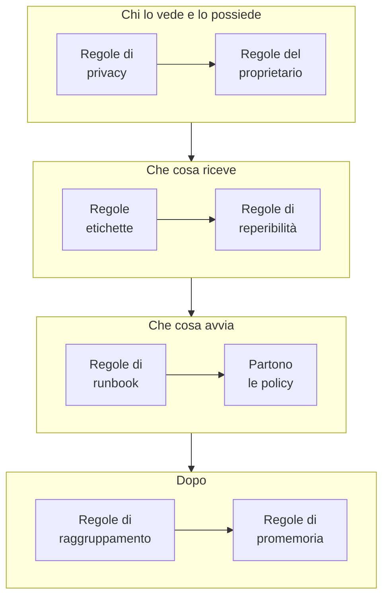

# Regole e impostazioni degli avvisi

La configurazione degli avvisi sta dentro **Avvisi**, non nelle **Impostazioni del progetto**: le regole che agiscono su ogni nuovo avviso e le impostazioni che danno forma a ogni avviso del progetto. Questa pagina è il riferimento per ciascuna di esse, e per ciò che gira da solo quando viene creato un avviso.

:::cards
- [Le regole che un nuovo avviso attraversa](#le-regole-che-un-nuovo-avviso-attraversa): In ordine, e che cosa fa ciascuna.
- [Regole di reperibilità](#regole-di-reperibilità): Chiamare le persone giuste senza scegliere una policy ogni volta.
- [Regole di promemoria](#regole-di-promemoria): Ricordare ai proprietari un avviso finché resta aperto.
- [Impostazioni](#impostazioni): Modelli di note, campi personalizzati, misurazioni, appartenenza agli episodi e numerazione.
:::

## Dove si trovano le impostazioni degli avvisi

Aprite **Avvisi** dal menu **Prodotti** nella barra superiore. Le sezioni **Regole** e **Impostazioni** del suo menu laterale partono compresse, quindi espandetele prima. Ogni pagina qui vale per tutto il progetto, a indirizzi che iniziano con `/dashboard/{projectId}/alerts/settings/`.

| Pagina delle regole            | Che cosa fa                                                                                    |
| ------------------------------ | ---------------------------------------------------------------------------------------------- |
| **Regole di raggruppamento**   | Mette gli avvisi correlati negli episodi. Vedere [Episodi di avvisi e regole di raggruppamento](/docs/alerts/episodes). |
| **Regole di reperibilità**     | Esegue policy di reperibilità per gli avvisi e gli episodi corrispondenti.                     |
| **Regole del proprietario**    | Aggiunge proprietari agli avvisi e agli episodi corrispondenti.                                |
| **Regole di runbook**          | Avvia runbook per gli avvisi corrispondenti.                                                   |
| **Regole di privacy**          | Rende privati gli avvisi e gli episodi corrispondenti.                                         |
| **Regole etichette**           | Aggiunge etichette agli avvisi e agli episodi corrispondenti.                                  |
| **Reminder Rules**             | Ricorda ai proprietari, a intervalli, un avviso finché è aperto.                               |

La sezione **Impostazioni** contiene **Stato avviso** e **Gravità avviso**, trattati in [Stati e gravità degli avvisi](/docs/alerts/states-and-severities), poi **Modelli di note**, **Campi personalizzati**, **Misurazioni**, **Appartenenza agli episodi** e **Numerazione**, trattati più sotto.

Altre due sezioni agiscono sugli avvisi. **Avvisi → IA → Impostazioni** decide che cosa fa OneUptime AI da solo: **Indaga sui nuovi avvisi**, attivo nei nuovi progetti, e **Correggi automaticamente i nuovi avvisi**, disattivato finché non lo attivate. Vedere [AI SRE](/docs/ai/ai-sre). **Avvisi → Area di lavoro** contiene le regole di Slack e Microsoft Teams che pubblicano avvisi ed episodi nei canali, e la sua scheda **Riepilogo**. Vedere [Slack](/docs/workspace-connections/slack).

## Le regole che un nuovo avviso attraversa

Le regole differiscono nel modo in cui si risolvono più corrispondenze:

- **Regole di raggruppamento** e **Reminder Rules** vengono controllate dall'alto verso il basso del loro elenco, e vince la prima corrispondenza. Trascinate una regola per cambiarne la posizione; una nuova regola va in fondo.
- **Regole di reperibilità**, **Regole del proprietario**, **Regole etichette**, **Regole di privacy** e **Regole di runbook** agiscono tutte quando corrispondono. Policy di reperibilità, proprietari ed etichette aggiunti da più regole vengono aggiunti una sola volta.

**Regole di reperibilità**, **Regole del proprietario**, **Regole etichette** e **Regole di privacy** hanno due schede: **Alert Rules**, per gli avvisi, ed **Episode Rules**, che agiscono allo stesso modo su ogni nuovo episodio di avviso. Una nuova regola parte abilitata; disattivate **Abilitato** nel suo modulo di modifica per sospenderla, e l'elenco mostra un **Abilitato** verde o un **Disabilitato** rosso per ogni regola.

La maggior parte delle regole agisce sugli avvisi e sugli episodi creati dopo il salvataggio. Per applicare una regola del proprietario, delle etichette o di privacy a quelli che avete già, usate **Esegui ora**: vedere [Eseguire le regole sulle risorse esistenti](/docs/configuration/run-rules-now). Le regole di promemoria sono l'eccezione: salvarne una ricalcola ogni avviso aperto.

### Condizioni

Le condizioni di una regola decidono su quali avvisi agisce, e si leggono come frasi: «Se **Titolo dell'avviso** contiene `database`», «E **Etichette del monitor** ha uno qualsiasi di *Production*». Una regola senza condizioni corrisponde a ogni avviso.

| Condizione                                                    | Confronta con                                                                                                  |
| ------------------------------------------------------------- | -------------------------------------------------------------------------------------------------------------- |
| **Monitor**, **Avviso Gravità**, **Etichette dell'avviso**, **Etichette del monitor** | **Ha uno qualsiasi di**, **Ha tutti i** o **Non ha nessuno di**, rispetto ai valori che scegliete.     |
| **Titolo dell'avviso**, **Descrizione dell'avviso**, **Nome del monitor**, **Descrizione del monitor** | **Contiene**, **Non contiene**, **Uguale a**, **Diverso da**, **Inizia con**, **Termina con**, senza distinguere maiuscole e minuscole, oppure **Corrisponde al pattern** e **Non corrisponde al pattern**, per un'espressione regolare o un carattere jolly `*`. |

Con due o più condizioni, scegliete **Soddisfa tutte**, dove ognuna deve valere, oppure **Soddisfa almeno una**, dove ne basta una. Le regole degli episodi corrispondono invece a gravità, etichette, titolo e descrizione di un episodio.

## Regole di reperibilità

**Avvisi → Regole → Regole di reperibilità** rende automatiche le chiamate. Ogni regola corrispondente aggiunge le sue policy al nuovo avviso, e l'avviso le esegue insieme alle policy che aveva già, ciascuna una volta.

:::steps
### Scegliere gli avvisi

Fate clic su **Crea: Alert On-Call Rule**. In **Corrispondenza**, **Tutti gli avvisi**, da cui parte una nuova regola, corrisponde a ogni nuovo avviso. Per restringerla, scegliete **Solo gli avvisi che soddisfano le condizioni** e aggiungete le condizioni che un avviso deve soddisfare.

### Scegliere le policy

In **Policy di reperibilità**, scegliete le **Policy di reperibilità** che la regola attiva. Il suo **Nome** le segue, come «Chiama Platform on-call», finché non ne digitate uno vostro, e una **Descrizione** attende sotto **Altri campi**. Poi create la regola.
:::

Una gravità da sola non chiama nessuno: una regola di reperibilità che corrisponde su **Avviso Gravità** è il modo per impostare «chiamare il team del database per ogni avviso High». Per vedere che cosa è stato eseguito per un avviso, aprite la sua pagina **Esecuzioni di reperibilità**. Ogni persona viene poi raggiunta nel modo impostato in **Impostazioni utente → Regole di reperibilità**, nella scheda **Avvisi**; vedere [Regole di escalation](/docs/on-call/escalation-rules).

Una regola chiama appena un avviso corrisponde. Perché attenda invece l'orario di lavoro, rispondete **Solo durante l'orario di lavoro** a **Quando deve chiamare questa regola?** sotto **Altri campi**. L'**Orario di lavoro** parte dal lunedì al venerdì, dalle 09:00 alle 17:00, nel vostro fuso orario: scegliete altri giorni, un'altra **Ora di inizio** o **Ora di fine**, o un altro **Fuso orario**, e una frase sotto la scelta dice cosa succederà. Nell'elenco, la regola mostra il suo orario sotto il nome. Un avviso che corrisponde fuori da quell'orario riceve un'esecuzione che attende e non chiama nessuno; quando inizia l'orario, la policy chiama con la sua prima regola di escalation ed esegue l'escalation come sempre. Se l'avviso viene riconosciuto o risolto prima, nessuno viene chiamato. Se l'avviso cambia mentre attende e ora corrisponde a una regola che chiama subito, per esempio perché ne è stata alzata la gravità, l'esecuzione inizia a chiamare in quel momento, e il feed dell'avviso dice perché. Due regole che attivano la stessa policy la attivano appena una delle due lo consente: una regola per le gravità più alte che chiama subito, accanto a una regola per il resto che attende l'orario di lavoro, tiene tranquille le notti.

## Regole del proprietario e delle etichette

Le **Regole del proprietario** aggiungono utenti e team proprietari ai nuovi avvisi corrispondenti, e le **Regole etichette** aggiungono etichette. Crearne una richiede due passaggi: **Corrispondenza**, le condizioni, poi **Proprietari** o **Etichette**, ciò che la regola aggiunge. Il **Nome** della regola segue ciò che scegliete finché non ne scrivete uno vostro.

- **Una regola può ereditare.** Compressi sotto **Eredita proprietari** o **Eredita etichette**, sei interruttori trasmettono i proprietari o le etichette del monitor, degli host, dei cluster Kubernetes, degli host Docker, degli host Podman e dei servizi dell'avviso. Le regole degli episodi non hanno questi interruttori. La sezione **Eredita proprietari** di una regola dei proprietari termina con **Team del creatore**: dei team elencati lì, diventa proprietario anche ognuno di cui fa parte la persona che crea l'avviso.
- **Una nuova regola deve aggiungere qualcosa**: scegliete almeno un proprietario o un'etichetta, o attivate un interruttore. In una regola per proprietari di incidenti o avvisi basta anche un team in **Team del creatore**.
- **Notifica ai proprietari**, sotto **Altri campi** di una regola del proprietario, decide se le persone aggiunte vengono informate.

[Regole per etichette e proprietari](/docs/configuration/label-and-owner-rules) descrive il modulo passo per passo, per ogni tipo di risorsa.

## Regole di privacy e di runbook

Le **Regole di privacy** rendono privati i nuovi avvisi corrispondenti, prima che giri qualsiasi altra cosa: solo i loro proprietari e gli amministratori e proprietari del progetto possono vederli. Una regola ha due passaggi: **Corrispondenza**, gli avvisi che rende privati, poi **Nome**, già compilato come «Rendi privati gli avvisi». Vedere [Avvisi privati](/docs/alerts/index#avvisi-privati).

Le **Regole di runbook** avviano un runbook quando un nuovo avviso corrisponde, a meno che l'avviso non sia stato creato risolto. Vedere [Regole di runbook](/docs/runbooks/rules).

## Regole di promemoria

**Avvisi → Regole → Reminder Rules** ricorda un avviso ai suoi proprietari finché resta aperto. Ogni nuovo avviso riceve la prima regola che gli corrisponde, dall'alto verso il basso dell'elenco.

:::steps
### Scegliere gli avvisi da ricordare

Fate clic su **Crea: Alert Reminder Rule**. In **Corrispondenza**, lasciate selezionato **Tutti gli avvisi** per ricordare ogni avviso, oppure scegliete **Solo gli avvisi che soddisfano le condizioni** e poi le **Avviso Gravità** e le **Etichette** a cui si applica.

### Impostare l'intervallo

In **Promemoria**, impostate **Intervallo del promemoria (minuti)**, ogni quanto vengono ricordati i proprietari, e **Interrompi i promemoria quando**: **Risolto**, il valore predefinito, o **Riconosciuto**. Il suo **Nome** segue entrambi, per esempio «Promemoria ogni 30 minuti fino alla risoluzione», finché non ne digitate uno vostro. Poi create la regola.
:::

I proprietari ricevono ogni promemoria come **Alert reminder**, attivo via e-mail per impostazione predefinita. La regola di un avviso viene ricalcolata quando cambiano la sua gravità o le sue etichette. Per fermare i promemoria di un avviso, disattivate **Invia promemoria** nella sua pagina **Impostazioni**; il salvataggio avviene nel momento in cui lo azionate.

## Impostazioni

### Modelli di note

**Avvisi → Impostazioni → Modelli di note** contiene testo già pronto per le note private. La scheda **Modelli di nota privata per gli avvisi** li elenca; **Crea: Avviso Nota Modello** chiede un **Nome del modello**, una **Descrizione del modello** e la **Nota**. Un modello viene proposto quando qualcuno scrive una nota privata su un avviso o un episodio, e quando ne riconosce o ne risolve uno, e il suo testo può essere modificato prima della pubblicazione. I modelli di nota degli avvisi sono testo semplice: a differenza dei modelli di nota degli incidenti, non compilano variabili.

### Campi personalizzati

**Avvisi → Impostazioni → Campi personalizzati** aggiunge i vostri campi a ogni avviso, come un livello del cliente o un riferimento a un ticket. Compilateli nella pagina **Campi personalizzati** di un avviso, o tramite l'API come `customFields`. Un campo può copiare il suo valore da un campo personalizzato del monitor invece di essere digitato: vedere [Campi copiati da un monitor](/docs/incidents/settings#campi-copiati-da-un-monitor), che funziona allo stesso modo per gli avvisi.

### Misurazioni

**Avvisi → Impostazioni → Misurazioni** misura quanto tempo richiedono le cose su ogni avviso. Scegliete **Tempo di riconoscimento** o **Tempo di risoluzione**, o due momenti vostri, come quando **L'avviso viene creato** e quando entra in uno stato che scegliete. Ogni misurazione è mostrata nella pagina dell'avviso e riportata nei grafici come `oneuptime.alert.measurement.<key>`. Vedere [Misurazioni](/docs/incidents/settings#misurazioni), che funziona allo stesso modo per gli avvisi.

La misurazione **Tempo di riconoscimento dopo la chiamata** conta da **Qualcuno viene chiamato per la prima volta**, quando una policy di reperibilità o una chiamata diretta ha chiamato per la prima volta qualcuno per l'avviso, anziché da quando è stato creato: a un avviso scattato di notte e per cui qualcuno viene chiamato al mattino la notte non viene addebitata. Un avviso per cui nessuno è stato chiamato non ha alcun valore. Vedere [Tempo di riconoscimento dopo la chiamata](/docs/incidents/settings#tempo-di-riconoscimento-dopo-la-chiamata).

### Appartenenza agli episodi

**Avvisi → Impostazioni → Appartenenza agli episodi** decide se un avviso può far parte di più di un episodio. Attivate **Un avviso può far parte di un solo episodio** e un avviso che fa parte di un episodio non viene aggiunto a nessun altro, né dalla dashboard né tramite l'API, un flusso di lavoro o una regola di raggruppamento, se prima non viene tolto da quell'episodio. È disattivato finché non lo attivate, e solo i Project Owners e i Project Admins possono cambiarlo. Attivarlo non toglie nessun avviso da un episodio. Vedere [Un solo episodio per incidente](/docs/incidents/episodes#un-solo-episodio-per-incidente), che funziona allo stesso modo per gli avvisi.

### Numerazione

**Avvisi → Impostazioni → Numerazione** imposta il testo davanti ai numeri di avvisi ed episodi: `ALT-` e `AE-` in un nuovo progetto, o `#` senza prefisso. **Aggiorna** apre **Prefisso del numero dell'avviso** e **Prefisso del numero dell'episodio di avviso**, con un'anteprima mentre digitate. Solo gli avvisi e gli episodi creati in seguito ricevono il nuovo prefisso. Le regole per un prefisso sono in [Prefissi dei numeri](/docs/incidents/settings#prefissi-dei-numeri).

La scheda **Numero successivo** sotto imposta il numero che ricevono il prossimo avviso e il prossimo episodio, per proseguire i numeri di un altro strumento: **Aggiorna** apre **Numero successivo dell'avviso** e **Numero successivo dell'episodio di avviso**, ciascuno maggiore del più alto usato finora. Vedete [Numeri successivi](/docs/incidents/settings#numeri-successivi).

> [!NOTE]
> Su OneUptime Cloud, i modelli di note e i campi personalizzati richiedono il piano **Growth** o superiore.

## Workflow

Ogni modello di avviso ha trigger e azioni di workflow che portano il suo nome: **On Create Alert**, **On Update Alert**, **On Create or Update Alert** e **On Delete Alert**, lo stesso per **Avviso Episodio**, **Avviso Stato Cronologia** e gli altri, e azioni come **Create One Alert** e **Update One Alert**. Le definizioni dei campi personalizzati degli avvisi sono l'unica eccezione: non hanno trigger di workflow. Vedere [Panoramica dei workflow](/docs/workflows/index).

## Chi può modificarle

Regole, campi personalizzati e misurazioni richiedono un Project Owner o un Project Admin, o un ruolo personalizzato con il permesso specifico di quella regola. **Membro degli avvisi** lavora con avvisi ed episodi, le loro note, i proprietari e le cronologie degli stati, e con i modelli di note, e **Amministratore degli avvisi** gestisce anche gli stati e le gravità degli avvisi. Vedere [Utenti, team e autorizzazioni](/docs/permissions/index).

## Passi successivi

:::cards
- [Episodi di avvisi e regole di raggruppamento](/docs/alerts/episodes): Le regole di raggruppamento, nel dettaglio.
- [Regole di escalation](/docs/on-call/escalation-rules): Che cosa succede quando una regola di reperibilità esegue una policy.
- [Regole per etichette e proprietari](/docs/configuration/label-and-owner-rules): Il modulo delle regole, passo per passo.
- [AI SRE](/docs/ai/ai-sre): Indagare e correggere automaticamente i nuovi avvisi.
:::
