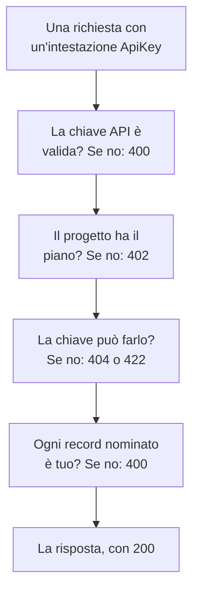

# Riferimento API OneUptime

Tutto ciò che puoi fare nella dashboard di OneUptime puoi farlo anche tramite la sua API REST: automatizzare il lavoro ripetitivo, collegare OneUptime agli altri tuoi strumenti o costruire integrazioni tue. Questa pagina mostra come fare la tua prima richiesta e le regole che ogni richiesta segue. Ogni endpoint e ogni campo si trovano nel [riferimento API completo](/reference).

:::cards
- [Fai la tua prima richiesta](#fai-la-tua-prima-richiesta): Una chiave API, un'intestazione e un comando curl.
- [Richieste e risposte](#richieste-e-risposte): Le sei richieste di ogni risorsa e cosa significa ogni codice di stato.
- [I piani e l'API](#i-piani-e-lapi): Cosa vende un piano e cosa funziona ancora sotto di esso.
- [Nominare e scrivere record](#nominare-e-scrivere-record): ID, riferimenti, interruttori e i campi che imposta OneUptime.
- [Stati ed episodi](#stati-ed-episodi): Lo stato in cui un record inizia e quelli che attraversa.
- [Cosa può raggiungere una richiesta](#cosa-può-raggiungere-una-richiesta): Letture, modifiche ed eliminazioni, un progetto alla volta.
:::

## Come viene risposta una richiesta

L'API è organizzata secondo REST: metodi e codici di stato HTTP standard, JSON in ingresso e in uscita. Ogni richiesta porta una chiave API e supera alcuni controlli. Il primo controllo che non supera risponde con un codice di stato e `{ "message": "..." }`, quindi il messaggio dice cosa l'ha fermata.



## Fai la tua prima richiesta

Tutte le richieste all'API sono autenticate con una chiave API. Una chiave appartiene a un progetto e fa ciò che le sue autorizzazioni consentono.

:::steps
### Creare una chiave API

Apri **Impostazioni del progetto → Avanzato → Chiavi API** e fai clic su **Crea: Chiave API**. Dagli un **Nome** e in **Accesso** scegli cosa può fare: **Amministratore del progetto**, **Membro del progetto**, **Visualizzatore**, oppure **Scegli le autorizzazioni più tardi** per aggiungere singole autorizzazioni nella pagina della chiave. La chiave scade tra un anno, a meno che tu non scelga un'altra data in **Avanzato**.

### Copiare la chiave

Si apre la pagina della chiave. Copia la **Chiave API** dalla scheda **Dettagli chiave API** e tienila fuori dal tuo codice:

```bash
export ONEUPTIME_API_KEY="your-api-key"
```

### Inviare una richiesta

Elenca i primi dieci monitor. La chiave legge il proprio progetto, quindi la richiesta non nomina alcun progetto:

```bash
curl -X POST 'https://oneuptime.com/api/monitor/get-list?skip=0&limit=10' \
  -H "ApiKey: $ONEUPTIME_API_KEY" \
  -H 'Content-Type: application/json' \
  -d '{ "select": { "name": true } }'
```

La risposta è `{ "data": [...], "count": ... }`: i monitor e quanti sono in totale. Su un'installazione self-hosted, usa il tuo indirizzo di OneUptime al posto di `https://oneuptime.com`.
:::

### Esempi per ogni risorsa

Ogni risorsa della dashboard di OneUptime ha una sezione **Sviluppatori** nel suo menu laterale, chiusa finché non la apri. La sua pagina **API** contiene comandi `curl` pronti all'uso per quella risorsa, puntati sul tuo OneUptime e compilati con i dati del tuo progetto: leggerla, modificarla ed eliminarla dalla pagina della risorsa, oppure elencare, contare e creare da una pagina di elenco (per esempio **Monitor**). I comandi leggono la tua chiave API dalla variabile d'ambiente `ONEUPTIME_API_KEY`.

Gli esempi sono scritti per la risorsa. Nell'elenco **Incidenti**, per esempio, la richiesta di elenco mostra la sua risposta con il tuo primo incidente, i filtri trovano gli incidenti non risolti, di una gravità, relativi a un monitor o degli ultimi sette giorni, usando i tuoi stati, gravità e monitor, e la richiesta di creazione dichiara un incidente con una delle tue gravità, con una riga su a cosa serve ogni campo. La pagina di un incidente lo legge con la sua risposta reale, lo sposta su un'altra delle tue gravità e offre le sue attività comuni: riconoscerlo e risolverlo (con gli stati del tuo progetto) e aggiungere note interne o pubbliche. Ogni pagina API termina con gli endpoint della risorsa.

## Richieste e risposte

Ogni risorsa ha le stesse richieste, sotto `https://oneuptime.com/api` e il percorso della risorsa, come `/monitor` o `/incident`:

| Richiesta | Metodo e percorso | Cosa contiene il corpo |
| --- | --- | --- |
| Elencare | `POST /api/<resource>/get-list` | `query`, `select` e `sort` |
| Contare | `POST /api/<resource>/count` | `query` |
| Leggerne uno | `POST /api/<resource>/<id>/get-item` | `select` |
| Creare | `POST /api/<resource>` | `{ "data": { ... } }` |
| Modificarne uno | `PUT /api/<resource>/<id>` | `{ "data": { ... } }`, i campi da modificare |
| Eliminarne uno | `DELETE /api/<resource>/<id>` | Niente |

Anche `POST /api/<resource>/<id>/update-item` e `POST /api/<resource>/<id>/delete-item` modificano ed eliminano un record, per i client che inviano solo `POST`.

### Filtrare, ordinare e sfogliare

Un elenco o un conteggio accetta una `query`. Un campo con un valore corrisponde a quel valore; un oggetto con un `_type` confronta:

| `_type` | Corrisponde a |
| --- | --- |
| `Search` | Testo che contiene `value` |
| `NotEqual` | Tutto tranne `value` |
| `GreaterThan`, `LessThan` | Date successive o numeri maggiori, oppure precedenti e minori |
| `InBetween` | Date o numeri tra `startValue` e `endValue` |
| `Includes` | Uno qualsiasi dei valori in `value` |
| `IsNull`, `NotNull` | Nessun valore, o un valore qualsiasi |

Un campo di un record che la risorsa nomina si filtra sotto la sua relazione: `"user": { "name": { "_type": "Search", "value": "ada" } }` trova i membri del team il cui utente ha un nome che contiene «ada». Filtrare per un campo richiede il permesso di leggerlo, attraverso una relazione come sulla risorsa stessa: un filtro su un campo che non puoi leggere viene rifiutato con un `422` che nomina il campo.

Una risorsa con proprietari - un monitor, un incidente, una policy di reperibilità e ogni altra con proprietari utente e team - si filtra anche in base a chi la possiede, sotto `owners`: `"owners": { "_type": "OwnedBy", "userIds": ["..."], "teamIds": ["..."] }` trova i record di cui sono proprietari una o più di quelle persone e di quei team. `match` è `AnyOf` se non lo imposti: `NoneOf` trova i record di cui nessuno di loro è proprietario, compresi i record senza proprietari, e `AnyOwner` e `NoOwner` trovano i record con almeno un proprietario o senza nessuno, senza nominare nessuno. I membri di un team non sono proprietari di ciò che il team possiede. Un filtro nomina al massimo 1.000 persone e team in tutto, una risorsa senza proprietari lo rifiuta con un `400`, e filtrare per proprietari senza il permesso di leggerli viene rifiutato con un `422`.

`select` nomina i campi da restituire, e `_id` torna sempre. `sort` li ordina, `ASC` o `DESC`; senza ordinamento, i più recenti vengono per primi. Un elenco restituisce 10 record se non imposti `limit`, fino a 10.000, e `skip` ne salta prima altrettanti: continua ad aumentare `skip` di `limit` finché non ne hai `count`. Aggiungi `?output-type=csv` a una richiesta di elenco per avere CSV invece di JSON.

Per esempio, i monitor il cui nome contiene «checkout», creati dall'inizio del 2026, i più recenti per primi:

```bash
curl -X POST 'https://oneuptime.com/api/monitor/get-list' \
  -H "ApiKey: $ONEUPTIME_API_KEY" \
  -H 'Content-Type: application/json' \
  -d '{
    "query": {
      "name": { "_type": "Search", "value": "checkout" },
      "createdAt": { "_type": "GreaterThan", "value": "2026-01-01T00:00:00.000Z" }
    },
    "select": { "name": true, "createdAt": true },
    "sort": { "createdAt": "DESC" },
    "limit": 100
  }'
```

Le date e gli ID diversi da `_id` tornano incapsulati, come `{ "_type": "DateTime", "value": "..." }` e `{ "_type": "ObjectID", "value": "..." }`: leggili da `value`.

Ogni ID per cui una richiesta filtra o che scrive - `_id`, un campo come `monitorId` e ogni record che una relazione elenca, come `"labels": [{ "_id": "..." }]` - è un UUID, inviato come testo o incapsulato come torna. Qualsiasi altra cosa, come un testo che non è un UUID o un oggetto al posto di un ID, viene rifiutata con un `400` che nomina il campo e dice se si trovava in `query` o in `data`, e non viene letto né scritto nulla:

```text
Invalid ID for "currentIncidentStateId" in the query: "resolved". An ID is a UUID, such as "550e8400-e29b-41d4-a716-446655440000".
```

### Codici di stato

| Codice | Cosa significa | Per saperne di più |
| --- | --- | --- |
| `200` | È andata a buon fine. Un elenco o un conteggio risponde con i record che puoi leggere, nessuno se non ce ne sono. | [Leggere un record dal suo ID](#leggere-un-record-dal-suo-id) |
| `400` | La richiesta è sbagliata: la chiave API non è valida, un valore non è consentito, un campo non può essere scritto, un record nominato non è tuo, oppure modifica più progetti insieme. Il messaggio dice cosa non va. | [I record che una richiesta nomina](#i-record-che-una-richiesta-nomina) |
| `402` | Il piano del progetto non include ciò che la richiesta usa. Il messaggio nomina il piano. | [Funzionalità che il tuo piano non include](#funzionalità-che-il-tuo-piano-non-include) |
| `404` | Il record non esiste, è in un altro progetto o è uno che non puoi leggere: la stessa risposta in ogni caso. | [Modificare o eliminare un record che non puoi leggere](#modificare-o-eliminare-un-record-che-non-puoi-leggere) |
| `422` | Non puoi farlo: la chiave API non ha alcuna autorizzazione per questo tipo di record, puoi leggere il record ma non modificarlo, oppure le etichette di un'autorizzazione lo escludono. Il messaggio dice perché. | [Modificare o eliminare un record che non puoi leggere](#modificare-o-eliminare-un-record-che-non-puoi-leggere) |
| `500` | Qualcosa è andato storto sul server. Quando il proprietario di un nuovo record non può essere scritto, il record viene rimosso, quindi la creazione si può ritentare. | [I record che una richiesta nomina](#i-record-che-una-richiesta-nomina) |

## I piani e l'API

### Funzionalità che il tuo piano non include

Su OneUptime Cloud, alcune risorse sono vendute in un piano: i provider di single sign-on e le connessioni SCIM in **Scale**; le chiavi API, i turni di reperibilità, e le regole di notifica e i riepiloghi di Slack e Microsoft Teams in **Growth**, tra gli altri. Crearne una, modificarla o attivarla richiede quel piano. Sotto di esso, la richiesta viene rifiutata con `402 Payment Required`, e il messaggio nomina il piano.

Alcune impostazioni di una risorsa sono vendute in un piano allo stesso modo. Per esempio: una pagina di stato privata, che nasconde uno dei suoi elenchi, o che ha HTML, CSS o JavaScript personalizzati, report via email, iscritti via SMS, Slack, Microsoft Teams o webhook, o una lista di IP consentiti; una dashboard condivisa pubblicamente, o la sua lista di IP consentiti; la lista di IP consentiti di un modulo; i registri di audit di un progetto. La guida di ciascuna, e la dashboard accanto all'impostazione, nominano il piano necessario. Un'impostazione così richiede il suo piano ogni volta che viene scritta - quando la risorsa viene creata con essa come quando viene modificata in seguito -, quindi anche una creazione che ne attiva una sotto il piano viene rifiutata con `402`. Un'impostazione lasciata al suo valore predefinito, o riportata ad esso, funziona con ogni piano: una creazione che non tocca queste impostazioni va a buon fine, e lo stesso vale per una configurazione Terraform che non le imposta.

Ciò che un progetto ha già resta gestibile qualunque sia il suo piano, per esempio dopo la fine di una prova o quando il piano scende:

- puoi eliminare quei record;
- puoi disattivarne uno, su una risorsa con un campo `isEnabled`, inviando `"isEnabled": false` e nient'altro;
- puoi elencare e leggere quelli che un progetto deve ritrovare dopo che il piano scende - per disattivarli, o per vedere cosa si è fermato: provider di single sign-on, connessioni SCIM, chiavi API e le loro autorizzazioni, turni di reperibilità, e regole di notifica e riepiloghi di Slack e Microsoft Teams.

Le solite autorizzazioni decidono ancora chi può fare cosa, esattamente come con il piano. Leggere le altre risorse vendute da un piano, come modelli, campi personalizzati, gruppi di monitor, registri di reperibilità e invii di moduli, richiede ancora il piano: leggerle significa usare la funzionalità. Le autorizzazioni di una chiave API non vengono eliminate una a una sotto **Growth**, perché eliminare un'autorizzazione di blocco darebbe più accesso alla chiave; elimina invece la chiave.

### Chiavi API e SCIM sotto il loro piano

Su OneUptime Cloud, le chiavi API di un progetto funzionano solo finché il progetto è su **Growth** o superiore, e le sue connessioni SCIM - quelle del progetto e quelle delle sue pagine di stato - funzionano pienamente solo finché è su **Scale** o superiore. Quando il progetto scende sotto quel piano:

- Ogni richiesta fatta con una delle chiavi API del progetto viene rifiutata con `402 Payment Required`, qualunque cosa chieda: l'API REST e tutto ciò che la chiama con una chiave API - Terraform, la CLI `oneuptime`, i client MCP collegati con una chiave API, i workflow che ne inviano una in un'intestazione di richiesta e i tuoi script. Il messaggio nomina il piano: `API keys need the Growth plan. This project's plan does not include them, so its API keys stopped working. The keys are kept: upgrade the project to Growth in Project Settings > Billing and Invoices > Billing and they work again.`
- Le sue connessioni SCIM si limitano a rimuovere persone. Disattivare ed eliminare persone, e toglierle dai gruppi, funziona ancora, quindi chi se ne va perde comunque il suo accesso; ogni richiesta SCIM che aggiungerebbe o modificherebbe persone o gruppi viene rifiutata con `402`, nel formato di errore SCIM, così il tuo provider di identità mostra il perché ([SCIM sotto il piano Scale](/docs/identity/scim#sotto-il-piano-scale)).

Niente viene eliminato o disattivato. Le chiavi e le connessioni vengono conservate e tornano a funzionare pienamente, così come sono, appena il progetto torna sul piano: nessuna nuova chiave da creare, niente da riconfigurare nel provider di identità. Un cambio di piano ha effetto entro un minuto.

Sotto **Growth**, **Impostazioni del progetto** > **Avanzato** > **Chiavi API** elenca le chiavi che il progetto ha ancora e dice che si sono fermate, quindi ognuna può essere eliminata (revocata) con qualsiasi piano. Creare o modificare chiavi richiede **Growth**. **Impostazioni del progetto** > **Fatturazione e fatture** > **Fatturazione** indica quante chiavi API un piano inferiore ferma e quante connessioni SCIM limita, per ogni piano che puoi scegliere, e cosa ha fermato il piano del progetto; i proprietari del progetto ricevono un'email quando un cambio di piano le ferma. I proprietari dei progetti che erano già sotto questi piani quando tutto questo è iniziato ricevono un'unica email che dice cosa si è fermato e come riattivarlo.

Sono coinvolte solo le chiavi API e le connessioni SCIM di un progetto. Le persone no: l'accesso alla dashboard, e i client MCP collegati tramite accesso, funzionano come prima. Le chiavi di ingestione della telemetria, le chiavi delle sonde e le chiavi degli agent non sono chiavi API e continuano a funzionare. Le installazioni self-hosted non hanno piani, quindi per loro non cambia nulla.

## Nominare e scrivere record

### Trovare l'ID di una risorsa

Le richieste che leggono, modificano o eliminano una risorsa la nominano con il suo ID, un UUID. Nella pagina della risorsa, la sua scheda dei dettagli termina con una piccola riga **ID** che mostra l'inizio dell'ID: fai clic sull'ID, o sul pulsante di copia accanto, per copiare l'ID intero. Gli elenchi che lo offrono hanno **Mostra ID** nel menu **⋯** di una riga, e l'ID è anche l'ultima parte dell'indirizzo della pagina. L'ID del tuo progetto è la prima cosa della scheda **Dettagli del progetto** in **Impostazioni del progetto → Progetto**.

### I record che una richiesta nomina

Molte risorse nominano altri record: un monitor le sue etichette e sonde, un iscritto a una pagina di stato la sua pagina di stato, un dispositivo di rete il suo sito, un membro di un incidente l'incidente e il ruolo. Ogni regola qui sotto vale allo stesso modo per l'API, Terraform e i workflow:

| Quando una richiesta | deve | Altrimenti |
| --- | --- | --- |
| nomina un record con il suo ID | nominare un record del tuo progetto | `400` |
| crea un record che si legge attraverso un altro, come una nota | crearlo sotto uno che puoi leggere | `400`, o `422` senza autorizzazione a leggere quel tipo di record |
| sposta un record sotto un altro | spostarlo sotto uno che puoi leggere | `400` |
| elenca record, o ne nomina uno in un campo proprio | nominare record che la tua autorizzazione di lettura raggiunge | `400` |
| nomina un'impostazione che contiene credenziali | venire da qualcuno che può leggere quel tipo di impostazione | `400` |
| crea o rietichetta un record con un'autorizzazione limitata a etichette | dare al record una di quelle etichette | `422` |
| nomina un record in due modi | nominare lo stesso record entrambe le volte | `400` |

#### Ogni ID deve essere del tuo progetto

Ogni ID che invii per un record nominato da una risorsa deve essere un record del tuo progetto — i selettori della dashboard non offrono altro — e le richieste di Terraform e dei workflow seguono la stessa regola. Un ID di un record di un altro progetto e un ID che non esiste vengono rifiutati allo stesso modo, con un `400` che nomina il campo e l'ID:

```text
This network device references records that are not in this project: Network Site "…". Please pick values from this project and try again.
```

Le persone vengono verificate in base all'appartenenza: chi non è membro del progetto viene rifiutato allo stesso modo. Una sonda globale, che ogni progetto può usare, conta come del tuo progetto. Modificare una risorsa verifica solo gli ID che la modifica aggiunge, quindi una risorsa che nomina qualcosa che nel frattempo è sparito si può ancora salvare.

#### Record che si leggono attraverso un altro

Un record che si legge attraverso un altro - le note e la cronologia degli stati di un incidente o di un avviso, gli annunci, i domini e i gruppi di una pagina di stato - deve anch'esso nominarne uno che puoi leggere, secondo la regola che segue la sua lettura: un incidente fuori dalle etichette o dai proprietari che la tua autorizzazione a leggere gli incidenti raggiunge, con un'etichetta che un blocco sulla lettura degli incidenti toglie, o contrassegnato come privato senza che tu sia tra i suoi proprietari, direttamente o tramite un team (i proprietari e gli amministratori del progetto vedono ogni incidente, avviso ed episodio privato), viene rifiutato con lo stesso `400`, e niente viene scritto. Ogni pagina di stato che un annuncio nomina deve essere una che puoi leggere, e una chiave la cui autorizzazione a leggere le pagine di stato ne raggiunge solo alcune deve nominarne almeno una. Un'autorizzazione a creare un record del genere richiede un'autorizzazione a leggere il record sotto cui viene creato; senza, la creazione viene rifiutata con un `422` che nomina le autorizzazioni che la consentirebbero:

```text
You do not have permissions to create Incident Internal Note. It is read through its Incident, and you need one of these permissions to read Incidents: …
```

Una modifica che sposta un record del genere segue la stessa regola: ogni record che aggiunge come genitore - un'altra pagina di stato per un annuncio, un altro servizio per un record che si legge attraverso il suo servizio - deve essere uno che puoi leggere, altrimenti la modifica viene rifiutata con lo stesso `400` e niente viene scritto. I genitori che un record ha già non vengono verificati di nuovo, e una modifica che non lo lascia sotto nessuno richiede un'autorizzazione a leggere quel tipo di record che li raggiunga tutti, come una creazione che non ne nomina nessuno.

#### Proprietari

I proprietari di una risorsa - i record dei proprietari utente e team di un monitor, di una policy di reperibilità, di una dashboard e di ogni altra risorsa con proprietari - si leggono attraverso la risorsa che possiedono allo stesso modo: elencarli, leggerli, aggiungerli e rimuoverli richiede un'autorizzazione a leggere quella risorsa, sotto le sue etichette e i suoi proprietari, e un record di proprietario di una risorsa che non puoi leggere riceve la risposta come se non esistesse. Anche aggiungerli e rimuoverli segue l'ambito dell'autorizzazione che lo consente: una con l'ambito `Owned` raggiunge solo i proprietari delle risorse di cui tu o uno dei tuoi team siete proprietari, e l'aggiunta di un proprietario a qualsiasi altra risorsa viene rifiutata con un `422` che lo dice.

#### Record che una scrittura elenca o nomina

I record che una creazione o una modifica elenca - i monitor e le policy di reperibilità di un incidente, i servizi di un avviso, le pagine di stato di un evento di manutenzione programmata, i runbook di una regola - rispettano la tua autorizzazione a leggere quel tipo di record quando ne hai una, e in ogni caso un blocco con etichette sulla sua lettura: uno al di fuori viene rifiutato con lo stesso `400`. Una modifica verifica solo i record che aggiunge a un elenco, quindi quelli che l'elenco contiene già restano.

L'unico record che una creazione o una modifica nomina in un campo proprio - il monitor di un avviso, il monitor che mostra una risorsa di una pagina di stato, il servizio di un budget dei costi, l'incidente a cui è collegata un'esecuzione di runbook - segue la stessa regola, con l'uno o l'altro dei suoi nomi: uno al di fuori della tua autorizzazione a leggere quel tipo di record, o con un'etichetta che un blocco sulla sua lettura toglie, viene rifiutato con lo stesso `400`. Una modifica lo verifica solo quando nomina un record diverso da quello che il campo contiene già. Le sonde globali e gli agenti IA di OneUptime, che ogni progetto può usare, restano aperti a ogni progetto. I record che un modello compila per te vengono verificati allo stesso modo una volta compilati, prima di salvare qualsiasi cosa: i monitor, le pagine di stato e le policy di reperibilità che un modello di incidente aggiunge a un incidente dichiarato a partire da esso devono essere record che puoi leggere, come se li avessi scelti tu.

#### Impostazioni che contengono credenziali

Un'impostazione che contiene credenziali - un server SMTP, un provider di chiamate e SMS, credenziali SNMP, una connessione per videochiamate, una chiave API, un server MCP esterno - viene nominata solo da chi può leggere quel tipo di impostazione: `smtpConfig` e `callSmsConfig` di una pagina di stato, `projectCallSMSConfig` di una policy per chiamate in arrivo, `snmpCredentialProfile` di un dispositivo di rete o di un sito, la connessione per videochiamate `videoCallConnection` di un incidente o di un avviso, `apiKey` di un'autorizzazione di chiave API e `externalMcpServers` di una regola IA. Nominarne una senza autorizzazione a leggere quel tipo di impostazione - o con una che un blocco senza etichette toglie - viene rifiutato con lo stesso `400`, con l'uno o l'altro dei suoi nomi; una modifica che mantiene l'impostazione che un record nomina già non viene interrogata. La ricerca dei numeri e l'elenco dei numeri posseduti di una policy per chiamate in arrivo richiedono la stessa lettura della configurazione di chiamate e SMS che nominano.

#### Etichette e proprietari alla creazione

Un'autorizzazione di creazione limitata a etichette crea solo record che portano una delle sue etichette - per un record senza etichette proprie, record sotto uno che ne porta una -, a meno che un'altra autorizzazione a creare quel tipo di record raggiunga tutto il progetto, e un blocco con etichette su un'autorizzazione di creazione rifiuta un record che porta una delle sue etichette. Una creazione al di fuori viene rifiutata con un `422` che nomina le etichette:

```text
Your access lets you create Status Pages only with one of these labels: Production. Add one of them and try again.
```

Un'autorizzazione di creazione con ambito **Owned** crea un monitor, una pagina di stato o un altro record con propri proprietari solo per una persona, che diventa uno dei suoi proprietari, e una nota o un altro record che prende i suoi proprietari dal record a cui appartiene solo sotto uno che tu o uno dei tuoi team possedete.

Il creatore diventa proprietario subito dopo il salvataggio del record, prima che gli accada qualsiasi altra cosa. Se la riga del proprietario non può essere scritta, il record viene rimosso e la creazione viene rifiutata con un `500`, così non resta nessun record che il suo creatore non potrebbe raggiungere.

#### Una modifica delle etichette

Una modifica delle etichette che porta un record - le sue etichette o, per un record senza etichette proprie, i record che nomina - rispetta allo stesso modo la tua autorizzazione a modificare quel tipo di record: con una limitata a etichette, il record ne conserva almeno una, a meno che un'altra autorizzazione a modificarlo raggiunga tutto il progetto, e un blocco con etichette su un'autorizzazione di modifica impedisce di dargli una delle sue etichette. Una modifica del genere viene rifiutata con un `422` che nomina le etichette:

```text
Your access lets you change Monitors only with one of these labels: Production. Keep one of them and try again.
```

#### Nominare un record in due modi

Un record si può nominare in due modi: con il suo campo ID (`monitorId`), oppure con la relazione (`"monitor": { "_id": "…" }`), che è ciò che inviano i moduli della dashboard. Invia uno dei due. Se una richiesta li invia entrambi, devono nominare lo stesso record: una richiesta in cui i due non coincidono — due ID diversi, o un ID e un valore vuoto — viene rifiutata con un `400` che nomina entrambi i campi:

```text
Conflicting Monitor references were provided. monitorId and monitor are names for the same field and must hold the same value: send only one of them, or the same id in each.
```

Entrambi i nomi vengono verificati allo stesso modo. Le regole sul record che nomini valgono con qualunque nome tu lo invii: il gruppo padre di un gruppo di una pagina di stato deve essere sulla stessa pagina di stato, una pagina di stato accetta al massimo tre link di intestazione, e il nome di un gruppo deve essere unico sulla sua pagina di stato.

### Interruttori

Un campo attivo o disattivo - `isEnabled`, `isVisibleOnStatusPage`, `isArchived` e ogni altro campo `true` o `false` - accetta `true` o `false`. Il testo e i numeri che il database legge come uno di essi vengono presi come quel valore, allo stesso modo per l'API, Terraform e i workflow: `"true"`, `"yes"`, `"on"`, `"1"` e `1` sono `true`, e `"false"`, `"no"`, `"off"`, `"0"` e `0` sono `false`, in maiuscolo o minuscolo. Tutto ciò che OneUptime fa con il record lo tratta anch'esso come quel valore: un evento di manutenzione programmata inviato con `"isVisibleOnStatusPage": "true"` mostra le sue immagini sulla pagina di stato, e `"isEnabled": "false"` disattiva una risorsa sotto il suo piano come fa `false`. Qualsiasi altro valore, come `"maybe"`, `""` o `2`, viene rifiutato con un `400` che nomina il campo:

```text
isVisibleOnStatusPage must be true or false.
```

Un aggiornamento che scrive i valori di un record così come sono già non cambia nulla: non avvia i workflow **On Update** del record, non invia aggiornamenti in tempo reale e non aggiunge una voce al registro di audit. `false` scritto sopra `false` conta come lo stesso valore, e così `"false"` scritto sopra `false`, un numero scritto come testo, un orario scritto come lo stesso istante in un altro formato ed etichette scritte come le stesse etichette in qualsiasi ordine. Quando un aggiornamento modifica alcuni valori e ne riscrive altri così come sono, la sua voce del registro di audit elenca solo i valori modificati, e il **Fields to watch** di un workflow sente solo quelli.

### Dove è stato acquistato un progetto

Il rivenditore, il piano del rivenditore e la licenza del rivenditore di un progetto (`resellerId`, `resellerPlanId`, `resellerLicenseId`, e le relazioni `reseller` e `resellerPlan`) li imposta solo OneUptime: quando un progetto viene creato con il codice promozionale di un rivenditore, e quando il rivenditore cambia il piano. Una creazione o una modifica di un progetto che ne invia uno viene rifiutata con un `400` che nomina il campo, chiunque la invii:

```text
User is not allowed to create on resellerId column of Project. No permission allows it: the column is set by the server, not by a request.
```

### Chi ha creato un record

OneUptime registra chi ha creato un record — e chi lo ha archiviato, risolto, riconosciuto o attivato — dalla richiesta stessa: la persona che ha effettuato l'accesso, o nessuno quando la richiesta arriva con una chiave API o da un workflow. Questi campi (`createdByUserId` e gli altri campi che terminano con `ByUserId`, con le loro relazioni come `createdByUser`) sono di sola lettura, così come il momento in cui un record è stato archiviato o risolto (`archivedAt`, `markedAsResolvedAt`, `markedAsArchivedAt`): attivare `isArchived` o `isResolved` registra chi l'ha fatto e quando, e disattivarlo cancella entrambi. Inviare un interruttore così come sta già conserva chi lo ha cambiato, e quando.

Il riferimento API contrassegna questi campi come di sola lettura. Un valore che una richiesta invia per uno di essi insieme ad altre modifiche viene ignorato, così il resto della modifica va a buon fine; un aggiornamento che non invia nient'altro viene rifiutato con un messaggio che nomina i campi. I record che OneUptime crea da sé per conto di qualcuno — una nota pubblicata da Slack o Microsoft Teams, un account creato da un invito — nominano quella persona.

## Stati ed episodi

### Lo stato in cui inizia un nuovo record

Un incidente, un avviso, un episodio di incidente e un episodio di avviso possono essere creati in uno qualsiasi degli stati del tuo progetto, come fa il campo **Stato iniziale** dei loro moduli di creazione: invia `currentIncidentStateId` (incidenti ed episodi di incidente) o `currentAlertStateId` (avvisi ed episodi di avviso), oppure la relazione. Il record inizia in quello stato e la sua cronologia degli stati comincia da esso. Se lo ometti, inizia nello stato di creazione del tuo progetto, quello contrassegnato con `isCreatedState` — oppure, per un incidente dichiarato da un modello che ha uno stato iniziale, in quello del modello. Uno stato di un altro progetto viene rifiutato come qualsiasi altro record. `current_incident_state_id` e `current_alert_state_id` di Terraform funzionano allo stesso modo. Un record creato nel tuo stato di riconosciuto o oltre non avvisa nessuno, e uno creato già risolto inoltre non viene raggruppato, corretto automaticamente o analizzato dall'IA, e non riceve un canale Slack o Microsoft Teams — vedi [Dichiarato già riconosciuto o risolto](/docs/incidents/declaring-incidents#dichiarato-già-riconosciuto-o-risolto).

### Cambiare lo stato di un record

Lo stato di un record cambia tramite una riga della sua cronologia degli stati - `POST /api/incident-state-timeline`, `/api/alert-state-timeline`, `/api/incident-episode-state-timeline`, `/api/alert-episode-state-timeline` o `/api/scheduled-maintenance-state-timeline` - oppure tramite un aggiornamento che scrive il suo stato attuale (`currentIncidentStateId`, `currentAlertStateId`, `currentScheduledMaintenanceStateId`, o la relazione), che registra la stessa riga. In entrambi i casi una sola regola governa il passaggio, per un episodio come per un incidente, un avviso o un evento di manutenzione programmata: uno stato precedente, nell'ordine del tuo progetto, a quello attuale del record viene rifiutato prima di salvare qualsiasi cosa, così come lo stato in cui si trova già:

```text
Episode cannot transition to Acknowledged state from Resolved state because Acknowledged is before Resolved in the order of incident states.
```

Uno stato impostato per errore si corregge eliminando la sua riga dalla cronologia degli stati del record. Vedi [L'ordine è un vincolo reale](/docs/incidents/states-and-severities#lordine-è-un-vincolo-reale-non-una-preferenza-di-visualizzazione).

### L'episodio in cui si trova un incidente o un avviso

`incidentEpisodeId` di un incidente e `alertEpisodeId` di un avviso — e le loro relazioni `incidentEpisode` e `alertEpisode` — nominano l'ultimo episodio a cui è stato aggiunto e di cui è ancora membro, oppure niente. Sono di sola lettura: OneUptime li imposta a partire dai membri dell'episodio. Per mettere un incidente in un episodio, crea un Incident Episode Member (`POST /api/incident-episode-member` con `incidentEpisodeId` e `incidentId`); per toglierlo, elimina quel membro, e l'incidente nomina allora l'ultimo episodio in cui si trova ancora, o nessuno. Gli avvisi funzionano allo stesso modo tramite gli Alert Episode Members (`/api/alert-episode-member`, con `alertEpisodeId` e `alertId`). Le regole di raggruppamento aggiungono incidenti e avvisi agli episodi allo stesso modo. Una creazione o un aggiornamento di un incidente o di un avviso che invia il suo episodio viene rifiutato, chiunque lo invii — l'API, Terraform, gli strumenti MCP o un workflow. In Terraform, `incident_episode_id` e `alert_episode_id` si possono leggere ma non impostare; le risorse `oneuptime_incident_episode_member` e `oneuptime_alert_episode_member` gestiscono l'appartenenza.

## Cosa può raggiungere una richiesta

### Modificare o eliminare un record che non puoi leggere

Una modifica o un'eliminazione raggiunge solo i record che la chiave API - o la persona che ha effettuato l'accesso - può leggere. Un record fuori dalle sue etichette o dai suoi proprietari, dietro un blocco sulla lettura, o letto attraverso un altro record che non può leggere (la nota di un incidente, l'annuncio di una pagina di stato) non può nemmeno essere modificato o eliminato. Un'autorizzazione a modificare o eliminare un tipo di record funziona insieme all'autorizzazione a leggerlo, e una a modificare le note di un incidente insieme a una a leggere gli incidenti.

Una richiesta che modifica o elimina un record tramite il suo ID - `PUT /api/<resource>/<id>` o `POST /api/<resource>/<id>/update-item`, `DELETE /api/<resource>/<id>` o `POST /api/<resource>/<id>/delete-item` - e non raggiunge nulla risponde:

- `404` quando il record non esiste, è in un altro progetto o è uno che non puoi leggere - la stessa risposta in ogni caso:

```text
Incident not found.
```

- `422` quando puoi leggere il record ma non modificarlo o eliminarlo, con il motivo:

```text
You do not have permission to update this incident.
```

Un'eliminazione che non raggiungeva nulla rispondeva prima `200`. Gli aggiornamenti e le eliminazioni tramite query, come i passaggi di aggiornamento ed eliminazione di un workflow, rispondono con quanti record hanno modificato, `0` quando non ne hanno raggiunto nessuno. Terraform interpreta un `404` durante `terraform destroy` come una risorsa già sparita.

La telemetria segue la stessa regola. Un'eliminazione di log, tracce, metriche, eccezioni, profili o registrazioni di sessione raggiunge le righe delle risorse - servizi, host, cluster e simili - la cui telemetria puoi sia leggere sia eliminare, e avviene un progetto alla volta: una richiesta su tutti i tuoi progetti viene rifiutata. Un'eliminazione di una riga tramite il suo ID che non raggiunge nulla risponde `404` o `422` come sopra.

### Le modifiche si fanno un progetto alla volta

Un aggiornamento o un'eliminazione dei record di un progetto avviene nel progetto che la richiesta nomina: l'intestazione `tenantid` oppure, per una chiave API, il progetto della chiave stessa. Un aggiornamento o un'eliminazione di un utente che ha effettuato l'accesso che non nomina alcun progetto, o che interroga tutti i suoi progetti con l'intestazione `is-multi-tenant-query`, viene rifiutato con `400`:

```text
Changes to incidents are made in one project at a time. Please pass the project ID in the 'tenantid' header.
```

Una richiesta del genere falliva prima con `500`. Le letture possono ancora interrogare tutti i tuoi progetti.

### Leggere un record dal suo ID

Una lettura di un record tramite il suo ID - `POST /api/<resource>/<id>/get-item` - risponde `404` quando il record non esiste, è in un altro progetto o è uno che non puoi leggere, la stessa risposta in ogni caso:

```text
Incident not found.
```

Prima rispondeva `200` con un corpo vuoto. Un elenco (`get-list`) e un conteggio rispondono ancora `200` con i record che puoi leggere, nessuno se non ce ne sono. Il provider Terraform interpreta un `404` durante l'aggiornamento come una risorsa sparita e la rimuove dallo stato, così il piano successivo la ricrea: dai alla chiave API che usa le autorizzazioni, e le etichette, per leggere ogni risorsa che gestisce. Gli strumenti MCP rispondono a un `404` con un errore che rimanda allo strumento di elenco corrispondente, e la CLI termina con il codice `3`.

## Il riferimento completo degli endpoint

Ogni risorsa, endpoint e campo si trova nel [riferimento API di OneUptime](/reference). È disponibile in più lingue: la tua lingua viene presa dal browser, e puoi cambiarla in qualsiasi momento con il selettore in cima alla pagina.

## Risoluzione dei problemi

:::details Ogni richiesta risponde 400 Invalid API Key
L'intestazione `ApiKey` è vuota, non è una chiave, oppure nomina una chiave scaduta o reimpostata. Copia di nuovo la chiave dalla sua pagina in **Impostazioni del progetto → Avanzato → Chiavi API**, dove c'è anche la sua data **Scade**.
:::

:::details Ogni richiesta risponde 402 Payment Required
Su OneUptime Cloud, le chiavi API funzionano solo finché il progetto è sul piano **Growth** o superiore. Le chiavi vengono conservate e tornano a funzionare così come sono appena il progetto torna sul piano: vedi [Chiavi API e SCIM sotto il loro piano](#chiavi-api-e-scim-sotto-il-loro-piano).
:::

:::details Ogni richiesta risponde 422 You do not have permissions
La chiave API non ha alcuna autorizzazione per quel tipo di record. Una chiave creata con **Scegli le autorizzazioni più tardi** non può fare nulla finché non ne riceve una: aprila in **Impostazioni del progetto → Avanzato → Chiavi API**, poi fai clic su **Aggiungi ruolo** o **Aggiungi autorizzazione**. Il messaggio nomina le autorizzazioni che farebbero passare la richiesta.
:::

:::details Un record che vedo nella dashboard risponde 404
La chiave API legge solo ciò che le sue autorizzazioni, e le loro etichette, raggiungono, e una chiave può raggiungere meno del tuo account. Dai alla chiave un'autorizzazione che raggiunga il record: vedi [Leggere un record dal suo ID](#leggere-un-record-dal-suo-id).
:::

:::details Un aggiornamento risponde 400 Invalid request body
Un aggiornamento invia i campi da modificare dentro `data`, come `{ "data": { "name": "New name" } }`. Un corpo senza di esso viene rifiutato, invece di rispondere `200` senza modificare nulla:

```text
Invalid request body. The update payload should be an object of the form { "data": { ...fields to update... } }.
```
:::

:::details Una scrittura risponde 400 e nomina un campo e un ID
L'ID nomina un record di un altro progetto, uno che non esiste o uno che le tue autorizzazioni non raggiungono. Vedi [I record che una richiesta nomina](#i-record-che-una-richiesta-nomina).
:::

## Passaggi successivi

:::cards
- [Utenti, team e autorizzazioni](/docs/permissions/index): Cosa raggiungono le autorizzazioni e le etichette di una chiave API.
- [Provider Terraform](/docs/terraform/index): Gestire le risorse di OneUptime come codice, tramite la stessa API.
- [CLI di OneUptime](/docs/cli/index): Chiamare l'API dal tuo terminale e dai tuoi script.
- [Server MCP](/docs/ai/mcp-server): Lasciare che gli assistenti IA lavorino con il tuo progetto.
:::
