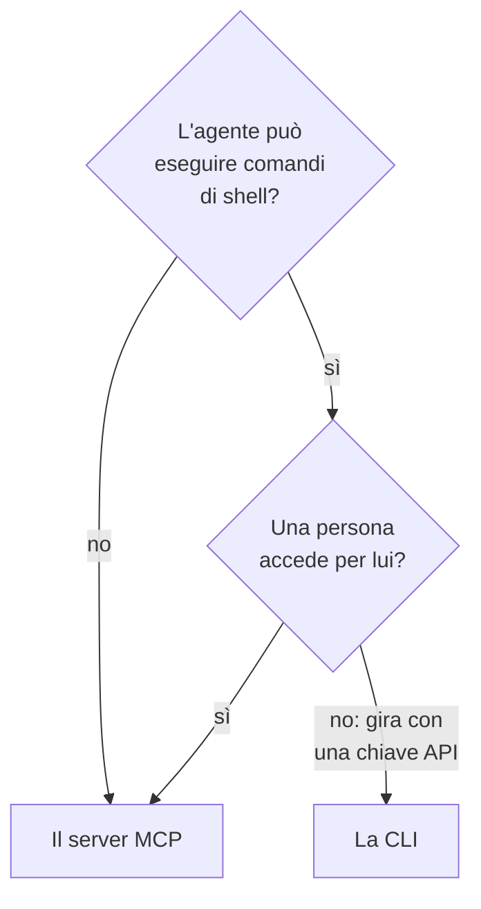

# CLI per agenti IA

Un agente IA che può eseguire comandi di shell, come un agente di programmazione nel tuo editor o un job della tua pipeline, può lavorare con OneUptime tramite la CLI invece del [server MCP](/docs/ai/mcp-server). Questa pagina dice quando va bene l'uno o l'altro, e come un agente installa la CLI, si orienta e legge le sue risposte.

:::cards
- [La CLI o il server MCP](#la-cli-o-il-server-mcp): Quale dei due dovrebbe usare un agente.
- [Prepararla per un agente](#prepararla-per-un-agente): Installala e dalle una chiave nell'ambiente.
- [Come si orienta un agente](#come-si-orienta-un-agente): Le risorse, i loro campi e l'aiuto.
- [Leggere le risposte](#leggere-le-risposte): JSON da ogni comando, errori compresi.
:::

## La CLI o il server MCP

Entrambi raggiungono l'API di OneUptime e fanno ciò che le loro credenziali consentono. Differiscono in ciò che serve all'agente per raggiungerli:



| | La CLI | Il server MCP |
| --- | --- | --- |
| All'agente serve | Una shell e Node.js 22 o successivo | Un client MCP, come Claude o Cursor |
| Accede con | Una chiave API del progetto, in `ONEUPTIME_API_KEY` | Il tuo account OneUptime, oppure una chiave API |
| Raggiunge | Ogni risorsa dell'API, 450 e più | I record e la telemetria per cui ha strumenti, e strumenti per la risposta agli incidenti |
| È adatto a | Script che l'agente scrive perché le persone li conservino, controlli in una pipeline e lavoro su molti record | Una conversazione: esaminare un incidente, configurare un monitor |

Usa la CLI quando l'agente esegue già comandi, come fa un agente di programmazione, o quando ciò che costruisce deve continuare a funzionare senza di lui: uno script in un repository, un passo di una pipeline. Usa il server MCP quando una persona parla con l'agente in un client di chat, così l'agente lavora con i suoi permessi e il client chiede prima di una modifica.

## Prepararla per un agente

Ogni OneUptime fornisce lo script di installazione della CLI della propria versione: i comandi qui sotto lo scaricano da `https://oneuptime.com`, quindi su un OneUptime self-hosted sostituiscilo con il tuo URL. Lo script viene prima salvato come `install.sh`, così puoi leggerlo prima di eseguirlo:

```bash
curl -fsSL https://oneuptime.com/install/cli -o install.sh
ONEUPTIME_URL=https://oneuptime.com bash install.sh
```

Dai all'agente una chiave API del progetto con solo l'accesso che serve al suo lavoro, nell'ambiente invece che sulla riga di comando, e fagli verificare prima la chiave:

```bash
export ONEUPTIME_API_KEY="your-api-key"
export ONEUPTIME_URL=https://oneuptime.com
oneuptime whoami --check -o json
```

Crea la chiave in **Impostazioni del progetto → Avanzato → Chiavi API**: vedi [Creare una chiave API](/docs/api-reference/api-reference#creare-una-chiave-api). Una chiave che può solo leggere lascia guardare l'agente, e nient'altro.

## Come si orienta un agente

La CLI dice che cosa sa fare, senza chiave API e senza richieste:

| Comando | Che cosa risponde |
| --- | --- |
| `oneuptime resources -o json` | Ogni risorsa: il suo comando, i suoi nomi, il suo percorso API, le sue operazioni e le sue azioni |
| `oneuptime incident fields -o json` | I campi di una risorsa: a che cosa serve ciascuno, il suo tipo, se una creazione ne ha bisogno e il suo flag |
| `oneuptime incident create --help` | Gli argomenti e i flag di un comando |

Un campo che contiene un ID dice di quale risorsa è l'ID che prende, così l'agente elenca prima quella risorsa: `incidentSeverityId` prende un ID da `oneuptime incident-severity list`. Un campo che nomina una persona accetta anche il suo indirizzo email, come con `--user-email`.

## Leggere le risposte

Fai aggiungere all'agente `-o json`, oppure `--json`, a ogni comando. Ogni comando risponde allora con JSON, compresi quelli la cui risposta è una frase, e un errore è un singolo oggetto JSON sullo standard error:

```bash
oneuptime incident acknowledge 6f1c2a40-3b1e-4c55-9a0b-3e2f8d7c1a11 -o json
```

```json
{
  "_id": "6f1c2a40-3b1e-4c55-9a0b-3e2f8d7c1a11",
  "action": "acknowledge",
  "changed": true,
  "state": {
    "_id": "0b7d5e2c-8f4a-4d1b-9c3e-5a6f7b8c9d0e",
    "name": "Acknowledged"
  }
}
```

Il codice di uscita dice che cosa è successo: `0` quando ha funzionato, `2` quando la chiave API manca o viene rifiutata, e `3` quando il record non c'è. Il JSON di un errore ha lo stesso codice in `exitCode`, e in `hint` che cosa fare dopo. Vedi [Formati di output](/docs/cli/output-formats#json) e [Codici di uscita](/docs/cli/scripting#codici-di-uscita).

## Passi successivi

:::cards
- [Operazioni sulle risorse](/docs/cli/resource-operations): Ogni operazione, con i suoi flag e filtri.
- [Riferimento dei comandi](/docs/cli/command-reference): Ogni comando, opzione e valore predefinito.
- [Server MCP](/docs/ai/mcp-server): Collega invece un client di chat a OneUptime.
:::
