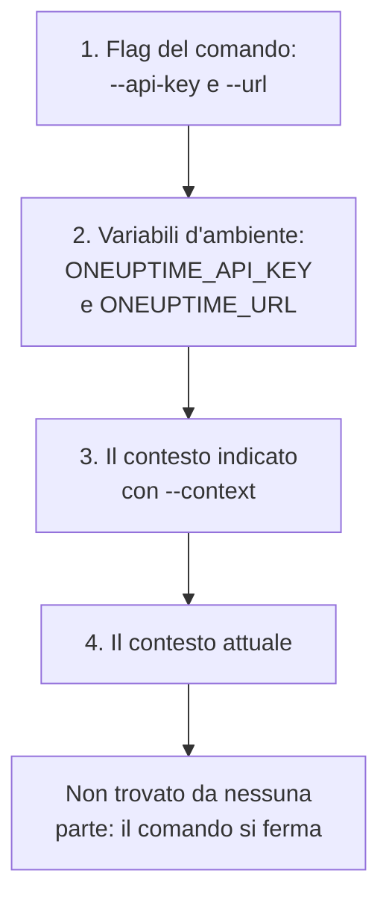

# Autenticazione

Ogni richiesta che la CLI invia porta una chiave API del tuo progetto. Salva le chiavi una volta con `oneuptime login`, un contesto per ogni ambiente, oppure passale a un comando in flag o variabili d'ambiente, come fanno gli script. Questa pagina mostra ogni modo, e quale usa un comando quando ce ne sono diversi.

:::cards
- [Accedere](#accedere): Salvare una chiave API e l'indirizzo del tuo OneUptime.
- [Contesti](#contesti): Un accesso salvato per ogni progetto o ambiente, e il passaggio dall'uno all'altro.
- [Quali credenziali usa un comando](#quali-credenziali-usa-un-comando): Prima i flag, poi le variabili d'ambiente, poi i contesti.
- [Risoluzione dei problemi](#risoluzione-dei-problemi): Credenziali non trovate, chiavi non valide e rifiuti.
:::

## Prima di iniziare

Ti serve una chiave API del tuo progetto. Creane una in **Impostazioni del progetto → Avanzato → Chiavi API** con **Crea: Chiave API**, e dalle l'accesso che servono ai tuoi comandi: vedi [Creare una chiave API](/docs/api-reference/api-reference#creare-una-chiave-api). Una chiave fa ciò che i suoi permessi consentono: una chiave che può solo leggere i record può elencarli e leggerli, ma non modificarli.

Su OneUptime Cloud, le chiavi API funzionano solo finché il progetto ha il piano **Growth** o superiore. Al di sotto, ogni comando risponde `API error (402)` con un messaggio che nomina il piano, finché il progetto non passa a un piano superiore; allora la stessa chiave funziona di nuovo. Vedi [Chiavi API e SCIM sotto il loro piano](/docs/api-reference/api-reference#chiavi-api-e-scim-sotto-il-loro-piano).

## Accedere

`oneuptime login` salva una chiave API e l'indirizzo del tuo OneUptime come contesto, e lo rende il contesto attuale:

```bash
oneuptime login <api-key> <instance-url> [--context-name <name>]
```

| Argomento o opzione | Che cos'è |
| --- | --- |
| `<api-key>` | Una chiave API del tuo progetto |
| `<instance-url>` | L'indirizzo del tuo OneUptime: `https://oneuptime.com`, oppure quello del tuo server, come `https://oneuptime.example.com` |
| `--context-name <name>` | Il nome con cui salvare il contesto. Predefinito: `default` |

Per esempio, un contesto chiamato `production`:

```bash
oneuptime login <api-key> https://oneuptime.com --context-name production
```

Risponde `Logged in successfully. Context "production" is now active.` Una barra alla fine dell'indirizzo viene rimossa, e un nuovo accesso con lo stesso nome sostituisce quel contesto.

> [!NOTE]
> `login` salva la chiave senza chiedere nulla a OneUptime. Esegui un comando, come `oneuptime incident count`, per vedere che la chiave funziona.

## Contesti

Un contesto è un accesso salvato: un nome, un indirizzo e una chiave API. Salvane uno per ogni progetto o ambiente, poi scegline uno per tutti i comandi che seguono, o per un singolo comando.

:::steps
### Salvare un contesto per ogni ambiente

```bash
oneuptime login <production-api-key> https://oneuptime.com --context-name production
oneuptime login <staging-api-key> https://oneuptime.example.com --context-name staging
```

Ogni accesso rende attuale il proprio contesto, quindi ora l'attuale è `staging`.

### Elencarli

```bash
oneuptime context list
```

```text
┌───┬────────────┬───────────────────────────────┐
│   │ Name       │ URL                           │
├───┼────────────┼───────────────────────────────┤
│   │ production │ https://oneuptime.com         │
├───┼────────────┼───────────────────────────────┤
│ * │ staging    │ https://oneuptime.example.com │
└───┴────────────┴───────────────────────────────┘
```

L'`*` segna il contesto attuale. Le chiavi API non vengono mai elencate.

### Passare a un altro contesto

```bash
oneuptime context use production
```

Risponde `Switched to context "production".` e i comandi che seguono lo usano.

### Usare un contesto per un solo comando

```bash
oneuptime incident list --context staging
```

Il contesto attuale resta com'era.
:::

| Comando | Che cosa fa |
| --- | --- |
| `oneuptime context list` | Elenca i contesti salvati; `*` segna quello attuale. Con `-o json`, il `name`, l'`apiUrl` e l'`isCurrent` di ogni contesto, mai la sua chiave |
| `oneuptime context use <name>` | Rende attuale un contesto salvato |
| `oneuptime context current` | Mostra nome, URL e chiave API del contesto attuale, con la chiave nascosta tranne i suoi primi quattro e ultimi quattro caratteri |
| `oneuptime context delete <name>` | Elimina un contesto salvato. Se era quello attuale, diventa attuale il primo contesto rimasto |

## Quali credenziali usa un comando

Un comando ha bisogno di una chiave API e di un URL. Prende ciascuno dei due dal primo di questi posti che lo ha:



Puoi quindi combinarli: per esempio una chiave API da una variabile d'ambiente con l'URL del contesto attuale. Le variabili d'ambiente sono adatte a script e job di CI, che non hanno contesti salvati:

:::tabs
@tab Linux
```bash
export ONEUPTIME_API_KEY=<api-key>
export ONEUPTIME_URL=https://oneuptime.com
oneuptime incident list
```
@tab macOS
```bash
export ONEUPTIME_API_KEY=<api-key>
export ONEUPTIME_URL=https://oneuptime.com
oneuptime incident list
```
@tab Windows
```powershell
$env:ONEUPTIME_API_KEY = "<api-key>"
$env:ONEUPTIME_URL = "https://oneuptime.com"
oneuptime incident list
```
:::

I flag vengono prima di tutto il resto, per un singolo comando:

```bash
oneuptime --api-key <api-key> --url https://oneuptime.com incident list
```

> [!WARNING]
> Una chiave passata come flag finisce nella cronologia della tua shell, e gli altri utenti della macchina possono vederla nell'elenco dei processi. Su una macchina condivisa, usa invece un contesto o una variabile d'ambiente.

## Verificare che cosa userà la CLI

`oneuptime whoami` mostra l'URL e la chiave API che userà il prossimo comando, e il contesto da cui provengono:

```bash
oneuptime whoami
```

```text
URL:     https://oneuptime.com
API Key: 4f1c****0a13
Context: production
```

Della chiave vengono mostrati solo i primi quattro e gli ultimi quattro caratteri. La riga `Context` compare solo quando l'URL e la chiave sono quelli del contesto stesso, non valori sostituiti da un flag o da una variabile d'ambiente. `whoami` legge le tue impostazioni senza chiamare OneUptime: mostra che cosa invierà un comando, non se OneUptime lo accetta. Senza nulla di salvato o impostato, risponde:

```text
Not authenticated. Run `oneuptime login` to authenticate.
```

## Il file di configurazione

`oneuptime login` salva i contesti in `~/.oneuptime/config.json`, nella tua cartella home (`%USERPROFILE%\.oneuptime\config.json` su Windows). La CLI lo crea in modo che solo il tuo utente possa leggerlo e scriverlo (modalità `0600`):

```json title="~/.oneuptime/config.json"
{
  "currentContext": "production",
  "contexts": {
    "production": {
      "name": "production",
      "apiUrl": "https://oneuptime.com",
      "apiKey": "<api-key>"
    },
    "staging": {
      "name": "staging",
      "apiUrl": "https://oneuptime.example.com",
      "apiKey": "<api-key>"
    }
  }
}
```

Il file contiene le chiavi API così come sono: tienilo fuori da cartelle condivise, backup e repository. Per uscire da un contesto, eliminalo con `oneuptime context delete <name>`; per uscire da tutti, elimina il file. Una chiave che potrebbe essere trapelata resta valida finché non la elimini in OneUptime, in **Impostazioni del progetto → Avanzato → Chiavi API**.

I formati di output e le dimensioni degli elenchi non vengono salvati qui: passa `-o` e `--limit` a ogni comando.

## Risoluzione dei problemi

:::details Il messaggio «No credentials found»
`Authentication error: No credentials found.` significa che nessun flag, variabile d'ambiente o contesto salvato ha dato al comando la sua chiave API e il suo URL. Esegui `oneuptime login`, oppure imposta sia `ONEUPTIME_API_KEY` sia `ONEUPTIME_URL`. Il comando termina con il codice `2`.
:::

:::details Il messaggio «API error (400): Invalid API Key»
La chiave non è una chiave API di OneUptime, è scaduta oppure è stata reimpostata. Copiala di nuovo dalla sua pagina in **Impostazioni del progetto → Avanzato → Chiavi API**, dove c'è anche la sua data sotto **Scade**, e accedi di nuovo con lo stesso nome di contesto. Il comando termina con il codice `2`.
:::

:::details Il messaggio «API error (402): API keys need the Growth plan»
Su OneUptime Cloud, il progetto è sotto il piano **Growth**, quindi le sue chiavi API hanno smesso di funzionare. Porta il progetto a un piano superiore, e la stessa chiave funziona di nuovo: nella CLI non c'è nulla da cambiare.
:::

:::details Il messaggio «API error (422): You do not have permissions»
I permessi della chiave non arrivano a ciò che il comando chiede. Dai alla chiave un ruolo o un permesso dalla sua pagina in **Impostazioni del progetto → Avanzato → Chiavi API**: il messaggio nomina i permessi che lascerebbero passare la richiesta.
:::

:::details Il messaggio «Context "staging" does not exist»
Nessun contesto con quel nome è salvato. `oneuptime context list` mostra i nomi che esistono.
:::

:::details whoami mostra un URL o una chiave diversi da quelli del contesto
Una variabile d'ambiente o un flag sostituisce il valore del contesto. `env | grep ONEUPTIME` mostra le variabili impostate, e `unset ONEUPTIME_API_KEY ONEUPTIME_URL` ti riporta ai tuoi contesti.
:::

:::details La richiesta all'indirizzo non riesce
`Error: Request failed to https://...` significa che la CLI non ha potuto raggiungere OneUptime a quell'indirizzo. Controlla l'URL con `oneuptime whoami`: è l'indirizzo a cui apri OneUptime, con `https://`, come `https://oneuptime.com`.
:::

## Passi successivi

:::cards
- [Operazioni sulle risorse](/docs/cli/resource-operations): Elencare, leggere, creare, modificare, eliminare e contare record.
- [Scripting e CI/CD](/docs/cli/scripting): Dare a una pipeline la sua chiave in variabili d'ambiente.
- [Riferimento API OneUptime](/docs/api-reference/api-reference): Che cosa può fare una chiave API, e che cosa significa ogni risposta.
:::
