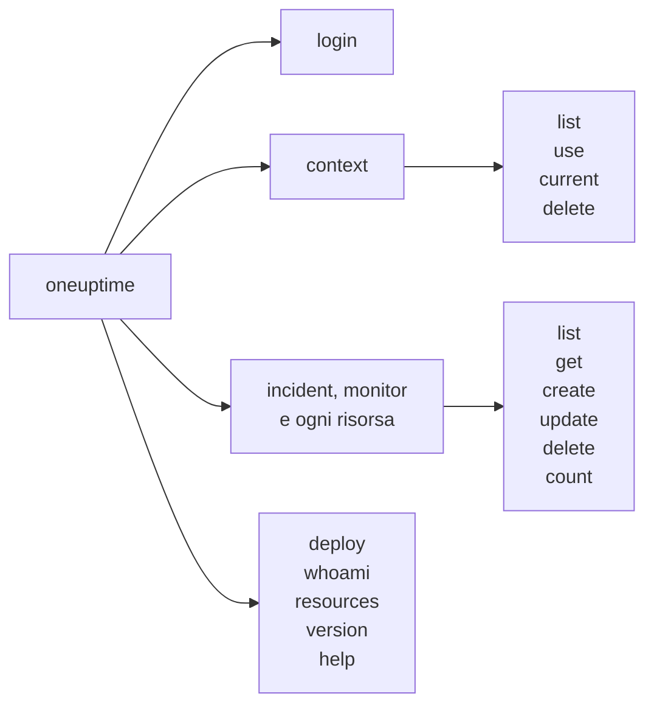

# Riferimento dei comandi

Ogni comando della CLI `oneuptime`, con i suoi argomenti, le sue opzioni e i suoi valori predefiniti. Aggiungi `--help` a qualsiasi comando per vedere la stessa cosa nel tuo terminale.

:::cards
- [Opzioni globali](#opzioni-globali): Le opzioni che ogni comando accetta.
- [Accesso e contesti](#accesso-e-contesti): login e i comandi context.
- [Comandi delle risorse](#comandi-delle-risorse): list, get, create, update, delete e count.
- [Altri comandi](#altri-comandi): deploy, whoami, resources, version e help.
:::

## I comandi



## Opzioni globali

| Opzione | Che cosa fa | Predefinito |
| --- | --- | --- |
| `--api-key <key>` | La chiave API per questo comando | `ONEUPTIME_API_KEY`, poi la chiave del contesto |
| `--url <url>` | L'indirizzo del tuo OneUptime per questo comando | `ONEUPTIME_URL`, poi l'URL del contesto |
| `--context <name>` | Il contesto salvato da usare per questo comando | Il contesto attuale |
| `-o, --output <format>` | `json`, `table` o `wide` | `table` in un terminale, `json` in una pipe |
| `--no-color` | Stampa senza colori | Colori, a meno che `NO_COLOR` non sia impostata |
| `-V, --version` | Stampa la versione della CLI | |
| `-h, --help` | Mostra la guida di un comando | |

Le opzioni vanno prima o dopo il comando: `oneuptime --context staging incident list` e `oneuptime incident list --context staging` fanno la stessa cosa.

## Accesso e contesti

### `oneuptime login`

Salva una chiave API e un indirizzo come contesto, e lo rende quello attuale. Vedi [Accedere](/docs/cli/authentication#accedere).

```bash
oneuptime login <api-key> <instance-url> [--context-name <name>]
```

| Argomento o opzione | Obbligatorio | Che cos'è | Predefinito |
| --- | --- | --- | --- |
| `<api-key>` | Sì | Una chiave API del tuo progetto | |
| `<instance-url>` | Sì | L'indirizzo del tuo OneUptime, come `https://oneuptime.com` | |
| `--context-name <name>` | No | Il nome con cui salvare il contesto | `default` |

### `oneuptime context list`

Elenca i contesti salvati; `*` segna quello attuale. Le chiavi API non vengono mai elencate.

```bash
oneuptime context list [-o <format>]
```

| Opzione | Obbligatorio | Che cos'è |
| --- | --- | --- |
| `-o, --output <format>` | No | `json`, `table` o `wide`. Il JSON dà il `name`, l'`apiUrl` e l'`isCurrent` di ogni contesto |

### `oneuptime context use`

Rende attuale un contesto salvato.

```bash
oneuptime context use <name>
```

| Argomento | Obbligatorio | Che cos'è |
| --- | --- | --- |
| `<name>` | Sì | Il nome di un contesto salvato |

### `oneuptime context current`

Mostra il nome e l'URL del contesto attuale, e la sua chiave API nascosta tranne i primi quattro e gli ultimi quattro caratteri.

```bash
oneuptime context current
```

### `oneuptime context delete`

Elimina un contesto salvato. Se era quello attuale, diventa attuale il primo contesto rimasto.

```bash
oneuptime context delete <name>
```

| Argomento | Obbligatorio | Che cos'è |
| --- | --- | --- |
| `<name>` | Sì | Il nome di un contesto salvato |

## Comandi delle risorse

`<resource>` è il comando di un tipo di record, preso dalle tabelle [Risorse](#risorse), come `incident` o `monitor`. Vedi [Operazioni sulle risorse](/docs/cli/resource-operations) per degli esempi.

### `oneuptime <resource> list`

Elenca i record, i più recenti prima. Le etichette sono invece elencate per nome, prima quelle numerate (`2. Team` prima di `10. Owner`).

```bash
oneuptime <resource> list [--query <json>] [--limit <n>] [--skip <n>] [--sort <json>] [-o <format>]
```

| Opzione | Che cosa fa | Predefinito |
| --- | --- | --- |
| `--query <json>` | Un filtro, in JSON | Ogni record che la chiave può leggere |
| `--limit <n>` | Il numero massimo di record da restituire, fino a 10.000 | `10` |
| `--skip <n>` | Quanti record saltare prima | `0` |
| `--sort <json>` | L'ordine, in JSON: `{"<field>":"ASC"}` o `{"<field>":"DESC"}` | I più recenti prima |
| `-o, --output <format>` | `json`, `table` o `wide` | `table` in un terminale, `json` in una pipe |

### `oneuptime <resource> get`

Legge un record. Solo record: la telemetria non ha `get`.

```bash
oneuptime <resource> get <id> [-o <format>]
```

| Argomento o opzione | Obbligatorio | Che cos'è |
| --- | --- | --- |
| `<id>` | Sì | L'ID del record, un UUID |
| `-o, --output <format>` | No | `json`, `table` o `wide` |

### `oneuptime <resource> create`

Crea un record e lo stampa.

```bash
oneuptime <resource> create (--data <json> | --file <path>) [-o <format>]
```

| Opzione | Obbligatorio | Che cos'è |
| --- | --- | --- |
| `--data <json>` | Una delle due | Il record, in JSON |
| `--file <path>` | Una delle due | Un file JSON che contiene il record. Indicato insieme a `--data`, viene usato il file |
| `-o, --output <format>` | No | `json`, `table` o `wide` |

### `oneuptime <resource> update`

Modifica i campi che indichi. Solo record: la telemetria non ha `update`.

```bash
oneuptime <resource> update <id> --data <json> [-o <format>]
```

| Argomento o opzione | Obbligatorio | Che cos'è |
| --- | --- | --- |
| `<id>` | Sì | L'ID del record |
| `--data <json>` | Sì | I campi da modificare, in JSON |
| `-o, --output <format>` | No | `json`, `table` o `wide` |

### `oneuptime <resource> delete`

Elimina un record subito, senza chiedere. Solo record: la telemetria non ha `delete`.

```bash
oneuptime <resource> delete <id> [--force]
```

| Argomento o opzione | Obbligatorio | Che cos'è |
| --- | --- | --- |
| `<id>` | Sì | L'ID del record |
| `--force` | No | Accettato e non cambia nulla: `delete` non chiede mai conferma |

### `oneuptime <resource> count`

Conta i record e stampa il numero.

```bash
oneuptime <resource> count [--query <json>] [-o <format>]
```

| Opzione | Obbligatorio | Che cos'è |
| --- | --- | --- |
| `--query <json>` | No | Un filtro, in JSON. Senza filtro, ogni record che la chiave può leggere |
| `-o, --output <format>` | No | `json`, `table` o `wide` |

### Risorse

I record accettano `list`, `get`, `create`, `update`, `delete` e `count`:

| Area | Comandi |
| --- | --- |
| Monitoraggio | `monitor`, `monitor-status`, `monitor-status-event` |
| Incidenti | `incident`, `incident-state`, `incident-severity`, `incident-state-timeline`, `incident-public-note`, `incident-internal-note`, `incident-alert`, `postmortem-status` |
| Avvisi | `alert`, `alert-state`, `alert-severity`, `alert-state-timeline`, `alert-internal-note` |
| Pagine di stato | `status-page`, `status-page-announcement` |
| Manutenzione programmata | `scheduled-maintenance-event`, `scheduled-maintenance-state`, `scheduled-maintenance-state-timeline` |
| Team e reperibilità | `team`, `on-call-policy` |
| Sicurezza | `security-case`, `security-case-evidence`, `security-case-note`, `security-case-priority`, `security-case-status`, `security-case-task`, `security-detection`, `security-playbook` |
| Etichette | `label` |

La telemetria accetta `list`, `create` e `count`:

| Area | Comandi |
| --- | --- |
| Osservabilità | `log`, `metric`, `span`, `exception-instance`, `monitor-log` |
| Sicurezza | `security-event`, `threat-intel-indicator` |
| Modifiche e costi | `change-event`, `kubernetes-cost-allocation` |

La CLI esce insieme a OneUptime, quindi `oneuptime resources` elenca i comandi della versione che hai installato.

### Richieste all'API

Ogni operazione è una richiesta all'API, con la chiave nell'intestazione `APIKey`. `<path>` è il percorso API della risorsa, dato da `oneuptime resources`: `/incident` per `incident`, `/on-call-duty-policy` per `on-call-policy`.

| Operazione | Richiesta | Corpo |
| --- | --- | --- |
| `list` | `POST /api/<path>/get-list` | `query`, `select`, `skip`, `limit` e `sort` |
| `get` | `POST /api/<path>/<id>/get-item` | `select` |
| `create` | `POST /api/<path>` | `{"data": ...}` |
| `update` | `PUT /api/<path>/<id>/` | `{"data": ...}` |
| `delete` | `DELETE /api/<path>/<id>/` | Nessuno |
| `count` | `POST /api/<path>/count` | `query` |

## Altri comandi

### `oneuptime deploy`

Registra da una pipeline un deploy o un'altra modifica, che compare sui grafici del servizio e che OneUptime AI legge quando indaga su un incidente. Scrive con una chiave di acquisizione della telemetria, non con una chiave API. Vedi [Deploy e modifiche](/docs/telemetry/change-events).

```bash
oneuptime deploy [--service <name>] [--service-version <version>] [--previous-version <version>] [--commit <sha>] [--repository <url>] [--branch <name>] [--pull-request <number>] [--environment <name>] [--title <title>] [--description <text>] [--type <type>] [--time <time>] [--attribute <key=value...>] [--ingestion-key <key>]
```

| Opzione | Obbligatorio | Che cos'è | Predefinito |
| --- | --- | --- | --- |
| `--service <name>` | No | Il servizio rilasciato | Una modifica che riguarda tutto il progetto |
| `--service-version <version>` | No | La versione rilasciata | |
| `--previous-version <version>` | No | La versione che ha sostituito | |
| `--commit <sha>` | No | Il commit rilasciato | |
| `--repository <url>` | No | Il repository in cui si trova il commit | |
| `--branch <name>` | No | Il branch rilasciato | |
| `--pull-request <number>` | No | La pull request rilasciata | |
| `--environment <name>` | No | L'ambiente in cui è stato rilasciato | |
| `--title <title>` | No | Il titolo della modifica; un tipo diverso da un deploy ne richiede uno | `Deploy <version>` |
| `--description <text>` | No | I dettagli della modifica | |
| `--type <type>` | No | Il tipo di modifica, come `config-change` o `rollback` | `deployment` |
| `--time <time>` | No | Quando è avvenuta, come `2026-10-19T10:00:00Z` | Adesso |
| `--attribute <key=value...>` | No | Altri attributi, come `key=value`, uno o più | |
| `--ingestion-key <key>` | No | Una chiave di acquisizione della telemetria del progetto | `ONEUPTIME_TELEMETRY_INGESTION_KEY` |

### `oneuptime whoami`

Mostra l'URL e la chiave API che userà il prossimo comando, con la chiave mascherata, e il contesto da cui provengono. Non chiama OneUptime. Vedi [Verificare che cosa userà la CLI](/docs/cli/authentication#verificare-che-cosa-userà-la-cli).

```bash
oneuptime whoami
```

### `oneuptime resources`

Elenca ogni tipo di record per cui la CLI ha un comando: il suo comando, i nomi al singolare e al plurale, il tipo e il percorso API, e il totale.

```bash
oneuptime resources [--type <type>] [-o <format>]
```

| Opzione | Obbligatorio | Che cos'è | Predefinito |
| --- | --- | --- | --- |
| `--type <type>` | No | `database` per i record, `analytics` per la telemetria | Entrambi |
| `-o, --output <format>` | No | `json`, `table` o `wide`. Il JSON dà il `name`, il `singularName`, il `pluralName`, il `modelType` e l'`apiPath` di ciascuno | `table` in un terminale, `json` in una pipe |

### `oneuptime version`

Stampa la versione della CLI, come fa `oneuptime --version`.

```bash
oneuptime version
```

### `oneuptime help`

Mostra la guida della CLI, o quella di un comando.

```bash
oneuptime help [command]
```

## Variabili d'ambiente

| Variabile | Che cosa fa |
| --- | --- |
| `ONEUPTIME_API_KEY` | La chiave API, quando nessun flag `--api-key` ne dà una |
| `ONEUPTIME_URL` | L'indirizzo del tuo OneUptime, quando nessun flag `--url` ne dà uno |
| `ONEUPTIME_TELEMETRY_INGESTION_KEY` | La chiave di acquisizione della telemetria con cui scrive `oneuptime deploy`, quando nessun flag `--ingestion-key` ne dà una |
| `NO_COLOR` | Impostata a un valore qualsiasi, disattiva i colori |

## File

| File | Che cosa contiene |
| --- | --- |
| `~/.oneuptime/config.json` | I contesti salvati, le loro chiavi API e il contesto attuale |

## Codici di uscita

| Codice | Significato |
| --- | --- |
| `0` | Ha funzionato |
| `1` | Non è riuscito: OneUptime ha rifiutato la richiesta, oppure il comando era sbagliato |
| `2` | Nessuna chiave API utilizzabile: nessuna trovata, non valida o sotto il suo piano |
| `3` | Non trovato: OneUptime ha risposto `404` |

Vedi [Codici di uscita](/docs/cli/scripting#codici-di-uscita) per degli esempi.

## Passi successivi

:::cards
- [Panoramica della CLI](/docs/cli/index): Installare la CLI ed eseguire i primi comandi.
- [Operazioni sulle risorse](/docs/cli/resource-operations): Esempi di ogni operazione.
- [Scripting e CI/CD](/docs/cli/scripting): La CLI in script e pipeline.
:::
