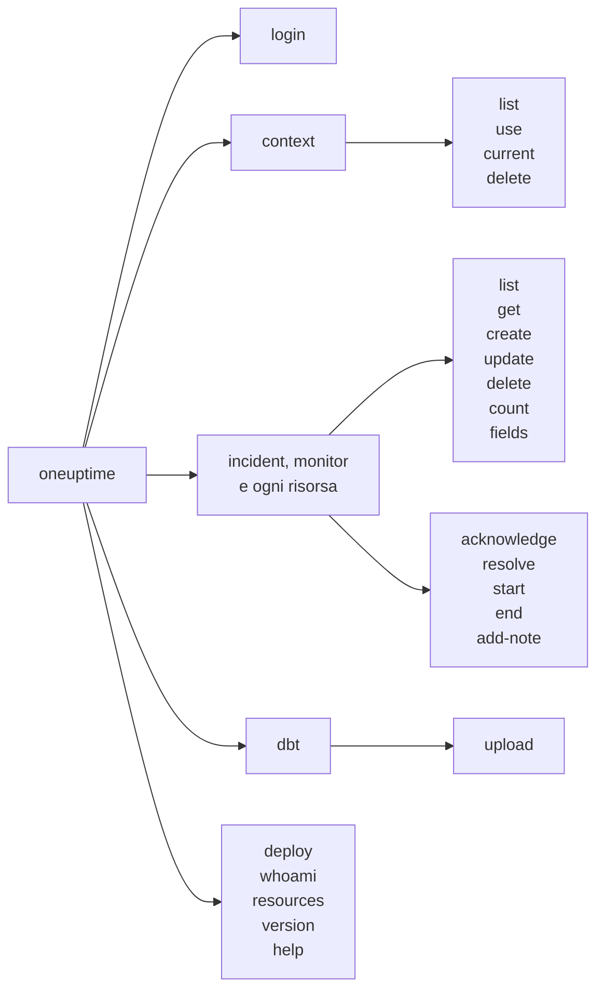

# Riferimento dei comandi

Ogni comando della CLI `oneuptime`, con i suoi argomenti, le sue opzioni e i suoi valori predefiniti. Aggiungi `--help` a qualsiasi comando per vedere la stessa cosa nel tuo terminale.

:::cards
- [Opzioni globali](#opzioni-globali): Le opzioni che ogni comando accetta.
- [Accesso e contesti](#accesso-e-contesti): login e i comandi context.
- [Comandi delle risorse](#comandi-delle-risorse): Le operazioni, i campi e le azioni di ogni risorsa.
- [Altri comandi](#altri-comandi): deploy, dbt upload, data-checks apply, whoami, resources, version e help.
:::

## I comandi



## Opzioni globali

| Opzione | Che cosa fa | Predefinito |
| --- | --- | --- |
| `--api-key <key>` | La chiave API per questo comando | `ONEUPTIME_API_KEY`, poi la chiave del contesto |
| `--url <url>` | L'indirizzo del tuo OneUptime per questo comando | `ONEUPTIME_URL`, poi l'URL del contesto |
| `--context <name>` | Il contesto salvato da usare per questo comando | Il contesto attuale |
| `-o, --output <format>` | `json`, `table` o `wide` | `table` in un terminale, `json` in una pipe |
| `--json` | Lo stesso di `-o json` | |
| `--no-color` | Stampa senza colori | Colori, a meno che `NO_COLOR` non sia impostata |
| `-V, --version` | Stampa la versione della CLI | |
| `-h, --help` | Mostra la guida di un comando | |

Le opzioni vanno prima o dopo il comando: `oneuptime --context staging incident list` e `oneuptime incident list --context staging` fanno la stessa cosa.

Ogni comando accetta `-o` e `--json`, quindi le tabelle qui sotto li tralasciano. Un comando la cui risposta è una frase, come `delete`, stampa la frase a meno che `-o json` o `--json` non chieda JSON: vedi [Formati di output](/docs/cli/output-formats#json).

## Accesso e contesti

### `oneuptime login`

Salva una chiave API e un indirizzo come contesto, e lo rende quello attuale. Vedi [Accedere](/docs/cli/authentication#accedere).

```bash
oneuptime login <api-key> <instance-url> [--context-name <name>]
```

| Argomento o opzione | Obbligatorio | Che cos'è | Predefinito |
| --- | --- | --- | --- |
| `<api-key>` | Sì | Una chiave API del tuo progetto | |
| `<instance-url>` | Sì | L'indirizzo del tuo OneUptime, come `https://oneuptime.com` | |
| `--context-name <name>` | No | Il nome con cui salvare il contesto | `default` |

### `oneuptime context list`

Elenca i contesti salvati; `*` segna quello attuale. Le chiavi API non vengono mai elencate: il JSON dà per ogni contesto `name`, `apiUrl` e `isCurrent`.

```bash
oneuptime context list
```

### `oneuptime context use`

Rende attuale un contesto salvato.

```bash
oneuptime context use <name>
```

| Argomento | Obbligatorio | Che cos'è |
| --- | --- | --- |
| `<name>` | Sì | Il nome di un contesto salvato |

### `oneuptime context current`

Mostra il nome e l'URL del contesto attuale, e la sua chiave API nascosta tranne i primi quattro e gli ultimi quattro caratteri.

```bash
oneuptime context current
```

### `oneuptime context delete`

Elimina un contesto salvato. Se era quello attuale, diventa attuale il primo contesto rimasto.

```bash
oneuptime context delete <name>
```

| Argomento | Obbligatorio | Che cos'è |
| --- | --- | --- |
| `<name>` | Sì | Il nome di un contesto salvato |

## Comandi delle risorse

`<resource>` è il comando di un tipo di record, preso dalla tabella [Risorse](#risorse), come `incident` o `monitor`. Una risorsa ha le operazioni che l'API accetta per essa, la maggior parte tutte e sei, e `oneuptime <resource> --help` elenca le sue. Vedi [Operazioni sulle risorse](/docs/cli/resource-operations) per degli esempi.

### `oneuptime <resource> list`

Elenca i record, i più recenti prima. Le etichette sono invece elencate per nome, prima quelle numerate (`2. Team` prima di `10. Owner`).

```bash
oneuptime <resource> list [--query <json>] [--limit <n>] [--skip <n>] [--sort <json>] [--fields <names>] [--all]
```

| Opzione | Che cosa fa | Predefinito |
| --- | --- | --- |
| `--query <json>` | Un filtro, in JSON | Ogni record che la chiave può leggere |
| `--limit <n>` | Il numero massimo di record da restituire, fino a 10.000 | `10` |
| `--skip <n>` | Quanti record saltare prima | `0` |
| `--sort <json>` | L'ordine, in JSON: `{"<field>":"ASC"}` o `{"<field>":"DESC"}` | I più recenti prima |
| `--fields <names>` | I campi da restituire, separati da virgole; un campo di un record collegato dopo un punto, come in `currentIncidentState.name` | Ogni campo che la chiave può leggere |
| `--all` | Ogni record che corrisponde, 100 alla volta, fino a 100.000, al posto di `--limit` e `--skip`. Solo record: la telemetria non ha `--all` | |

### `oneuptime <resource> get`

Legge un record.

```bash
oneuptime <resource> get <id> [--fields <names>]
```

| Argomento o opzione | Obbligatorio | Che cos'è |
| --- | --- | --- |
| `<id>` | Sì | L'ID del record, un UUID |
| `--fields <names>` | No | I campi da restituire, separati da virgole. Predefinito: ogni campo che la chiave può leggere |

### `oneuptime <resource> create`

Crea un record e lo stampa.

```bash
oneuptime <resource> create [--<field> <value>]... [--data <json>] [--file <path>]
```

| Opzione | Obbligatorio | Che cos'è |
| --- | --- | --- |
| `--<field> <value>` | I campi che una creazione deve indicare | Il valore di un campo: `--title <text>`, `--incident-severity-id <id>`, `--labels <ids>`. `oneuptime <resource> create --help` li elenca. Solo record |
| `--data <json>` | No | Il record, come JSON |
| `--file <path>` | No | Un file JSON che contiene il record. Indicato insieme a `--data`, viene usato il file |

I flag si aggiungono sopra `--data` o `--file`. Un campo che nomina una persona per ID utente ha anche un flag che la nomina per indirizzo email: `--user-email` accanto a `--user-id`.

### `oneuptime <resource> update`

Modifica i campi che indichi.

```bash
oneuptime <resource> update <id> [--<field> <value>]... [--data <json>] [--file <path>]
```

| Argomento o opzione | Obbligatorio | Che cos'è |
| --- | --- | --- |
| `<id>` | Sì | L'ID del record |
| `--<field> <value>` | No | Un campo da modificare: `oneuptime <resource> update --help` li elenca. Solo record |
| `--data <json>` | No | I campi da modificare, come JSON |
| `--file <path>` | No | Un file JSON che contiene i campi da modificare. Indicato insieme a `--data`, viene usato il file |

### `oneuptime <resource> delete`

Elimina un record subito, senza chiedere.

```bash
oneuptime <resource> delete <id> [--force]
```

| Argomento o opzione | Obbligatorio | Che cos'è |
| --- | --- | --- |
| `<id>` | Sì | L'ID del record |
| `--force` | No | Accettato e non cambia nulla: `delete` non chiede mai conferma |

### `oneuptime <resource> count`

Conta i record e stampa il numero.

```bash
oneuptime <resource> count [--query <json>]
```

| Opzione | Obbligatorio | Che cos'è |
| --- | --- | --- |
| `--query <json>` | No | Un filtro, in JSON. Senza filtro, ogni record che la chiave può leggere |

### `oneuptime <resource> fields`

Elenca i campi della risorsa: a che cosa serve ciascuno, il suo tipo, se una creazione deve indicarlo e il flag che lo imposta. Li legge dalla CLI stessa, senza chiave API e senza richieste.

```bash
oneuptime <resource> fields
```

### `oneuptime <resource> acknowledge`

Sposta un incidente, un avviso o un episodio dell'uno o dell'altro nello stato riconosciuto del tuo progetto, come fa il pulsante della dashboard. Un record già riconosciuto, o oltre, resta com'è.

```bash
oneuptime <resource> acknowledge <id>
```

| Argomento | Obbligatorio | Che cos'è |
| --- | --- | --- |
| `<id>` | Sì | L'ID del record |

### `oneuptime <resource> resolve`

Sposta un incidente, un avviso o un episodio dell'uno o dell'altro nello stato risolto del tuo progetto.

```bash
oneuptime <resource> resolve <id>
```

| Argomento | Obbligatorio | Che cos'è |
| --- | --- | --- |
| `<id>` | Sì | L'ID del record |

### `oneuptime <resource> start`

Sposta un evento di manutenzione nello stato in corso del tuo progetto.

```bash
oneuptime <resource> start <id>
```

| Argomento | Obbligatorio | Che cos'è |
| --- | --- | --- |
| `<id>` | Sì | L'ID dell'evento |

### `oneuptime <resource> end`

Sposta un evento di manutenzione nello stato terminato del tuo progetto.

```bash
oneuptime <resource> end <id>
```

| Argomento | Obbligatorio | Che cos'è |
| --- | --- | --- |
| `<id>` | Sì | L'ID dell'evento |

### `oneuptime <resource> add-note`

Aggiunge una nota a un incidente, un avviso, un episodio dell'uno o dell'altro o un evento di manutenzione.

```bash
oneuptime <resource> add-note <id> --note <markdown> [--public]
```

| Argomento o opzione | Obbligatorio | Che cos'è |
| --- | --- | --- |
| `<id>` | Sì | L'ID del record |
| `--note <markdown>` | Sì | La nota, in Markdown |
| `--public` | No | La pubblica sulle pagine di stato del record, dove i suoi iscritti vengono avvisati. Solo incidenti, i loro episodi e manutenzioni programmate |

### Risorse

Ogni risorsa dell'API di OneUptime è un comando, con le operazioni che l'API accetta per essa, `fields` e le azioni dei record che ne hanno:

{{CLI_RESOURCE_COMMANDS}}

La CLI esce insieme a OneUptime, quindi `oneuptime resources` elenca i comandi della versione che hai installato.

### Richieste all'API

Ogni operazione è una richiesta all'API, con la chiave nell'intestazione `APIKey`. `<path>` è il percorso API della risorsa, dato da `oneuptime resources`: `/incident` per `incident`, `/on-call-duty-policy` per `on-call-policy`.

| Operazione | Richiesta | Corpo |
| --- | --- | --- |
| `list` | `POST /api/<path>/get-list` | `query`, `select`, `skip`, `limit` e `sort` |
| `get` | `POST /api/<path>/<id>/get-item` | `select` |
| `create` | `POST /api/<path>` | `{"data": ...}` |
| `update` | `PUT /api/<path>/<id>/` | `{"data": ...}` |
| `delete` | `DELETE /api/<path>/<id>/` | Nessuno |
| `count` | `POST /api/<path>/count` | `query` |

Un'azione legge gli stati del tuo progetto e il record, poi crea una riga nella cronologia degli stati del record, come fa il pulsante della dashboard: `acknowledge` su un incidente crea un `incident-state-timeline`. `add-note` crea un `incident-internal-note`, oppure con `--public` un `incident-public-note`. Un flag di email elenca prima i membri del team del progetto con quell'indirizzo. Quando OneUptime rifiuta un campo che la chiave non può leggere, un elenco o una lettura chiede di nuovo senza di esso.

## Altri comandi

### `oneuptime deploy`

Registra da una pipeline un deploy o un'altra modifica, che compare sui grafici del servizio e che OneUptime AI legge quando indaga su un incidente. Scrive con una chiave di acquisizione della telemetria, non con una chiave API. Vedi [Deploy e modifiche](/docs/telemetry/change-events).

```bash
oneuptime deploy [--service <name>] [--service-version <version>] [--previous-version <version>] [--commit <sha>] [--repository <url>] [--branch <name>] [--pull-request <number>] [--environment <name>] [--title <title>] [--description <text>] [--type <type>] [--time <time>] [--attribute <key=value...>] [--ingestion-key <key>]
```

| Opzione | Obbligatorio | Che cos'è | Predefinito |
| --- | --- | --- | --- |
| `--service <name>` | No | Il servizio rilasciato | Una modifica che riguarda tutto il progetto |
| `--service-version <version>` | No | La versione rilasciata | |
| `--previous-version <version>` | No | La versione che ha sostituito | |
| `--commit <sha>` | No | Il commit rilasciato | |
| `--repository <url>` | No | Il repository in cui si trova il commit | |
| `--branch <name>` | No | Il branch rilasciato | |
| `--pull-request <number>` | No | La pull request rilasciata | |
| `--environment <name>` | No | L'ambiente in cui è stato rilasciato | |
| `--title <title>` | No | Il titolo della modifica; un tipo diverso da un deploy ne richiede uno | `Deploy <version>` |
| `--description <text>` | No | I dettagli della modifica | |
| `--type <type>` | No | Il tipo di modifica, come `config-change` o `rollback` | `deployment` |
| `--time <time>` | No | Quando è avvenuta, come `2026-10-19T10:00:00Z` | Adesso |
| `--attribute <key=value...>` | No | Altri attributi, come `key=value`, uno o più | |
| `--ingestion-key <key>` | No | Una chiave di acquisizione della telemetria del progetto | `ONEUPTIME_TELEMETRY_INGESTION_KEY` |

### `oneuptime dbt upload`

Invia gli artefatti di un progetto dbt dopo una build, dalla CI o da un job di dbt Cloud, a Osservabilità dei dati. I suoi modelli compaiono sulle tabelle che costruiscono, con la loro derivazione, i suoi test compaiono accanto ai controlli di OneUptime e possono generare avvisi, e ogni build è un'esecuzione della pipeline del progetto. Legge `manifest.json` e `run_results.json` dalla cartella di destinazione di dbt, invia solo ciò che Osservabilità dei dati ne legge e scrive con una chiave di acquisizione della telemetria, non con una chiave API. La pagina Documentazione di Osservabilità dei dati, nella tua dashboard, lo mostra in un job di CI.

```bash
oneuptime dbt upload [--target-path <dir>] [--manifest <file>] [--run-results <file>] [--project <name>] [--ingestion-key <key>]
```

| Opzione | Obbligatorio | Che cos'è | Predefinito |
| --- | --- | --- | --- |
| `--target-path <dir>` | No | La cartella in cui dbt ha scritto i suoi artefatti | `target` |
| `--manifest <file>` | No | Il manifest da inviare | `manifest.json` nella cartella di destinazione |
| `--run-results <file>` | No | I risultati dell'esecuzione da inviare | `run_results.json` nella cartella di destinazione |
| `--project <name>` | No | Il nome del progetto dbt, necessario solo quando non si invia un manifest | Il progetto del manifest |
| `--ingestion-key <key>` | No | Una chiave di acquisizione della telemetria del progetto | `ONEUPTIME_TELEMETRY_INGESTION_KEY` |

### `oneuptime data-checks apply`

Fa corrispondere i controlli dei dati del progetto a un file YAML, così sono conservati in un repository e rivisti come codice. Un errore in qualsiasi punto del file non applica nulla e termina con un errore. Il formato del file è in [Controlli e riconciliazioni](/docs/data-observability/checks).

```bash
oneuptime data-checks apply <file> [--dry-run] [--prune]
```

| Opzione | Obbligatorio | Che cos'è | Predefinito |
| --- | --- | --- | --- |
| `--dry-run` | No | Dice cosa cambierebbe, e non cambia nulla | Disattivato |
| `--prune` | No | Elimina i controlli creati da un'applicazione precedente che il file non nomina più | Disattivato |

### `oneuptime whoami`

Mostra l'URL e la chiave API che userà il prossimo comando, con la chiave mascherata, e il contesto da cui vengono. Senza `--check`, non chiama OneUptime. Vedi [Verificare che cosa userà la CLI](/docs/cli/authentication#verificare-che-cosa-userà-la-cli).

```bash
oneuptime whoami [--check]
```

| Opzione | Obbligatorio | Che cos'è |
| --- | --- | --- |
| `--check` | No | Chiede a OneUptime se accetta la chiave, e mostra il progetto della chiave, la versione del tuo OneUptime e quella della CLI |

### `oneuptime resources`

Elenca ogni tipo di record per cui la CLI ha un comando: il suo comando, i nomi al singolare e al plurale, il tipo e il percorso API, e il totale. Il JSON dà per ciascuno `name`, `singularName`, `pluralName`, `modelType`, `apiPath`, `operations` e `actions`.

```bash
oneuptime resources [--type <type>]
```

| Opzione | Obbligatorio | Che cos'è | Predefinito |
| --- | --- | --- | --- |
| `--type <type>` | No | `database` per i record, `analytics` per la telemetria | Entrambi |

### `oneuptime version`

Stampa la versione della CLI, come fa `oneuptime --version`.

```bash
oneuptime version
```

### `oneuptime help`

Mostra la guida della CLI, o quella di un comando.

```bash
oneuptime help [command]
```

## Variabili d'ambiente

| Variabile | Che cosa fa |
| --- | --- |
| `ONEUPTIME_API_KEY` | La chiave API, quando nessun flag `--api-key` ne dà una |
| `ONEUPTIME_URL` | L'indirizzo del tuo OneUptime, quando nessun flag `--url` ne dà uno |
| `ONEUPTIME_TELEMETRY_INGESTION_KEY` | La chiave di acquisizione della telemetria con cui scrive `oneuptime deploy`, quando nessun flag `--ingestion-key` ne dà una |
| `NO_COLOR` | Impostata a un valore qualsiasi, disattiva i colori |

## File

| File | Che cosa contiene |
| --- | --- |
| `~/.oneuptime/config.json` | I contesti salvati, le loro chiavi API e il contesto attuale |

## Codici di uscita

| Codice | Significato |
| --- | --- |
| `0` | Ha funzionato |
| `1` | Non è riuscito: OneUptime ha rifiutato la richiesta, oppure il comando era sbagliato |
| `2` | Nessuna chiave API utilizzabile: nessuna trovata, non valida o sotto il suo piano |
| `3` | Non trovato: OneUptime ha risposto `404` |

Vedi [Codici di uscita](/docs/cli/scripting#codici-di-uscita) per degli esempi.

## Passi successivi

:::cards
- [Panoramica della CLI](/docs/cli/index): Installare la CLI ed eseguire i primi comandi.
- [Operazioni sulle risorse](/docs/cli/resource-operations): Esempi di ogni operazione.
- [Scripting e CI/CD](/docs/cli/scripting): La CLI in script e pipeline.
:::
