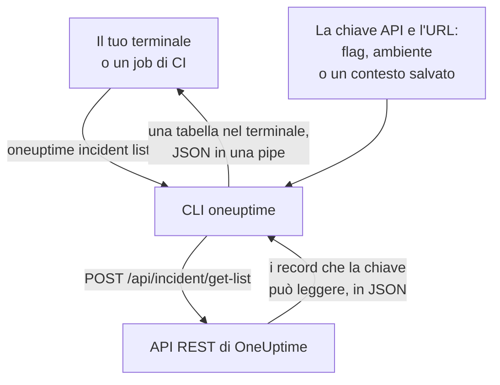

# Panoramica della CLI

La CLI di OneUptime, `oneuptime`, gestisce il tuo progetto OneUptime da un terminale o da uno script. Elenca, legge, crea, modifica, elimina e conta monitor, incidenti, avvisi, pagine di stato e gli altri record che l'API di OneUptime offre, con una chiave API del tuo progetto.

:::cards
- [Come funziona la CLI](#come-funziona-la-cli): Un comando, una richiesta all'API, una risposta.
- [Installare la CLI](#installare-la-cli): Un comando npm, e la versione da scegliere.
- [Eseguire i primi comandi](#eseguire-i-primi-comandi): Salva la tua chiave API, poi elenca i tuoi incidenti.
- [I comandi in sintesi](#i-comandi-in-sintesi): Ogni comando, e la pagina che lo spiega.
:::

## Come funziona la CLI

Ogni comando invia una richiesta all'API REST di OneUptime e stampa la risposta. La CLI prende la chiave API e l'indirizzo del tuo OneUptime da flag, variabili d'ambiente o da un contesto salvato da `oneuptime login`. La chiave decide che cosa un comando può leggere e modificare, esattamente come per l'API.



I comandi per i record arrivano con la CLI: ogni tipo di record che l'API di OneUptime apre agli strumenti ne ha uno, gli stessi record per cui il [server MCP](/docs/ai/mcp-server) ha degli strumenti. Esegui `oneuptime resources` per elencarli.

## Prima di iniziare

- **Node.js e npm**, in una versione LTS attuale, per installare la CLI.
- **Una chiave API del tuo progetto.** Creane una in **Impostazioni del progetto → Avanzato → Chiavi API** con **Crea: Chiave API**: vedi [Creare una chiave API](/docs/api-reference/api-reference#creare-una-chiave-api).
- **Su OneUptime Cloud, il piano Growth o superiore.** Le chiavi API di un progetto funzionano solo con esso: vedi [Chiavi API e SCIM sotto il loro piano](/docs/api-reference/api-reference#chiavi-api-e-scim-sotto-il-loro-piano).

## Installare la CLI

Installa il pacchetto `@oneuptime/cli` da npm. Aggiunge il comando `oneuptime`, e `--version` stampa la versione installata:

```bash
npm install -g @oneuptime/cli
oneuptime --version
```

La CLI esce insieme a OneUptime e ha lo stesso numero di versione. Su un OneUptime self-hosted, installa la CLI della versione del tuo OneUptime, così che i suoi comandi corrispondano ai record del tuo server:

```bash
npm install -g @oneuptime/cli@<your-oneuptime-version>
```

> [!WARNING]
> Le versioni della CLI precedenti alla 14.0.64 si fermano appena avviate, con un errore come `Cannot find module 'Common/Models/DatabaseModels/Index'`. Installa la 14.0.64 o una successiva con `npm install -g @oneuptime/cli@latest`. Su un OneUptime self-hosted precedente alla 14.0.64, [aggiorna prima OneUptime](/docs/installation/upgrading#come-aggiornare), poi installa la CLI della versione a cui l'hai aggiornato.

## Eseguire i primi comandi

:::steps
### Salvare la tua chiave API

Accedi con la chiave e l'indirizzo del tuo OneUptime. La CLI li salva come un contesto chiamato `default` e da ora in poi lo usa:

```bash
oneuptime login <your-api-key> https://oneuptime.com
```

Risponde `Logged in successfully. Context "default" is now active.` Su un OneUptime self-hosted, usa il suo indirizzo al posto di `https://oneuptime.com`.

### Elencare i tuoi incidenti

```bash
oneuptime incident list
```

I dieci incidenti più recenti compaiono come tabella. `login` salva la chiave senza verificarla, quindi questo è il primo comando che mostra che la chiave funziona: se viene rifiutata, vedi [Risoluzione dei problemi](/docs/cli/authentication#risoluzione-dei-problemi).

### Vedere che cos'altro puoi gestire

```bash
oneuptime resources
```

L'elenco mostra ogni tipo di record con cui puoi lavorare, e il suo comando, come `monitor`, `status-page` o `on-call-policy`.
:::

## I comandi in sintesi

| Comando | Che cosa fa | Per saperne di più |
| --- | --- | --- |
| `oneuptime login <api-key> <instance-url>` | Salva una chiave API e un indirizzo come contesto | [Autenticazione](/docs/cli/authentication#accedere) |
| `oneuptime context list`, `use`, `current`, `delete` | Elenca, cambia, mostra ed elimina i contesti salvati | [Autenticazione](/docs/cli/authentication#contesti) |
| `oneuptime whoami` | Mostra l'URL e la chiave API che userà il prossimo comando | [Autenticazione](/docs/cli/authentication#verificare-che-cosa-userà-la-cli) |
| `oneuptime deploy` | Registra un deploy, o un'altra modifica, per i grafici e OneUptime AI | [Deploy e modifiche](/docs/telemetry/change-events) |
| `oneuptime <resource> list`, `get`, `create`, `update`, `delete`, `count` | Lavora con un tipo di record | [Operazioni sulle risorse](/docs/cli/resource-operations) |
| `oneuptime resources` | Elenca i tipi di record, con i loro comandi | [Riferimento dei comandi](/docs/cli/command-reference#oneuptime-resources) |
| `oneuptime version` | Stampa la versione della CLI | [Riferimento dei comandi](/docs/cli/command-reference#oneuptime-version) |
| `oneuptime help [command]` | Mostra la guida di un comando | [Ottenere aiuto](#ottenere-aiuto) |

## Opzioni globali

Queste opzioni funzionano con ogni comando, prima o dopo di esso:

| Opzione | Che cosa fa |
| --- | --- |
| `--api-key <key>` | La chiave API per questo comando, al posto di quella salvata |
| `--url <url>` | L'indirizzo del tuo OneUptime per questo comando |
| `--context <name>` | Un contesto salvato per questo comando, al posto di quello attuale |
| `-o, --output <format>` | `table`, `json` o `wide`: vedi [Formati di output](/docs/cli/output-formats) |
| `--no-color` | Stampa senza colori |
| `-V, --version` | Stampa la versione della CLI |
| `-h, --help` | Mostra la guida del comando |

## Ottenere aiuto

Ogni comando ha la sua guida, con i suoi argomenti, le sue opzioni e i suoi valori predefiniti:

```bash
oneuptime --help
oneuptime help incident
oneuptime incident list --help
```

## Passi successivi

:::cards
- [Autenticazione](/docs/cli/authentication): Contesti per ogni ambiente, e quale chiave usa un comando.
- [Operazioni sulle risorse](/docs/cli/resource-operations): Elencare, leggere, creare, modificare, eliminare e contare record.
- [Formati di output](/docs/cli/output-formats): Tabelle per le persone, JSON per gli script.
- [Scripting e CI/CD](/docs/cli/scripting): Codici di uscita, jq e pipeline.
- [Riferimento dei comandi](/docs/cli/command-reference): Ogni comando, opzione e valore predefinito.
:::
