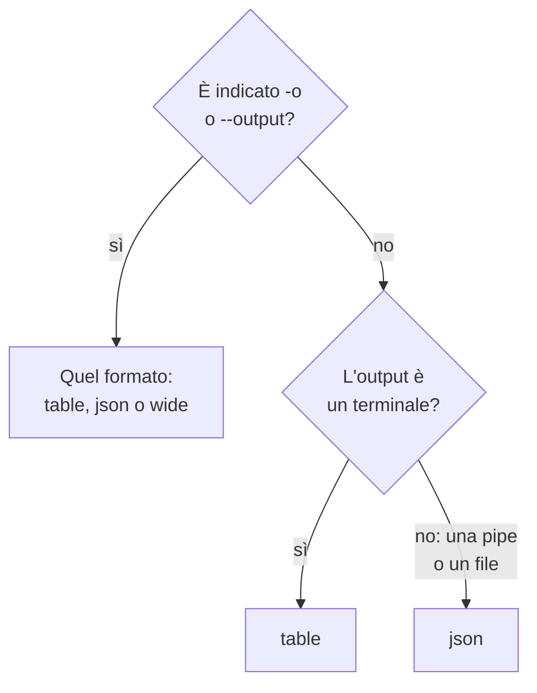

# Formati di output

La CLI stampa una tabella quando leggi la sua risposta in un terminale, e JSON quando la legge uno script o un altro programma. Scegli il formato di qualsiasi comando con `-o` o `--output`.

:::cards
- [Come si sceglie il formato](#come-si-sceglie-il-formato): Un terminale riceve una tabella, una pipe riceve JSON.
- [Tabella](#tabella): Sei colonne, ogni valore tagliato a 60 caratteri.
- [JSON](#json): Ogni campo, intero, per gli script e jq.
- [Ampio](#ampio): Una tabella con tutte le colonne.
:::

## Come si sceglie il formato



| Formato | Che cosa stampa | Ideale per |
| --- | --- | --- |
| `table` | Una tabella di al massimo sei colonne; un singolo record come una riga per campo | Leggere in un terminale |
| `json` | La risposta così come OneUptime l'ha inviata, rientrata di due spazi | Script, `jq` e file |
| `wide` | Una tabella con una colonna per ogni campo | Confrontare molti campi a colpo d'occhio |

`-o` funziona su ogni comando che stampa record: `list`, `get`, `create`, `update` e `count` di una risorsa, `oneuptime resources` e `oneuptime context list`. Può stare in qualsiasi punto della riga di comando. Qualsiasi altro valore viene rifiutato prima che una richiesta parta:

```text
error: option '-o, --output <format>' argument 'yaml' is invalid. Allowed choices are json, table, wide.
```

## Tabella

La tabella è il formato predefinito in un terminale. `oneuptime resources --type analytics`, per esempio, stampa questa:

```text
┌────────────────────────────┬────────────────────────────┬─────────────────────────────┬───────────┬─────────────────────────────┐
│ Command                    │ Singular                   │ Plural                      │ Type      │ API Path                    │
├────────────────────────────┼────────────────────────────┼─────────────────────────────┼───────────┼─────────────────────────────┤
│ log                        │ Log                        │ Logs                        │ analytics │ /logs                       │
├────────────────────────────┼────────────────────────────┼─────────────────────────────┼───────────┼─────────────────────────────┤
│ span                       │ Span                       │ Spans                       │ analytics │ /span                       │
├────────────────────────────┼────────────────────────────┼─────────────────────────────┼───────────┼─────────────────────────────┤
│ metric                     │ Metric                     │ Metrics                     │ analytics │ /metrics                    │
├────────────────────────────┼────────────────────────────┼─────────────────────────────┼───────────┼─────────────────────────────┤
│ exception-instance         │ Exception Instance         │ Exception Instances         │ analytics │ /exceptions                 │
├────────────────────────────┼────────────────────────────┼─────────────────────────────┼───────────┼─────────────────────────────┤
│ monitor-log                │ Monitor Log                │ Monitor Logs                │ analytics │ /monitor-log                │
├────────────────────────────┼────────────────────────────┼─────────────────────────────┼───────────┼─────────────────────────────┤
│ kubernetes-cost-allocation │ Kubernetes Cost Allocation │ Kubernetes Cost Allocations │ analytics │ /kubernetes-cost-allocation │
├────────────────────────────┼────────────────────────────┼─────────────────────────────┼───────────┼─────────────────────────────┤
│ security-event             │ Security Event             │ Security Events             │ analytics │ /security-events            │
├────────────────────────────┼────────────────────────────┼─────────────────────────────┼───────────┼─────────────────────────────┤
│ change-event               │ Change Event               │ Change Events               │ analytics │ /change-events              │
├────────────────────────────┼────────────────────────────┼─────────────────────────────┼───────────┼─────────────────────────────┤
│ threat-intel-indicator     │ Threat Intel Indicator     │ Threat Intel Indicators     │ analytics │ /threat-intel-indicators    │
└────────────────────────────┴────────────────────────────┴─────────────────────────────┴───────────┴─────────────────────────────┘

Total: 9 resources
```

Per un elenco di record, una tabella mostra al massimo sei colonne: prima `_id`, `name`, `title`, `status`, `createdAt` e `updatedAt`, quelle che i record hanno, poi i campi successivi dei record nell'ordine. Le colonne vengono prese dal primo record. Un valore più lungo di 60 caratteri viene tagliato ai suoi primi 57, seguiti da `...`.

Un singolo record, come lo stampano `get` e `create`, è una tabella di due colonne: il nome del campo e il suo valore, una riga per campo.

OneUptime invia le date e gli ID di altri record come oggetti, come `{"_type":"DateTime","value":"2026-10-14T09:12:44.000Z"}`, e una tabella li mostra come quel testo. Il loro valore è in `value`: vedi [JSON](#json).

## JSON

Il JSON è la risposta così come OneUptime l'ha inviata, rientrata di due spazi: un elenco è un array di record, e un singolo record è un oggetto.

```bash
oneuptime incident list --limit 1 -o json
```

```json
[
  {
    "_id": "6f1c2a40-3b1e-4c55-9a0b-3e2f8d7c1a11",
    "createdAt": {
      "_type": "DateTime",
      "value": "2026-10-14T09:12:44.000Z"
    },
    "title": "Checkout API is down",
    "currentIncidentStateId": {
      "_type": "ObjectID",
      "value": "0b7d5e2c-8f4a-4d1b-9c3e-5a6f7b8c9d0e"
    }
  }
]
```

Un record ha ogni campo che la chiave può leggere; questo è ridotto a quattro. L'`_id` proprio di un record è testo, e gli altri ID e le date sono oggetti il cui `value` li contiene:

```bash
oneuptime incident list -o json | jq -r '.[] | "\(.createdAt.value)  \(.title)"'
```

Quando l'output non è un terminale, come in `oneuptime incident list | jq '.[].title'`, la CLI stampa JSON senza `-o json`. Scrivi comunque `-o json` negli script, così non dipendono da questo.

## Ampio

`-o wide` è una tabella con una colonna per ogni campo dei record. Ogni valore viene comunque tagliato a 60 caratteri, e i record hanno molti campi, quindi una tabella ampia è molto larga: scorrila con `less -S`.

```bash
oneuptime incident list -o wide | less -S
```

## Colori

Le intestazioni delle tabelle sono ciano; i messaggi sono verdi quando qualcosa ha funzionato, blu per le informazioni e rossi per gli errori. Disattiva i colori con `--no-color`, oppure impostando `NO_COLOR` a un valore qualsiasi:

```bash
oneuptime incident list --no-color
NO_COLOR=1 oneuptime incident list
```

## Che cosa stampa ogni comando

I record e i conteggi vanno sullo standard output, e gli errori sullo standard error, così una pipe legge solo la risposta.

| Comando | In una tabella | In JSON |
| --- | --- | --- |
| Un `list` che non trova nulla | `No results found.` | `[]` |
| Un `get` o un `create` | Una riga per campo | Il record |
| Un `count` | Il numero | Il numero |
| Un `update` | Una riga vuota | `{}` |
| Un `delete` | `Monitor <id> deleted successfully.` | La stessa riga |

## Passi successivi

:::cards
- [Scripting e CI/CD](/docs/cli/scripting): Leggere il JSON con jq in script e pipeline.
- [Operazioni sulle risorse](/docs/cli/resource-operations): Le operazioni di cui queste sono le risposte.
- [Riferimento dei comandi](/docs/cli/command-reference): Ogni comando e ogni opzione.
:::
