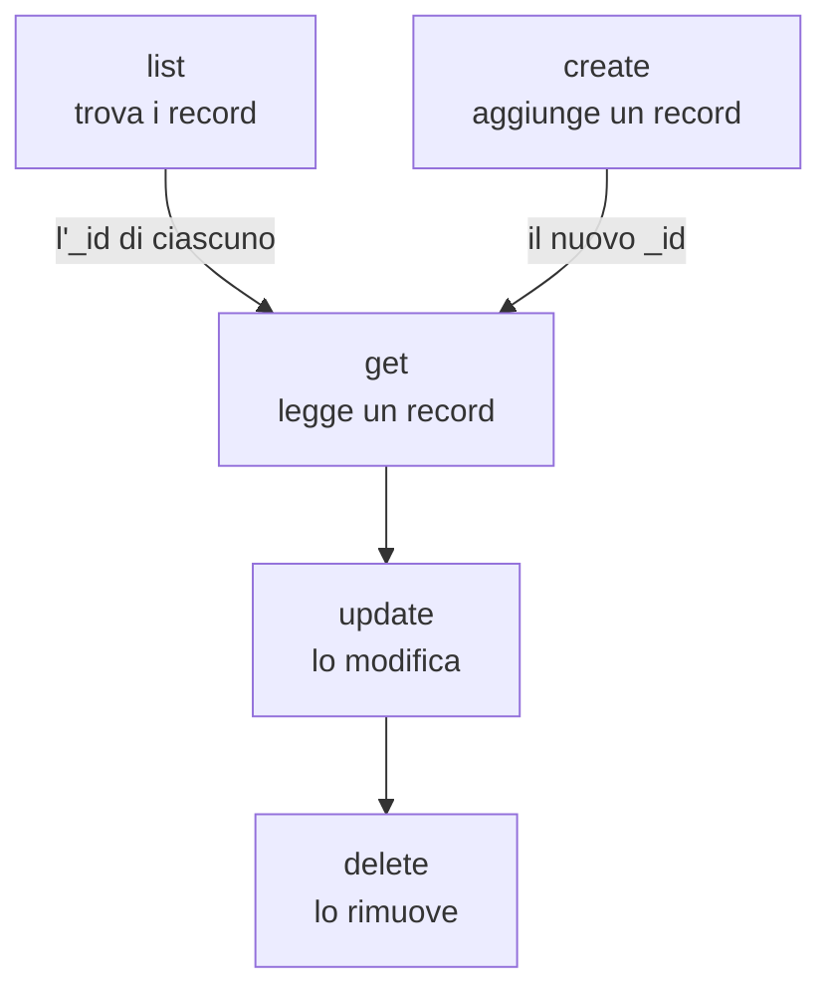

# Operazioni sulle risorse

Ogni tipo di record è un comando a sé, come `incident`, `monitor` o `status-page`, e ciascuno accetta le stesse operazioni: `list`, `get`, `create`, `update`, `delete` e `count`. Questa pagina mostra ogni operazione, con i filtri, la paginazione e il JSON in cui si scrive un record.

:::cards
- [Trovare il comando di un record](#trovare-il-comando-di-un-record): oneuptime resources li elenca tutti.
- [Elencare i record](#elencare-i-record): Filtrare, ordinare e sfogliare.
- [Creare un record](#creare-un-record): Da JSON sulla riga di comando o in un file.
- [Eliminare un record](#eliminare-un-record): Subito, senza annullamento.
:::

## Come si combinano le operazioni

Leggere, modificare ed eliminare un record richiedono il suo ID. Elencare, contare e creare non ne richiedono, e un elenco o una creazione ti danno gli ID che servono alle altre:



Un ID è un UUID, come `6f1c2a40-3b1e-4c55-9a0b-3e2f8d7c1a11`. Puoi anche copiarne uno dalla pagina del record in OneUptime: vedi [Trovare l'ID di una risorsa](/docs/api-reference/api-reference#trovare-lid-di-una-risorsa).

## Trovare il comando di un record

```bash
oneuptime resources
```

L'elenco mostra ogni tipo di record con il suo comando, i suoi nomi, il suo tipo e il suo percorso API. Ci sono due tipi:

| Tipo | Che cosa contiene | Operazioni |
| --- | --- | --- |
| `database` | I record che gestisci: monitor, incidenti, avvisi, pagine di stato, team e altro | `list`, `get`, `create`, `update`, `delete`, `count` |
| `analytics` | La telemetria: log, span, metriche, eccezioni e altri eventi | `list`, `create`, `count` |

Mostra un solo tipo con `oneuptime resources --type database` o `--type analytics`. Il [Riferimento dei comandi](/docs/cli/command-reference#risorse) elenca ogni comando.

## Elencare i record

```bash
oneuptime <resource> list [--query <json>] [--limit <n>] [--skip <n>] [--sort <json>] [-o <format>]
```

| Opzione | Che cosa fa | Predefinito |
| --- | --- | --- |
| `--query <json>` | Restituisce solo i record che corrispondono: vedi [Filtrare un elenco](#filtrare-un-elenco) | Ogni record che la chiave può leggere |
| `--limit <n>` | Il numero massimo di record da restituire, fino a 10.000 | `10` |
| `--skip <n>` | Quanti record corrispondenti saltare prima | `0` |
| `--sort <json>` | L'ordine, come `{"createdAt":"ASC"}`, oppure `"DESC"` per i più recenti prima | I più recenti prima |
| `-o, --output <format>` | `table`, `json` o `wide` | `table` in un terminale, `json` in una pipe |

```bash
# The ten newest incidents
oneuptime incident list

# The oldest monitors first, 50 at a time: the second page
oneuptime monitor list --sort '{"createdAt":"ASC"}' --limit 50 --skip 50

# Every field of each incident, as JSON
oneuptime incident list -o json
```

Un elenco chiede a OneUptime ogni campo di ogni record che la chiave può leggere. Una tabella ne mostra sei; il JSON li mostra tutti (vedi [Formati di output](/docs/cli/output-formats)). Per scorrere tutti i record, aumenta `--skip` di `--limit` finché una pagina non torna vuota; `count` dice quanti sono.

Le etichette sono elencate per nome anziché dalle più recenti: prima le etichette il cui nome inizia con un numero, nell'ordine di quel numero (`2. Team` prima di `10. Owner`), poi le altre in ordine alfabetico. Per elencarle in un altro ordine, indica `--sort`.

### Filtrare un elenco

`--query` accetta lo stesso filtro dell'API: un campo con un valore corrisponde a quel valore, e un oggetto con un `_type` confronta.

| Filtro | Corrisponde a |
| --- | --- |
| `{"title":"Checkout API is down"}` | Record con esattamente quel valore |
| `{"title":{"_type":"Search","value":"checkout"}}` | Testo che contiene il valore |
| `{"createdAt":{"_type":"GreaterThan","value":"2026-10-01T00:00:00.000Z"}}` | Date successive, o numeri maggiori |
| `{"currentIncidentState":{"isResolvedState":false}}` | Un campo di un record che la risorsa nomina: qui, gli incidenti non risolti |

```bash
oneuptime incident list --query '{"title":{"_type":"Search","value":"checkout"}}'
```

[Filtrare, ordinare e sfogliare](/docs/api-reference/api-reference#filtrare-ordinare-e-sfogliare) nel riferimento API elenca ogni `_type`.

## Leggere un record

```bash
oneuptime <resource> get <id> [-o <format>]
```

```bash
oneuptime incident get 6f1c2a40-3b1e-4c55-9a0b-3e2f8d7c1a11
```

Una tabella mostra una riga per ogni campo del record, con ogni valore tagliato a 60 caratteri; `-o json` mostra i valori interi. Un ID che non nomina alcun record che la tua chiave può leggere risponde `Not found`, e il comando termina con il codice `3`.

## Creare un record

```bash
oneuptime <resource> create --data <json> [-o <format>]
oneuptime <resource> create --file <path> [-o <format>]
```

`--data` accetta il record come JSON, e `--file` lo legge da un file JSON. Indica uno dei due; se li indichi entrambi, viene usato il file. I campi sono quelli dell'API, e il [riferimento API](/reference) elenca quelli di ogni risorsa. Il progetto viene dalla chiave API, quindi un record non lo nomina mai.

```bash
# A manual monitor
oneuptime monitor create --data '{"name":"Checkout API","monitorType":"Manual"}'

# An incident with one of your severities
oneuptime incident create --data '{"title":"Checkout API is down","incidentSeverityId":"<severity-id>"}'

# The same incident, from a file
oneuptime incident create --file incident.json
```

La CLI stampa il nuovo record, con il suo `_id`. Un incidente inizia nello stato di creazione del tuo progetto, a meno che `currentIncidentStateId` non ne nomini un altro: vedi [Lo stato in cui inizia un nuovo record](/docs/api-reference/api-reference#lo-stato-in-cui-inizia-un-nuovo-record). Per trovare gli ID delle tue gravità:

```bash
oneuptime incident-severity list -o json | jq -r '.[] | "\(._id)  \(.name)"'
```

> [!TIP]
> Su Windows, metti il JSON in un file e usa `--file`: PowerShell e il Prompt dei comandi racchiudono il JSON tra virgolette sulla riga di comando in modo diverso da Bash.

## Aggiornare un record

```bash
oneuptime <resource> update <id> --data <json> [-o <format>]
```

`--data` è obbligatorio e contiene solo i campi da modificare:

```bash
# Rename a monitor
oneuptime monitor update <monitor-id> --data '{"name":"Checkout API (EU)"}'

# Move an incident to your resolved state
oneuptime incident update <incident-id> --data '{"currentIncidentStateId":"<resolved-state-id>"}'
```

OneUptime risponde a un aggiornamento con un oggetto vuoto: la CLI stampa una riga vuota, oppure `{}` con `-o json`. Esegui `get` per vedere il record com'è adesso. Spostare un incidente in un altro stato in questo modo registra la modifica sulla sua cronologia, come fa la dashboard, e uno stato precedente a quello attuale viene rifiutato. Per trovare l'ID dello stato risolto, il primo nell'ordine del tuo progetto:

```bash
oneuptime incident-state list --query '{"isResolvedState":true}' --sort '{"order":"ASC"}' --limit 1 -o json | jq -r '.[0]._id'
```

## Eliminare un record

```bash
oneuptime <resource> delete <id>
```

```bash
oneuptime monitor delete 6f1c2a40-3b1e-4c55-9a0b-3e2f8d7c1a11
```

Risponde `Monitor 6f1c2a40-3b1e-4c55-9a0b-3e2f8d7c1a11 deleted successfully.`

> [!CAUTION]
> `delete` rimuove il record subito. La CLI non ti chiede conferma, e non si può annullare. Accetta `--force`, per gli script scritti con esso, e `--force` non cambia nulla.

## Contare i record

```bash
oneuptime <resource> count [--query <json>]
```

```bash
# Every incident
oneuptime incident count

# Incidents that are not resolved
oneuptime incident count --query '{"currentIncidentState":{"isResolvedState":false}}'
```

La CLI stampa un solo numero, lo stesso in una tabella e in JSON, così uno script può leggerlo così com'è.

## Che cosa può fare ogni tipo

| Operazione | `database` | `analytics` |
| --- | --- | --- |
| `list` | Sì | Sì |
| `get` | Sì | No |
| `create` | Sì | Sì |
| `update` | Sì | No |
| `delete` | Sì | No |
| `count` | Sì | Sì |

## Risoluzione dei problemi

:::details Il messaggio «Not found: API error (404)»
Il record non esiste, si trova in un altro progetto, oppure la chiave non può leggerlo: OneUptime risponde allo stesso modo in ogni caso. Controlla l'ID con `list`, e i permessi della chiave. Il comando termina con il codice `3`.
:::

:::details Il messaggio «API error (422): You do not have permissions to select on»
Un elenco o una lettura chiede ogni campo del record, e la chiave non può leggerne uno: il messaggio nomina il campo e i permessi che possono leggerlo. Dai alla chiave uno di quei permessi.
:::

:::details Il messaggio «Error: Invalid JSON»
Il valore di `--query`, `--sort` o `--data` non è JSON. In Bash e zsh, racchiudilo tra apici singoli; su Windows, metti un record in un file e usa `--file`.
:::

:::details API error (400) in una creazione o in un aggiornamento
OneUptime ha rifiutato un campo: il messaggio lo nomina. `No fields to update` significa che `--data` non conteneva alcun campo da modificare.
:::

## Passi successivi

:::cards
- [Formati di output](/docs/cli/output-formats): Leggere le risposte come tabelle o come JSON.
- [Scripting e CI/CD](/docs/cli/scripting): Usare queste operazioni in script e pipeline.
- [Riferimento dei comandi](/docs/cli/command-reference): Ogni comando, opzione e valore predefinito.
:::
