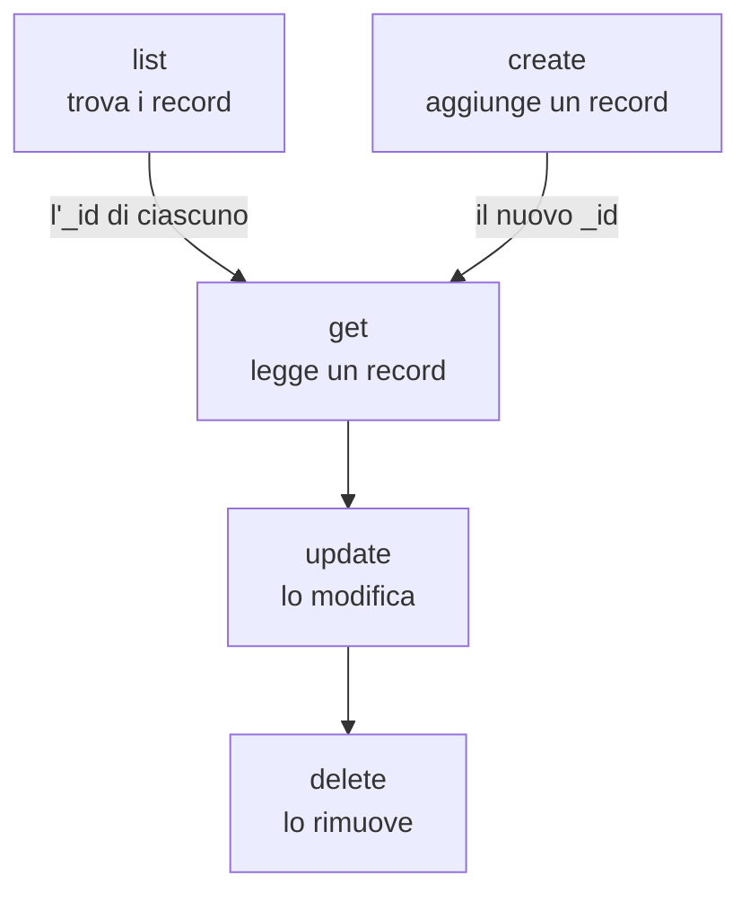

# Operazioni sulle risorse

Ogni tipo di record è un comando a sé, come `incident`, `monitor` o `status-page`, con le operazioni che l'API accetta per esso: per la maggior parte, `list`, `get`, `create`, `update`, `delete` e `count`. Questa pagina mostra ogni operazione, con i filtri, la paginazione e i flag con cui si scrive un record, e i comandi che fanno ciò che fanno i pulsanti della dashboard.

:::cards
- [Trovare il comando di un record](#trovare-il-comando-di-un-record): oneuptime resources li elenca tutti.
- [Elencare i record](#elencare-i-record): Filtrare, ordinare e sfogliare.
- [Creare un record](#creare-un-record): Un flag per ogni campo, oppure il record come JSON.
- [Riconoscere, risolvere e aggiungere note](#riconoscere-risolvere-e-aggiungere-note): I pulsanti della dashboard, come comandi.
- [Eliminare un record](#eliminare-un-record): Subito, senza annullamento.
:::

## Come si combinano le operazioni

Leggere, modificare ed eliminare un record richiedono il suo ID. Elencare, contare e creare non ne richiedono, e un elenco o una creazione ti danno gli ID che servono alle altre:



Un ID è un UUID, come `6f1c2a40-3b1e-4c55-9a0b-3e2f8d7c1a11`. Puoi anche copiarne uno dalla pagina del record in OneUptime: vedi [Trovare l'ID di una risorsa](/docs/api-reference/api-reference#trovare-lid-di-una-risorsa).

## Trovare il comando di un record

```bash
oneuptime resources
```

L'elenco mostra ogni tipo di record con il suo comando, i suoi nomi, il suo tipo e il suo percorso API. Ci sono due tipi:

| Tipo | Che cosa contiene |
| --- | --- |
| `database` | I record che gestisci: monitor, incidenti, avvisi, pagine di stato, team e altro |
| `analytics` | La telemetria: log, span, metriche, eccezioni e altri eventi |

Mostra un solo tipo con `oneuptime resources --type database` o `--type analytics`. Il [Riferimento dei comandi](/docs/cli/command-reference#risorse) elenca ogni comando.

Una risorsa accetta le operazioni che l'API accetta per essa. La maggior parte le accetta tutte e sei; una che OneUptime scrive da sé, come un log delle email, è di sola lettura. `oneuptime <resource> --help` elenca i sottocomandi di una risorsa.

## Vedere i campi di una risorsa

`fields` elenca i campi di una risorsa dalla CLI stessa, senza chiave API e senza richieste:

```bash
oneuptime incident fields
```

Ogni campo ha il suo tipo, a che cosa serve, se una creazione deve indicarlo e il flag che lo imposta. Un campo che contiene un ID nomina la risorsa a cui l'ID appartiene: `incidentSeverityId` ne prende uno da `oneuptime incident-severity list`. Con `-o json`, uno script o un agente IA legge lo stesso, con le stesse chiavi per ogni campo: `name`, `title`, `type`, `description`, `required`, `create`, `update`, `read`, `flag`, `emailFlag` e `relatedResource`.

## Elencare i record

```bash
oneuptime <resource> list [--query <json>] [--limit <n>] [--skip <n>] [--sort <json>] [--fields <names>] [--all] [-o <format>]
```

| Opzione | Che cosa fa | Predefinito |
| --- | --- | --- |
| `--query <json>` | Restituisce solo i record che corrispondono: vedi [Filtrare un elenco](#filtrare-un-elenco) | Ogni record che la chiave può leggere |
| `--limit <n>` | Il numero massimo di record da restituire, fino a 10.000 | `10` |
| `--skip <n>` | Quanti record corrispondenti saltare prima | `0` |
| `--sort <json>` | L'ordine, come `{"createdAt":"ASC"}`, oppure `"DESC"` per i più recenti prima | I più recenti prima |
| `--fields <names>` | I campi da restituire, separati da virgole, come `title,createdAt` | Ogni campo che la chiave può leggere |
| `--all` | Ogni record che corrisponde, pagina dopo pagina, al posto di `--limit` e `--skip`. Solo record | |
| `-o, --output <format>` | `table`, `json` o `wide` | `table` in un terminale, `json` in una pipe |

```bash
# The ten newest incidents
oneuptime incident list

# The oldest monitors first, 50 at a time: the second page
oneuptime monitor list --sort '{"createdAt":"ASC"}' --limit 50 --skip 50

# Every field of each incident, as JSON
oneuptime incident list -o json

# The title, the state and the creation date of every incident
oneuptime incident list --all --fields title,currentIncidentState.name,createdAt -o json
```

Un elenco chiede a OneUptime ogni campo di ogni record che la chiave può leggere. `--fields` chiede invece quelli che nomina e, dopo un punto, un campo di un record collegato, come in `currentIncidentState.name`. Una tabella mostra sei campi; il JSON li mostra tutti (vedi [Formati di output](/docs/cli/output-formats)). `--all` legge ogni pagina, 100 record alla volta, fino a 100.000; `count` dice quanti sono.

Le etichette sono elencate per nome anziché dalle più recenti: prima le etichette il cui nome inizia con un numero, nell'ordine di quel numero (`2. Team` prima di `10. Owner`), poi le altre in ordine alfabetico. Per elencarle in un altro ordine, indica `--sort`.

### Filtrare un elenco

`--query` accetta lo stesso filtro dell'API: un campo con un valore corrisponde a quel valore, e un oggetto con un `_type` confronta.

| Filtro | Corrisponde a |
| --- | --- |
| `{"title":"Checkout API is down"}` | Record con esattamente quel valore |
| `{"title":{"_type":"Search","value":"checkout"}}` | Testo che contiene il valore |
| `{"createdAt":{"_type":"GreaterThan","value":"2026-10-01T00:00:00.000Z"}}` | Date successive, o numeri maggiori |
| `{"currentIncidentState":{"isResolvedState":false}}` | Un campo di un record che la risorsa nomina: qui, gli incidenti non risolti |

```bash
oneuptime incident list --query '{"title":{"_type":"Search","value":"checkout"}}'
```

[Filtrare, ordinare e sfogliare](/docs/api-reference/api-reference#filtrare-ordinare-e-sfogliare) nel riferimento API elenca ogni `_type`.

## Leggere un record

```bash
oneuptime <resource> get <id> [--fields <names>] [-o <format>]
```

```bash
oneuptime incident get 6f1c2a40-3b1e-4c55-9a0b-3e2f8d7c1a11
```

Una tabella mostra una riga per ogni campo del record, con ogni valore tagliato a 60 caratteri; `-o json` mostra i valori interi. Un ID che non nomina alcun record che la tua chiave può leggere risponde `Not found`, e il comando termina con il codice `3`.

## Creare un record

```bash
oneuptime <resource> create [--<field> <value>]... [--data <json>] [--file <path>] [-o <format>]
```

Ogni campo che una creazione accetta ha un flag: `--title <text>`, `--incident-severity-id <id>`, `--labels <ids>` per ID separati da virgole, `--is-visible-on-status-page [true|false]` per un campo sì o no, vero quando è indicato da solo, e `--monitor-steps <json>` per un campo che contiene JSON. `oneuptime <resource> create --help` li elenca, e [`fields`](#vedere-i-campi-di-una-risorsa) dice a che cosa serve ciascuno. Il progetto viene dalla chiave API, quindi un record non lo nomina mai.

```bash
# A manual monitor
oneuptime monitor create --name "Checkout API" --monitor-type Manual

# An incident with one of your severities
oneuptime incident create --title "Checkout API is down" --incident-severity-id <severity-id>

# The same incident, from a file
oneuptime incident create --file incident.json
```

`--data` accetta il record come JSON, e `--file` lo legge da un file JSON, con i campi dell'API: il [riferimento API](/reference) elenca quelli di ogni risorsa. Se li indichi entrambi, viene usato il file, e i flag si aggiungono sopra l'uno o l'altro.

Un campo che nomina una persona per ID utente ha un secondo flag che la nomina per indirizzo email: `--user-email` accanto a `--user-id`, `--owner-user-emails` accanto a `--owner-users`. La CLI la cerca tra i membri del progetto della chiave API e le persone invitate a esso. Un membro del team nominato con un indirizzo che nessuno nel progetto ha viene invitato al progetto, come quando lo inviti dalla dashboard:

```bash
oneuptime team-member create --team-id <team-id> --user-email alice@example.com
```

La CLI stampa il nuovo record, con il suo `_id`. Un incidente inizia nello stato di creazione del tuo progetto, a meno che `currentIncidentStateId` non ne nomini un altro: vedi [Lo stato in cui inizia un nuovo record](/docs/api-reference/api-reference#lo-stato-in-cui-inizia-un-nuovo-record). Per trovare gli ID delle tue gravità:

```bash
oneuptime incident-severity list -o json | jq -r '.[] | "\(._id)  \(.name)"'
```

> [!TIP]
> Su Windows, indica i campi con i loro flag, oppure metti il JSON in un file e usa `--file`: PowerShell e il Prompt dei comandi racchiudono il JSON tra virgolette sulla riga di comando in modo diverso da Bash.

## Aggiornare un record

```bash
oneuptime <resource> update <id> [--<field> <value>]... [--data <json>] [--file <path>] [-o <format>]
```

Indica solo i campi da modificare, con i loro flag o come JSON:

```bash
# Rename a monitor
oneuptime monitor update <monitor-id> --name "Checkout API (EU)"

# Record an incident's root cause
oneuptime incident update <incident-id> --root-cause "A full disk on the primary database"
```

OneUptime risponde a un aggiornamento con un oggetto vuoto: la CLI stampa una riga vuota, oppure `{}` con `-o json`. Esegui `get` per vedere il record com'è adesso. Per spostare un incidente in un altro stato, indica `--current-incident-state-id`: la modifica viene registrata sulla sua cronologia, come fa la dashboard, e uno stato precedente a quello attuale viene rifiutato. [`acknowledge` e `resolve`](#riconoscere-risolvere-e-aggiungere-note) trovano lo stato per te. Per trovare l'ID dello stato risolto, il primo nell'ordine del tuo progetto:

```bash
oneuptime incident-state list --query '{"isResolvedState":true}' --sort '{"order":"ASC"}' --limit 1 -o json | jq -r '.[0]._id'
```

## Riconoscere, risolvere e aggiungere note

Gli incidenti, gli avvisi, i loro episodi e gli eventi di manutenzione programmata hanno comandi per ciò che i pulsanti della dashboard fanno su di essi:

| Comando | Che cosa fa | Risorse |
| --- | --- | --- |
| `acknowledge <id>` | Sposta il record nello stato riconosciuto del tuo progetto | `incident`, `alert`, `incident-episode`, `alert-episode` |
| `resolve <id>` | Lo sposta nello stato risolto del tuo progetto | Gli stessi quattro |
| `start <id>` | Sposta l'evento nello stato in corso del tuo progetto | `scheduled-maintenance-event` |
| `end <id>` | Lo sposta nello stato terminato del tuo progetto | `scheduled-maintenance-event` |
| `add-note <id> --note <markdown>` | Aggiunge una nota che può leggere solo chi può vedere il record, oppure con `--public` una sulle pagine di stato del record | Tutti e cinque |

```bash
oneuptime incident acknowledge 6f1c2a40-3b1e-4c55-9a0b-3e2f8d7c1a11
oneuptime incident add-note 6f1c2a40-3b1e-4c55-9a0b-3e2f8d7c1a11 --note "Rolled back the 14:05 deploy."
oneuptime incident resolve 6f1c2a40-3b1e-4c55-9a0b-3e2f8d7c1a11
```

`acknowledge` risponde `Incident 6f1c2a40-3b1e-4c55-9a0b-3e2f8d7c1a11 acknowledged: it is in Acknowledged now.` Un record già in quello stato, o oltre, resta com'è: il comando lo dice e termina con `0`. Con `-o json`, risponde con l'`_id` del record, l'`action`, se qualcosa è cambiato (`changed`) e lo stato `state` in cui si trova il record. Gli avvisi e gli episodi di avvisi accettano solo note interne.

## Eliminare un record

```bash
oneuptime <resource> delete <id>
```

```bash
oneuptime monitor delete 6f1c2a40-3b1e-4c55-9a0b-3e2f8d7c1a11
```

Risponde `Monitor 6f1c2a40-3b1e-4c55-9a0b-3e2f8d7c1a11 deleted successfully.` Con `-o json`, risponde con l'`_id` del record e `"deleted": true`.

> [!CAUTION]
> `delete` rimuove il record subito. La CLI non ti chiede conferma, e non si può annullare. Accetta `--force`, per gli script scritti con esso, e `--force` non cambia nulla.

## Contare i record

```bash
oneuptime <resource> count [--query <json>]
```

```bash
# Every incident
oneuptime incident count

# Incidents that are not resolved
oneuptime incident count --query '{"currentIncidentState":{"isResolvedState":false}}'
```

La CLI stampa un solo numero, lo stesso in una tabella e in JSON, così uno script può leggerlo così com'è.

## Risoluzione dei problemi

:::details Il messaggio «Not found: API error (404)»
Il record non esiste, si trova in un altro progetto, oppure la chiave non può leggerlo: OneUptime risponde allo stesso modo in ogni caso. Controlla l'ID con `list`, e i permessi della chiave. Il comando termina con il codice `3`.
:::

:::details Il messaggio «Left out fields this API key may not read»
Un elenco o una lettura chiede ogni campo del record, e OneUptime rifiuta un campo che la chiave non può leggere: la CLI chiede di nuovo senza di esso e nomina i campi tralasciati sullo standard error. Dai alla chiave un permesso che li legge, oppure nomina i campi che ti servono con `--fields`: un campo nominato che la chiave non può leggere ferma il comando con `API error (422)`.
:::

:::details Il messaggio «Error: Invalid JSON»
Il valore di `--query`, `--sort` o `--data` non è JSON. In Bash e zsh, racchiudilo tra apici singoli; su Windows, indica i campi con i loro flag, oppure metti un record in un file e usa `--file`.
:::

:::details API error (400) in una creazione o in un aggiornamento
OneUptime ha rifiutato un campo: il messaggio lo nomina, e `oneuptime <resource> fields` elenca i campi con i flag che li impostano. Un comando che non indica alcun campo viene rifiutato prima di essere inviato, con i flag da indicare.
:::

:::details Il messaggio «No one in this project, or invited to it, has the email address»
Un flag di email nomina qualcuno che non è né membro del progetto della chiave API né invitato a esso. Invitalo con `oneuptime team-member create --team-id <team-id> --user-email <email>`, oppure nominalo per ID utente.
:::

## Passi successivi

:::cards
- [Formati di output](/docs/cli/output-formats): Leggere le risposte come tabelle o come JSON.
- [Scripting e CI/CD](/docs/cli/scripting): Usare queste operazioni in script e pipeline.
- [Riferimento dei comandi](/docs/cli/command-reference): Ogni comando, opzione e valore predefinito.
:::
