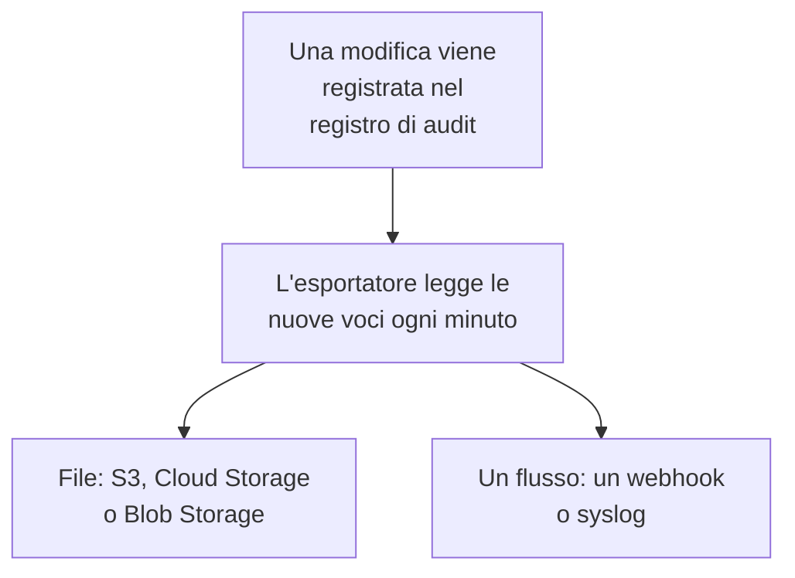

# Esportazione del registro di audit

Invia il registro di audit, man mano che viene registrato, allo storage o al servizio che scegli: Amazon S3 o uno storage compatibile con S3, Google Cloud Storage, Azure Blob Storage, un webhook o syslog. Conserva lì le voci per tutto il tempo richiesto dalle tue verifiche di conformità, e cercale nel tuo SIEM. I proprietari e gli amministratori di un progetto ne esportano il registro di audit dalle impostazioni del progetto, e gli amministratori principali esportano quello di tutti i progetti dall'Admin Dashboard. Fa parte del piano Enterprise su OneUptime Cloud, e dell'Enterprise Edition quando ospiti OneUptime in proprio.

:::cards
- [Configurare un'esportazione](#configurare-unesportazione): Scegli una destinazione, provala, salvala.
- [Cosa viene inviato](#cosa-viene-inviato): Un oggetto JSON per voce, in uno schema stabile.
- [Quando vengono inviate le voci](#quando-vengono-inviate-le-voci): Ogni minuto, ogni voce una volta, in ordine.
- [Quando una destinazione non risponde](#quando-una-destinazione-non-risponde): I nuovi tentativi, l'errore, e nessuna voce saltata.
:::

## Come una voce raggiunge la tua destinazione



- **Un'esportazione, una destinazione.** Un progetto può avere più esportazioni, e ognuna invia ogni voce alla propria destinazione.
- **Quella di un progetto, o quella dell'istanza.** L'esportazione di un progetto invia le voci di quel progetto. Un'esportazione configurata nell'Admin Dashboard invia le voci di tutti i progetti che registrano audit.
- **Da quando viene salvata.** Un'esportazione invia ciò che viene registrato dopo il salvataggio, a meno che tu non imposti **Esporta da** su una data precedente.

## Prima di iniziare

- **Su OneUptime Cloud, il piano Enterprise.** Con gli altri piani, la pagina mostra che cosa fa la funzionalità e come ottenerla.
- **Quando ospiti OneUptime in proprio, l'Enterprise Edition**, con una licenza che includa i registri di audit. Vedi [Edizione Enterprise](/docs/self-hosted/enterprise).
- **La registrazione di audit attiva** in ogni progetto che esporti. Vedi [Registri di audit](/docs/configuration/audit-logs).
- **Un Project Owner o un Project Admin** per esportare il registro di audit di un progetto, oppure un amministratore principale per esportare quello dell'istanza.

## Configurare un'esportazione

:::steps
### Apri la pagina di esportazione

Per un progetto, vai a **Impostazioni del progetto → Registri di audit → Esporta**. Per l'intera istanza, vai a **Impostazioni → Esportazione del registro di audit** nell'Admin Dashboard.

### Scegli una destinazione

Fai clic su **Aggiungi esportazione** e scegli una delle sei destinazioni qui sotto. La destinazione di un'esportazione non si può cambiare in seguito.

### Indica come raggiungerla

Compila ciò che la destinazione chiede. Le impostazioni che quasi tutti lasciano come sono aspettano in **Altri campi**, e **Guida alla configurazione** apre la sezione della destinazione in questa pagina.

### Invia un test

Fai clic su **Scrivi un file di prova** o **Invia una voce di prova**. Uno storage riceve il file `oneuptime-audit-log-export-test.ndjson.gz` nella sua cartella, e un webhook o syslog riceve una voce con azione `Test`. Un test non riuscito dice cosa correggere.

### Avvia l'esportazione

Fai clic su **Avanti**, dai un nome all'esportazione e fai clic su **Avvia l'esportazione**. Le prime voci arrivano entro pochi minuti.
:::

La riga dell'esportazione mostra come sta andando: **In esportazione**, **In errore**, **In pausa**, **In attesa di voci** o **In avvio**. **Invia un test** invia un test con le impostazioni salvate, e **Modifica** le cambia: una credenziale lasciata vuota mantiene quella salvata.

## Destinazioni

| Destinazione | Cosa arriva | Si autentica con |
| --- | --- | --- |
| [Amazon S3](#amazon-s3) | File NDJSON compressi | Una chiave di accesso |
| [Storage compatibile con S3](#storage-compatibile-con-s3) | File NDJSON compressi | Una chiave di accesso |
| [Google Cloud Storage](#google-cloud-storage) | File NDJSON compressi | Una chiave dell'account di servizio |
| [Azure Blob Storage](#azure-blob-storage) | File NDJSON compressi | Un token SAS o una chiave di accesso |
| [Webhook](#webhook) | Richieste HTTPS | Un'intestazione e un segreto di firma facoltativi |
| [Syslog](#syslog) | Messaggi RFC 5424 | Nulla |

### Amazon S3

| Campo | Cosa inserire |
| --- | --- |
| **Bucket** | Il bucket in cui vengono scritti i file. |
| **Regione** | La regione del bucket. Parte da `us-east-1`. |
| **ID chiave di accesso** | Una chiave di accesso che possa scrivere oggetti nel bucket. |
| **Chiave di accesso segreta** | Il segreto della chiave. |
| **Cartella** | In **Altri campi**. Se resta vuota, i file vanno in `oneuptime/audit-logs/`. |

La chiave ha bisogno solo di `s3:PutObject` sulla cartella:

```json
{
  "Version": "2012-10-17",
  "Statement": [
    {
      "Effect": "Allow",
      "Action": "s3:PutObject",
      "Resource": "arn:aws:s3:::my-audit-logs/oneuptime/audit-logs/*"
    }
  ]
}
```

### Storage compatibile con S3

Gli stessi campi di Amazon S3, dopo un **Endpoint**: l'indirizzo S3 dello storage, come `https://minio.example.com:9000` o `https://<account>.r2.cloudflarestorage.com`. Imposta **Regione** su quella che lo storage si aspetta: `us-east-1` per MinIO e il valore predefinito di Wasabi, `auto` per Cloudflare R2.

### Google Cloud Storage

Inserisci il **Bucket** e incolla una **Chiave dell'account di servizio** (JSON) il cui account di servizio abbia il ruolo Storage Object Creator sul bucket. **Cartella** aspetta in **Altri campi**.

### Azure Blob Storage

Inserisci l'**Account di archiviazione** e il **Container**, e scegli in **Accedi con** come autenticarti: un **Token SAS** con le autorizzazioni Create e Write sul container, oppure una **Chiave di accesso** dell'account di archiviazione. Un token SAS si può limitare a questo container, quindi è la scelta più sicura. **Cloud** e **Cartella** aspettano in **Altri campi**.

### Webhook

OneUptime invia ogni lotto con POST all'**URL**, come array JSON (`application/json`) o come una voce per riga (`application/x-ndjson`), secondo **Formato del corpo**, con queste intestazioni:

| Intestazione | Valore |
| --- | --- |
| `X-OneUptime-Event` | `audit-log-export` |
| `X-OneUptime-Batch-Id` | L'id della prima voce del lotto: lo stesso lotto inviato di nuovo porta lo stesso id. |
| `X-OneUptime-Entry-Count` | Quante voci contiene il corpo. |
| `X-OneUptime-Signature` | `sha256=` e l'HMAC-SHA256 del corpo, con il **Segreto di firma**, quando è impostato. |

La **Credenziale**, come `Bearer <token>`, viene inviata nell'intestazione che scegli in **Nome dell'intestazione**, `Authorization` se non la cambi. **Formato del corpo**, **Nome dell'intestazione** e **Segreto di firma** aspettano in **Altri campi**. Qualsiasi risposta 2xx vale come consegna. Un `413` divide il lotto in due, e qualsiasi altro rifiuto invia di nuovo l'intero lotto più tardi.

### Syslog

Ogni voce è un messaggio RFC 5424 inviato all'**Host** e alla **Porta**, via TLS sulla porta `6514` a meno che **Protocollo** non indichi TCP, con facility 13 (log audit) e severity 6 (informational):

```text
<110>1 2026-10-24T09:15:03.000Z oneuptime.example.com oneuptime - audit-log - {"schemaVersion":1,"id":"..."}
```

I messaggi sono delimitati dal conteggio degli ottetti (RFC 5425), a meno che **Delimitazione** non indichi un messaggio per riga. Un ricevitore il cui certificato è firmato da una CA privata ha bisogno del certificato di quella CA in **Certificato della CA**. Entrambi aspettano in **Altri campi**.

## Cosa viene inviato

Ogni voce è un oggetto JSON, con le chiavi sempre in quest'ordine:

| Chiave | Cosa contiene |
| --- | --- |
| `schemaVersion` | `1`. Una modifica allo schema arriva con una nuova versione. |
| `id` | L'id della voce. La stessa voce inviata due volte ha lo stesso id. |
| `createdAt` | Quando è stata registrata la modifica, in UTC. |
| `projectId` | Il progetto in cui è stata fatta la modifica. |
| `action` | `Create`, `Update`, `Delete` o `Download`. |
| `resourceType`, `resourceId`, `resourceName` | Che cosa è stato modificato. |
| `rootResourceType`, `rootResourceId` | La risorsa a cui appartiene, come uno SLO per la sua regola. |
| `userId`, `userName`, `userEmail`, `userType` | Chi ha fatto la modifica. |
| `apiKeyId`, `apiKeyName` | La chiave API con cui è stata fatta, se c'è. |
| `mcpOAuthGrantId`, `mcpClientName` | Il client MCP tramite cui è stata fatta, se c'è. |
| `workflowId`, `workflowName` | Il workflow che l'ha fatta, se c'è. |
| `changes` | Ogni campo modificato: `field`, con `oldValue` e `newValue`. |

Un file contiene una voce per riga, compresso con gzip, ed è archiviato sotto l'ora della sua prima voce: `oneuptime/audit-logs/2026/10/24/09/20261024T091503Z_<first entry id>.ndjson.gz`.

Chiavi, token e password non escono mai: vengono registrati come `[REDACTED]`, e i campi che nessuno può leggere sono esclusi da ogni voce.

## Quando vengono inviate le voci

- **Ogni minuto.** Le voci registrate più di un minuto fa vengono lette dalla più vecchia e inviate in lotti: fino a 5.000 voci o 16 MB per file, e 500 voci per richiesta webhook o connessione syslog.
- **I file non vengono scritti per ogni voce.** Un file viene scritto quando un lotto è pieno o la sua prima voce ha cinque minuti.
- **Ogni voce una volta, in ordine.** Dopo ogni consegna l'esportazione ricorda l'ultima voce inviata, così un riavvio o un altro worker riprende da lì.
- **Una ripetizione si riconosce.** Un lotto inviato di nuovo dopo un crash scrive lo stesso nome di file o porta lo stesso `X-OneUptime-Batch-Id`, e ogni voce porta il suo `id`.

## Quando una destinazione non risponde

Un lotto viene tentato tre volte, a pochi secondi di distanza, poi l'esportazione aspetta prima di riprovare: un minuto, poi due, quattro e così via, fino a un'ora. La sua riga dice **In errore**, e **Visualizza errore** mostra cosa ha risposto la destinazione e quando verrà ritentata.

Nulla viene saltato: le voci aspettano nel registro di audit, e la prossima consegna che riesce recupera dalla più vecchia. Una voce più vecchia della conservazione del registro di audit del suo progetto viene eliminata prima di poter essere inviata, quindi correggi un'esportazione in errore entro quel tempo.

Per mettere in pausa un'esportazione, scegli **Disattiva** nel menu della sua riga: mantiene la sua posizione, e **Attiva** invia ciò che è stato registrato nel frattempo. Su OneUptime Cloud, un progetto che lascia il piano Enterprise smette di esportare, e le sue esportazioni aspettano sotto la scheda di upgrade, dove possono essere disattivate o eliminate. Quando ospiti OneUptime in proprio, l'esportazione si ferma finché la licenza non include i registri di audit, e riprende da dove si era fermata appena una licenza li include.

## Risoluzione dei problemi

:::details Il test dice che l'accesso è negato
La chiave, il token o l'account di servizio non può scrivere dove scrive l'esportazione. Dagli il permesso di creare oggetti nella cartella, come mostra qui sopra la sezione di ogni destinazione, poi invia di nuovo il test.
:::

:::details Il test non raggiunge l'indirizzo
L'esportazione di un progetto su OneUptime Cloud non può raggiungere un indirizzo di rete privata. Quando ospiti OneUptime in proprio può farlo, a meno che `DATA_SOURCE_BLOCK_PRIVATE_ADDRESSES` non sia `true`, e un'esportazione configurata nell'Admin Dashboard può sempre farlo. Gli indirizzi di loopback e link-local non vengono mai raggiunti.
:::

:::details Non arriva nulla
Controlla che la registrazione di audit sia attiva nel progetto, e che qualcuno abbia cambiato qualcosa dopo il salvataggio dell'esportazione. Uno storage riceve un file solo quando un lotto è pieno o ha cinque minuti.
:::

## Passi successivi

:::cards
- [Registri di audit](/docs/configuration/audit-logs): Che cosa viene registrato e per quanto tempo viene conservato.
- [Utenti, team e autorizzazioni](/docs/permissions/index): Decidere chi può configurare un'esportazione.
- [Edizione Enterprise](/docs/self-hosted/enterprise): I registri di audit su un'installazione in proprio.
:::
