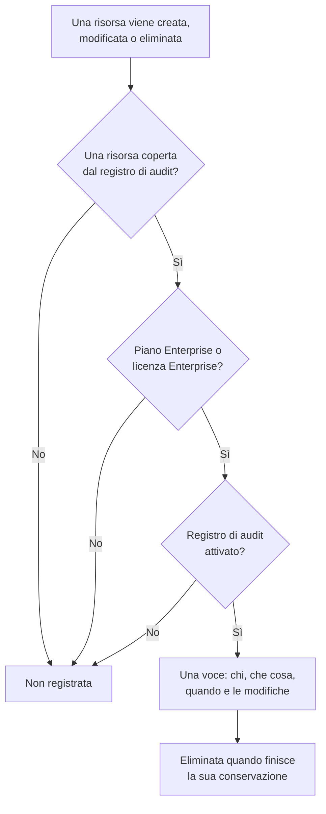

# Registri di audit

Il registro di audit annota chi ha cambiato che cosa nel tuo progetto: ogni creazione, modifica ed eliminazione delle risorse che copre, con i valori prima e dopo. Usalo per scoprire chi ha disattivato un monitor o cambiato una chiave API, e per conservare una traccia per le verifiche di conformità. Fa parte del piano Enterprise su OneUptime Cloud, e dell'Enterprise Edition quando ospiti OneUptime in proprio.

:::cards
- [Attivare il registro di audit](#attivare-il-registro-di-audit): All'inizio è disattivato in ogni progetto.
- [Leggere il registro di audit](#leggere-il-registro-di-audit): Chi ha cambiato che cosa, e quando.
- [Che cosa viene registrato](#che-cosa-viene-registrato): Le risorse e le azioni che copre.
- [Per quanto tempo restano le voci](#per-quanto-tempo-restano-le-voci): Da 7 a 180 giorni.
:::

## Come una modifica diventa una voce

- **All'inizio è disattivato.** Un progetto non registra nulla finché qualcuno non attiva il registro di audit, e nulla di prima di quel momento.
- **Registra ciò che fanno le persone.** Una modifica fatta da una persona, una chiave API, un client MCP o un workflow viene registrata. Una modifica che OneUptime fa da solo, come quella di un'attività in background, resta fuori a meno che tu non attivi **Memorizza eventi di sistema**.
- **Le voci non si possono modificare.** Nessuno può modificare o eliminare una voce, né dalla dashboard né tramite l'API. Una voce se ne va solo quando finisce la sua conservazione.

## Prima di iniziare

- **Su OneUptime Cloud, il piano Enterprise.** Con gli altri piani, le pagine del registro di audit mostrano che cosa fa la funzionalità e come ottenerla.
- **Quando ospiti OneUptime in proprio, l'Enterprise Edition**, con una licenza che includa i registri di audit. Vedi [Edizione Enterprise](/docs/self-hosted/enterprise).
- **Un ruolo che può leggere il registro di audit.** Project Owner, Project Admin, Settings Admin o l'autorizzazione **Read Audit Log**. Per attivare il registro di audit e cambiarne le impostazioni serve un Project Owner, un Project Admin o il permesso di modificare il progetto.

## Attivare il registro di audit

:::steps
### Aprire le impostazioni del registro di audit

Vai a **Impostazioni del progetto → Registri di audit → Impostazioni**. **Registri di audit** è chiuso all'inizio nel menu laterale: fai clic per aprirlo.

### Modificare le impostazioni

Fai clic su **Edit Audit Log Settings**.

### Attivarlo

Attiva **Abilita log di controllo**, imposta **Conservazione (giorni)** e scegli se **Memorizza eventi di sistema**. Fai clic su **Salva modifiche**.
:::

| Impostazione | Valore iniziale | Che cosa fa |
| --- | --- | --- |
| **Abilita log di controllo** | Disattivato | Registra da adesso le modifiche alle risorse del progetto. |
| **Conservazione (giorni)** | 7 | Per quanti giorni resta ogni voce: da 7 a 180. |
| **Memorizza eventi di sistema** | Disattivato | Registra anche le modifiche che OneUptime fa da solo, avviate da nessuna persona e da nessuna chiave. |

Una modifica di queste impostazioni vale entro un minuto.

## Leggere il registro di audit

**Impostazioni del progetto → Registri di audit → Registri di audit** elenca ogni voce del progetto, le più recenti per prime:

| Colonna | Che cosa mostra |
| --- | --- |
| **Quando** | Quanto tempo fa, con data e ora. |
| **Azione** | `Create`, `Update` o `Delete`, oppure `Download` per un file di cattura dei pacchetti che qualcuno ha scaricato. |
| **Risorsa** | Il nome della risorsa, che la apre finché esiste, e il suo tipo. |
| **Attore** | Chi ha fatto la modifica: una persona, una chiave API, un workflow, oppure `System` per una modifica che OneUptime ha fatto da solo. La modifica di una persona fatta tramite un client MCP indica quale. |
| **Modifiche** | Quanti campi sono cambiati, o sono stati acquisiti in una creazione o un'eliminazione. Fai clic per vedere ogni campo. |

Filtra per **Tipo di risorsa**, **Nome della risorsa**, **Azione**, **Email utente** o **Ora**. Una modifica elenca solo i campi cambiati, prima e dopo, e un salvataggio che non cambia nulla non aggiunge alcuna voce.

Monitor, incidenti, avvisi, pagine di stato, SLO e molte altre risorse hanno anche una propria pagina **Registri di audit**, in una sezione chiusa del loro menu laterale come **Avanzato**. Elenca solo le voci di quella risorsa, con quelle di ciò che le appartiene: la pagina di uno SLO mostra anche le sue regole e i suoi proprietari.

## Che cosa viene registrato

| Risorsa | **Tipo di risorsa** nel registro |
| --- | --- |
| Monitor | `Monitor` |
| Incidenti | `Incident` |
| Avvisi | `Alert` |
| Pagine di stato | `Status Page` |
| Eventi di manutenzione pianificata | `Scheduled Maintenance Event` |
| Criteri di reperibilità | `On-Call Policy` |
| SLO | `Service Level Objective` |
| Le regole e i proprietari di uno SLO | `SLO Burn Rate Rule`, `SLO Monitor Rule`, `Service Level Objective User Owner`, `Service Level Objective Team Owner` |
| Team | `Team` |
| Ruoli personalizzati, e i team e le chiavi API che ne ricevono uno | `Custom Role`, `Team Custom Role`, `API Key Custom Role` |
| Etichette | `Label` |
| Stati e gravità degli incidenti | `Incident State`, `Incident Severity` |
| Stati e gravità degli avvisi | `Alert State`, `Alert Severity` |
| Stati del monitor | `Monitor Status` |
| Stati della manutenzione programmata | `Scheduled Maintenance State` |
| Ruoli incidente | `Incident Role` |
| Stati del post-mortem | `Postmortem Status` |
| Chiavi API | `API Key` |
| Client MCP che le persone collegano | `MCP Client Authorization` |
| Elementi dell'inventario | `Inventory Item` |
| Configurazioni del collector | `Collector Config` |
| vCenter | `vCenter` |
| Catture dei pacchetti, e i loro download | `Packet Capture` |
| Casi di sicurezza con le loro priorità e i loro stati, playbook e le loro esecuzioni, ed entità protette | `Security Case`, `Security Case Priority`, `Security Case Status`, `Security Playbook`, `Security Playbook Run`, `Protected Entity` |
| Esportazioni del registro di audit | `Audit Log Export` |

Viene registrato anche quando un amministratore aggiunge o rimuove un metodo di notifica o una regola di reperibilità personale sull'account di un'altra persona, senza l'indirizzo o il numero stesso.

Altri dati non sono nel registro di audit, come chi fa parte di un team o un permesso aggiunto da solo a un team. I campi che nessuno può leggere sono esclusi da ogni voce, e chiavi, token e password vengono registrati come `[REDACTED]`: la voce mostra che sono cambiati, mai il loro valore.

## Per quanto tempo restano le voci

Ogni voce resta per la **Conservazione (giorni)** che il progetto aveva quando è stata registrata, poi viene eliminata. Una nuova conservazione vale per le nuove voci: quelle già registrate mantengono le loro date.

Per conservare le voci oltre 180 giorni, inviale man mano che vengono registrate al tuo storage o SIEM: vedi [Esportazione del registro di audit](/docs/configuration/audit-log-export). Puoi anche leggerle tramite l'API con una chiave API che abbia **Read Audit Log** e salvarle dove ti servono. Vedi [Riferimento API OneUptime](/docs/api-reference/api-reference).

## Quando il piano o la licenza non include più i registri di audit

- **Su OneUptime Cloud**, un progetto che lascia il piano Enterprise smette di registrare, e le sue pagine del registro di audit mostrano la scheda di upgrade finché non torna a quel piano.
- **Quando ospiti OneUptime in proprio**, il registro di audit smette di registrare quando la prova Enterprise o il periodo di tolleranza finisce senza licenza, o quando la licenza non include i registri di audit. Il registro di audit lo segnala in rosso. Le voci già registrate restano, e la registrazione riprende con le stesse impostazioni appena viene attivata una licenza. Vedi [Quando una licenza scade o manca](/docs/self-hosted/enterprise#quando-una-licenza-scade-o-manca).

## Risoluzione dei problemi

:::details Il registro di audit è vuoto
Il registro di audit è disattivato all'inizio e non registra nulla di prima della sua attivazione. Se l'elenco dice che il registro di audit è disattivato, segui il suo link alle impostazioni e attivalo. Altrimenti, modifica un monitor o un incidente e aggiorna l'elenco.
:::

:::details Una modifica manca nel registro di audit
Controlla che la risorsa sia in [Che cosa viene registrato](#che-cosa-viene-registrato), e che la modifica sia stata fatta dopo l'attivazione del registro di audit. Una modifica che OneUptime ha fatto da solo viene registrata solo con **Memorizza eventi di sistema** attivo.
:::

## Passi successivi

:::cards
- [Esportazione del registro di audit](/docs/configuration/audit-log-export): Inviare il registro di audit al proprio storage o SIEM.
- [Utenti, team e autorizzazioni](/docs/permissions/index): Decidere chi può leggere il registro di audit.
- [Impostazioni del progetto](/docs/configuration/project-settings): Le altre impostazioni del progetto.
- [Fatturazione e utilizzo](/docs/configuration/billing): Cambiare il piano del progetto.
- [Edizione Enterprise](/docs/self-hosted/enterprise): I registri di audit in un'installazione self-hosted.
:::
