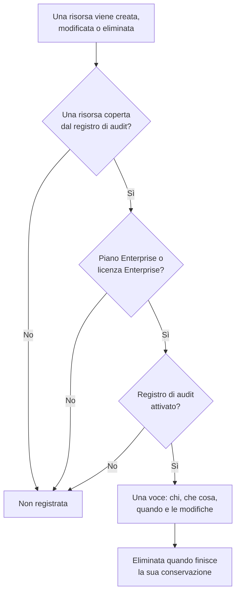

# Registri di audit

Il registro di audit annota chi ha cambiato che cosa nel tuo progetto: ogni creazione, modifica ed eliminazione delle risorse che copre, con i valori prima e dopo, e ogni volta che qualcuno accede o si disconnette. Usalo per scoprire chi ha disattivato un monitor o cambiato una chiave API, chi ha effettuato l'accesso e da dove, e per conservare una traccia per le verifiche di conformità. Fa parte del piano Enterprise su OneUptime Cloud, e dell'Enterprise Edition quando ospiti OneUptime in proprio.

:::cards
- [Attivare il registro di audit](#attivare-il-registro-di-audit): All'inizio è disattivato in ogni progetto.
- [Leggere il registro di audit](#leggere-il-registro-di-audit): Chi ha cambiato che cosa, e quando.
- [Che cosa viene registrato](#che-cosa-viene-registrato): Le risorse e le azioni che copre.
- [Accessi e sessioni](#accessi-e-sessioni): Chi ha effettuato l'accesso, e come è finita ogni sessione.
- [Per quanto tempo restano le voci](#per-quanto-tempo-restano-le-voci): Da 7 a 180 giorni.
:::

## Come una modifica diventa una voce

- **All'inizio è disattivato.** Un progetto non registra nulla finché qualcuno non attiva il registro di audit, e nulla di prima di quel momento.
- **Registra ciò che fanno le persone.** Una modifica fatta da una persona, una chiave API, un client MCP o un workflow viene registrata. Una modifica che OneUptime fa da solo, come quella di un'attività in background, resta fuori a meno che tu non attivi **Memorizza eventi di sistema**.
- **Le voci non si possono modificare.** Nessuno può modificare o eliminare una voce, né dalla dashboard né tramite l'API. Una voce se ne va solo quando finisce la sua conservazione.

## Prima di iniziare

- **Su OneUptime Cloud, il piano Enterprise.** Con gli altri piani, le pagine del registro di audit mostrano che cosa fa la funzionalità e come ottenerla.
- **Quando ospiti OneUptime in proprio, l'Enterprise Edition**, con una licenza che includa i registri di audit. Vedi [Edizione Enterprise](/docs/self-hosted/enterprise).
- **Un ruolo che può leggere il registro di audit.** Project Owner, Project Admin, Settings Admin o l'autorizzazione **Read Audit Log**. Per attivare il registro di audit e cambiarne le impostazioni serve un Project Owner, un Project Admin o il permesso di modificare il progetto.

## Attivare il registro di audit

:::steps
### Aprire le impostazioni del registro di audit

Vai a **Impostazioni del progetto → Registri di audit → Impostazioni**. **Registri di audit** è chiuso all'inizio nel menu laterale: fai clic per aprirlo.

### Modificare le impostazioni

Fai clic su **Edit Audit Log Settings**.

### Attivarlo

Attiva **Abilita log di controllo**, imposta **Conservazione (giorni)** e scegli se **Memorizza eventi di sistema**. Fai clic su **Salva modifiche**.
:::

| Impostazione | Valore iniziale | Che cosa fa |
| --- | --- | --- |
| **Abilita log di controllo** | Disattivato | Registra da adesso le modifiche alle risorse del progetto. |
| **Conservazione (giorni)** | 7 | Per quanti giorni resta ogni voce: da 7 a 180. |
| **Memorizza eventi di sistema** | Disattivato | Registra anche le modifiche che OneUptime fa da solo, avviate da nessuna persona e da nessuna chiave. |

Una modifica di queste impostazioni vale entro un minuto.

## Leggere il registro di audit

**Impostazioni del progetto → Registri di audit → Registri di audit** elenca ogni voce del progetto, le più recenti per prime:

| Colonna | Che cosa mostra |
| --- | --- |
| **Quando** | Quanto tempo fa, con data e ora. |
| **Azione** | `Create`, `Update` o `Delete`, `Download` per un file di cattura dei pacchetti che qualcuno ha scaricato, oppure `Sign In`, `Sign Out`, `Session Timeout` o `Session Revoked` per una sessione. |
| **Risorsa** | Il nome della risorsa, che la apre finché esiste, e il suo tipo. |
| **Attore** | Chi ha fatto la modifica: una persona, una chiave API, un workflow, oppure `System` per una modifica che OneUptime ha fatto da solo. La modifica di una persona fatta tramite un client MCP indica quale. |
| **Modifiche** | Quanti campi sono cambiati, o sono stati acquisiti in una creazione o un'eliminazione. Per una sessione, come è stato fatto l'accesso o perché è finita. Fai clic per vedere ogni campo. |

Filtra per **Tipo di risorsa**, **Nome della risorsa**, **Azione**, **Email utente** o **Ora**. Una modifica elenca solo i campi cambiati, prima e dopo, e un salvataggio che non cambia nulla non aggiunge alcuna voce.

Una risorsa senza un nome proprio prende il nome da ciò che la nomina in OneUptime: un'eccezione dal suo tipo e dall'inizio del suo messaggio, con identificatori, indirizzi e tutto ciò che sembra un segreto mascherati, un'esecuzione di un runbook dal suo runbook, il numero di telefono di una politica chiamate in arrivo dal numero stesso, e un modello o un dominio dal proprio nome.

Monitor, incidenti, avvisi, pagine di stato, SLO e molte altre risorse hanno anche una propria pagina **Registri di audit**, in una sezione chiusa del loro menu laterale come **Avanzato**. Elenca solo le voci di quella risorsa, con quelle di ciò che le appartiene: la pagina di uno SLO mostra anche le sue regole e i suoi proprietari.

## Che cosa viene registrato

Viene registrato tutto ciò che le persone creano, modificano o eliminano in un progetto: monitor, incidenti, avvisi, pagine di stato, workflow e i loro passaggi, code, dashboard, criteri di reperibilità, team e chi ne fa parte, chiavi API e ogni impostazione. **Tipo di risorsa** indica di che cosa tratta una voce, per esempio `Monitor`, `Workflow` o `Queue`.

| Non registrato | Perché |
| --- | --- |
| Registri dei messaggi | Ognuno è già la traccia di un'email, un SMS, una chiamata, una notifica push o un messaggio di chat che OneUptime ha inviato o ricevuto. |
| Tracce delle esecuzioni | Ognuna è già la traccia di un'esecuzione di workflow, un'escalation di reperibilità, una scansione, un'importazione o un'esecuzione di IA. |
| Ciò che riportano agenti e telemetria | Le risorse scoperte, le letture e l'utilizzo cambiano a ogni rapporto, non perché qualcuno li abbia modificati. |
| Feed di attività | Un feed mostra modifiche che il registro di audit registra già. |
| Lo stato di lavoro di OneUptime | Sessioni dei lettori delle pagine di stato, job in coda e altri stati che OneUptime conserva mentre lavora. |
| La configurazione delle notifiche di una persona | Gli indirizzi, i numeri e le regole di reperibilità personali di ogni persona sono solo suoi. |
| Le preferenze di una persona | I prodotti che ogni persona fissa nella propria barra in alto sono solo suoi, e solo quella persona li vede. |

Viene registrato anche quando un amministratore aggiunge o rimuove un metodo di notifica o una regola di reperibilità personale sull'account di un'altra persona, senza l'indirizzo o il numero stesso.

I campi che scrive solo OneUptime, come quando un host è stato visto l'ultima volta, sono esclusi da ogni voce, così come i campi che nessuno può leggere. Quando OneUptime ne scrive uno perché qualcuno gliel'ha chiesto, come unire un'eccezione a un'altra o reimpostare l'URL di un webhook, la voce lo registra come una modifica di quella persona. Chiavi, token e password vengono registrati come `[REDACTED]`: la voce mostra che sono cambiati, mai il loro valore. I passaggi di un workflow vengono registrati come ciò che è cambiato, con i nomi delle impostazioni di un passaggio ma mai ciò che vi è stato scritto, e lo spostamento di un passaggio sull'area di lavoro non viene registrato.

Ciò che OneUptime fa perché qualcuno gliel'ha chiesto è registrato anch'esso come modifica di quella persona, che il progetto memorizzi o no gli eventi di sistema:

- Avviare, approvare, completare, saltare e annullare un'esecuzione di un runbook. I suoi passaggi sono registrati come ciò che è stato fatto a ciascuno, ad esempio `Approved "Restart the API" (step 3)`, mai con ciò che un passaggio ha stampato.
- Ciò che una regola cambia quando qualcuno la esegue: le etichette e i proprietari che aggiunge, i record che una regola di privacy rende privati, i dispositivi che una regola di assegnazione del sito sposta, i dispositivi e i monitor che una regola di importazione automatica crea, e ciò che una regola dei monitor di una pagina di stato o di uno SLO cambia nella sua pagina o nel suo SLO.
- Acquistare, associare e rilasciare il numero di telefono di una politica chiamate in arrivo.
- Risolvere un avviso sui dati che qualcuno segna come previsto o come non un problema.
- Reimpostare il link di un feed di calendario.
- I team a cui qualcuno si unisce accedendo con SSO.

Ciò che una regola fa da sé è una modifica di OneUptime stesso, registrata con **Memorizza eventi di sistema** attivo: le etichette e i proprietari che una regola aggiunge quando viene creato un record, e un record che rende privato in quel momento; i dispositivi e i monitor che una regola di importazione automatica crea da nuovi risultati di scansione; e ciò che una regola dei monitor di una pagina di stato o di uno SLO cambia quando si salva una regola, un monitor o un'etichetta.

La reimpostazione dell'agente IA di un host, di un cluster o di un account cloud è registrata nella pagina **Registri di audit** della risorsa stessa, come la modifica di `aiAgentResetAt` fatta da chi l'ha reimpostato: chi, e quando. Lo stesso vale per la creazione di una chiave per l'agente IA di un account cloud: le chiavi risultano modificate, mai con una chiave o un hash. Ciò che un agente segnala quando si connette e si fa sentire resta escluso, come prima.

## Accessi e sessioni

Ogni volta che un membro del progetto accede a OneUptime, il registro di audit lo annota, e di nuovo quando quella sessione finisce. Un accesso riguarda OneUptime, non un singolo progetto, quindi lo registra ogni progetto di cui la persona è membro.

| Azione | Quando viene registrata |
| --- | --- |
| `Sign In` | Qualcuno accede: con una password o un link di accesso, una passkey, Google, Microsoft, Vercel o il single sign-on. |
| `Sign Out` | La persona si disconnette. |
| `Session Timeout` | OneUptime chiude la sessione alla sua scadenza: il tempo di inattività o la durata della sessione impostati da un amministratore del server, oppure 30 giorni senza utilizzo. |
| `Session Revoked` | OneUptime chiude la sessione perché la password è cambiata, l'account è stato bloccato, oppure un amministratore del server ha reimpostato o reso obbligatoria l'autenticazione a due fattori. |

La **Risorsa** di una voce è la sessione, che prende il nome dal dispositivo da cui è stato fatto l'accesso, ad esempio `Chrome 130 on macOS`. Il suo **Attore** è la persona a cui appartiene la sessione, quindi filtrando per **Email utente** si trovano tutti i suoi accessi e tutte le sue sessioni. I suoi dettagli dicono come la persona ha effettuato l'accesso e con quale secondo fattore, l'indirizzo IP e la località, e, per una sessione finita, quando è stato fatto l'accesso, quando è stata usata l'ultima volta e quando è scaduta. Il provider SSO proprio di un progetto viene nominato solo nel registro di audit di quel progetto.

Accessi e sessioni vengono registrati che il progetto memorizzi o no gli eventi di sistema. Una durata della sessione o 30 giorni senza utilizzo vengono registrati entro pochi minuti dalla scadenza. Un tempo di inattività viene registrato quando la scheda aperta della persona o l'app mobile raggiunge di nuovo OneUptime.

## Per quanto tempo restano le voci

Ogni voce resta per la **Conservazione (giorni)** che il progetto aveva quando è stata registrata, poi viene eliminata. Una nuova conservazione vale per le nuove voci: quelle già registrate mantengono le loro date. Anche tramite l'API, una conservazione è un numero intero di giorni da 7 a 180: qualsiasi altro valore viene rifiutato.

Per conservare le voci oltre 180 giorni, inviale man mano che vengono registrate al tuo storage o SIEM: vedi [Esportazione del registro di audit](/docs/configuration/audit-log-export). Puoi anche leggerle tramite l'API con una chiave API che abbia **Read Audit Log** e salvarle dove ti servono. Vedi [Riferimento API OneUptime](/docs/api-reference/api-reference).

## Quando il piano o la licenza non include più i registri di audit

- **Su OneUptime Cloud**, un progetto che lascia il piano Enterprise smette di registrare, e le sue pagine del registro di audit mostrano la scheda di upgrade finché non torna a quel piano.
- **Quando ospiti OneUptime in proprio**, il registro di audit smette di registrare quando la prova Enterprise o il periodo di tolleranza finisce senza licenza, o quando la licenza non include i registri di audit. Il registro di audit lo segnala in rosso. Le voci già registrate restano, e la registrazione riprende con le stesse impostazioni appena viene attivata una licenza. Vedi [Quando una licenza scade o manca](/docs/self-hosted/enterprise#quando-una-licenza-scade-o-manca).

## Risoluzione dei problemi

:::details Il registro di audit è vuoto
Il registro di audit è disattivato all'inizio e non registra nulla di prima della sua attivazione. Se l'elenco dice che il registro di audit è disattivato, segui il suo link alle impostazioni e attivalo. Altrimenti, modifica un monitor o un incidente e aggiorna l'elenco.
:::

:::details Una modifica manca nel registro di audit
Controlla che la risorsa sia in [Che cosa viene registrato](#che-cosa-viene-registrato), e che la modifica sia stata fatta dopo l'attivazione del registro di audit. Una modifica che OneUptime ha fatto da solo viene registrata solo con **Memorizza eventi di sistema** attivo.
:::

## Passi successivi

:::cards
- [Esportazione del registro di audit](/docs/configuration/audit-log-export): Inviare il registro di audit al proprio storage o SIEM.
- [Utenti, team e autorizzazioni](/docs/permissions/index): Decidere chi può leggere il registro di audit.
- [Impostazioni del progetto](/docs/configuration/project-settings): Le altre impostazioni del progetto.
- [Fatturazione e utilizzo](/docs/configuration/billing): Cambiare il piano del progetto.
- [Edizione Enterprise](/docs/self-hosted/enterprise): I registri di audit in un'installazione self-hosted.
:::
