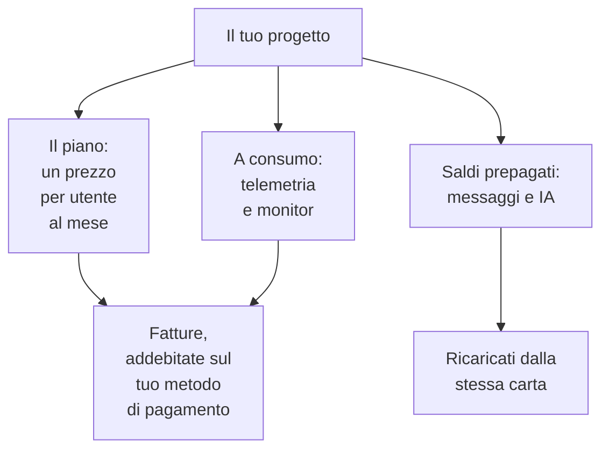

# Fatturazione e utilizzo

Su OneUptime Cloud, un progetto paga il suo piano, per utente, e ciò che usa: telemetria, monitor attivi, e i messaggi e il lavoro dell'IA che paga con saldi prepagati. Questa pagina mostra dove vedere e cambiare ciascuno, e chi può farlo. Un'installazione self-hosted non ha fatturazione, né nessuna di queste pagine.

:::cards
- [Il tuo piano e le postazioni](#il-tuo-piano-e-le-postazioni): Quanto costa il piano, e chi conta come postazione.
- [Metodi di pagamento](#metodi-di-pagamento): La carta su cui vengono addebitate le fatture.
- [Fatture](#fatture): Pagarle, scaricarle e controllare che cosa hai usato.
- [Saldi prepagati](#saldi-prepagati): Messaggi e IA, ricaricati a mano o in automatico.
:::

## Che cosa paga un progetto

| Cosa | Come viene addebitato |
| --- | --- |
| Il piano | Un prezzo per utente al mese, fatturato mensilmente o annualmente. Ogni persona del progetto è una postazione. |
| Telemetria | $0.10 per GB acquisito, con 15 giorni di conservazione. Una conservazione più lunga costa di più, e una conservazione inferiore a 7 giorni si paga come 7 giorni: vedi [Quanto costa la conservazione](/docs/telemetry/data-retention#quanto-costa-la-conservazione). |
| Session replay | $2 per GB, con 15 giorni di conservazione. |
| Monitor attivi | $1 per monitor al mese. Ogni monitor tranne uno manuale è attivo, anche quando è disattivato. |
| SMS, chiamate, WhatsApp e Telegram | Pagati con il saldo del progetto man mano che ogni messaggio viene inviato. |
| OneUptime AI | Pagata con i crediti IA del progetto, a meno che non giri sul tuo provider LLM. |

La [pagina dei prezzi](https://oneuptime.com/pricing) confronta i piani.

## Prima di iniziare

- **OneUptime Cloud.** La sezione **Fatturazione e fatture** delle **Impostazioni del progetto** esiste solo su OneUptime Cloud ed è chiusa all'inizio: fai clic sul suo titolo per aprirla.
- **Un ruolo che può leggere la fatturazione.** I Project Owner, chi ha **Manage Billing** e i tre ruoli di fatturazione leggono ogni pagina di fatturazione. Vedi [Chi può fare che cosa](#chi-può-fare-che-cosa).

## Il tuo piano e le postazioni

Vai a **Impostazioni del progetto → Fatturazione e fatture → Fatturazione**. La scheda **Piano attuale** mostra il piano del progetto e il suo prezzo per utente, e **Postazioni**: una per ogni persona del progetto.

Una persona conta come postazione dal momento in cui la inviti, prima ancora che accetti, finché non la rimuovi. Per cambiare il numero di postazioni, invita o rimuovi persone: vedi [Invitare persone](/docs/permissions/inviting-people).

## Cambiare il piano

:::steps
### Aggiungere prima un metodo di pagamento

Un cambio di piano richiede un metodo di pagamento. Senza, **Change Plan** apre invece **Add a Payment Method**: vedi [Metodi di pagamento](#metodi-di-pagamento).

### Fare clic su Change Plan

Nella scheda **Piano attuale**, fai clic su **Change Plan**. **Piano annuale** parte attivo: disattivalo per vedere i prezzi mensili.

### Scegliere il piano

Ogni piano mostra il suo prezzo per utente. La nota sotto i piani dice che cosa succede alla tua prova: **Your free trial carries over** finché il progetto è ancora in prova, e **Changing plan does not start a free trial** quando non lo è più.

### Salvare la modifica

Fai clic su **Salva modifiche**. Un piano a pagamento viene fatturato dal momento in cui passi a esso, e ogni persona che inviti con quel piano viene fatturata quando la inviti.
:::

Le chiavi API funzionano solo dal piano Growth in su, e sotto il piano Scale le connessioni SCIM si limitano a rimuovere persone. Un piano che le ferma dice quante prima che tu lo scelga, e la pagina **Fatturazione** mostra **Non incluso in questo piano** finché sono ferme. Non si elimina nulla: tornano a funzionare con un piano che le include.

> [!NOTE]
> Hai acquistato OneUptime tramite un rivenditore o un marketplace cloud (AWS Marketplace, Microsoft Marketplace, Google Cloud Marketplace o Vercel Marketplace)? La pagina **Fatturazione** lo dice. Un rivenditore cambia il piano per te, e un marketplace addebita il piano e l'utilizzo del progetto sulla tua fattura cloud.

## Metodi di pagamento

La scheda **Metodi di pagamento** elenca le carte del progetto. Le fatture vengono addebitate automaticamente su quella predefinita.

:::steps
### Fare clic su Aggiungi metodo di pagamento

Nella scheda **Metodi di pagamento**, fai clic su **Aggiungi metodo di pagamento**.

### Inserire la carta

Inserisci i dati di pagamento e fai clic su **Save payment method**. Il metodo che aggiungi diventa quello predefinito, e aggiungerne uno attiva l'utilizzo a consumo. Non cambia il tuo piano.
:::

- **Imposta come predefinito** rende un altro metodo dell'elenco quello su cui vengono addebitate le fatture.
- **Re-sync Autopay**, sul metodo predefinito, corregge un rinnovo che addebita ancora una carta vecchia.
- Il progetto tiene sempre almeno un metodo di pagamento: aggiungine un altro prima di eliminare l'ultimo.

## Indirizzo di fatturazione ed email delle fatture

La scheda **Dettagli aziendali / Indirizzo di fatturazione** contiene ciò che le tue fatture dicono di te. Fai clic su **Aggiorna** e compila due passaggi:

| Passaggio | Campi |
| --- | --- |
| **Indirizzo di fatturazione** | **Dettagli aziendali / Indirizzo di fatturazione**: la ragione sociale dell'azienda, l'indirizzo e la partita IVA o il codice fiscale. **Paese**: il tuo paese di fatturazione. |
| **Fatture** | **Email amministrazione / contabilità**: dove vanno fatture, ricevute e avvisi di fatturazione, più indirizzi separati da virgole. **Invia le fatture via email**: inviare lì ogni fattura appena viene emessa. |

## Fatture

**Impostazioni del progetto → Fatturazione e fatture → Fatture** elenca le fatture del progetto, ognuna con **Numero della fattura**, **Data della fattura**, **Importo** e **Stato della fattura**.

- **Paga la fattura** paga una fattura ancora da saldare.
- **Scarica** apre la fattura in PDF. Su una fattura ancora da saldare, si trova nel menu **⋯** della riga.

Quando la tua banca sta ancora elaborando un pagamento, OneUptime lo segnala: alcune banche impiegano fino a 2 giorni per confermare un pagamento con carta, e la fattura si aggiorna da sola. Non pagarla di nuovo.

## Cronologia utilizzo

**Impostazioni del progetto → Fatturazione e fatture → Cronologia utilizzo** mostra la telemetria inviata dal progetto, una riga per prodotto, servizio e giorno:

| Colonna | Che cosa mostra |
| --- | --- |
| **Prodotto** | Log, tracce, metriche e gli altri tipi di telemetria. |
| **Giorno** | Il giorno dell'invio. |
| **Servizio** | Il servizio, oppure l'host, il cluster o l'altra risorsa, che l'ha inviata. |
| **Dati acquisiti (in GB)** | Quanto è arrivato. |
| **Conservazione dei dati (in giorni)** | Per quanto tempo viene conservata. |
| **Costo totale** | Quanto è costata, in dollari statunitensi. |

L'utilizzo di un giorno compare quando il giorno è finito. Filtra per **Prodotto**, **Giorno** o **Servizio** per trovare che cosa è cresciuto.

## Saldi prepagati

I messaggi SMS, le chiamate, WhatsApp e Telegram si pagano con il saldo del progetto, e OneUptime AI con i suoi crediti IA. Li ricarichi entrambi in anticipo:

| Saldo | Dove |
| --- | --- |
| SMS, chiamate, WhatsApp e Telegram | **Impostazioni del progetto → Notifiche → Impostazioni notifiche** |
| OneUptime AI | **Impostazioni del progetto → IA → Crediti IA** |

:::steps
### Ricaricarlo subito

Nella scheda **Saldo attuale** della pagina, fai clic su **Ricarica saldo**. Inserisci un importo da $20 a $1,000 e fai clic su **Ricarica**. L'importo viene addebitato sulla carta del progetto.

### Oppure lasciarlo ricaricare da solo

Nella scheda **Ricarica automatica**, fai clic su **Modifica: Ricarica automatica** e attiva **Abilita ricarica automatica**. All'inizio è disattivata. Una volta attiva, OneUptime aggiunge $20 ogni volta che il saldo scende a $10, oppure gli importi che scegli.
:::

Quando un saldo non basta, il messaggio non viene inviato oppure OneUptime AI si ferma, e i proprietari del progetto ricevono un'email. Vedi [Quando una chiamata non viene inviata](/docs/on-call/escalation-rules#quando-un-avviso-non-viene-inviato) e [Quando i crediti IA finiscono](/docs/ai/ai-sre#quando-i-crediti-ia-si-esauriscono).

## Chi può fare che cosa

| Per | Serve |
| --- | --- |
| Leggere le pagine di fatturazione: il piano, le fatture, l'utilizzo, i saldi e i metodi di pagamento | Project Owner, **Manage Billing**, **Amministratore della fatturazione**, **Membro della fatturazione** o **Visualizzatore della fatturazione** |
| Scaricare una fattura | Project Owner, Project Admin, **Manage Billing**, **Read Invoices**, **Amministratore della fatturazione** o **Membro della fatturazione** |
| Cambiare l'indirizzo di fatturazione e l'email delle fatture | Project Owner, **Manage Billing**, **Amministratore della fatturazione** o **Membro della fatturazione** |
| Attivare o disattivare SMS, chiamate, WhatsApp o Telegram | Project Owner, **Manage Billing** o **Amministratore della fatturazione** |
| Aggiungere un metodo di pagamento | Project Owner, **Manage Billing** o **Create Payment Method** |
| Pagare una fattura | Project Owner, **Manage Billing** o **Edit Invoices** |
| Cambiare il piano, ricaricare un saldo o cambiare la ricarica automatica | Project Owner o **Manage Billing** |

Un pulsante che non puoi usare appare bloccato e dice chi può. Vedi [Utenti, team e autorizzazioni](/docs/permissions/index#team) per i ruoli di fatturazione.

## Impostazioni che richiedono un piano

Su OneUptime Cloud, queste impostazioni di amministrazione richiedono un piano. Una pagina di cui non hai il piano mostra che cosa fa la funzionalità e il piano che le serve.

| Impostazione | Il piano che richiede |
| --- | --- |
| Etichette | Growth |
| Chiavi API | Growth |
| I tuoi server SMTP e account Twilio | Growth |
| I tuoi provider LLM | Growth |
| Collegare client MCP | Growth |
| Creare team | Scale |
| SSO, OIDC e SCIM | Scale |
| Override della conservazione | Scale |
| Registri di audit | Enterprise |

## Disdire il piano

Per smettere di pagare un progetto, eliminalo: la fatturazione si ferma quando viene eliminato. Vedi [Eliminare il progetto](/docs/configuration/project-settings#eliminare-il-progetto). Un progetto acquistato tramite un rivenditore si disdice con il rivenditore, e uno acquistato tramite un marketplace cloud sul marketplace.

## Risoluzione dei problemi

:::details "Add a payment method in Project Settings > Billing and Invoices > Billing before using paid monitoring or telemetry"
Un progetto con il piano Free ha bisogno di un metodo di pagamento prima di creare monitor attivi o inviare telemetria, perché si pagano a consumo. Aggiungine uno in [Metodi di pagamento](#metodi-di-pagamento). I monitor manuali restano gratuiti.
:::

:::details Un banner rosso dice che ci sono fatture non pagate
Un progetto con fatture non pagate diventa inattivo, e viene eliminato se restano non pagate. Apri **Fatture** e fai clic su **Paga la fattura** su ognuna ancora da saldare.
:::

:::details Change Plan apre Add a Payment Method
Il progetto non ha ancora un metodo di pagamento. Aggiungine uno, poi cambia il piano.
:::

:::details La cronologia utilizzo è vuota
L'utilizzo si conta per giorno, e un giorno compare quando è finito. Un progetto che non ha inviato telemetria non ha righe.
:::

## Passi successivi

:::cards
- [Impostazioni del progetto](/docs/configuration/project-settings): Tutto il resto che vale per l'intero progetto.
- [Invitare persone](/docs/permissions/inviting-people): Aggiungere le persone per cui sono le tue postazioni.
- [Conservazione dei dati](/docs/telemetry/data-retention): Conservare la telemetria per il tempo necessario, e non oltre.
- [Filtri di scarto e regole di mascheramento](/docs/telemetry/drop-filters-and-scrub-rules): Smettere di pagare la telemetria che non usi.
:::
