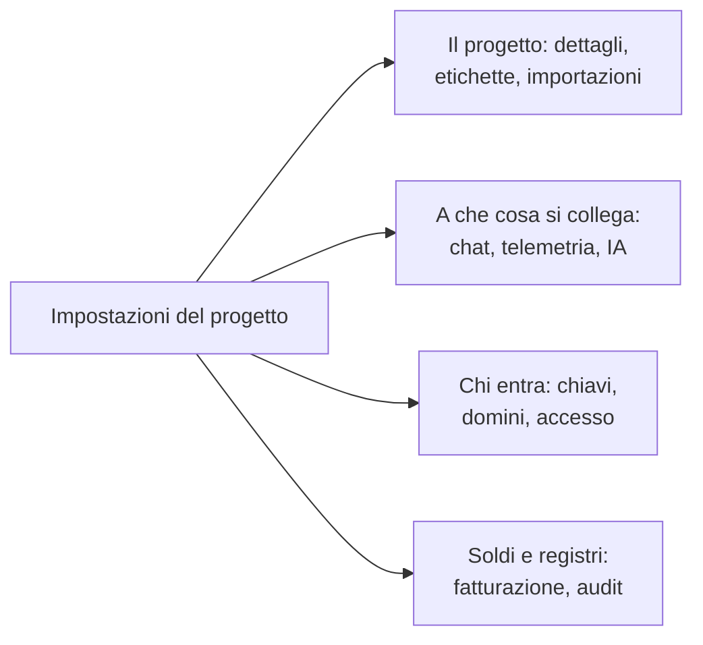

# Impostazioni del progetto

Le impostazioni del progetto raccolgono ciò che vale per l'intero progetto: il nome, gli strumenti a cui si collega, le chiavi, come accedono le persone, la fatturazione e la traccia di audit. Quasi tutto lo configuri una volta e ci torni di rado. Questa pagina ne è una mappa e copre le impostazioni senza una pagina propria: i dettagli del progetto, le etichette, i flag delle funzionalità e l'eliminazione del progetto.

:::cards
- [Trovare un'impostazione](#trovare-unimpostazione): Che cosa contiene ogni sezione del menu laterale.
- [I dettagli del progetto](#i-dettagli-del-progetto): Il nome, l'ID e l'accesso del supporto.
- [Etichette](#etichette): Contrassegni per risorse, autorizzazioni e regole.
- [Eliminare il progetto](#eliminare-il-progetto): Che cosa serve, e che cosa se ne va con lui.
:::

## Aprire le impostazioni del progetto

Vai a **Prodotti → Impostazioni → Impostazioni del progetto**. Il menu laterale raggruppa le pagine in sezioni, e solo **Base** è aperta all'inizio: fai clic sul titolo di una sezione per aprirla. Una sezione si apre da sola su qualsiasi sua pagina.

## Prima di iniziare

- **Un ruolo che può modificare il progetto.** I Project Owner e i Project Admin modificano la maggior parte di queste impostazioni. Fatturazione, canali di notifica ed eliminazione del progetto richiedono di più, come dice ogni sezione.
- **Su OneUptime Cloud, il piano che include un'impostazione.** Alcune impostazioni richiedono un piano: vedi [Impostazioni che richiedono un piano](/docs/configuration/billing#impostazioni-che-richiedono-un-piano).

## Trovare un'impostazione

| Sezione | Pagine | Dove leggere di più |
| --- | --- | --- |
| **Base** | **Progetto**, **Etichette** | [I dettagli del progetto](#i-dettagli-del-progetto), [Etichette](#etichette) |
| **Area di lavoro** | **Slack**, **Microsoft Teams**, **Video Calls** | [Slack](/docs/workspace-connections/slack), [Microsoft Teams](/docs/workspace-connections/microsoft-teams), [Videochiamate](/docs/workspace-connections/video-calls) |
| **Telemetria e APM** | **Chiavi di acquisizione**, **Conservazione dei dati** | [Chiavi di acquisizione](/docs/telemetry/ingestion-keys), [Conservazione dei dati](/docs/telemetry/data-retention) |
| **Notifiche** | **Impostazioni notifiche**, **Registri di notifica**, **App mobili** | [Notifiche](#notifiche) |
| **IA** | **AI Features**, **Provider LLM**, **Server MCP esterni**, **Crediti IA**, **Registri IA**, **Server MCP** | [Provider LLM](/docs/ai/llm-provider), [Server MCP esterni](/docs/ai/external-mcp-servers), [Server MCP](/docs/ai/mcp-server), [AI SRE](/docs/ai/ai-sre#controllo-dei-costi) |
| **Avanzato** | **Domini**, **Chiavi API**, **Flag delle funzionalità**, **Importa da un altro strumento** | [Domini personalizzati](/docs/status-pages/branding-and-domains#domini-personalizzati), [Chiavi API](/docs/permissions/index#chiavi-api), [Flag delle funzionalità](#flag-delle-funzionalità), [Migrare da Opsgenie](/docs/moving-to-oneuptime/opsgenie) e le altre guide alla migrazione |
| **Sicurezza** | **SSO**, **SCIM** | [SSO](/docs/identity/sso), [SCIM](/docs/identity/scim) |
| **Fatturazione e fatture** | **Fatturazione**, **Cronologia utilizzo**, **Fatture** | [Fatturazione e utilizzo](/docs/configuration/billing) |
| **Registri di audit** | **Registri di audit**, **Impostazioni**, **Esporta** | [Registri di audit](/docs/configuration/audit-logs), [Esportazione del registro di audit](/docs/configuration/audit-log-export) |
| **Zona pericolosa** | **Zona pericolosa** | [Eliminare il progetto](#eliminare-il-progetto) |

**Fatturazione e fatture** e **Crediti IA** esistono solo su OneUptime Cloud: un'installazione self-hosted non ha fatturazione.

## I dettagli del progetto

**Impostazioni del progetto → Base → Progetto** contiene due schede.

**Dettagli del progetto** mostra il nome del progetto e il suo ID:

- **Nome del progetto**: fai clic su **Modifica: Progetto** per rinominare il progetto. Un nome ha almeno 2 caratteri. Per rinominarlo serve un Project Owner, oppure il permesso di modificare il progetto o di gestire la fatturazione.
- **ID Progetto**: copialo per l'API, la CLI e Terraform, o quando scrivi al supporto.
- **Data Residency**: su OneUptime Cloud, dove devono stare i dati del tuo progetto, quando OneUptime lo ha registrato. Solo OneUptime lo imposta.

**Accesso dell'assistenza clienti**, su OneUptime Cloud, decide se il team di supporto di OneUptime può aprire il progetto. Attiva **Consenti al supporto di OneUptime di accedere a questo progetto** quando vuoi il suo aiuto: OneUptime chiede prima, perché il supporto potrà vedere e modificare tutto nel progetto, e tu fai clic su **Fai entrare il supporto**. Disattivalo quando ha finito: viene salvato subito. I Project Owner e i Project Admin lo modificano.

## Etichette

Le etichette sono contrassegni che metti su monitor, incidenti, pagine di stato e altre risorse. Filtrano e raggruppano gli elenchi, e limitano fin dove arrivano i permessi di un team e le regole del progetto.

:::steps
### Aprire le etichette

Vai a **Impostazioni del progetto → Base → Etichette**.

### Creare un'etichetta

Fai clic su **Crea: Etichetta**. Dalle un **Nome** e, se vuoi, una **Descrizione**. **Colore etichetta** è già scelto, un colore che nessuna etichetta della pagina usa ancora: scegline un altro se preferisci. Fai clic su **Crea: Etichetta** per salvarla.
:::

Su OneUptime Cloud, creare e modificare etichette richiede il piano Growth. Vedi [Etichette](/docs/permissions/index#etichette) per come le etichette limitano i permessi, e [Regole per etichette e proprietari](/docs/configuration/label-and-owner-rules) per etichettare le risorse quando vengono create.

In un elenco, le etichette di un record sono mostrate una sotto l'altra; quando sono più di quattro, compaiono le prime tre con un link alle altre. Ovunque le etichette siano elencate (negli elenchi, nella pagina di un record e in ogni selettore di etichette), sono in ordine naturale: prima le etichette il cui nome inizia con un numero, nell'ordine di quel numero (`2. Team` prima di `10. Owner`), poi le altre in ordine alfabetico, senza distinguere maiuscole e minuscole. Per scegliere l'ordine delle tue etichette, fai iniziare il loro nome con un numero, come `1. Category` e `2. Subcategory`.

### Archiviare un'etichetta

Per ritirare un'etichetta, archiviala dal menu **⋯** della sua riga invece di eliminarla. Tutto ciò che ha l'etichetta la mantiene e puoi ancora filtrare in base a essa, ma nessuno può più aggiungerla a nulla: ogni selettore di etichette la esclude, e l'API, Terraform e MCP la rifiutano. La finestra di dialogo elenca le regole e le autorizzazioni configurate per usare l'etichetta, che continuano a usarla finché non le modifichi. Le etichette archiviate sono elencate a parte, nella sezione compressa **Etichette archiviate**, dove **Annulla archiviazione** ne ripristina una. **Elimina** elenca prima tutto ciò da cui l'etichetta verrebbe rimossa, e offre **Archivia invece**.

## Notifiche

**Impostazioni del progetto → Notifiche** raccoglie il modo in cui il progetto invia le notifiche:

- **Impostazioni notifiche**: la scheda **Canali di notifica** attiva o disattiva SMS, chiamate telefoniche, WhatsApp e Telegram per il progetto. Tutti e quattro partono disattivati. Li attiva un Project Owner, un **Amministratore della fatturazione** o chi ha **Manage Billing**. La pagina contiene anche i server di posta del progetto, in **Configurazioni SMTP personalizzate** (vedi [SMTP](/docs/emails/smtp)), e il suo account Twilio (vedi [Integrazione Twilio](/docs/self-hosted/twilio-integration)). Su OneUptime Cloud contiene il saldo con cui si pagano questi messaggi: vedi [Saldi prepagati](/docs/configuration/billing#saldi-prepagati).
- **Registri di notifica**: ogni notifica inviata dal progetto, con una scheda per canale: **E-mail**, **SMS**, **WhatsApp**, **Telegram**, **Webhook**, **Chiamata**, **Push** e **Area di lavoro**.
- **App mobili**: dove trovare le app per iOS e Android. Vedi [Panoramica delle app](/docs/mobile-desktop-apps/index).

## Flag delle funzionalità

**Impostazioni del progetto → Avanzato → Flag delle funzionalità** attiva o disattiva funzionalità facoltative per il progetto. Ognuna è un interruttore che si salva quando lo sposti. Oggi contiene **Gruppi di monitor**, disattivato in un nuovo progetto: attivalo per aggiungere i gruppi di monitor al menu Monitor. Disattivarlo non elimina nessun gruppo. Vedi [Gruppi di monitor](/docs/monitor/monitor-groups).

## Eliminare il progetto

Eliminare un progetto elimina tutto ciò che contiene, per ogni membro: monitor, incidenti, pagine di stato, configurazione della reperibilità e telemetria. Niente lo riporta indietro.

:::steps
### Aprire la zona pericolosa

Vai a **Impostazioni del progetto → Zona pericolosa**.

### Fare clic su Elimina: Progetto

Fai clic su **Elimina: Progetto**. Una finestra chiede di confermare.

### Scrivere il nome del progetto

Scrivi il nome esattamente com'è. **Elimina: Progetto** resta bloccato finché non lo fai. Su OneUptime Cloud, la finestra chiede anche perché te ne vai: la risposta è facoltativa.

### Confermare

Fai clic su **Elimina: Progetto**. OneUptime elimina il progetto e ti fa uscire.
:::

> [!CAUTION]
> L'eliminazione del progetto non si può annullare. Serve un Project Owner, oppure il permesso di eliminare il progetto.

Su OneUptime Cloud, eliminare il progetto è il modo per disdire il suo piano: la fatturazione si ferma quando il progetto viene eliminato. Un progetto fatturato tramite un marketplace cloud riceve un ultimo addebito per il suo utilizzo, e il suo acquisto sul marketplace resta attivo finché non lo disdici lì.

## Risoluzione dei problemi

:::details Sembra mancare una sezione del menu laterale
Tutte le sezioni tranne **Base** sono chiuse all'inizio. Fai clic sul titolo della sezione per aprirla. In un'installazione self-hosted non c'è la sezione **Fatturazione e fatture** né la pagina **Crediti IA**.
:::

:::details Modifica: Progetto è bloccato
Per rinominare il progetto serve un Project Owner, oppure il permesso di modificare il progetto o di gestire la fatturazione. Il pulsante bloccato indica il permesso che ti serve.
:::

:::details Elimina: Progetto resta bloccato nella finestra
Scrivi il nome del progetto esattamente come lo mostra la finestra: maiuscole e minuscole contano.
:::

## Passi successivi

:::cards
- [Invitare persone](/docs/permissions/inviting-people): Portare il tuo team nel progetto.
- [Fatturazione e utilizzo](/docs/configuration/billing): Il tuo piano, i metodi di pagamento, le fatture e l'utilizzo.
- [Registri di audit](/docs/configuration/audit-logs): Vedere chi ha cambiato che cosa nel progetto.
- [SSO](/docs/identity/sso): Far accedere le persone con il tuo provider di identità.
:::
