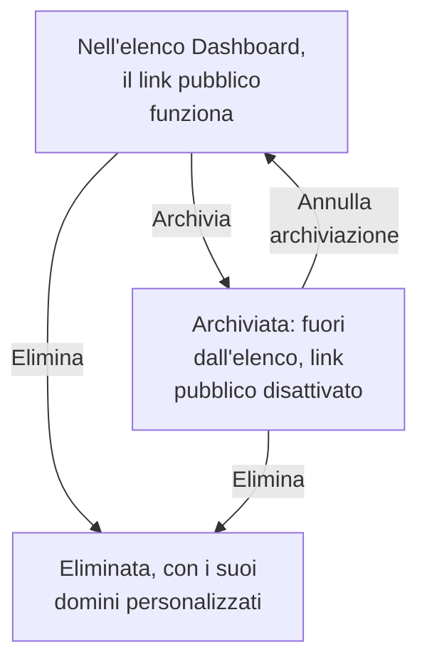

# Configurazione e permessi della dashboard

Quando hai una dashboard che vale la pena tenere, questa pagina spiega chi può leggerla e modificarla, come i proprietari e le etichette organizzano le tue dashboard, e come copiarne, esportarne, archiviarne ed eliminarne una.

:::cards
- [Chi può fare cosa](#chi-può-fare-cosa): Le autorizzazioni dietro ogni azione, e chi le ha.
- [Proprietari](#proprietari): Gli utenti e i team a cui appartiene una dashboard.
- [Duplicare una dashboard](#duplicare-una-dashboard): Una copia sicura, numerata per te.
- [Archiviare una dashboard](#archiviare-una-dashboard): Mettere via una dashboard senza eliminarla.
:::

## Chi può fare cosa

Le dashboard seguono le [autorizzazioni](/docs/permissions/index) del tuo progetto. Ogni azione richiede una di queste, ottenuta tramite un team:

| Per | Serve |
| --- | --- |
| Leggere le dashboard | `ReadDashboard`, oppure un ruolo del progetto: Project Owner, Project Admin, Project Member, Viewer o un ruolo Settings |
| Creare dashboard | `CreateDashboard`, Project Owner o Project Admin |
| Modificare una dashboard: i suoi widget, le variabili, la condivisione, il branding, e archiviarla | `EditDashboard`, Project Owner o Project Admin |
| Eliminare una dashboard | `DeleteDashboard`, Project Owner o Project Admin |
| Aggiungere e rimuovere proprietari | Le autorizzazioni sui proprietari delle dashboard, Project Owner, Project Admin o Project Member |
| Aggiungere e modificare domini personalizzati | Le autorizzazioni sui domini delle dashboard, Project Owner, Project Admin, Project Member, Settings Admin o Settings Member |
| Creare regole del proprietario e regole delle etichette | Le autorizzazioni sulle regole, Project Owner o Project Admin |

Quindi un Project Member legge ogni dashboard, ma ha bisogno di `CreateDashboard` ed `EditDashboard` per costruirne. Lettura, modifica ed eliminazione possono ciascuna essere limitate alle dashboard che un team possiede, o alle dashboard che hanno certe etichette: vedi [Ambito: fin dove arriva un'autorizzazione concessa](/docs/permissions/index#ambito-fin-dove-arriva-unautorizzazione-concessa).

Assegnale nella pagina **Autorizzazioni** di un team: apri **Prodotti → Team** e scegli il team.

Chi può vedere una dashboard fuori dal progetto è una questione a parte, a cui risponde la sua pagina **Condivisione**: vedi [Accesso alle dashboard pubbliche](#accesso-alle-dashboard-pubbliche).

## Proprietari

I **proprietari** di una dashboard sono gli utenti e i team a cui appartiene. Aggiungili nella pagina **Proprietari** della dashboard, oppure seleziona più dashboard nell'elenco **Dashboard** e aggiungi proprietari a tutte insieme.

I proprietari restringono l'accesso quando lo chiedi: un'autorizzazione di team limitata alle dashboard che il team possiede raggiunge solo le dashboard che hanno come proprietario quel team, o la persona che agisce. La proprietà da sola non concede nulla.

L'elenco **Dashboard** mostra i proprietari di ogni dashboard, e il suo filtro **Proprietario** trova le dashboard possedute da una persona o da un team.

## Etichette

Le etichette sono tag per organizzare le dashboard. Aggiungile nella pagina **Panoramica** della dashboard, dove modifichi anche il nome e la descrizione, oppure a più dashboard alla volta dall'elenco **Dashboard**.

Schemi comuni:

- **Per team**: `team:platform`, `team:checkout`, `team:growth`.
- **Per ambiente**: `env:prod`, `env:staging`.
- **Per scopo**: `purpose:oncall`, `purpose:exec`, `purpose:investigation`.

Il filtro **Etichette** dell'elenco **Dashboard** è il modo più rapido per trovare una dashboard in un progetto che ne ha accumulate molte. Le etichette limitano anche le autorizzazioni: un'autorizzazione di team ristretta a certe etichette raggiunge solo le dashboard che ne hanno una.

## Regole del proprietario e delle etichette

Invece di aggiungere proprietari ed etichette a mano, lascia che lo facciano le regole. In **Impostazioni**, nel menu laterale di **Dashboard**, le **Regole del proprietario** aggiungono proprietari e le **Regole etichette** aggiungono etichette a ogni nuova dashboard che corrisponde: in base alle etichette che ha già, o a un modello nel suo nome o nella sua descrizione. [Regole per etichette e proprietari](/docs/configuration/label-and-owner-rules) spiega come corrispondono le regole, e come applicarne una alle dashboard che hai già.

## Accesso alle dashboard pubbliche

Chi può vedere una dashboard fuori dal progetto è un'unica scelta nella sua pagina **Condivisione** (anche **⋯ → Condividi** sulla dashboard stessa; vedi [Condivisione e dashboard pubbliche](/docs/dashboards/sharing)):

1. **Solo le persone di questo progetto** (l'impostazione predefinita): la dashboard non ha un link pubblico; il suo indirizzo pubblico mostra una pagina non trovata.
2. **Chiunque abbia il link**: chiunque abbia il link pubblico può vederla, senza accedere.
3. **Chiunque abbia il link e una password**: i visitatori inseriscono una password prima che compaia la dashboard.

In **Altre impostazioni** nella stessa pagina, la **Lista IP consentiti** (piano Scale) rifiuta le richieste al link pubblico da qualsiasi indirizzo IP che non vi compare. La configurazione pubblica più blindata è **Chiunque abbia il link e una password** con una lista di IP consentiti: utile per i portali dei partner in cui vuoi entrambi i livelli.

## Duplicare una dashboard

Per copiare una dashboard, aprila, vai alla sua pagina **Impostazioni** e fai clic su **Duplica: Dashboard**. Il nome della copia è già compilato per te: il nome della dashboard, numerato oltre i nomi che il progetto ha già ("Checkout API" viene copiata come "Checkout API 2", e una copia di quest'ultima come "Checkout API 3"). Cambialo se vuoi, conferma con **Duplica: Dashboard**, e la copia si apre. Ha i widget, le variabili, la descrizione e le etichette della dashboard. Il branding e i domini personalizzati restano all'originale, e la condivisione pubblica parte sempre disattivata, così decidi tu se attivarla.

È la mossa giusta quando vuoi derivare da un modello (come "la nostra dashboard di reperibilità") una copia per un servizio specifico.

## Esportare e importare

Una dashboard viaggia come JSON:

- **Esporta: Dashboard**, nella pagina **Impostazioni** della dashboard, la scarica come file JSON. Per esportarne più di una, selezionale nell'elenco **Dashboard** e scegli **Esporta JSON**.
- **Importa JSON**, sopra l'elenco **Dashboard**, crea dashboard da un file di questo tipo, in questo progetto o in un altro.

Un'esportazione contiene le impostazioni proprie della dashboard, tra cui i widget e le variabili. I proprietari e le etichette restano fuori, e per i widget che puntano a risorse di questo progetto, come uno SLO o una fonte di dati, può essere necessario sceglierle di nuovo in un altro progetto.

## Archiviare una dashboard

Archivia una dashboard che non usi più ma vuoi conservare. Una dashboard archiviata esce dall'elenco **Dashboard** e, se è pubblica, il suo link pubblico smette di funzionare: il suo URL e i suoi domini personalizzati rispondono "Dashboard not found". I suoi widget, le variabili, il branding, i domini e le impostazioni pubbliche vengono tutti conservati, quindi ripristinarla dall'archivio la riporta esattamente com'era, link pubblico compreso.

Per archiviare una dashboard, aprila, vai alla sua pagina **Impostazioni** e fai clic su **Archivia**. Per archiviarne più di una, selezionale nell'elenco **Dashboard** e scegli **Archivia**. Per recuperarne una, apri **Dashboard → Avanzato → Archiviato**, selezionala e scegli **Annulla archiviazione**, oppure aprila e fai clic su **Annulla archiviazione** nel banner in cima alle sue pagine.

L'archiviazione è l'alternativa reversibile all'eliminazione: ricorri prima a essa quando non sei sicuro.

## Eliminare una dashboard

Apri la pagina **Elimina** della dashboard. L'eliminazione non può essere annullata: la dashboard, i suoi widget e le variabili, e tutti i domini personalizzati collegati vengono rimossi. La tua telemetria non viene toccata.

Se la dashboard è pubblica su un dominio personalizzato, l'indirizzo smette di rispondere non appena la elimini. Per continuare a servire l'indirizzo, aggiungi il dominio a un'altra dashboard dopo aver eliminato questa: un dominio appartiene a una sola dashboard alla volta.

## Registri di audit

La pagina **Registri di audit** della dashboard elenca ogni modifica fatta alla dashboard, e chi l'ha fatta. I registri di audit fanno parte del piano Enterprise e dell'[Edizione Enterprise](/docs/self-hosted/enterprise).

## Conservazione dei dati e backup

Le dashboard stesse non scadono. I dati che mostrano seguono le impostazioni di conservazione del tuo progetto: con l'intervallo di tempo impostato sugli ultimi 3 mesi, un progetto che conserva i log per 15 giorni ne mostra gli ultimi 15 giorni.

Se ospiti OneUptime in proprio, basta un backup regolare del database: la configurazione di una dashboard è memorizzata insieme al resto del tuo progetto. Su OneUptime Cloud, i backup sono gestiti per te. Per una copia tutta tua, esporta la dashboard in JSON, oppure leggila tramite l'[API di OneUptime](/docs/api-reference/api-reference).

## Passaggi successivi

:::cards
- [Condivisione e dashboard pubbliche](/docs/dashboards/sharing): Link pubblici, password, liste di IP consentiti e domini personalizzati.
- [Utenti, team e autorizzazioni](/docs/permissions/index): Team, ruoli, ambiti e blocchi.
- [Variabili e filtri della dashboard](/docs/dashboards/variables): Una dashboard per ogni servizio.
- [Panoramica delle dashboard](/docs/dashboards/index): Il quadro generale.
:::
