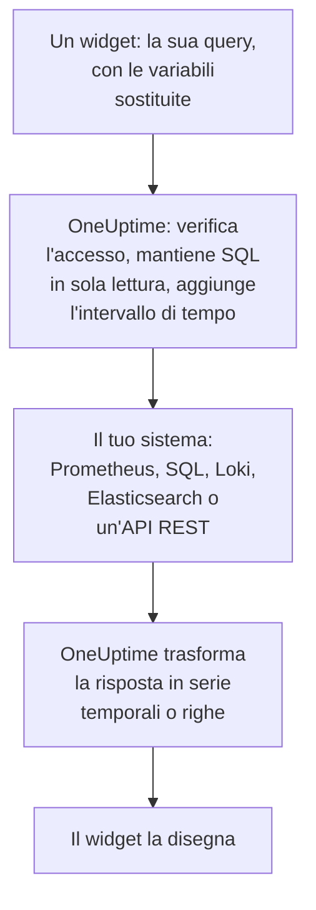

# Fonti di dati esterne

Una fonte di dati esterna collega un sistema esterno a OneUptime, come Prometheus, un database SQL, ClickHouse, Loki, Elasticsearch o un'API REST, così le tue dashboard possono rappresentarne i dati accanto ai tuoi. Colleghi il sistema una volta; poi ogni widget esegue una query di sola lettura nel linguaggio di quel sistema.

:::cards
- [Collegare una fonte di dati](#collegare-una-fonte-di-dati): Scegli il tipo, poi indica dove si trova e come accedere.
- [Scrivere una query](#scrivere-una-query): PromQL, SQL, LogQL, Query DSL o una richiesta.
- [Limiti](#limiti): I timeout e i tetti che proteggono entrambe le parti.
- [Sicurezza](#sicurezza): Query di sola lettura e credenziali di sola scrittura.
:::

## Come viene eseguita una query

Il widget invia la sua query a OneUptime, con le variabili già sostituite. OneUptime verifica che tu possa leggere la fonte di dati, inserisce l'intervallo di tempo e interroga il tuo sistema con le credenziali che conserva. Poi dà alla risposta la forma di serie temporali o di righe, che il widget disegna.



## Prima di iniziare

- **Un piano che la includa.** Su OneUptime Cloud, creare e modificare fonti di dati richiede il piano **Growth**. Eliminarne una funziona con ogni piano.
- **Un'autorizzazione per aggiungerle.** I proprietari e gli amministratori del progetto possono aggiungere fonti di dati; tutti gli altri hanno bisogno di `CreateDataSource`, con `EditDataSource` e `DeleteDataSource` per modificarle e rimuoverle. Chiunque possa leggere le fonti di dati del progetto, membri e visualizzatori compresi, vede i dati dei loro widget.
- **Un account di sola lettura.** Le dashboard leggono soltanto. Collega i database con un account che possa solo leggere, e le fonti HTTP con un token che possa solo interrogare.
- **Una via d'accesso.** È il server API di OneUptime a collegarsi al tuo sistema, quindi deve poterlo raggiungere: vedi [Sicurezza](#sicurezza) per gli indirizzi che vengono rifiutati.

## Sistemi supportati

| Tipo | Linguaggio di query | Funziona con |
| --- | --- | --- |
| Prometheus | PromQL | Prometheus, Thanos, Cortex, Mimir, VictoriaMetrics |
| PostgreSQL | SQL | PostgreSQL, TimescaleDB, CockroachDB |
| MySQL | SQL | MySQL, MariaDB |
| Microsoft SQL Server | T-SQL | SQL Server, Azure SQL |
| ClickHouse | SQL | ClickHouse, tramite la sua interfaccia HTTP |
| Grafana Loki | LogQL | Loki ed endpoint compatibili con Loki |
| Elasticsearch | Query DSL (JSON) | Elasticsearch, OpenSearch |
| REST API | Richiesta (JSON) | Qualsiasi API HTTP(S) che risponda in JSON |

## Collegare una fonte di dati

:::steps
### Aprire le fonti di dati

Apri **Prodotti → Dashboard**, espandi **Impostazioni** nel menu laterale e fai clic su **Origini dati**.

### Scegliere il tipo

Fai clic su **Crea: Data Source**. La finestra **Choose a Data Source Type** raggruppa i tipi in base a ciò che contengono: metriche, log, database, ricerca e API. Fai clic su uno.

### Darle un nome

In **Informazioni di base**, dalle un **Nome**, come "Prometheus di produzione", e una **Descrizione** se vuoi.

### Indicare dove si trova

In **Connessione**, una fonte HTTP riceve l'**URL** a cui risponde. Un database riceve il suo **Database Host**, la sua **Database Port** (lasciala vuota per 5432, 3306, 1433 o 8123) e il suo **Nome del database**.

### Indicare come accedere

In **Autenticazione**, inserisci un **Nome utente** e una **Password** oppure, per una fonte HTTP, un **Token API**, inviato come token bearer. **Altri campi** contiene **Custom HTTP Headers**, come `{ "X-Scope-OrgID": "tenant-1" }`, e **Additional Options**: `sslEnabled` e `sslRejectUnauthorized` per i database, `elasticsearchIndex` per Elasticsearch, che senza di esso legge tutti gli indici (`*`).

### Provarla

Fai clic su **Crea: Data Source**, poi su **Test** nella sua riga. OneUptime si collega con i dati che hai fornito, e dice se ha funzionato o che cosa è andato storto.
:::

Per cambiare una fonte di dati in seguito, aprila dall'elenco. **Modifica** in **Data Source Details** cambia tutto tranne i suoi segreti; **Aggiorna le credenziali** sostituisce la password, il token o le intestazioni, e lascia com'erano i campi che lasci vuoti; **Test** la verifica di nuovo.

## Usarla in un widget

Modifica una dashboard, fai clic su **Aggiungi widget** e scegli un widget del gruppo Fonti di dati esterne: un **Grafico**, un **Valore**, un **Indicatore** o una **Tabella**. Nelle sue impostazioni:

- Scegli la **Data Source** e scrivi la **Query**. L'editor indica il linguaggio di query e mostra un esempio per il tipo.
- In un grafico, **Aggiungi query** sovrappone altre query sugli stessi assi, e **Legend (optional)** dà un nome a ogni serie a partire dalle sue etichette: `{{instance}} — errors` scrive davanti l'etichetta `instance` della serie.
- In un valore o in un indicatore, **Reduce** trasforma i punti in un solo numero: l'ultimo valore (il predefinito), il primo, la media, la somma, il minimo o il massimo. **Unit** aggiunge un suffisso, e scala le unità note: `Bytes` si legge come 1.5 MB, `ms` come 2.4 s.
- In una tabella funziona qualsiasi query di sola lettura, e le sue righe appaiono così come arrivano.

## Scrivere una query

Ogni tipo usa il proprio linguaggio, con le stesse regole su ciò che viene restituito:

- **Grafici, valori e indicatori hanno bisogno di serie temporali.** Una query SQL restituisce una colonna temporale chiamata `time`, `timestamp`, `date` o `ts`, e una colonna numerica `value` (o la sua prima colonna numerica); ogni altra colonna diventa un'etichetta della serie. Elasticsearch ha bisogno di un'aggregazione `date_histogram`, e Loki di una query di metriche come `rate()` o `count_over_time()`.
- **Le tabelle mostrano righe** così come le restituisce la query: righe SQL, serie Prometheus, righe di log di Loki, risultati di Elasticsearch, o gli oggetti al `rowsPath` di un'API REST.

:::tabs
@tab Prometheus
```text title="PromQL"
sum by (job) (rate(http_requests_total{job=~"{{job}}"}[5m]))
```
@tab SQL
```sql title="SQL"
SELECT date_trunc('minute', created_at) AS time, COUNT(*) AS value
FROM orders
WHERE created_at BETWEEN $__startTime AND $__endTime
GROUP BY 1
ORDER BY 1
```
@tab Loki
```text title="LogQL"
sum by (app) (rate({app="api"} |= "error" [5m]))
```
@tab Elasticsearch
```json title="Query DSL"
{
  "query": { "range": { "@timestamp": { "gte": "$__startTime", "lte": "$__endTime" } } },
  "aggs": {
    "over_time": {
      "date_histogram": { "field": "@timestamp", "fixed_interval": "1m" }
    }
  }
}
```
@tab REST API
```json title="Request"
{
  "path": "/api/stats?from=$__startTimeMs&to=$__endTimeMs",
  "method": "GET",
  "rowsPath": "data.items",
  "timestampField": "time",
  "valueField": "count",
  "seriesField": "service"
}
```
:::

### Macro temporali

Prometheus e Loki ricevono l'intervallo di tempo della dashboard con ogni richiesta, quindi le loro query non hanno bisogno d'altro. Gli altri tipi inseriscono l'intervallo di tempo dove scrivi una macro:

| Macro | Diventa | In |
| --- | --- | --- |
| `$__startTime`, `$__endTime` | L'inizio e la fine dell'intervallo, in UTC: `'2026-10-13 09:00:00'` in SQL, ISO 8601 altrove | SQL, Elasticsearch, REST API |
| `$__startTimeMs`, `$__endTimeMs` | Gli stessi, in millisecondi dal 1970 | SQL, Elasticsearch, REST API |
| `$__rangeSeconds` | La durata dell'intervallo, in secondi | SQL |

Le macro SQL sono scritte in UTC, quindi esegui le sessioni del tuo database in UTC, oppure converti nella query.

### Variabili della dashboard

Scrivi `{{name}}` in qualsiasi punto di una query, e il widget ci mette il valore della variabile prima di inviare la query. Più valori di una variabile a selezione multipla vengono uniti con `|`, che è ciò che serve a un selettore con espressione regolare di PromQL o LogQL: `job=~"{{job}}"`. Una variabile senza nulla di scelto lascia il segnaposto così com'è scritto, quindi l'errore lo nomina. [Variabili e filtri della dashboard](/docs/dashboards/variables) spiega come aggiungerne una.

## Limiti

Ogni query ha dei limiti, così che una dashboard di venti widget che si aggiorna ogni minuto non possa sovraccaricare OneUptime o il tuo sistema:

| Limite | Valore |
| --- | --- |
| Connessione | 10 secondi |
| Esecuzione di una query | 30 secondi |
| Punti in una risposta a serie temporale | 11.000 |
| Righe in una tabella | 1.000 |
| Serie in una risposta | 100 |
| Risposta da una fonte HTTP | 20 MB |

Le query di intervallo di Prometheus e Loki chiedono circa 250 punti sull'intervallo di tempo, a non meno di 10 secondi e non più di un giorno di distanza l'uno dall'altro.

## Sicurezza

- **SQL resta in sola lettura.** Una query deve essere un'unica istruzione che inizi con `SELECT`, `WITH`, `SHOW`, `EXPLAIN`, `DESCRIBE` o `DESC`. Le parole che scrivono o modificano una sessione, come `INSERT`, `UPDATE`, `DELETE`, `DROP`, `INTO` o `SET`, vengono rifiutate ovunque fuori dalle stringhe e dai nomi tra virgolette, quindi metti tra virgolette una colonna che porta il nome di una di esse. Scrivi un apice dentro una stringa come due apici (`''`): una barra rovesciata prima di un apice viene rifiutata. Anche le sessioni di PostgreSQL, MySQL e ClickHouse sono di sola lettura. SQL Server non ha sessioni di sola lettura, quindi collegalo con un login di sola lettura.
- **Le credenziali sono di sola scrittura.** **Password**, **Token API** e **Custom HTTP Headers** sono cifrati a riposo, e l'API non li restituisce mai, nemmeno a te.
- **Gli indirizzi vengono verificati.** Gli indirizzi di loopback, link-local (dove si trovano i metadati del cloud) e gli altri indirizzi riservati vengono rifiutati ovunque. Gli indirizzi privati vengono rifiutati su OneUptime Cloud, e consentiti su un'installazione self-hosted a meno che `DATA_SOURCE_BLOCK_PRIVATE_ADDRESSES` sia `true`: vedi [Accesso alla rete privata](/docs/self-hosted/private-network-access).
- **Le dashboard pubbliche non le eseguono mai.** I widget di Fonti di dati esterne vengono esclusi da una [dashboard pubblica](/docs/dashboards/sharing), query comprese.

## Risoluzione dei problemi

:::details Test dice che non riesce a collegarsi
Controlla l'URL, oppure l'host e la porta, dal punto in cui gira OneUptime: un firewall, un indirizzo privato su OneUptime Cloud o un database in ascolto solo sulla propria macchina appaiono uguali da qui. Per un database che richiede TLS, aggiungi `{ "sslEnabled": true }` in **Additional Options**.
:::

:::details "Only read-only queries are allowed"
La query non inizia con `SELECT`, `WITH`, `SHOW`, `EXPLAIN`, `DESCRIBE` o `DESC`. Invia un'unica istruzione che si limiti a leggere: anche una seconda istruzione dopo un `;` viene rifiutata, con "Only a single SQL statement is allowed per query."
:::

:::details "Query contains a keyword that is not allowed"
Una parola che scrive compare fuori da una stringa, spesso come nome di colonna, come `delete` o `set`. Mettila tra virgolette come fa il database: `"delete"` in PostgreSQL, `[delete]` in SQL Server, e tra apici inversi in MySQL e ClickHouse.
:::

:::details Il grafico resta vuoto, ma la tabella mostra righe
La query restituisce righe, ma nessuna serie temporale. Chiama `time` la colonna temporale e `value` il numero in SQL, aggiungi un'aggregazione `date_histogram` in Elasticsearch, oppure trasforma una query di log di Loki in una query di metriche con `rate()` o `count_over_time()`.
:::

:::details Mancano alcuni dati
La risposta ha raggiunto un [limite](#limiti). Restringi l'intervallo di tempo, filtra la query o aggregala in meno serie.
:::

## Passaggi successivi

:::cards
- [Widget della dashboard](/docs/dashboards/widgets): Ogni widget, compreso il gruppo Fonti di dati esterne.
- [Variabili e filtri della dashboard](/docs/dashboards/variables): Variabili da usare nelle tue query.
- [Accesso alla rete privata](/docs/self-hosted/private-network-access): Raggiungi sistemi su una rete privata da un'installazione self-hosted.
- [Configurazione e permessi della dashboard](/docs/dashboards/configuration): Chi può aggiungere fonti di dati, e chi le legge.
:::
