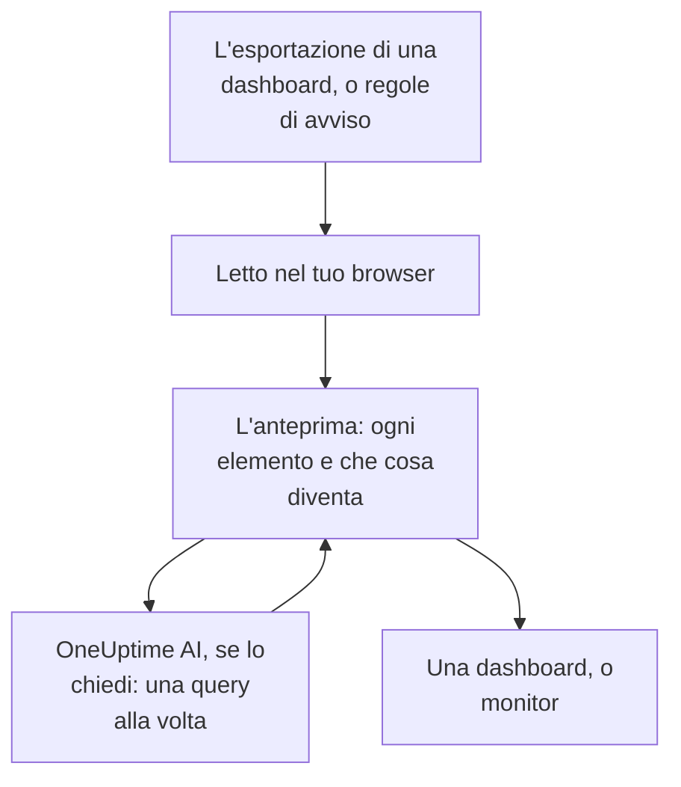

# Importare da Grafana e Datadog

Porta in OneUptime una dashboard creata in Grafana o Datadog, o le regole di avviso scritte per Prometheus, Grafana o Datadog. Incolli o carichi il file, vedi che cosa diventa ogni pannello e ogni regola, e solo allora crei la dashboard o i monitor.

:::cards
- [Importare una dashboard](#importare-una-dashboard): Il modello JSON di una dashboard di Grafana, o l'esportazione di una dashboard di Datadog.
- [Importare regole di avviso](#importare-regole-di-avviso): File di regole di Prometheus, regole di avviso di Grafana e monitor di Datadog.
- [Come viene convertito ogni elemento](#come-viene-convertito-ogni-elemento): Esattamente, approssimativamente o per niente, e perché.
- [Convertire una query con OneUptime AI](#convertire-una-query-con-oneuptime-ai): Per una query che nessuna regola converte.
:::

## Come funziona un'importazione

OneUptime legge il file nel tuo browser e converte ogni pannello, widget, variabile e regola separatamente. L'anteprima li elenca tutti con ciò che diventa ciascuno. Non viene creato nulla finché non scegli di crearlo, e allora viene creato con i tuoi permessi, come lo creano i moduli di dashboard e monitor.

## Prima di iniziare

- I widget e i monitor importati leggono le metriche e i log di questo progetto. Inviali con OpenTelemetry o il Datadog Agent, oppure con Prometheus remote write per le metriche e l'API push di Loki per i log, e mantengono i nomi che hanno lì.
- Importare una dashboard richiede un ruolo che possa creare dashboard, e importare regole di avviso un ruolo che possa creare monitor.
- Un file può arrivare a 10 MB, e se ne leggono fino a 500 pannelli o regole.

## Importare una dashboard

:::steps
### Aprire l'importazione della dashboard

Apri **Prodotti → Dashboard**, poi **Altre opzioni → Import from Grafana or Datadog**.

### Incollare la dashboard

In Grafana, copia il modello JSON dalle impostazioni della dashboard. In Datadog, esporta il JSON della dashboard. Incollalo, o scegli **Upload a File**, poi scegli **Anteprima**.

### Creare la dashboard

Controlla che cosa diventa ogni pannello e ogni variabile, dai un nome alla dashboard e scegli **Crea dashboard**. Si apre la nuova dashboard.
:::

Il PromQL di Grafana resta come è scritto: OneUptime compila `$__interval`, `$__rate_interval` e `$__range` come fa Grafana, e una variabile su All corrisponde a ogni valore. Una query di Datadog diventa PromQL sulle metriche inviate dal Datadog Agent: `avg:system.cpu.user{host:web-1}` legge `system_cpu_user{resource_host_name="web-1"}`, e `.as_count()` riporta un conteggio che l'Agent ha inviato come tasso al numero contato in ogni intervallo. Un widget di Datadog che elenca log diventa un **Flusso di log**, e una serie temporale che li conta un **Grafico dei log**, entrambi sui log inviati dal Datadog Agent e filtrati dalla ricerca di Datadog.

## Importare regole di avviso

:::steps
### Aprire l'importazione degli avvisi

Apri **Prodotti → Monitor**, poi **Altre opzioni → Import Alerts**.

### Incollare le regole

Incolla un file di regole di Prometheus o una risorsa PrometheusRule, l'esportazione delle regole di avviso di Grafana o monitor di Datadog esportati come JSON, poi scegli **Anteprima**.

### Creare i monitor

Togli la spunta alle regole che non vuoi, scegli in **When a rule fires** che cosa apre una regola che scatta e scegli **Crea monitor**.
:::

Ogni regola diventa un monitor Metrics con una query PromQL, la condizione della regola e la sua finestra. Apre un avviso, o un incidente, per ogni serie che supera la soglia, e lo risolve quando la serie si riprende. Titolo e descrizione vengono dal riepilogo o dal messaggio della regola, con le etichette della serie già inserite.

Un monitor di anomalie o di previsioni di Datadog diventa un monitor Metrics con la condizione di anomalia o di previsione di OneUptime, e un monitor di log di Datadog un monitor Logs che conta i log trovati dalla sua ricerca.

## Come viene convertito ogni elemento

| Stato | Che cosa significa |
| --- | --- |
| **Converted exactly** | Legge gli stessi dati e li mostra allo stesso modo. |
| **Converted approximately** | Viene creato, e le sue note dicono che cosa cambia. |
| **Not converted** | Non viene creato nulla, e le sue note dicono perché. |

Non vengono convertite le regole di registrazione, le regole di avviso di Prometheus e Grafana sui log, i widget di Datadog che leggono tracce o eventi, i monitor di valori anomali e di cambiamenti di Datadog, né i suoi monitor di tutto ciò che non sono metriche e log.

## Convertire una query con OneUptime AI

Una query che nessuna regola converte mostra **Convert with OneUptime AI**, che richiede l'IA attiva per il progetto. Solo quella query, con i nomi delle variabili della dashboard, va al [provider LLM](/docs/ai/llm-provider) del tuo progetto. La risposta viene verificata come qualsiasi query e ti viene mostrata: scegli **Use This Query** per usarla. Non viene creato nulla finché non crei la dashboard o i monitor.

## Passaggi successivi

:::cards
- [Widget della dashboard](/docs/dashboards/widgets): Cambia ciò che mostra un widget importato.
- [Variabili e filtri della dashboard](/docs/dashboards/variables): Le variabili create da un'importazione.
- [Monitor metriche](/docs/monitor/metrics-monitor): I monitor creati da un'importazione.
- [PromQL](/docs/telemetry/promql): Il linguaggio che leggono i widget e i monitor importati.
:::
