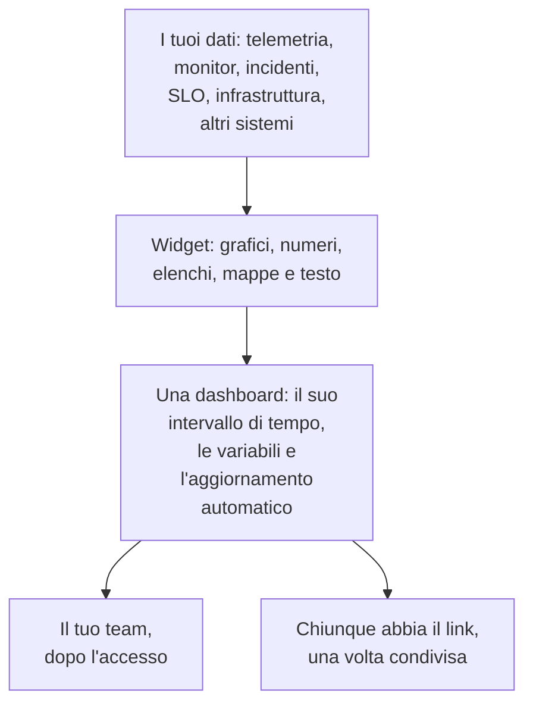

# Panoramica delle dashboard

Una dashboard è una pagina di widget che disponi tu: grafici delle tue metriche, dei log e delle tracce, elenchi di incidenti, avvisi e monitor, i tuoi SLO e la tua infrastruttura, perfino dati di sistemi esterni a OneUptime. Creane una per lo schermo del turno di reperibilità, per il controllo mattutino di un team o come pagina per i tuoi clienti, e condividila con il tuo progetto o con chiunque abbia il link.

:::cards
- [Come funziona una dashboard](#come-funziona-una-dashboard): Da dove arrivano i suoi dati, e chi la vede.
- [Trovare le tue dashboard](#trovare-le-tue-dashboard): L'elenco Dashboard e le pagine di ciascuna dashboard.
- [Creare la tua prima dashboard](#creare-la-tua-prima-dashboard): Da un modello a una pagina condivisa in cinque passaggi.
- [Un esempio: una dashboard per la reperibilità](#un-esempio-una-dashboard-per-la-reperibilità): Una pagina che funziona per ogni servizio.
:::

## Come funziona una dashboard

Ogni widget legge da una fonte, entro l'intervallo di tempo della dashboard e filtrato dalle sue variabili. Chiunque apra la dashboard vede gli stessi widget: il tuo team quando accede, e i visitatori tramite il suo link pubblico una volta che la condividi.

| Termine | Che cosa significa |
| --- | --- |
| Dashboard | Una pagina: un nome, una griglia di widget, un intervallo di tempo, variabili e un'impostazione di aggiornamento automatico. |
| Widget | Un riquadro della griglia: un grafico, un numero, un elenco, una mappa, un orologio o un blocco di testo. |
| Variabile | Un selettore nella barra degli strumenti che restringe ogni widget che la supporta a un servizio, un host o un cliente. |
| Intervallo di tempo | La finestra che leggono tutti i grafici e i numeri. Una dashboard si apre sul suo valore predefinito, l'ultima ora a meno che chi la modifica non ne imposti un altro, e ogni lettore può sceglierne uno proprio. |
| Aggiornamento automatico | Ogni quanto i widget rileggono i loro dati: disattivato, oppure da ogni 5 secondi a ogni 15 minuti. |
| Lettura e modifica | Una dashboard si apre in lettura. Modificarla è un passaggio a parte, che termina salvando o scartando le modifiche. |

## A cosa servono le dashboard

- **Una pagina "va tutto bene?"** per chi è di reperibilità, per lo standup di un team o per uno schermo a parete.
- **Vedere i collegamenti**: un picco di CPU accanto a un aumento della latenza e a un incidente aperto salta all'occhio in una pagina, e sfugge facilmente su tre.
- **Indagare**: metti fianco a fianco i grafici che riapri di continuo, e trascina su un picco per leggere tutti i widget in quel momento.
- **Condividere fuori dal team**: una pagina sulle prestazioni per un cliente o un partner, protetta da una password o da una lista di IP consentiti, se vuoi.

## Trovare le tue dashboard

Apri **Prodotti → Dashboard**. L'elenco **Dashboard** mostra le dashboard del progetto con le loro descrizioni, etichette e proprietari. Cerca per nome o descrizione, restringi l'elenco con i filtri **Proprietario** ed **Etichette**, oppure seleziona più dashboard per cambiarne le etichette o i proprietari, archiviarle o esportarle in JSON.

Il menu laterale dell'elenco contiene le pagine che si occupano di tutte le tue dashboard:

| Pagina | Che cosa ci fai |
| --- | --- |
| **Dashboard** | Le dashboard del progetto. Creane una, oppure importa dashboard con **Importa JSON**. |
| **Dashboard → Playlist** | [Mostrare le dashboard una dopo l'altra](/docs/dashboards/playlists) su uno schermo, come la parete di un NOC. |
| **Impostazioni → Regole del proprietario** | Aggiungere automaticamente proprietari alle nuove dashboard. |
| **Impostazioni → Regole etichette** | Aggiungere automaticamente etichette alle nuove dashboard. |
| **Impostazioni → Origini dati** | Collegare Prometheus, database SQL, ClickHouse, Loki, Elasticsearch o un'API REST. |
| **Avanzato → Archiviato** | Le dashboard che hai archiviato. Ripristinale da qui. |

Apri una dashboard, e il suo menu laterale ha queste pagine. Ogni sezione tranne **Base** parte chiusa: fai clic sul suo titolo per aprirla.

| Pagina | Che cosa ci fai |
| --- | --- |
| **Dashboard** | La dashboard stessa. Leggila, o modificala dal suo menu **⋯**. |
| **Panoramica** | Il suo nome, la descrizione e le etichette. |
| **Condivisione** | Chi può vederla, il suo link pubblico e una lista di IP consentiti in Altre impostazioni. |
| **Proprietari** | Gli utenti e i team a cui appartiene. |
| **Branding** | Titolo della pagina, descrizione, logo, tema e favicon della dashboard pubblica. |
| **Domini personalizzati** | Ospitare la dashboard pubblica sul tuo dominio. |
| **Impostazioni** | Duplicare, esportare o archiviare la dashboard. |
| **Registri di audit** | Ogni modifica fatta alla dashboard, e chi l'ha fatta. |
| **Elimina** | Eliminare la dashboard per sempre. |

## Creare la tua prima dashboard

:::steps
1. **Crea** — scegli un modello, oppure **Parti da zero**. Un modello compila il nome e si apre con i suoi widget; una dashboard creata da zero si apre senza nulla, con **Aggiungi widget** sul suo canvas.
2. **Aggiungi i widget** — scegli un widget dal catalogo, imposta nelle sue impostazioni che cosa legge, poi trascinalo in posizione e ridimensionalo.
3. **Aggiungi le variabili, se ti servono** — una variabile `service`, per esempio, permette a una sola dashboard di mostrare qualsiasi servizio.
4. **Salva** — fai clic su **Salva modifiche**. Niente di ciò che cambi durante la modifica viene conservato finché non lo fai.
5. **(Facoltativo) Condividi pubblicamente** — scegli **⋯ → Condividi** sulla dashboard e decidi chi può vederla: chiunque abbia il link, oppure chiunque abbia il link e una password.
:::

[Creare una dashboard](/docs/dashboards/authoring) spiega ogni passaggio.

## Un esempio: una dashboard per la reperibilità

L'obiettivo: una pagina per il servizio di checkout, con la sua latenza, il tasso di errori, gli incidenti aperti e gli ultimi log, che funzioni anche per ogni altro servizio.

1. Fai clic su **Crea dashboard**, scegli **Parti da zero** e chiama la dashboard "Reperibilità checkout".
2. Fai clic su **Aggiungi widget** e aggiungi un **Grafico** della tua metrica di latenza delle richieste, aggregata come P95.
3. Accanto, aggiungi un **Valore** del tuo tasso di errori, con una soglia di avviso di 1 e una soglia critica di 5.
4. Sotto, aggiungi un **Elenco incidenti** filtrato sugli incidenti non risolti, e un **Flusso di log** con i log del servizio.
5. Apri **Variabili**, aggiungi una variabile chiamata `service` con l'origine Telemetry Attribute e la chiave di attributo `service.name`, e dalle il valore predefinito `checkout`.
6. Fai clic su **Salva modifiche**. Scegli `payments` nel selettore `service` della barra degli strumenti: il grafico, il valore e il flusso di log passano al servizio payments, e l'elenco degli incidenti continua a mostrare tutti gli incidenti non risolti.

## Come si integrano le dashboard con il resto di OneUptime

- **I monitor e la telemetria** sono da dove arrivano i dati. Ogni metrica, log e traccia che invii può finire in un widget.
- **Gli incidenti e gli avvisi** compaiono nei widget **Elenco incidenti** ed **Elenco avvisi**. Una dashboard si limita a mostrarli: ci lavori sulle loro pagine.
- **Le pagine di stato** dicono ai tuoi clienti se il tuo servizio funziona. Le dashboard mostrano nel dettaglio come si comporta. Le due cose lavorano fianco a fianco.
- **I workflow** agiscono su ciò che succede. Le dashboard sono dove lo leggi.

## Passaggi successivi

:::cards
- [Creare una dashboard](/docs/dashboards/authoring): Crea una dashboard, modificala e salva le modifiche.
- [Widget della dashboard](/docs/dashboards/widgets): Ogni widget, e quale scegliere.
- [Variabili e filtri della dashboard](/docs/dashboards/variables): Una dashboard per ogni servizio, host o cliente.
- [Condivisione e dashboard pubbliche](/docs/dashboards/sharing): Link pubblici, password, liste di IP consentiti e domini personalizzati.
:::
