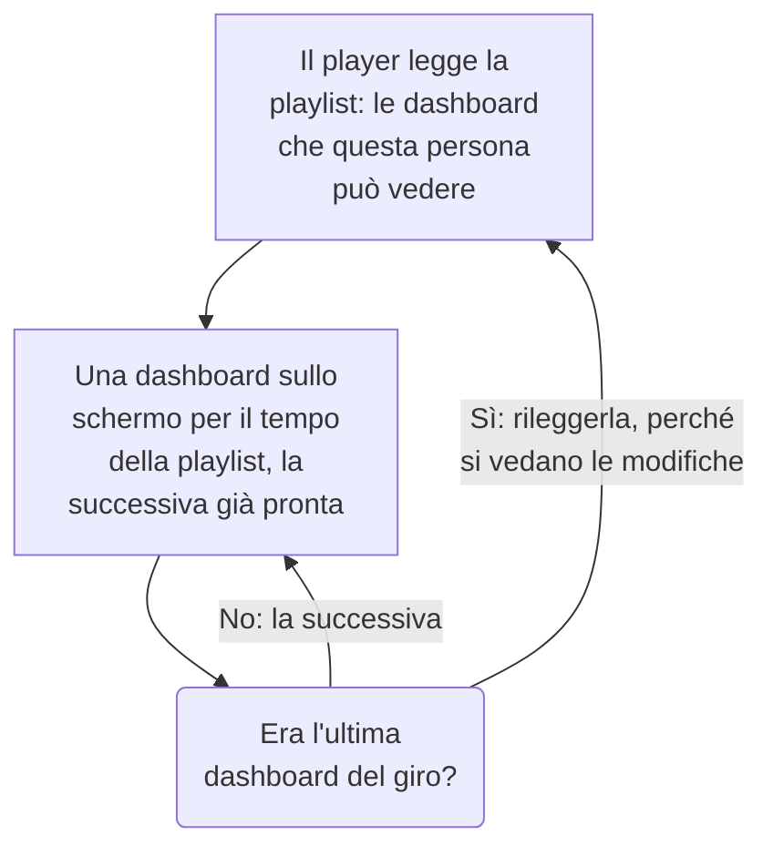

# Playlist di dashboard

Una playlist mostra una serie di dashboard una dopo l'altra su uno schermo che nessuno tocca, come la parete di un NOC o la TV di un team: ogni dashboard per il tempo che scegli, a ciclo continuo, finché qualcuno non la mette in pausa. Crea la playlist una volta, apri il suo player sullo schermo e lascialo andare.

:::cards
- [Come si riproduce una playlist](#come-si-riproduce-una-playlist): L'ordine, i turni e cosa mostra ogni dashboard.
- [Creare una playlist](#creare-una-playlist): Un nome, le sue dashboard in ordine e per quanto tempo viene mostrata ciascuna.
- [Riprodurla su uno schermo](#riprodurla-su-uno-schermo): La barra del player, i suoi pulsanti e i suoi tasti.
- [Chi vede cosa](#chi-vede-cosa): I permessi, e le dashboard che una persona non può leggere.
:::

## Come si riproduce una playlist

Il player mostra la prima dashboard della playlist, poi la successiva quando il suo tempo è scaduto, e dopo l'ultima ricomincia dalla prima. Ogni dashboard si apre come l'hanno salvata i suoi editor: con il proprio intervallo di tempo predefinito, il proprio aggiornamento automatico e le proprie variabili, qualunque cosa dica l'indirizzo del player. Mentre una dashboard è sullo schermo, il player disegna la successiva fuori dalla vista, così lo schermo non resta mai vuoto tra una e l'altra.

Una playlist nomina le sue dashboard e non le copia mai: una modifica che un editor salva in una dashboard è sullo schermo la volta successiva che tocca a lei. Il player rilegge la playlist prima di ogni giro, così una dashboard aggiunta, spostata o rimossa compare entro un giro, senza ricaricare lo schermo; se quella lettura non riesce, lo schermo ripete il giro che ha.

## Creare una playlist

:::steps
### Aprire le playlist
Apri **Prodotti → Dashboard**, poi **Playlist** nel menu laterale. L'elenco mostra quante dashboard ha ogni playlist e per quanto tempo viene mostrata ciascuna, con **Riproduci** in ogni riga.

### Darle un nome
Fai clic su **Crea: Playlist** e dalle un **Nome** che dica dove viene riprodotta, per esempio «Parete NOC».

### Aggiungere le sue dashboard
In **Dashboard**, scegli ciascuna da **Aggiungi una dashboard**, nell'ordine in cui lo schermo le mostra. I pulsanti sulla riga di una dashboard la spostano in alto o in basso, oppure la rimuovono. Le dashboard archiviate non vengono proposte.

### Scegliere per quanto mostrarle
**Mostra ogni dashboard per** parte da un minuto; scegli un tempo da 15 secondi a un'ora. Fai clic su **Crea: Playlist**.
:::

La pagina della playlist elenca le sue dashboard in ordine, per quanto tempo viene mostrata ciascuna e il **Link del player**. **Modifica playlist** cambia il nome, le dashboard, il loro ordine e il tempo. **Elimina: Playlist di dashboard**, in fondo alla pagina, elimina la playlist e mai le sue dashboard.

Tramite l'API e Terraform, una playlist è un `name`, le sue `dashboards` come un elenco del tipo `[{"dashboardId": "<id>"}]` nell'ordine in cui vengono mostrate, al massimo 100, e `intervalInSeconds`, un qualsiasi numero intero di secondi da 10 a 86400 (un giorno). Un valore fuori da questi limiti viene rifiutato, con l'indicazione di cosa non va.

## Riprodurla su uno schermo

Fai clic su **Riproduci** sulla riga della playlist o sulla sua pagina. Il player riempie la finestra del browser, sopra il resto di OneUptime; **Schermo intero** riempie tutto lo schermo. Per avviare uno schermo da solo, apri su di esso il **Link del player** e aggiungilo ai preferiti: il link apre subito il player.

La barra del player indica la dashboard sullo schermo, la playlist, a che punto è il giro («2 di 5») e la dashboard che viene dopo. Una linea sotto la barra si riempie mentre una dashboard ha il suo turno. I pulsanti della barra vanno alla dashboard precedente, mettono in pausa o riproducono, e vanno alla successiva; su un computer, questi tasti fanno lo stesso:

| Tasti | Cosa fa |
| --- | --- |
| `Space` | **Pausa o riproduci**. In pausa, la dashboard resta sullo schermo e la barra indica **In pausa**. |
| `Right Arrow` | **Dashboard successiva**. |
| `Left Arrow` | **Dashboard precedente**. |
| `F` | **Schermo intero**, o uscirne. |
| `Esc` | **Esci dal player**, di nuovo alla pagina della playlist. A schermo intero, il primo `Esc` esce solo dallo schermo intero. |
| `?` | **Mostra le scorciatoie da tastiera**. |

Una dashboard a cui vai, la successiva o la precedente, ha un turno intero. In una pagina che si legge da destra a sinistra, come in persiano, le frecce si scambiano: `Left Arrow` va alla dashboard successiva. Mentre riproduce, il player impedisce allo schermo di andare in sospensione, dove il browser lo consente.

## Chi vede cosa

Le playlist hanno permessi propri, ottenuti tramite un team come quelli delle dashboard:

| Per | Serve |
| --- | --- |
| Vedere e riprodurre le playlist | `ReadDashboardPlaylist`, oppure un ruolo del progetto: Project Owner, Project Admin, Project Member, Viewer o un ruolo Settings |
| Creare playlist | `CreateDashboardPlaylist`, Project Owner o Project Admin |
| Modificare una playlist: il nome, le dashboard e il tempo | `EditDashboardPlaylist`, Project Owner o Project Admin |
| Eliminare una playlist | `DeleteDashboardPlaylist`, Project Owner o Project Admin |

Una playlist non mostra mai a nessuno una dashboard che non può leggere. Il player riproduce solo le dashboard che la persona connessa allo schermo può leggere e che non sono archiviate, e salta le altre: una dashboard eliminata, una archiviata o una che i suoi permessi le nascondono. La pagina della playlist dice perché salta ciascuna. Salvare una playlist mantiene le dashboard che contiene e che l'editor non può vedere, così non va perso niente di ciò che un'altra persona vi ha messo.

| Quando il player trova | Mostra |
| --- | --- |
| Dashboard che può mostrare | Ciascuna a turno. |
| Nessuna dashboard che può mostrare | **Ancora niente da mostrare**, e ricontrolla ogni minuto. |
| La playlist eliminata, o che quella persona non può leggere | **Playlist non trovata**. |
| Una lettura non riuscita | **Impossibile caricare questa playlist**, e riprova ogni minuto, oppure con **Riprova**. |

> [!NOTE]
> Il player è per chi ha effettuato l'accesso a OneUptime. Per far girare una playlist su uno schermo, accedi su quello schermo con un account che può leggere la playlist e le sue dashboard, per esempio un membro del team con il ruolo Viewer.

## Passaggi successivi

:::cards
- [Creare una dashboard](/docs/dashboards/authoring): Costruisci le dashboard che una playlist mostra.
- [Variabili e filtri della dashboard](/docs/dashboards/variables): La selezione salvata con cui si apre ogni dashboard.
- [Condivisione e dashboard pubbliche](/docs/dashboards/sharing): Mostra una dashboard a chi non accede.
- [Configurazione e permessi della dashboard](/docs/dashboards/configuration): Proprietari, etichette e chi può leggere una dashboard.
:::
