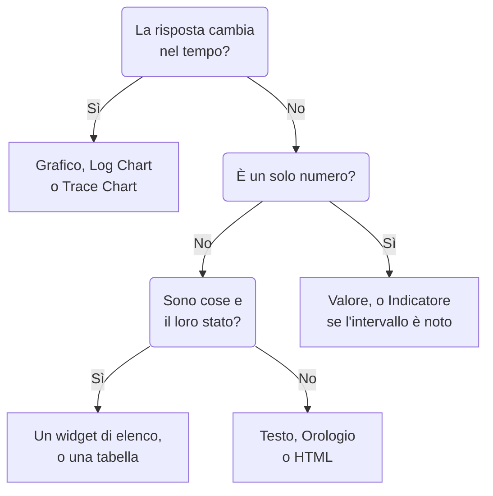

# Widget della dashboard

Un widget è un riquadro di una dashboard. Questa pagina elenca ogni widget del catalogo **Aggiungi widget**, che cosa mostra e le impostazioni che contano, negli stessi gruppi del catalogo. Per posizionare i widget sulla griglia e salvarli, vedi [Creare una dashboard](/docs/dashboards/authoring).

:::cards
- [Quale widget usare?](#quale-widget-usare): Scegli in base alla domanda a cui risponde il riquadro.
- [Grafici e numeri](#grafici-e-numeri): Grafico, Valore, Indicatore e Tabella, da una query di metriche.
- [Log, tracce e sicurezza](#log-tracce-e-sicurezza): Grafici dei volumi, flussi in tempo reale ed elenchi.
- [Ordinare elenchi e tabelle](#ordinare-elenchi-e-tabelle): Ordina per una colonna e scegli l'ordine che vedono tutti.
- [Quando un widget non può essere mostrato](#quando-un-widget-non-può-essere-mostrato): Che cosa mostra un widget rotto, e come sistemarlo.
:::

## Quale widget usare?

Parti dalla domanda a cui deve rispondere il riquadro:

| La domanda | Il widget |
| --- | --- |
| Come è cambiata una metrica nel tempo? | **Grafico** |
| Quanti log, di quale gravità, nel tempo? | **Grafico dei log** |
| Quanto sono veloci le richieste, e quante falliscono, nel tempo? | **Grafico delle tracce** |
| Qual è un certo numero in questo momento? | **Valore**, oppure **Indicatore** quando ha un intervallo noto |
| Quali host, servizi o endpoint si distinguono? | **Tabella** o **Tabella delle tracce** |
| Che cosa sta succedendo in questo momento? | **Flusso di log**, **Elenco delle tracce**, **Elenco incidenti** o **Elenco avvisi** |
| I nostri siti sono tutti attivi? | **Elenco monitor** |
| Stiamo mantenendo l'affidabilità che abbiamo promesso? | **SLO** o **Elenco SLO** |
| In che stato sono i nostri cluster e i nostri host? | Un widget del gruppo Infrastruttura |
| Dove si trova nel mondo la nostra rete, e che cosa è inattivo? | **Mappa di rete** |
| Un titolo, una nota, l'ora in un altro ufficio? | **Testo** o **Orologio** |
| Dati conservati fuori da OneUptime? | Un widget del gruppo Fonti di dati esterne |
| Qualcosa che nessun widget copre? | **HTML**, una volta sicuro che nessun altro widget lo faccia |



La maggior parte delle dashboard ne combina alcuni: un grafico in alto, uno o due valori accanto, un titolo di testo e uno o due elenchi sotto.

## Grafici e numeri

Questi quattro widget leggono una query di metriche, costruita come la costruisce l'esploratore delle metriche: scegli una metrica e un'aggregazione, aggiungi filtri sugli attributi, e raggruppa per un attributo per ottenere una serie per valore.

### Grafico

Una serie temporale di una o più query di metriche nell'intervallo di tempo della dashboard. **Chart Type** la disegna come grafico a linee, a barre, ad aree, ad aree sovrapposte o a torta. **Additional Queries** sovrappone altre metriche sugli stessi assi, e **Formulas** le combina con `+`, `-`, `*`, `/`, `%`, `^` e parentesi, come in `(1 - a) * 100`. Le impostazioni di visualizzazione di ogni query aggiungono una legenda e un'unità, un colore, linee di avviso e critiche, e una frequenza al secondo per i contatori che crescono soltanto.

Usalo quando è la forma della linea a raccontare la storia: latenza, errori, throughput o profondità di una coda.

### Valore

Un grande numero con uno sparkline: il valore della query sull'intero intervallo di tempo, sommato per una somma o un conteggio, il più alto per un massimo, il più basso per un minimo, e la media negli altri casi. Una freccia confronta la seconda metà dell'intervallo con la prima, ciascuna metà calcolata allo stesso modo, colorata in base a **Trend Direction**: se un valore più alto è meglio o peggio, oppure dedotto dal nome della metrica. Punta il cursore sulla freccia per vedere il valore di ciascuna metà, e sullo sparkline per leggere valore e ora di qualsiasi punto. **Warning Threshold** rende lo sfondo giallo e **Critical Threshold** rosso quando il valore li raggiunge.

Usalo quando un numero risponde alla domanda: il tasso di errori, la latenza P95 o le richieste servite oggi.

### Indicatore

Un quadrante tra un minimo e un massimo, 0 e 100 se non li imposti, con una zona gialla a partire da **Warning Threshold** e una zona rossa a partire da **Critical Threshold**.

Usalo quando il valore vive in un intervallo noto: l'uso di CPU o disco in percentuale, o la capacità di una coda.

### Tabella

Valori di metriche come righe. **Group By Attributes** dà una riga per valore, per esempio una per `host.name`; senza, ogni riga è un intervallo di tempo. **Metrics & Columns** imposta le colonne: metriche, e formule su di esse, come la disponibilità in percentuale. Quando raggruppi, **Reduce across time** trasforma la serie di ogni riga in un solo valore: l'ultimo valore, la media, la somma, il minimo o il massimo.

Usala per una suddivisione invece che per un andamento: gli host più rumorosi, gli errori per servizio, le richieste per endpoint.

## Testo, orologio e HTML

Questi widget non hanno bisogno di una fonte di dati.

### Testo

Una riga o un blocco di testo, per un titolo, una nota o i link ai tuoi runbook. Attiva **Markdown** per disegnare titoli, link, elenchi, codice e tabelle; altrimenti il testo appare come l'hai scritto, in grassetto, corsivo o sottolineato se vuoi.

### Orologio

L'ora attuale in qualsiasi fuso orario, in cifre o con un quadrante analogico, con un'etichetta come "Ufficio di Sydney". Senza fuso orario, mostra quello di ciascun visualizzatore. Aggiungine uno per ufficio per vedere chi è sveglio.

### HTML

Il tuo HTML, CSS e JavaScript, disegnato come widget. Le sue impostazioni sono il corpo HTML, un foglio di stile facoltativo, uno script facoltativo e tre interruttori di autorizzazione.

Usalo quando ti serve qualcosa che nessun widget integrato copre: un badge di terze parti incorporato, una tabella presa da un'API interna, una legenda personalizzata o una serie di link con stile verso i tuoi strumenti.

#### Che cosa può e non può fare

Il widget viene reso in un frame isolato (sandbox) sulla propria origine isolata. Dentro quel frame il tuo codice può fare più o meno qualsiasi cosa: costruire il DOM, eseguire timer, fare richieste a qualsiasi URL, disegnare su un canvas.

Quello che non può fare è raggiungere la pagina di OneUptime che lo circonda. Non ha accesso al DOM della dashboard, ai cookie, allo storage locale né alla sessione dell'API, e non può far navigare altrove la scheda del browser. Questo vale sia che la dashboard sia privata sia che sia condivisa pubblicamente.

Due conseguenze da conoscere prima di incollare qualcosa:

- Un `fetch` dal widget è una richiesta cross-origin da un'origine opaca, quindi il server che chiami deve consentirla con CORS. Chiamare l'API di OneUptime da qui non è supportato.
- Il widget parte trasparente. Imposta uno sfondo su `body` nel tuo CSS se vuoi che riempia la scheda. Nel tema scuro il suo testo parte chiaro e il suo elemento `<html>` ha la classe `dark`: inizia una regola CSS con `html.dark` per dare uno stile solo al tema scuro.

#### Usare le variabili della dashboard

Scrivi `{{variableName}}` in qualsiasi punto dell'HTML, del CSS o del JavaScript e viene sostituito con il valore attuale di quella variabile prima che il widget venga reso. Scegliere un nuovo valore rende di nuovo il widget. Un segnaposto che nomina una variabile inesistente resta com'è.

Gli script ricevono gli stessi valori, più l'intervallo di tempo della dashboard, in `window.ONEUPTIME`:

```javascript title="window.ONEUPTIME"
window.ONEUPTIME.variables.environment; // current value, or "" if unset
window.ONEUPTIME.startDate; // ISO 8601 string, start of the dashboard's time range
window.ONEUPTIME.endDate; // ISO 8601 string, end of it
```

Il widget si ricarica ogni volta che la dashboard si aggiorna, quindi un widget che recupera i propri dati tiene il passo con l'intervallo di aggiornamento.

#### Autorizzazioni

**Run JavaScript** (attivo per impostazione predefinita) esegue il tuo script. Disattivalo per rendere solo markup e stili: lo script viene allora escluso del tutto dal widget, anziché essere semplicemente bloccato.

**Open links in a new tab** (attivo per impostazione predefinita) permette ai link e a `window.open` di aprire una scheda del browser. I link si aprono sempre in una nuova scheda; il widget non può mai far navigare la dashboard stessa.

**Allow forms to submit** (disattivato per impostazione predefinita) permette a un `<form>` dentro il widget di essere inviato.

Chi può modificare la dashboard decide che cosa esegue questo widget, e tutti quelli che visualizzano la dashboard lo eseguono: su una dashboard pubblica, questo include i visitatori anonimi. Tratta l'accesso in modifica a una dashboard con un widget HTML come tratteresti l'accesso a qualsiasi altro codice che rilasci.

## Log, tracce e sicurezza

| Widget | Che cosa mostra | Impostazioni che contano |
| --- | --- | --- |
| **Grafico dei log** | Il volume dei log nel tempo, una serie per gravità, come barre, linee o aree. | Gravità, testo contenuto nel corpo, filtri sugli attributi. |
| **Flusso di log** | Le ultime righe di log che corrispondono a un filtro. | Gravità, testo contenuto nel corpo, filtri sugli attributi come `@service.name:checkout`, quante righe. |
| **Grafico delle tracce** | Numero di richieste, numero di errori o tempo di risposta (medio, minimo, massimo, da P50 a P99) nel tempo. | La metrica, quali span contare, e un attributo per cui dividere le serie. |
| **Elenco delle tracce** | Le ultime tracce, con la loro durata e il loro stato. | Stato, quante righe. |
| **Tabella delle tracce** | I principali nomi di span, stati o valori di attributo per numero di richieste, con i tempi di risposta mediano, medio, minimo e massimo. | Per che cosa raggruppare le righe, e quali span contare. |
| **Eventi di sicurezza** | Gli ultimi eventi di sicurezza, con gravità, classe di evento e host. | Gravità, classi di evento, testo contenuto nel messaggio. |
| **Flusso degli eventi di sicurezza** | Un flusso di eventi di sicurezza dalla loro origine, attraverso la classe di evento, fino alla gravità. | Gravità, quanti eventi. |

I widget delle tracce contano solo gli span radice, come fa l'esploratore delle tracce, a meno che tu non includa gli span figli nelle loro impostazioni. Uno schema comune è un grafico della latenza in alto con un elenco di tracce lente sotto.

## Incidenti, avvisi e monitor

| Widget | Che cosa mostra | Filtri |
| --- | --- | --- |
| **Elenco incidenti** | Gli incidenti con il loro stato e la loro gravità. | Non risolti, presi in carico o risolti; gravità, stato, monitor ed etichette. |
| **Elenco avvisi** | Gli avvisi con il loro stato e la loro gravità. | Non risolti, presi in carico o risolti; gravità, stato, monitor ed etichette. |
| **Elenco monitor** | I monitor con il loro stato attuale. | Operativi o no, stato, tipo di monitor ed etichette, oppure una **Variabile etichetta** che i visualizzatori scelgono nella barra degli strumenti. |

Come la maggior parte dei widget di elenco, questi tre possono disegnare un alveare di celle colorate per stato al posto di una tabella: sceglilo in **Modalità di visualizzazione**. Mostrano lo stato attuale, qualunque sia l'intervallo di tempo della dashboard.

## Obiettivi del livello di servizio

### SLO

Un singolo obiettivo del livello di servizio, disegnato come un solo numero o come una linea nel tempo.

**Impostazioni**: quale SLO, oppure lo SLO scelto in una variabile della dashboard; quale dei suoi tre numeri (SLI, Error Budget Remaining o Burn Rate); la visualizzazione Tile o Grafico; e un titolo facoltativo.

- **Tile** mostra il numero attuale, più una seconda riga quando c'è: l'obiettivo sotto lo SLI, i minuti rimanenti sotto l'error budget. Un'etichetta di stato colora l'insieme.
- **Grafico** disegna lo stesso numero sull'intervallo di tempo della dashboard, con l'obiettivo segnato da una linea tratteggiata sulla serie dello SLI. Lo storico viene scritto ogni pochi minuti dal worker di valutazione, quindi uno SLO appena creato appare vuoto nel grafico finché non viene valutato per la prima volta.

Usalo quando la dashboard risponde a "stiamo rispettando ciò che abbiamo promesso?" piuttosto che a "che cosa sta succedendo adesso?".

Il widget SLO funziona sulle [dashboard pubbliche](/docs/dashboards/sharing). Ciò che viene pubblicato sono i numeri principali dello SLO (nome, obiettivo, SLI attuale, error budget rimanente, burn rate e stato), qualunque sia quello che il widget disegna. La sua definizione resta privata: i monitor che osserva, le sue etichette, la descrizione, la query e la pianificazione della valutazione non vengono mai inviati a un visitatore pubblico. Un widget Tile pubblica solo quei numeri attuali; un widget Grafico pubblica anche lo storico dell'unica serie che disegna, e nient'altro.

### SLO List

Ogni SLO con il suo stato, lo SLI, l'error budget e il burn rate, a partire da quello con meno budget rimasto. Filtralo per stato o etichette, oppure con una **Variabile etichetta** che i visualizzatori scelgono nella barra degli strumenti. [Metriche e dashboard degli SLO](/docs/slo/metrics) mostra entrambi i widget SLO all'opera.

## Infrastruttura

Ognuno di questi widget elenca le risorse che un agent o un collector comunica a OneUptime. Restringili per cluster, host o namespace nei loro filtri, e mostrali come elenco o come alveare.

| Gruppo | Widget | Alimentato da |
| --- | --- | --- |
| **Host** | **Host**, con il loro stato di connessione, sistema operativo, CPU e memoria | Qualsiasi collector OpenTelemetry che invii `host.name` |
| **Kubernetes** | **Pod**, **Nodi**, **Spazi dei nomi**, **Distribuzioni**, **StatefulSets**, **DaemonSets**, **Lavori**, **CronJobs** | L'[Agent Kubernetes](/docs/monitor/kubernetes-agent) |
| **Docker** | **Host**, **Contenitori**, **Immagini**, **Reti**, **Volumi** | L'agent Docker |
| **Docker Swarm** | **Nodi**, **Servizi** | L'agent Docker Swarm |
| **Podman** | **Host**, **Contenitori**, **Immagini**, **Reti**, **Volumi** | L'agent Podman |
| **Proxmox** | **Nodi**, **Guest** | L'agent Proxmox |
| **VMware** | **Host**, **Macchine virtuali** | L'agent VMware, o un vCenter che colleghi |
| **Ceph** | **OSD**, come un muro colorato per stato, e **Pools** | L'agent Ceph |
| **Array di storage** | **Volumi**, e **Hardware** come un muro colorato per stato | L'agent per array di storage |

Usali per una pagina che unisca lo stato della tua infrastruttura alla telemetria dei carichi di lavoro che ci girano sopra.

### Network Map

I tuoi siti di rete disegnati sulla mappa del mondo, ciascuno fissato alla propria latitudine e longitudine e colorato in base allo stato dei monitor aggregato su di esso. I siti vicini condividono un indicatore con il conteggio stampato all'interno; un indicatore che rappresenta esattamente un sito apre quel sito quando ci fai clic.

La mappa si inquadra sui siti che ha disegnato: una rete dentro un solo paese riempie l'inquadratura con quel paese, una distribuita su più continenti si apre sul mondo. Non ci sono controlli di zoom o di spostamento: un riquadro di dashboard è un'immagine, e la pagina Network Map sotto Network è il posto dove percorrere la gerarchia.

Sopra la mappa indica quanti siti sono inattivi, perché un puntino rosso di due pixel tra duecento verdi non è qualcosa che si legga alla distanza da cui si guarda una dashboard. Sotto, una riga di copertura dice che cosa la mappa non mostra: i siti senza coordinate, e se è stato raggiunto il limite di righe.

**Impostazioni**: titolo, vista mappa o elenco, numero massimo di siti disegnati, se stampare i nomi dei siti, e filtri per tipo di sito e per stato. I nomi dei siti si nascondono automaticamente quando la mappa diventa troppo affollata per leggerli; il tooltip continua a nominare ogni indicatore.

Un sito compare solo se ha delle coordinate. Aggiungi latitudine e longitudine sul sito (o importale da un CSV) per fissarlo.

## Fonti di dati esterne

Il gruppo Fonti di dati esterne disegna un **Grafico**, un **Valore**, un **Indicatore** o una **Tabella** da un sistema che non appartiene a OneUptime: Prometheus, PostgreSQL, MySQL, SQL Server, ClickHouse, Loki, Elasticsearch o qualsiasi API REST. Colleghi il sistema una volta, poi scrivi la query di ogni widget nel linguaggio di quel sistema. [Fonti di dati esterne](/docs/dashboards/data-sources) spiega come.

## Ordinare elenchi e tabelle

Fai clic sull'intestazione di una colonna per ordinare un elenco o una tabella in base a essa: un primo clic ordina come indica la tabella qui sotto, il clic successivo al contrario, e quello dopo riporta il widget al suo ordine. Sulla colonna in base a cui il widget è già ordinato, un clic inverte l'ordine. Una freccia indica la colonna in base a cui sono ordinate le righe.

| Colonna | Primo clic | Clic successivo |
| --- | --- | --- |
| Uno stato o una gravità | Prima i peggiori | Prima i migliori |
| Un orario | Prima i più recenti | Prima i meno recenti |
| Un numero | Prima i più alti | Prima i più bassi |
| Testo | Dalla A alla Z | Dalla Z alla A |

Il peggiore segue l'ordine del tuo progetto: lo stato di un monitor in base alla sua priorità, la gravità e lo stato di un incidente o di un avviso in base all'ordine in cui li tieni, e una risorsa inattiva, non pronta o spenta prima di una sana. La fase di un pod ordina Failed, poi Unknown, poi Pending, poi Running e Succeeded. Lo SLI e il budget di errore di uno SLO, e il VMID di un guest Proxmox, ordinano prima i più bassi.

Viene ordinato l'intero elenco, non solo le righe sullo schermo: un elenco che mostra 25 righe, ordinato con i peggiori prima, mostra i 25 peggiori di tutti. Le righe a pari merito mantengono l'ordine del widget. Una colonna in base a cui un elenco non può essere ordinato per intero, come il messaggio di un evento di sicurezza, non ordina.

### Il tuo ordinamento

Il tuo ordinamento è solo tuo: il tuo browser lo ricorda per quel widget su quella dashboard, così un ricaricamento o il riavvio di uno schermo a parete lo mantengono, e nessun altro lo vede. Il clic che riporta il widget al suo ordine dimentica il tuo ordinamento, e il widget segue poi il suo ordine, anche quando un editor lo cambia in seguito.

### L'ordine che vedono tutti

Per scegliere l'ordine in cui un widget si apre per tutti, modificalo e scegli l'ordine in **Ordina**, oppure fai clic sull'intestazione di una colonna nella sua **Live Preview**, poi fai clic su **Salva modifiche**. Vedi subito il nuovo ordine; chi ha ordinato il widget a modo suo mantiene il proprio ordinamento.

I modelli di dashboard aprono i loro elenchi di host, nodi, pod, servizi Swarm e dispositivi di rete con i peggiori prima.

Tramite l'API e Terraform, l'ordine è l'`arguments.sort` del widget: una colonna e una direzione, per esempio `status:desc`. Un widget elenco rifiuta una colonna che non ha, e l'errore elenca gli ordinamenti che ha.

## Su una dashboard pubblica

Una [dashboard pubblica](/docs/dashboards/sharing) disegna la maggior parte dei widget per i suoi visitatori, e ciascuno mostra solo ciò per cui è stato configurato. Alcuni non possono essere mostrati senza una sessione con accesso:

- **Grafico dei log**, **Grafico delle tracce**, **Tabella delle tracce**, **Eventi di sicurezza** e **Flusso degli eventi di sicurezza** indicano al loro posto che non sono disponibili sulle dashboard pubbliche.
- I widget di Fonti di dati esterne vengono esclusi del tutto da una dashboard pubblica, perché le loro impostazioni sono la query stessa.

## Quando un widget non può essere mostrato

Un widget che non può essere disegnato mostra **Impossibile mostrare questo widget** al suo posto, e il resto della dashboard continua a funzionare. Succede quando OneUptime non ha alcun widget del suo tipo (uno che è stato rimosso, scritto in modo errato quando la dashboard è stata creata tramite l'API, o aggiunto da una versione più recente), oppure quando il widget fallisce mentre viene disegnato, per esempio perché le sue impostazioni salvate sono incomplete.

Se puoi modificare la dashboard, fai clic su **Modifica widget** sul widget. La dashboard passa in modalità di modifica con le impostazioni di quel widget aperte: correggile, oppure fai clic su **Elimina widget**, poi su **Salva modifiche**. Un widget che è fallito mentre veniva disegnato offre anche **Riprova**, e viene disegnato di nuovo al prossimo aggiornamento automatico o quando cambi l'intervallo di tempo.

Ai visitatori di una dashboard pubblica viene detto solo che il widget non può essere mostrato.

## Passaggi successivi

:::cards
- [Variabili e filtri della dashboard](/docs/dashboards/variables): Lascia che i visualizzatori puntino i widget su un servizio, un host o un cliente.
- [Fonti di dati esterne](/docs/dashboards/data-sources): Rappresenta Prometheus, SQL, Loki e altro accanto ai tuoi dati.
- [Creare una dashboard](/docs/dashboards/authoring): Aggiungi, disponi e salva i widget.
- [Condivisione e dashboard pubbliche](/docs/dashboards/sharing): Condividi la dashboard fuori dal tuo team.
:::
