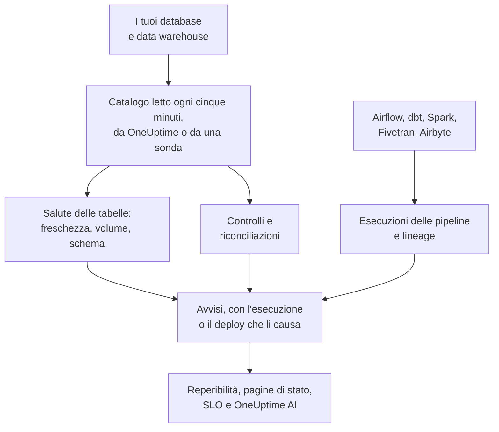

# Osservabilità dei dati

Osservabilità dei dati sorveglia le tabelle su cui si basa la tua azienda, in PostgreSQL, MySQL, SQL Server, Oracle, MongoDB, Redshift, Snowflake, BigQuery, ClickHouse, Databricks e Athena, e ti avvisa quando i loro dati sono in ritardo, mancanti, errati o danneggiati, prima che se ne accorga chi li usa. Impara da sé il ritmo di ogni tabella, legge il catalogo di ogni database in modo che nessun valore ne esca, e collega ogni problema dei dati all'esecuzione della pipeline, al deploy o alla tabella a monte che ne è la causa.

Risponde a quattro domande:

:::cards
- [I dati sono aggiornati?](/docs/data-observability/table-health): L'ultima modifica, le righe, le dimensioni e le colonne di ogni tabella, lette ogni cinque minuti, con avvisi quando una tabella è in ritardo, si riduce o cambia struttura.
- [I dati sono corretti?](/docs/data-observability/checks): Controlli su ciò che contiene una tabella, riconciliazioni tra una tabella e la sua copia, e i test di dbt, con avvisi quando falliscono.
- [Da dove vengono, e cosa alimentano?](/docs/data-observability/lineage-and-pipelines): Il lineage dalle tue pipeline, da dbt, Fivetran, Airbyte, dalle viste e dalla cronologia delle query dei database stessi, così un problema apre una sola segnalazione.
- [Chi li usa può fidarsi?](/docs/data-observability/data-products): Prodotti di dati con uno SLA di freschezza, sulle pagine di stato e monitorati come SLO, con un badge «data as of».
:::

## Come funziona

1. **Collega un database** con un utente di sola lettura. Un database che Sicurezza dei dati conosce già viene sorvegliato senza fare nulla, e così ogni dataset BigQuery trovato dalla tua connessione Google Cloud. Un database in una rete privata viene letto da una sonda che esegui lì.
2. **Ogni cinque minuti** OneUptime legge il catalogo e le statistiche di ogni database: ogni tabella e vista, le sue colonne, righe e dimensioni, e quando è cambiata l'ultima volta. Nessuna tabella viene scansionata, e su MongoDB si leggono solo i nomi dei campi dei suoi documenti più recenti. Un percorso in un bucket può essere sorvegliato allo stesso modo.
3. **Il ritmo di ogni tabella viene appreso**: quanto spesso cambia di solito. Una tabella che salta il suo ritmo è in ritardo; una le cui righe crollano, o le cui colonne cambiano, lo segnala.
4. **Gli avvisi consigliati** trasformano ciascuno di questi casi in un monitor che scegli di avere, e i controlli che aggiungi leggono ciò che contiene una tabella.
5. La **Derivazione** (lineage) indica quali tabelle alimentano quali, così un avviso su una tabella la cui origine si è guastata per prima viene trattato come conseguenza di quell'origine: una segnalazione, non dieci.

## In cosa è diverso

- **Fa parte del resto di OneUptime.** Un avviso sui dati è un avviso come gli altri: chiama chi è di reperibilità, apre incidenti, compare sulle pagine di stato e conta per gli SLO. I servizi che, secondo le tue tracce, scrivono in una tabella, e i loro deploy, compaiono accanto a ogni avviso sulla tabella.
- **Niente da configurare tabella per tabella.** Ritmi, pianificazioni e durate abituali delle esecuzioni vengono appresi da ciò che fa ogni tabella e ogni pipeline, e un monitor consigliato per un database copre ogni sua tabella, comprese quelle create in seguito.
- **Una segnalazione per causa.** Un avviso la cui tabella, pipeline o database a monte ha già un avviso aperto si unisce a quell'avviso come sua conseguenza, già riconosciuto, così un caricamento non riuscito chiama una volta sola.
- **Ogni avviso si spiega da sé.** Classifica la causa probabile, indica cosa dipende dalla tabella e chi ne è proprietario, e impara da ciò che ne dici: contrassegnane uno come **Non è un problema** e la stessa cosa resta silenziosa la volta successiva.
- **OneUptime AI conosce i tuoi dati.** Le indagini sugli avvisi relativi ai dati partono da chi scrive nella tabella, dalle sue esecuzioni e dalle sue tabelle a monte; in Chiedi all'IA, Slack e Microsoft Teams, e dagli agenti IA, si può chiedere se una tabella è aggiornata; e un controllo si può scrivere a partire da una frase. Vedi [OneUptime AI e l'API](/docs/data-observability/ai-and-api).

## Prima di iniziare

- **Un ruolo che può configurarla.** I ruoli Proprietario del progetto, Amministratore del progetto e Amministratore della telemetria collegano i database. Chiunque possa modificare gli asset di dati aggiunge controlli, riconciliazioni e prodotti di dati; chi ha il ruolo Visualizzatore legge ciò che ha trovato. Vedi [Riferimento autorizzazioni](/docs/permissions/reference).
- **Un utente di sola lettura su ogni database.** [Collegare un database](/docs/data-observability/connect) elenca il minimo che serve a ogni motore. OneUptime suggerisce i database che i tuoi trace, i tuoi account cloud e Database Monitoring già conoscono.

## Avvio rapido

:::steps
### Collega un database

Apri **Osservabilità dei dati**, vai su **Database** e scegli **Collega un database**. Scegli il motore e fornisci una stringa di connessione di sola lettura, oppure il nome della variabile d'ambiente da cui la legge la tua sonda. [Collegare un database](/docs/data-observability/connect) mostra l'utente di ogni motore.

### Guarda le sue tabelle

Entro cinque minuti le sue tabelle compaiono in **Tabelle**, ognuna con le sue righe, le sue dimensioni e il momento dell'ultima modifica. La freschezza di una tabella è nota non appena è cambiata due volte: **Aggiornata** finché mantiene il suo ritmo, **In ritardo** appena lo salta.

### Aggiungi gli avvisi consigliati

In **Database**, scegli **Avvisi consigliati** per il database e aggiungi quelli che vuoi: una tabella in ritardo, una le cui righe calano bruscamente o sono insolitamente poche, una le cui colonne cambiano, e un database che smette di inviare dati. Ognuno è un monitor come gli altri: reperibilità, proprietari, finestre di manutenzione e pagine di stato funzionano come per qualsiasi altro.
:::

## Passaggi successivi

:::cards
- [Collegare un database](/docs/data-observability/connect): L'utente con i privilegi minimi per ogni motore, e le sonde per le reti private.
- [Salute delle tabelle](/docs/data-observability/table-health): Freschezza, volume, modifiche allo schema, tabelle inutilizzate e le metriche che ogni tabella scrive.
- [Controlli e riconciliazioni](/docs/data-observability/checks): Regole sui valori di una tabella, il confronto di una tabella con la sua copia, e i test di dbt.
- [Lineage e pipeline](/docs/data-observability/lineage-and-pipelines): OpenLineage, dbt, Fivetran e Airbyte, e una segnalazione per causa.
- [Prodotti di dati](/docs/data-observability/data-products): SLA di freschezza per chi usa i dati, sulle pagine di stato e come SLO.
- [OneUptime AI e l'API](/docs/data-observability/ai-and-api): Indagini, un controllo da una frase, la freschezza per gli agenti IA, e ogni endpoint.
:::
