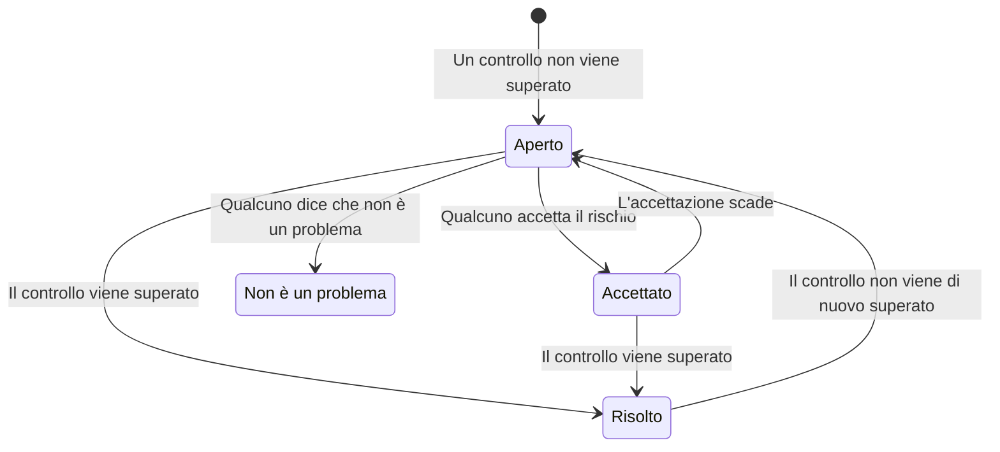

# Controlli e problemi di Sicurezza dei dati

Sicurezza dei dati esegue 32 controlli su ogni archivio, in nove gruppi. Un controllo legge ciò che si sa di un archivio - come è configurato, cosa vi è stato trovato, chi può raggiungerlo, dove si trova - e viene superato, non viene superato o non può stabilirlo. Un controllo non superato apre un problema su quell'archivio, e il problema si chiude da solo quando il controllo viene superato. Questa pagina elenca ogni controllo, come si calcolano la gravità e il punteggio di rischio di un problema, e cosa succede a un problema nel corso della sua vita.

:::cards
- [Come decide un controllo](#come-decide-un-controllo): Superato, non superato o non può stabilirlo, e quanto è grave un fallimento.
- [Tutti i controlli](#tutti-i-controlli): Tutti i 32, con cosa verifica ciascuno e come correggerlo.
- [Punteggio di rischio](#punteggio-di-rischio): Come vengono ordinati i problemi all'interno di una gravità.
- [Cosa succede a un problema](#cosa-succede-a-un-problema): Aperto, risolto, accettato, non è un problema.
- [Correggi da qui](#correggi-da-qui): Blocca un bucket pubblico, o interrompi la condivisione di uno snapshot, con un clic.
:::

## Come decide un controllo

Ogni controllo legge delle informazioni su un archivio e risponde in uno di quattro modi:

| Risposta | Cosa significa | Cosa succede al problema |
| --- | --- | --- |
| Superato | Il controllo non trova nulla che non va. | Un problema aperto o accettato viene risolto. |
| Non superato | Il controllo trova il problema, e dice in una frase cosa ha visto: la prova del problema. | Si apre un problema, oppure quello aperto viene aggiornato. |
| Non può stabilirlo | Non è stato possibile leggere un'informazione: un permesso che il ruolo non ha, una chiamata non riuscita. | Non cambia nulla: un problema aperto resta aperto, perché nessuno può concludere che un problema sia risolto quando OneUptime non ha potuto guardare. |
| Non si applica | Il tipo di archivio non ha un'impostazione del genere. | Un problema aperto viene risolto. |

### La gravità segue i dati

Lo stesso problema conta di più su dati più sensibili. Ogni controllo indica una gravità per ogni livello di sensibilità, e un problema prende quella del suo archivio: un bucket pubblico di numeri di carta è Critico, un bucket pubblico di immagini del sito web solo Basso. Un trattino significa nessun problema. La sensibilità di un archivio deriva dai suoi risultati (vedi [Tipi di dati sensibili](/docs/data-security/data-types#sensibilità)), quindi i campioni di contenuto rendono corrette le gravità.

Alcuni controlli impostano invece la gravità in base a ciò che hanno visto. **Contiene segreti** è Alto su qualsiasi archivio, e Critico su un archivio pubblico o condiviso con altri account.

## Tutti i controlli

La gravità è indicata per i dati di livello Ristretto, Confidenziale, Interno e Pubblico, in quest'ordine. La pagina di ogni problema mostra la correzione completa per il suo archivio - i passaggi nella console, il comando CLI e, dove è adatto, il Terraform - con il nome e la regione dell'archivio già compilati.

### Esposizione

| Controllo | Si applica a | Cosa verifica | Gravità | Come correggere |
| --- | --- | --- | --- | --- |
| Chiunque su Internet può leggerlo (`public-read`) | Archiviazione di oggetti, Warehouse, Ricerca | La policy, l'ACL o i binding IAM dell'archivio permettono a chiunque di leggerne i dati senza effettuare l'accesso. | Critico / Critico / Alto / Basso | Rimuovi ogni concessione ai principal anonimi o a tutti gli utenti autenticati. I file che devono essere pubblici vanno in un archivio contrassegnato come **Pubblico per scelta** che non contiene nient'altro. |
| Chiunque su Internet può modificarlo (`public-write`) | Archiviazione di oggetti, Warehouse, Ricerca | La policy, l'ACL o i binding IAM dell'archivio permettono a chiunque di scriverne o eliminarne i dati. | Critico / Critico / Critico / Alto | Rimuovi ogni concessione di scrittura o eliminazione ai principal anonimi o a tutti gli utenti autenticati. |
| L'accesso pubblico non è bloccato (`public-access-not-blocked`) | AWS S3 Bucket | S3 Block Public Access non è completamente attivo per il bucket o per il suo account, quindi una sola modifica alla policy può renderlo pubblico. | Alto / Medio / Basso / — | Attiva tutte e quattro le impostazioni di Block Public Access per il bucket. |
| Il database accetta connessioni da Internet (`internet-reachable`) | Database, Warehouse, Ricerca, Cache | Il database ha un endpoint pubblico o l'accesso dalla rete pubblica attivato. | Alto / Alto / Medio / Basso | Disattiva l'endpoint pubblico, e raggiungi il database tramite una rete privata o un bastion host. |
| Il suo firewall lascia entrare ogni indirizzo (`open-to-all-addresses`) | Database, Warehouse, Ricerca, Cache | Una regola del firewall o una rete autorizzata consente 0.0.0.0/0 o l'intero intervallo di indirizzi. | Critico / Critico / Alto / Medio | Sostituisci la regola che consente tutto con gli indirizzi o le reti che hanno bisogno di accesso. |
| Un suo snapshot può essere ripristinato da chiunque (`snapshot-public`) | Database, Snapshot | Uno snapshot del database è condiviso pubblicamente, quindi qualsiasi account cloud può ripristinarne una copia completa. | Critico / Critico / Critico / Alto | Rendi privato lo snapshot. |
| Un suo snapshot è condiviso con altri account (`snapshot-shared-externally`) | Database, Snapshot | Uno snapshot del database è condiviso con account esterni a quelli collegati. | Alto / Alto / Medio / Basso | Interrompi la condivisione dello snapshot con gli account che non dovrebbero averlo. |
| Account esterni alla tua organizzazione possono raggiungerlo (`shared-with-external-accounts`) | Ogni archivio tranne la telemetria | La policy dell'archivio concede l'accesso ad account, tenant o progetti che non sono collegati a OneUptime. | Alto / Alto / Medio / Basso | Esamina ogni principal esterno, e rimuovi quelli che non hanno bisogno di accesso. |

### Cifratura

| Controllo | Si applica a | Cosa verifica | Gravità | Come correggere |
| --- | --- | --- | --- | --- |
| I suoi dati non sono cifrati a riposo (`not-encrypted-at-rest`) | Ogni archivio tranne la telemetria | La cifratura dello storage è disattivata. | Alto / Medio / Basso / — | Attiva la cifratura a riposo. Un'istanza RDS non può essere cifrata sul posto: ripristina una copia cifrata del suo snapshot. |
| I dati di livello Ristretto non sono cifrati con una tua chiave (`no-customer-managed-key`) | Ogni archivio tranne la telemetria | L'archivio contiene dati di livello Ristretto ma è cifrato con la chiave predefinita del provider, non con una gestita dal cliente. | Medio / — / — / — | Cifra l'archivio con una chiave che gestisci nel tuo servizio di chiavi. |
| Le connessioni non cifrate sono consentite (`encryption-in-transit-not-enforced`) | Ogni archivio tranne la telemetria | L'archivio accetta connessioni che non usano TLS. | Alto / Medio / Basso / — | Richiedi TLS per ogni connessione. Su S3, nega ogni richiesta in cui `aws:SecureTransport` è false. |
| Accetta TLS precedenti alla 1.2 (`weak-tls`) | Ogni archivio tranne la telemetria | La versione minima di TLS è 1.0 o 1.1. | Medio / Medio / Basso / — | Imposta la versione minima di TLS a 1.2 o successiva. |

### Ripristino

| Controllo | Si applica a | Cosa verifica | Gravità | Come correggere |
| --- | --- | --- | --- | --- |
| Non ha backup, o li conserva per meno di 7 giorni (`no-backups`) | Database, Warehouse | I backup automatici sono disattivati, o conservati per meno di 7 giorni. | Alto / Medio / Basso / — | Attiva i backup automatici, e conservali per almeno 7 giorni. |
| Il ripristino point-in-time è disattivato (`no-point-in-time-recovery`) | AWS DynamoDB Table, Azure Cosmos DB Account | La tabella o il database non può essere ripristinato a un momento precedente a un errore. | Medio / Basso / — / — | Attiva il ripristino point-in-time. |
| Può essere eliminato in un solo passaggio (`deletion-protection-off`) | Database, Warehouse | La protezione dall'eliminazione è disattivata. | Medio / Basso / — / — | Attiva la protezione dall'eliminazione. |
| I file eliminati o sovrascritti non possono essere recuperati (`deleted-data-not-recoverable`) | Archiviazione di oggetti | Il versioning e l'eliminazione temporanea sono entrambi disattivati. | Medio / Basso / — / — | Attiva il versioning o l'eliminazione temporanea. |

### Visibilità

| Controllo | Si applica a | Cosa verifica | Gravità | Come correggere |
| --- | --- | --- | --- | --- |
| Nessuno saprebbe chi lo ha letto (`access-not-logged`) | Ogni archivio tranne la telemetria | Le letture dell'archivio non vengono registrate: nessun log di accesso, nessun log di audit sull'accesso ai dati. | Alto / Medio / Basso / — | Attiva il logging di accesso o di audit per le letture: i log di accesso al server S3 o gli eventi di dati CloudTrail, i log di diagnostica StorageRead di Azure, i log di audit Data Access di Cloud Storage. |

### Accesso

| Controllo | Si applica a | Cosa verifica | Gravità | Come correggere |
| --- | --- | --- | --- | --- |
| Chiunque abbia la chiave dell'account può leggere tutto (`shared-key-access`) | Azure Storage Account | L'account di archiviazione consente l'accesso con chiave condivisa, che aggira Microsoft Entra ID e non lascia una traccia di audit per persona. | Medio / Basso / — / — | Sposta le applicazioni su Microsoft Entra ID, poi disattiva l'accesso con chiave dell'account di archiviazione. |
| Gli oggetti possono avere regole di accesso proprie (`object-acls-enabled`) | AWS S3 Bucket, Google Cloud Storage Bucket | Le ACL degli oggetti sono attive, quindi un oggetto può essere reso pubblico mentre il bucket sembra privato. | Basso / Basso / — / — | Su S3, imposta Object Ownership su Bucket owner enforced. Su Cloud Storage, attiva l'accesso uniforme a livello di bucket. |
| Più di 25 identità possono leggere dati di livello Ristretto (`many-readers`) | Ogni archivio tranne la telemetria | Più identità di quante la maggior parte dei team riesca a esaminare hanno accesso in lettura all'archivio. | Medio / — / — / — | Apri la pagina **Chi può accedervi** dell'archivio, e rimuovi gli accessi inutilizzati o più ampi del necessario. |

### Igiene dei dati

| Controllo | Si applica a | Cosa verifica | Gravità | Come correggere |
| --- | --- | --- | --- | --- |
| Contiene segreti (`secrets-stored`) | Ogni archivio tranne la telemetria | Nei dati dell'archivio sono stati trovati password, chiavi API, token o chiavi private. | Alto / Alto / Alto / Alto | Ruota ogni segreto trovato, come se fosse trapelato. Sposta i segreti in un secret manager ed eliminali dall'archivio. |
| Sono conservati codici di sicurezza delle carte (`card-security-codes-stored`) | Ogni archivio tranne la telemetria | Sono stati trovati codici CVV o CVC. PCI DSS vieta di conservarli dopo l'autorizzazione di un pagamento, cifrati o no. | Critico / Critico / Critico / Critico | Ferma il codice che li scrive, elimina i codici conservati, e verifica che non ne restino nei backup. |
| I numeri di carta sono conservati in forma leggibile (`card-numbers-readable`) | Ogni archivio tranne la telemetria | Sono stati trovati numeri di carta completi in forma leggibile. PCI DSS richiede che siano illeggibili ovunque siano conservati. | Alto / Alto / Alto / Alto | Tokenizza i numeri di carta con il tuo provider di pagamento, o cifrali a livello di campo, ed elimina le copie leggibili. |
| Le password sono conservate in chiaro (`plaintext-passwords`) | Ogni archivio tranne la telemetria | Un campo password contiene valori che non sono hash di password (bcrypt, argon2, scrypt o PBKDF2). | Critico / Critico / Critico / Critico | Esegui l'hash delle password con bcrypt, scrypt o argon2, migra quelle conservate, e fai reimpostare la password a ogni account. |
| Dati di produzione sono stati copiati in un archivio non di produzione (`production-data-in-non-production`) | Ogni archivio tranne la telemetria | Valori trovati in un archivio di produzione sono stati trovati anche qui, in un archivio di sviluppo, di test o di staging. | Alto / Medio / — / — | Sostituisci la copia con dati mascherati o sintetici, ed elimina i dati reali dall'archivio non di produzione. |
| Dati sensibili che nessuno usa da 90 giorni (`stale-sensitive-data`) | Ogni archivio tranne la telemetria | L'archivio contiene dati sensibili e non ha avuto letture né scritture per 90 giorni. | Medio / Basso / — / — | Conferma che i dati non servono più, poi archiviali con una data di conservazione, o eliminali. |
| Questo archivio sensibile non ha un proprietario (`no-owner`) | Ogni archivio | L'archivio contiene dati sensibili e non ha un proprietario. | Medio / Basso / — / — | Aggiungi un proprietario nella pagina **Proprietari** dell'archivio, o una regola del proprietario che corrisponda ai suoi tag. |

### Telemetria

| Controllo | Si applica a | Cosa verifica | Gravità | Come correggere |
| --- | --- | --- | --- | --- |
| Dati sensibili stanno arrivando nella tua telemetria (`sensitive-data-in-telemetry`) | Telemetria | Log, tracce, eccezioni, replay o conversazioni IA contengono dati sensibili che nessuna regola di pulizia maschera. | Alto / Medio / Basso / — | Premi **Ripulisci** su ogni risultato per mascherare i dati all'ingestione, poi correggi il codice che li scrive. |
| Segreti stanno arrivando nella tua telemetria (`secrets-in-telemetry`) | Telemetria | Password, chiavi API o token compaiono in log, tracce, eccezioni o conversazioni IA. | Critico / Critico / Critico / Critico | Ruota prima il segreto, poi premi **Ripulisci** e correggi il codice che lo scrive. |

### Residenza

| Controllo | Si applica a | Cosa verifica | Gravità | Come correggere |
| --- | --- | --- | --- | --- |
| I dati sono conservati fuori dalle regioni in cui possono risiedere (`residency-violation`) | Ogni archivio tranne la telemetria | La regione dell'archivio, o una regione in cui vengono replicati i suoi dati, viola una regola di residenza. | Alto / Alto / Medio / — | Sposta i dati in una regione consentita, o smetti di copiarli nell'altra. Se il trasferimento è lecito, accetta il problema e registra il motivo. |

### IA

| Controllo | Si applica a | Cosa verifica | Gravità | Come correggere |
| --- | --- | --- | --- | --- |
| Dati sensibili vengono inviati a un provider di IA (`sensitive-data-to-ai`) | Conversazioni IA | Le conversazioni IA registrate in OneUptime portano dati sensibili a un provider di modelli. | Critico / Alto / Basso / — | Oscura i valori sensibili prima che i prompt vengano inviati, o invia queste chiamate a un modello che ospiti tu. |
| Dati di livello Ristretto si trovano in un archivio usato per l'IA (`sensitive-data-in-ai-store`) | Ogni archivio tranne la telemetria | Un archivio taggato come dati di addestramento o di retrieval per l'IA contiene dati di livello Ristretto. | Alto / Medio / — / — | Rimuovi o maschera i dati di livello Ristretto prima che vengano usati per addestrare un modello o per fornirgli contesto. |

## Punteggio di rischio

La gravità dice quanto è grave un problema. Il punteggio di rischio, da 0 a 100, ordina i problemi di una stessa gravità, in base a ciò che rende peggiore lo stesso problema:

```text
risk = severity + 10 × exposure + 6 × volume + 5 × activity + 4 × production, at most 100
```

| Fattore | Punti |
| --- | --- |
| Gravità | 75 per Critico, 50 per Alto, 25 per Medio, 0 per Basso |
| Esposizione | 10 per Pubblico, 8 per Altri account, 6 per Raggiungibile da Internet, 3 per Sconosciuto, 0 per Privato |
| Volume | Fino a 6, in base ai record sensibili stimati dell'archivio su scala logaritmica: 1 per 10 record, 3 per 1.000, 5 per un milione, 6 per dieci milioni o più |
| Attività | 5 quando Security Operations ha visto rilevamenti sull'archivio nell'ultima settimana |
| Produzione | 4 per un archivio in produzione |

Gli extra aggiungono al massimo 25 punti, quindi un problema non ottiene mai un punteggio inferiore a quello di un problema di gravità più bassa. Un bucket pubblico di produzione con un milione di record di dati di livello Ristretto ottiene 75 + 10 + 5 + 4 = 94 per un problema Critico. Ogni problema elenca i fattori che hanno aumentato il suo punteggio, con i loro punti, e l'archivio mostra il punteggio del suo problema aperto peggiore.

L'ambiente di un archivio - Produzione, Staging, Development, Test o Sconosciuto - deriva dai suoi tag (`env`, `environment`, `stage`, `tier` e simili) oppure, in loro assenza, dalle parole nel suo nome, come `prod`, `staging`, `dev` o `qa`. Impostalo sull'archivio quando nessuno dei due lo indica.

## Cosa succede a un problema



OneUptime apre, aggiorna e risolve i problemi man mano che i controlli vengono eseguiti. Ciò che una persona fa con un problema è decidere cosa succede dopo:

| Stato | Come ci arriva | Cosa segue |
| --- | --- | --- |
| **Aperto** | Il suo controllo ora non viene superato sull'archivio. | Conta nella Panoramica, nel riepilogo dell'archivio e nella conformità, finché il controllo non viene superato. |
| **Risolto** | Il suo controllo è stato superato in un'esecuzione successiva, non si applica più o è stato disattivato, oppure il suo archivio è stato archiviato. Una persona può anche scegliere **Segna come risolto**: l'archivio viene subito controllato di nuovo. | Si riapre se il controllo non viene di nuovo superato, e il problema conta quante volte si è riaperto. |
| **Accettato** | Una persona ha scelto **Accetta il rischio**, con un **Motivo** e una data in **Accettato fino al**, al massimo a un anno di distanza. | Resta chiuso fino a quella data, poi si riapre se il controllo continua a non essere superato. Accettalo di nuovo allora, se il motivo vale ancora. |
| **Non è un problema** | Una persona ha scelto **Non è un problema**: il risultato era sbagliato. | Resta chiuso, anche mentre il controllo non viene superato. **Riapri** lo riporta ad Aperto. |

I Security Member, i Security Admin, i Project Admin e i Project Owner possono cambiare lo stato di un problema, e assegnarlo a una persona o a un team con **Assegna**. Ogni modifica viene scritta nella **Cronologia** del problema: quando si è aperto, ogni cambio di gravità, ogni cambio di stato e chi lo ha fatto, le nuove verifiche richieste, e cosa hanno fatto le integrazioni.

Un problema che si riapre mantiene la sua cronologia. I rischi accettati vengono riesaminati ogni giorno, così un'accettazione scade puntuale anche quando non è stato scansionato nulla.

## Correggi da qui

Un problema aperto su un bucket pubblico o su uno snapshot condiviso può essere corretto dalla sua pagina. Sopra i passaggi della console, **Correggi da qui** propone la modifica che lo corregge:

| Il problema | Il suo archivio | Il pulsante | Cosa cambia |
| --- | --- | --- | --- |
| `public-read`, `public-write` o `public-access-not-blocked` | Un bucket S3, un account di archiviazione Azure o un bucket Cloud Storage | **Blocca l'accesso pubblico** | Attiva le quattro impostazioni di Block Public Access del bucket, disattiva l'accesso anonimo ai blob dell'account di archiviazione, o applica la prevenzione dell'accesso pubblico del bucket |
| `snapshot-public` o `snapshot-shared-externally` | Uno snapshot RDS, un database RDS, o un cluster Aurora o DocumentDB | **Revoca la condivisione** | Interrompe la condivisione dello snapshot, o di ogni snapshot manuale condiviso del database, con tutti e con gli account esterni a quelli che hai collegato |

Prima chiede conferma, dicendo cosa cambia e cosa smette di funzionare. Cambia il modo in cui l'archivio è condiviso, mai i suoi dati, e non cambia nulla che sia già chiuso. Un archivio contrassegnato come **Pubblico per scelta** non viene mai bloccato.

Agisce tramite la connessione cloud dell'archivio, quindi la connessione deve avere **Risposta di sicurezza dei dati** attivata e il suo comando di configurazione eseguito di nuovo (vedi [Configurare Sicurezza dei dati](/docs/data-security/setup#lasciare-che-sicurezza-dei-dati-chiuda-unesposizione)). Fino ad allora il pannello dice cosa attivare. L'archivio viene controllato di nuovo subito dopo, e il problema si risolve da solo quando il suo controllo viene superato. La **Cronologia** del problema e la **Cronologia** dell'archivio dicono cosa è stato fatto, e chi l'ha fatto.

## Impostazioni dei controlli

**Sicurezza dei dati → Impostazioni → Controlli** elenca ogni controllo per gruppo, con ciò che cerca e la gravità che riceve un fallimento per ogni sensibilità. Ogni controllo si può regolare per il progetto, e ogni modifica si salva subito:

- **Il suo interruttore** disattiva il controllo, quando non si adatta al tuo modo di lavorare. I suoi problemi aperti e accettati vengono risolti, e indicano che il controllo non viene più eseguito.
- **La sua gravità** è **Per sensibilità** come impostazione iniziale, oppure un'unica gravità che riceve ogni fallimento del controllo, qualunque cosa contenga il suo archivio.

Per silenziare un controllo su un solo archivio, accetta il rischio sul problema di quell'archivio, oppure contrassegna il problema con Non è un problema. Per un risultato sbagliato, anziché un problema che non conta, contrassegna invece il risultato come non sensibile (vedi [Tipi di dati sensibili](/docs/data-security/data-types#non-sensibile-e-mai-sensibile)).

**Controlla ora** su un archivio ne rilegge la configurazione ed esegue i suoi controlli. **Scansiona ora** ne campiona il contenuto, e i suoi controlli vengono eseguiti al termine della scansione.

## Passaggi successivi

:::cards
- [Integrazioni di Sicurezza dei dati](/docs/data-security/integrations): Casi di sicurezza, avvisi ed email ai proprietari quando si apre un problema.
- [Flussi di dati, accesso e residenza](/docs/data-security/flows-access-residency): Gli accessi, le copie e le regioni che leggono diversi controlli.
- [Conformità di Sicurezza dei dati](/docs/data-security/compliance): I requisiti dei framework di cui ogni controllo è una prova.
:::
