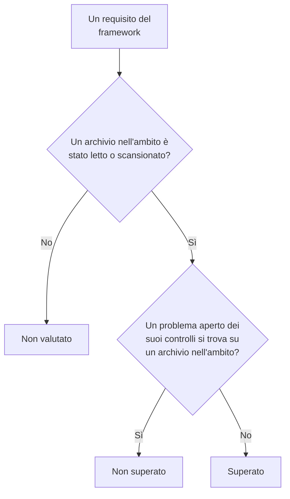

# Conformità di Sicurezza dei dati

Sicurezza dei dati valuta nove framework in base a ciò che hanno trovato le sue scansioni. Ogni framework copre gli archivi di cui parlano le sue regole - il GDPR gli archivi che contengono dati personali, PCI DSS gli archivi in cui sono stati trovati dati di carte, SOC 2 ogni archivio - e ciascuno dei suoi requisiti viene soddisfatto o meno dai controlli che ne sono la prova. **Sicurezza dei dati → Conformità** mostra il punteggio di ogni framework, quanti archivi copre, e ogni requisito con il numero di problemi aperti che lo fanno fallire. Ogni risorsa che contiene archivi dati - un cluster Kubernetes, un host Docker o Podman, un database, un servizio o una risorsa cloud - ha la stessa pagina tutta per sé, dove puoi disattivare ciò che non la riguarda. Un punteggio è una prova per un audit, non un certificato: dice ciò che OneUptime riesce a vedere degli archivi che legge.

:::cards
- [I framework](#i-framework): I nove, e quali archivi copre ciascuno.
- [Come viene valutato un framework](#come-viene-valutato-un-framework): Requisiti superati, non superati e non valutati.
- [Nella pagina di una risorsa](#nella-pagina-di-una-risorsa): La conformità di un cluster, di un host, di un database, di un servizio o di una risorsa cloud, e ciò che è disattivato per quella risorsa.
- [Requisiti e relativi controlli](#requisiti-e-relativi-controlli): Ogni requisito, e i controlli che ne sono la prova.
- [Registro dei trattamenti](#registro-dei-trattamenti): L'articolo 30 del GDPR, scritto a partire dai tuoi archivi, con le bozze di OneUptime AI da confermare.
- [Valutazioni d'impatto](#valutazioni-dimpatto): Una valutazione d'impatto sulla protezione dei dati per ogni archivio che ne ha bisogno.
- [Prove di audit](#prove-di-audit): Ciò che un auditor legge sotto ogni requisito, esportato con il tuo registro e la cronologia dei problemi.
:::

## I framework

| Framework | Nome completo | Archivi nell'ambito |
| --- | --- | --- |
| GDPR | Regolamento generale sulla protezione dei dati dell'UE | Archivi che contengono dati personali. |
| CCPA | California Consumer Privacy Act, come modificato dal CPRA | Archivi che contengono informazioni personali. |
| HIPAA | HIPAA Security Rule | Archivi che contengono dati sanitari. |
| PCI DSS | PCI DSS v4.0 | Archivi in cui sono stati trovati numeri di carta. |
| SOC 2 | SOC 2 Trust Services Criteria | Ogni archivio dati. |
| ISO 27001 | ISO/IEC 27001:2022 | Ogni archivio dati. |
| NIST CSF | NIST Cybersecurity Framework 2.0 | Ogni archivio dati. |
| LGPD | Legge generale sulla protezione dei dati del Brasile | Archivi che contengono dati personali di persone in Brasile. |
| DPDP | Digital Personal Data Protection Act dell'India, 2023 | Archivi che contengono dati personali di persone in India. |

## Quali archivi copre un framework

L'ambito di un archivio deriva dai dati trovati al suo interno, quindi cambia man mano che le scansioni trovano altro:

- **SOC 2, ISO 27001 e NIST CSF** sono framework di sicurezza: coprono ogni archivio, qualunque cosa contenga.
- **GDPR, CCPA, HIPAA e PCI DSS** coprono gli archivi che contengono un tipo di dati che proteggono. I dati personali fanno rientrare il GDPR e il CCPA, i dati sanitari anche HIPAA, e i numeri di carta, i codici di sicurezza delle carte e le date di scadenza delle carte PCI DSS. Un archivio che contiene solo segreti o documenti aziendali non rientra in nessuno di essi.
- **LGPD e DPDP** sono leggi nazionali: coprono gli archivi che contengono dati personali di persone in Brasile o in India, ricavati dai tipi di dati che appartengono a quel paese, come un CPF brasiliano o un numero Aadhaar indiano.

[Tipi di dati sensibili](/docs/data-security/data-types#tipi-di-dati-integrati) elenca ogni tipo di dati, con il suo paese.

## Come viene valutato un framework

- **Un requisito è superato** quando nessun problema aperto dei controlli associati a esso si trova su un archivio nell'ambito del framework, e **non è superato** quando ce n'è uno.
- **Non è valutato** finché nessun archivio nell'ambito ha avuto la configurazione letta o il contenuto scansionato.
- **Due requisiti sono soddisfatti da Sicurezza dei dati stessa**: l'articolo 30 del GDPR, registri delle attività di trattamento, e ISO 27001 A.5.12, classificazione delle informazioni. Sono superati quando ogni archivio nell'ambito è stato letto o scansionato, e non superati finché uno non lo è stato.
- **È disattivato** quando ogni archivio nell'ambito appartiene a una risorsa che ha disattivato il requisito (vedi [Nella pagina di una risorsa](#nella-pagina-di-una-risorsa)).
- **Il punteggio** è la quota dei requisiti valutati di un framework che sono superati, come percentuale intera: uno disattivato non conta né in un senso né nell'altro. Un framework senza nulla di valutato non ha un punteggio.

Contano solo i problemi aperti. Un problema il cui rischio è accettato, o che non è un problema, non fa fallire i suoi requisiti, quindi un rischio accettato è una decisione che il tuo audit può vedere sul problema: chi lo ha accettato, perché, e fino a quando.

## Nella pagina di una risorsa

Il menu di una risorsa ha una sezione **Sicurezza**, chiusa finché non la apri, non appena la risorsa contiene un archivio dati che Sicurezza dei dati conosce, in un progetto che usa Sicurezza dei dati e per chi può leggere gli archivi dati:

| Risorsa | I suoi archivi dati |
| --- | --- |
| Cluster Kubernetes | I database in esecuzione su di esso |
| Host Docker o Podman | I database in esecuzione su di esso |
| Database | Il database stesso |
| Servizio | La sua telemetria: i log, le tracce e le eccezioni che invia |
| Risorsa cloud | La risorsa stessa: un bucket, un database o un data warehouse |

- **Sicurezza dei dati** elenca quegli archivi, prima i più rischiosi, e i problemi aperti su di essi. Ognuno si apre in Sicurezza dei dati, dove viene gestito.
- **Conformità** valuta i framework solo per quegli archivi. Vengono prima i framework che i loro dati fanno rientrare nell'ambito; quelli disattivati, e quelli per cui nessuno di questi archivi contiene dati, sono raccolti più in basso, in una sezione chiusa.

Ogni framework ha un interruttore, **Si applica qui**, e così ciascuno dei suoi requisiti. Disattivarne uno esclude gli archivi della risorsa da quel framework, o da quel requisito, nella pagina della risorsa e in **Sicurezza dei dati → Conformità**, che indica quanti archivi sono stati esclusi dalle loro risorse. Riattivarlo li fa rientrare. Ogni interruttore si salva subito, e ogni modifica resta nei [Log di audit](/docs/configuration/audit-logs) del progetto.

Disattivarne uno chiede poi, subito sotto, **Perché non si applica qui?** Il motivo è facoltativo: scrivine uno breve e scegli **Salva motivo**, oppure **Non ora** per lasciar perdere. Da quel momento indica chi lo ha disattivato e quando, e il motivo, con **Aggiungi motivo** o **Modifica motivo** per scriverlo o cambiarlo in seguito. Come l'interruttore, il motivo resta nel log di audit.

**Sicurezza dei dati → Conformità** dice lo stesso per ogni risorsa. Un framework selezionato elenca, sotto **Disattivato per l'intero framework**, le risorse che lo hanno disattivato del tutto, e ogni requisito indica, sotto il suo stato, le risorse che hanno disattivato quel requisito: ciascuna con un link alla propria pagina Conformità, con chi lo ha disattivato, quando e perché. Il suo **Esporta CSV** le riporta in una colonna `Turned Off On`, ed **Esporta JSON** in un elenco `turnedOff`.

Un archivio segue gli interruttori di una sola risorsa. Un database in esecuzione su un cluster Kubernetes, o su un host Docker o Podman, segue quelli del cluster o dell'host: disattiva un framework per il cluster, ed è disattivato per ogni database in esecuzione su di esso. La pagina Conformità del database stesso lo dice e rimanda a quella del cluster o dell'host, con i suoi interruttori bloccati.

I Membri della sicurezza, gli Amministratori della sicurezza, gli Amministratori del progetto e i Proprietari del progetto possono attivare e disattivare framework e requisiti, come possono regolare un controllo. I Visualizzatori della sicurezza vedono ciò che è disattivato, e perché.

## Requisiti e relativi controlli

### GDPR

| Requisito | Cosa chiede | Controlli |
| --- | --- | --- |
| Art. 5(1)(c) | Minimizzazione dei dati | `production-data-in-non-production`, `stale-sensitive-data`, `new-personal-data-column`, `sensitive-data-in-telemetry`, `sensitive-data-to-ai`, `sensitive-data-in-ai-store` |
| Art. 5(1)(e) | Limitazione della conservazione | `stale-sensitive-data` |
| Art. 25 | Protezione dei dati fin dalla progettazione e per impostazione predefinita | `production-data-in-non-production`, `stale-sensitive-data`, `new-personal-data-column`, `sensitive-data-in-telemetry`, `sensitive-data-to-ai`, `sensitive-data-in-ai-store` |
| Art. 28 | Responsabili del trattamento | `sensitive-data-to-ai` |
| Art. 30 | Registri delle attività di trattamento | Soddisfatto da Sicurezza dei dati stessa |
| Art. 32 | Sicurezza del trattamento | `public-read`, `public-write`, `public-access-not-blocked`, `internet-reachable`, `open-to-all-addresses`, `snapshot-public`, `snapshot-shared-externally`, `shared-with-external-accounts`, `not-encrypted-at-rest`, `no-customer-managed-key`, `encryption-in-transit-not-enforced`, `weak-tls`, `no-backups`, `no-point-in-time-recovery`, `deletion-protection-off`, `deleted-data-not-recoverable`, `access-not-logged`, `shared-key-access`, `object-acls-enabled`, `many-readers`, `unused-access`, `secrets-stored`, `plaintext-passwords`, `secrets-in-telemetry` |
| Artt. 44-49 | Trasferimenti verso paesi terzi | `residency-violation` |

### CCPA

| Requisito | Cosa chiede | Controlli |
| --- | --- | --- |
| 1798.100(c) | Raccolta limitata a quanto necessario | `production-data-in-non-production`, `stale-sensitive-data`, `new-personal-data-column`, `sensitive-data-in-telemetry`, `sensitive-data-to-ai`, `sensitive-data-in-ai-store` |
| 1798.150 | Procedure di sicurezza ragionevoli | `public-read`, `public-write`, `public-access-not-blocked`, `internet-reachable`, `open-to-all-addresses`, `snapshot-public`, `snapshot-shared-externally`, `shared-with-external-accounts`, `shared-key-access`, `object-acls-enabled`, `many-readers` |

### HIPAA

| Requisito | Cosa chiede | Controlli |
| --- | --- | --- |
| 164.308(a)(4) | Gestione dell'accesso alle informazioni | `unused-access` |
| 164.308(a)(7) | Piano di emergenza | `no-backups`, `no-point-in-time-recovery`, `deletion-protection-off`, `deleted-data-not-recoverable` |
| 164.312(a)(1) | Controllo degli accessi | `public-read`, `public-write`, `public-access-not-blocked`, `internet-reachable`, `open-to-all-addresses`, `snapshot-public`, `snapshot-shared-externally`, `shared-with-external-accounts`, `shared-key-access`, `object-acls-enabled`, `many-readers` |
| 164.312(a)(2)(iv) | Cifratura e decifratura | `not-encrypted-at-rest`, `no-customer-managed-key` |
| 164.312(b) | Controlli di audit | `access-not-logged` |
| 164.312(e)(1) | Sicurezza della trasmissione | `encryption-in-transit-not-enforced`, `weak-tls` |

### PCI DSS

| Requisito | Cosa chiede | Controlli |
| --- | --- | --- |
| 3.3.1 | I dati di autenticazione sensibili non vengono conservati dopo l'autorizzazione | `card-security-codes-stored` |
| 3.4.1 | I numeri di carta vengono mascherati quando sono visualizzati | `card-numbers-readable`, `sensitive-data-in-telemetry` |
| 3.5.1 | I numeri di carta sono illeggibili ovunque siano conservati | `not-encrypted-at-rest`, `no-customer-managed-key`, `card-numbers-readable` |
| 4.2.1 | Una crittografia robusta protegge i dati delle carte in transito | `encryption-in-transit-not-enforced`, `weak-tls` |
| 7.2 | L'accesso è definito e assegnato in base alla necessità | `public-read`, `public-write`, `public-access-not-blocked`, `internet-reachable`, `open-to-all-addresses`, `snapshot-public`, `snapshot-shared-externally`, `shared-with-external-accounts`, `shared-key-access`, `object-acls-enabled`, `many-readers` |
| 7.2.4 | Gli account e i loro accessi vengono riesaminati | `unused-access` |
| 8.3.2 | I fattori di autenticazione sono illeggibili quando sono conservati | `plaintext-passwords` |
| 10.2 | I log di audit registrano l'accesso ai dati delle carte | `access-not-logged` |

### SOC 2

| Requisito | Cosa chiede | Controlli |
| --- | --- | --- |
| A1.2 | Backup e ripristino | `no-backups`, `no-point-in-time-recovery`, `deletion-protection-off`, `deleted-data-not-recoverable` |
| CC6.1 | Sicurezza degli accessi logici | `public-read`, `public-write`, `public-access-not-blocked`, `internet-reachable`, `open-to-all-addresses`, `snapshot-public`, `snapshot-shared-externally`, `shared-with-external-accounts`, `not-encrypted-at-rest`, `no-customer-managed-key`, `shared-key-access`, `object-acls-enabled`, `many-readers`, `secrets-stored`, `plaintext-passwords`, `secrets-in-telemetry` |
| CC6.2 | L'accesso viene rimosso quando non serve più | `unused-access` |
| CC6.7 | Trasmissione delle informazioni | `encryption-in-transit-not-enforced`, `weak-tls` |
| CC7.2 | Monitoraggio dei componenti di sistema | `access-not-logged` |

### ISO 27001

| Requisito | Cosa chiede | Controlli |
| --- | --- | --- |
| A.5.9 | Inventario delle informazioni e degli altri beni associati | `no-owner` |
| A.5.12 | Classificazione delle informazioni | Soddisfatto da Sicurezza dei dati stessa |
| A.5.15 | Controllo degli accessi | `public-read`, `public-write`, `public-access-not-blocked`, `internet-reachable`, `open-to-all-addresses`, `snapshot-public`, `snapshot-shared-externally`, `shared-with-external-accounts`, `shared-key-access`, `object-acls-enabled`, `many-readers` |
| A.5.18 | Diritti di accesso | `unused-access` |
| A.5.34 | Privacy e protezione delle PII | `production-data-in-non-production`, `stale-sensitive-data`, `new-personal-data-column`, `sensitive-data-in-telemetry`, `sensitive-data-to-ai`, `sensitive-data-in-ai-store` |
| A.8.11 | Mascheramento dei dati | `production-data-in-non-production`, `stale-sensitive-data`, `new-personal-data-column`, `sensitive-data-in-telemetry`, `sensitive-data-to-ai`, `sensitive-data-in-ai-store` |
| A.8.12 | Prevenzione della fuga di dati | `secrets-stored`, `secrets-in-telemetry` |
| A.8.13 | Backup delle informazioni | `no-backups`, `no-point-in-time-recovery`, `deletion-protection-off`, `deleted-data-not-recoverable` |
| A.8.15 | Logging | `access-not-logged` |
| A.8.24 | Uso della crittografia | `not-encrypted-at-rest`, `no-customer-managed-key`, `encryption-in-transit-not-enforced`, `weak-tls`, `plaintext-passwords` |

### NIST CSF

| Requisito | Cosa chiede | Controlli |
| --- | --- | --- |
| ID.AM-07 | Gli inventari di dati e metadati vengono mantenuti | `no-owner` |
| PR.AA-05 | I permessi di accesso vengono gestiti | `public-read`, `public-write`, `public-access-not-blocked`, `internet-reachable`, `open-to-all-addresses`, `snapshot-public`, `snapshot-shared-externally`, `shared-with-external-accounts`, `shared-key-access`, `object-acls-enabled`, `many-readers`, `unused-access` |
| PR.DS-01 | I dati a riposo sono protetti | `not-encrypted-at-rest`, `no-customer-managed-key`, `secrets-stored`, `secrets-in-telemetry` |
| PR.DS-02 | I dati in transito sono protetti | `encryption-in-transit-not-enforced`, `weak-tls` |
| PR.DS-11 | I backup dei dati vengono conservati e testati | `no-backups`, `no-point-in-time-recovery`, `deletion-protection-off`, `deleted-data-not-recoverable` |
| DE.CM-09 | I dati e il loro utilizzo vengono monitorati | `access-not-logged` |

### LGPD

| Requisito | Cosa chiede | Controlli |
| --- | --- | --- |
| Art. 6 | Necessità e limitazione della finalità | `production-data-in-non-production`, `stale-sensitive-data`, `new-personal-data-column`, `sensitive-data-in-telemetry`, `sensitive-data-to-ai`, `sensitive-data-in-ai-store` |
| Art. 33 | Trasferimento internazionale dei dati | `residency-violation` |
| Art. 46 | Misure di sicurezza | `public-read`, `public-write`, `public-access-not-blocked`, `internet-reachable`, `open-to-all-addresses`, `snapshot-public`, `snapshot-shared-externally`, `shared-with-external-accounts`, `not-encrypted-at-rest`, `no-customer-managed-key`, `shared-key-access`, `object-acls-enabled`, `many-readers` |

### DPDP

| Requisito | Cosa chiede | Controlli |
| --- | --- | --- |
| Sez. 8(5) | Misure di sicurezza ragionevoli | `public-read`, `public-write`, `public-access-not-blocked`, `internet-reachable`, `open-to-all-addresses`, `snapshot-public`, `snapshot-shared-externally`, `shared-with-external-accounts`, `not-encrypted-at-rest`, `no-customer-managed-key`, `shared-key-access`, `object-acls-enabled`, `many-readers` |
| Sez. 8(7) | Cancellazione quando la finalità è stata raggiunta | `production-data-in-non-production`, `stale-sensitive-data`, `new-personal-data-column`, `sensitive-data-in-telemetry`, `sensitive-data-to-ai`, `sensitive-data-in-ai-store` |
| Sez. 16 | Trasferimento al di fuori dell'India | `residency-violation` |

## Registro dei trattamenti

L'articolo 30 del GDPR ti chiede di tenere un registro delle tue attività di trattamento. Sicurezza dei dati ne scrive la parte che riguarda dove sono conservati i dati personali: una riga per ogni archivio che contiene dati personali. È la scheda **Registro dei trattamenti** alla fine di **Sicurezza dei dati → Conformità**, con **Esporta CSV** ed **Esporta JSON**.

| Colonna | Da dove viene |
| --- | --- |
| Archivio, tipo, provider e regione | Discovery |
| Ambiente | I tag o il nome dell'archivio, oppure ciò che imposti tu |
| Sensibilità, categorie e tipi di dati | Ciò che hanno trovato le scansioni, oppure la sensibilità che imposti tu |
| Proprietari | I proprietari dell'archivio, le persone e i membri dei suoi team |
| Finalità | Ciò che scrivi o confermi nella **Finalità** dell'archivio: perché contiene dati personali. OneUptime la compila per gli archivi che conserva per la tua sicurezza |
| Conservazione | Ciò che scrivi o confermi nella **Conservazione** dell'archivio: per quanto tempo vi vengono conservati i dati. OneUptime la compila per gli archivi che conserva per la tua sicurezza, e per la telemetria di un servizio in base alla conservazione della telemetria del tuo progetto |
| Chi può leggere | Chi può leggere un archivio che OneUptime conserva per la tua sicurezza |
| Framework | I framework che i suoi tipi di dati fanno rientrare nell'ambito |
| Dichiarato da | OneUptime, per gli archivi che conserva per la tua sicurezza |
| Base giuridica | Ciò che scrivi o confermi: la base giuridica dell'archivio ai sensi dell'articolo 6 del GDPR, una tra consenso, contratto, obbligo legale, interessi vitali, compito di interesse pubblico e legittimo interesse. Legittimo interesse per gli archivi che OneUptime conserva per la tua sicurezza |
| Interessati | Ciò che scrivi o confermi: a chi si riferiscono i dati dell'archivio, come clienti, utenti, dipendenti o pazienti |
| Destinatari | Ricavati dai flussi di dati dell'archivio: gli host esterni e i fornitori di IA a cui vengono inviati i suoi dati, e gli archivi che ne contengono una copia |
| Trasferimenti | Ricavati dalla regione dell'archivio, dalle regioni in cui il suo cloud lo copia e dalle regioni delle sue copie, confrontate con i paesi dei suoi interessati: ogni trasferimento fuori da quei paesi, o il motivo per cui non è noto |
| Valutazione d'impatto | Se l'archivio ha bisogno di una valutazione d'impatto sulla protezione dei dati, e a che punto è: non necessaria, necessaria, redatta o modificata |
| In attesa di revisione | I campi la cui bozza aspetta una persona. Una bozza non è mai nel registro, né nelle sue esportazioni, finché qualcuno non la conferma |

Per un archivio trovato da Sicurezza dei dati, nessuna scansione può sapere perché contiene dati personali, per quanto tempo, su quale base o a chi si riferiscono: scrivili nelle sue **Impostazioni**, oppure conferma le bozze di OneUptime AI. Il registro e i punteggi sono forniti anche dall'API di Sicurezza dei dati, in `/data-security/record-of-processing`, `/data-security/compliance` e, per una singola risorsa, `/data-security/resource-compliance`, a chiunque possa leggere gli archivi dati (vedi [Integrazioni di Sicurezza dei dati](/docs/data-security/integrations#api-terraform-e-mcp)).

### Le bozze di OneUptime AI

OneUptime AI redige **Finalità**, **Conservazione**, **Base giuridica** e **Interessati** di un archivio a partire da ciò che Sicurezza dei dati ne sa: i tipi di dati trovati, il suo nome, i tag e la descrizione, i servizi che lo usano e a cosa servono secondo i loro team, dove vanno i suoi dati e dove sono conservati. Non vede mai un valore dei tuoi dati (vedi [OneUptime AI in Sicurezza dei dati](/docs/data-security/ai)).

- **Una bozza è segnata come Bozza** e dice perché, con i fatti su cui si basa a un clic di distanza. Non è nel registro finché non premi **Conferma**, o non la riscrivi con parole tue con **Modifica**.
- **Le tue parole non vengono mai sostituite da una bozza.** Un campo che hai scritto non viene mai più redatto. Una bozza che hai confermato viene redatta di nuovo solo quando cambia un fatto su cui si basa, e allora viene proposta, non applicata: segnata come **Modifica proposta**, con ciò che è cambiato, **Usa la nuova bozza** e **Mantieni l'attuale**.
- **Rivedi bozze**, nella scheda **Registro dei trattamenti**, mostra uno alla volta gli archivi le cui bozze ti aspettano. Le **Impostazioni** di un archivio hanno gli stessi campi, con **Redigi con OneUptime AI** per quelli vuoti.
- **Da sola**, OneUptime AI redige una volta al giorno i campi vuoti degli archivi più rischiosi, mentre **Lavora sui nuovi problemi** è attivo in **Sicurezza dei dati → IA**, come consentono le tue regole IA.

La conservazione della telemetria di un servizio, i destinatari e i trasferimenti vengono ricavati da semplice codice, mai redatti. Le bozze sono un punto di partenza, non una consulenza legale: falle verificare da chi risponde della tua conformità.

### Archivi che OneUptime conserva per la tua sicurezza

Tre archivi contengono indirizzi IP di proposito, per proteggere la tua rete: **Eventi di sicurezza**, **Network Flows** e **Cassaforte indirizzi di sicurezza**. Il registro elenca ognuno di quelli che ha il tuo progetto. OneUptime li dichiara invece di trovarli: ciò che contengono è noto per progettazione, quindi nessuna scansione li legge, nessun controllo si applica a loro e il fatto che contengano questi indirizzi non è mai un problema, perché è il loro scopo. Portano l'indicazione **Dichiarato da OneUptime** in **Archivi dati**, e la **Panoramica** e i punteggi dei framework li lasciano fuori.

| Archivio | Cosa contiene | Conservazione | Chi può leggerlo |
| --- | --- | --- | --- |
| Eventi di sicurezza | Gli indirizzi IP, i nomi utente e gli indirizzi email di chi ha agito e di ciò che ha toccato | La [conservazione della telemetria](/docs/telemetry/data-retention) del tuo progetto, letta ogni volta che si legge il registro, così una modifica vale subito | Proprietari del progetto, Amministratori del progetto, Amministratori della sicurezza, Membri della sicurezza, Visualizzatori della sicurezza e chiunque abbia Read Security Event |
| Network Flows | Gli indirizzi IP di chi ha comunicato con chi | 30 giorni dopo l'arrivo di un flusso | Chiunque possa leggere i dispositivi di rete |
| Cassaforte indirizzi di sicurezza | L'indirizzo IP dietro ogni token lasciato da una regola di indirizzo IP che applica l'hash nei log e nelle tracce che legge [Eventi di sicurezza](/docs/telemetry/security-events) | 30 giorni dopo l'ultima volta in cui un indirizzo è stato visto | Solo le scansioni di Eventi di sicurezza, all'interno di OneUptime: nessuna persona, pagina, esportazione, API o strumento di IA |

La finalità di ciascuno è «Sicurezza delle reti e dell'informazione (considerando 49 del GDPR)». Per scrivere una finalità o una conservazione tua, usa **Modifica registro** nelle **Impostazioni** dell'archivio: un campo lasciato vuoto mantiene quello di OneUptime.

Un archivio è elencato finché il tuo progetto ne conserva i dati: la cassaforte, finché una regola di indirizzo IP attiva applica l'hash ai log o alle tracce che legge Eventi di sicurezza, e per altri 31 giorni (vedi [Mascherare i dati sensibili](/docs/telemetry/drop-filters-and-scrub-rules#mascherare-i-dati-sensibili)). Quando i suoi dati non ci sono più, l'archivio viene messo tra quelli archiviati, e torna con la tua finalità e la tua conservazione se tornano i dati.

## Valutazioni d'impatto

L'articolo 35 del GDPR richiede una valutazione d'impatto sulla protezione dei dati prima di un trattamento che può presentare un rischio elevato. Sicurezza dei dati indica quali archivi ne hanno bisogno: un archivio che contiene categorie particolari di dati, come i dati sanitari, dati su molte persone (circa 100.000 record o più), o dati che lasciano i paesi dei suoi interessati.

La **Valutazione d'impatto** di un archivio, nel suo menu sotto **Impostazioni**, dice perché l'archivio ne ha bisogno, o che non ne ha bisogno. **Redigi la valutazione** chiede a OneUptime AI le quattro parti richieste dall'articolo 35, paragrafo 7, a partire dal registro dell'archivio, dai suoi problemi aperti e da quelli corretti di recente, da quanto è esposto, da quanti possono accedervi e dalla sua crittografia:

| Parte | Articolo |
| --- | --- |
| Il trattamento e le sue finalità | Art. 35(7)(a) |
| Necessità e proporzionalità | Art. 35(7)(b) |
| Rischi per gli interessati | Art. 35(7)(c) |
| Misure per affrontare i rischi | Art. 35(7)(d) |

Ogni parte dice chi l'ha scritta e quando, con i fatti su cui si basa una parte redatta. **Modifica** rende tua una parte, che non viene mai più redatta; **Redigi di nuovo** redige solo le parti che nessuno ha modificato. Una parte scritta su fatti che da allora sono cambiati lo segnala. **Esporta PDF** ed **Esporta Markdown** scaricano la valutazione.

## Prove di audit

Le **Prove di audit**, nel framework che scegli in **Sicurezza dei dati → Conformità**, sono ciò che un auditor legge sotto ciascuno dei suoi requisiti, negli ultimi 30, 90, 180 o 365 giorni:

- gli archivi nel suo ambito, e lo stato dei suoi controlli;
- i problemi dei suoi controlli aperti e corretti nel periodo, e con quale rapidità sono stati corretti;
- i rischi accettati sotto di esso, con i motivi e la scadenza;
- le risorse che lo hanno disattivato, e perché.

**Redigi le prove** chiede a OneUptime AI un paragrafo sotto ogni requisito, vincolato a quei fatti; **Modifica** rende tuo un paragrafo, che non viene mai più redatto. Un requisito senza paragrafo mostra le sue prove così come sono. **Esporta PDF** ed **Esporta Markdown** scaricano le prove con due appendici: il registro dei trattamenti degli archivi nell'ambito, e la cronologia dei problemi che citano.

## Passaggi successivi

:::cards
- [Controlli e problemi di Sicurezza dei dati](/docs/data-security/checks-and-issues): I controlli dietro ogni requisito, e come correggerli.
- [Flussi di dati, accesso e residenza](/docs/data-security/flows-access-residency): Le regole di residenza, per i trasferimenti secondo GDPR, LGPD e DPDP.
- [Tipi di dati sensibili](/docs/data-security/data-types): I tipi di dati che fanno rientrare un archivio nell'ambito di un framework.
:::
