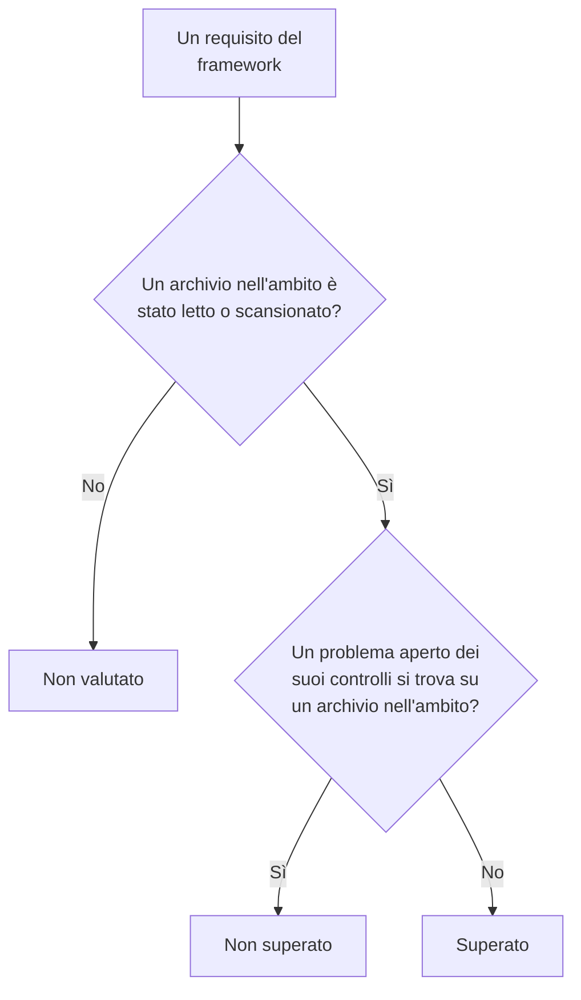

# Conformità di Sicurezza dei dati

Sicurezza dei dati valuta nove framework in base a ciò che hanno trovato le sue scansioni. Ogni framework copre gli archivi di cui parlano le sue regole - il GDPR gli archivi che contengono dati personali, PCI DSS gli archivi in cui sono stati trovati dati di carte, SOC 2 ogni archivio - e ciascuno dei suoi requisiti viene soddisfatto o meno dai controlli che ne sono la prova. **Sicurezza dei dati → Conformità** mostra il punteggio di ogni framework, quanti archivi copre, e ogni requisito con il numero di problemi aperti che lo fanno fallire. Un punteggio è una prova per un audit, non un certificato: dice ciò che OneUptime riesce a vedere degli archivi che legge.

:::cards
- [I framework](#i-framework): I nove, e quali archivi copre ciascuno.
- [Come viene valutato un framework](#come-viene-valutato-un-framework): Requisiti superati, non superati e non valutati.
- [Requisiti e relativi controlli](#requisiti-e-relativi-controlli): Ogni requisito, e i controlli che ne sono la prova.
- [Registro dei trattamenti](#registro-dei-trattamenti): L'articolo 30 del GDPR, scritto a partire dai tuoi archivi.
:::

## I framework

| Framework | Nome completo | Archivi nell'ambito |
| --- | --- | --- |
| GDPR | Regolamento generale sulla protezione dei dati dell'UE | Archivi che contengono dati personali. |
| CCPA | California Consumer Privacy Act, come modificato dal CPRA | Archivi che contengono informazioni personali. |
| HIPAA | HIPAA Security Rule | Archivi che contengono dati sanitari. |
| PCI DSS | PCI DSS v4.0 | Archivi in cui sono stati trovati numeri di carta. |
| SOC 2 | SOC 2 Trust Services Criteria | Ogni archivio dati. |
| ISO 27001 | ISO/IEC 27001:2022 | Ogni archivio dati. |
| NIST CSF | NIST Cybersecurity Framework 2.0 | Ogni archivio dati. |
| LGPD | Legge generale sulla protezione dei dati del Brasile | Archivi che contengono dati personali di persone in Brasile. |
| DPDP | Digital Personal Data Protection Act dell'India, 2023 | Archivi che contengono dati personali di persone in India. |

## Quali archivi copre un framework

L'ambito di un archivio deriva dai dati trovati al suo interno, quindi cambia man mano che le scansioni trovano altro:

- **SOC 2, ISO 27001 e NIST CSF** sono framework di sicurezza: coprono ogni archivio, qualunque cosa contenga.
- **GDPR, CCPA, HIPAA e PCI DSS** coprono gli archivi che contengono un tipo di dati che proteggono. I dati personali fanno rientrare il GDPR e il CCPA, i dati sanitari anche HIPAA, e i numeri di carta, i codici di sicurezza delle carte e le date di scadenza delle carte PCI DSS. Un archivio che contiene solo segreti o documenti aziendali non rientra in nessuno di essi.
- **LGPD e DPDP** sono leggi nazionali: coprono gli archivi che contengono dati personali di persone in Brasile o in India, ricavati dai tipi di dati che appartengono a quel paese, come un CPF brasiliano o un numero Aadhaar indiano.

[Tipi di dati sensibili](/docs/data-security/data-types#tipi-di-dati-integrati) elenca ogni tipo di dati, con il suo paese.

## Come viene valutato un framework

- **Un requisito è superato** quando nessun problema aperto dei controlli associati a esso si trova su un archivio nell'ambito del framework, e **non è superato** quando ce n'è uno.
- **Non è valutato** finché nessun archivio nell'ambito ha avuto la configurazione letta o il contenuto scansionato.
- **Due requisiti sono soddisfatti da Sicurezza dei dati stessa**: l'articolo 30 del GDPR, registri delle attività di trattamento, e ISO 27001 A.5.12, classificazione delle informazioni. Sono superati quando ogni archivio nell'ambito è stato letto o scansionato, e non superati finché uno non lo è stato.
- **Il punteggio** è la quota dei requisiti valutati di un framework che sono superati, come percentuale intera. Un framework senza nulla di valutato non ha un punteggio.

Contano solo i problemi aperti. Un problema il cui rischio è accettato, o che non è un problema, non fa fallire i suoi requisiti, quindi un rischio accettato è una decisione che il tuo audit può vedere sul problema: chi lo ha accettato, perché, e fino a quando.

## Requisiti e relativi controlli

### GDPR

| Requisito | Cosa chiede | Controlli |
| --- | --- | --- |
| Art. 5(1)(c) | Minimizzazione dei dati | `production-data-in-non-production`, `stale-sensitive-data`, `sensitive-data-in-telemetry`, `sensitive-data-to-ai`, `sensitive-data-in-ai-store` |
| Art. 5(1)(e) | Limitazione della conservazione | `stale-sensitive-data` |
| Art. 25 | Protezione dei dati fin dalla progettazione e per impostazione predefinita | `production-data-in-non-production`, `stale-sensitive-data`, `sensitive-data-in-telemetry`, `sensitive-data-to-ai`, `sensitive-data-in-ai-store` |
| Art. 28 | Responsabili del trattamento | `sensitive-data-to-ai` |
| Art. 30 | Registri delle attività di trattamento | Soddisfatto da Sicurezza dei dati stessa |
| Art. 32 | Sicurezza del trattamento | `public-read`, `public-write`, `public-access-not-blocked`, `internet-reachable`, `open-to-all-addresses`, `snapshot-public`, `snapshot-shared-externally`, `shared-with-external-accounts`, `not-encrypted-at-rest`, `no-customer-managed-key`, `encryption-in-transit-not-enforced`, `weak-tls`, `no-backups`, `no-point-in-time-recovery`, `deletion-protection-off`, `deleted-data-not-recoverable`, `access-not-logged`, `shared-key-access`, `object-acls-enabled`, `many-readers`, `secrets-stored`, `plaintext-passwords`, `secrets-in-telemetry` |
| Artt. 44-49 | Trasferimenti verso paesi terzi | `residency-violation` |

### CCPA

| Requisito | Cosa chiede | Controlli |
| --- | --- | --- |
| 1798.100(c) | Raccolta limitata a quanto necessario | `production-data-in-non-production`, `stale-sensitive-data`, `sensitive-data-in-telemetry`, `sensitive-data-to-ai`, `sensitive-data-in-ai-store` |
| 1798.150 | Procedure di sicurezza ragionevoli | `public-read`, `public-write`, `public-access-not-blocked`, `internet-reachable`, `open-to-all-addresses`, `snapshot-public`, `snapshot-shared-externally`, `shared-with-external-accounts`, `shared-key-access`, `object-acls-enabled`, `many-readers` |

### HIPAA

| Requisito | Cosa chiede | Controlli |
| --- | --- | --- |
| 164.308(a)(7) | Piano di emergenza | `no-backups`, `no-point-in-time-recovery`, `deletion-protection-off`, `deleted-data-not-recoverable` |
| 164.312(a)(1) | Controllo degli accessi | `public-read`, `public-write`, `public-access-not-blocked`, `internet-reachable`, `open-to-all-addresses`, `snapshot-public`, `snapshot-shared-externally`, `shared-with-external-accounts`, `shared-key-access`, `object-acls-enabled`, `many-readers` |
| 164.312(a)(2)(iv) | Cifratura e decifratura | `not-encrypted-at-rest`, `no-customer-managed-key` |
| 164.312(b) | Controlli di audit | `access-not-logged` |
| 164.312(e)(1) | Sicurezza della trasmissione | `encryption-in-transit-not-enforced`, `weak-tls` |

### PCI DSS

| Requisito | Cosa chiede | Controlli |
| --- | --- | --- |
| 3.3.1 | I dati di autenticazione sensibili non vengono conservati dopo l'autorizzazione | `card-security-codes-stored` |
| 3.4.1 | I numeri di carta vengono mascherati quando sono visualizzati | `card-numbers-readable`, `sensitive-data-in-telemetry` |
| 3.5.1 | I numeri di carta sono illeggibili ovunque siano conservati | `not-encrypted-at-rest`, `no-customer-managed-key`, `card-numbers-readable` |
| 4.2.1 | Una crittografia robusta protegge i dati delle carte in transito | `encryption-in-transit-not-enforced`, `weak-tls` |
| 7.2 | L'accesso è definito e assegnato in base alla necessità | `public-read`, `public-write`, `public-access-not-blocked`, `internet-reachable`, `open-to-all-addresses`, `snapshot-public`, `snapshot-shared-externally`, `shared-with-external-accounts`, `shared-key-access`, `object-acls-enabled`, `many-readers` |
| 8.3.2 | I fattori di autenticazione sono illeggibili quando sono conservati | `plaintext-passwords` |
| 10.2 | I log di audit registrano l'accesso ai dati delle carte | `access-not-logged` |

### SOC 2

| Requisito | Cosa chiede | Controlli |
| --- | --- | --- |
| A1.2 | Backup e ripristino | `no-backups`, `no-point-in-time-recovery`, `deletion-protection-off`, `deleted-data-not-recoverable` |
| CC6.1 | Sicurezza degli accessi logici | `public-read`, `public-write`, `public-access-not-blocked`, `internet-reachable`, `open-to-all-addresses`, `snapshot-public`, `snapshot-shared-externally`, `shared-with-external-accounts`, `not-encrypted-at-rest`, `no-customer-managed-key`, `shared-key-access`, `object-acls-enabled`, `many-readers`, `secrets-stored`, `plaintext-passwords`, `secrets-in-telemetry` |
| CC6.7 | Trasmissione delle informazioni | `encryption-in-transit-not-enforced`, `weak-tls` |
| CC7.2 | Monitoraggio dei componenti di sistema | `access-not-logged` |

### ISO 27001

| Requisito | Cosa chiede | Controlli |
| --- | --- | --- |
| A.5.9 | Inventario delle informazioni e degli altri beni associati | `no-owner` |
| A.5.12 | Classificazione delle informazioni | Soddisfatto da Sicurezza dei dati stessa |
| A.5.15 | Controllo degli accessi | `public-read`, `public-write`, `public-access-not-blocked`, `internet-reachable`, `open-to-all-addresses`, `snapshot-public`, `snapshot-shared-externally`, `shared-with-external-accounts`, `shared-key-access`, `object-acls-enabled`, `many-readers` |
| A.5.34 | Privacy e protezione delle PII | `production-data-in-non-production`, `stale-sensitive-data`, `sensitive-data-in-telemetry`, `sensitive-data-to-ai`, `sensitive-data-in-ai-store` |
| A.8.11 | Mascheramento dei dati | `production-data-in-non-production`, `stale-sensitive-data`, `sensitive-data-in-telemetry`, `sensitive-data-to-ai`, `sensitive-data-in-ai-store` |
| A.8.12 | Prevenzione della fuga di dati | `secrets-stored`, `secrets-in-telemetry` |
| A.8.13 | Backup delle informazioni | `no-backups`, `no-point-in-time-recovery`, `deletion-protection-off`, `deleted-data-not-recoverable` |
| A.8.15 | Logging | `access-not-logged` |
| A.8.24 | Uso della crittografia | `not-encrypted-at-rest`, `no-customer-managed-key`, `encryption-in-transit-not-enforced`, `weak-tls`, `plaintext-passwords` |

### NIST CSF

| Requisito | Cosa chiede | Controlli |
| --- | --- | --- |
| ID.AM-07 | Gli inventari di dati e metadati vengono mantenuti | `no-owner` |
| PR.AA-05 | I permessi di accesso vengono gestiti | `public-read`, `public-write`, `public-access-not-blocked`, `internet-reachable`, `open-to-all-addresses`, `snapshot-public`, `snapshot-shared-externally`, `shared-with-external-accounts`, `shared-key-access`, `object-acls-enabled`, `many-readers` |
| PR.DS-01 | I dati a riposo sono protetti | `not-encrypted-at-rest`, `no-customer-managed-key`, `secrets-stored`, `secrets-in-telemetry` |
| PR.DS-02 | I dati in transito sono protetti | `encryption-in-transit-not-enforced`, `weak-tls` |
| PR.DS-11 | I backup dei dati vengono conservati e testati | `no-backups`, `no-point-in-time-recovery`, `deletion-protection-off`, `deleted-data-not-recoverable` |
| DE.CM-09 | I dati e il loro utilizzo vengono monitorati | `access-not-logged` |

### LGPD

| Requisito | Cosa chiede | Controlli |
| --- | --- | --- |
| Art. 6 | Necessità e limitazione della finalità | `production-data-in-non-production`, `stale-sensitive-data`, `sensitive-data-in-telemetry`, `sensitive-data-to-ai`, `sensitive-data-in-ai-store` |
| Art. 33 | Trasferimento internazionale dei dati | `residency-violation` |
| Art. 46 | Misure di sicurezza | `public-read`, `public-write`, `public-access-not-blocked`, `internet-reachable`, `open-to-all-addresses`, `snapshot-public`, `snapshot-shared-externally`, `shared-with-external-accounts`, `not-encrypted-at-rest`, `no-customer-managed-key`, `shared-key-access`, `object-acls-enabled`, `many-readers` |

### DPDP

| Requisito | Cosa chiede | Controlli |
| --- | --- | --- |
| Sez. 8(5) | Misure di sicurezza ragionevoli | `public-read`, `public-write`, `public-access-not-blocked`, `internet-reachable`, `open-to-all-addresses`, `snapshot-public`, `snapshot-shared-externally`, `shared-with-external-accounts`, `not-encrypted-at-rest`, `no-customer-managed-key`, `shared-key-access`, `object-acls-enabled`, `many-readers` |
| Sez. 8(7) | Cancellazione quando la finalità è stata raggiunta | `production-data-in-non-production`, `stale-sensitive-data`, `sensitive-data-in-telemetry`, `sensitive-data-to-ai`, `sensitive-data-in-ai-store` |
| Sez. 16 | Trasferimento al di fuori dell'India | `residency-violation` |

## Registro dei trattamenti

L'articolo 30 del GDPR ti chiede di tenere un registro delle tue attività di trattamento. Sicurezza dei dati ne scrive la parte che riguarda dove sono conservati i dati personali: una riga per ogni archivio che contiene dati personali.

| Colonna | Da dove viene |
| --- | --- |
| Archivio, tipo, provider e regione | Discovery |
| Ambiente | I tag o il nome dell'archivio, oppure ciò che imposti tu |
| Sensibilità, categorie e tipi di dati | Ciò che hanno trovato le scansioni, oppure la sensibilità che imposti tu |
| Proprietari | I proprietari dell'archivio, le persone e i membri dei suoi team |
| Finalità | Ciò che scrivi nella **Finalità** dell'archivio: perché contiene dati personali |
| Conservazione | Ciò che scrivi nella **Conservazione** dell'archivio: per quanto tempo vi vengono conservati i dati |
| Framework | I framework che i suoi tipi di dati fanno rientrare nell'ambito |

Compila **Finalità** e **Conservazione** nelle **Impostazioni** di ogni archivio: sono le due cose che nessuna scansione può sapere. Il registro e i punteggi sono forniti anche dall'API di Sicurezza dei dati, in `/data-security/record-of-processing` e `/data-security/compliance`, a chiunque possa leggere gli archivi dati (vedi [Integrazioni di Sicurezza dei dati](/docs/data-security/integrations#api-terraform-e-mcp)).

## Passaggi successivi

:::cards
- [Controlli e problemi di Sicurezza dei dati](/docs/data-security/checks-and-issues): I controlli dietro ogni requisito, e come correggerli.
- [Flussi di dati, accesso e residenza](/docs/data-security/flows-access-residency): Le regole di residenza, per i trasferimenti secondo GDPR, LGPD e DPDP.
- [Tipi di dati sensibili](/docs/data-security/data-types): I tipi di dati che fanno rientrare un archivio nell'ambito di un framework.
:::
