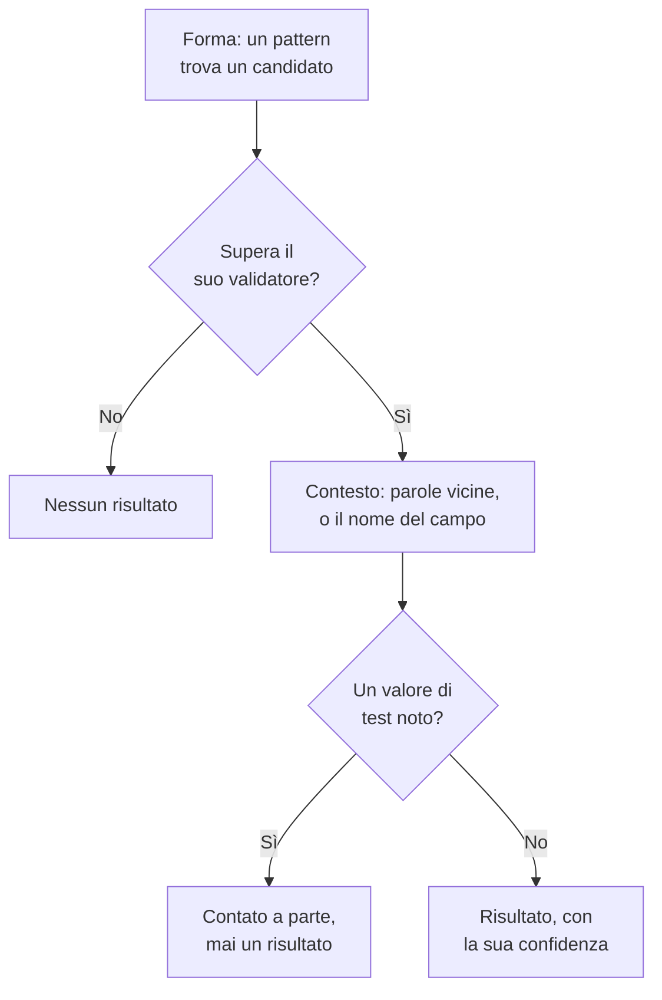

# Tipi di dati sensibili

Sicurezza dei dati conosce 143 tipi di dati sensibili: numeri di carta, conti bancari, documenti d'identità nazionali di 43 paesi, identificativi sanitari, chiavi API e token, e le categorie particolari di dati personali. Ciascuno ha una categoria, una sensibilità e, quando appartiene a un paese, quel paese. Questa pagina spiega come viene trovato un valore ed elenca ogni tipo di dati, così puoi capire perché qualcosa è stato trovato e decidere cosa farne.

:::cards
- [Come viene trovato un valore](#come-viene-trovato-un-valore): Forma, validatore, contesto, valori di test, confidenza.
- [Campi e colonne](#campi-e-colonne): Come viene giudicata un'intera colonna o un intero attributo.
- [Ogni tipo di dati](#tipi-di-dati-integrati): Tutti i 143, per categoria.
- [I tuoi tipi di dati](#i-tuoi-tipi-di-dati): ID dei dipendenti, numeri di polizza e la casella Testalo.
:::

## Come viene trovato un valore

Ogni scansione - una riga di log, una cella CSV, una riga di database, i primi byte di un oggetto - esegue gli stessi passi:

1. **Forma.** Ogni tipo di dati ha dei pattern che trovano candidati: sedici cifre, `AKIA` e sedici lettere, una parola, una `@` e un dominio. Un pattern non corrisponde mai all'interno di un token più lungo, quindi un numero di carta non viene trovato dentro una sequenza di cifre più lunga.
2. **Validatore.** Un candidato deve rispettare le regole proprie del suo tipo: un checksum (Luhn per le carte, mod 97 per gli IBAN, Verhoeff per i numeri Aadhaar, la cifra di controllo della maggior parte dei documenti d'identità nazionali), una data reale, un prefisso noto, abbastanza casualità per un segreto. Un candidato che non le rispetta non è affatto un risultato. Segnaposto come `000000000` e `123456789` non superano nessun tipo numerico.
3. **Contesto.** Le parole vicine a un candidato - per impostazione predefinita fino a 64 caratteri prima e 32 dopo - che dicono cos'è ne alzano la confidenza di un livello, e lo stesso fa un campo il cui nome indica il tipo. Le parole che dicono che è qualcos'altro, come un numero d'ordine o di tracciamento, la abbassano di un livello. Un numero senza checksum e con una forma comune, come un numero di passaporto o un conto bancario, conta solo accanto a parole che lo nominano.
4. **Valori di test noti.** I numeri di carta di test pubblicati (come `4242 4242 4242 4242` di Stripe), gli IBAN di esempio, gli indirizzi su `example.com` e su altri domini riservati, gli indirizzi IP della documentazione, gli ID di esempio stampati nella documentazione governativa, le chiavi in modalità test come `sk_test_` e le chiavi segnaposto vengono contati a parte. Non producono mai un risultato, quindi un archivio pieno di questi valori si legge come un ambiente di test, non come una violazione.
5. **Confidenza.** Ciò che resta è un risultato, sicuro quanto le sue prove consentono.

| Confidenza | Cosa significa |
| --- | --- |
| **Alto** | Il valore ha superato il suo validatore, e le parole intorno a esso o il campo in cui si trova dicono cos'è - oppure, per un campo, la maggior parte dei suoi valori è di quel tipo. |
| **Medio** | Il valore ha superato il suo validatore senza nulla intorno a confermarlo, oppure il nome del campo dice cosa contiene e alcuni valori concordano. |
| **Basso** | La forma corrisponde, ma nulla la conferma. |

Contano solo i risultati di livello Alto e Medio: rendono sensibile un archivio e possono aprire un problema. I risultati di livello Basso sono elencati sull'archivio, compressi, perché una persona li valuti.

Quando due tipi di dati rivendicano gli stessi caratteri, vince il risultato più sicuro: la confidenza più alta, poi il rilevatore le cui regole dimostrano di più, poi la corrispondenza più lunga.

Un valore lungo viene letto in finestre di 64 KB che si sovrappongono di 4 KB, così un valore viene trovato intero ovunque si trovi, e di un singolo valore si leggono al massimo 4 MB.

## Campi e colonne

Una colonna, un campo JSON o un attributo di log viene giudicato nel suo insieme. Il suo nome suggerisce un tipo di dati, e i suoi valori campionati lo dimostrano. La quota dei suoi valori che contengono il tipo decide quanto è sicuro il risultato:

| Valori che contengono il tipo | Confidenza |
| --- | --- |
| 60% o più | Alto |
| 25% o più | Alto quando il nome del campo indica il tipo, altrimenti Medio |
| Meno | Medio quando il nome del campo indica il tipo, altrimenti Basso: qualche email in una colonna di altro |

Un campo i cui valori superano in media gli 80 caratteri è testo libero - note, messaggi, descrizioni - e non ci si aspetta che contenga un solo tipo. I suoi risultati mantengono la confidenza che ogni corrispondenza ha ottenuto da sola, e indicano che sono stati trovati in testo libero. Vengono classificati fino a 1.000 valori di un campo, e fino a 16 KB di ciascuno.

Il nome di un campo viene diviso in parole - `customerEmail`, `customer_email` e `customer-email` sono tutti «customer email» - e il suggerimento sul nome di un tipo corrisponde quando le sue parole compaiono in quell'ordine, una accanto all'altra: «date of birth» corrisponde a `customer_date_of_birth`, non a `birth_city`. Solo l'ultima parte di un percorso con punti è il nome proprio del campo, insieme alla parte che la precede quando l'ultima è una parola generica come `number`, `id` o `value`: `customer.address.city` non è un indirizzo stradale, e `card.number` è comunque un numero di carta.

Alcuni tipi di dati non si riconoscono dai loro valori: nessun pattern distingue il nome di una persona da una via, o una religione da qualsiasi altra parola. Questi vengono trovati solo dal nome del campo, quando il campo ha dei valori: Nome della persona, Nome utente, Genere, Nazionalità, Informazioni sanitarie, Origine razziale o etnica, Convinzioni religiose, Orientamento sessuale, Opinioni politiche, Appartenenza sindacale, Dati biometrici, Dati genetici e Precedenti penali. Un nome, un nome utente, un genere o una nazionalità è allora Alto quando il 60% o più dei valori sembra tale, e altrimenti Medio.

Un campo il cui nome dice che contiene una password - `password`, `passwordHash`, `pwd`, non `password_changed_at` - dovrebbe contenere un hash: bcrypt, argon2, scrypt, PBKDF2 o un altro schema che un archivio usa di solito. I valori vuoti, i segnaposto come `********` e i valori cifrati vengono messi da parte. Quando tra i restanti quelli che non sono hash sono più di quelli che lo sono, il campo contiene le password stesse, che nessun pattern può vedere, e l'archivio non supera [Le password sono conservate in chiaro](/docs/data-security/checks-and-issues#igiene-dei-dati).

## Sensibilità

| Sensibilità | Cosa significa |
| --- | --- |
| **Ristretto** | Se trapela, ne derivano danni: segreti, numeri di carta, cartelle cliniche, documenti d'identità governativi. |
| **Confidenziale** | Dati personali, e documenti contrassegnati come confidenziali. |
| **Interno** | I dati propri dell'azienda, non destinati all'esterno. |
| **Public** | Non è stato trovato nulla di sensibile. |

Un archivio è sensibile quanto il tipo di dati più sensibile trovato al suo interno con una confidenza di livello almeno Medio. I valori di test e i risultati contrassegnati come non sensibili non contano nulla, e un archivio in cui non è stato trovato nulla è Pubblico. Per trattare un archivio come più o meno sensibile di quanto dicono i suoi risultati, imposta tu la sua sensibilità nelle **Impostazioni** dell'archivio: i controlli useranno quella.

## Categorie

| Categoria | Cosa comprende | Dati personali |
| --- | --- | --- |
| Segreti e credenziali | Password, chiavi API, token e chiavi private che sbloccano altri sistemi. | No |
| Finanziari | Numeri di carta, conti bancari, IBAN e wallet di criptovalute. | Sì |
| Salute | Numeri di cartella clinica, identificativi sanitari, diagnosi e prescrizioni. | Sì |
| Documenti d'identità governativi | Numeri d'identità nazionale, codici fiscali, numeri di passaporto e di previdenza sociale. | Sì |
| Categoria particolare | Ciò che l'articolo 9 del GDPR protegge di più: etnia, religione, orientamento sessuale, politica, appartenenza sindacale, dati biometrici e genetici. | Sì |
| Contatti e identità | Chi è una persona e come raggiungerla: email, telefono, indirizzo, data di nascita, indirizzo IP. | Sì |
| Riservatezza aziendale | Documenti contrassegnati come confidenziali, solo per uso interno o coperti da segreto professionale. | No |

I dati personali sono dati su una persona, nel senso di GDPR, CCPA, LGPD e DPDP. Un archivio che contiene solo segreti e documenti aziendali è fuori dall'ambito di un framework sulla privacy, mai da quello di un framework di sicurezza (vedi [Conformità di Sicurezza dei dati](/docs/data-security/compliance)).

## Tipi di dati integrati

Un tipo di dati che appartiene a un paese lo indica con un codice ISO 3166-1: le regole di residenza e i framework legati a un paese lo leggono (vedi [Residenza](/docs/data-security/flows-access-residency#regole-di-residenza)). L'ID è il nome con cui l'API e i risultati indicano il tipo.

### Contatti e identità

| Tipo di dati | ID | Cos'è | Sensibilità | Paese |
| --- | --- | --- | --- | --- |
| Indirizzo email | `email-address` | L'indirizzo email di una persona. | Confidenziale | — |
| Numero di telefono | `phone-number` | Un numero di telefono in formato internazionale o nazionale. | Confidenziale | — |
| Nome della persona | `person-name` | Il nome, il cognome o il nome completo di una persona, trovato dal nome del campo. | Confidenziale | — |
| Indirizzo stradale | `postal-address` | Un indirizzo stradale: un numero civico, il nome di una via e un tipo di via. | Confidenziale | — |
| Codice postale | `postal-code` | Un codice postale. Da solo restringe la zona in cui vive una persona. | Interno | — |
| Data di nascita | `date-of-birth` | Una data accanto a parole che dicono che è la data di nascita di qualcuno. | Confidenziale | — |
| Indirizzo IP | `ip-address` | Un indirizzo IPv4 o IPv6 pubblico, che il GDPR tratta come dato personale. | Confidenziale | — |
| Indirizzo MAC | `mac-address` | L'indirizzo hardware di una scheda di rete, che identifica un dispositivo. | Confidenziale | — |
| ID pubblicitario | `advertising-id` | Un ID pubblicitario mobile (IDFA, GAID, AAID) che traccia un dispositivo. | Confidenziale | — |
| Posizione precisa | `geolocation` | Una latitudine e una longitudine abbastanza precise da individuare un edificio. | Confidenziale | — |
| Nome utente | `username` | Il nome di accesso o di account di una persona, trovato dal nome del campo. | Confidenziale | — |
| Genere | `gender` | Il genere o il sesso di una persona, trovato dal nome del campo. | Confidenziale | — |
| Nazionalità | `nationality` | La nazionalità o la cittadinanza di una persona, trovata dal nome del campo. | Confidenziale | — |
| Numero di identificazione del veicolo | `vehicle-identification-number` | Un VIN di 17 caratteri con una cifra di controllo valida. | Confidenziale | — |

### Documenti d'identità governativi

| Tipo di dati | ID | Cos'è | Sensibilità | Paese |
| --- | --- | --- | --- | --- |
| Numero di Social Security USA | `us-ssn` | Un numero di Social Security statunitense. | Ristretto | US |
| Codice fiscale USA (ITIN) | `us-itin` | Un Individual Taxpayer Identification Number statunitense. | Ristretto | US |
| Codice del datore di lavoro USA (EIN) | `us-ein` | Un Employer Identification Number statunitense, accanto a parole che lo indicano. | Confidenziale | US |
| Numero di passaporto USA | `us-passport` | Un numero di passaporto statunitense, accanto a parole che lo indicano. | Ristretto | US |
| Numero di patente USA | `us-drivers-license` | Un numero di patente di guida statunitense, accanto a parole che lo indicano. | Ristretto | US |
| Numero di National Insurance UK | `uk-nino` | Un numero di National Insurance del Regno Unito. | Ristretto | GB |
| Numero di passaporto UK | `uk-passport` | Un numero di passaporto del Regno Unito, accanto a parole che lo indicano. | Ristretto | GB |
| Numero di patente UK | `uk-driving-licence` | Un numero di patente di guida del Regno Unito di 16 caratteri. | Ristretto | GB |
| Social Insurance Number del Canada | `ca-sin` | Un Social Insurance Number canadese con una cifra di controllo valida. | Ristretto | CA |
| CURP del Messico | `mx-curp` | Una Clave Única de Registro de Población messicana. | Ristretto | MX |
| RFC del Messico | `mx-rfc` | Un codice fiscale messicano Registro Federal de Contribuyentes. | Ristretto | MX |
| CPF del Brasile | `br-cpf` | Un numero brasiliano di Cadastro de Pessoas Físicas. | Ristretto | BR |
| CNPJ del Brasile | `br-cnpj` | Un numero di registrazione delle imprese brasiliano (CNPJ). | Confidenziale | BR |
| CUIT / CUIL dell'Argentina | `ar-cuit` | Un codice di identificazione fiscale o lavorativa argentino. | Ristretto | AR |
| RUT del Cile | `cl-rut` | Un Rol Único Tributario cileno con una cifra di controllo valida. | Ristretto | CL |
| DNI della Spagna | `es-dni` | Un numero di documento nazionale d'identità spagnolo con la sua lettera di controllo. | Ristretto | ES |
| NIE della Spagna | `es-nie` | Un numero d'identità spagnolo per stranieri con la sua lettera di controllo. | Ristretto | ES |
| NIF del Portogallo | `pt-nif` | Un numero di identificazione fiscale portoghese. | Ristretto | PT |
| Numero di previdenza sociale francese (NIR) | `fr-nir` | Un numero INSEE francese con la sua chiave di due cifre. | Ristretto | FR |
| Codice fiscale tedesco | `de-tax-id` | Una Steuerliche Identifikationsnummer tedesca. | Ristretto | DE |
| Codice fiscale italiano | `it-codice-fiscale` | Un codice fiscale italiano con un carattere di controllo valido. | Ristretto | IT |
| BSN dei Paesi Bassi | `nl-bsn` | Un numero di servizio al cittadino olandese che supera la prova dell'undici. | Ristretto | NL |
| Numero nazionale belga | `be-national-number` | Un numero del registro nazionale belga. | Ristretto | BE |
| PESEL della Polonia | `pl-pesel` | Un numero di identificazione nazionale polacco. | Ristretto | PL |
| Numero d'identità personale svedese | `se-personnummer` | Un personnummer svedese con una cifra di controllo valida. | Ristretto | SE |
| Numero d'identità nazionale norvegese | `no-fodselsnummer` | Un fødselsnummer norvegese con entrambe le cifre di controllo. | Ristretto | NO |
| Numero CPR danese | `dk-cpr` | Un numero di registrazione civile danese, accanto a parole che lo indicano. | Ristretto | DK |
| Codice d'identità personale finlandese | `fi-hetu` | Un henkilötunnus finlandese con il suo carattere di controllo. | Ristretto | FI |
| Numero PPS irlandese | `ie-ppsn` | Un Personal Public Service Number irlandese. | Ristretto | IE |
| Numero AHV svizzero | `ch-ahv` | Un numero di previdenza sociale svizzero (AHV / AVS). | Ristretto | CH |
| CNP della Romania | `ro-cnp` | Un codice numerico personale rumeno. | Ristretto | RO |
| EGN della Bulgaria | `bg-egn` | Un numero civile unificato bulgaro. | Ristretto | BG |
| OIB della Croazia | `hr-oib` | Un numero di identificazione personale croato. | Ristretto | HR |
| AMKA della Grecia | `gr-amka` | Un numero di previdenza sociale greco. | Ristretto | GR |
| Numero d'identità turco | `tr-tckn` | Un numero T.C. Kimlik turco. | Ristretto | TR |
| Numero d'identità israeliano | `il-teudat-zehut` | Un numero Teudat Zehut israeliano. | Ristretto | IL |
| Numero d'identità sudafricano | `za-id` | Un numero d'identità sudafricano con una data e una cifra di controllo valide. | Ristretto | ZA |
| Emirates ID degli EAU | `ae-emirates-id` | Un numero della carta d'identità degli Emirati Arabi Uniti. | Ristretto | AE |
| ID nazionale dell'Arabia Saudita | `sa-national-id` | Un numero di ID nazionale saudita o di iqama. | Ristretto | SA |
| Numero Aadhaar indiano | `in-aadhaar` | Un numero Aadhaar di 12 cifre che supera il controllo Verhoeff. | Ristretto | IN |
| PAN dell'India | `in-pan` | Un Permanent Account Number indiano. | Ristretto | IN |
| Numero d'identità di residente cinese | `cn-resident-id` | Un numero di 18 caratteri della carta d'identità di residente cinese. | Ristretto | CN |
| My Number giapponese | `jp-my-number` | Un numero individuale giapponese con una cifra di controllo valida. | Ristretto | JP |
| Numero di registrazione dei residenti sudcoreano | `kr-rrn` | Un numero di registrazione dei residenti coreano. | Ristretto | KR |
| NRIC / FIN di Singapore | `sg-nric` | Un numero della carta d'identità o di identificazione per stranieri di Singapore. | Ristretto | SG |
| Numero della carta d'identità di Hong Kong | `hk-hkid` | Un numero della carta d'identità di Hong Kong con la sua cifra di controllo. | Ristretto | HK |
| ID nazionale di Taiwan | `tw-national-id` | Un numero di identificazione nazionale taiwanese. | Ristretto | TW |
| ID nazionale thailandese | `th-national-id` | Un numero di identificazione del cittadino thailandese. | Ristretto | TH |
| Numero MyKad malese | `my-mykad` | Un numero della carta d'identità malese. | Ristretto | MY |
| NIK dell'Indonesia | `id-nik` | Un numero d'identità della popolazione indonesiano. | Ristretto | ID |
| Tax file number australiano | `au-tfn` | Un tax file number australiano con un controllo valido. | Ristretto | AU |
| Numero IRD neozelandese | `nz-ird` | Un numero dell'Inland Revenue neozelandese con una cifra di controllo valida. | Ristretto | NZ |
| SNILS della Russia | `ru-snils` | Un numero di conto assicurativo russo con il suo numero di controllo. | Ristretto | RU |
| INN della Russia | `ru-inn` | Un numero di identificazione del contribuente russo. | Ristretto | RU |
| Numero di passaporto | `passport-number` | Un numero di passaporto di qualsiasi paese, accanto a parole che lo indicano. | Ristretto | — |

### Finanziari

| Tipo di dati | ID | Cos'è | Sensibilità | Paese |
| --- | --- | --- | --- | --- |
| Numero di carta | `credit-card-number` | Un numero di carta di pagamento che supera il controllo di Luhn e appartiene a un circuito di carte. | Ristretto | — |
| Codice di sicurezza della carta | `card-verification-code` | Un CVV o CVC, che PCI DSS vieta di conservare dopo l'autorizzazione di un pagamento. | Ristretto | — |
| Data di scadenza della carta | `card-expiration-date` | La data di scadenza di una carta, accanto a parole che lo indicano. | Confidenziale | — |
| IBAN | `iban` | Un numero di conto bancario internazionale che supera il controllo mod-97. | Ristretto | — |
| Numero di conto bancario | `bank-account-number` | Un numero di conto bancario, accanto a parole che lo indicano. | Ristretto | — |
| Codice SWIFT / BIC | `swift-bic` | Il codice SWIFT o BIC di una banca, accanto a parole che lo indicano. | Interno | — |
| Routing number bancario USA | `us-bank-routing-number` | Un routing number ABA con un checksum valido, accanto a parole che lo indicano. | Interno | US |
| Sort code UK | `uk-sort-code` | Un sort code bancario del Regno Unito, accanto a parole che lo indicano. | Interno | GB |
| IFSC dell'India | `in-ifsc` | Un Indian Financial System Code che identifica una filiale bancaria. | Interno | IN |
| BSB australiano | `au-bsb` | Un numero bank-state-branch australiano, accanto a parole che lo indicano. | Interno | AU |
| Indirizzo Bitcoin | `bitcoin-address` | Un indirizzo Bitcoin con un checksum valido. | Confidenziale | — |
| Indirizzo Ethereum | `ethereum-address` | Un indirizzo Ethereum, accanto a parole che lo indicano. | Confidenziale | — |

### Salute

| Tipo di dati | ID | Cos'è | Sensibilità | Paese |
| --- | --- | --- | --- | --- |
| Numero NHS UK | `uk-nhs-number` | Un numero del National Health Service del Regno Unito con una cifra di controllo valida. | Ristretto | GB |
| ID beneficiario Medicare USA | `us-medicare-mbi` | Un Medicare Beneficiary Identifier statunitense. | Ristretto | US |
| Numero Medicare australiano | `au-medicare-number` | Un numero della tessera Medicare australiana con una cifra di controllo valida. | Ristretto | AU |
| Numero di assicurazione sanitaria tedesco | `de-health-insurance-number` | Una Krankenversichertennummer tedesca con una cifra di controllo valida. | Ristretto | DE |
| Numero di cartella clinica | `medical-record-number` | Il numero di cartella clinica di un paziente, accanto a parole che lo indicano. | Ristretto | — |
| ID iscritto al piano sanitario | `health-plan-id` | Un numero di iscritto o di polizza di un'assicurazione sanitaria, accanto a parole che lo indicano. | Ristretto | — |
| Codice di diagnosi (ICD-10) | `diagnosis-code` | Un codice di diagnosi ICD-10, accanto a parole che lo indicano. | Ristretto | — |
| Codice del farmaco (NDC) | `drug-code` | Un National Drug Code statunitense, accanto a parole che lo indicano. | Confidenziale | — |
| Numero DEA USA | `us-dea-number` | Il numero della Drug Enforcement Administration di un prescrittore, con una cifra di controllo valida. | Confidenziale | US |
| ID del fornitore di cure USA (NPI) | `us-npi` | Un National Provider Identifier. Identifica un fornitore di cure, non un paziente. | Interno | US |
| Informazioni sanitarie | `health-information` | Diagnosi, patologie, farmaci e altri dettagli sanitari, trovati dal nome del campo. | Ristretto | — |

### Segreti e credenziali

| Tipo di dati | ID | Cos'è | Sensibilità | Paese |
| --- | --- | --- | --- | --- |
| ID della chiave di accesso AWS | `aws-access-key-id` | La metà pubblica di una chiave di accesso AWS. Con il suo segreto firma le richieste AWS. | Ristretto | — |
| Chiave di accesso segreta AWS | `aws-secret-access-key` | La metà segreta di una chiave di accesso AWS, accanto a parole che lo indicano. | Ristretto | — |
| Chiave API Google | `google-api-key` | Una chiave API di Google Cloud o di Maps. | Ristretto | — |
| Chiave dell'account di servizio Google | `google-service-account-key` | Un file di chiave di un account di servizio Google Cloud con la sua chiave privata. | Ristretto | — |
| Client secret OAuth di Google | `google-oauth-client-secret` | Un client secret OAuth di Google. | Ristretto | — |
| Chiave dell'account di archiviazione Azure | `azure-storage-account-key` | Una chiave di un account di archiviazione Azure o una stringa di connessione che ne contiene una. | Ristretto | — |
| Token SAS di Azure | `azure-sas-token` | Una firma di accesso condiviso di Azure, che concede l'accesso senza effettuare il login. | Ristretto | — |
| Client secret di Azure | `azure-client-secret` | Un client secret di un'applicazione Microsoft Entra ID. | Ristretto | — |
| Token GitHub | `github-token` | Un token GitHub di accesso personale, OAuth, di app o con granularità fine. | Ristretto | — |
| Token GitLab | `gitlab-token` | Un token di accesso personale GitLab. | Ristretto | — |
| Token Slack | `slack-token` | Un token Slack di bot, di utente o di app. | Ristretto | — |
| URL del webhook Slack | `slack-webhook-url` | Un webhook in entrata di Slack, che permette a chiunque di pubblicare in un canale. | Ristretto | — |
| Chiave segreta Stripe | `stripe-secret-key` | Una chiave segreta live o con restrizioni di Stripe, che può spostare denaro. | Ristretto | — |
| Chiave API Twilio | `twilio-api-key` | Un SID di chiave API Twilio con il suo segreto. | Ristretto | — |
| Chiave API SendGrid | `sendgrid-api-key` | Una chiave API SendGrid. | Ristretto | — |
| Chiave API Mailgun | `mailgun-api-key` | Una chiave API Mailgun. | Ristretto | — |
| Chiave API Mailchimp | `mailchimp-api-key` | Una chiave API Mailchimp. | Ristretto | — |
| Chiave API OpenAI | `openai-api-key` | Una chiave API OpenAI, che consuma il credito dell'account. | Ristretto | — |
| Chiave API Anthropic | `anthropic-api-key` | Una chiave API Anthropic. | Ristretto | — |
| Token Hugging Face | `huggingface-token` | Un token Hugging Face. | Ristretto | — |
| Token npm | `npm-token` | Un token di accesso npm, che può pubblicare pacchetti. | Ristretto | — |
| Token PyPI | `pypi-token` | Un token di caricamento PyPI. | Ristretto | — |
| Token Docker Hub | `docker-hub-token` | Un token di accesso personale Docker Hub. | Ristretto | — |
| Token Shopify | `shopify-token` | Un token di accesso o di app Shopify. | Ristretto | — |
| Token Square | `square-token` | Un token di accesso o un segreto Square. | Ristretto | — |
| Token di accesso Braintree | `braintree-access-token` | Un token di accesso di produzione Braintree. | Ristretto | — |
| Token DigitalOcean | `digitalocean-token` | Un token di accesso personale DigitalOcean. | Ristretto | — |
| Chiave API New Relic | `new-relic-api-key` | Una chiave API utente New Relic. | Ristretto | — |
| Chiave API Datadog | `datadog-api-key` | Una chiave API o di applicazione Datadog, accanto a parole che lo indicano. | Ristretto | — |
| Token HashiCorp Vault | `vault-token` | Un token di servizio HashiCorp Vault. | Ristretto | — |
| Token Terraform Cloud | `terraform-cloud-token` | Un token API di Terraform Cloud o Enterprise. | Ristretto | — |
| Token API Atlassian | `atlassian-api-token` | Un token API Atlassian. | Ristretto | — |
| Chiave API Linear | `linear-api-key` | Una chiave API Linear. | Ristretto | — |
| JSON web token | `json-web-token` | Un JWT firmato, spesso un token di sessione o di accesso. | Ristretto | — |
| Chiave privata | `private-key` | Un blocco di chiave privata PEM, OpenSSH o PGP. | Ristretto | — |
| Password in un URL | `password-in-url` | Un URL che contiene un nome utente e una password, come una stringa di connessione a un database. | Ristretto | — |
| Password in una stringa di connessione | `connection-string-password` | Un valore Password= o Pwd= in una stringa di connessione. | Ristretto | — |
| Intestazione Authorization | `authorization-header` | Una credenziale Basic o Bearer copiata da un'intestazione HTTP Authorization. | Ristretto | — |
| Password o segreto | `generic-secret` | Un valore assegnato a una password, un segreto, una chiave API o un token, che sembra abbastanza casuale da essere reale. | Ristretto | — |
| Chiave privata Bitcoin | `bitcoin-private-key` | Una chiave privata Bitcoin in formato wallet import, con un checksum valido. | Ristretto | — |

### Categoria particolare

| Tipo di dati | ID | Cos'è | Sensibilità | Paese |
| --- | --- | --- | --- | --- |
| Origine razziale o etnica | `racial-or-ethnic-origin` | Razza o etnia, trovata dal nome del campo. | Ristretto | — |
| Convinzioni religiose | `religious-belief` | Religione o convinzioni, trovate dal nome del campo. | Ristretto | — |
| Orientamento sessuale | `sexual-orientation` | Orientamento sessuale, trovato dal nome del campo. | Ristretto | — |
| Opinioni politiche | `political-opinion` | Opinioni politiche o appartenenza a un partito, trovate dal nome del campo. | Ristretto | — |
| Appartenenza sindacale | `trade-union-membership` | Appartenenza sindacale, trovata dal nome del campo. | Ristretto | — |
| Dati biometrici | `biometric-data` | Impronte digitali, modelli del volto, impronte vocali e altri dati biometrici, trovati dal nome del campo. | Ristretto | — |
| Dati genetici | `genetic-data` | Dati sul DNA e sul genoma, trovati dal nome del campo. | Ristretto | — |
| Precedenti penali | `criminal-record` | Condanne penali e reati (articolo 10 del GDPR), trovati dal nome del campo. | Ristretto | — |

### Riservatezza aziendale

| Tipo di dati | ID | Cos'è | Sensibilità | Paese |
| --- | --- | --- | --- | --- |
| Documento coperto da segreto professionale | `privileged-document` | Un documento contrassegnato come coperto dal segreto avvocato-cliente o dal segreto professionale. | Ristretto | — |
| Documento contrassegnato come confidenziale | `confidential-document` | Un documento contrassegnato come confidenziale, strettamente confidenziale o segreto commerciale. | Confidenziale | — |
| Documento contrassegnato come interno | `internal-document` | Un documento contrassegnato come solo per uso interno o non destinato alla distribuzione. | Interno | — |

## I tuoi tipi di dati

Aggiungi un tipo di dati per ciò che ha solo la tua azienda: un ID dipendente, un numero di polizza, un codice di progetto. Vai su **Sicurezza dei dati → Impostazioni → Tipi di dati** e aggiungilo in **I tuoi tipi di dati**. Viene scansionato esattamente come quelli integrati, in bucket, database e telemetria, dalla scansione successiva in poi.

:::steps
### Indica cos'è

Assegnagli un **Nome**, come ID dipendente, una **Categoria** e una **Sensibilità**: quanto è sensibile un archivio che lo contiene. Una **Descrizione** dice cos'è, a chi legge un suo risultato.

### Indica come si trova

Inserisci un **Pattern**: un'espressione regolare JavaScript per un valore, come `EMP-\d{6}`. Aggiungi i **Nomi dei campi** che lo contengono, come `employee id`, e le **Parole chiave** che, vicino a un valore, confermano che è di questo tipo. Lascia vuoto il pattern per trovare il tipo solo dai nomi dei campi.

### Testalo

Incolla del testo di esempio in **Testalo** per vedere cosa vi trova il tuo tipo di dati. Esegue sul testo il codice stesso dello scanner, nel tuo browser: il testo non viene mai inviato a OneUptime, e se ne testano solo i primi 64 KB.
:::

In **Altri campi**, **Ignora maiuscole/minuscole** fa corrispondere il pattern a prescindere da maiuscole e minuscole, **Richiede una parola chiave** conta un valore solo quando ha vicino una parola chiave o il nome del campo dice che è di questo tipo, e **Checksum** richiede che un valore superi un controllo: **Nessuno**, **Luhn** (la cifra di controllo dei numeri di carta), **Mod97** (le cifre di controllo di un IBAN) o **Verhoeff** (la cifra di controllo di un numero Aadhaar).

Un pattern viene verificato quando lo salvi: deve compilare, non corrispondere a testo vuoto e girare in un tempo proporzionale al testo. Viene eseguito da un matcher che non fa mai backtracking, quindi nessun pattern può bloccare una scansione, comunque sia scritto. Un tipo accetta al massimo 50 parole chiave e 50 nomi di campo.

Un valore del tuo tipo è Medio da solo e Alto con una parola chiave vicina quando supera un checksum, e Basso da solo e Medio con una parola chiave quando non ne ha. In una colonna decide la quota di valori che corrispondono, come per ogni tipo.

## Non sensibile e mai sensibile

Una scansione può trovare qualcosa che non è ciò che sembra: una colonna di numeri d'ordine che superano il controllo di Luhn, il tuo indirizzo di supporto in ogni riga di log. Dillo a OneUptime, e smette di contarlo:

- **Contrassegna il risultato come non sensibile.** Nella pagina **Contenuto** dell'archivio, scegli **Contrassegna come non sensibile** sul risultato e indica il motivo. Non conta più per la sensibilità dell'archivio né per i suoi controlli, e l'archivio viene subito controllato di nuovo. Il risultato resta sull'archivio, contrassegnato, con il tuo motivo, così la persona successiva vede cosa è stato deciso.
- **Aggiungi il valore a Mai sensibile**, nelle impostazioni di Sicurezza dei dati, per un valore che non è mai un risultato da nessuna parte, come `support@yourcompany.com`. I valori vengono confrontati dopo che lo scanner li ha normalizzati, senza distinguere maiuscole e minuscole.
- **Disattiva un tipo di dati integrato.** In **Tipi di dati integrati**, su **Sicurezza dei dati → Impostazioni → Tipi di dati**, ogni tipo di dati ha un interruttore, che si salva nel momento in cui lo sposti. Nessuna scansione del progetto cerca un tipo disattivato.

## Passaggi successivi

:::cards
- [Controlli e problemi di Sicurezza dei dati](/docs/data-security/checks-and-issues): Cosa cambia nei problemi di un archivio in base alla sua sensibilità.
- [Dati sensibili nella telemetria](/docs/data-security/telemetry): I tipi di dati trovati nei tuoi log, nelle tue tracce e nei tuoi prompt.
- [Conformità di Sicurezza dei dati](/docs/data-security/compliance): I framework che ogni tipo di dati fa rientrare nell'ambito.
:::
