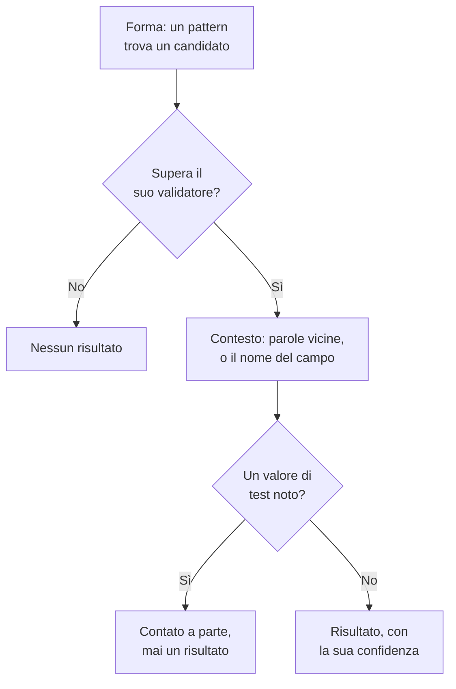

# Tipi di dati sensibili

Sicurezza dei dati conosce 143 tipi di dati sensibili: numeri di carta, conti bancari, documenti d'identità nazionali di 43 paesi, identificativi sanitari, chiavi API e token, e le categorie particolari di dati personali. Ciascuno ha una categoria, una sensibilità e, quando appartiene a un paese, quel paese. Questa pagina spiega come viene trovato un valore ed elenca ogni tipo di dati, così puoi capire perché qualcosa è stato trovato e decidere cosa farne.

:::cards
- [Come viene trovato un valore](#come-viene-trovato-un-valore): Forma, validatore, contesto, valori di test, confidenza.
- [Campi e colonne](#campi-e-colonne): Come viene giudicata un'intera colonna o un intero attributo.
- [Nomi e indirizzi stradali nel testo libero](#nomi-e-indirizzi-stradali-nel-testo-libero): Il piccolo modello all'interno dello scanner e i suoi punteggi.
- [Ogni tipo di dati](#tipi-di-dati-integrati): Tutti i 143, per categoria.
- [I tuoi tipi di dati](#i-tuoi-tipi-di-dati): ID dei dipendenti, numeri di polizza e la casella Testalo.
- [I tipi di dati che trova OneUptime AI](#i-tipi-di-dati-che-trova-oneuptime-ai): I tuoi tipi di dati, trovati nei campi che nessun rilevatore ha saputo classificare.
- [I verdetti di OneUptime AI](#i-verdetti-di-oneuptime-ai): Un verdetto su ogni risultato che ti aspetta, con le decisioni del tuo team come precedenti.
:::

## Come viene trovato un valore



Ogni scansione - una riga di log, una cella CSV, una riga di database, i primi byte di un oggetto - esegue gli stessi passi:

1. **Forma.** Ogni tipo di dati ha dei pattern che trovano candidati: sedici cifre, `AKIA` e sedici lettere, una parola, una `@` e un dominio. Un pattern non corrisponde mai all'interno di un token più lungo, quindi un numero di carta non viene trovato dentro una sequenza di cifre più lunga.
2. **Validatore.** Un candidato deve rispettare le regole proprie del suo tipo: un checksum (Luhn per le carte, mod 97 per gli IBAN, Verhoeff per i numeri Aadhaar, la cifra di controllo della maggior parte dei documenti d'identità nazionali), una data reale, un prefisso noto, abbastanza casualità per un segreto. Un candidato che non le rispetta non è affatto un risultato. Segnaposto come `000000000` e `123456789` non superano nessun tipo numerico.
3. **Contesto.** Le parole vicine a un candidato - per impostazione predefinita fino a 64 caratteri prima e 32 dopo - che dicono cos'è ne alzano la confidenza di un livello, e lo stesso fa un campo il cui nome indica il tipo. Le parole che dicono che è qualcos'altro, come un numero d'ordine o di tracciamento, la abbassano di un livello. Un numero senza checksum e con una forma comune, come un numero di passaporto o un conto bancario, conta solo accanto a parole che lo nominano.
4. **Valori di test noti.** I numeri di carta di test pubblicati (come `4242 4242 4242 4242` di Stripe), gli IBAN di esempio, gli indirizzi su `example.com` e su altri domini riservati, gli indirizzi IP della documentazione, gli ID di esempio stampati nella documentazione governativa, le chiavi in modalità test come `sk_test_` e le chiavi segnaposto vengono contati a parte. Non producono mai un risultato, quindi un archivio pieno di questi valori si legge come un ambiente di test, non come una violazione.
5. **Confidenza.** Ciò che resta è un risultato, sicuro quanto le sue prove consentono.

| Confidenza | Cosa significa |
| --- | --- |
| **Alto** | Il valore ha superato il suo validatore, e le parole intorno a esso o il campo in cui si trova dicono cos'è - oppure, per un campo, la maggior parte dei suoi valori è di quel tipo. |
| **Medio** | Il valore ha superato il suo validatore senza nulla intorno a confermarlo, oppure il nome del campo dice cosa contiene e alcuni valori concordano. |
| **Basso** | La forma corrisponde, ma nulla la conferma. |

Contano solo i risultati di livello Alto e Medio: rendono sensibile un archivio e possono aprire un problema. I risultati di livello Basso sono elencati sull'archivio, compressi, perché una persona li valuti: **Conferma** su uno corretto lo porta ad Alto, e resta Alto nelle scansioni successive.

Quando due tipi di dati rivendicano gli stessi caratteri, vince il risultato più sicuro: la confidenza più alta, poi il rilevatore le cui regole dimostrano di più, poi la corrispondenza più lunga.

Un valore viene letto anche come lo scrivono le persone. Le sequenze di escape percentuali di un URL vengono lette, compresi i byte UTF-8 di un carattere, quindi vengono trovati un indirizzo IP, un indirizzo email come `jane%40example.com` o `jos%C3%A9%40example.com`, un token o una chiave in una query string. La query string di un URL viene letta anche come la scrive un modulo, con un segno più per ogni spazio, quindi un numero scritto a gruppi viene trovato con uno spazio codificato in percentuale o un segno più tra i gruppi, come `4111+1111+1111+1111` o `DE44%205001%200517%205407%203249%2031`, e così anche un codice postale, un indirizzo stradale e una data di nascita, come `SW1A+2AA`, `10+Downing+Street` o `dob=12%2F03%2F1985`. Le cifre di un numero vengono lette in qualsiasi scrittura, come le cifre a larghezza piena (`４１１１ １１１１ １１１１ １１１１`) o le cifre arabo-indiche, prima ogni scrittura da sola e poi insieme: un numero di carta, il codice di sicurezza o la data di scadenza di una carta, un numero di telefono, un numero di Social Security USA, un IBAN, un routing number, un numero di conto bancario, un sort code, un BSB, un BIC, un IFSC, un numero d'identità nazionale, un identificativo sanitario come un numero NHS, un codice postale o una data di nascita. Un tale numero digitato interamente a larghezza piena, come lo scrive un testo giapponese o cinese, viene letto anche con il segno più, i trattini, le parentesi, i punti, le barre e gli spazi ideografici come caratteri ASCII, come `＋８１ ３－１２３４－５６７８` o `５３６－２２－８７３１`, e così anche un numero i cui gruppi sono separati da un altro tipo di trattino, letto come un trattino solo tra due cifre: il segno di allungamento che un testo giapponese digita al posto di un trattino, come `＋８１ ３ー１２３４ー５６７８`, o un trattino tipografico, una lineetta numerica, una lineetta enne o un segno meno, come `536–22–8731`. Un valore digitato in lettere a larghezza piena viene letto con le sue lettere, cifre e segni come caratteri ASCII, come un indirizzo email `ｊａｎｅ＠ｅｘａｍｐｌｅ．ｃｏｍ`, un IBAN `ＤＥ８９　３７０４　００４４　０５３２　０１３０　００` o un codice postale britannico `ＳＷ１Ａ　２ＡＡ`, e così anche le parole che nominano un numero, come `ＴＥＬ`. Un testo senza alcun valore digitato in lettere a larghezza piena, come la prosa giapponese o cinese, viene letto così com'è. Un indirizzo email viene trovato in qualsiasi scrittura, come `张伟@example.com` o `почта@пример.рф`, e un indirizzo IPv6 subito dopo i due punti di una chiave, come `ip:2001:db8::1`. Ogni risultato è il valore così come è scritto, quindi una regola di pulizia lo nasconde lì.

Un valore lungo viene letto in finestre di 64 KB che si sovrappongono di 4 KB, così un valore viene trovato intero ovunque si trovi, e di un singolo valore si leggono al massimo 4 MB.

## Campi e colonne

Una colonna, un campo JSON o un attributo di log viene giudicato nel suo insieme. Il suo nome suggerisce un tipo di dati, e i suoi valori campionati lo dimostrano. La quota dei suoi valori che contengono il tipo decide quanto è sicuro il risultato:

| Valori che contengono il tipo | Confidenza |
| --- | --- |
| 60% o più | Alto |
| 25% o più | Alto quando il nome del campo indica il tipo, altrimenti Medio |
| Meno | Medio quando il nome del campo indica il tipo, altrimenti Basso: qualche email in una colonna di altro |

Un campo i cui valori superano in media gli 80 caratteri è testo libero - note, messaggi, descrizioni - e non ci si aspetta che contenga un solo tipo. I suoi risultati mantengono la confidenza che ogni corrispondenza ha ottenuto da sola, e indicano che sono stati trovati in testo libero. Vengono classificati fino a 1.000 valori di un campo, e fino a 16 KB di ciascuno.

Il nome di un campo viene diviso in parole - `customerEmail`, `customer_email` e `customer-email` sono tutti «customer email» - e il suggerimento sul nome di un tipo corrisponde quando le sue parole compaiono in quell'ordine, una accanto all'altra: «date of birth» corrisponde a `customer_date_of_birth`, non a `birth_city`. Solo l'ultima parte di un percorso con punti è il nome proprio del campo, insieme alla parte che la precede quando l'ultima è una parola generica come `number`, `id` o `value`: `customer.address.city` non è un indirizzo stradale, e `card.number` è comunque un numero di carta.

Alcuni tipi di dati non si riconoscono dai loro valori: nessun pattern distingue il nome di una persona da una via, o una religione da qualsiasi altra parola. Questi vengono trovati solo dal nome del campo, quando il campo ha dei valori: Nome della persona, Nome utente, Genere, Nazionalità, Informazioni sanitarie, Origine razziale o etnica, Convinzioni religiose, Orientamento sessuale, Opinioni politiche, Appartenenza sindacale, Dati biometrici, Dati genetici e Precedenti penali. Un nome, un nome utente, un genere o una nazionalità è allora Alto quando il 60% o più dei valori sembra tale, e altrimenti Medio. Nel testo libero, i nomi delle persone e gli indirizzi stradali vengono trovati anche da un piccolo modello: vedi [Nomi e indirizzi stradali nel testo libero](#nomi-e-indirizzi-stradali-nel-testo-libero). Il nome di una persona viene trovato anche nella query string di un URL, sotto un parametro chiamato come si chiamerebbe un campo del genere, ad esempio `full_name` in `/contacts?full_name=Jos%C3%A9%20Garc%C3%ADa`: il suo valore viene letto come lo scrive un URL, è Alto quando sembra un nome, e viene trovato dove è scritto, sequenze di escape comprese. Un parametro chiamato solo `name` viene lasciato al modello.

Un campo il cui nome dice che contiene una password - `password`, `passwordHash`, `pwd`, non `password_changed_at` - dovrebbe contenere un hash: bcrypt, argon2, scrypt, PBKDF2 o un altro schema che un archivio usa di solito. I valori vuoti, i segnaposto come `********` e i valori cifrati vengono messi da parte. Quando tra i restanti quelli che non sono hash sono più di quelli che lo sono, il campo contiene le password stesse, che nessun pattern può vedere, e l'archivio non supera [Le password sono conservate in chiaro](/docs/data-security/checks-and-issues#igiene-dei-dati).

### Campi che nessun rilevatore ha saputo collocare

Una colonna o un campo il cui nome non rimanda a nessun tipo di dati, e i cui valori non corrispondono a nessun rilevatore, non è noto come sicuro: può essere il tuo numero cliente, o una colonna con il nome in un'altra lingua. Con **Abilita IA** attivo nel progetto, una scansione del contenuto conserva questi campi, al massimo 200 per scansione, e a OneUptime AI viene chiesto quale dei tipi di dati del progetto contiene ciascuno, al massimo 40 campi di un archivio alla volta. Gli vengono detti il nome del campo, i nomi dei campi accanto e le forme dei suoi valori - ogni lettera scritta come `a` o `A` e ogni cifra come `9`, quindi `AB-1234` diventa `AA-9999` - mai un valore. Non si chiede del testo libero, dei campi con meno di 5 valori, dei numeri interi piccoli né dei campi con il nome di un id, di un orario o di uno stato.

Una scansione della telemetria conserva allo stesso modo gli attributi che nessun rilevatore ha classificato, dai log, dagli span, dalle metriche e dal resto della telemetria di un servizio, al massimo 50 per servizio a ogni scansione. Non conserva mai gli attributi propri di OneUptime, né quelli che le convenzioni di OpenTelemetry scrivono su ogni record per dire da dove viene, come il servizio, l'host o il pod, né il testo libero, come il corpo di un log.

Ogni tipo che OneUptime AI nomina è un risultato di livello Basso, contrassegnato **Suggerito da OneUptime AI** con il suo motivo, scritto nella lingua del tuo progetto e mostrato lungo tutta la riga del risultato. Come ogni risultato di livello Basso non conta nulla finché una persona non sceglie **Conferma** nella pagina **Contenuto** dell'archivio; **Contrassegna come non sensibile** lo rifiuta. Di un campo a cui è stata data una risposta non si chiede di nuovo per 30 giorni, e di un campo che una persona ha valutato non si chiede mai più.

## Nomi e indirizzi stradali nel testo libero

Nessun pattern distingue il nome di una persona da qualsiasi altra parola. Per questo il testo libero - una nota di supporto, una riga di log, un messaggio di eccezione, un prompt - viene letto anche da un piccolo modello linguistico che vi trova i nomi delle persone e gli indirizzi stradali. Il modello gira all'interno dello scanner, sui worker di OneUptime e sulle tue sonde: il testo non lascia mai lo scanner, mentre gira non viene scaricato nulla e non viene scritto alcun prompt. Non è OneUptime AI, e gli interruttori di OneUptime AI non lo attivano né lo disattivano: lo fa **Individua nomi e indirizzi stradali**.

- **Cosa legge.** Un campo i cui valori superano in media gli 80 caratteri; un campo il cui nome dice che una persona vi scrive del testo libero, per quanto brevi siano i suoi valori, come `delivery_note`, `comentario`, `Lieferhinweis` o `opmerking` (vedi [Valori brevi](#valori-brevi)); e, nella telemetria, ogni corpo di log, messaggio di eccezione, stack trace e conversazione IA, per quanto breve. Legge fino a 100 valori diversi di un campo, 32 KB di testo in tutto, e fino a 16 KB di un singolo valore. Un URL in ciò che legge viene letto come un URL: le sue sequenze di escape percentuali vengono lette, e un `+` tra due lettere viene letto come uno spazio, quindi il nome in `/profile?name=Jos%C3%A9%20Garc%C3%ADa` viene trovato, e nascosto così come è scritto.
- **Cosa trova.** Un **Nome della persona** (`person-name`) e un **Indirizzo stradale** (`postal-address`): un luogo che il modello legge accanto a un numero civico, come `14 Calle Mayor`, con il codice postale e la città che lo seguono. Una città o un paese da soli non sono un indirizzo stradale.
- **Quanto è sicuro.** Un nome o un indirizzo trovato dal modello è Medio da solo. È Alto quando il nome del campo dice che contiene nomi o indirizzi, o quando lo dicono parole vicine, come «customer», «Kunde» o «dirección». È Basso quando il modello non ne è sicuro, con un punteggio inferiore a 0,6. Ciascuno mantiene la confidenza che ha ottenuto da solo, quindi un nome tra mille righe di log resta Medio.
- **Valori di test.** Segnaposto come `Jane Doe`, `John Smith`, `Max Mustermann` e `123 Main Street` vengono contati a parte, come i valori di test di ogni tipo.
- **Cosa conserva.** I suoi campioni sono mascherati come quelli di un nome trovato dal nome di un campo: il primo carattere e quattro asterischi, `M****`. Non se ne calcolano mai le impronte. Nella pagina **Contenuto** dell'archivio, un risultato di questo tipo riporta **Trovato nel testo libero dal modello dello scanner**.
- **I suoi record, e le sue regole.** Un risultato trovato dal modello elenca i record in cui è stato trovato, con ogni riga tagliata attorno al nome o all'indirizzo e ogni nome e indirizzo che contiene mascherati, e **Ripulisci** dimostra una regola su quei record, come per ogni risultato: vengono riletti con il modello, con fino a 20 secondi del suo tempo ogni volta. Un record per cui non ha avuto tempo non è elencato, e l'elenco dice per quanti valori non ha avuto tempo. Dove il modello non può girare, l'elenco lo dice, e nessuna regola per il risultato viene dimostrata.

| Modello | Licenza | Dimensione | Revisione | Lingue valutate |
| --- | --- | --- | --- | --- |
| [openmasq/ner-multilingual](https://huggingface.co/openmasq/ner-multilingual): sei strati di BERT multilingue, ONNX int8 | Apache 2.0 | 98 MB | `8cf7273` | Inglese, spagnolo, tedesco, francese, italiano, portoghese, olandese |

### Quanto bene li trova

È stato misurato attraverso il codice stesso dello scanner, su un set di test scritto apposta: 392 frasi inventate in sette lingue - righe di log, note di supporto, email, prompt - di cui 168 non contengono né un nome né un indirizzo. Un risultato è corretto quando si sovrappone a un nome o a un indirizzo del suo tipo. La soglia è stata fissata prima di misurare qualsiasi modello: una precisione di almeno 0,90 per ogni tipo sull'insieme delle lingue e di 0,85 in ciascuna lingua, un richiamo di almeno 0,70, e al massimo 20 falsi risultati ogni 1.000 valori che non contengono né l'uno né l'altro. Dei quattro modelli misurati, due l'hanno superata, ed è stato scelto il più piccolo. Un test presidia questi punteggi: una modifica al modello o allo scanner che ne abbassa uno lo fa fallire.

| Lingua | Nomi: precisione | Nomi: richiamo | Indirizzi: precisione | Indirizzi: richiamo |
| --- | --- | --- | --- | --- |
| Inglese | 0,96 | 0,96 | 1,00 | 1,00 |
| Spagnolo | 0,96 | 0,96 | 1,00 | 1,00 |
| Tedesco | 1,00 | 0,93 | 1,00 | 1,00 |
| Francese | 0,96 | 0,96 | 1,00 | 1,00 |
| Italiano | 0,96 | 0,96 | 1,00 | 1,00 |
| Portoghese | 0,93 | 0,89 | 1,00 | 1,00 |
| Olandese | 0,96 | 0,89 | 1,00 | 1,00 |
| Tutte e sette | 0,96 | 0,94 | 1,00 | 1,00 |

Sulle 168 frasi del set di test che non contengono né l'uno né l'altro, produce 18 falsi risultati ogni 1.000. Ecco anche i suoi punteggi su una parte di un benchmark pubblico, [gretelai/synthetic_pii_finance_multilingual](https://huggingface.co/datasets/gretelai/synthetic_pii_finance_multilingual) (Apache 2.0): 15 documenti finanziari in ciascuna di sette lingue. Le sue etichette sono state generate automaticamente e non sono complete, quindi leggi questa tabella accanto a quella precedente e non da sola:

| Lingua | Nomi: precisione | Nomi: richiamo | Indirizzi: precisione | Indirizzi: richiamo |
| --- | --- | --- | --- | --- |
| Inglese | 0,91 | 0,90 | 0,83 | 1,00 |
| Spagnolo | 0,89 | 0,37 | 0,58 | 0,70 |
| Tedesco | 0,93 | 0,58 | 0,75 | 0,70 |
| Francese | 0,84 | 0,50 | 0,42 | 0,83 |
| Italiano | 0,73 | 0,61 | 0,79 | 0,69 |
| Olandese | 0,91 | 0,49 | 1,00 | 0,89 |
| Svedese | 1,00 | 0,61 | 1,00 | 0,93 |
| Tutte e sette | 0,89 | 0,54 | 0,77 | 0,82 |

Ecco i quattro modelli misurati su quel set di test, uno dopo l'altro sulla stessa macchina, ciascuno cronometrato su un solo core con il codice nativo di onnxruntime. OneUptime esegue quello scelto con la versione WebAssembly di onnxruntime, che gira in ogni immagine ma è da cinque a otto volte più lenta:

| Modello | Licenza | Dimensione | Nomi: precisione / richiamo | Indirizzi: precisione / richiamo | Falsi risultati ogni 1.000 | Tempo ogni 1.000 valori di 75 / 1.181 caratteri |
| --- | --- | --- | --- | --- | --- | --- |
| openmasq/ner-multilingual (scelto) | Apache 2.0 | 98 MB | 0,963 / 0,939 | 1,000 / 1,000 | 18 | 5,9 s / 82 s |
| Wismut/nym-pii-multilingual-small | MIT | 121 MB | 0,995 / 0,974 | 0,985 / 1,000 | 12 | 7,4 s / 103 s |
| jkomyno/minilmv2-l6-h384-ner-en-it-q8 | MIT | 34 MB | 0,704 / 0,929 | 0,839 / 1,000 | 369 | 3,7 s / 68 s |
| balticml/mmbert-small-pii-redaction | Apache 2.0 | 38 MB | 0,712 / 0,995 | 0,762 / 0,992 | 589 | 7,8 s / 159 s |

### Valori brevi

Un campo breve viene letto solo quando il suo nome dice che una persona vi scrive del testo libero. La regola è stata misurata prima di essere scelta, su 49 colonne di un database nelle sette lingue, 588 valori in tutto: nomi di prodotti, titoli, etichette, qualifiche e nomi di negozi, dove il nome di un marchio, di un personaggio o di una via non è un risultato, e brevi note di consegna, commenti dell'assistenza e osservazioni dei clienti con 91 nomi e 28 indirizzi stradali. Leggere ogni campo di quattro o più parole, la prima regola considerata, ha letto 108 valori del catalogo e ne ha ricavato 53 nomi falsi, come `Ralph Lauren` nel nome di una polo e `Tom Sawyer` nel titolo di un libro:

| Regola | Valori del catalogo letti | Nomi: precisione | Nomi: richiamo | Indirizzi: precisione | Falsi risultati ogni 1.000 |
| --- | --- | --- | --- | --- | --- |
| Campi di quattro o più parole (non scelta) | 108 | 0,62 | 0,99 | 1,00 | 222 |
| Campi il cui nome indica testo libero (scelta) | 0 | 0,98 | 0,99 | 1,00 | 14 |

La regola scelta, per lingua. Un test blocca questi punteggi, e la soglia con cui è stato scelto il modello:

| Lingua | Nomi: precisione | Nomi: richiamo | Indirizzi: precisione | Indirizzi: richiamo |
| --- | --- | --- | --- | --- |
| Inglese | 1,00 | 1,00 | 1,00 | 1,00 |
| Spagnolo | 1,00 | 1,00 | 1,00 | 1,00 |
| Tedesco | 1,00 | 1,00 | 1,00 | 1,00 |
| Francese | 1,00 | 1,00 | 1,00 | 1,00 |
| Italiano | 1,00 | 1,00 | 1,00 | 1,00 |
| Portoghese | 0,86 | 0,92 | 1,00 | 1,00 |
| Olandese | 1,00 | 1,00 | 1,00 | 1,00 |
| Tutte e sette | 0,98 | 0,99 | 1,00 | 1,00 |

Conta il nome del campo stesso: `orders.delivery_note` viene letto, `notes.author` no, e nemmeno un nome che finisce con un id, un conteggio, un tipo, uno stato o una data, come `message_id`. Una descrizione non viene letta per il suo nome: quella di un prodotto è testo di catalogo.

### Dove gira e quanto costa

- **In ogni immagine.** L'immagine App, che esegue i worker, e l'immagine della sonda contengono il modello, il suo vocabolario e il runtime, comprese le immagini air-gapped e Iron Bank: circa 114 MB su disco. Vengono scaricati quando l'immagine viene costruita, da una revisione fissata, e verificati con il loro SHA-256. Durante una scansione non viene scaricato nulla.
- **Memoria.** Viene caricato la prima volta che una scansione ne ha bisogno, una volta per processo: circa 550 MB, rilasciati dopo 10 minuti senza scansioni.
- **Tempo.** Su un core, tra 30 secondi e un minuto ogni 1.000 valori lunghi quanto una riga di log, e circa 9 minuti ogni 1.000 valori di 1.200 caratteri. Una scansione del contenuto di un archivio gli concede fino a 2 minuti. La scansione oraria della telemetria gli concede fino a 1 minuto in tutto e 6 secondi per archivio, a un gruppo diverso di archivi ogni ora.
- **A turno.** Il modello di ogni scansione dei contenuti riparte da dove si è fermato quello della precedente: dalla prima tabella o dal primo container di cui non ha letto il testo libero, e con gli oggetti di un bucket per cui non ha avuto tempo, che vengono riletti prima di ogni altro. Ciò che ha iniziato e non ha potuto finire non torna primo, così niente trattiene il suo tempo scansione dopo scansione, e ogni tabella e ogni oggetto ha il suo turno, per quanto testo libero contenga l'archivio dati.
- **Quando il suo tempo si esaurisce**, la scansione si conclude con ciò che il modello ha letto, e i suoi avvisi dicono quanti valori di testo libero ha letto, mai cosa contengono. Un worker o una sonda senza il modello esegue la scansione come prima e dice perché:

```text
Names and street addresses were looked for in 120 of 500 free-text values: this store's 6 seconds of model time ran out.
Names and street addresses in free text were not looked for: the model's model_quantized.onnx is not installed on this probe.
```

I dettagli di una scansione mostrano questi avvisi, e ogni altro avviso di una scansione dei contenuti o della telemetria, nella lingua di chi legge.

**Individua nomi e indirizzi stradali** è attivo in ogni progetto: le scansioni del contenuto di bucket, database e dataset BigQuery leggono il testo libero con il modello, sui worker e sulle sonde. **Individua nomi e indirizzi stradali nella telemetria**, subito sotto, è disattivato: leggere una sola volta ogni corpo di log, eccezione e conversazione di un progetto molto attivo con 200 servizi richiede circa 48 minuti di un core, e il minuto all'ora della scansione ne legge circa il 4%. Attivalo perché ogni scansione oraria ne legga una parte. Entrambi si trovano su **Sicurezza dei dati → Impostazioni → Impostazioni di scansione**, sotto **Cosa legge Sicurezza dei dati**. La casella **Testalo** funziona nel tuo browser, senza il modello: lì non compare ciò che il modello troverebbe. Il modello aggiungerebbe circa 113 MB da scaricare, 67 MB compressi, e circa 440 MB alla memoria della scheda, quindi gira solo nello scanner.

## Sensibilità

| Sensibilità | Cosa significa |
| --- | --- |
| **Ristretto** | Se trapela, ne derivano danni: segreti, numeri di carta, cartelle cliniche, documenti d'identità governativi. |
| **Confidenziale** | Dati personali, e documenti contrassegnati come confidenziali. |
| **Interno** | I dati propri dell'azienda, non destinati all'esterno. |
| **Pubblico** | Non è stato trovato nulla di sensibile. |

Un archivio è sensibile quanto il tipo di dati più sensibile trovato al suo interno con una confidenza di livello almeno Medio. I valori di test e i risultati contrassegnati come non sensibili non contano nulla, e un archivio in cui non è stato trovato nulla è Pubblico. Per trattare un archivio come più o meno sensibile di quanto dicono i suoi risultati, imposta tu la sua sensibilità nelle **Impostazioni** dell'archivio: i controlli useranno quella.

## Categorie

| Categoria | Cosa comprende | Dati personali |
| --- | --- | --- |
| Segreti e credenziali | Password, chiavi API, token e chiavi private che sbloccano altri sistemi. | No |
| Finanziari | Numeri di carta, conti bancari, IBAN e wallet di criptovalute. | Sì |
| Salute | Numeri di cartella clinica, identificativi sanitari, diagnosi e prescrizioni. | Sì |
| Documenti d'identità governativi | Numeri d'identità nazionale, codici fiscali, numeri di passaporto e di previdenza sociale. | Sì |
| Categoria particolare | Ciò che l'articolo 9 del GDPR protegge di più: etnia, religione, orientamento sessuale, politica, appartenenza sindacale, dati biometrici e genetici. | Sì |
| Contatti e identità | Chi è una persona e come raggiungerla: email, telefono, indirizzo, data di nascita, indirizzo IP. | Sì |
| Riservatezza aziendale | Documenti contrassegnati come confidenziali, solo per uso interno o coperti da segreto professionale. | No |

I dati personali sono dati su una persona, nel senso di GDPR, CCPA, LGPD e DPDP. Un archivio che contiene solo segreti e documenti aziendali è fuori dall'ambito di un framework sulla privacy, mai da quello di un framework di sicurezza (vedi [Conformità di Sicurezza dei dati](/docs/data-security/compliance)).

## Tipi di dati integrati

Un tipo di dati che appartiene a un paese lo indica con un codice ISO 3166-1: le regole di residenza e i framework legati a un paese lo leggono (vedi [Residenza](/docs/data-security/flows-access-residency#regole-di-residenza)). L'ID è il nome con cui l'API e i risultati indicano il tipo.

### Contatti e identità

| Tipo di dati | ID | Cos'è | Sensibilità | Paese |
| --- | --- | --- | --- | --- |
| Indirizzo email | `email-address` | L'indirizzo email di una persona. | Confidenziale | — |
| Numero di telefono | `phone-number` | Un numero di telefono in formato internazionale o nazionale. | Confidenziale | — |
| Nome della persona | `person-name` | Il nome, il cognome o il nome completo di una persona, individuato dal nome del campo o dal modello dello scanner nel testo libero. | Confidenziale | — |
| Indirizzo stradale | `postal-address` | Un indirizzo stradale: un numero civico, il nome di una via e un tipo di via. | Confidenziale | — |
| Codice postale | `postal-code` | Un codice postale. Da solo restringe la zona in cui vive una persona. | Interno | — |
| Data di nascita | `date-of-birth` | Una data accanto a parole che dicono che è la data di nascita di qualcuno. | Confidenziale | — |
| Indirizzo IP | `ip-address` | Un indirizzo IPv4 o IPv6 pubblico, che il GDPR tratta come dato personale. | Confidenziale | — |
| Indirizzo MAC | `mac-address` | L'indirizzo hardware di una scheda di rete, che identifica un dispositivo. | Confidenziale | — |
| ID pubblicitario | `advertising-id` | Un ID pubblicitario mobile (IDFA, GAID, AAID) che traccia un dispositivo. | Confidenziale | — |
| Posizione precisa | `geolocation` | Una latitudine e una longitudine abbastanza precise da individuare un edificio. | Confidenziale | — |
| Nome utente | `username` | Il nome di accesso o di account di una persona, trovato dal nome del campo. | Confidenziale | — |
| Genere | `gender` | Il genere o il sesso di una persona, trovato dal nome del campo. | Confidenziale | — |
| Nazionalità | `nationality` | La nazionalità o la cittadinanza di una persona, trovata dal nome del campo. | Confidenziale | — |
| Numero di identificazione del veicolo | `vehicle-identification-number` | Un VIN di 17 caratteri con una cifra di controllo valida. | Confidenziale | — |

### Documenti d'identità governativi

| Tipo di dati | ID | Cos'è | Sensibilità | Paese |
| --- | --- | --- | --- | --- |
| Numero di Social Security USA | `us-ssn` | Un numero di Social Security statunitense. | Ristretto | US |
| Codice fiscale USA (ITIN) | `us-itin` | Un Individual Taxpayer Identification Number statunitense. | Ristretto | US |
| Codice del datore di lavoro USA (EIN) | `us-ein` | Un Employer Identification Number statunitense, accanto a parole che lo indicano. | Confidenziale | US |
| Numero di passaporto USA | `us-passport` | Un numero di passaporto statunitense, accanto a parole che lo indicano. | Ristretto | US |
| Numero di patente USA | `us-drivers-license` | Un numero di patente di guida statunitense, accanto a parole che lo indicano. | Ristretto | US |
| Numero di National Insurance UK | `uk-nino` | Un numero di National Insurance del Regno Unito. | Ristretto | GB |
| Numero di passaporto UK | `uk-passport` | Un numero di passaporto del Regno Unito, accanto a parole che lo indicano. | Ristretto | GB |
| Numero di patente UK | `uk-driving-licence` | Un numero di patente di guida del Regno Unito di 16 caratteri. | Ristretto | GB |
| Social Insurance Number del Canada | `ca-sin` | Un Social Insurance Number canadese con una cifra di controllo valida. | Ristretto | CA |
| CURP del Messico | `mx-curp` | Una Clave Única de Registro de Población messicana. | Ristretto | MX |
| RFC del Messico | `mx-rfc` | Un codice fiscale messicano Registro Federal de Contribuyentes. | Ristretto | MX |
| CPF del Brasile | `br-cpf` | Un numero brasiliano di Cadastro de Pessoas Físicas. | Ristretto | BR |
| CNPJ del Brasile | `br-cnpj` | Un numero di registrazione delle imprese brasiliano (CNPJ). | Confidenziale | BR |
| CUIT / CUIL dell'Argentina | `ar-cuit` | Un codice di identificazione fiscale o lavorativa argentino. | Ristretto | AR |
| RUT del Cile | `cl-rut` | Un Rol Único Tributario cileno con una cifra di controllo valida. | Ristretto | CL |
| DNI della Spagna | `es-dni` | Un numero di documento nazionale d'identità spagnolo con la sua lettera di controllo. | Ristretto | ES |
| NIE della Spagna | `es-nie` | Un numero d'identità spagnolo per stranieri con la sua lettera di controllo. | Ristretto | ES |
| NIF del Portogallo | `pt-nif` | Un numero di identificazione fiscale portoghese. | Ristretto | PT |
| Numero di previdenza sociale francese (NIR) | `fr-nir` | Un numero INSEE francese con la sua chiave di due cifre. | Ristretto | FR |
| Codice fiscale tedesco | `de-tax-id` | Una Steuerliche Identifikationsnummer tedesca. | Ristretto | DE |
| Codice fiscale italiano | `it-codice-fiscale` | Un codice fiscale italiano con un carattere di controllo valido. | Ristretto | IT |
| BSN dei Paesi Bassi | `nl-bsn` | Un numero di servizio al cittadino olandese che supera la prova dell'undici. | Ristretto | NL |
| Numero nazionale belga | `be-national-number` | Un numero del registro nazionale belga. | Ristretto | BE |
| PESEL della Polonia | `pl-pesel` | Un numero di identificazione nazionale polacco. | Ristretto | PL |
| Numero d'identità personale svedese | `se-personnummer` | Un personnummer svedese con una cifra di controllo valida. | Ristretto | SE |
| Numero d'identità nazionale norvegese | `no-fodselsnummer` | Un fødselsnummer norvegese con entrambe le cifre di controllo. | Ristretto | NO |
| Numero CPR danese | `dk-cpr` | Un numero di registrazione civile danese, accanto a parole che lo indicano. | Ristretto | DK |
| Codice d'identità personale finlandese | `fi-hetu` | Un henkilötunnus finlandese con il suo carattere di controllo. | Ristretto | FI |
| Numero PPS irlandese | `ie-ppsn` | Un Personal Public Service Number irlandese. | Ristretto | IE |
| Numero AHV svizzero | `ch-ahv` | Un numero di previdenza sociale svizzero (AHV / AVS). | Ristretto | CH |
| CNP della Romania | `ro-cnp` | Un codice numerico personale rumeno. | Ristretto | RO |
| EGN della Bulgaria | `bg-egn` | Un numero civile unificato bulgaro. | Ristretto | BG |
| OIB della Croazia | `hr-oib` | Un numero di identificazione personale croato. | Ristretto | HR |
| AMKA della Grecia | `gr-amka` | Un numero di previdenza sociale greco. | Ristretto | GR |
| Numero d'identità turco | `tr-tckn` | Un numero T.C. Kimlik turco. | Ristretto | TR |
| Numero d'identità israeliano | `il-teudat-zehut` | Un numero Teudat Zehut israeliano. | Ristretto | IL |
| Numero d'identità sudafricano | `za-id` | Un numero d'identità sudafricano con una data e una cifra di controllo valide. | Ristretto | ZA |
| Emirates ID degli EAU | `ae-emirates-id` | Un numero della carta d'identità degli Emirati Arabi Uniti. | Ristretto | AE |
| ID nazionale dell'Arabia Saudita | `sa-national-id` | Un numero di ID nazionale saudita o di iqama. | Ristretto | SA |
| Numero Aadhaar indiano | `in-aadhaar` | Un numero Aadhaar di 12 cifre che supera il controllo Verhoeff. | Ristretto | IN |
| PAN dell'India | `in-pan` | Un Permanent Account Number indiano. | Ristretto | IN |
| Numero d'identità di residente cinese | `cn-resident-id` | Un numero di 18 caratteri della carta d'identità di residente cinese. | Ristretto | CN |
| My Number giapponese | `jp-my-number` | Un numero individuale giapponese con una cifra di controllo valida. | Ristretto | JP |
| Numero di registrazione dei residenti sudcoreano | `kr-rrn` | Un numero di registrazione dei residenti coreano. | Ristretto | KR |
| NRIC / FIN di Singapore | `sg-nric` | Un numero della carta d'identità o di identificazione per stranieri di Singapore. | Ristretto | SG |
| Numero della carta d'identità di Hong Kong | `hk-hkid` | Un numero della carta d'identità di Hong Kong con la sua cifra di controllo. | Ristretto | HK |
| ID nazionale di Taiwan | `tw-national-id` | Un numero di identificazione nazionale taiwanese. | Ristretto | TW |
| ID nazionale thailandese | `th-national-id` | Un numero di identificazione del cittadino thailandese. | Ristretto | TH |
| Numero MyKad malese | `my-mykad` | Un numero della carta d'identità malese. | Ristretto | MY |
| NIK dell'Indonesia | `id-nik` | Un numero d'identità della popolazione indonesiano. | Ristretto | ID |
| Tax file number australiano | `au-tfn` | Un tax file number australiano con un controllo valido. | Ristretto | AU |
| Numero IRD neozelandese | `nz-ird` | Un numero dell'Inland Revenue neozelandese con una cifra di controllo valida. | Ristretto | NZ |
| SNILS della Russia | `ru-snils` | Un numero di conto assicurativo russo con il suo numero di controllo. | Ristretto | RU |
| INN della Russia | `ru-inn` | Un numero di identificazione del contribuente russo. | Ristretto | RU |
| Numero di passaporto | `passport-number` | Un numero di passaporto di qualsiasi paese, accanto a parole che lo indicano. | Ristretto | — |

### Finanziari

| Tipo di dati | ID | Cos'è | Sensibilità | Paese |
| --- | --- | --- | --- | --- |
| Numero di carta | `credit-card-number` | Un numero di carta di pagamento che supera il controllo di Luhn e appartiene a un circuito di carte. | Ristretto | — |
| Codice di sicurezza della carta | `card-verification-code` | Un CVV o CVC, che PCI DSS vieta di conservare dopo l'autorizzazione di un pagamento. | Ristretto | — |
| Data di scadenza della carta | `card-expiration-date` | La data di scadenza di una carta, accanto a parole che lo indicano. | Confidenziale | — |
| IBAN | `iban` | Un numero di conto bancario internazionale che supera il controllo mod-97. | Ristretto | — |
| Numero di conto bancario | `bank-account-number` | Un numero di conto bancario, accanto a parole che lo indicano. | Ristretto | — |
| Codice SWIFT / BIC | `swift-bic` | Il codice SWIFT o BIC di una banca, accanto a parole che lo indicano. | Interno | — |
| Routing number bancario USA | `us-bank-routing-number` | Un routing number ABA con un checksum valido, accanto a parole che lo indicano. | Interno | US |
| Sort code UK | `uk-sort-code` | Un sort code bancario del Regno Unito, accanto a parole che lo indicano. | Interno | GB |
| IFSC dell'India | `in-ifsc` | Un Indian Financial System Code che identifica una filiale bancaria. | Interno | IN |
| BSB australiano | `au-bsb` | Un numero bank-state-branch australiano, accanto a parole che lo indicano. | Interno | AU |
| Indirizzo Bitcoin | `bitcoin-address` | Un indirizzo Bitcoin con un checksum valido. | Confidenziale | — |
| Indirizzo Ethereum | `ethereum-address` | Un indirizzo Ethereum, accanto a parole che lo indicano. | Confidenziale | — |

### Salute

| Tipo di dati | ID | Cos'è | Sensibilità | Paese |
| --- | --- | --- | --- | --- |
| Numero NHS UK | `uk-nhs-number` | Un numero del National Health Service del Regno Unito con una cifra di controllo valida. | Ristretto | GB |
| ID beneficiario Medicare USA | `us-medicare-mbi` | Un Medicare Beneficiary Identifier statunitense. | Ristretto | US |
| Numero Medicare australiano | `au-medicare-number` | Un numero della tessera Medicare australiana con una cifra di controllo valida. | Ristretto | AU |
| Numero di assicurazione sanitaria tedesco | `de-health-insurance-number` | Una Krankenversichertennummer tedesca con una cifra di controllo valida. | Ristretto | DE |
| Numero di cartella clinica | `medical-record-number` | Il numero di cartella clinica di un paziente, accanto a parole che lo indicano. | Ristretto | — |
| ID iscritto al piano sanitario | `health-plan-id` | Un numero di iscritto o di polizza di un'assicurazione sanitaria, accanto a parole che lo indicano. | Ristretto | — |
| Codice di diagnosi (ICD-10) | `diagnosis-code` | Un codice di diagnosi ICD-10, accanto a parole che lo indicano. | Ristretto | — |
| Codice del farmaco (NDC) | `drug-code` | Un National Drug Code statunitense, accanto a parole che lo indicano. | Confidenziale | — |
| Numero DEA USA | `us-dea-number` | Il numero della Drug Enforcement Administration di un prescrittore, con una cifra di controllo valida. | Confidenziale | US |
| ID del fornitore di cure USA (NPI) | `us-npi` | Un National Provider Identifier. Identifica un fornitore di cure, non un paziente. | Interno | US |
| Informazioni sanitarie | `health-information` | Diagnosi, patologie, farmaci e altri dettagli sanitari, trovati dal nome del campo. | Ristretto | — |

### Segreti e credenziali

| Tipo di dati | ID | Cos'è | Sensibilità | Paese |
| --- | --- | --- | --- | --- |
| ID della chiave di accesso AWS | `aws-access-key-id` | La metà pubblica di una chiave di accesso AWS. Con il suo segreto firma le richieste AWS. | Ristretto | — |
| Chiave di accesso segreta AWS | `aws-secret-access-key` | La metà segreta di una chiave di accesso AWS, accanto a parole che lo indicano. | Ristretto | — |
| Chiave API Google | `google-api-key` | Una chiave API di Google Cloud o di Maps. | Ristretto | — |
| Chiave dell'account di servizio Google | `google-service-account-key` | Un file di chiave di un account di servizio Google Cloud con la sua chiave privata. | Ristretto | — |
| Client secret OAuth di Google | `google-oauth-client-secret` | Un client secret OAuth di Google. | Ristretto | — |
| Chiave dell'account di archiviazione Azure | `azure-storage-account-key` | Una chiave di un account di archiviazione Azure o una stringa di connessione che ne contiene una. | Ristretto | — |
| Token SAS di Azure | `azure-sas-token` | Una firma di accesso condiviso di Azure, che concede l'accesso senza effettuare il login. | Ristretto | — |
| Client secret di Azure | `azure-client-secret` | Un client secret di un'applicazione Microsoft Entra ID. | Ristretto | — |
| Token GitHub | `github-token` | Un token GitHub di accesso personale, OAuth, di app o con granularità fine. | Ristretto | — |
| Token GitLab | `gitlab-token` | Un token di accesso personale GitLab. | Ristretto | — |
| Token Slack | `slack-token` | Un token Slack di bot, di utente o di app. | Ristretto | — |
| URL del webhook Slack | `slack-webhook-url` | Un webhook in entrata di Slack, che permette a chiunque di pubblicare in un canale. | Ristretto | — |
| Chiave segreta Stripe | `stripe-secret-key` | Una chiave segreta live o con restrizioni di Stripe, che può spostare denaro. | Ristretto | — |
| Chiave API Twilio | `twilio-api-key` | Un SID di chiave API Twilio con il suo segreto. | Ristretto | — |
| Chiave API SendGrid | `sendgrid-api-key` | Una chiave API SendGrid. | Ristretto | — |
| Chiave API Mailgun | `mailgun-api-key` | Una chiave API Mailgun. | Ristretto | — |
| Chiave API Mailchimp | `mailchimp-api-key` | Una chiave API Mailchimp. | Ristretto | — |
| Chiave API OpenAI | `openai-api-key` | Una chiave API OpenAI, che consuma il credito dell'account. | Ristretto | — |
| Chiave API Anthropic | `anthropic-api-key` | Una chiave API Anthropic. | Ristretto | — |
| Token Hugging Face | `huggingface-token` | Un token Hugging Face. | Ristretto | — |
| Token npm | `npm-token` | Un token di accesso npm, che può pubblicare pacchetti. | Ristretto | — |
| Token PyPI | `pypi-token` | Un token di caricamento PyPI. | Ristretto | — |
| Token Docker Hub | `docker-hub-token` | Un token di accesso personale Docker Hub. | Ristretto | — |
| Token Shopify | `shopify-token` | Un token di accesso o di app Shopify. | Ristretto | — |
| Token Square | `square-token` | Un token di accesso o un segreto Square. | Ristretto | — |
| Token di accesso Braintree | `braintree-access-token` | Un token di accesso di produzione Braintree. | Ristretto | — |
| Token DigitalOcean | `digitalocean-token` | Un token di accesso personale DigitalOcean. | Ristretto | — |
| Chiave API New Relic | `new-relic-api-key` | Una chiave API utente New Relic. | Ristretto | — |
| Chiave API Datadog | `datadog-api-key` | Una chiave API o di applicazione Datadog, accanto a parole che lo indicano. | Ristretto | — |
| Token HashiCorp Vault | `vault-token` | Un token di servizio HashiCorp Vault. | Ristretto | — |
| Token Terraform Cloud | `terraform-cloud-token` | Un token API di Terraform Cloud o Enterprise. | Ristretto | — |
| Token API Atlassian | `atlassian-api-token` | Un token API Atlassian. | Ristretto | — |
| Chiave API Linear | `linear-api-key` | Una chiave API Linear. | Ristretto | — |
| JSON web token | `json-web-token` | Un JWT firmato, spesso un token di sessione o di accesso. | Ristretto | — |
| Chiave privata | `private-key` | Un blocco di chiave privata PEM, OpenSSH o PGP. | Ristretto | — |
| Password in un URL | `password-in-url` | Un URL che contiene un nome utente e una password, come una stringa di connessione a un database. | Ristretto | — |
| Password in una stringa di connessione | `connection-string-password` | Un valore Password= o Pwd= in una stringa di connessione. | Ristretto | — |
| Intestazione Authorization | `authorization-header` | Una credenziale Basic o Bearer copiata da un'intestazione HTTP Authorization. | Ristretto | — |
| Password o segreto | `generic-secret` | Un valore assegnato a una password, un segreto, una chiave API o un token, che sembra abbastanza casuale da essere reale. | Ristretto | — |
| Chiave privata Bitcoin | `bitcoin-private-key` | Una chiave privata Bitcoin in formato wallet import, con un checksum valido. | Ristretto | — |

### Categoria particolare

| Tipo di dati | ID | Cos'è | Sensibilità | Paese |
| --- | --- | --- | --- | --- |
| Origine razziale o etnica | `racial-or-ethnic-origin` | Razza o etnia, trovata dal nome del campo. | Ristretto | — |
| Convinzioni religiose | `religious-belief` | Religione o convinzioni, trovate dal nome del campo. | Ristretto | — |
| Orientamento sessuale | `sexual-orientation` | Orientamento sessuale, trovato dal nome del campo. | Ristretto | — |
| Opinioni politiche | `political-opinion` | Opinioni politiche o appartenenza a un partito, trovate dal nome del campo. | Ristretto | — |
| Appartenenza sindacale | `trade-union-membership` | Appartenenza sindacale, trovata dal nome del campo. | Ristretto | — |
| Dati biometrici | `biometric-data` | Impronte digitali, modelli del volto, impronte vocali e altri dati biometrici, trovati dal nome del campo. | Ristretto | — |
| Dati genetici | `genetic-data` | Dati sul DNA e sul genoma, trovati dal nome del campo. | Ristretto | — |
| Precedenti penali | `criminal-record` | Condanne penali e reati (articolo 10 del GDPR), trovati dal nome del campo. | Ristretto | — |

### Riservatezza aziendale

| Tipo di dati | ID | Cos'è | Sensibilità | Paese |
| --- | --- | --- | --- | --- |
| Documento coperto da segreto professionale | `privileged-document` | Un documento contrassegnato come coperto dal segreto avvocato-cliente o dal segreto professionale. | Ristretto | — |
| Documento contrassegnato come confidenziale | `confidential-document` | Un documento contrassegnato come confidenziale, strettamente confidenziale o segreto commerciale. | Confidenziale | — |
| Documento contrassegnato come interno | `internal-document` | Un documento contrassegnato come solo per uso interno o non destinato alla distribuzione. | Interno | — |

## I tuoi tipi di dati

Aggiungi un tipo di dati per ciò che ha solo la tua azienda: un ID dipendente, un numero di polizza, un codice di progetto. Vai su **Sicurezza dei dati → Impostazioni → Tipi di dati** e aggiungilo in **I tuoi tipi di dati**. Viene scansionato esattamente come quelli integrati, in bucket, database e telemetria, dalla scansione successiva in poi.

:::steps
### Indica cos'è

Assegnagli un **Nome**, come ID dipendente, una **Categoria** e una **Sensibilità**: quanto è sensibile un archivio che lo contiene. Una **Descrizione** dice cos'è, a chi legge un suo risultato.

### Indica come si trova

Inserisci un **Pattern**: un'espressione regolare JavaScript per un valore, come `EMP-\d{6}`. Aggiungi i **Nomi dei campi** che lo contengono, come `employee id`, e le **Parole chiave** che, vicino a un valore, confermano che è di questo tipo. Lascia vuoto il pattern per trovare il tipo solo dai nomi dei campi.

### Testalo

Incolla del testo di esempio in **Testalo** per vedere cosa vi trova il tuo tipo di dati. Esegue sul testo il codice stesso dello scanner, nel tuo browser: il testo non viene mai inviato a OneUptime, e se ne testano solo i primi 64 KB.
:::

In **Altri campi**, **Ignora maiuscole/minuscole** fa corrispondere il pattern a prescindere da maiuscole e minuscole, **Richiede una parola chiave** conta un valore solo quando ha vicino una parola chiave o il nome del campo dice che è di questo tipo, e **Checksum** richiede che un valore superi un controllo: **Nessuno**, **Luhn** (la cifra di controllo dei numeri di carta), **Mod97** (le cifre di controllo di un IBAN) o **Verhoeff** (la cifra di controllo di un numero Aadhaar).

Un pattern viene verificato quando lo salvi: deve compilare, non corrispondere a testo vuoto e girare in un tempo proporzionale al testo. Viene eseguito da un matcher che non fa mai backtracking, quindi nessun pattern può bloccare una scansione, comunque sia scritto. Un tipo accetta al massimo 50 parole chiave e 50 nomi di campo.

Un valore del tuo tipo è Medio da solo e Alto con una parola chiave vicina quando supera un checksum, e Basso da solo e Medio con una parola chiave quando non ne ha. In una colonna decide la quota di valori che corrispondono, come per ogni tipo.

### Descrivilo

In cima al modulo di un nuovo tipo di dati, **Descrivilo** compila il modulo per te. Scrivi come sono i dati, per esempio "le nostre matricole dei dipendenti sono come EMP-123456, a volte senza il trattino", aggiungi qualche esempio se vuoi, uno per riga, e scegli **Compila il modulo**. OneUptime AI riceve la tua frase e le forme dei tuoi esempi, mai gli esempi: restano nel tuo browser, dove **Testalo** mostra quanti di essi trova il suo pattern. Leggi ciò che ha compilato, cambia ciò che vuoi e salva: nulla viene salvato finché non lo fai, e il pattern viene controllato come uno scritto da te. Descrivilo richiede che **Abilita IA** sia attivo per il progetto.

## I tipi di dati che trova OneUptime AI

I campi che nessun rilevatore ha saputo classificare contengono spesso un tipo di dati proprio della tua azienda, conservato in molti punti con nomi che dicono la stessa cosa: i numeri di polizza di un assicuratore in colonne chiamate `policy_no`, `policyNumber` e `police_nr`, in tutti i suoi database. Con **Abilita IA** attivo per il progetto, OneUptime AI trova un tipo di dati del genere nei campi che le tue scansioni hanno conservato, e te lo chiede solo dopo che le tue scansioni lo hanno dimostrato.

:::steps
### Trova un gruppo di campi

Tre o più campi in due o più archivi formano un gruppo quando la maggior parte dei loro valori ha una stessa forma, con o senza i separatori tra le sue parti, e i loro nomi condividono una parola che dice cosa contengono. Una forma senza cifre, una data, un'ora o un numero decimale non forma mai un gruppo, e una parola come `id`, `no` o `number` da sola non dice nulla.

### Redige un tipo di dati

OneUptime AI redige un tipo di dati per ogni nuovo gruppo, al massimo 3 alla volta, dai nomi dei campi e dalle forme dei loro valori, mai da un valore. La bozza deve superare gli stessi controlli di un tipo salvato e trovare le forme da cui è stata redatta. Una bozza che non ci riesce viene richiesta un'altra volta, con il motivo.

### Le tue prossime scansioni lo dimostrano

La bozza viene eseguita nella prossima scansione di ogni archivio del suo gruppo, per al massimo 48 ore o un intervallo di scansione, se più lungo. Non crea alcun rilevamento: ogni scansione conta quanti valori troverebbe, nei campi del gruppo e in ogni altro campo degli stessi archivi. Viene proposta quando trova almeno l'80% dei valori dei suoi campi e al massimo l'1% degli altri valori. Un campo altrove in cui trova quasi tutti i valori contiene gli stessi dati con un altro nome: viene indicato, non contato contro di essa.
:::

Ogni bozza viene anche contata, nello stesso momento, in forma ristretta: fuori dai campi del suo gruppo, una bozza ristretta trova un valore solo accanto a una delle sue parole chiave o sotto un nome di campo che la nomina. Una bozza che trova troppo altrove viene proposta in forma ristretta quando basta. Una bozza che non basta in nessuna delle due forme viene scartata, e il suo gruppo non viene redatto di nuovo per 30 giorni.

Ogni tipo di dati che propone attende in **Tipi di dati da esaminare**, in cima a **Sicurezza dei dati → Impostazioni → Tipi di dati** e in **Sicurezza dei dati → IA**, con ciò che le tue scansioni hanno contato, per esempio "Corrisponde al 98% dei valori di questi 11 campi; altrove negli stessi archivi, a 0,1% dei valori." **Aggiungi tipo di dati** apre il modulo di un tipo di dati compilato con esso, da modificare e testare; salvarlo aggiunge il tipo, che le scansioni trovano dalla loro prossima esecuzione. **Non è un tipo di dati** lo rifiuta: non viene mai più proposto per quei campi. Aggiungerlo richiede un ruolo che può creare tipi di dati.

## Non sensibile e mai sensibile

Una scansione può trovare qualcosa che non è ciò che sembra: una colonna di numeri d'ordine che superano il controllo di Luhn, il tuo indirizzo di supporto in ogni riga di log. Dillo a OneUptime, e smette di contarlo:

- **Contrassegna il risultato come non sensibile.** Nella pagina **Contenuto** dell'archivio, scegli **Contrassegna come non sensibile** sul risultato e indica il motivo. Non conta più per la sensibilità dell'archivio né per i suoi controlli, e l'archivio viene subito controllato di nuovo. Il risultato resta sull'archivio, contrassegnato, con il tuo motivo, così la persona successiva vede cosa è stato deciso.
- **Aggiungi il valore a Mai sensibile**, nelle impostazioni di Sicurezza dei dati, per un valore che non è mai un risultato da nessuna parte, come `support@yourcompany.com`. I valori vengono confrontati dopo che lo scanner li ha normalizzati, senza distinguere maiuscole e minuscole.
- **Disattiva un tipo di dati integrato.** In **Tipi di dati integrati**, su **Sicurezza dei dati → Impostazioni → Tipi di dati**, ogni tipo di dati ha un interruttore, che si salva nel momento in cui lo sposti. Nessuna scansione del progetto cerca un tipo disattivato.

## I verdetti di OneUptime AI

Con **Abilita IA** attivo nel progetto e **Lavora sui nuovi problemi** attivo in **Sicurezza dei dati → IA**, OneUptime AI dà il suo verdetto su ogni risultato che aspetta una persona, dopo ogni scansione del suo archivio. Un risultato aspetta quando la scansione non ne era sicura - un risultato di livello Basso, o uno dei suggerimenti di OneUptime AI - oppure quando un risultato di livello Medio o Alto mostra segni di una corrispondenza errata:

- la maggior parte di ciò che corrispondeva erano valori di test noti;
- il nome del campo indica un altro tipo di dati, e non questo;
- un campo ID, come `order_number`, `invoice_no` o `ref_id`, contiene un tipo verificato con l'algoritmo di Luhn, il cui controllo viene superato da una sequenza di cifre qualsiasi su dieci, e il suo nome non indica quel tipo.

Il verdetto è **Confermalo**, **Non sensibile** o **Impossibile stabilirlo**, con un motivo nella lingua del tuo progetto. Viene mostrato lungo tutta la riga del risultato, nella pagina **Contenuto** dell'archivio e nella pagina **Nella tua telemetria**, con le decisioni del tuo team su cui si basa, come «Il tuo team ha contrassegnato `order_number` come non sensibile in 4 archivi». **Mostra le decisioni** le elenca una per una: il loro archivio, il loro campo e il motivo che ha dato il tuo team.

### Le decisioni del tuo team come precedenti

OneUptime AI riceve le decisioni precedenti del tuo team su risultati dello stesso tipo di dati, al massimo dieci. Prima vengono quelle in un campo con lo stesso nome, in qualsiasi archivio: `order_number`, `orderNumber` e `public.orders.order_number` sono tutti «order number». Tra queste viene prima la stessa posizione, poi la decisione più recente. Poi vengono i campi i cui nomi, o i motivi dati per essi, dicono la stessa cosa, come `order_ref` con il motivo «Shopify order numbers». Di ogni decisione riceve dove si trovava il risultato, cosa è stato deciso e il motivo dato, senza i valori presenti in un motivo. Non riceve mai un valore, un campione mascherato o un record.

Un risultato in testo libero, come il corpo di un log o un messaggio, non ha un nome di campo con cui confrontarlo. I suoi precedenti vengono dalla stessa posizione in un altro archivio, come il corpo del log di un altro servizio.

### Cosa decide OneUptime AI da sola

- **Non contrassegna mai un risultato come non sensibile**, qualunque cosa dica una regola. Lo fa una persona, con il proprio motivo. Dove il verdetto è **Non sensibile**, **Contrassegna come non sensibile** parte dal motivo che OneUptime AI ha scritto in bozza, e che puoi modificare.
- **Conferma da sola un risultato solo dove lo prevede una regola IA**: una regola IA di Sicurezza dei dati con **Giudica** impostato su **Automaticamente**, per l'archivio e il tipo di dati. Serve anche che il tuo team abbia confermato un risultato simile, o un campo che porta il nome del tipo. La conferma compare nella **Cronologia** dell'archivio e sotto **Fatto dall'IA** in **Sicurezza dei dati → IA**, e **Annulla** la ritira.

Altrimenti il verdetto aspetta sulla riga del risultato. Dove il progetto ha regole IA, un risultato riceve un verdetto solo quando una regola per il suo archivio e il suo tipo di dati ha **Giudica** attivo; una regola limitata ad alcuni controlli o gravità riguarda i problemi, e non giudica nessun risultato. OneUptime AI giudica al massimo 40 risultati di un archivio dopo una scansione, prima quelli che non ha mai giudicato, e il resto dopo la scansione successiva. Dopo una scansione successiva, torna a giudicare un risultato solo quando è cambiato ciò su cui si basa il suo verdetto, come una nuova decisione su un risultato simile.

## Risultati simili

Dopo che hai confermato un risultato o l'hai contrassegnato come non sensibile, **Applica ai risultati simili** elenca i risultati simili su cui nessuno ha ancora deciso: lo stesso tipo di dati, in un campo con lo stesso nome, in questo archivio e in ogni altro archivio che puoi leggere. Ognuno è selezionato. Deseleziona quelli che vuoi valutare singolarmente, e gli altri ricevono la stessa decisione, con il tuo motivo, come una tua modifica; un risultato che non puoi modificare resta com'era. **Non ora** li lascia tutti come sono. Un risultato in testo libero non ha mai risultati simili: ciò che contiene un testo non dice nulla di un altro.

## Cosa dicono delle scansioni le tue decisioni

Quando il tuo team contrassegna dei risultati come non sensibili, OneUptime AI propone modifiche alle scansioni sotto **In attesa di te** in **Sicurezza dei dati → IA**:

- **Disattivare un tipo di dati integrato** quando ogni suo risultato è stato contrassegnato come non sensibile: almeno 3 risultati, in almeno 2 archivi. Un risultato che OneUptime AI ha solo suggerito non conta.
- **Escludere una posizione dalle scansioni di un archivio** quando ogni risultato che vi si trova è stato contrassegnato come non sensibile, almeno 2. Viene proposto per una colonna di database o un attributo di telemetria, che una scansione può escludere singolarmente.

Ogni proposta aspetta sempre che una persona la approvi: una scansione che smette di cercare non vede i dati reali che arrivano dopo. **Mai sensibile** non viene mai proposto, perché contiene valori, e OneUptime AI non ne vede mai nessuno.

## Passaggi successivi

:::cards
- [Controlli e problemi di Sicurezza dei dati](/docs/data-security/checks-and-issues): Cosa cambia nei problemi di un archivio in base alla sua sensibilità.
- [Dati sensibili nella telemetria](/docs/data-security/telemetry): I tipi di dati trovati nei tuoi log, nelle tue tracce e nei tuoi prompt.
- [Conformità di Sicurezza dei dati](/docs/data-security/compliance): I framework che ogni tipo di dati fa rientrare nell'ambito.
:::
