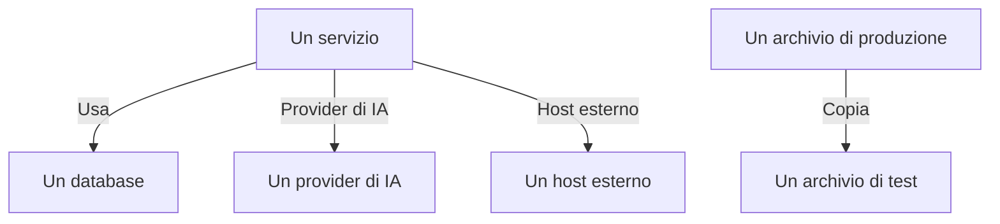

# Flussi di dati, accesso e residenza

Sapere cosa contiene un archivio è solo metà del lavoro. Sicurezza dei dati ricostruisce anche dove vanno quei dati - quali servizi usano l'archivio, quali provider di IA e host esterni raggiungono i dati, e dove sono stati copiati -, chi può raggiungere ogni archivio, e se i dati risiedono nelle regioni in cui possono stare. Tutto ciò viene da prove che OneUptime ha già: le tue tracce, le impostazioni di accesso proprie del tuo cloud e le impronte di ciò che hanno trovato le scansioni.

:::cards
- [Flussi di dati](#flussi-di-dati): Servizi, provider di IA, host esterni e copie.
- [Chi può raggiungere un archivio](#chi-può-raggiungere-un-archivio): Ogni concessione che il tuo cloud riporta, e quanto è esposto l'archivio.
- [Regole di residenza](#regole-di-residenza): Le regioni in cui può risiedere ogni tipo di dati.
:::

## Flussi di dati

| Flusso | Cosa significa | Da dove viene |
| --- | --- | --- |
| **Usa** | Un servizio comunica con un archivio. | La mappa dei servizi, che OneUptime ricava dagli span client dei tuoi servizi ogni dieci minuti. Ogni database presente è collegato al suo archivio per nome, indirizzo o endpoint, così un database che nessun'altra origine elenca diventa un archivio a sé. |
| **Provider di IA** | Un servizio invia dati a un provider di IA. | Le chiamate IA nelle tracce del servizio degli ultimi 7 giorni, che indicano il provider che raggiungono. |
| **Host esterno** | Un servizio chiama un host esterno ai tuoi sistemi. | I servizi remoti della mappa dei servizi, in base all'indirizzo a cui vengono chiamati. |
| **Copia** | Un archivio contiene valori di un altro. | Le impronte dei valori trovati da ogni scansione: due archivi condividono dati quando le loro impronte di un tipo di dati si sovrappongono per metà o più. |

Un flusso porta i tipi di dati che contiene la sua origine, e la loro sensibilità. Un flusso è confermato quando una scansione ha dimostrato che i dati ci sono, non solo che esiste un percorso per raggiungerli: una copia lo è sempre, e un flusso verso un provider di IA lo è quando le conversazioni IA del servizio contengono dati di livello Confidenziale o Ristretto. Un flusso non visto di nuovo per 30 giorni viene rimosso.

Due controlli leggono i flussi. [Dati di produzione sono stati copiati in un archivio non di produzione](/docs/data-security/checks-and-issues#igiene-dei-dati) non viene superato sulla destinazione di una copia. Una copia parte dall'archivio di produzione quando solo uno dei due è in produzione, e altrimenti dall'archivio che OneUptime ha trovato per primo. [Dati sensibili vengono inviati a un provider di IA](/docs/data-security/checks-and-issues#ia) non viene superato sulle conversazioni IA di un servizio quando contengono dati sensibili, e indica i provider che hanno raggiunto.

### Come le impronte restano private

Una copia viene trovata senza i valori di nessuno dei due archivi. Per ogni tipo di dati che trova con confidenza Alta, una scansione riassume i valori letti in un MinHash: 128 slot, ciascuno il minimo di una funzione di hash sui valori, di cui si conservano solo i 16 bit meno significativi. Due sketch coincidono in circa tanti slot quanto si sovrappongono i loro due insiemi di valori, quindi confrontare gli sketch stima quanta parte di un archivio si trova nell'altro.

- **I valori vengono sottoposti a hash con una chiave propria del progetto** (HMAC-SHA256), così nessuno senza la chiave può confrontare un valore noto con uno sketch, e gli sketch di due progetti non possono mai essere confrontati.
- **Solo 16 bit di ogni minimo escono dalla scansione.** Da uno sketch non si può risalire a nessun valore, né al suo hash.
- **Uno sketch riguarda un tipo di dati, non un campo.** Un archivio ne ha uno per ogni tipo di dati trovato al suo interno con confidenza Alta, e niente di più.

## Chi può raggiungere un archivio

La lettura della configurazione trasforma le impostazioni di accesso proprie di ogni cloud - policy e ACL dei bucket, assegnazioni di ruolo di Azure, binding IAM di Google Cloud, condivisioni di snapshot - in un unico elenco di chi può raggiungere l'archivio, nella sua pagina **Chi può accedervi**:

| Colonna | Cosa dice |
| --- | --- |
| **Principal** | Chi o cosa ha accesso, come lo chiama il cloud: `*`, l'id di un account, un ARN, un'email, un account di servizio. |
| **Tipo di principal** | Pubblico, Account, Ruolo, Utente, Gruppo, Service Principal, Account di servizio o Servizio. |
| **Livello di accesso** | Lettura, Scrittura o Amministratore. |
| **Concesso tramite** | Cosa lo concede: una policy del bucket, un'ACL, un'assegnazione di ruolo, un binding IAM o una condivisione di snapshot. |
| **Esterno** | Il principal è esterno agli account, alle sottoscrizioni e ai progetti collegati a OneUptime. |
| **Public** | Il principal è chiunque su Internet. |

L'elenco viene riletto a ogni lettura della configurazione, e una concessione che il cloud non riporta più viene rimossa. [Più di 25 identità possono leggere dati di livello Ristretto](/docs/data-security/checks-and-issues#accesso) conta i lettori presenti nell'elenco. I servizi che usano un archivio sono i suoi flussi **Usa**.

In base a ciò che legge, ogni archivio riceve un'esposizione:

| Esposizione | Cosa significa |
| --- | --- |
| **Public** | Chiunque su Internet può leggerlo. |
| **Altri account** | Account esterni a quelli collegati possono raggiungerlo. |
| **Raggiungibile da Internet** | Il suo endpoint di rete accetta connessioni da Internet. |
| **Privato** | Solo i tuoi account e le tue reti lo raggiungono. |
| **Sconosciuto** | OneUptime non ha potuto leggere abbastanza della sua configurazione per stabilirlo. |

Pubblico prevale su condiviso, e condiviso prevale su raggiungibile: un bucket pubblico che è anche condiviso con un altro account è Pubblico. L'esposizione si somma al [punteggio di rischio](/docs/data-security/checks-and-issues#punteggio-di-rischio) di un problema.

## Regole di residenza

Una regola di residenza dice dove può risiedere un tipo di dati. Aggiungine una in **Sicurezza dei dati → Impostazioni → Regole di residenza**:

| Campo | Cosa fa |
| --- | --- |
| **Nome** | Cos'è la regola, come I dati personali UE restano nell'UE. |
| **Regioni consentite** | Le regioni in cui quei dati possono essere conservati e copiati, scritte come le chiama il tuo cloud. Una regola senza regioni non controlla nulla. |
| **Categorie di dati** | Le categorie di dati che copre. Se è vuoto, copre ogni tipo di dati personali. |
| **Dati sulle persone in** | Solo i dati sulle persone in questi paesi, come codici ISO 3166-1 quali `DE` o `IN`. Se è vuoto, copre i dati sulle persone ovunque. |
| **Descrizione** | A cosa serve la regola, come I dati dei nostri clienti UE sono conservati solo nell'UE. |
| **Abilitato** | Se gli archivi vengono controllati rispetto alla regola. |

Un archivio viola una regola quando contiene dati che la regola copre, e la sua regione, o una regione in cui vengono copiati i suoi dati, non corrisponde a nessuna delle regioni consentite. Le copie sono le regioni in cui vengono replicati i dati di un archivio: la replica S3, la copia con ridondanza geografica di un account di archiviazione, le repliche di un database. L'archivio non supera allora [I dati sono conservati fuori dalle regioni in cui possono risiedere](/docs/data-security/checks-and-issues#residenza), con la regione e la regola che ha violato.

### Regioni e caratteri jolly

Un `*` in una regione consentita sta per qualsiasi sequenza di caratteri, maiuscole e minuscole sono equivalenti, e il pattern deve corrispondere all'intera regione:

| Regione consentita | Corrisponde a | Non corrisponde a |
| --- | --- | --- |
| `eu-*` (AWS) | `eu-west-1`, `eu-central-1` | `us-east-1`, `us-eu-1` |
| `europe-*` (Google Cloud) | `europe-west1`, `europe-north1` | `us-central1` |
| `westeurope` (Azure) | `westeurope` | `northeurope` |

Elenca un pattern per ogni cloud che usi: `eu-*`, `europe-*`, `westeurope` e `northeurope` insieme mantengono i dati in Europa su tutti e tre.

### Di chi sono i dati che contiene un archivio

OneUptime ricava dai dati stessi di chi sono i dati che contiene un archivio. Un tipo di dati che appartiene a un paese dice che le sue persone si trovano in quel paese: un codice fiscale tedesco dice `DE`, un numero Aadhaar indiano `IN`, un numero NHS UK `GB`. L'archivio elenca quei paesi come paesi degli interessati, e una regola limitata alle persone di alcuni paesi copre solo gli archivi che contengono i loro dati. [Tipi di dati sensibili](/docs/data-security/data-types#tipi-di-dati-integrati) indica il paese di ogni tipo di dati che ne ha uno.

## Passaggi successivi

:::cards
- [Controlli e problemi di Sicurezza dei dati](/docs/data-security/checks-and-issues): Ogni controllo alimentato da questi flussi, concessioni e regole.
- [Conformità di Sicurezza dei dati](/docs/data-security/compliance): Come residenza e accesso contano per GDPR, LGPD e DPDP.
- [Topologia](/docs/telemetry/topology): La mappa dei servizi da cui vengono i flussi.
:::
