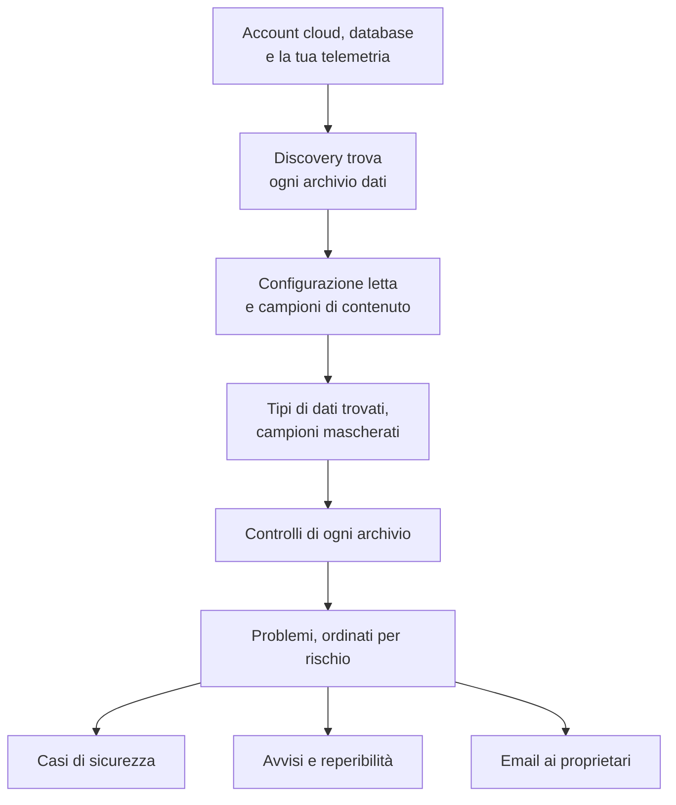

# Sicurezza dei dati

Sicurezza dei dati trova i dati sensibili che la tua azienda conserva - nei bucket cloud, nei database e nei data warehouse, e nella telemetria che invii a OneUptime - e ti dice cosa non va nel modo in cui sono conservati. Trova da sé gli archivi, legge come è configurato ciascuno, campiona ciò che contiene e apre un problema per ogni criticità, ordinato per rischio.

Risponde a quattro domande:

:::cards
- [Dove sono i nostri dati sensibili?](/docs/data-security/data-types): 143 tipi di dati, dai numeri di carta e dai codici identificativi nazionali alle chiavi API, trovati in bucket, tabelle e telemetria.
- [Sono esposti?](/docs/data-security/checks-and-issues): 32 controlli su ogni archivio: accesso pubblico, cifratura, backup, logging, segreti e copie.
- [Chi può raggiungerli, e dove vanno?](/docs/data-security/flows-access-residency): Chi può leggere ogni archivio, quali servizi lo usano e quali provider di IA e host raggiungono i suoi dati.
- [Rispettano le nostre regole?](/docs/data-security/compliance): Regole di residenza, e nove framework valutati in base a ciò che hanno trovato le scansioni.
:::

## Come funziona

1. **Discovery** trova gli archivi che OneUptime conosce già: il tuo inventario cloud, i database monitorati dal prodotto Database, i database con cui parlano i tuoi servizi sulla mappa dei servizi e la telemetria di ogni servizio. Aggiungi un archivio a mano solo quando nessuna origine lo elenca.
2. **La lettura della configurazione** chiede a ogni cloud come è configurato ciascun archivio: chi può raggiungerlo, come è cifrato, sottoposto a backup e registrato nei log. Legge le impostazioni, mai i dati.
3. **I campioni di contenuto** leggono un po' di ciò che contiene un archivio, dove lo consenti: alcuni oggetti di ogni tipo in un bucket, alcune righe di ogni tabella, i record più recenti della telemetria di ogni servizio.
4. La **Classificazione** trova i valori sensibili nei campioni e conserva conteggi e campioni mascherati, mai un valore.
5. I **Controlli** stabiliscono cosa non va in ogni archivio, e quanto è grave per i dati che contiene. Ogni controllo non superato apre un problema, che si chiude da solo quando il controllo viene superato.

## In cosa è diverso

- **La tua telemetria è un archivio dati.** I log, le tracce, le eccezioni, i replay di sessione e le conversazioni IA di ogni servizio vengono controllati come un bucket, ogni ora. Un indirizzo email in una riga di log è un risultato, e **Ripulisci** lo maschera all'ingestione da quel momento in poi. Vedi [Dati sensibili nella telemetria](/docs/data-security/telemetry).
- **I flussi vengono dal traffico reale.** La mappa dei servizi dice quale servizio usa quale database, le chiamate IA nominano il provider che raggiungono, e le copie dei dati di produzione si trovano confrontando le impronte. Vedi [Flussi di dati, accesso e residenza](/docs/data-security/flows-access-residency).
- **Le prove sono sempre mascherate.** Un risultato conserva conteggi e al massimo tre campioni mascherati, come `j***@e******.com`, mascherati all'interno dello scanner prima che qualcosa ne esca. Disattiva i campioni e conserva solo i conteggi.
- **Lo scanner è open source.** Il pattern, il checksum, le parole di contesto e i valori di test di ogni tipo di dati si trovano nel codice sorgente di OneUptime, così puoi leggere esattamente cosa produce un risultato. Lo stesso codice gira sui worker di OneUptime, su una sonda e nella casella **Testalo**.
- **Funziona con il resto di OneUptime.** Un problema Critico apre un caso di sicurezza sull'archivio, così [Security Operations](/docs/telemetry/security-cases) lo gestisce come qualsiasi altra minaccia. Può generare un avviso che chiama chi è di reperibilità, e invia un'email ai proprietari dell'archivio. Vedi [Integrazioni di Sicurezza dei dati](/docs/data-security/integrations).
- **OneUptime AI aiuta a correggerlo.** **Spiega con l'IA** dice al proprietario di un archivio cosa non va e come correggerlo sul suo cloud, e **Correggi con l'IA** apre una pull request nel tuo codice di infrastruttura.

## Prima di iniziare

- **Un ruolo che può configurarla.** I Project Owner, i Project Admin e i Security Admin modificano le impostazioni di Sicurezza dei dati. I Security Member gestiscono i problemi e scansionano gli archivi, e i Security Viewer leggono ciò che ha trovato. Gli altri ruoli non ne vedono nulla, a meno che al loro team non vengano dati i suoi permessi: sapere quali bucket contengono numeri di carta è esattamente ciò che vuole un attaccante. Vedi [Ruoli](/docs/permissions/reference#ruoli).
- **Un account cloud da leggere, o un database.** Sicurezza dei dati legge un account cloud tramite una [connessione cloud](/docs/telemetry/cloud-accounts), e un database che gestisci tramite una stringa di connessione di sola lettura. La telemetria non richiede nulla: viene scansionata ogni ora.

## Avvio rapido

:::steps
### Collega un account cloud

Vai su **Cloud → Collega** e scegli il tuo cloud. Se l'account è già collegato, scegli invece **Modifica** sulla sua connessione. [Collegare un account cloud](/docs/telemetry/cloud-accounts) spiega ogni cloud passo per passo.

### Scegli il livello di sicurezza dei dati

In **Altri campi**, imposta **Sicurezza dei dati** su **Solo configurazione** per controllare come è configurato ogni archivio, oppure su **Configurazione e campioni di contenuto** per trovare anche i dati sensibili al loro interno. Il comando mostrato dal modulo cambia in base alla tua scelta: eseguilo nella shell del tuo cloud, come indica il modulo. [Configurare Sicurezza dei dati](/docs/data-security/setup) elenca esattamente cosa concede ogni livello, e [Collegare un account cloud](/docs/telemetry/cloud-accounts#sicurezza-dei-dati) mostra il comando di ogni livello.

### Esamina i problemi

Apri **Sicurezza dei dati**. Gli archivi compaiono in **Archivi dati** man mano che la discovery li trova, ogni 15 minuti, e la configurazione di una connessione viene letta entro un'ora. I problemi si aprono in **Problemi** appena termina una lettura o una scansione, ognuno con il suo punteggio di rischio, e la **Panoramica** mostra i cinque più rischiosi. Ogni problema dice cosa non va, perché è importante e come correggerlo, con i comandi per il tuo cloud.
:::

## Cosa conta come archivio dati

| Dove | Archivi | Campioni di contenuto |
| --- | --- | --- |
| AWS | AWS S3 Bucket, AWS RDS Instance, AWS Aurora Cluster, AWS RDS Snapshot, AWS DynamoDB Table, AWS Redshift Cluster, AWS DocumentDB Cluster, AWS OpenSearch Domain, AWS ElastiCache Cluster, AWS EFS File System | AWS S3 Bucket |
| Azure | Azure Storage Account, Azure SQL Database, Azure Cosmos DB Account, Azure PostgreSQL Server, Azure MySQL Server | Azure Storage Account |
| Google Cloud | Google Cloud Storage Bucket, Google Cloud SQL Instance, Google BigQuery Dataset, Google Firestore Database, Google Spanner Instance, Google Bigtable Instance | Google Cloud Storage Bucket, Google BigQuery Dataset |
| Database che gestisci | PostgreSQL, MySQL, MongoDB, SQL Server, Oracle, Redis, Elasticsearch | PostgreSQL, MySQL |
| OneUptime | Registri, Tracce, Eccezioni, Session Replays, Conversazioni IA | Registri, Tracce, Eccezioni, Session Replays, Conversazioni IA |

Ogni archivio riceve i controlli che si applicano al suo tipo. Un archivio il cui contenuto non può essere campionato viene comunque controllato: un bucket pubblico o un database non cifrato è un problema qualunque cosa contenga.

Un archivio viene archiviato, con la sua cronologia, quando la sua origine non lo elenca più: **Archivi dati archiviati**, in fondo al menu di Sicurezza dei dati, lo conserva. Torna da solo se la sua origine lo elenca di nuovo.

La **Cronologia** di un archivio dice cosa gli è successo, e chi l'ha fatto: quando è stato trovato o aggiunto, ogni modifica alle sue impostazioni e ai suoi proprietari, quando è stato archiviato o è tornato, e ogni esposizione chiusa da un problema o da un playbook.

## Ogni quanto viene eseguito

| Cosa | Quando |
| --- | --- |
| Trovare nuovi archivi | Ogni 15 minuti |
| Leggere la configurazione di una connessione cloud | Una volta al giorno, ed entro un'ora dopo che CloudTrail registra una modifica all'accesso, alla cifratura, ai backup o alla condivisione di un archivio AWS |
| Campionare il contenuto di un archivio | Ogni 24 ore, o con la frequenza indicata da **Scansiona ogni (ore)** |
| Campionare la telemetria di ogni servizio | Ogni ora, sull'ultima ora |
| Controllare di nuovo ogni archivio | Dopo ogni lettura e scansione, dopo che modifichi qualcosa da cui dipende un controllo, e una volta al giorno |

**Scansiona ora** su un archivio ne campiona subito il contenuto, e **Controlla ora** ne rilegge la configurazione.

## Passaggi successivi

:::cards
- [Configurare Sicurezza dei dati](/docs/data-security/setup): I tre livelli, i permessi che concede ciascuno e la scansione dei tuoi database.
- [Tipi di dati sensibili](/docs/data-security/data-types): Come viene trovato un valore, e ogni tipo di dati che Sicurezza dei dati conosce.
- [Controlli e problemi di Sicurezza dei dati](/docs/data-security/checks-and-issues): Ogni controllo, il punteggio di rischio e cosa succede a un problema.
- [Integrazioni di Sicurezza dei dati](/docs/data-security/integrations): Casi di sicurezza, avvisi, proprietari, workflow e OneUptime AI.
:::
