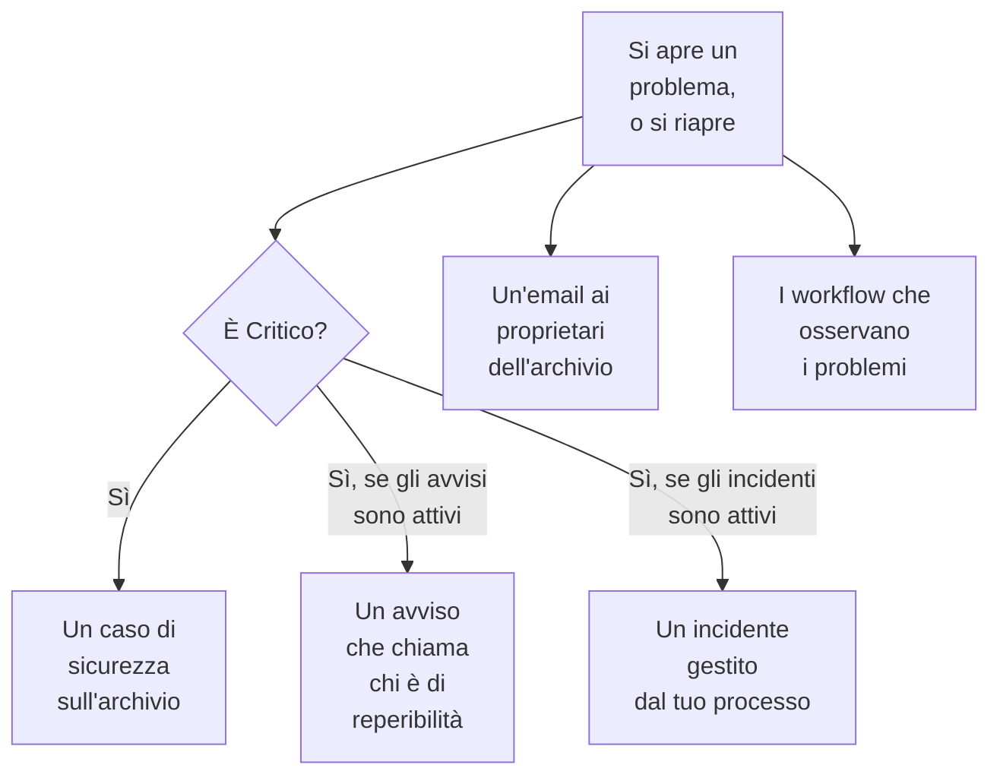

# Integrazioni di Sicurezza dei dati

Sicurezza dei dati non gestisce un sistema di chiamata né una coda di sicurezza propri. Passa ciò che trova alle parti di OneUptime che lo fanno già: un problema Critico diventa un caso di sicurezza, può chiamare chi è di reperibilità o dichiarare un incidente, e ogni nuovo problema viene inviato via email ai proprietari dell'archivio. I workflow, OneUptime AI, l'API, Terraform e il server MCP raggiungono tutto ciò che conserva.

:::cards
- [Security Operations](#security-operations): Un caso di sicurezza per ogni archivio con un problema Critico.
- [Avvisi e reperibilità](#avvisi-e-reperibilità): Chiama chi è di reperibilità quando si apre un problema Critico.
- [Incidenti](#incidenti): Dichiara un incidente per una violazione di cui deve occuparsi il tuo processo di gestione degli incidenti.
- [Proprietari](#proprietari): Chi possiede ogni archivio, impostato a mano o tramite regole, e l'email che riceve.
- [OneUptime AI](#oneuptime-ai): Spiega un problema, apri una pull request che lo corregge, o fai domande sui tuoi dati a Chiedi all'IA.
- [Chiudere un'esposizione](#chiudere-unesposizione): Blocca l'accesso pubblico o interrompi la condivisione, da un problema o da un playbook.
:::

## Come funziona

Ognuna di queste viene eseguita quando una valutazione apre un problema, o lo riapre. Ognuna è best effort: il problema è già aperto e nella sua cronologia, quindi un'integrazione non riuscita viene registrata e saltata, mai ritentata fino a creare un secondo caso o una seconda chiamata. Ciò che ha fatto ognuna viene scritto nella **Cronologia** del problema, e la pagina del problema rimanda al caso, all'avviso e all'incidente che ha avviato.

| Impostazione | Predefinito | Cosa fa |
| --- | --- | --- |
| **Apri casi di sicurezza** | Attivo | Un problema Critico apre un caso di sicurezza, raggruppato per archivio. |
| **Genera avvisi** | Disattivato | Un problema Critico genera un avviso, che chiama chi è di reperibilità. |
| **Gravità avviso** | Vuoto | La gravità di quegli avvisi. Se è vuota, è la più grave del progetto. |
| **Dichiara incidenti** | Disattivato | Un problema Critico dichiara un incidente, preso in carico dal tuo processo di gestione degli incidenti. |
| **Gravità incidente** | Vuoto | La gravità di quegli incidenti. Se è vuota, è la più grave del progetto. |
| **Notifica ai proprietari** | Attivo | Ogni nuovo problema viene inviato via email ai proprietari del suo archivio. |

## Security Operations

Ogni archivio è un'entità a sé in Security Operations, di tipo **Archivio dati**. Con **Apri casi di sicurezza** attivo, un problema Critico viene inviato a Security Operations come rilevamento sull'archivio:

- la sua origine è **Sicurezza dei dati**, e la sua regola prende il nome dal controllo, come `Data Security: public-read`;
- è Critico, quindi il caso che apre ha la priorità Critica del progetto;
- è raggruppato per archivio: un secondo problema Critico sullo stesso archivio si aggiunge al caso aperto che lo riguarda invece di aprirne un altro.

Da lì il caso si gestisce come qualsiasi altro: viene assegnato, annotato e chiuso, e i playbook del progetto vi rispondono. I rilevamenti dell'archivio contano per il suo rischio in [Rischio delle entità](/docs/telemetry/security-entity-risk), come quelli di qualsiasi entità. Vedi [Casi di sicurezza e playbook](/docs/telemetry/security-cases).

## Avvisi e reperibilità

Con **Genera avvisi** attivo, un problema Critico genera un avviso, intitolato «Data Security:» seguito dal titolo e dall'archivio del problema. L'avviso chiama chi è di reperibilità tramite le proprie regole, come qualsiasi altro avviso (vedi [Avvisi](/docs/alerts/index) e [Reperibilità](/docs/on-call/index)). Un problema ha al massimo un avviso aperto alla volta, per quanto spesso venga valutato. **Gravità avviso** imposta la gravità dell'avviso; se resta vuota, è la più grave del progetto.

Un avviso termina insieme al suo problema: quando il problema non è più aperto - il suo controllo viene superato, oppure una persona lo segna come risolto, ne accetta il rischio o dice che non è un problema - l'avviso viene risolto, e la **Cronologia** del problema lo riporta. Un problema che si riapre genera un nuovo avviso.

Gli avvisi sono disattivati per impostazione predefinita perché la maggior parte dei team vuole vedere un risultato di sicurezza dei dati prima di tutto in un caso di sicurezza. Attivali quando un bucket pubblico di numeri di carta deve svegliare qualcuno.

## Incidenti

Con **Dichiara incidenti** attivo, un problema Critico dichiara un incidente, intitolato come il suo avviso, per una violazione di cui deve occuparsi il tuo processo di gestione degli incidenti: reperibilità, canali del workspace, pagine di stato e un postmortem (vedi [Incidenti](/docs/incidents/index)). Un problema ha al massimo un incidente aperto alla volta. **Gravità incidente** imposta la gravità dell'incidente; se resta vuota, è la più grave del progetto.

Sicurezza dei dati non risolve mai un incidente, nemmeno quando il suo problema è stato risolto: un incidente può avere una pagina di stato e un postmortem, quindi lo chiude chi lo gestisce. Un caso di sicurezza è l'altra via per arrivare a un incidente: **Dichiara incidente** sul caso ne apre uno a esso collegato (vedi [Dichiarare un incidente](/docs/telemetry/security-cases#dichiarare-un-incidente)).

## Proprietari

I proprietari di un archivio sono persone e team, nella pagina **Proprietari** dell'archivio. Sono i destinatari di un problema: ricevono l'email, e **Questo archivio sensibile non ha un proprietario** non viene superato su un archivio sensibile che non ne ha.

Con **Notifica ai proprietari** attivo, ogni valutazione che apre problemi su un archivio invia ai suoi proprietari un'unica email - alle persone che lo possiedono, e ai membri dei team che lo possiedono, fino a 50 - intitolata con il numero di nuovi problemi dell'archivio, come «Data Security: 2 new issues on orders-db». Elenca la gravità e il titolo di ogni nuovo problema e la sensibilità dell'archivio, e rimanda all'archivio. Non contiene mai un campione.

### Regole del proprietario e regole etichette

Le regole impostano proprietari ed etichette al posto tuo, man mano che gli archivi vengono trovati:

| Regola | Dove | Cosa fa |
| --- | --- | --- |
| **Regole del proprietario** | **Sicurezza dei dati → Regole → Regole del proprietario** | Aggiunge utenti e team proprietari a ogni archivio che corrisponde |
| **Regole etichette** | **Sicurezza dei dati → Regole → Regole etichette** | Aggiunge etichette a ogni archivio che corrisponde |

Una regola corrisponde a un archivio in base alle sue etichette, a un pattern del suo nome o della sua descrizione, oppure al **Modello di tag cloud**: un pattern confrontato con ciascuno dei tag cloud dell'archivio, scritti `key=value`. `^team=payments$` corrisponde a ogni archivio con il tag `team=payments`, e `^env=` a ogni archivio con un tag `env`. Un nuovo archivio riceve le regole del progetto nel momento in cui viene trovato, e la **Notifica ai proprietari** di una regola del proprietario dice se i proprietari che aggiunge vengono avvisati. [Regole per etichette e proprietari](/docs/configuration/label-and-owner-rules) spiega come corrisponde ogni regola e quando vengono eseguite le regole.

## Workflow

**Archivio dati** e **Problema di sicurezza dei dati** sono trigger dei workflow, ciascuno con **Alla creazione**, **All'aggiornamento**, **Alla creazione o all'aggiornamento** e **All'eliminazione**. Sceglili nel pannello **Aggiungi trigger**, sotto **Risorse OneUptime**.

- **Problema di sicurezza dei dati → Alla creazione** viene eseguito quando un problema si apre per la prima volta. Leggine la gravità in un blocco **If / Else**, e pubblica quelli Critici in un canale o apri un ticket nel tuo tracker.
- **Problema di sicurezza dei dati → All'aggiornamento**, con **Campi da osservare** impostato sul suo stato, viene eseguito quando un problema viene risolto, accettato o si riapre.
- **Archivio dati → Alla creazione** viene eseguito quando la discovery trova un archivio, per esempio per avvisare un team di ogni nuovo bucket.

Vedi [Trigger dei workflow](/docs/workflows/triggers) per i campi che passa ogni trigger.

## OneUptime AI

Due azioni su un problema chiedono aiuto a OneUptime AI. Entrambe inviano a OneUptime AI il titolo e la gravità del problema, il nome, il tipo, la regione e l'id cloud dell'archivio, la sua sensibilità e i suoi tipi di dati, la prova, perché il controllo è importante e la correzione per il cloud dell'archivio - mai i campioni di un risultato. Entrambe rispettano gli interruttori e i limiti di OneUptime AI del progetto.

- **Spiega con l'IA** scrive, per il proprietario dell'archivio, cosa non va, cosa potrebbe succedere e i passaggi esatti per correggerlo sul suo cloud. La spiegazione viene conservata nella **Cronologia** del problema. Chiunque possa leggere Sicurezza dei dati può richiederla.
- **Correggi con l'IA** chiede a OneUptime AI di correggere il problema nel tuo codice di infrastruttura - Terraform, CloudFormation, Bicep o simili - con la modifica più piccola che fa superare il controllo, e di aprire una pull request. Richiede che il repository che contiene il codice di infrastruttura dell'archivio sia collegato in **Codice**: sceglilo in **Repository** quando il progetto ne ha più di uno. La pull request compare in **Codice** (vedi [Codice](/docs/ai/ai-agent)). Possono richiederla i Security Member e i ruoli superiori.

### Chiedi all'IA

**Chiedi all'IA** legge anche Sicurezza dei dati. In qualsiasi pagina di Sicurezza dei dati, chiedi quali archivi contengono numeri di carta, cosa correggere per primo, o quali archivi potrebbe raggiungere un ruolo se trapelasse; nella pagina di un archivio o di un problema legge prima quel record. Risponde con tre strumenti di lettura, eseguiti con i tuoi permessi:

| Strumento | Cosa legge |
| --- | --- |
| `query_data_stores` | Gli archivi, i più rischiosi per primi, per sensibilità, tipo di dati, esposizione, provider o nome - oppure un archivio con ciò che è stato trovato e dove, chi può raggiungerlo e i suoi problemi aperti |
| `query_data_security_issues` | I problemi, i più rischiosi per primi, per stato, gravità, archivio o controllo - oppure un problema con la sua prova e la correzione per il suo cloud |
| `query_data_store_access` | Chi può raggiungere un archivio, oppure ogni archivio che un principal può raggiungere |

Leggono tipi di dati, posizioni e conteggi, mai i campioni di un risultato, mascherati o no. Chiedi all'IA non cambia nulla in Sicurezza dei dati.

## Chiudere un'esposizione

Due modifiche chiudono l'esposizione di un archivio cloud, ciascuna tramite la connessione cloud dell'archivio con **Risposta di sicurezza dei dati** attivata (vedi [Configurare Sicurezza dei dati](/docs/data-security/setup#lasciare-che-sicurezza-dei-dati-chiuda-unesposizione)):

- **Blocca l'accesso pubblico**, su un bucket S3, un account di archiviazione Azure o un bucket Cloud Storage.
- **Revoca la condivisione**, su uno snapshot RDS, oppure sugli snapshot manuali condivisi di un database RDS, di un cluster Aurora o di un cluster DocumentDB.

Una persona ne esegue una da un problema aperto che risolve, con **Correggi da qui** (vedi [Controlli e problemi di Sicurezza dei dati](/docs/data-security/checks-and-issues#correggi-da-qui)). Un playbook di Security Operations le esegue come passi della categoria **Contenimento**, **Blocca l'accesso pubblico agli archivi dati** e **Revoca la condivisione degli archivi dati**: su ogni archivio dati di cui tratta il caso, al massimo 10, ciascuno un passo che parte con **Richiede approvazione** attivo. Un archivio contrassegnato come **Pubblico per scelta** non viene mai bloccato. In entrambi i casi la cronologia dell'archivio dice cosa è stato fatto, e l'archivio viene subito controllato di nuovo, così il problema si risolve quando la modifica ha avuto effetto.

## API, Terraform e MCP

Tutto ciò che conserva Sicurezza dei dati è un record dell'API di OneUptime, letto con gli stessi permessi della dashboard (vedi il [Riferimento API](/docs/api-reference/api-reference)):

| Record | Percorso API |
| --- | --- |
| Archivi dati, le loro cronologie, i loro risultati e chi può raggiungerli | `/data-store`, `/data-store-feed`, `/data-store-finding`, `/data-store-access` |
| Problemi, le loro cronologie e i flussi di dati | `/data-security-issue`, `/data-security-issue-feed`, `/data-security-flow` |
| Scansioni | `/data-security-scan` |
| Tipi di dati personalizzati, impostazioni dei controlli e regole di residenza | `/data-security-custom-data-type`, `/data-security-check-setting`, `/data-security-residency-rule` |
| Le impostazioni del progetto | `/data-security-setting` |
| Proprietari, regole del proprietario e regole etichette | `/data-store-owner-user`, `/data-store-owner-team`, `/data-store-owner-rule`, `/data-store-label-rule` |

Alcune risposte vengono calcolate su richiesta invece di essere conservate. Ognuna è una `POST`:

| Percorso | Cosa fa |
| --- | --- |
| `/data-security/overview` | I dati della Panoramica: archivi per sensibilità e categoria, problemi aperti per gravità, i problemi più rischiosi e gli ultimi 30 giorni di problemi |
| `/data-security/compliance` | Il punteggio e i requisiti di ogni framework |
| `/data-security/record-of-processing` | Il registro dei trattamenti del GDPR, una riga per ogni archivio che contiene dati personali |
| `/data-store/<id>/scan-now` | **Scansiona ora**: campiona subito il contenuto dell'archivio |
| `/data-store/<id>/check-now` | **Controlla ora**: rilegge la configurazione dell'archivio ed esegue i suoi controlli |
| `/data-store-finding/<id>/scrub` | **Ripulisci** su un risultato della telemetria |
| `/data-security-issue/<id>/explain` | **Spiega con l'IA** su un problema |
| `/data-security-issue/<id>/fix-with-ai` | **Correggi con l'IA** su un problema |
| `/data-store/<id>/response-actions` | Quali azioni di risposta l'archivio può eseguire ora, e perché no |
| `/data-store/<id>/respond` | **Blocca l'accesso pubblico** o **Revoca la condivisione** sull'archivio, con il problema da cui è stata eseguita |

Il [provider Terraform](/docs/terraform/index) ha una risorsa per ogni tipo di record che crei - archivi dati che aggiungi tu, tipi di dati personalizzati, impostazioni dei controlli, regole di residenza, regole del proprietario e regole etichette - che prende il nome dal record, come `oneuptime_residency_rule`.

Il [server MCP](/docs/ai/mcp-server) ha strumenti per creare, leggere, elencare, aggiornare, eliminare e contare questi record: Data Store, Data Store Finding, Data Store Access Entry, Data Flow, Data Security Issue, Data Security Scan, Custom Data Type, Check Setting, Residency Rule e Data Security Setting. Un assistente IA può allora chiedere, con i tuoi permessi, quali archivi contengono numeri di carta, o cosa è aperto su un bucket.

## Passaggi successivi

:::cards
- [Casi di sicurezza e playbook (SOAR)](/docs/telemetry/security-cases): Gestisci i casi che apre Sicurezza dei dati.
- [Regole per etichette e proprietari](/docs/configuration/label-and-owner-rules): Come corrispondono le regole, e quando vengono eseguite.
- [Trigger dei workflow](/docs/workflows/triggers): Esegui un workflow quando si apre un problema o viene trovato un archivio.
- [Controlli e problemi di Sicurezza dei dati](/docs/data-security/checks-and-issues): Cosa significa ogni problema, e come correggerlo.
:::
