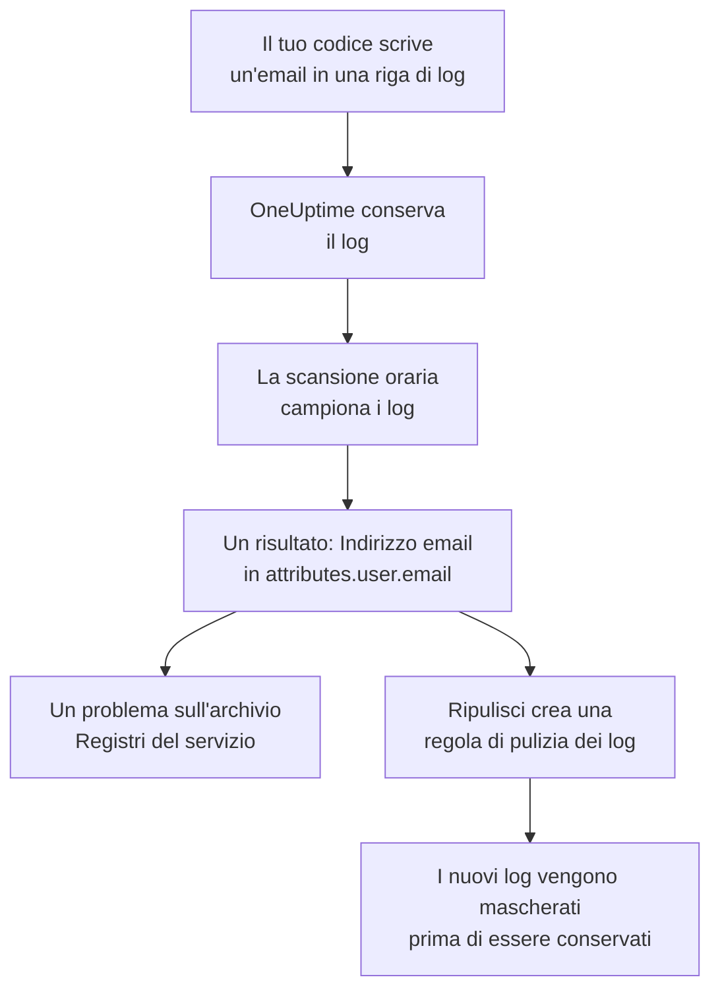

# Dati sensibili nella telemetria

La telemetria contiene tutto ciò che scrive il tuo codice: un indirizzo email in una riga di log, un numero di carta in un attributo di uno span, un token in uno stack trace, la domanda di un cliente in un prompt. Sicurezza dei dati tratta i log, le tracce, le eccezioni e le conversazioni IA di ogni servizio, e le sessioni di ogni applicazione RUM, come archivi dati a sé stanti. Li campiona ogni ora, vi trova i dati sensibili come fa in un bucket, e **Ripulisci** trasforma un risultato in una regola di pulizia che da quel momento in poi maschera quei dati all'ingestione.

Non c'è nulla da configurare: la telemetria di ogni servizio viene scansionata ogni ora, a meno che **Scansiona telemetria** non sia disattivato nelle impostazioni del progetto.

:::cards
- [Cosa viene letto](#cosa-viene-letto): Gli attributi, i corpi, i messaggi e i prompt di ogni segnale.
- [Come campiona una scansione](#come-campiona-una-scansione): I record più recenti di ogni servizio, ogni ora.
- [Ripulisci](#ripulisci): Maschera un risultato all'ingestione, con un clic.
- [Cosa conta come ripulito](#cosa-conta-come-ripulito): Quando una regola di pulizia copre già un risultato.
:::

## Come funziona

Un risultato coperto da una regola di pulizia viene contrassegnato come ripulito: ciò che resta di quei dati sono dati vecchi in attesa della fine della loro conservazione, non una fuga ancora in corso. I due controlli della telemetria contano solo ciò che nessuna regola copre, quindi il loro problema si risolve quando ogni risultato è ripulito (vedi [Controlli della telemetria](/docs/data-security/checks-and-issues#telemetria)).

## Cosa viene letto

| Archivio | Cosa viene letto | Dove punta un risultato |
| --- | --- | --- |
| Registri | Ogni attributo, e il corpo | `attributes.<key>`, `body` |
| Tracce | Ogni attributo degli span, e gli attributi di ogni evento degli span | `attributes.<key>`, `events.<event>.<key>` |
| Eccezioni | Il messaggio, lo stack trace e gli attributi | `message`, `stackTrace`, `attributes.<key>` |
| Conversazioni IA | I prompt e le risposte di ogni chiamata IA, sotto le chiavi in cui li mettono le convenzioni GenAI, e ogni altro attributo | La chiave in cui si trovano, come `gen_ai.input.messages` o `gen_ai.prompt[].content` |
| Session Replays | Gli attributi degli span e dei log di un'applicazione RUM, gli attributi delle sue sessioni, i tratti che `identify()` ha assegnato ai suoi utenti e il riferimento utente che ha ricevuto | `spans.attributes.<key>`, `logs.attributes.<key>`, `sessions.attributes.<key>`, `sessions.identifiedUserTraits.<key>`, `sessions.identifiedUserLabel` |

Le chiavi numerate vengono raccolte in un'unica posizione: `gen_ai.prompt.3.content` diventa `gen_ai.prompt[].content`, così i venti messaggi di una chat sono un solo risultato, non venti. Gli attributi che OneUptime aggiunge da sé, che iniziano con `oneuptime.`, non vengono letti.

### Perché la registrazione di un replay non viene mai letta

La registrazione di un replay di sessione contiene il testo delle pagine che le persone hanno visto. Guardarla richiede un permesso a sé, e un risultato ricavato da essa mostrerebbe il testo mascherato delle pagine a chiunque possa leggere Sicurezza dei dati. Per questo di un replay si leggono solo gli attributi: gli span, i log e i dettagli della sessione accanto alla registrazione. Il registratore maschera già nel browser ciò che registra, e anche le regole di pulizia dei log vengono applicate alle registrazioni (vedi [Session Replay](/docs/telemetry/session-replay)).

### Conversazioni IA

Il prompt di una chiamata IA porta con sé l'intera chat che precede il messaggio più recente della persona, quindi di ogni valore di una chiamata IA vengono letti fino a 16.384 caratteri. Quando le conversazioni IA contengono dati sensibili, ne seguono altre due cose: il provider di IA a cui sono andate le chiamate è un flusso di quei dati, e [Dati sensibili vengono inviati a un provider di IA](/docs/data-security/checks-and-issues#ia) non viene superato sull'archivio.

Le conversazioni di uno [strumento di IA aziendale](/docs/telemetry/ai-company-tools) restano escluse. Solo i Project Owner e i Project Admin possono leggerle, e un risultato finisce dove lo legge chiunque legga Sicurezza dei dati, quindi gli span di quei servizi non vengono mai letti, e le loro conversazioni IA vengono indicate come non lette.

## Come campiona una scansione

Ogni ora vengono letti i record più recenti dell'ultima ora di ogni segnale, e vengono classificati campo per campo come quelli di qualsiasi altro archivio (vedi [Campi e colonne](/docs/data-security/data-types#campi-e-colonne)):

| Limite | Valore |
| --- | --- |
| Record di ogni servizio e segnale | **Dimensione del campione di telemetria**, 500 per impostazione predefinita, mai più di 1.000 |
| Servizi o applicazioni RUM letti per segnale | I 200 più attivi |
| Record in una lettura | 5.000, condivisi tra i servizi; 500 per le chiamate IA |
| Caratteri del corpo di un log, del messaggio di un'eccezione o di uno stack trace | 8.192 |
| Caratteri del valore di un attributo | 4.096 |
| Caratteri di un valore di una chiamata IA | 16.384 |
| Attributi di un record | 128; 64 per una chiamata IA |
| Eventi di uno span, e attributi di un evento | 16 e 32 |
| Posizioni di un archivio | 500 |

Ogni valore viene troncato già nel database, così nessun valore lungo ne esce, e ogni lettura si ferma dopo 30 secondi. Una lettura non riuscita è un'avvertenza sugli archivi a cui era destinata; la scansione prosegue con la successiva.

Per escludere qualcosa, aggiungilo alle **Esclusioni dalla scansione** dell'archivio: una posizione indicata per intero (`attributes.http.url`), tutto ciò che sta sotto una posizione (`attributes.http`), o una chiave di attributo indicata da sola (`http.url`).

## Ripulisci

**Ripulisci** su un risultato crea la regola di pulizia che da quel momento nasconde quel tipo di dati in quella posizione, oppure indica la regola abilitata che lo fa già:

:::steps
### Apri il risultato

Apri l'archivio di telemetria - i **Registri** di un servizio, per esempio - e il risultato.

### Premi Ripulisci

Fai clic su **Ripulisci**. OneUptime crea una regola di pulizia dei log per i log e per i log di un'applicazione RUM, e una regola di pulizia delle tracce per span, eccezioni e chiamate IA, sulla parte del record in cui si trova il risultato.

### Correggi anche il codice

La regola maschera i nuovi dati prima che vengano conservati. I dati già conservati restano fino alla fine della loro conservazione, quindi correggi il codice che li scrive: il risultato indica il servizio e l'attributo.
:::

La regola prende il nome da ciò che nasconde, come «Data Security: Email address in attributes.user.email», ed è elencata con le altre tue regole di pulizia (vedi [Filtri di scarto e regole di pulizia](/docs/telemetry/drop-filters-and-scrub-rules#mascherare-i-dati-sensibili)). È una di queste:

| Risultato | Regola creata da Ripulisci |
| --- | --- |
| Indirizzo email, numero di carta, numero di Social Security USA, numero di telefono o indirizzo IP | Il pattern integrato di quel tipo. I numeri di carta, i numeri di Social Security e i numeri di telefono vengono mascherati, gli altri oscurati. |
| Un valore sotto una chiave che sembra sensibile, come `password` o `token` | Una regola **Sensitive Attribute Keys**, che oscura l'intero valore di ogni attributo del genere |
| Qualsiasi altro tipo di dati che un pattern può trovare | Una regola **Regex personalizzata** creata dai pattern propri del tipo di dati, che oscura ogni valore con quella forma |

Alcuni risultati non possono essere ripuliti da una regola, e **Ripulisci** dice perché:

- Un tipo di dati trovato solo dai nomi dei campi, come il nome di una persona: nessun pattern può trovarlo. Rinomina l'attributo con una chiave che una regola delle chiavi sensibili nasconde, oppure smetti di inviarlo.
- Un tipo di dati che si distingue dagli altri valori solo per le parole che lo circondano, come un routing number: una regola nasconderebbe molto più di quel tipo di dati.
- Una dicitura di classificazione di un documento: nascondere la parola non nasconderebbe il documento.
- Uno dei tuoi tipi di dati: aggiungi tu una regola di pulizia personalizzata con il suo pattern.
- I dettagli propri di una sessione (`sessions.*`): l'ingestione dei replay di sessione non esegue regole di pulizia.

**Ripulisci** crea la regola a tuo nome, con i tuoi permessi: possono premerlo i Project Owner e i Project Admin, e anche un team che può creare regole di pulizia dei log, e regole di pulizia delle tracce per span, eccezioni e chiamate IA.

## Cosa conta come ripulito

Un risultato viene contrassegnato come ripulito solo quando l'ingestione eseguirebbe su di esso una regola abilitata e la regola troverebbe il suo tipo di dati:

- **I record giusti.** Le regole dei log coprono i log e i log di un'applicazione RUM. Le regole delle tracce coprono span, eccezioni e chiamate IA: un'eccezione è una copia dell'evento di eccezione del suo span, quindi la ripuliscono le regole che ripuliscono gli eventi.
- **La parte giusta.** I **Campi da rimuovere** della regola includono la parte del record in cui si trova il risultato, oppure la regola li lascia al loro valore predefinito.
- **Un pattern che trova il tipo.** Un **Tipo di pattern** integrato trova il proprio tipo di dati: **Indirizzo email** trova gli indirizzi email, **Numero di carta di credito** i numeri di carta, **SSN (Social Security Number)** i numeri di Social Security USA, **Numero di telefono** i numeri di telefono e **Indirizzo IP** gli indirizzi IP. **Sensitive Attribute Keys** copre ogni valore sotto una chiave che sembra sensibile, qualunque sia il valore.
- **I tuoi pattern personalizzati non contano mai.** Una **Regex personalizzata** copre un risultato solo quando è esattamente il pattern che **Ripulisci** crea per il suo tipo. Un risultato conserva solo campioni mascherati, su cui nessun pattern può essere provato, quindi OneUptime non potrebbe dimostrare che il tuo pattern nasconde i dati, e un risultato considerato ripulito per errore è una fuga che nessuno guarda.

Una regola disattivata, o che non ripulisce nulla, non conta mai. La copertura viene ricalcolata dopo ogni scansione, quindi una regola che aggiungi o rimuovi a mano cambia ciò che è contrassegnato come ripulito entro un'ora.

## Passaggi successivi

:::cards
- [Filtri di scarto e regole di pulizia](/docs/telemetry/drop-filters-and-scrub-rules): Ogni opzione delle regole di pulizia, e le regole che scrivi tu.
- [Controlli e problemi di Sicurezza dei dati](/docs/data-security/checks-and-issues): I due controlli della telemetria e i controlli dell'IA.
- [Flussi di dati, accesso e residenza](/docs/data-security/flows-access-residency): I provider di IA e gli host a cui i tuoi servizi inviano dati.
:::
