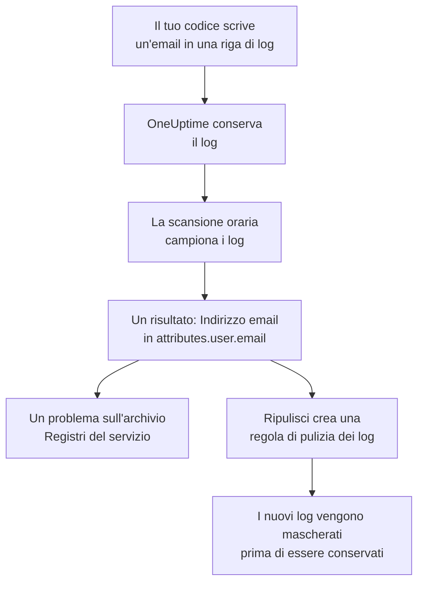

# Dati sensibili nella telemetria

La telemetria contiene tutto ciò che scrive il tuo codice: un indirizzo email in una riga di log, un numero di carta in un attributo di uno span, un token in uno stack trace, la domanda di un cliente in un prompt, l'indirizzo IP di un utente nell'etichetta di una metrica. Sicurezza dei dati tratta i log, le tracce, le metriche, le eccezioni e le conversazioni IA di ogni servizio, e le sessioni di ogni applicazione RUM, come archivi dati a sé stanti. Li campiona ogni ora, vi trova i dati sensibili come fa in un bucket, e **Ripulisci** trasforma un risultato in una regola che da quel momento in poi maschera quei dati all'ingestione.

Non c'è nulla da configurare: la telemetria di ogni servizio viene scansionata ogni ora, a meno che **Scansiona telemetria** non sia disattivato nelle impostazioni del progetto. Per escludere i log, le tracce o un altro segnale di un servizio, disattiva **Scansiona contenuto** nelle **Impostazioni** di quell'archivio: dalla scansione successiva non se ne legge nulla.

:::cards
- [Cosa viene letto](#cosa-viene-letto): Gli attributi, i corpi, i messaggi e i prompt di ogni segnale.
- [Come campiona una scansione](#come-campiona-una-scansione): I record più recenti di ogni servizio, ogni ora.
- [Ripulisci](#ripulisci): Maschera un risultato all'ingestione, con un clic.
- [Scarta questa metrica](#scarta-questa-metrica): Smetti di memorizzare le metriche il cui nome contiene dati sensibili.
- [Cosa conta come ripulito](#cosa-conta-come-ripulito): Quando una regola di pulizia copre già un risultato.
:::

## Come funziona

Un risultato coperto da una regola di pulizia viene contrassegnato come ripulito: ciò che resta di quei dati sono dati vecchi in attesa della fine della loro conservazione, non una fuga ancora in corso. I due controlli della telemetria contano solo ciò che nessuna regola copre, quindi il loro problema si risolve quando ogni risultato è ripulito (vedi [Controlli della telemetria](/docs/data-security/checks-and-issues#telemetria)).

## Cosa viene letto

| Archivio | Cosa viene letto | Dove punta un risultato |
| --- | --- | --- |
| Log | Ogni attributo, e il corpo | `attributes.<key>`, `body` |
| Tracce | Ogni attributo degli span, e gli attributi di ogni evento degli span | `attributes.<key>`, `events.<event>.<key>` |
| Eccezioni | Il messaggio, lo stack trace e gli attributi | `message`, `stackTrace`, `attributes.<key>` |
| Conversazioni IA | I prompt e le risposte di ogni chiamata IA, sotto le chiavi in cui li mettono le convenzioni GenAI, e ogni altro attributo | La chiave in cui si trovano, come `gen_ai.input.messages` o `gen_ai.prompt[].content` |
| Session Replays | Gli attributi degli span e dei log di un'applicazione RUM, gli attributi delle sue sessioni, i tratti che `identify()` ha assegnato ai suoi utenti e il riferimento utente che ha ricevuto | `spans.attributes.<key>`, `logs.attributes.<key>`, `sessions.attributes.<key>`, `sessions.identifiedUserTraits.<key>`, `sessions.identifiedUserLabel` |
| Metriche | Ogni attributo di un punto dati, compresi quelli della sua risorsa, e i nomi delle metriche | `attributes.<key>`, `attributes.resource.<key>`, `name` |

Le chiavi numerate vengono raccolte in un'unica posizione: `gen_ai.prompt.3.content` diventa `gen_ai.prompt[].content`, così i venti messaggi di una chat sono un solo risultato, non venti. Gli attributi che OneUptime aggiunge da sé, che iniziano con `oneuptime.`, non vengono letti.

### Metriche

Gli attributi di una metrica sono le etichette delle sue serie. Sono gli stessi su ogni punto dati di una serie, quindi una metrica che scrive mille punti al minuto può contenere solo tre valori, e un'etichetta che espone l'email di un utente aggiunge una serie, non un punto. Per questo una metrica viene campionata per serie, non per punti:

- **Un punto di ogni serie.** Ogni metrica viene letta nel minuto più recente in cui ha scritto nell'ultima ora: un punto dati di ciascuna di al massimo 100 serie di quel minuto, con qualunque frequenza venga inviata la metrica, così una serie attiva non scavalca mai una serie tranquilla. Un valore viene classificato una sola volta, per quante serie lo ripetano, quindi un risultato conta i valori distinti nella sua posizione.
- **Prima le metriche nuove, poi le altre a turno.** Quali metriche ha scritto un servizio, e quando ciascuna ha scritto per la prima volta nell'ultimo giorno, si ricava dall'aggregazione al minuto che conserva la tabella delle metriche, mai dai suoi punti. Ogni scansione legge le metriche più attive di un servizio, quelle con più probabilità di avere molte serie. Poi vengono le metriche che ha iniziato a scrivere nelle ultime 2 ore, perché una nuova fuga di dati di solito nasce da codice nuovo, e poi le successive delle sue altre metriche, in un ordine fisso, da dove si è fermata l'ultima scansione. Le metriche nuove occupano al massimo metà di quei turni, così le altre conservano sempre i propri.
- **Ogni metrica entro un tempo fisso.** In un servizio di M metriche, di cui ogni scansione ne legge 10, ciascuna viene letta almeno una volta ogni M ÷ 5 ore, arrotondando per eccesso: 60 ore per un servizio di 300 metriche. Finché continua ad avviare nuove metriche ogni ora, il tempo è al massimo il doppio.
- **L'intervallo proprio di ogni metrica.** Le metriche vengono lette insieme, ciascuna per il proprio intervallo della chiave primaria della tabella. Una metrica il cui minuto più recente contiene più di 16.384 punti, come una che ha come etichetta l'email di ogni utente, viene letta da sola, e la lettura si ferma ai suoi primi punti, così non costa più di qualsiasi altra metrica.

Un risultato indica l'attributo, come `attributes.user.email`, oppure `name` per i dati nel nome di una metrica. I suoi record sono i punti dati in cui è stato trovato: ognuno mostra la sua metrica e il valore dell'attributo, mascherato, e si apre in **Metriche** su quella metrica, raggruppata per quell'attributo. Quando il nome di una metrica contiene dati sensibili, anche il nome viene mascherato, e il record apre invece le metriche del servizio.

### Perché la registrazione di un replay non viene mai letta

La registrazione di un replay di sessione contiene il testo delle pagine che le persone hanno visto. Guardarla richiede un permesso a sé, e un risultato ricavato da essa mostrerebbe il testo mascherato delle pagine a chiunque possa leggere Sicurezza dei dati. Per questo di un replay si leggono solo gli attributi: gli span, i log e i dettagli della sessione accanto alla registrazione. Il registratore maschera già nel browser ciò che registra, e anche le regole di pulizia dei log vengono applicate alle registrazioni (vedi [Session Replay](/docs/telemetry/session-replay)).

### Conversazioni IA

Il prompt di una chiamata IA porta con sé l'intera chat che precede il messaggio più recente della persona, quindi di ogni valore di una chiamata IA vengono letti fino a 16.384 caratteri. Quando le conversazioni IA contengono dati sensibili, ne seguono altre due cose: il provider di IA a cui sono andate le chiamate è un flusso di quei dati, e [Dati sensibili vengono inviati a un provider di IA](/docs/data-security/checks-and-issues#ia) non viene superato sull'archivio.

Le conversazioni di uno [strumento di IA aziendale](/docs/telemetry/ai-company-tools) restano escluse. Solo i Proprietari del progetto e gli Amministratori del progetto possono leggerle, e un risultato finisce dove lo legge chiunque legga Sicurezza dei dati, quindi gli span di quei servizi non vengono mai letti, e le loro conversazioni IA vengono indicate come non lette.

## Come campiona una scansione

Ogni ora vengono letti i record più recenti dell'ultima ora di ogni segnale, e vengono classificati campo per campo come quelli di qualsiasi altro archivio (vedi [Campi e colonne](/docs/data-security/data-types#campi-e-colonne)):

| Limite | Valore |
| --- | --- |
| Record di ogni servizio e segnale | **Dimensione del campione di telemetria**, 500 per impostazione predefinita, mai più di 1.000 |
| Servizi o applicazioni RUM letti per segnale | I 200 più attivi |
| Record in una lettura | 5.000, condivisi tra i servizi; 500 per le chiamate IA |
| Caratteri del corpo di un log, del messaggio di un'eccezione o di uno stack trace | 8.192 |
| Caratteri del valore di un attributo | 4.096 |
| Caratteri di un valore di una chiamata IA | 16.384 |
| Attributi di un record | 128; 64 per una chiamata IA |
| Eventi di uno span, e attributi di un evento | 16 e 32 |
| Posizioni di un archivio | 500 |
| Metriche lette in una scansione | 100, condivise tra i servizi, almeno una per ciascuno; al massimo 10 di un servizio, metà tra le sue più attive e metà tra le nuove e le altre, a turno |
| Una metrica nuova | Una il cui primo punto delle ultime 24 ore è arrivato nelle ultime 2 ore |
| Serie di una metrica | Un punto dati di ciascuna, del suo minuto più recente, al massimo 100 |

Ogni valore viene troncato già nel database, così nessun valore lungo ne esce, e ogni lettura si ferma dopo 30 secondi. Una lettura non riuscita è un'avvertenza sugli archivi a cui era destinata; la scansione prosegue con la successiva.

Per escludere qualcosa, aggiungilo alle **Esclusioni dalla scansione** dell'archivio: una posizione indicata per intero (`attributes.http.url`), tutto ciò che sta sotto una posizione (`attributes.http`), o una chiave di attributo indicata da sola (`http.url`).

## Ripulisci

**Ripulisci** su un risultato crea la regola che da quel momento nasconde quel tipo di dati in quella posizione, oppure indica la regola abilitata che lo fa già:

:::steps
### Apri il risultato

Apri il problema - **Dove è stato trovato** elenca ogni risultato che lo causa - oppure **Sicurezza dei dati > Nella tua telemetria**, dove **Mostra i record** apre accanto all'elenco i record in cui è stato trovato un risultato.

### Premi Ripulisci

Fai clic su **Ripulisci**. OneUptime crea una regola di pulizia dei log per i log e per i log di un'applicazione RUM, una regola di pulizia delle tracce per span, eccezioni e chiamate IA, sulla parte del record in cui si trova il risultato, e una regola della pipeline delle metriche per l'attributo di una metrica.

### Correggi anche il codice

La regola maschera i nuovi dati prima che vengano conservati. I dati già conservati restano fino alla fine della loro conservazione, quindi correggi il codice che li scrive: il risultato indica il servizio e l'attributo.
:::

La regola prende il nome da ciò che nasconde, come «Data Security: Email address in attributes.user.email», ed è elencata con le altre tue regole di pulizia (vedi [Filtri di scarto e regole di pulizia](/docs/telemetry/drop-filters-and-scrub-rules#mascherare-i-dati-sensibili)). È una di queste:

| Risultato | Regola creata da Ripulisci |
| --- | --- |
| Indirizzo email, numero di carta, numero di Social Security USA, numero di telefono o indirizzo IP | Il pattern integrato di quel tipo. I numeri di carta, i numeri di Social Security e i numeri di telefono vengono mascherati, gli altri oscurati. |
| Un valore sotto una chiave che sembra sensibile, come `password` o `token` | Una regola **Chiavi di attributi sensibili**, che oscura l'intero valore di ogni attributo del genere |
| Qualsiasi altro tipo di dati che un pattern può trovare | Una regola **Regex personalizzata** creata dai pattern propri del tipo di dati, che oscura ogni valore con quella forma |
| Qualsiasi tipo di dati nell'attributo di una metrica | Una regola della pipeline delle metriche **Oscura attributo** per il servizio, che sostituisce con `[REDACTED]` i valori dell'attributo con la forma del tipo di dati, oppure ogni valore dell'attributo quando nessun pattern trova il tipo di dati |

Alcuni risultati non possono essere ripuliti da una regola, e **Ripulisci** dice perché. L'attributo di una metrica può sempre esserlo, poiché la sua regola può nascondere ogni valore dell'attributo:

- Un tipo di dati trovato solo dai nomi dei campi, come il nome di una persona: nessun pattern può trovarlo. Rinomina l'attributo con una chiave che una regola delle chiavi sensibili nasconde, oppure smetti di inviarlo.
- Un tipo di dati che si distingue dagli altri valori solo per le parole che lo circondano, come un routing number: una regola nasconderebbe molto più di quel tipo di dati.
- Una dicitura di classificazione di un documento: nascondere la parola non nasconderebbe il documento.
- Uno dei tuoi tipi di dati: aggiungi tu una regola di pulizia personalizzata con il suo pattern.
- I dettagli propri di una sessione (`sessions.*`): l'ingestione dei replay di sessione non esegue regole di pulizia.
- Il nome di una metrica (`name`): lo imposta il codice che crea la metrica, e una regola della pipeline può solo rinominare una metrica per intero. Rinomina la metrica e invia invece come attributo ciò che varia nel suo nome. Nel frattempo, **Scarta questa metrica** può smettere di memorizzare quelle metriche.

**Ripulisci** crea la regola a tuo nome, con i tuoi permessi: possono premerlo i Proprietari del progetto e gli Amministratori del progetto, e anche un team che può creare regole di pulizia dei log, regole di pulizia delle tracce per span, eccezioni e chiamate IA, e regole della pipeline delle metriche per le metriche.

## Scarta questa metrica

Nessuna regola toglie i dati dal nome di una metrica, quindi finché il codice che dà il nome alla metrica non viene corretto, i dati continuano ad arrivare. **Scarta questa metrica** su un risultato nel nome di una metrica smette di memorizzare le metriche il cui nome li contiene, a costo dei loro dati, quindi avviene solo quando lo chiedi:

- **Le metriche di un servizio.** Crea una regola della pipeline delle metriche **Scarta** per il servizio del risultato: ogni nuovo punto dati di una metrica il cui nome contiene quel tipo di dati viene scartato prima di essere memorizzato. Il suo filtro è il pattern che **Ripulisci** usa per il tipo, quindi un tipo che nessun pattern può trovare, come il nome di una persona, non si può scartare, e la finestra di dialogo dice perché.
- **Detto prima di farlo.** La finestra di dialogo dice che quei punti dati vanno persi per sempre, quante delle metriche del servizio scritte nell'ultimo giorno hanno un nome simile, quali monitor e dashboard le leggono e quindi non ricevono più nuovi dati, che ciò che è già memorizzato resta fino alla fine della sua conservazione, e come annullarlo. Non viene scartato nulla finché non spunti di aver capito.
- **A tuo nome, e registrato.** La regola viene creata con il tuo permesso di creare regole della pipeline delle metriche: possono crearla i Proprietari del progetto e gli Amministratori del progetto, e anche un team che può creare regole della pipeline delle metriche. I log di audit registrano chi l'ha creata.
- **Si annulla eliminando la regola.** La regola prende il nome da ciò che scarta, ad esempio «Data Security: drop metrics named with Email address», e compare con le altre regole della pipeline delle metriche in **Metriche → Impostazioni → Regole pipeline**. Eliminala o disattivala, e quelle metriche vengono di nuovo memorizzate da quel momento. Ciò che è stato scartato nel frattempo non torna.

Il risultato viene allora segnato come **Scartati**, e conta come ripulito: di quei dati non viene memorizzato più nulla.

## Cosa conta come ripulito

Un risultato viene contrassegnato come ripulito solo quando l'ingestione eseguirebbe su di esso una regola abilitata e la regola troverebbe il suo tipo di dati:

- **I record giusti.** Le regole dei log coprono i log e i log di un'applicazione RUM. Le regole delle tracce coprono span, eccezioni e chiamate IA: un'eccezione è una copia dell'evento di eccezione del suo span, quindi la ripuliscono le regole che ripuliscono gli eventi.
- **La parte giusta.** I **Campi da rimuovere** della regola includono la parte del record in cui si trova il risultato, oppure la regola li lascia al loro valore predefinito.
- **Un pattern che trova il tipo.** Un **Tipo di pattern** integrato trova il proprio tipo di dati: **Indirizzo email** trova gli indirizzi email, **Numero di carta di credito** i numeri di carta, **SSN (numero di previdenza sociale USA)** i numeri di Social Security USA, **Numero di telefono** i numeri di telefono e **Indirizzo IP** gli indirizzi IP. **Chiavi di attributi sensibili** copre ogni valore sotto una chiave che sembra sensibile, qualunque sia il valore.
- **I tuoi pattern personalizzati non contano mai.** Una **Regex personalizzata** copre un risultato solo quando è esattamente il pattern che **Ripulisci** crea per il suo tipo. Un risultato conserva solo campioni mascherati, su cui nessun pattern può essere provato, quindi OneUptime non potrebbe dimostrare che il tuo pattern nasconde i dati, e un risultato considerato ripulito per errore è una fuga che nessuno guarda.
- **L'attributo di una metrica.** Una regola della pipeline delle metriche **Oscura attributo** o **Rimuovi attributo** sulla chiave di quell'attributo, per il servizio del risultato o per l'intero progetto, lo copre quando non ha filtri, o ha esattamente il filtro che crea **Ripulisci**. Un filtro scritto da te non conta mai, per lo stesso motivo.
- **Il nome di una metrica.** Una regola della pipeline delle metriche **Scarta** per il servizio del risultato o per l'intero progetto lo copre quando ha esattamente il filtro che crea **Scarta questa metrica**, o nessun filtro, nel qual caso non memorizza nessuna metrica del servizio. Una regola così senza filtri copre ogni risultato in quelle metriche.

Una regola disattivata, o che non ripulisce nulla, non conta mai. La copertura viene ricalcolata dopo ogni scansione, quindi una regola che aggiungi o rimuovi a mano cambia ciò che è contrassegnato come ripulito entro un'ora.

## Passaggi successivi

:::cards
- [Filtri di scarto e regole di pulizia](/docs/telemetry/drop-filters-and-scrub-rules): Ogni opzione delle regole di pulizia, e le regole che scrivi tu.
- [Controlli e problemi di Sicurezza dei dati](/docs/data-security/checks-and-issues): I due controlli della telemetria e i controlli dell'IA.
- [Flussi di dati, accesso e residenza](/docs/data-security/flows-access-residency): I provider di IA e gli host a cui i tuoi servizi inviano dati.
:::
