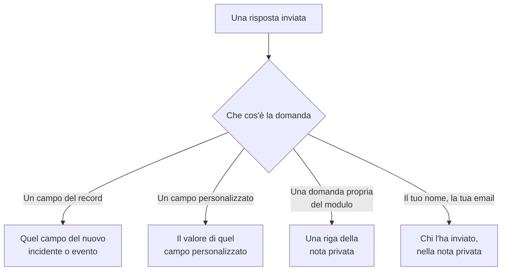

# Creare un modulo

La pagina **Costruisci** di un modulo è dove decidi cosa chiede e che aspetto ha la sua pagina. Le domande sono a sinistra, nell'ordine in cui le mostra la pagina pubblica; **Aggiungi una domanda**, a destra, elenca tutto ciò che puoi aggiungere. Sopra le domande, compresso, c'è il [branding](#branding) del modulo: il suo logo e la sua favicon. Gli insiemi di risposte con un nome da cui si può partire per compilare il modulo — ognuno dei quali può anche rendere una domanda obbligatoria, facoltativa o nascosta per il proprio caso — sono nella sua pagina **Modelli**: vedi [Modelli](#modelli).

:::cards
- [L'editor](#leditor): Aggiungi, modifica, sposta e salva le domande.
- [Cosa puoi aggiungere](#cosa-puoi-aggiungere): Le tue domande, i campi del record, i campi personalizzati e il mittente.
- [Domande nascoste](#domande-nascoste): Le compila un modello, mai chi invia.
- [Modelli](#modelli): Un modulo, e un link, per ogni caso che il tuo team segnala spesso.
:::

## Dove va ogni risposta

Ogni risposta viene anche conservata con l'invio, nella pagina **Invii** del modulo. Un campo che il modulo non chiede, o che resta vuoto, viene compilato dalle [impostazioni All'invio](/docs/forms/on-submit) del modulo.

## L'editor

:::steps
### Aggiungere una domanda

Scegli cosa aggiungere in **Aggiungi una domanda**. La nuova domanda viene inserita dopo quella selezionata, o alla fine, e viene selezionata.

### Modificarla dove si trova

Seleziona una scheda per modificarla: la domanda, il testo di aiuto, il tipo di risposta e le opzioni, se è obbligatoria o nascosta, e i pulsanti per duplicarla o eliminarla. **Fatto** la chiude.

### Metterla al suo posto

Trascina una scheda per la sua maniglia per spostarla, oppure usa **Sposta su** e **Sposta giù** sulla scheda selezionata — da un telefono, o dalla tastiera.

### Salvare il modulo

**Salva modifiche** salva tutte le modifiche in una volta. Finché non salvi, l'editor dice **Modifiche non salvate** e offre **Annulla modifiche**, e il browser chiede conferma prima che tu lasci la pagina.
:::

- **L'intestazione del modulo** mostra il suo nome e la sua descrizione come li mostrerà la pagina pubblica. **Modifica nome e descrizione** li modifica.
- **Le domande** sono schede. Ognuna mostra la domanda come la vedranno le persone, con un badge che dice a cosa è collegata — **Incidente · Gravità**, **Campo personalizzato · Region**, **Mittente · E-mail**, o il suo tipo di risposta per una domanda propria del modulo. Un asterisco rosso segna una domanda obbligatoria, e un badge **Nascosto** una domanda [nascosta](#domande-nascoste).
- **Limiti.** Un modulo può avere fino a 50 domande. Chi può leggere un modulo ma non modificarlo vede l'editor in sola lettura.

## Branding

**Branding**, compresso sopra le domande, è l'aspetto della pagina del modulo: il tuo logo in cima alla pagina, sopra il nome del modulo, e la tua favicon nella scheda del browser mentre il modulo è aperto. Finché non carichi i tuoi, il modulo mostra il logo e la favicon di OneUptime.

Compressa, la sezione elenca **Logo** e **Favicon** — segnati come impostati non appena il modulo ha i suoi — e dice quali di OneUptime sono ancora in uso. Espandila per vederli entrambi come li mostra la pagina: il logo come appare in cima alla pagina, e la favicon in una scheda del browser accanto al nome del modulo, che è il titolo della scheda.

**Modifica branding** li modifica in un'unica finestra:

| Campo | Cos'è |
| --- | --- |
| **Logo** | Mostrato in cima alla pagina del modulo, sopra il suo nome, al posto del logo di OneUptime. Un'immagine PNG, JPEG, GIF, WebP o SVG di 512 KB al massimo. Rimuovilo per tornare al logo di OneUptime. |
| **Logo Alt Text** | Cosa dice il logo, letto dagli screen reader: di solito il nome della tua organizzazione. Viene chiesto non appena c'è un logo. Lascialo vuoto e gli screen reader saltano il logo — il nome del modulo lo segue comunque. Rimuovere il logo svuota anche questo campo. |
| **Favicon** | L'icona nella scheda del browser mentre il modulo è aperto, al posto della favicon di OneUptime. Un'immagine PNG, JPEG, GIF, WebP, SVG o ICO di 128 KB al massimo; un PNG, SVG o ICO quadrato funziona meglio. Rimuovila per tornare alla favicon di OneUptime. |

Il logo mantiene l'altezza del logo di OneUptime che sostituisce, e uno largo viene adattato alla larghezza della pagina. Ogni immagine viene controllata al salvataggio — dalla dashboard, dall'API, da Terraform o da un flusso di lavoro: deve essere stata caricata nel progetto del modulo, essere di uno dei tipi sopra e non superare il suo limite. Un logo che non è una di quelle immagini viene rifiutato con "The logo must be a PNG, JPEG, GIF, WebP or SVG image.", uno troppo grande con "The logo must be 512 KB or smaller.", e uno il cui caricamento non esiste più — o che è stato caricato in un altro progetto — con "The logo's file could not be found. Upload the logo again." Una favicon viene rifiutata allo stesso modo, con "The favicon must be a PNG, JPEG, GIF, WebP, SVG or ICO image.", "The favicon must be 128 KB or smaller." e "The favicon's file could not be found. Upload the favicon again."

**Anteprima** mostra il logo come lo mostra la pagina. Chi può leggere un modulo ma non modificarlo vede il suo branding senza **Modifica branding**. Il logo e la favicon arrivano alla pagina del modulo solo all'interno del modulo stesso — vedi [Condivisione e sicurezza](/docs/forms/sharing-and-security#cosa-protegge-un-modulo).

## Cosa puoi aggiungere

**Aggiungi una domanda** elenca quattro gruppi: **Domande** proprie del modulo, **Campi dell'incidente** o **Campi della manutenzione programmata** di ciò che il modulo crea, **Campi personalizzati** e **Mittente**.

### Domande proprie del modulo

| Tipo di risposta | Cosa fornisce il mittente |
| --- | --- |
| **Risposta breve** | Una riga di testo. |
| **Paragrafo** | Più righe di testo. |
| **Testo formattato** | Testo con formattazione e link. |
| **Numero** | Un numero. |
| **Elenco a discesa** | Una scelta da un elenco. |
| **Selezione multipla** | Un numero qualsiasi di scelte da un elenco. |
| **Casella di controllo** | Una casella da spuntare, come una conferma. |
| **Data** | Un giorno. |
| **Data e ora** | Un giorno e un'ora. |

Un menu a discesa o una selezione multipla elenca le **Opzioni** che gli dai, ognuna con un colore facoltativo (il pulsante accanto a un'opzione apre una serie di colori con nome, con **Colore personalizzato** per un codice esatto), da una a 100. Passare una domanda da **Elenco a discesa** a **Selezione multipla** mantiene le sue opzioni; una domanda che diventa di uno di questi tipi parte con due opzioni che puoi rinominare, e una che smette di esserlo le perde. **Duplica** copia una domanda propria del modulo subito sotto di essa.

Le risposte a queste domande vengono conservate con l'invio ed elencate nella nota privata di ciò che il modulo crea — non compilano alcun campo. Per compilare un campo, aggiungi il campo stesso, dai due gruppi successivi.

### Campi di ciò che il modulo crea

I campi di un incidente, o di un evento di manutenzione programmata, a cui un mittente può rispondere. La risposta diventa il valore del campo.

| Campo dell'incidente | Si risponde con |
| --- | --- |
| **Titolo** | Una riga, fino a 500 caratteri. |
| **Descrizione** | Testo formattato, fino a 20.000 caratteri. |
| **Gravità** | Una delle tue gravità degli incidenti. |
| **Monitor** | Uno qualsiasi dei monitor che offri — i monitor interessati dell'incidente. |
| **Etichette** | Una qualsiasi delle etichette che offri. |
| **Inizio dell'impatto** | Una data e un'ora: quando è iniziato il problema, secondo il ricordo del mittente. |

| Campo della manutenzione programmata | Si risponde con |
| --- | --- |
| **Titolo** | Una riga, fino a 100 caratteri. |
| **Descrizione** | Testo formattato, fino a 20.000 caratteri. |
| **Inizia il** | Una data e un'ora. Chiesto sempre e sempre obbligatorio. |
| **Termina il** | Una data e un'ora successive a **Inizia il**. Chiesto sempre e obbligatorio. |
| **Monitor** | Uno qualsiasi dei monitor che offri. |
| **Pagine di stato** | Una qualsiasi delle pagine di stato che offri. |
| **Etichette** | Una qualsiasi delle etichette che offri. |

Ogni campo può essere chiesto una sola volta; l'elenco segna quelli già presenti nel modulo con **Aggiunto**. Un campo che il modulo non chiede — o che resta vuoto — viene compilato dalle [impostazioni All'invio](/docs/forms/on-submit) del modulo.

**Scelte offerte.** Una pagina pubblica non deve elencare tutto il tuo progetto a degli sconosciuti, quindi un campo a cui si risponde scegliendo dei record offre solo quelli che scegli tu. **Monitor**, **Etichette** e **Pagine di stato** elencano esattamente le scelte che offri, e non vengono chiesti finché non ne offri almeno una. **Gravità** offre tutte le gravità degli incidenti a meno che tu non la restringa, perché le gravità non sono segrete. Le risposte al di fuori delle scelte offerte vengono rifiutate.

### Campi personalizzati

I tuoi campi personalizzati degli incidenti — o della manutenzione programmata, per un modulo di manutenzione — ognuno una domanda la cui risposta diventa il valore del campo. La domanda prende tipo e opzioni dal campo personalizzato, e parte con il suo nome come domanda e la sua descrizione come testo di aiuto, che puoi cambiare.

Un modulo chiede solo i campi personalizzati che gli aggiungi, qualunque cosa dica **Mostra alla creazione**: ogni campo che un modulo chiede mostra il suo nome, la sua descrizione e le sue opzioni a chiunque abbia il link. Quando un campo personalizzato viene eliminato, la sua domanda resta nel modulo ma non viene più chiesta, e la sua scheda lo dice — elimina la domanda. Un campo ricreato con lo stesso nome è un campo nuovo: aggiungilo di nuovo.

Un campo personalizzato che copia il suo valore da un campo personalizzato del monitor lo dice sulla sua scheda: quando l'incidente o l'evento ha monitor che concordano su un valore per esso, quel valore sostituisce la risposta del mittente.

### Mittente

**Il tuo nome** e **La tua email** chiedono chi sta inviando. Vengono conservati con l'invio e indicati nella nota privata, così il tuo team può ricontattare la persona, e non vengono mai mostrati sull'incidente o sull'evento stesso. OneUptime non scrive mai al mittente. Omettili, o rendili facoltativi, per accettare invii anonimi.

L'email deve essere un solo indirizzo normale, come `ada@example.com` — non un nome con l'indirizzo tra parentesi angolari, né un elenco di indirizzi. Nome ed email arrivano fino a 100 caratteri ciascuno.

## Le domande di un nuovo modulo

Un nuovo modulo parte con le domande che dovrebbe quasi sempre fare, così funziona dal momento in cui viene creato: il **Titolo**, obbligatorio; la **Descrizione**; per un modulo di manutenzione, **Inizia il** e **Termina il**; e **Il tuo nome** e **La tua email**, obbligatori. Il loro testo è nella lingua della tua dashboard. Modificale, nascondile o rimuovile come vuoi — tranne l'inizio e la fine di un evento di manutenzione, senza i quali nessun evento può essere programmato. Quando le tue domande dicono già tutto, nascondi la **Descrizione** invece di lasciare un riquadro in cui nessuno dovrebbe scrivere: vedi [Domande nascoste](#domande-nascoste).

## Domande obbligatorie

**Obbligatorio** significa che il modulo non può essere inviato senza una risposta. Una risposta fatta solo di spazi, tabulazioni o a capo conta come nessuna risposta, e una **Casella di controllo** obbligatoria deve essere spuntata. Il server ricontrolla ogni domanda obbligatoria quando il modulo viene inviato, quindi anche una richiesta fatta senza la pagina deve rispettarle.

Una domanda non obbligatoria può restare vuota: il suo campo viene allora compilato dalle impostazioni All'invio, come se il modulo non l'avesse chiesta.

## Domande nascoste

Attiva **Nascosto** su una scheda e la domanda non viene più mostrata nel modulo. Non viene chiesta a nessuno, quindi non è mai obbligatoria, e un invio non può rispondervi — la richiesta non viene nemmeno letta per essa. Solo il [modello](#modelli) da cui parte un invio vi risponde, e resta senza risposta quando il mittente non parte da alcun modello, o parte da uno che la lascia vuota. Un modello può anche chiedere comunque una domanda nascosta, per il proprio caso: vedi [Come un modello chiede ogni domanda](#come-un-modello-chiede-ogni-domanda).

Nascondi una domanda quando la sua risposta spetta al tuo team, non al mittente:

- **La descrizione dell'incidente**, quando le domande che hai aggiunto dicono già tutto. Nascosta, non invita più nessuno a scrivere lì; dai a ogni modello il testo standard che invii per il suo caso, oppure lascia che gli incidenti partano senza.
- **Un campo personalizzato letto dai tuoi flussi di lavoro o dalle tue regole**, come un tipo di notifica, impostato da ogni modello.
- **Una domanda propria del modulo** la cui risposta serve solo al tuo team nella nota privata.

Una domanda nascosta mantiene la sua posizione, la sua etichetta e le sue impostazioni, quindi puoi mostrarla di nuovo in qualsiasi momento. Un campo senza il quale la destinazione del modulo non può essere creata — **Inizia il** e **Termina il** di un evento di manutenzione — non può essere nascosto. La risposta a una domanda nascosta viene controllata e salvata esattamente come una risposta digitata, e conservata con l'invio.

## Modelli

La pagina **Modelli** di un modulo contiene insiemi di risposte con un nome da cui si può partire per compilare il modulo — uno per ogni caso che il tuo team segnala spesso, come **Interruzione dell'applicazione**, **Manutenzione pianificata** o **Servizio ripristinato** — così un modulo, e un link, servono per tutti.

:::steps
### Aggiungere un modello

Fai clic su **Aggiungi modello**. L'editor ha due parti. **Domande** elenca ogni domanda del modulo con il modo in cui questo modello la chiede — vedi [Come un modello chiede ogni domanda](#come-un-modello-chiede-ogni-domanda). **Risposte** le elenca di nuovo, comprese quelle nascoste e nessuna obbligatoria: compila ciò a cui il modello deve rispondere, e lascia il resto a chi invia. Una risposta a una domanda che il modello non chiede lo segnala sotto — viene usata così com'è.

### Scegliere il predefinito

**Predefinito** lo rende il modello con cui si apre il modulo. Solo un modello può essere quello predefinito, e un modulo il cui unico modello è quello predefinito è semplicemente un modulo precompilato.

### Condividere il suo link

**Copia link** copia il link proprio del modello, che apre il modulo compilato con esso. Vedi [Condivisione e sicurezza](/docs/forms/sharing-and-security#un-link-per-ogni-modello).
:::

Ogni modello elenca ciò che compila e le domande che chiede a modo suo, come **Data della manutenzione programmata · Nascosto**, e ha **Modifica**, **Duplica** — una copia subito dopo di esso, con un nome come **Interruzione dell'applicazione 2** —, **Sposta su** e **Sposta giù**, per l'ordine in cui il modulo li elenca, e **Elimina**.

Sulla pagina pubblica, un modulo con modelli li elenca sopra le sue domande, sotto **Parti da un modello**. Sceglierne uno compila il modulo e fa le domande come le fa quel modello; il mittente può ancora cambiare qualsiasi risposta prima di inviare, e sceglierne un altro fa ripartire il modulo da quello. La pagina si apre con il modello indicato dal suo link, altrimenti con quello predefinito, altrimenti con nessuno. Anche **Anteprima** elenca i modelli e si apre su quello predefinito.

> [!IMPORTANT]
> Chiunque apra il link vede il nome di ogni modello e le sue risposte alle domande che chiede — è così che la pagina si compila da sola. Le risposte di un modello a domande che non chiede non lasciano mai il server, quindi tieni ciò che è interno in una domanda nascosta.

Ogni risposta di ogni modello viene controllata rispetto alla sua domanda quando i modelli vengono salvati — un'opzione che la domanda offre, un record che il modulo offre, un testo che ci sta —, e così ogni domanda che un modello chiede a modo suo, e il salvataggio viene rifiutato con un messaggio che indica il modello e il problema, sia che arrivi dalla dashboard, dall'API o da Terraform. Il nome di un modello arriva fino a 100 caratteri ed è unico nel modulo, e un modulo ha fino a 50 modelli. Se in seguito cambi le domande, la risposta di un modello a una domanda che hai rimosso, o che non le si adatta più, semplicemente non viene usata, e il salvataggio successivo di quel modello la scarta. Il salvataggio degli altri modelli non viene mai rifiutato per questo: ciò che un modello conteneva già non viene ricontrollato.

### Come un modello chiede ogni domanda

Casi diversi richiedono domande diverse: un'interruzione ha bisogno dell'applicazione interessata e non di una finestra di manutenzione, una manutenzione pianificata ha bisogno della finestra. Invece di creare un modulo per ogni caso, lascia che ogni modello faccia le domande del modulo a modo suo. Nelle **Domande** di un modello, ogni domanda ha una di queste impostazioni:

| Impostazione | Quando qualcuno parte dal modello |
| --- | --- |
| **Predefinito del modulo** | La domanda viene fatta come la fa il modulo — obbligatoria, facoltativa o nascosta, come dice la sua scheda nell'editor. Il selettore dice quale, come **Predefinito del modulo (Nascosto)**, e segue la scheda quando la cambi. |
| **Obbligatorio** | La domanda viene fatta, e il modulo non può essere inviato senza una risposta. |
| **Facoltativo** | La domanda viene fatta, e può restare vuota. |
| **Nascosto** | La domanda non viene fatta. La risposta del modello, se ne ha una, è la risposta, come per una domanda che il modulo nasconde. |

Così un solo modulo di incidente può servire entrambi i casi:

| Domanda | Interruzione dell'applicazione | Manutenzione pianificata |
| --- | --- | --- |
| Nome dell'applicazione | Obbligatorio | Obbligatorio |
| Strutture interessate | Obbligatorio | Facoltativo |
| Data della manutenzione programmata | Nascosto | Obbligatorio |

Ogni domanda parte da **Predefinito del modulo**, e così ogni domanda che aggiungi al modulo in seguito, in ogni modello. **Inizia il** e **Termina il** di un evento di manutenzione vengono sempre chiesti e sono sempre obbligatori: nessun modello può cambiarli. Un modello può nascondere tutte le altre domande e rispondervi da sé: il suo link è allora un modulo di un solo pulsante, **Invia** — comodo per un caso come **Servizio ripristinato**.

La pagina segue il modello che sceglie il mittente: sceglierne un altro ridisegna il modulo con le domande di quel modello, e **Anteprima** fa lo stesso. Il server applica a ogni invio le domande che fa il modello che indica, chiunque l'abbia inviato: a una domanda che il modello rende obbligatoria si deve rispondere, e una che nasconde non viene letta dalla richiesta — si usa la risposta del modello. Un invio che non indica alcun modello, o ne indica uno eliminato nel frattempo, segue le impostazioni del modulo stesso. Una domanda che il modulo nasconde viene mostrata alla pagina pubblica solo quando un modello la chiede.

## Quando l'editor segnala una domanda

Una scheda con qualcosa che non va dice cosa, in ambra:

| La scheda dice | Cosa non va |
| --- | --- |
| **Questo campo personalizzato è stato eliminato, quindi la domanda non viene posta. Elimina la domanda.** | La pagina pubblica omette la domanda. |
| **Scegli almeno un'opzione da offrire, altrimenti la domanda non viene posta.** | Un campo a cui si risponde scegliendo dei record non ne offre nessuno: scegli i monitor, le etichette o le pagine di stato che offre. |
| **Aggiungi almeno un'opzione.** | Un menu a discesa o una selezione multipla non ha nulla da scegliere. |
| **Scrivi la domanda.** | La domanda non ha testo. |

Il modulo non può essere salvato finché una domanda ha uno degli ultimi tre: **Salva modifiche** dice quale domanda e cosa non va, e l'anteprima omette una domanda del genere. Il salvataggio controlla anche le domande nel loro insieme, e viene rifiutato con un messaggio che indica il problema quando, per esempio, due domande chiedono lo stesso campo, o un modulo di manutenzione non chiede quando la manutenzione inizia e finisce — che le domande arrivino dall'editor, dall'API, da Terraform o da un flusso di lavoro.

## Anteprima

**Anteprima** apre il modulo esattamente come lo vedono le persone al suo link — lo stesso logo, le stesse domande, campi, opzioni e controlli, il suo elenco di modelli, e solo le domande che fa il modello scelto — e ti lascia compilarlo. Nulla di ciò che inserisci lì viene inviato: **Invia** controlla soltanto le tue risposte, e **Compilalo di nuovo** ricomincia. L'anteprima mostra le domande come sono nell'editor, salvate o no, e dice quando omette una domanda segnalata.

## Cosa vede il mittente

La pagina pubblica mostra il logo del modulo — il logo di OneUptime finché non carichi il tuo —, poi il nome e la descrizione del modulo, i suoi modelli se ne ha, le domande che fa — come le fa il modello scelto, o quelle che non nasconde quando non è scelto alcun modello — e **Invia**, e la scheda del browser mostra il nome del modulo e la sua favicon. È nella lingua del mittente quando OneUptime la ha — la lingua che ha scelto per ultima in OneUptime su quel browser, o altrimenti quella che chiede il suo browser — e in inglese negli altri casi. Le tue domande, opzioni e testi di aiuto vengono mostrati come li hai scritti.

Dopo l'invio, la pagina dice "Grazie — la tua risposta è stata inviata." e dà il numero di ciò che è stato creato — "Il tuo numero di riferimento è INC-42." —, seguito dal messaggio di ringraziamento del modulo, se ne hai scritto uno nella pagina **Condividi**. **Invia un'altra risposta** apre un modulo vuoto. Il mittente non riceve alcuna email e non ha modo di tornare all'incidente o all'evento.

## Limiti di dimensione

| Risposta | Limite |
| --- | --- |
| Il **Titolo** di un incidente | 500 caratteri, senza contare gli spazi alle due estremità. |
| Il **Titolo** di un evento di manutenzione | 100 caratteri. |
| **Descrizione** | 20.000 caratteri. |
| Qualsiasi altra risposta di testo | 10.000 caratteri. |
| Una risposta a selezione multipla | 100 scelte. |
| **Il tuo nome**, **La tua email** | 100 caratteri ciascuno. |

Un invio che supera un limite, omette una risposta obbligatoria o dà una risposta che non si adatta alla sua domanda viene rifiutato con un messaggio che dice quale, e non viene creato nulla. Le risposte a domande che il modulo non fa vengono ignorate.

## Passaggi successivi

:::cards
- [Cosa crea un invio](/docs/forms/on-submit): Come le risposte e le impostazioni All'invio diventano un incidente o un evento di manutenzione.
- [Condivisione e sicurezza](/docs/forms/sharing-and-security): Condividere il link, un link per ogni modello, e cosa li protegge.
- [Impostazioni e automazione degli incidenti](/docs/incidents/settings): Campi personalizzati e modelli degli incidenti.
:::
