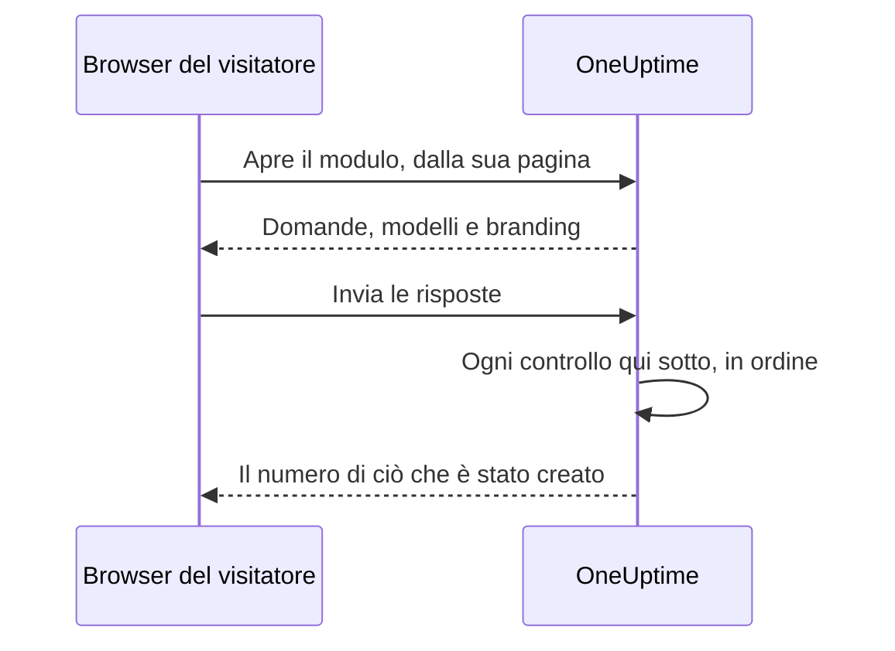

# Condivisione e sicurezza

Un modulo è aperto a chiunque abbia il suo link, e ogni invio può chiamare il tuo team di reperibilità o mettere una finestra di manutenzione nel tuo calendario. Questa pagina tratta la pagina **Condividi** del modulo — il link, la disattivazione del modulo, il messaggio dopo l'invio e la lista IP consentiti — e ogni altro controllo che una richiesta supera lungo il percorso.

:::cards
- [Condividere il link](#condividere-il-link): Copialo, aprilo e reimpostalo quando arriva troppo lontano.
- [Un link per ogni modello](#un-link-per-ogni-modello): Un segnalibro per caso, un solo modulo dietro a tutti.
- [Cosa protegge un modulo](#cosa-protegge-un-modulo): Ogni controllo che una richiesta supera, in ordine.
- [Risoluzione dei problemi](#risoluzione-dei-problemi): Cosa significa ogni messaggio sulla pagina del modulo, e cosa fare.
:::

## La pagina Condividi

| Scheda | Cosa contiene |
| --- | --- |
| **Stato** | **Accetta invii** — se il link del modulo funziona. |
| **Link di condivisione** | Il link, con **Copia link**, **Apri modulo** e **Reimposta link**. |
| **Dopo l'invio** | Il **Messaggio di ringraziamento** che le persone vedono dopo l'invio, sotto il numero di ciò che il modulo ha creato. |
| **Accesso** | La **Lista IP consentiti**. |

## Condividere il link

La scheda **Link di condivisione** mostra il link del modulo, come `https://oneuptime.com/accounts/form/<share-key>`:

- **Copia link** lo copia.
- **Apri modulo** apre il modulo in una nuova scheda, come lo vedono le persone.
- **Reimposta link** dà al modulo un nuovo link, dopo la tua conferma. Il vecchio link smette subito di funzionare e mostra il messaggio di non disponibilità, quindi tutti quelli con cui l'hai condiviso hanno bisogno di quello nuovo. Usalo quando un link è arrivato più lontano del dovuto.

Chiunque abbia il link può aprire il modulo e inviarlo, senza un account OneUptime e senza accedere. Aver effettuato l'accesso non cambia nulla: OneUptime sa chi ha inviato solo dal nome e dall'email digitati nel modulo. Quindi tratta il link come un numero di telefono del tuo team di reperibilità. Condividilo dove lo troveranno le persone che devono usarlo — una pagina della intranet, un runbook del supporto, un messaggio fissato in una chat — e non su un sito web pubblico, a meno che tu non voglia invii da chiunque.

Il link contiene una chiave casuale propria, non l'ID del modulo. In un'installazione self-hosted viene servito dal tuo host OneUptime, e funziona solo all'indirizzo configurato da `HTTP_PROTOCOL` e `HOST`: se aperto con un altro nome del server, o con il suo indirizzo IP, le richieste del modulo vengono rifiutate come provenienti da un altro sito web.

I link ai vecchi moduli di incidente, `/accounts/incident-form/<share-key>`, aprono lo stesso modulo al suo nuovo indirizzo.

### Un link per ogni modello

Ognuno dei [modelli](/docs/forms/building#modelli) del modulo ha un link proprio: il link del modulo con `?template=` e l'id del modello, come `https://oneuptime.com/accounts/form/<share-key>?template=<template-id>`. **Copia link** nella pagina **Modelli** del modulo lo copia. Apre il modulo compilato con quel modello, quindi un team può salvare un link per caso nei segnalibri mentre tu mantieni un solo modulo. Quando il mittente sceglie un altro modello, l'indirizzo nel suo browser lo segue, quindi il link che copia è il modulo come lo vede.

Il link di un modello è il link del modulo: funziona finché il modulo è in **Accetta invii**, e **Reimposta link** lo ritira insieme al resto. Un link che indica un modello che hai eliminato apre il modulo come se non ne indicasse nessuno — con il modello predefinito, se c'è.

### Disattivare un modulo

Per smettere di accettare invii senza eliminare il modulo, disattiva **Accetta invii**. Il link mostra allora "Questo modulo non è disponibile. Potrebbe essere stato disattivato oppure il link potrebbe non essere più valido.", e la scheda **Link di condivisione** ti ricorda che il modulo è disattivato. Riattivalo e lo stesso link funziona di nuovo.

### Il messaggio di ringraziamento

Dopo un invio, la pagina dice "Grazie — la tua risposta è stata inviata." e dà il numero di ciò che è stato creato, poi il tuo **Messaggio di ringraziamento**, in Markdown. Usalo per dire cosa succede dopo, e a chi rivolgersi quando qualcosa è urgente. Senza di esso, la pagina mostra solo il messaggio standard.

Un'immagine nella descrizione o nel messaggio di ringraziamento del modulo viene mostrata a tutti quelli che aprono il link finché il modulo è in **Accetta invii**. Disattiva il modulo, o togli l'immagine, e l'immagine torna privata, a meno che qualcos'altro che tutti vedono la contenga ancora.

## Cosa protegge un modulo

Ogni richiesta supera questi controlli, in questo ordine:

1. La richiesta deve arrivare dalla pagina del modulo stesso, non da un altro sito web — vedi [Richieste da altri siti web](#richieste-da-altri-siti-web).
2. Deve rientrare nei limiti di frequenza.
3. Il modulo deve esistere, essere in **Accetta invii** e appartenere a un progetto con un piano che include i moduli.
4. Deve arrivare da un indirizzo della **Lista IP consentiti**, quando il modulo ne ha una.
5. Un invio deve superare il captcha, quando l'istanza ha il captcha attivo.
6. Ogni risposta deve rientrare nei limiti di dimensione e adattarsi alla sua domanda — vedi [Creare un modulo](/docs/forms/building#limiti-di-dimensione).
7. Ciò che formano le risposte e le impostazioni deve poter essere creato: un incidente ha bisogno di una gravità, un evento di una fine successiva al suo inizio.
8. Un invio deve rientrare nella quota oraria del modulo — vedi [Limiti di frequenza](#limiti-di-frequenza).

Il logo e la favicon di un modulo fanno parte del modulo: vengono inviati dentro la risposta che lo apre, in base64, solo dopo che ha superato i primi quattro controlli, e mai da un indirizzo proprio. Nessuno può ottenerli senza il modulo, e nessun file può essere ottenuto tramite il suo id attraverso un modulo; i file stessi restano privati. Un modulo mostra solo immagini caricate nel proprio progetto: un file di un altro progetto viene rifiutato quando il modulo viene salvato, e non viene mai inviato alla sua pagina.

### Lista IP consentiti

Per limitare un modulo alle tue reti:

:::steps
1. Apri la pagina **Condividi** del modulo.
2. Nella scheda **Accesso**, fai clic su **Modifica lista IP consentiti**.
3. Inserisci una rete per riga, e salva. La scheda le elenca poi sotto **Lista IP consentiti**.
:::

Ogni riga è una di queste:

| Voce | Esempio | Nota |
| --- | --- | --- |
| Un indirizzo IPv4 | `203.0.113.7` | |
| Un indirizzo IPv6 | `2001:db8::7` | Corrisponde comunque sia scritto, in maiuscolo o con gli zeri per esteso. |
| Un intervallo IPv4, in notazione CIDR | `10.0.0.0/8` | Gli intervalli IPv6 non sono supportati — elenca ogni indirizzo IPv6 su una riga a sé. |

Un indirizzo IPv4 deve essere scritto come tale: scritto alla maniera IPv6, come `::ffff:203.0.113.7`, viene rifiutato. L'elenco viene controllato ogni volta che viene salvato — dalla dashboard, dall'API, da Terraform o da un flusso di lavoro —, e una riga che non potrebbe mai corrispondere viene rifiutata con un messaggio che la indica. Lascia l'elenco vuoto per consentire tutte le reti. Non appena ha una voce, una richiesta il cui indirizzo non può essere determinato viene rifiutata.

Su OneUptime Cloud, impostare la lista IP consentiti richiede il piano **Scale** — sia quando un modulo viene creato con una tramite l'API sia quando viene modificato —, come la lista IP consentiti di una [dashboard pubblica](/docs/dashboards/sharing). Svuotarla funziona con qualsiasi piano.

### Richieste da altri siti web

Un browser dice a un server quale pagina ha inviato una richiesta. Quando la pagina di un altro sito web fa aprire o inviare un modulo al browser di un visitatore, la richiesta viene rifiutata con "This form can only be used from its own page." — prima che un limite di frequenza la conti, e qualunque sia il link, quindi la risposta non dice nulla su quali moduli esistono.

Una richiesta viene rifiutata quando la sua intestazione `Sec-Fetch-Site` è presente e dice qualcosa di diverso da `same-origin` o `none`, oppure quando la sua intestazione `Origin` è presente e non è il tuo indirizzo OneUptime — `HTTP_PROTOCOL` e `HOST`, con la porta quando `HOST` ne ha una. Un invio deve anche essere inviato come JSON (`application/json`); uno inviato come campi di modulo di una pagina web, o come testo semplice, viene rifiutato con "The request must be a JSON object holding the form's answers in "data".". Leggere un modulo richiede anche l'intestazione che la pagina del modulo aggiunge a ogni richiesta che fa, `X-OneUptime-Form: 1`: una pagina non può far aggiungere un'intestazione a un browser senza uno script, e lo script di un altro sito web che ne aggiunge una si tradisce con il suo `Origin`.

### Limiti di frequenza

Aprire un modulo e inviarlo sono limitati per indirizzo di rete, e l'invio è limitato anche per modulo:

- **Aprire un modulo** — per modulo da un indirizzo, e per indirizzo su tutti i moduli, con margine per un intero ufficio che apre il link nello stesso momento. Oltre l'uno o l'altro, la pagina mostra "Troppe richieste. Riprova più tardi." Se il limitatore di frequenza non è raggiungibile, i moduli si aprono comunque.
- **Inviare, per indirizzo** — per modulo da un indirizzo, e per indirizzo su tutti i moduli. Oltre l'uno o l'altro, il mittente vede "Troppe segnalazioni dalla tua rete. Attendi qualche minuto e riprova." Tutti quelli dietro uno stesso indirizzo — una rete d'ufficio, un gateway VPN — condividono questi limiti, e ogni invio conta, anche uno che poi viene rifiutato per una risposta sbagliata.
- **Inviare, per modulo** — quanti record può creare un modulo in un'ora, da tutti gli indirizzi insieme, così anche gli invii da molti indirizzi contemporaneamente possono chiamarti solo un numero limitato di volte all'ora. Conta solo un invio che ha superato tutti gli altri controlli, subito prima che venga creato il suo record. Oltre questo limite, tutti vedono "Questo modulo sta ricevendo troppi invii in questo momento. Riprova più tardi." finché la finestra non termina. **Reimposta link** fa partire il nuovo link con una quota nuova.

Ogni limite risponde `429` con un'intestazione `Retry-After`, in secondi, e la pagina dice al mittente quando riprovare. Le finestre sono fisse, non scorrevoli. Se il limitatore di frequenza non è raggiungibile, gli invii vengono rifiutati invece di essere lasciati passare senza conteggio: l'API risponde `503`, e il mittente vede "Al momento non è possibile accettare invii. Riprova tra qualche minuto."

In un'installazione self-hosted, queste variabili d'ambiente dell'app OneUptime cambiano i limiti:

| Variabile | Predefinito | Cosa imposta |
| --- | --- | --- |
| `FORM_RATE_LIMIT_WINDOW_SECONDS` | `60` | La finestra per l'apertura dei moduli, in secondi. |
| `FORM_RATE_LIMIT_PER_FORM_AND_IP_PER_WINDOW` | `120` | Quante volte un indirizzo può aprire un modulo per finestra. |
| `FORM_RATE_LIMIT_PER_IP_PER_WINDOW` | `600` | Quante volte un indirizzo può aprire moduli per finestra, su tutti i moduli. |
| `FORM_SUBMIT_RATE_LIMIT_WINDOW_SECONDS` | `900` | La finestra per i limiti di invio per indirizzo, in secondi. |
| `FORM_SUBMIT_RATE_LIMIT_PER_FORM_AND_IP_PER_WINDOW` | `10` | Invii a un modulo da un indirizzo per finestra. |
| `FORM_SUBMIT_RATE_LIMIT_PER_IP_PER_WINDOW` | `30` | Invii da un indirizzo per finestra, su tutti i moduli. |
| `FORM_SUBMIT_RATE_LIMIT_PER_FORM_WINDOW_SECONDS` | `3600` | La finestra per il limite per modulo, in secondi. |
| `FORM_SUBMIT_RATE_LIMIT_PER_FORM_PER_WINDOW` | `60` | Record che un modulo può creare per finestra, da tutti gli indirizzi insieme. |

Ogni variabile legge anche il suo vecchio nome, con `INCIDENT_FORM_` davanti invece di `FORM_` — come `INCIDENT_FORM_SUBMIT_RATE_LIMIT_PER_FORM_PER_WINDOW` —, quindi un'installazione che aveva regolato i moduli di incidente mantiene i suoi limiti; il nuovo nome prevale quando sono impostati entrambi. Né `config.env` né i valori del chart Helm le trasmettono: aggiungile tu all'ambiente del container `app` — con `app.extraEnv`, o con l'`extraEnv` dell'intero chart, nel chart Helm, oppure in un `docker-compose.override.yml` per Docker Compose. `TRUSTED_PROXY_HOPS` decide quale indirizzo contano i limiti per indirizzo.

### Captcha

Quando la tua istanza OneUptime ha hCaptcha attivo, il modulo mostra un captcha, e un invio che non lo ha superato viene rifiutato. Non esiste un'impostazione per modulo. Un'installazione self-hosted attiva il captcha con `CAPTCHA_ENABLED`, `CAPTCHA_SITE_KEY` e `CAPTCHA_SECRET_KEY` — le stesse impostazioni che proteggono la registrazione. Senza di esso, i limiti di frequenza e la lista IP consentiti reggono il carico.

## Risoluzione dei problemi

:::details Il link dice che il modulo non è disponibile
"Questo modulo non è disponibile. Potrebbe essere stato disattivato oppure il link potrebbe non essere più valido." La pagina dà la stessa risposta qualunque sia il motivo, così non dice mai a uno sconosciuto se un modulo esiste:

- **Accetta invii** è disattivato nella pagina **Condividi**.
- Il link è stato sostituito con **Reimposta link**. Condividi quello nuovo.
- Il modulo è stato eliminato.
- Su OneUptime Cloud, il progetto è sotto il piano **Growth**, o il suo abbonamento non è pagato.
- Il link è stato troncato quando è stato copiato.
:::

:::details Il modulo può essere aperto solo da una rete consentita
"Questo modulo può essere aperto solo da una rete consentita." L'indirizzo del mittente non è nella **Lista IP consentiti** del modulo: aggiungi la sua rete, oppure svuota l'elenco. In un'installazione self-hosted dietro un proxy o un bilanciatore di carico, controlla `TRUSTED_PROXY_HOPS` — quando è troppo basso, OneUptime vede l'indirizzo del tuo proxy invece di quello del mittente. La pagina dice lo stesso quando il modulo è stato aperto a un indirizzo diverso da quello del tuo OneUptime: apri il link esattamente come lo mostra la scheda **Link di condivisione**.
:::

:::details Troppi invii
"Troppe segnalazioni dalla tua rete. Attendi qualche minuto e riprova." Tutti quelli dietro uno stesso indirizzo condividono i limiti per indirizzo, il che conta durante un'interruzione grave, quando molte persone segnalano nello stesso momento. La pagina dice quando riprovare. "Questo modulo sta ricevendo troppi invii in questo momento. Riprova più tardi." è invece la quota per modulo: non dipende dalla rete del mittente, e le segnalazioni vengono di nuovo accettate quando la finestra termina. Se gli invii non sono genuini perché il link è arrivato più lontano del dovuto, **Reimposta link** blocca subito il vecchio link.
:::

:::details Gli invii non possono essere accettati in questo momento
"Al momento non è possibile accettare invii. Riprova tra qualche minuto." Il limitatore di frequenza non era raggiungibile, quindi gli invii vengono rifiutati invece di essere lasciati passare senza conteggio. Aprire il modulo funziona ancora. In un'installazione self-hosted, controlla che Valkey, la cache in cui conta il limitatore di frequenza, sia attivo e raggiungibile dall'app OneUptime.
:::

:::details Questo modulo non può creare un incidente perché non ha una gravità
Il modulo non chiede una gravità, le sue impostazioni non ne indicano nessuna — o quella indicata è stata eliminata — e nemmeno il suo modello di incidente ne imposta una. Scegli una gravità nella pagina **All'invio** del modulo. Vedi [Senza gravità, niente incidente](/docs/forms/on-submit#come-un-invio-diventa-un-incidente).
:::

:::details Un invio viene rifiutato
Il messaggio dice cosa non va: manca una risposta obbligatoria o contiene solo spazi, una risposta è troppo lunga o non si adatta alla sua domanda, l'indirizzo email non è un solo indirizzo normale, oppure una finestra di manutenzione finisce prima di iniziare. "Verifica captcha non riuscita. Riprova." significa che il captcha non è stato superato, o è scaduto: risolvilo di nuovo. In un'installazione self-hosted in cui ogni invio non supera il captcha, controlla che `CAPTCHA_SITE_KEY` e `CAPTCHA_SECRET_KEY` siano entrambi impostati.
:::

:::details Una domanda non è nel modulo
L'editor segnala le domande che lascia fuori dal modulo pubblico — un campo personalizzato che è stato eliminato, per esempio —, e **Anteprima** dice quando ne omette una. Vedi [Quando l'editor segnala una domanda](/docs/forms/building#quando-leditor-segnala-una-domanda). Una domanda con il badge **Nascosto** è lasciata fuori di proposito: solo i modelli vi rispondono. Vedi [Domande nascoste](/docs/forms/building#domande-nascoste). Una domanda può anche essere nel modulo per un modello e fuori per un altro: ogni modello può nascondere una domanda, o chiederne una che il modulo nasconde. Apri **Modifica** del modello e controlla le sue **Domande**. Vedi [Come un modello chiede ogni domanda](/docs/forms/building#come-un-modello-chiede-ogni-domanda).
:::

:::details Un modello non compila una domanda
La risposta di un modello viene usata solo finché si adatta ancora alla sua domanda: un'opzione che la domanda offre ancora, un record che il modulo offre ancora, un testo non troppo lungo. Modifica il modello, rispondi di nuovo alla domanda e salvalo. Vedi [Modelli](/docs/forms/building#modelli).
:::

:::details L'incidente o l'evento non è sulla pagina di stato
È così di proposito: gli incidenti di un modulo vengono dichiarati nascosti, e gli eventi di manutenzione restano nascosti a meno che le impostazioni di **Pubblicazione** del modulo non dicano altrimenti. Vedi [Cosa crea un invio](/docs/forms/on-submit).
:::

:::details Nessuno è stato chiamato
L'incidente di un modulo esegue le policy di reperibilità indicate dalle sue impostazioni e dal suo modello, e ciò che aggiungono le tue regole di reperibilità, come qualsiasi altro incidente. Senza nessuna di queste, nessuno viene chiamato. Aggiungi una policy di reperibilità nella pagina **All'invio** del modulo, oppure scrivi una regola di reperibilità che corrisponda ai suoi incidenti — per un'etichetta che il modulo aggiunge sempre, per esempio.
:::

## Passaggi successivi

:::cards
- [Panoramica dei moduli](/docs/forms/index): A cosa servono i moduli, i permessi e l'API.
- [Creare un modulo](/docs/forms/building): Le domande, le domande nascoste e i modelli.
- [Cosa crea un invio](/docs/forms/on-submit): L'incidente o l'evento che crea ogni invio.
:::
