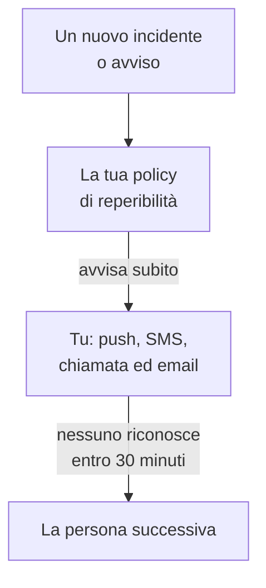

# Essere avvisati per chiamata, SMS o push

Alla fine di questa guida, OneUptime ti avvisa sul telefono, con una notifica push, un SMS o una telefonata, per ogni nuovo incidente e ogni nuovo avviso del tuo progetto; se nessuno riconosce entro 30 minuti viene avvisata la persona successiva; e una chiamata di test che hai riconosciuto dimostra che tutto funziona. La guida segue la configurazione guidata **Avvisare la persona giusta quando qualcosa si guasta** e richiede circa 10 minuti.

## Cosa ti serve

- Un progetto di cui sei proprietario: solo un proprietario può attivare SMS e chiamate, e solo un proprietario o un amministratore può creare una policy di reperibilità.
- Il tuo cellulare.
- I colleghi da avvisare, aggiunti come membri del progetto: [Invitare persone](/docs/permissions/inviting-people) spiega come fare.

:::tabs
@tab OneUptime Cloud
Le notifiche push sono gratuite su tutti i piani. SMS e chiamate sono pagati con il credito del progetto, che parte da 0.00 USD, e aggiungere un numero di telefono invia un SMS, quindi il credito deve prima superare 1.00 USD. Il credito aggiunto viene addebitato sulla carta del progetto. Il piano Free comprende una persona e una regola di escalation: vieni avvisato solo tu, e la chiamata si ripete invece di raggiungere qualcun altro.
@tab Self-hosted
Il tuo server deve poter inviare email e SMS, e fare chiamate. Il suo amministratore principale li configura su `/admin/setup`, con una prova per ciascuno, come mostra la [Guida al self-hosting](/docs/installation/self-hosting-guide). Le notifiche push arrivano all'app tramite il relay push di OneUptime, senza niente da configurare.
:::

## Passaggi

:::steps
### Aprire la configurazione guidata

Nella **Home** del tuo progetto, fai clic su **Configura una policy di reperibilità** nell'elenco **Benvenuto in OneUptime 👋**. In un nuovo progetto, la home page chiede prima **Cosa vuoi fare per prima cosa?**: spunta **Avvisare la persona giusta quando qualcosa si guasta** e fai clic su **Continua**. Se il passaggio manca o è già fatto, premi `Ctrl+K` (`Cmd+K` su un Mac), digita `get paged` e scegli **Avvisare la persona giusta quando qualcosa si guasta**.

### Installare l'app sul telefono

Installa OneUptime On-Call dall'App Store o da Google Play e accedi: l'app registra il tuo telefono per le notifiche push. Torna alla configurazione e fai clic su **Ricontrolla**: ora **App mobile o browser**, sotto **Come dobbiamo raggiungerti?**, elenca il tuo telefono.

### Attivare SMS e chiamate

Nei nuovi progetti, SMS e chiamate sono disattivati. Se sei il proprietario del progetto, fai clic su **Attiva SMS e chiamate**; agli altri viene detto chi può farlo. Su OneUptime Cloud, se il credito è di 1.00 USD o meno, fai clic su **Aggiungi credito**, inserisci da 20 a 1.000 USD in **Importo (USD)** e fai clic su **Ricarica**.

### Aggiungere il tuo numero di telefono

Digita il tuo numero di cellulare con il prefisso internazionale in **Il tuo numero di telefono**, per esempio `+15551234567`, e fai clic su **Inviami un codice via SMS**. Inserisci il codice ricevuto via SMS e fai clic su **Verifica**: anche le telefonate di reperibilità arrivano a questo numero. Fai clic su **Continua**. Per essere avvisato solo dall'app e via email, lascia vuoto il numero e fai clic subito su **Continua**.

### Scegliere chi altro viene avvisato

In **Chi altro è reperibile?** sei già in **Chiamati per primi**. Fai clic su **Aggiungi membri del team** per avvisare altre persone insieme a te, poi fai clic su **Salva e continua**. In un progetto che non ha ancora una policy di reperibilità, questo crea `Default on-call policy`, che avvisa queste persone per ogni nuovo incidente e ogni nuovo avviso. In un progetto che ne ha già una, sceglila in **Policy di reperibilità** e aggiungi invece le persone in **Aggiungi alla prima regola di escalation**. Se qualcuno non è ancora raggiungibile, il passaggio resta aperto su **Una chiamata li raggiunge?**: fai clic su **Invia promemoria di configurazione** per quella persona, poi su **Continua**.

### Decidere cosa succede se nessuno risponde

In **E se nessuno risponde?**, mantieni **Chiama qualcun altro**, scegli chi in **Chiamati dopo** e lascia **Minuti di attesa** a `30` o cambia il valore. Fai clic su **Salva e continua**. Con il piano Free, il passaggio propone invece **Richiama le stesse persone**, con **Volte da richiamare** a `2`.

### Inviare una chiamata di test

In **Invia una chiamata di test**, fai clic su **Testa questa policy**. Scegli una **Gravità** e fai clic su **Invia chiamata di test**. La prima regola di escalation della policy viene avvisata come farebbe un incidente reale, e ogni messaggio dice TEST. Non viene creato alcun incidente, e nessuna pagina di stato o iscritto viene informato.

### Riconoscere la chiamata di test

Riconosci la chiamata di test dal link nell'SMS o nell'email, oppure premi 1 durante la telefonata. L'app mostra che la chiamata è arrivata, ma non può riconoscere un test. Poi fai clic su **Fatto** nella finestra di dialogo, e su **Continua**.
:::

## Controllare che funzioni

- Il passaggio di test dice chi ha riconosciuto la chiamata, come e in quanto tempo.
- La configurazione termina su **Le chiamate sono configurate**, un riepilogo ricavato da ciò che è stato salvato: **Chi viene chiamato**, **Se nessuno risponde** e **Testato**. Un problema della policy stessa, come qualcuno che non riesce a raggiungere, è elencato in **Richiede attenzione**.
- Nella **Home**, l'elenco segna il passaggio **Configura una policy di reperibilità** come completato. Se era l'ultimo passaggio, l'elenco scompare.

Se la policy avvisa qualcun altro, puoi guardare anche l'escalation: fai clic su **Apri la policy di reperibilità** nel riepilogo, poi su **Testa questa policy**. Attiva **Percorri ogni livello di escalation**, invia il test e non riconoscere la prima chiamata: la persona successiva viene avvisata al massimo 2 minuti dopo.

## Cosa può andare storto

:::details Non c'è il pulsante Inviami un codice via SMS
Gli SMS sono disattivati, o non si possono inviare, e il passaggio dice perché. Solo un proprietario del progetto, o chi gestisce la fatturazione, vede **Attiva SMS e chiamate**. Su OneUptime Cloud, un credito di 1.00 USD o meno nasconde il campo. Su un server self-hosted che non può inviare SMS, il suo amministratore principale vede **Configura SMS e chiamate**, che apre l'Admin Dashboard per aggiungere Twilio, come mostra [Integrazione Twilio](/docs/self-hosted/twilio-integration).
:::

:::details Aggiungi credito dice che non è stato trovato alcun metodo di pagamento
Il credito aggiunto viene addebitato sulla carta del progetto. Aggiungine una in **Impostazioni del progetto → Fatturazione e fatture → Fatturazione** con **Aggiungi metodo di pagamento**, poi aggiungi di nuovo credito. Fino ad allora, l'app e l'email continuano ad avvisarti.
:::

:::details Self-hosted: il numero viene rifiutato perché non è configurato alcun account Twilio
Solo l'amministratore principale viene avvertito in anticipo che il server non può inviare SMS. Chiedigli di configurare SMS e chiamate su `/admin/setup`. Nel frattempo, fai clic su **Continua**: l'app e l'email continuano ad avvisarti.
:::

:::details Il codice o la chiamata di test non arriva mai
Controlla prima il prefisso internazionale del numero. Dopo una chiamata di test, chiudi la finestra di dialogo con **Fatto** e fai clic su **Non l'ho ricevuta**: ti dice cosa controllare, e **Apri i miei metodi di notifica** elenca tutti i modi in cui puoi essere raggiunto. Su un server self-hosted, invia un SMS di prova da `/admin/setup`, ed esegui `npm run doctor` sul server.
:::

## Passaggi successivi

:::cards
- [Pianificazioni di reperibilità](/docs/on-call/schedules): Fare i turni, così ogni chiamata va a chi è reperibile. Su Cloud, dal piano Growth.
- [Regole di escalation](/docs/on-call/escalation-rules): Aggiungere livelli, team e pianificazioni alla policy.
- [Come contattarmi](/docs/notifications/on-call-rules): Scegliere quale metodo ti raggiunge per primo, e quando.
- [Pubblicare una pagina di stato](/docs/guides/status-page): Dire ai tuoi clienti cosa succede, sul tuo dominio.
:::
