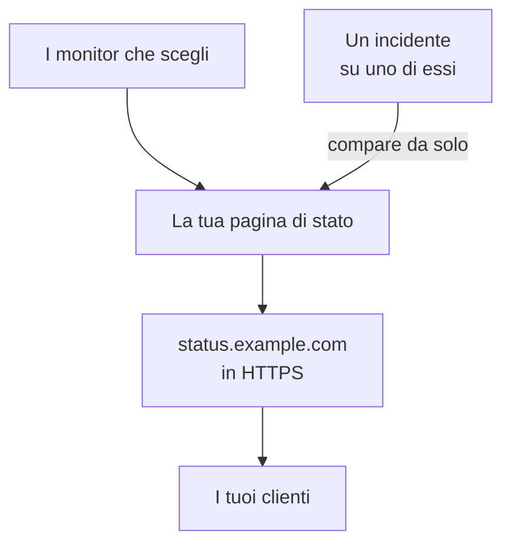

# Pubblicare una pagina di stato

Alla fine di questa guida, i tuoi clienti aprono una pagina di stato a un indirizzo tuo, come `status.example.com`, in HTTPS. La pagina mostra i monitor che scegli con il loro stato e il loro uptime, e un incidente su uno di essi vi compare da solo. La guida segue la configurazione guidata **Pubblica una pagina di stato**, poi aggiunge il tuo dominio in **Domini personalizzati**, nella pagina di stato: circa 15 minuti, più i tempi del tuo provider DNS.

## Cosa ti serve

- Almeno un monitor: una pagina di stato mostra dei monitor. Se non ne hai ancora, la configurazione guidata propone prima **Configura un monitor**.
- Il ruolo di proprietario o amministratore del progetto: la pagina richiede il permesso di creare pagine di stato, e il tuo dominio quello di aggiungere e verificare i domini del progetto.
- Un dominio che controlli, e l'accesso ai suoi record DNS presso il tuo provider DNS.

:::tabs
@tab OneUptime Cloud
Un dominio personalizzato e il suo certificato SSL gratuito sono inclusi in tutti i piani. Il piano Free ha una pagina di stato per progetto: se ne hai già una, apri i suoi **Domini personalizzati** e parti dal passaggio che aggiunge il tuo dominio. Una nuova pagina di stato è pubblica; renderla privata richiede il piano Growth.
@tab Self-hosted
Il tuo server ha bisogno di un suo nome host, come `oneuptime.example.com`, con un record A che punta al server, e deve rispondere sulle porte 80 e 443. Imposta `STATUS_PAGE_CNAME_RECORD` su quel nome in `config.env` (`statusPage.cnameRecord` nel chart Helm), al posto del valore di esempio. I certificati gratuiti richiedono anche `LETS_ENCRYPT_ACCOUNT_KEY` (`letsEncrypt.accountKey`): una chiave privata creata con openssl e codificata in base64. Riavvia OneUptime dopo averli cambiati. **Aggiungi dominio personalizzato** controlla prima il server, ed elenca cosa manca ancora.
:::

## Passaggi

:::steps
### Aprire la configurazione guidata

Nella **Home** del tuo progetto, fai clic su **Pubblica una pagina di stato** nell'elenco **Benvenuto in OneUptime 👋**. In un nuovo progetto, la home page chiede prima **Cosa vuoi fare per prima cosa?**: spunta **Informare i clienti con una pagina di stato** e fai clic su **Continua**. Se il passaggio manca o è già fatto, premi `Ctrl+K` (`Cmd+K` su un Mac), digita `status page` e scegli **Pubblica una pagina di stato**.

### Dare un nome e scegliere cosa mostra

In **Dalle un nome e scegli cosa mostra**, tieni il **Nome della pagina di stato** suggerito o digitane uno tuo. In **Cosa mostra**, spunta i monitor che i tuoi clienti devono vedere, oppure fai clic su **Seleziona tutto**. Fai clic su **Crea la pagina di stato**. Da questo momento la pagina è pubblica al suo link, e mostra solo i monitor che hai spuntato.

### Guardare cosa vedono i tuoi clienti

In **Questo è ciò che vedono i tuoi clienti**, apri l'indirizzo sotto **Link pubblico**: i tuoi monitor sono elencati con il loro stato. Torna alla configurazione e fai clic su **Va bene**.

### Aprire Domini personalizzati

La configurazione termina con un riepilogo. In **Personalizzala (facoltativo)**, fai clic su **Il tuo dominio**. Si apre la pagina **Domini personalizzati** della pagina di stato.

### Aggiungere il tuo dominio

Fai clic su **Aggiungi dominio personalizzato**. In **Dominio**, digita l'indirizzo che apriranno i tuoi clienti, come `status.example.com`, e fai clic su **Continua**. Si apre la finestra di dialogo **Configurazione DNS** con i record da aggiungere.

### Aggiungere i record DNS

Presso il tuo provider DNS, aggiungi ogni record elencato in **Configurazione DNS**, con il suo **Tipo**, **Nome** e **Valore**: un record CNAME che fa puntare l'indirizzo a OneUptime e, la prima volta che il progetto usa questo dominio, un record TXT che dimostra che il dominio appartiene al progetto. Se il tuo provider aggiunge da solo il dominio a ogni nome, digita solo la parte che lo precede, come `status`, e `@` per il dominio stesso.

### Verificare i record

Tieni aperta **Configurazione DNS** e fai clic su **Verifica ora**. Sotto ogni record, la finestra dice cosa ha cercato e cosa ha ottenuto. Il record TXT viene per primo: finché non viene trovato, il dominio non viene aggiunto, quindi fai di nuovo clic su **Verifica ora** finché non lo è. Una volta trovato il record CNAME, la finestra di dialogo dice **Il tuo record CNAME è verificato.**, e viene emesso un certificato SSL gratuito, di solito entro 15 minuti.
:::

## Controllare che funzioni

- Apri `https://status.example.com`, con il tuo indirizzo: la tua pagina di stato si apre senza avvisi sul certificato.
- In **Domini personalizzati**, lo **Stato** del dominio dice **Certificato emesso, si rinnova automaticamente.** Per un po' può dire **Emissione di un certificato gratuito, di solito entro 15 minuti.** anche quando la pagina si apre già.
- Nella **Home**, l'elenco segna il passaggio **Pubblica una pagina di stato** come completato: lo è non appena una pagina di stato mostra un monitor. Se era l'ultimo passaggio, l'elenco scompare.

Non serve altro: OneUptime rinnova il certificato da solo. Una volta che il dominio è nell'elenco, OneUptime controlla il suo record CNAME ogni 15 minuti e lo verifica quando il record è attivo, anche se chiudi **Configurazione DNS**.

## Cosa può andare storto

:::details Il dominio non è nell'elenco dopo aver chiuso Configurazione DNS
**Configurazione DNS** è stata chiusa prima che il suo record TXT venisse trovato, quindi il dominio non è mai stato aggiunto. Fai clic su **Aggiungi dominio personalizzato**, digita lo stesso indirizzo, fai clic su **Continua**, poi su **Verifica ora** finché la finestra di dialogo non trova entrambi i record.
:::

:::details Il dominio resta su In attesa del DNS
Apri **Configurazione DNS** dalla riga del dominio e fai clic su **Verifica ora**: ti dice cosa ha trovato. Controlla che il nome del record sia l'indirizzo completo, come `status.example.com`, e che il suo valore sia quello mostrato da **Configurazione DNS**. Se il nome risponde con un indirizzo, ha un record A, oppure il tuo provider DNS lo fa passare da un proxy: sostituisci il record A, o imposta il nome su DNS only. Per un dominio radice, come `example.com`, usa il record ALIAS, ANAME o di appiattimento del CNAME del tuo provider.
:::

:::details Lo Stato dice che non è stato possibile emettere un certificato gratuito
Un record CAA sul tuo dominio che non include `letsencrypt.org` blocca il certificato. Su un server self-hosted, Let's Encrypt deve raggiungere il server sulla porta 80. Risolvi la causa: OneUptime continua a riprovare da solo, e **Verifica ora** in **Configurazione DNS** ordina di nuovo il certificato, al massimo una volta ogni 15 minuti per dominio.
:::

:::details Self-hosted: il server non è pronto per i domini personalizzati
**Aggiungi dominio personalizzato** dice **Questo server non è ancora pronto per i domini personalizzati**, con una riga per ogni cosa che manca ancora e cosa cambiare: le impostazioni in [Cosa ti serve](#cosa-ti-serve). Senza `LETS_ENCRYPT_ACCOUNT_KEY`, un dominio verificato dice **Verificato. Usa l'HTTPS del tuo proxy.**: servi il suo HTTPS dal tuo proxy. [Branding e domini della pagina di stato](/docs/status-pages/branding-and-domains#prima-di-iniziare) ha i dettagli.
:::

## Passaggi successivi

:::cards
- [Branding e domini della pagina di stato](/docs/status-pages/branding-and-domains): Il tuo logo, i colori, i link dell'intestazione e il footer.
- [Iscritti e annunci](/docs/status-pages/subscribers): Permettere ai clienti di iscriversi, e pubblicare annunci.
- [Manutenzione programmata](/docs/scheduled-maintenance/index): Informare i clienti dei lavori programmati prima che inizino.
- [Essere avvisati per chiamata, SMS o push](/docs/guides/paging): Essere avvisato quando uno di quei monitor va giù.
:::
