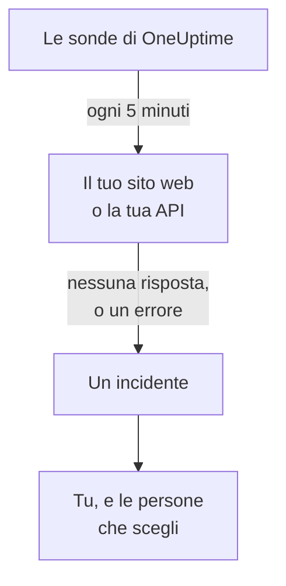

# Sapere quando il tuo sito web o la tua API smette di funzionare

Alla fine di questa guida, OneUptime controlla il tuo sito web o la tua API ogni 5 minuti, apre un incidente e ti avvisa quando smette di rispondere o risponde con un errore; e una chiamata di test che hai riconosciuto dimostra che il messaggio ti raggiunge. La guida segue la configurazione guidata **Sapere quando il mio sito web o la mia API non funziona** e richiede circa 5 minuti.

## Cosa ti serve

- Un progetto OneUptime in cui puoi creare monitor: possono farlo un proprietario, un amministratore o un membro. Per creare un account e un progetto, segui la prima parte della [Guida rapida](/docs/introduction/quickstart#creare-un-progetto).
- L'indirizzo da controllare, come `https://example.com`. Per un'API, scegli un endpoint che risponda a un semplice `GET` senza chiave, per esempio un health check: una risposta come `401` viene considerata un'interruzione.

:::tabs
@tab OneUptime Cloud
L'indirizzo viene controllato da sonde in più regioni, quindi deve essere raggiungibile da Internet. Il piano Free comprende 10 monitor attivi.
@tab Self-hosted
L'indirizzo viene controllato dalla sonda del tuo server stesso, quindi deve essere raggiungibile da lì. Perché tu riceva le email, il server deve poterle inviare: il suo amministratore principale configura l'email su `/admin/setup`, come mostra la [Guida al self-hosting](/docs/installation/self-hosting-guide). L'amministratore principale non diventa proprietario di ciò che crea, quindi per ricevere le email si aggiunge nella pagina **Proprietari** del monitor.
:::

## Passaggi

:::steps
### Aprire la configurazione guidata

In un nuovo progetto, la **Home** chiede prima **Cosa vuoi fare per prima cosa?**: spunta **Sapere quando il mio sito web o la mia API non funziona** e fai clic su **Continua**. Poi fai clic su **Crea il tuo primo monitor** nell'elenco **Benvenuto in OneUptime 👋**. Se l'elenco non mostra questo passaggio, premi `Ctrl+K` (`Cmd+K` su un Mac), digita `website down` e scegli **Sapere quando il mio sito web o la mia API non funziona**.

### Inserire l'indirizzo

In **Cosa dobbiamo controllare?**, digita l'indirizzo in **Indirizzo del sito web o dell'API**. Per un endpoint API, spunta **Questo è un endpoint API**. Fai clic su **Inizia il controllo**: le sonde lo controllano subito, e una frase dice cosa hanno trovato. Fai clic su **Continua**.

### Scegliere chi viene avvisato

In **Chi deve essere avvisato?**, ciò che vedi dipende dal progetto:

- Se il progetto non ha ancora né una policy di reperibilità né una regola di reperibilità, sei già in **Chi viene chiamato**. Fai clic su **Aggiungi membri del team** per aggiungere persone che fanno già parte del progetto, poi fai clic su **Salva e continua**. Questo crea `Default on-call policy`, che avvisa queste persone per ogni nuovo incidente e ogni nuovo avviso del progetto.
- Se il progetto ha una policy o una regola di reperibilità, sono le sue regole a decidere chi viene chiamato: fai clic su **Continua**.
- Se sei un membro, e quindi non puoi configurare le chiamate, ti viene detto che riceverai un'email come proprietario del monitor: fai clic su **Continua**.

### Inviarti un test

In **Invia un test**, fai clic su **Inviami una chiamata di test**. Scegli una **Gravità** e fai clic su **Invia chiamata di test**. Il test ti raggiunge come farebbe una chiamata reale, e ogni messaggio dice TEST. Non viene creato alcun incidente.

### Riconoscere la chiamata di test

Riconosci la chiamata di test dal link nell'email. Funziona anche un numero di telefono verificato, una volta attivati SMS e chiamate per il progetto: apri il link nell'SMS, oppure premi 1 durante la telefonata. Poi fai clic su **Fatto** nella finestra di dialogo, e su **Continua**.
:::

## Controllare che funzioni

- La configurazione termina sul suo riepilogo, ricavato da ciò che è stato salvato: **Controllato**, **In caso di interruzione**, **Chi viene avvisato** e **Testato**.
- Fai clic su **Apri il monitor**, poi su **Mostra la catena** nella sua scheda **Quando va giù**: la scheda mostra la catena che va dal monitor alle persone che raggiunge, e dice **Niente interrompe la catena.** quando niente la interromperebbe.
- Nella **Home**, l'elenco segna il passaggio **Crea il tuo primo monitor** come completato non appena arriva il risultato del primo controllo. Se era l'ultimo passaggio, l'elenco scompare.

Per configurare un altro indirizzo in seguito, riapri la configurazione e fai clic su **Controlla un altro indirizzo**.

## Cosa può andare storto

:::details Il risultato del primo controllo non arriva mai
Se la frase dice che nessuna posizione controlla l'indirizzo, il monitor non ha una sonda; se continua a dire che il controllo è in corso, la sua sonda non è connessa. Apri **Monitor → Impostazioni → Sonde** per vedere lo stato di ogni sonda. Su un server self-hosted, l'amministratore principale controlla la sonda del server su `/admin/setup`. Poi apri il monitor, aggiungigli una sonda connessa e riapri la configurazione.
:::

:::details Il sito funziona, ma il monitor dice che è giù
Il monitor considera un'interruzione l'assenza di risposta, o una risposta con un codice fuori dall'intervallo da 200 a 399. Per il monitor, un firewall che blocca le sonde equivale a un'assenza di risposta: su OneUptime Cloud, consenti gli indirizzi elencati in [Indirizzi IP](/docs/configuration/ip-addresses); su un server self-hosted, consenti la macchina su cui gira la sonda. Per cambiare la regola, vedi [Monitor sito web](/docs/monitor/website-monitor) o [Monitor API](/docs/monitor/api-monitor).
:::

:::details La chiamata di test non può essere riconosciuta
Non è arrivato nulla da cui riconoscerla, il che su un server self-hosted di solito significa che il server non può ancora inviare email: il passaggio lo dice, e il suo amministratore principale vede **Configura l'email**. Configurala, poi fai clic su **Invia un altro test**, oppure fai clic su **Salta il test** e torna più tardi. Dopo un test, chiudi la finestra di dialogo con **Fatto** e fai clic su **Non l'ho ricevuta**: ti dice cosa controllare.
:::

## Passaggi successivi

:::cards
- [Essere avvisati per chiamata, SMS o push](/docs/guides/paging): Essere avvisato sul telefono, e avvisare la persona successiva se nessuno risponde.
- [Pubblicare una pagina di stato](/docs/guides/status-page): Mostrare il monitor ai tuoi clienti, sul tuo dominio.
- [Criteri e stati](/docs/monitor/criteria-and-statuses): Decidere esattamente quando un monitor conta come non disponibile.
:::
