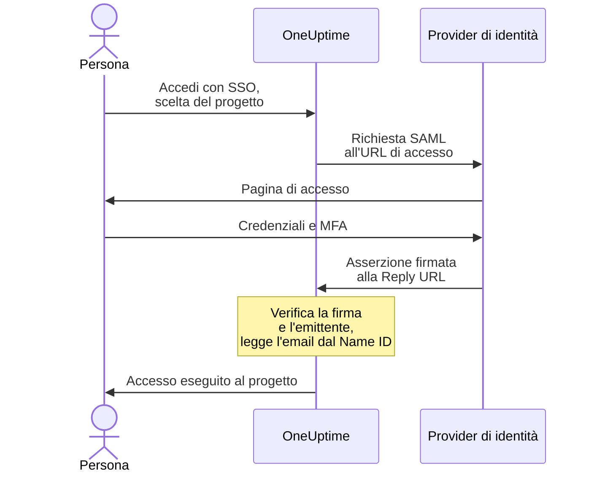

# SSO

Il single sign-on (SSO) permette alle persone del tuo progetto di accedere a OneUptime con il provider di identità (IdP) della tua organizzazione, tramite SAML 2.0 o OpenID Connect. Gestisci accessi, password e autenticazione a più fattori in un unico posto, e puoi richiedere l'SSO a tutti nel progetto.

> [!NOTE]
> **Edizione:** l'SSO, incluso "Require SSO to sign in", fa parte di ogni edizione di OneUptime: le installazioni self-hosted lo hanno nella Community Edition, senza licenza. Su OneUptime Cloud è disponibile dal piano **Scale** in su. Consulta [Edizione Enterprise](/docs/self-hosted/enterprise) per vedere cosa include ogni edizione.

:::cards
- [Configurare un provider SAML](#configurare-lsso): Crearlo in OneUptime e dare due URL al tuo IdP.
- [Guide dei provider di identità](#guide-dei-provider-di-identità): Keycloak, Microsoft Entra ID e Okta, passo dopo passo.
- [OpenID Connect](#openid-connect-oidc): Accedere invece tramite un'app OIDC.
- [Richiedere l'SSO](#richiedere-lsso-per-il-progetto): Fare dell'SSO l'unico modo per entrare nel progetto.
:::

## Come funziona l'accesso SAML

Un provider SAML collega un progetto a un'applicazione del tuo provider di identità. Chi accede sceglie il progetto nella pagina **Accedi con SSO** di OneUptime, accede presso il tuo IdP e torna con l'accesso eseguito.



OneUptime legge solo poche cose dall'asserzione che invia il tuo IdP:

| Dall'asserzione | Che cosa ne fa OneUptime |
| --- | --- |
| Firma | La verifica con il **Certificato pubblico** del provider. La risposta deve essere firmata e non deve essere cifrata. |
| Issuer | Deve corrispondere esattamente all'**Emittente** del provider. |
| Audience | Deve essere l'**Identificatore (Entity ID)** del provider. Una risposta che il tuo IdP ha creato per un'altra applicazione viene rifiutata. |
| Recipient e Destination | Devono essere la **URL di risposta** del provider, l'indirizzo a cui è stata inviata la risposta. |
| `NotBefore` e `NotOnOrAfter` | La risposta è accettata solo finché lo consentono, e non oltre 10 minuti dalla sua emissione, con 3 minuti di tolleranza per gli orologi che non coincidono. |
| Name ID | L'indirizzo email della persona. Deve essere un indirizzo email valido. |
| Attributi del nome | Il nome della persona, usato quando OneUptime crea il suo account: un nome visualizzato (`displayName`, o `http://schemas.microsoft.com/identity/claims/displayname`), oppure un nome e un cognome (`firstName` e `lastName`, o le attestazioni `givenname` e `surname` che Microsoft Entra ID invia per impostazione predefinita). Facoltativo. |
| `http://schemas.microsoft.com/identity/claims/objectidentifier` | L'ID oggetto della persona, che Microsoft Entra ID invia per impostazione predefinita. Il primo accesso tramite il provider collega l'account a questo ID, e un accesso successivo che indica l'indirizzo email dell'account con un altro ID oggetto viene rifiutato. Facoltativo. |

Ogni risposta fa accedere una sola volta. Inviata di nuovo, ad esempio tornando indietro nel browser dopo l'accesso, viene rifiutata: accedi di nuovo.

Chi accede per la prima volta entra nei **Team** del provider, che decidono che cosa può fare: vedi [Ruoli e team degli utenti SSO](#ruoli-e-team-degli-utenti-sso).

> [!NOTE]
> Su OneUptime Cloud, la prima volta che qualcuno accede al progetto con uno dei suoi provider SAML o OIDC, OneUptime gli invia un link via email invece di farlo entrare. La persona lo apre, conferma che il single sign-on del progetto può farla accedere e prosegue con l'accesso. Il link vale 24 ore. Succede una volta per progetto, e di nuovo se la persona lascia il progetto e poi torna. Le installazioni self-hosted fanno accedere subito. Su OneUptime Cloud, ogni accesso che non va subito a buon fine riceve questa stessa risposta, che l'indirizzo abbia un account o no: chi non ha ancora un account riceve anch'esso l'email, e l'account viene creato quando conferma, mentre un account bloccato o un amministratore di OneUptime non riceve alcuna email. Un'installazione self-hosted rifiuta invece questi due casi con un unico messaggio.

Su OneUptime Cloud, chi entra nel progetto tramite SSO occupa un posto, proprio come una persona che inviti. Se il tuo piano include un numero fisso di posti e sono tutti occupati, le nuove persone non possono entrare tramite SSO finché non si libera un posto.

## Configurare l'SSO

Ti serve l'autorizzazione ad aggiungere provider SSO — **Proprietario del progetto**, **Amministratore del progetto** o **Create Project SSO** — e, su OneUptime Cloud, il piano **Scale**. Per la parte del tuo provider di identità, vedi le [guide dei provider di identità](#guide-dei-provider-di-identità).

:::steps
1. **Aprire le impostazioni del progetto**

   - Apri il tuo progetto OneUptime
   - Vai a **Impostazioni del progetto** > **Sicurezza** > **SSO**

2. **Creare la configurazione SSO**

   - Fai clic su **Aggiungi provider SAML**
   - Inserisci un **Nome** per la configurazione SSO (ad esempio "Keycloak SAML" o "Okta SAML")
   - Inserisci l'**URL di accesso** del tuo provider di identità
   - Inserisci l'**Emittente** (Entity ID) del tuo provider di identità
   - Incolla il **Certificato pubblico** del tuo provider di identità
   - Nel passaggio **Accesso**, **Team** parte dal team dei membri del progetto: chi accede per la prima volta entra in questi team. Sono accettati solo i team in cui potresti invitare qualcuno: un team che dà più accesso di quello che hai viene indicato sotto **Team**
   - Tutto il resto è già compilato sotto **Altri campi**: il **Metodo di firma** (`RSA-SHA256`), il **Metodo di digest** (`SHA256`) e una descrizione ("Sign in with" seguito dal nome). Modificali solo se il tuo provider di identità lo richiede

3. **Ottenere i metadati SSO di OneUptime**
   - Il salvataggio apre la finestra **Configurazione SSO**. Puoi riaprirla con il pulsante **Visualizza configurazione SSO**
   - Copia l'**Identificatore (Entity ID)**, ad esempio `https://oneuptime.com/<project-id>/<provider-id>`: serve nella configurazione del tuo IdP
   - Copia la **URL di risposta (URL dell'Assertion Consumer Service)**, ad esempio `https://oneuptime.com/identity/idp-login/<project-id>/<provider-id>`: serve nella configurazione del tuo IdP
   - Un nuovo provider parte disattivato. Quando il tuo IdP ha questi due valori, modifica il provider e attiva **Abilitato**

4. **Provare il provider**
   - Apri il link della scheda **Link di accesso SSO** e scegli il provider nella pagina che si apre. Vieni portato alla pagina di accesso del tuo provider di identità e torni su OneUptime con l'accesso eseguito
   - Quando funziona, puoi [richiedere l'SSO](#richiedere-lsso-per-il-progetto) per il progetto
:::

## Guide dei provider di identità

Scegli il tuo provider di identità. Ogni guida recupera i valori dell'IdP, crea il provider in OneUptime e poi dà all'IdP l'**Identificatore (Entity ID)** e la **URL di risposta** di OneUptime.

:::tabs
@tab Keycloak
Keycloak è una diffusa soluzione open source per la gestione delle identità e degli accessi. Ti serve un'istanza Keycloak in funzione con un realm, e l'accesso amministrativo sia a Keycloak sia a OneUptime.

:::steps
1. **Raccogliere i valori del realm**

   - **URL di accesso**: `https://<your-keycloak-domain>/auth/realms/<your-realm>/protocol/saml`
   - **Emittente**: `https://<your-keycloak-domain>/auth/realms/<your-realm>`
   - **Certificato**: il certificato di firma del realm. Apri `https://<your-keycloak-domain>/auth/realms/<your-realm>/protocol/saml/descriptor` e copia il valore `X509Certificate`, oppure apri **Realm settings** > **Keys** e fai clic su **Certificate** sulla chiave RS256

   Keycloak 17 e versioni successive servono questi URL senza il prefisso `/auth`. Metti il certificato tra le sue righe, così:

   ```text
   -----BEGIN CERTIFICATE-----
   MIICnzCCAYcCBgFyPZ8QFzANBgkqhkiG.......
   -----END CERTIFICATE-----
   ```

2. **Creare il provider in OneUptime**

   Vai a **Impostazioni del progetto** > **Sicurezza** > **SSO**, fai clic su **Aggiungi provider SAML** e compila:
   - **Nome**: un nome descrittivo (ad esempio `my-project-oneuptime`)
   - **URL di accesso** ed **Emittente**: i valori sopra
   - **Certificato pubblico**: il certificato, tra le sue righe `BEGIN CERTIFICATE` ed `END CERTIFICATE`
   - **Metodo di firma** e **Metodo di digest**: già impostati sotto **Altri campi** (`RSA-SHA256` e `SHA256`)

   Salva e copia l'**Identificatore (Entity ID)** e la **URL di risposta (URL dell'Assertion Consumer Service)** dalla finestra che si apre.

3. **Creare il client Keycloak**

   In Keycloak, apri **Clients** nel tuo realm e crea un client, oppure modificane uno esistente:
   - **Client Protocol** (tipo di client): `saml`
   - **Client ID**: l'**Identificatore (Entity ID)** di OneUptime
   - **Root URL** e **Valid Redirect URIs**: l'URL di OneUptime
   - **Assertion Consumer Service POST Binding URL**: la **URL di risposta (URL dell'Assertion Consumer Service)** di OneUptime

4. **Regolare le impostazioni del client**

   - Imposta **Name ID Format** su `email` e attiva **Force Name ID Format**, così Keycloak invia sempre l'email come Name ID
   - Nella scheda **Keys** del client, disattiva **Client signature required** (in **Signing keys config**): OneUptime non firma le sue richieste di accesso

5. **Attivare il provider e provarlo**

   In OneUptime, modifica il provider e attiva **Abilitato**, poi apri il link della scheda **Link di accesso SSO** e scegli il provider. Dovresti arrivare alla pagina di accesso di Keycloak e tornare su OneUptime.
:::
@tab Microsoft Entra ID
Microsoft Entra ID (prima Azure AD / Active Directory) è il servizio di identità cloud di Microsoft. Ti serve un tenant che supporti le applicazioni aziendali con SSO SAML, e l'accesso amministrativo sia a Entra ID sia a OneUptime. Su OneUptime Cloud, se la galleria di applicazioni di Microsoft Entra elenca OneUptime, aggiungi l'app da lì: include già le attestazioni che OneUptime legge e i modelli dei suoi URL.

:::steps
1. **Creare un'applicazione aziendale in Entra ID**

   - Accedi al [Microsoft Entra admin center](https://entra.microsoft.com)
   - Vai a **Identity** > **Applications** > **Enterprise applications** e fai clic su **+ New application**
   - Dalla galleria: cerca OneUptime, selezionalo e fai clic su **Create**
   - Altrimenti: fai clic su **+ Create your own application**, inserisci un nome (ad esempio "OneUptime"), seleziona **Integrate any other application you don't find in the gallery (Non-gallery)** e fai clic su **Create**

2. **Copiare i valori SAML di Entra ID**

   - Nell'applicazione, vai a **Single sign-on** e seleziona **SAML**
   - In **SAML Certificates**, scarica il **Certificate (Base64)**, apri il file in un editor di testo e copiane il contenuto
   - In **Set up OneUptime**, copia la **Login URL** e il **Microsoft Entra Identifier** (**Azure AD Identifier** nei tenant meno recenti)

3. **Creare il provider in OneUptime**

   Vai a **Impostazioni del progetto** > **Sicurezza** > **SSO**, fai clic su **Aggiungi provider SAML** e compila:
   - **Nome**: un nome descrittivo (ad esempio `Azure AD SAML`)
   - **URL di accesso**: la **Login URL**
   - **Emittente**: il **Microsoft Entra Identifier**
   - **Certificato pubblico**: il certificato Base64, comprese le righe `BEGIN CERTIFICATE` ed `END CERTIFICATE`
   - **Metodo di firma** e **Metodo di digest**: già impostati sotto **Altri campi** (`RSA-SHA256` e `SHA256`)

   Salva e copia l'**Identificatore (Entity ID)** e la **URL di risposta (URL dell'Assertion Consumer Service)** dalla finestra che si apre.

4. **Dare a Entra ID gli URL di OneUptime**

   In **Basic SAML Configuration**, fai clic su **Edit** e imposta:
   - **Identifier (Entity ID)**: l'**Identificatore (Entity ID)** di OneUptime
   - **Reply URL (Assertion Consumer Service URL)**: la **URL di risposta** di OneUptime

   Fai clic su **Save**.

5. **Inviare l'email come Name ID**

   In **Attributes & Claims**, fai clic su **Edit**. L'applicazione della galleria ha già queste impostazioni: controllale.
   - Imposta **Unique User Identifier (Name ID)** sull'indirizzo email dell'utente: `user.mail`, oppure `user.userprincipalname` quando quello è l'indirizzo email
   - Imposta il **Name identifier format** su `Email address`
   - Mantieni le attestazioni predefinite di Entra ID: i nuovi account ricevono il nome della persona da `givenname` e `surname`, e l'account viene collegato all'ID oggetto della persona, `objectidentifier`. Facoltativamente, aggiungi un'attestazione chiamata `http://schemas.microsoft.com/identity/claims/displayname` con l'attributo di origine `user.displayname`, per dare invece ai nuovi account il nome visualizzato. OneUptime ignora le altre attestazioni

6. **Assegnare utenti e gruppi**

   In **Users and groups** dell'applicazione, fai clic su **+ Add user/group**, seleziona gli utenti e i gruppi a cui dare l'accesso SSO e fai clic su **Assign**.

7. **Attivare il provider e provarlo**

   In OneUptime, modifica il provider e attiva **Abilitato**, poi apri il link della scheda **Link di accesso SSO** e scegli il provider. Dovresti arrivare alla pagina di accesso di Microsoft e tornare su OneUptime.
:::
@tab Okta
Okta è una piattaforma di identità molto diffusa con SSO SAML. Ti serve un'organizzazione Okta con accesso amministrativo, e l'accesso amministrativo a OneUptime. Su OneUptime Cloud, se l'Okta Integration Network elenca OneUptime, aggiungi l'app da lì: fa accedere le persone dalla pagina **Accedi con SSO** di OneUptime e dalla loro dashboard di Okta, dà loro un account al primo accesso e chiede due ID invece degli URL di OneUptime.

:::steps
1. **Aggiungere OneUptime a Okta**

   - Nella Okta Admin Console, vai a **Applications** > **Applications**
   - Dall'Okta Integration Network: fai clic su **Browse App Catalog**, cerca OneUptime e fai clic su **Add Integration**. Okta chiede l'**OneUptime Project ID** e l'**OneUptime SSO Provider ID** prima che OneUptime possa mostrarli: per ora inserisci `0` in entrambi, li sostituirai al passaggio 4. Fai clic su **Done** e continua con il passaggio 2
   - Altrimenti fai clic su **Create App Integration**, seleziona **SAML 2.0** e fai clic su **Next**, inserisci "OneUptime" come **App name** e fai clic su **Next**
   - Okta chiede gli URL di OneUptime prima di mostrare i propri. Per ora inserisci il tuo indirizzo OneUptime (ad esempio `https://oneuptime.com`) come **Single sign-on URL** e come **Audience URI (SP Entity ID)**: li sostituirai entrambi al passaggio 4
   - Imposta **Name ID format** su `EmailAddress` e **Application username** su `Email`
   - Fai clic su **Next**, seleziona **I'm an Okta customer adding an internal app** e fai clic su **Finish**

2. **Copiare i valori SAML di Okta**

   Nella scheda **Sign On** dell'applicazione, in **SAML Signing Certificates**, trova il certificato attivo:
   - Fai clic su **Actions** > **View IdP metadata** e copia l'**URL di accesso** (Identity Provider Single Sign-On URL) e l'**Emittente** (Identity Provider Issuer)
   - Fai clic su **Actions** > **Download certificate**, apri il file `.cert` in un editor di testo e copiane il contenuto

3. **Creare il provider in OneUptime**

   Vai a **Impostazioni del progetto** > **Sicurezza** > **SSO**, fai clic su **Aggiungi provider SAML** e compila:
   - **Nome**: un nome descrittivo (ad esempio `Okta SAML`)
   - **URL di accesso** ed **Emittente**: i valori di Okta
   - **Certificato pubblico**: il certificato, comprese le righe `BEGIN CERTIFICATE` ed `END CERTIFICATE`
   - **Metodo di firma** e **Metodo di digest**: già impostati sotto **Altri campi** (`RSA-SHA256` e `SHA256`)

   Salva e copia l'**Identificatore (Entity ID)** e la **URL di risposta (URL dell'Assertion Consumer Service)** dalla finestra che si apre.

4. **Dare a Okta gli URL di OneUptime**

   Per l'applicazione dell'Okta Integration Network, nella scheda **General**, fai clic su **Edit** in **App Settings** e imposta:
   - **OneUptime Project ID** e **OneUptime SSO Provider ID**: i due ID contenuti nell'**Identificatore (Entity ID)** di OneUptime, `https://oneuptime.com/<project-id>/<provider-id>`

   Fai clic su **Save** e verifica che **Application username format** sia `Email` nella scheda **Sign On**.

   Per la tua applicazione, nella scheda **General**, fai clic su **Edit** in **SAML Settings** e poi su **Next**, quindi imposta:
   - **Single sign-on URL**: la **URL di risposta (URL dell'Assertion Consumer Service)** di OneUptime
   - **Audience URI (SP Entity ID)**: l'**Identificatore (Entity ID)** di OneUptime

   Facoltativamente, aggiungi le istruzioni di attributo `firstName`, con il valore `user.firstName`, e `lastName`, con il valore `user.lastName`, così i nuovi account ricevono il nome della persona. Fai clic su **Next**, poi su **Finish**.

5. **Assegnare le persone**

   Nella scheda **Assignments**, fai clic su **Assign** > **Assign to People** o **Assign to Groups**, seleziona chi ottiene l'accesso SSO, fai clic su **Assign** per ciascuno e poi su **Done**.

6. **Attivare il provider e provarlo**

   In OneUptime, modifica il provider e attiva **Abilitato**, poi apri il link della scheda **Link di accesso SSO** e scegli il provider. Dovresti arrivare alla pagina di accesso di Okta e tornare su OneUptime.
:::
@tab Altro
L'SSO di OneUptime usa SAML 2.0 e funziona con qualsiasi provider di identità conforme:

:::steps
1. Recupera l'**URL di accesso** (il suo endpoint SSO), l'**Emittente** (il suo Entity ID) e il **Certificato pubblico** (il suo certificato di firma X.509) del tuo provider di identità. Se il tuo IdP li mostra solo dopo che esiste un'applicazione, crea l'applicazione usando il tuo indirizzo OneUptime come URL provvisori.
2. In OneUptime, crea il provider con quei valori e copia l'**Identificatore (Entity ID)** e la **URL di risposta (URL dell'Assertion Consumer Service)** dalla finestra **Configurazione SSO** (o da **Visualizza configurazione SSO**).
3. Nell'applicazione SAML del tuo provider di identità, imposta l'**Assertion Consumer Service URL / Reply URL** e l'**Entity ID / Audience URI** sui valori di OneUptime, e il **Name ID Format** sull'indirizzo email.
4. Il **Metodo di firma** (`RSA-SHA256`) e il **Metodo di digest** (`SHA256`) sono già impostati sotto **Altri campi**; modificali solo se il tuo provider di identità firma in modo diverso
5. Attiva **Abilitato** per il provider e provalo con il link della scheda **Link di accesso SSO**.
:::
:::

## OpenID Connect (OIDC)

Un progetto può anche accedere tramite un provider OpenID Connect, come Google Workspace, Okta, Microsoft Entra ID, Auth0 o Keycloak. Ti serve l'autorizzazione ad aggiungere provider OIDC (**Proprietario del progetto**, **Amministratore del progetto** o **Create Project OIDC**) e, su OneUptime Cloud, il piano **Scale**.

:::steps
1. Registra presso il tuo provider di identità un'app (un client OIDC) che possa usare il flusso authorization code con PKCE, e copia il suo **URL dell'emittente**, il **Client ID** e il **Client Secret**.
2. In OneUptime, vai a **Impostazioni del progetto** > **Sicurezza** > **SSO**. Sotto i provider SAML, fai clic su **Aggiungi provider OIDC**.
3. Inserisci un **Nome** (ciò che le persone vedono nella pagina di accesso), l'**URL dell'emittente**, il **Client ID** e il **Client Secret**. In alternativa puoi incollare l'URL di discovery del provider in **URL dell'emittente**.
4. Nel passaggio **Accesso**, **Team** parte dal team dei membri del progetto: chi accede per la prima volta entra in questi team. Tutto il resto è già compilato sotto **Altri campi**: l'**URL di discovery** (l'emittente seguito da `/.well-known/openid-configuration`), gli **Ambiti** (`openid email profile`), i nomi delle attestazioni `email` e `name`, e una descrizione ("Sign in with" seguito dal nome). Modificali solo se il tuo provider lo richiede. Sono accettati solo i team in cui potresti invitare qualcuno: un team che dà più accesso di quello che hai viene indicato sotto **Team**.
5. Salva. Si apre la finestra **Configurazione OIDC** con la **Redirect URI**: aggiungila agli URI di reindirizzamento consentiti della tua app. Un nuovo provider parte disattivato, quindi poi modificalo e attiva **Abilitato**.
6. Apri il link della scheda **Link di accesso SSO** e scegli il provider, per accedere tramite esso prima di richiedere l'SSO per il progetto.
:::

## Uscire anche dal provider di identità

Uscire da OneUptime lascia la persona connessa al provider di identità, quindi su un computer condiviso, come uno schermo del NOC o un chiosco, la persona successiva che sceglie il provider nella pagina di accesso entra al posto di chi se n'è andato. Su un provider SAML o OIDC, attiva **Esci anche dal provider di identità** in **Altri campi** perché l'uscita da OneUptime chiuda anche la sessione presso il provider. È disattivato per impostazione predefinita: su un portatile personale farebbe uscire la persona anche da ogni altra app che usa il provider. Vale per le persone che accedono da un browser dopo che è stato attivato; l'app mobile esce solo da OneUptime.

:::tabs
@tab SAML
Inserisci l'URL di uscita del tuo provider di identità come **URL di uscita** del provider, in **Altri campi**: senza di esso l'opzione non si può attivare. Poi fornisci al tuo provider di identità l'**URL di Single Logout** della finestra **Configurazione SSO** e il certificato con cui OneUptime firma le sue richieste di uscita, da **Scarica il certificato di firma** nella stessa finestra.

| Provider di identità | URL di uscita | Dove vanno l'URL di Single Logout e il certificato |
| --- | --- | --- |
| Okta | **Identity Provider Single Logout URL**, in **View SAML setup instructions** nella scheda **Sign On** | Nella scheda **General**, modifica le **SAML Settings**, fai clic su **Show Advanced Settings** e seleziona **Allow application to initiate Single Logout**. Imposta **Single Logout URL** sull'URL di Single Logout e **SP Issuer** sull'identificatore (Entity ID), e carica il certificato come **Signature Certificate**. |
| Microsoft Entra ID | **Logout URL**, in **Set up OneUptime** | In **Basic SAML Configuration**, imposta **Logout Url (Optional)** sull'URL di Single Logout. Entra ID non ha bisogno di alcun certificato. |
| Keycloak | L'endpoint SAML del realm, lo stesso dell'URL di accesso | Nella scheda **Advanced** del client, imposta **Logout Service Redirect Binding URL** sull'URL di Single Logout. Lascia attivo **Front channel logout**. Keycloak non ha bisogno di alcun certificato finché **Client signature required** è disattivato, come impostato sopra. |

Dopo l'uscita lì, il provider di identità rimanda il browser all'URL di Single Logout, che apre la pagina di accesso o segnala che il provider di identità non ha confermato l'uscita. Quando la persona esce dal provider di identità, o da un'altra app che lo usa, un provider di identità che invia richieste di uscita alle sue app, come Keycloak e Microsoft Entra ID, la fa uscire anche da OneUptime. OneUptime accetta solo una richiesta firmata dal provider di identità.
@tab OpenID Connect
Il browser passa per l'uscita del provider appena OneUptime lo ha fatto uscire, e il provider lo rimanda alla pagina di accesso di OneUptime. Registra quella pagina presso il tuo provider: la finestra **Configurazione OIDC** la mostra come URI di reindirizzamento dopo l'uscita, che i provider chiamano post-logout redirect URI. Un provider il cui documento di discovery non nomina alcun `end_session_endpoint`, come Google, non può attivarla.

| Provider di identità | Dove registrare l'URI di reindirizzamento dopo l'uscita |
| --- | --- |
| Okta | Nella scheda **General** dell'integrazione, fai clic su **Edit** in **General Settings** e aggiungilo a **Sign-out redirect URIs**. |
| Microsoft Entra ID | Nella registrazione dell'app, in **Authentication**, aggiungilo ai **Redirect URIs** della piattaforma **Web**. La **Front-channel logout URL** è un'altra impostazione, che OneUptime non usa. |
| Auth0 | Nelle **Settings** dell'applicazione, aggiungilo ad **Allowed Logout URLs**. Un tenant creato prima del 14 novembre 2023 deve anche attivare **RP-Initiated Logout End Session Endpoint Discovery** nelle sue impostazioni **Advanced**, perché il suo documento di discovery nomini un `end_session_endpoint`. |
| Keycloak | Nelle impostazioni del client, aggiungilo a **Valid post logout redirect URIs** (Keycloak 19 e successivi). |

Un provider che non lo ha registrato mostra la propria pagina di errore dopo un'uscita da OneUptime, invece di rimandare indietro la persona; la persona è comunque uscita da OneUptime.
:::

## Ruoli e team degli utenti SSO

OneUptime non associa ruoli o gruppi del tuo provider di identità. Ciò che una persona può fare dipende dai team di cui fa parte: un provider aggiunge i nuovi arrivati ai suoi **Team**, e tu gestisci i team e le loro autorizzazioni in OneUptime, come descritto in [Utenti, team e autorizzazioni](/docs/permissions/index). Per tenere l'appartenenza ai team allineata al tuo provider di identità, usa [SCIM](/docs/identity/scim). Ogni team a cui qualcuno si unisce accedendo è registrato nella pagina **Log di audit** di quel team, come una modifica fatta dalla persona che ha effettuato l'accesso.

I team di un provider decidono che cosa possono fare le persone che accedono con esso, quindi un provider viene salvato solo con team in cui chi lo salva potrebbe invitare qualcuno. Ogni salvataggio li verifica di nuovo: un provider i cui team danno più accesso di quello che hai può essere modificato solo da qualcuno il cui accesso li copre, come un Proprietario del progetto. I provider salvati prima di questa verifica continuano a far accedere le persone nei loro team. Chiunque possa modificare un provider può comunque disattivarlo, così da poterlo fermare subito.

## Domini

**Accedi con SSO** chiede un indirizzo email e propone i provider che servono il dominio di quell'indirizzo. Non legge alcun account: un indirizzo con un account nel tuo progetto e uno senza alcun account ricevono la stessa risposta, quindi la pagina non dice nulla su chi ha un account. Per essere proposto lì, un provider elenca i domini che serve:

1. Aggiungi il tuo dominio in **Impostazioni del progetto** > **Avanzato** > **Domini**, fai clic su **Verifica dominio** nella sua riga e aggiungi il record TXT mostrato al DNS del dominio. Appena il record viene trovato, il dominio è verificato.
2. Modifica il provider e scegli il dominio in **Domini**, nel passaggio **Accesso**. Sono elencati solo i domini verificati del progetto.

**Accedi con SSO** propone quindi il provider a ogni indirizzo di quel dominio, chiunque lo digiti. Il dominio deve corrispondere esattamente: `acme.com` non copre `eu.acme.com`, quindi aggiungi ogni dominio con cui le persone accedono.

I provider configurati prima che esistessero i domini hanno ricevuto i domini verificati del loro progetto con l'aggiornamento di OneUptime: ogni dominio che il progetto aveva verificato, a meno che anche un altro progetto non l'avesse verificato. Scegli tu un dominio del genere, se è tuo. Un dominio aggiunto ma mai verificato non è stato dato a nessun provider.

Un provider che non indica alcun dominio verificato non viene proposto a nessuno lì. La sua colonna **Domini** dice **Nessun dominio verificato**, e un avviso sopra i tuoi provider lo nomina e dice cosa fare. Finché il progetto non ha alcun dominio verificato, **Verifica un dominio** nell'avviso apre **Domini**.

Chi ha l'email su un altro dominio, come un collaboratore esterno, non trova nessun provider nemmeno lì. Condividi con loro il link di accesso SSO del tuo progetto: copialo dalla scheda **Link di accesso SSO** sotto i tuoi provider. Elenca i provider del progetto e non chiede alcun indirizzo email, quindi non dice nulla su chi ha un account. Anche un accesso avviato dal tuo provider di identità funziona, qualunque sia il dominio.

## Richiedere l'SSO per il progetto

Configurare un provider non impedisce a nessuno di accedere con una password. Per fare dell'SSO l'unico modo per entrare nel progetto, usa l'interruttore **Richiedi l'SSO per l'accesso** in **Impostazioni del progetto** > **Sicurezza** > **SSO**, sotto i tuoi provider:

:::steps
1. Prova prima il tuo provider con il link della scheda **Link di accesso SSO**.
2. Attiva **Richiedi l'SSO per l'accesso**. OneUptime chiede conferma prima di salvare: da quel momento tutti nel progetto, te compreso, devono accedere con l'SSO per aprirlo, e chi ha eseguito l'accesso con una password resta escluso dal progetto finché non accede con l'SSO.
3. Fai clic su **Richiedi l'SSO** per confermare. L'interruttore salva subito; non c'è un pulsante di salvataggio separato.
:::

Per attivare **Richiedi l'SSO per l'accesso** serve un provider che faccia accedere le persone al progetto: uno dei suoi provider SAML o OIDC attivo, oppure un provider globale attivo che faccia accedere le persone a quel progetto. Senza, OneUptime rifiuta e chiede di attivare prima un provider per il progetto e di provarlo. Se scegli un provider richiesto dal progetto, deve essere uno di questi, e la stessa verifica avviene quando in seguito richiedi un altro provider.

Un salvataggio che invia **Richiedi l'SSO per l'accesso** attivo quando lo è già, o che indica il provider già richiesto dal progetto, viene verificato allo stesso modo: l'API, Terraform e altri strumenti spesso inviano tutte le impostazioni a ogni salvataggio. Quindi, finché il progetto non ha un provider che faccia accedere le persone, o se il provider richiesto è stato disattivato nel frattempo, un salvataggio del genere viene rifiutato con le stesse parole, qualunque altra cosa cambi: prima attiva un provider, richiedine un altro o disattiva **Richiedi l'SSO per l'accesso**.

Un nuovo progetto segue la stessa regola. Non ha ancora un provider proprio, quindi crearlo con **Richiedi l'SSO per l'accesso** già attivo — solo un amministratore principale (master admin) può farlo — richiede un provider globale attivo che faccia accedere le persone a ogni progetto, e senza di esso viene rifiutato con le stesse parole. Crea il progetto, configura e prova il suo provider, poi attiva l'interruttore.

Finché l'intero server richiede l'SSO (**Admin** > **Impostazioni** > **Single sign-on** > **Richiedi l'SSO per l'accesso**), anche la creazione di qualsiasi progetto richiede un provider globale del genere, altrimenti nessuno, nemmeno chi lo crea, potrebbe aprire il progetto. Senza di esso la creazione di un progetto viene rifiutata, e il messaggio chiede a un amministratore del server di attivarne uno. Gli amministratori principali possono comunque creare progetti.

Disattivare **Richiedi l'SSO per l'accesso** salva non appena sposti l'interruttore e fa rientrare subito i membri con la loro password, a meno che qualcuno non lo riattivi nello stesso istante; in quel caso un server applicativo può impiegare fino a un minuto per allinearsi. Possono modificarlo i Proprietari del progetto, gli Amministratori del progetto e i membri con l'autorizzazione **Edit Project**; gli altri vedono l'interruttore bloccato, insieme all'autorizzazione che servirebbe loro.

> [!NOTE]
> Su OneUptime Cloud, richiedere l'SSO richiede il piano **Scale**, mentre disattivarlo funziona con ogni piano. Sotto Scale, **Impostazioni del progetto** > **Sicurezza** > **SSO** mostra l'offerta del piano; un progetto che una prova di Scale ha lasciato con l'SSO richiesto trova lì anche **Richiedi l'SSO per l'accesso**, sotto l'offerta, per poterlo disattivare. Riattivarlo richiede **Scale**.

### Gestire l'accesso dei tuoi membri con l'SSO

Richiedere l'SSO tiene i dati del progetto dietro il tuo provider di identità, ma i tuoi membri possono ancora impostare in OneUptime una password, passkey e l'autenticazione a due fattori, che il tuo progetto non chiede mai. Finché **Richiedi l'SSO per l'accesso** è attivo, un secondo interruttore sotto di esso, **Gestisci l'accesso con l'SSO**, lo impedisce.

L'accesso di una persona è gestito dall'SSO quando ogni progetto a cui appartiene, compreso qualsiasi progetto a cui è invitata, richiede l'SSO e ha attivo **Gestisci l'accesso con l'SSO**. Non può allora impostare password, passkey, chiavi di sicurezza, app di autenticazione, codici di backup né l'autenticazione a due fattori, **Password dimenticata?** non le invia alcun link, e il suo **Profilo utente** indica il suo provider di identità invece di offrire quelle impostazioni. Nell'accesso non cambia nulla: la sua password la fa ancora accedere a OneUptime, e il tuo progetto chiede l'SSO come prima.

La regola viene verificata ogni volta, quindi:

- **Qualcuno in un progetto che non gestisce l'accesso**: appena è membro di un progetto, o viene invitato in uno, che non richiede l'SSO o non ha attivo **Gestisci l'accesso con l'SSO**, riottiene le sue impostazioni, e il suo **Profilo utente** indica quel progetto come motivo. Se lo lascia, il suo accesso torna gestito. Un account può appartenere a molte organizzazioni, quindi un'organizzazione non decide mai per i progetti di un'altra.
- **Progetti con provider diversi**: chi è in due progetti che gestiscono entrambi l'accesso, ciascuno con il proprio provider di identità, è gestito, e il suo profilo indica entrambi i provider.
- **Gli amministratori principali** mantengono sempre le proprie impostazioni.
- **Quello che le persone avevano configurato prima** viene conservato, senza che il tuo progetto lo usi, finché non viene cancellato: dai Proprietari del progetto (vedi sotto), o da un amministratore del server nella pagina **Autenticazione** della persona nell'Admin Dashboard, con **Cancella impostazioni di accesso**.

**Gestisci l'accesso con l'SSO** salva non appena sposti l'interruttore, non elimina nulla, e disattivarlo restituisce subito a tutti le loro impostazioni. Chi può modificare **Richiedi l'SSO per l'accesso** può modificarlo, con gli stessi piani. Con **Richiedi l'SSO per l'accesso** disattivato, è nascosto e non cambia nulla.

### Cancellare ciò che i tuoi membri avevano salvato prima

Mentre **Gestisci l'accesso con l'SSO** è attivo, i Proprietari del progetto vedono sotto quanti dei suoi membri hanno ancora una password o l'autenticazione a due fattori salvata in OneUptime. **Cancella impostazioni di accesso** elimina, dopo aver chiesto conferma, le loro password con eventuali link di reimpostazione o di accesso, le passkey, le chiavi di sicurezza, le app di autenticazione e i codici di backup, disattiva l'autenticazione a due fattori e termina le sessioni in cui hanno effettuato l'accesso senza SSO. Non si può annullare.

Un account può appartenere a molte organizzazioni, quindi puoi cancellare le impostazioni solo delle persone di cui la tua organizzazione è responsabile. La tua organizzazione sono i progetti di cui sei proprietario: le impostazioni di una persona vengono cancellate solo quando ogni progetto a cui appartiene, compreso qualsiasi progetto a cui è invitata, è un progetto di cui sei **Proprietario del progetto** e ha attivo **Gestisci l'accesso con l'SSO**. Tutti gli altri mantengono le proprie impostazioni:

- chi è membro di un progetto, o è invitato in un progetto, di cui non sei proprietario o che non gestisce l'accesso con l'SSO;
- chi è solo invitato nel tuo progetto e non vi è ancora entrato;
- gli amministratori principali, e tu: cambia le tue nel tuo **Profilo utente**.

Ogni persona le cui impostazioni vengono cancellate riceve un'email con ciò che è stato rimosso e con l'avviso che ora accede con l'SSO, e i log di audit dei tuoi progetti registrano la cancellazione a tuo nome. Solo un **Proprietario del progetto** può cancellare, dopo aver effettuato l'accesso alla dashboard: mai con una chiave API.

## Disattivare o eliminare un provider

| Che cosa modifichi | Le persone che hanno eseguito l'accesso con il provider |
| --- | --- |
| Disattivarlo o eliminarlo | Accedono di nuovo con l'SSO alla richiesta successiva, dove l'SSO è richiesto |
| Un nuovo certificato o client secret, altri URL, un nuovo nome o altri team | Restano con l'accesso eseguito |
| Attivarlo | Possono accedere con esso subito |

Disattivare o eliminare un provider SAML o OIDC chiude gli accessi che ha concesso. In un progetto che richiede l'SSO, di per sé o perché lo richiede l'intero server:

- Chi ha eseguito l'accesso con esso deve accedere di nuovo con l'SSO alla richiesta successiva, e le pagine che ha aperte smettono subito di ricevere gli aggiornamenti in tempo reale.
- Un client MCP che qualcuno ha collegato dopo aver eseguito l'accesso con esso smette di funzionare nel progetto. Collegalo di nuovo dopo aver eseguito l'accesso con l'SSO.
- Riattivare il provider non ripristina quegli accessi: le persone accedono di nuovo con esso.

Modificare qualsiasi altra cosa di un provider lascia tutti con l'accesso eseguito: un nuovo certificato o client secret, altri URL, un nuovo nome o altri team. I loro accessi sono stati verificati quando sono avvenuti, e l'accesso successivo usa le nuove impostazioni.

Finché il progetto richiede l'SSO, OneUptime mantiene un modo per entrare: non puoi disattivare né eliminare l'ultimo provider con cui le persone possono accedere al progetto, contando i provider globali che fanno accedere a esso, né il provider richiesto dal progetto. Disattiva prima **Richiedi l'SSO per l'accesso**.

Attivare un provider permette di accedere con esso subito.

Quando l'intero server richiede l'SSO (**Admin** > **Impostazioni** > **Single sign-on** > **Richiedi l'SSO per l'accesso**), ogni progetto mantiene allo stesso modo un modo per entrare, anche uno che non richiede l'SSO di per sé: attiva prima un altro provider per esso.

I provider globali seguono la stessa regola: una modifica a uno di essi, o ai suoi progetti collegati, che lascerebbe senza provider un progetto che richiede l'SSO viene rifiutata, indicando il progetto. Vedi [SSO globale](/docs/identity/global-sso#disattivare-o-eliminare-un-provider).

Dove né il progetto né il server richiedono l'SSO, disattivare un provider blocca i nuovi accessi con esso. Chi ha già eseguito l'accesso resta dentro, come chi ha eseguito l'accesso con una password.

## Provider rimasti sotto il piano Scale

Un provider SAML o OIDC che un progetto ha ancora continua a far accedere le persone dopo la fine di una prova di Scale o il passaggio a un piano inferiore. Per questo, sotto Scale, la pagina **SSO** elenca i provider del progetto sotto l'offerta (**Provider SAML ancora configurati**, **Provider OIDC ancora configurati**):

- **Disattiva** ferma subito un provider. OneUptime chiede prima conferma.
- **Elimina** lo rimuove.

Aggiungere un provider, modificarne uno o riattivarlo richiede **Scale**. Chi può fare cosa resta come con Scale: disattivare un provider richiede l'autorizzazione a modificarlo, eliminarlo quella a eliminarlo.

Finché il progetto richiede ancora l'SSO, anche la sua pagina **SSO** mostra **Richiedi l'SSO per l'accesso**: disattivalo prima di disattivare l'ultimo provider. Fino ad allora l'ultimo provider con cui le persone possono accedere non può essere disattivato né eliminato, così nessuno resta escluso dal progetto.

La pagina **Single Sign-On** di una pagina di stato elenca allo stesso modo i suoi provider, nelle sue schede **SAML** e **OIDC**. Finché la pagina di stato richiede ancora l'SSO, entrambe le schede mostrano anche **Richiedi l'SSO per l'accesso**: disattivalo prima di disattivare i suoi provider, altrimenti i suoi utenti privati non potranno più accedere.

## Risoluzione dei problemi

:::details "SSO Config not found"
Il provider è disattivato, oppure il link riguarda un provider che non esiste più. Un nuovo provider parte disattivato: modificalo e attiva **Abilitato**.
:::

:::details "No teams added."
La persona non è ancora nel progetto e il provider non ha **Team** in cui aggiungerla. Modifica il provider e scegli almeno un team, come il team dei membri del progetto.
:::

:::details "Issuer URL does not match"
L'emittente nell'asserzione del tuo IdP non è l'**Emittente** del provider. Copialo di nuovo dal tuo IdP — l'URL del realm di Keycloak, il **Microsoft Entra Identifier** o l'Identity Provider Issuer di Okta — in modo che i due coincidano esattamente.
:::

:::details "SAML Audience does not match"
La risposta è stata creata per un'altra applicazione: la sua audience non è l'**Identificatore (Entity ID)** di questo provider. Nel tuo IdP, imposta l'entity ID dell'applicazione sull'**Identificatore (Entity ID)** di **Visualizza configurazione SSO**: il **Client ID** in Keycloak, l'**Identifier (Entity ID)** in Entra ID, l'**Audience URI (SP Entity ID)** in Okta. Un IdP configurato con il solo indirizzo di OneUptime come entity ID, ad esempio `https://oneuptime.com`, continua a funzionare.
:::

:::details "SAML Recipient does not match"
La risposta è stata inviata per un altro indirizzo: il suo recipient non è la **URL di risposta** di questo provider. Nel tuo IdP, imposta la reply URL dell'applicazione sulla **URL di risposta (URL dell'Assertion Consumer Service)** di **Visualizza configurazione SSO**: la **Assertion Consumer Service POST Binding URL** in Keycloak, la **Reply URL (Assertion Consumer Service URL)** in Entra ID, la **Single sign-on URL** in Okta. "SAML Destination does not match" ha la stessa causa e la stessa soluzione.
:::

:::details "SAML response has expired"
La risposta è arrivata a OneUptime più tardi di quanto consenta il tuo IdP, o più di 10 minuti dopo la sua emissione: accedi di nuovo. Se continua a succedere, l'orologio del tuo IdP o del server OneUptime è sbagliato; OneUptime ammette al massimo 3 minuti di differenza tra i due. "SAML response is not valid yet" è lo stesso problema al contrario.
:::

:::details "SAML response was already used"
Ogni risposta del tuo IdP fa accedere una sola volta. Tornare indietro nel browser dopo l'accesso, o ricaricare la pagina attraverso cui ti ha mandato il tuo IdP, invia di nuovo la stessa risposta: accedi di nuovo, da OneUptime o dal tuo IdP.
:::

:::details "This account is linked to someone else."
Microsoft Entra ID ha fatto accedere qualcuno con l'indirizzo email di un account collegato, tramite questo provider, a un altro ID oggetto: ora l'indirizzo appartiene a un'altra persona in Entra ID, oppure l'account Entra ID della persona è stato ricreato. OneUptime rifiuta l'accesso, così chi avrà in seguito quell'indirizzo non può usare l'account. Se l'account è davvero di quella persona, rimuovila dal progetto e aggiungila di nuovo: il suo accesso successivo collegherà l'account al suo nuovo ID oggetto.
:::

:::details L'accesso non riesce con un errore di firma o di certificato
Incolla l'attuale certificato di firma dell'IdP in **Certificato pubblico**, comprese le righe `BEGIN CERTIFICATE` ed `END CERTIFICATE`. Per Entra ID scarica il certificato **Base64**, non quello raw; per Okta il certificato di firma attivo; per Keycloak il certificato del realm giusto.
:::

:::details "Encrypted SAML Responses are not supported"
OneUptime non decifra le asserzioni. Disattiva la cifratura delle asserzioni per l'applicazione nel tuo IdP, così invia un'asserzione firmata e non cifrata.
:::

:::details "SAML response did not include a valid email address"
OneUptime legge l'indirizzo email dal Name ID. Imposta il Name ID sull'email dell'utente: **Name ID Format** `email` con **Force Name ID Format** in Keycloak, l'**Unique User Identifier (Name ID)** in Entra ID, oppure **Name ID format** `EmailAddress` e **Application username** `Email` in Okta. L'indirizzo deve corrispondere all'account OneUptime della persona.
:::

:::details Entra ID: AADSTS700016
L'**Identifier (Entity ID)** in Entra ID non corrisponde a quello di OneUptime. Copialo di nuovo da **Visualizza configurazione SSO**; i due valori devono essere identici.
:::

:::details Okta: 404, o un'audience che non corrisponde
La **Single sign-on URL** in Okta deve essere esattamente la **URL di risposta** di OneUptime, e l'**Audience URI** esattamente l'**Identificatore (Entity ID)** di OneUptime. Verifica che entrambi abbiano sostituito i valori provvisori.
:::

:::details L'utente non è assegnato all'applicazione
Entra ID e Okta fanno accedere solo le persone assegnate all'applicazione. Assegna l'utente, o un gruppo di cui fa parte.
:::

:::details Keycloak: ciclo di reindirizzamento
Verifica che **Valid Redirect URIs** e **Assertion Consumer Service POST Binding URL** siano impostati come sopra, sul client del realm giusto.
:::

## Passaggi successivi

:::cards
- [SSO globale](/docs/identity/global-sso): Un unico provider di identità per tutti i progetti di un'istanza self-hosted.
- [SCIM](/docs/identity/scim): Lascia che il tuo provider di identità aggiunga e rimuova persone automaticamente.
- [Utenti, team e autorizzazioni](/docs/permissions/index): Che cosa permettono di fare i team in cui entrano i nuovi arrivati.
:::
