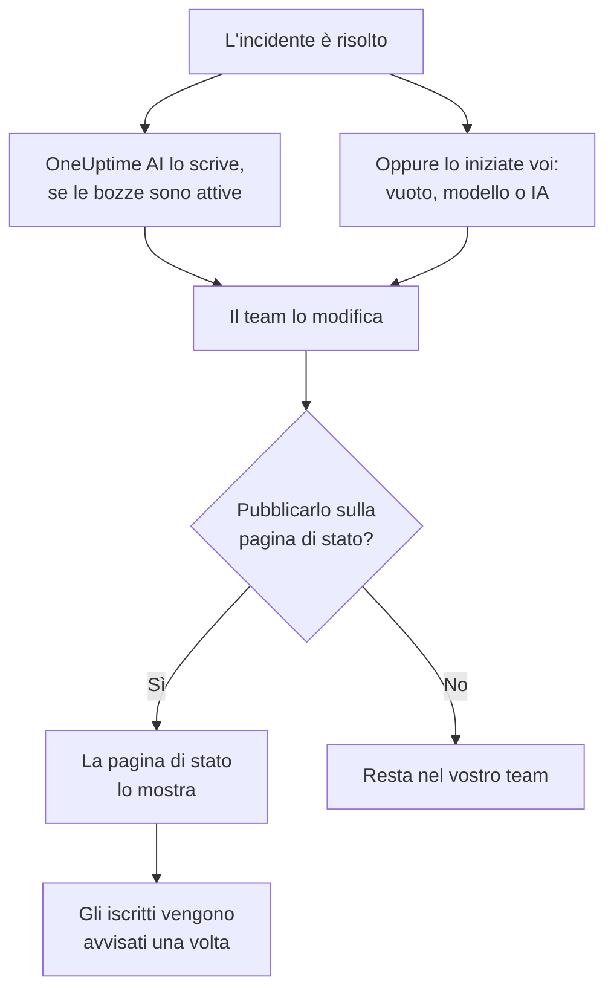

# Post-mortem

Un post-mortem è il resoconto dopo un incidente: cosa è successo, perché, quanto è costato ai vostri utenti e cosa cambia ora. In OneUptime lo scrivete sull'incidente stesso. Può partire da un vostro modello o da una bozza di OneUptime AI, e può essere pubblicato sulla vostra pagina di stato come aggiornamento finale dell'incidente.

:::cards
- [Scrivere un post-mortem](#scrivere-un-post-mortem): Nella pagina Post-mortem dell'incidente, in cinque passaggi.
- [Partire da un modello o da una bozza dell'IA](#partire-da-un-modello-o-da-una-bozza-dellia): La vostra traccia, o una che OneUptime AI compila.
- [Pubblicarlo sulla vostra pagina di stato](#pubblicarlo-sulla-vostra-pagina-di-stato): Mostrarlo ai clienti e avvisare gli iscritti una sola volta.
- [Post-mortem degli episodi](#post-mortem-degli-episodi): Un unico resoconto per un gruppo di incidenti.
:::

## Come nasce un post-mortem

Un post-mortem ha tre parti, tutte sull'incidente: la nota, scritta in Markdown; i suoi allegati, come screenshot e report; e se compare sulla vostra pagina di stato. Si trovano nella pagina **Post-mortem** dell'incidente, sotto **Indagine** nel suo menu laterale.

## Scrivere un post-mortem

:::steps
### Aprire il post-mortem

Aprite l'incidente, poi fate clic su **Post-mortem** sotto **Indagine** nel suo menu laterale. La scheda **Nota del postmortem** mostra la nota, gli allegati e se il post-mortem è sulla pagina di stato.

### Fare clic su Modifica nota post mortem

Il dialogo **Modifica nota post mortem** si apre sul suo primo passaggio, **Post-mortem**.

### Scrivere la nota e allegare i file

Scrivete la **Nota del postmortem** in Markdown: cosa è successo, l'impatto, come è stato risolto e le azioni successive. Aggiungete screenshot, report o cronologie in **Allegati del postmortem**.

### Scegliere se pubblicarlo

Fate clic su **Avanti**. Nel passaggio **Pagina di stato**, **Pubblica nella pagina di stato** è disattivato, quindi il post-mortem resta nel vostro team. Per mostrarlo ai clienti, vedere [Pubblicarlo sulla vostra pagina di stato](#pubblicarlo-sulla-vostra-pagina-di-stato).

### Salvare il post-mortem

Fate clic su **Salva modifiche**. La scheda mostra la nota e gli allegati.
:::

Ogni modifica della nota viene registrata nel feed dell'incidente, e pubblicata nel canale Slack o Microsoft Teams dell'incidente se ne ha uno. Finché il post-mortem non è pubblicato, nessun iscritto della pagina di stato ne viene a conoscenza.

Scrivere un post-mortem richiede il ruolo Project Owner, Project Admin, Project Member, Incident Admin o Incident Member, oppure un ruolo personalizzato con il permesso Edit Incident. Chi può leggere l'incidente può leggerne il post-mortem.

## Partire da un modello o da una bozza dell'IA

Due pulsanti della scheda compilano la nota al posto vostro: **Generate with AI**, e **Applica modello** non appena il progetto ha un modello di post-mortem. Entrambi aprono lo stesso editor di **Modifica nota post mortem**, con la nota compilata e il resto del post-mortem com'era. Nulla viene salvato finché non fate clic su **Salva modifiche**, quindi rileggete la nota e correggetela prima.

### Applicare un modello

**Applica modello** compare non appena il progetto ha un modello di post-mortem. I modelli si creano in **Incidenti → Impostazioni → Modelli post-mortem**: vedere [Modelli di post-mortem](/docs/incidents/settings#modelli-post-mortem). Su OneUptime Cloud, i modelli richiedono il piano Growth.

Fate clic su **Applica modello**, sceglietene uno in **Seleziona modello** nel dialogo **Applica modello di analisi post-incidente** e fate clic su **Applica modello**. Se il progetto ha un solo modello, è già selezionato.

### Generarlo con l'IA

Fate clic su **Generate with AI**. Il dialogo **Generate Postmortem with AI** propone una traccia in **Seleziona modello**: **Standard Postmortem**, **Detailed Technical Postmortem** o **Brief Postmortem**, poi i vostri modelli di post-mortem. **Template Preview** mostra la traccia, e potete modificarla prima di generare.

Fate clic su **Generate with AI** in fondo al dialogo. OneUptime AI legge l'incidente (la sua descrizione, la causa principale e la correzione, la cronologia degli stati, le note pubbliche e private, i messaggi del suo canale Slack o Microsoft Teams, e ciò che si è detto nelle [sue chiamate](/docs/workspace-connections/video-calls#trascrizioni-delle-chiamate)) e scrive il post-mortem secondo la vostra traccia. Poi l'editor si apre con il risultato.

La generazione richiede che l'IA sia attiva per il progetto, in **Impostazioni del progetto → IA → AI Features**, e un provider LLM: vedere [Provider LLM](/docs/ai/llm-provider). Richiede anche il ruolo Project Owner o Project Admin, oppure un ruolo personalizzato con il permesso Edit Incident: gli altri ruoli possono scrivere il post-mortem, ma non generarlo.

### Lasciare che OneUptime AI lo scriva quando un incidente viene risolto

Con **Scrivi una bozza di post-mortem quando un incidente viene risolto** attivo, OneUptime AI scrive una bozza del post-mortem ogni volta che un incidente viene risolto, la salva come nota e la pubblica nel feed dell'incidente perché il vostro team la rivegga. L'interruttore si trova in **Incidenti → IA → Impostazioni**, ed è attivo per i nuovi progetti.

- Non sostituisce mai una nota già scritta.
- Non scrive mai in un post-mortem già pubblicato, dove la bozza arriverebbe sulla pagina di stato senza revisione.
- Richiede che l'IA sia attiva per il progetto, e si ferma per la giornata non appena il progetto raggiunge i suoi limiti giornalieri di IA. Vedere [Post-mortem automatico](/docs/ai/ai-sre#post-mortem-automatico).

## Pubblicarlo sulla vostra pagina di stato

Un post-mortem pubblicato è l'aggiornamento finale dell'incidente per i vostri clienti: la pagina di stato mostra la nota, evidenziata nella cronologia dell'incidente, con i suoi allegati da scaricare.

:::steps
### Aprire il passaggio Pagina di stato

Fate clic su **Modifica nota post mortem**, poi su **Avanti** per arrivare al passaggio **Pagina di stato**.

### Attivare Pubblica nella pagina di stato

Attivate **Pubblica nella pagina di stato**. Compaiono altri due campi: **Notifica agli iscritti**, attivo, e **Postmortem pubblicato il**, impostato su adesso.

### Decidere chi avvisare, e quando compare

Disattivate **Notifica agli iscritti** per pubblicare senza avvisare gli iscritti. Modificate **Postmortem pubblicato il** per mostrare un'altra ora accanto al post-mortem.

### Pubblicarlo

Fate clic su **Salva modifiche**. La scheda ora mostra **Postmortem visibile nella pagina di stato?**, **Notifica agli iscritti**, **Stato notifica iscritto** e **Postmortem pubblicato il**.
:::

Cosa decide se i clienti lo vedono, e se ne vengono a sapere:

- **L'incidente deve essere sulla pagina di stato.** Una pagina di stato mostra un post-mortem solo su un incidente che mostra: **Visibile sulla pagina di stato** attivo, e l'incidente non privato.
- **La nota deve dire qualcosa.** Un post-mortem pubblicato con la nota vuota non viene mostrato, e nessuno viene avvisato.
- **Gli iscritti vengono avvisati una volta**, la prima volta che la pagina di stato mostra il post-mortem. Salvarlo di nuovo, o modificarlo mentre è pubblicato, aggiorna la pagina senza avvisare nessuno. Toglierlo e pubblicarlo di nuovo li avvisa di nuovo. Uno pubblicato mentre il suo incidente è nascosto viene inviato quando l'incidente diventa visibile.
- **Notifica agli iscritti viene letto quando parte la notifica.** Attivarlo dopo la pubblicazione del post-mortem non invia nulla.

**Stato notifica iscritto** mostra se la notifica è partita, e offre **Riprova** se non è riuscita. Vedere [Il post-mortem](/docs/status-pages/subscribers#il-post-mortem) per ogni caso, e [Riprova e Reinvia](/docs/status-pages/subscribers#riprovare-e-inviare-di-nuovo).

**Postmortem pubblicato il** è anche il momento in cui il post-mortem conta come pubblicato per la misura **Tempo fino al post-mortem**: vedere [Misure pronte all'uso](/docs/incidents/settings#misurazioni-pronte).

## Post-mortem degli episodi

Anche un episodio di incidenti ha una pagina **Post-mortem**, sotto **Indagine**: un unico resoconto per tutti gli incidenti dell'episodio. Fate clic su **Modifica post mortem** per scriverlo. **Applica modello** e **Generate with AI** funzionano come su un incidente, e l'IA legge l'episodio e i suoi incidenti membri.

Il post-mortem di un episodio è solo la nota: non ha allegati, e nessuna pagina di stato lo mostra. OneUptime AI non ne scrive uno da solo quando un episodio viene risolto. Generarlo richiede il ruolo Project Owner o Project Admin, oppure un ruolo personalizzato con il permesso Edit Incident Episode.

Gli avvisi e gli eventi di manutenzione programmata non hanno un post-mortem.

## Tramite l'API

Un post-mortem è un insieme di campi dell'incidente, letti e scritti tramite `/api/incident` come il resto dell'incidente:

| Campo | Cos'è |
| --- | --- |
| `postmortemNote` | La nota, in Markdown. |
| `showPostmortemOnStatusPage` | Se il post-mortem è pubblicato sulle vostre pagine di stato. Parte da `false`. |
| `notifySubscribersOnPostmortemPublished` | Se gli iscritti vengono avvisati quando viene pubblicato. Parte da `true`. |
| `postmortemPostedAt` | L'ora che la pagina di stato mostra accanto. |

Scrivere `showPostmortemOnStatusPage` come `true` su una `postmortemNote` già scritta pubblica il post-mortem, come fa il dialogo.

## Risoluzione dei problemi

:::details Applica modello non compare nella scheda
Il progetto non ha ancora un modello di post-mortem, oppure il vostro ruolo non può leggerli. Createne uno in **Incidenti → Impostazioni → Modelli post-mortem**. Su OneUptime Cloud, i modelli richiedono il piano Growth.
:::

:::details Generate with AI dice che l'IA è disattivata, o che vi manca il permesso
Attivate l'IA in **Impostazioni del progetto → IA → AI Features**. La generazione richiede il ruolo Project Owner o Project Admin, oppure un ruolo personalizzato con il permesso Edit Incident, anche per chi può modificare il post-mortem.
:::

:::details Il post-mortem non è sulla pagina di stato
Controllate tre cose: **Pubblica nella pagina di stato** è attivo, la nota non è vuota, e l'incidente è mostrato sulla pagina di stato (**Visibile sulla pagina di stato** attivo, e non privato).
:::

:::details Gli iscritti non sono stati avvisati del post-mortem
**Notifica agli iscritti** era disattivato alla pubblicazione, oppure l'incidente è nascosto: in quel caso viene inviato appena l'incidente diventa visibile. **Stato notifica iscritto** nella scheda indica quale.
:::

:::details Non è comparsa alcuna bozza dell'IA quando l'incidente è stato risolto
L'incidente aveva già una nota, il post-mortem era già pubblicato, oppure **Scrivi una bozza di post-mortem quando un incidente viene risolto** è disattivato. L'IA deve essere attiva per il progetto, e il progetto non deve aver raggiunto i suoi limiti giornalieri di IA.
:::

## Passaggi successivi

:::cards
- [Panoramica degli incidenti](/docs/incidents/index): Le altre pagine dell'incidente, dalla dichiarazione alla risoluzione.
- [Impostazioni e automazione degli incidenti](/docs/incidents/settings): I modelli di post-mortem e la misura del tempo fino al post-mortem.
- [Iscritti e annunci](/docs/status-pages/subscribers): Tutto ciò che una pagina di stato comunica ai suoi iscritti.
- [AI SRE](/docs/ai/ai-sre): Cosa fa OneUptime AI da solo dopo un incidente.
:::
