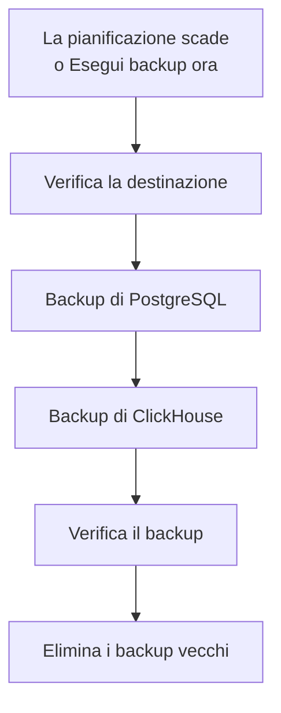

# Backup

Esegui il backup di un OneUptime self-hosted in uno storage di tua proprietà, secondo una pianificazione, e ripristinalo dall'Admin Dashboard. Un backup contiene PostgreSQL, con progetti, monitor, incidenti, pagine di stato e utenti, e ClickHouse, con log, tracce e metriche. I backup vengono conservati per quanti giorni scegli, quelli più vecchi vengono eliminati per te e qualsiasi backup può essere ripristinato sul posto. I backup fanno parte della Edizione Enterprise.

:::cards
- [Configurare i backup](#configurare-i-backup): Scegli una destinazione, testala, imposta una pianificazione.
- [Destinazioni](#destinazioni): Cosa chiede ogni destinazione consigliata.
- [Ripristinare un backup](#ripristinare-un-backup): Cosa viene sostituito e come restano al sicuro i dati attuali.
- [Passare a un nuovo server](#passare-a-un-nuovo-server): Ripristina i backup di un'installazione su un'altra.
:::

## Come funziona un backup



- **Coerente.** PostgreSQL viene salvato in un'unica transazione, quindi il dump è il database com'era in un preciso momento, mentre OneUptime continua a funzionare. ClickHouse salva ogni tabella com'era quando ne ha letto le parti.
- **Direttamente nella destinazione.** L'output di `pg_dump` viene inviato in streaming allo storage mentre viene scritto, e ClickHouse scrive da solo il proprio backup nello storage. Sul disco del server non viene scritto nulla, qualunque sia la dimensione dei dati.
- **Verificato.** Prima che il backup sia valido, `pg_restore` rilegge il dump dalla destinazione, e lì si trova il record che ClickHouse tiene del proprio backup. Lo SHA-256 del dump viene conservato con il backup, e un ripristino lo verifica prima di sostituire qualsiasi cosa. Un backup che fallisce o viene annullato elimina ciò che ha scritto, quindi la destinazione contiene solo backup completi.
- **Cifrato.** I backup arrivano allo storage tramite HTTPS, a meno che tu non inserisca un endpoint `http://`. Amazon S3, Google Cloud Storage, Azure Blob Storage e Cloudflare R2 cifrano tutto ciò che memorizzano; su un altro storage, attiva la cifratura a riposo del bucket. Le credenziali della destinazione sono memorizzate cifrate e non vengono più mostrate.
- **Uno alla volta.** Su tutta l'installazione viene eseguito un solo backup o ripristino alla volta. Gli altri aspettano il proprio turno.

Ogni backup è una cartella a sé all'interno della cartella della destinazione (`oneuptime/backups/` a meno che tu non ne scelga un'altra), con il nome dell'ora in cui è iniziato, in UTC:

```text
oneuptime/backups/20261024T020000Z-3f2a9c1b/manifest.json
oneuptime/backups/20261024T020000Z-3f2a9c1b/postgres.dump
oneuptime/backups/20261024T020000Z-3f2a9c1b/clickhouse/
```

`manifest.json` viene scritto per ultimo: indica cosa contiene il backup e quale versione di OneUptime lo ha creato.

## Prima di iniziare

- **La Edizione Enterprise**, con una licenza che includa i backup. I backup vengono eseguiti durante il periodo di prova e il periodo di tolleranza. Senza licenza non viene eseguito nessun nuovo backup, e il ripristino e l'eliminazione dei backup funzionano comunque. Vedi [Edizione Enterprise](/docs/self-hosted/enterprise).
- **Un amministratore principale.** I backup si configurano nell'Admin Dashboard.
- **Un bucket o un container solo per i backup**, e credenziali che possano leggere, scrivere, elencare ed eliminare al suo interno.
- **Una destinazione che anche ClickHouse raggiunge.** ClickHouse scrive da solo il proprio backup nello storage, quindi la sua rete deve raggiungere lo storage, come quella di OneUptime.
- **Per ripristinare PostgreSQL, un utente del database che possa creare database.** Un ripristino scrive in un nuovo database accanto a quello attivo. Il PostgreSQL fornito con OneUptime si connette come superutente, che può farlo.

## Configurare i backup

:::steps
### Aprire la pagina dei backup

Nell'Admin Dashboard, vai in **Impostazioni → Backup** e fai clic su **Configura i backup**.

### Scegliere dove vanno i backup

Scegli una delle destinazioni consigliate. Cosa chiede ciascuna si trova in [Destinazioni](#destinazioni).

### Compilare la connessione

Compila ciò che la destinazione chiede. Una cartella, una regione e le impostazioni che quasi tutti lasciano invariate si trovano in **Altri campi**, e **Guida alla configurazione** apre la sezione della destinazione in questa pagina.

### Testare la destinazione

Fai clic su **Testa la destinazione**. OneUptime scrive, legge, elenca ed elimina un piccolo file di test, verifica che `pg_dump` possa eseguire il backup del tuo PostgreSQL e chiede a ClickHouse di scrivere un backup di test delle definizioni delle sue tabelle. Non viene salvato nulla, e una verifica che fallisce dice cosa cambiare.

### Scegliere quando vengono eseguiti i backup

Scegli **Frequenza** e l'ora in **Alle (UTC)**, e per i backup settimanali il **Giorno della settimana**. **Conserva i backup per (giorni)** è 30 a meno che tu non lo cambi. Disattiva **Esegui il backup anche di ClickHouse** per eseguire il backup solo di PostgreSQL.

### Iniziare i backup

Fai clic su **Inizia i backup**. Il primo backup viene eseguito alla prossima ora pianificata, e **Esegui backup ora** ne avvia uno subito.
:::

La pagina mostra poi come vanno i backup: quando è stato eseguito l'ultimo, quanto era grande e quanto è durato, e quando verrà eseguito il prossimo. Un backup in corso mostra il passaggio in cui si trova, e **Visualizza passaggi** mostra ogni passaggio mentre viene eseguito.

## Destinazioni

| Destinazione | Storage | Accede con |
| --- | --- | --- |
| [Amazon S3](#amazon-s3) | Amazon S3 | Una chiave di accesso |
| [Cloudflare R2](#cloudflare-r2) | Storage compatibile con S3 | Un token API di R2 |
| [Backblaze B2](#backblaze-b2) | Storage compatibile con S3 | Una chiave applicazione |
| [Wasabi](#wasabi) | Storage compatibile con S3 | Una chiave di accesso |
| [MinIO](#minio) | Storage compatibile con S3 | Una chiave di accesso |
| [Google Cloud Storage](#google-cloud-storage) | Google Cloud Storage | Una chiave HMAC |
| [Azure Blob Storage](#azure-blob-storage) | Azure Blob Storage | Un token SAS o una chiave di accesso |
| [Altro storage compatibile con S3](#altro-storage-compatibile-con-s3) | Storage compatibile con S3 | Una chiave di accesso |

Una chiave per Amazon S3 o per un altro storage compatibile con S3 richiede `s3:PutObject`, `s3:GetObject`, `s3:ListBucket`, `s3:DeleteObject` e `s3:AbortMultipartUpload` sulla cartella, e nient'altro:

```json
{
  "Version": "2012-10-17",
  "Statement": [
    {
      "Effect": "Allow",
      "Action": "s3:ListBucket",
      "Resource": "arn:aws:s3:::my-backups"
    },
    {
      "Effect": "Allow",
      "Action": [
        "s3:PutObject",
        "s3:GetObject",
        "s3:DeleteObject",
        "s3:AbortMultipartUpload"
      ],
      "Resource": "arn:aws:s3:::my-backups/oneuptime/backups/*"
    }
  ]
}
```

### Amazon S3

| Campo | Cosa inserire |
| --- | --- |
| **Bucket** | Il bucket in cui vengono scritti i backup. Usalo solo per i backup. |
| **Regione** | La regione del bucket. Parte da `us-east-1`. |
| **ID chiave di accesso** | Una chiave di accesso con i permessi indicati sopra. |
| **Chiave di accesso segreta** | Il segreto della chiave. |
| **Cartella** | In **Altri campi**. Se lasciata vuota, i backup vanno in `oneuptime/backups/`. |

Amazon S3 cripta ogni file che memorizza, e OneUptime glielo chiede (SSE-S3) per ogni file che scrive.

### Cloudflare R2

Inserisci come **Endpoint** l'indirizzo dell'API S3 del tuo account, `https://<account-id>.r2.cloudflarestorage.com`, dalle impostazioni del bucket in R2. Poi inserisci il **Bucket**, e l'**ID chiave di accesso** e la **Chiave di accesso segreta** di un token API di R2 che possa leggere e scrivere oggetti al suo interno. Rileggere i backup da R2 non costa nulla.

### Backblaze B2

Inserisci come **Endpoint** l'endpoint S3 del bucket, mostrato nella sua pagina Buckets in Backblaze, ad esempio `https://s3.us-west-004.backblazeb2.com`. Poi inserisci il **Bucket**, e l'ID e la chiave di una chiave applicazione come **ID chiave di accesso** e **Chiave di accesso segreta**. La regione viene ricavata dall'endpoint.

### Wasabi

Inserisci come **Endpoint** l'URL del servizio della regione del bucket, ad esempio `https://s3.us-east-1.wasabisys.com`, poi il **Bucket** e una chiave di accesso. La regione viene ricavata dall'endpoint.

### MinIO

Inserisci come **Endpoint** l'indirizzo dell'API S3 del tuo server MinIO, ad esempio `https://minio.example.com:9000`, poi il **Bucket** e una chiave di accesso la cui policy possa leggere, scrivere, elencare ed eliminare al suo interno. OneUptime e ClickHouse devono raggiungere entrambi l'indirizzo.

### Google Cloud Storage

Inserisci il **Bucket**, e la **Chiave di accesso HMAC** e il **Segreto HMAC** di un account di servizio con il ruolo Storage Object Admin sul bucket. Crea la chiave nelle impostazioni di Cloud Storage, nella scheda Interoperabilità. OneUptime e ClickHouse raggiungono il bucket tramite l'API compatibile con S3 di Cloud Storage.

### Azure Blob Storage

Inserisci l'**Account di archiviazione** e il **Container**, e scegli in **Accedi con** come accedere: un **Token SAS** con i permessi di lettura, aggiunta, creazione, scrittura, eliminazione ed elenco sul container, oppure una **Chiave di accesso** dell'account di archiviazione. Un token SAS può essere limitato al container, quindi è la scelta più sicura. **Cloud** e **Cartella** si trovano in **Altri campi**.

### Altro storage compatibile con S3

Per Ceph, DigitalOcean Spaces, Hetzner Object Storage e qualsiasi storage con un'API S3, inserisci il suo indirizzo S3 come **Endpoint**, poi il **Bucket** e una chiave di accesso. **Regione**, in **Altri campi**, serve solo se lo storage ne richiede una. Se lasciata vuota, viene ricavata dall'endpoint, oppure è `us-east-1`.

## Pianificazione e conservazione

| Impostazione | Cosa fa |
| --- | --- |
| **Frequenza** | **Ogni ora**, **Ogni 6 ore**, **Ogni 12 ore**, **Ogni giorno** o **Ogni settimana**. Ogni giorno va bene per la maggior parte delle installazioni. |
| **Alle (UTC)** | L'ora in cui iniziano i backup, in UTC, con la tua ora locale accanto. Ogni 6 o 12 ore si contano da essa: alle `02:00`, i backup ogni 6 ore vengono eseguiti alle 02:00, 08:00, 14:00 e 20:00. I backup ogni ora vengono eseguiti allo scoccare dell'ora. |
| **Giorno della settimana** | Il giorno in cui vengono eseguiti i backup settimanali. |
| **Conserva i backup per (giorni)** | Da 1 a 3650 giorni. 30 a meno che tu non lo cambi. |
| **Esegui il backup anche di ClickHouse** | Attivo a meno che tu non lo disattivi. Il backup di PostgreSQL viene sempre eseguito. |

Dopo ogni backup, i backup iniziati più di **Conserva i backup per (giorni)** fa vengono eliminati, nella destinazione e dall'elenco, tranne il backup riuscito più recente, che viene conservato per quanto vecchio sia. Disattivare i backup, o una licenza che scade, non ti lascia quindi mai senza un backup da ripristinare.

**Disattiva i backup pianificati**, nel menu della scheda di stato, ferma la pianificazione. **Esegui backup ora** funziona comunque e nessun backup viene eliminato. **Attiva** riavvia la pianificazione.

## Ripristinare un backup

:::warning Cosa sostituisce un ripristino
Un ripristino sostituisce i dati attuali con quelli del backup. Tutto ciò che è cambiato dalla creazione del backup va perso, a meno che tu non esegua prima il backup dei dati attuali.
:::

:::steps
### Scegliere il backup

Nella tabella **Backup**, fai clic su **Ripristina** sul backup a cui tornare. OneUptime verifica prima il backup: che i suoi file siano nella destinazione e invariati, quale versione di OneUptime lo ha creato e che questo server possa ripristinarlo.

### Scegliere cosa ripristinare

Seleziona **PostgreSQL: progetti, monitor, incidenti, utenti**, **ClickHouse: log, tracce, metriche** o entrambi. La finestra mostra quanti progetti, utenti e monitor contiene il backup e quanti ce ne sono ora.

### Proteggere i dati attuali

**Esegui prima il backup dei dati attuali** è selezionato: il ripristino inizia con un backup dei dati che sostituisce, così puoi tornarci. Deselezionalo solo se hai un'altra copia, perché senza di essa il ripristino non può essere annullato.

### Confermare

Digita `restore` e fai clic su **Ripristina**.
:::

Un ripristino viene eseguito passo per passo, e la pagina mostra ciascun passaggio:

| Passaggio | Cosa succede |
| --- | --- |
| **Verifica il backup** | I file del backup ci sono, e questa installazione può ripristinarlo. |
| **Backup dei dati attuali** | Un backup dei dati attuali, a meno che tu non l'abbia deselezionato. |
| **Ripristina PostgreSQL** | Il backup viene ripristinato in un nuovo database accanto a quello attivo, e verificato. |
| **Ripristina ClickHouse** | La telemetria attiva viene messa da parte, e quella del backup viene ripristinata al suo posto. |
| **Passa ai dati ripristinati** | Il database ripristinato prende il nome di quello attivo, in un attimo. |
| **Aggiorna i dati ripristinati** | Le migrazioni del database di questa versione vengono eseguite sui dati ripristinati. |
| **Pulizia** | Ciò che era stato messo da parte viene rimosso. |

OneUptime continua a funzionare con i dati attuali fino al passaggio, e prima di allora nulla di ciò che usa cambia. Un ripristino che fallisce o viene annullato prima del passaggio lascia tutto com'era, e uno che fallisce durante il passaggio rimette a posto ciò che aveva messo da parte. La telemetria che arriva mentre ClickHouse viene ripristinato non viene memorizzata. Dopo il ripristino di PostgreSQL potresti essere disconnesso: accedi con un account presente nel backup.

:::details Il ripristino dice che il backup è stato creato con un altro ENCRYPTION_SECRET
Le credenziali che OneUptime memorizza, come la chiave di una destinazione, sono crittografate con `ENCRYPTION_SECRET`. Imposta l'`ENCRYPTION_SECRET` con cui è stato creato il backup prima del ripristino, altrimenti quelle credenziali non potranno essere lette in seguito.
:::

## Passare a un nuovo server

:::steps
### Installare OneUptime sul nuovo server

Installa la Edizione Enterprise, nella versione che ha creato i backup o in una più recente.

### Configurare la stessa destinazione

In **Impostazioni → Backup**, configura la destinazione in cui si trovano i tuoi backup. La pagina trova i backup già presenti e li elenca, pronti per il ripristino. **Trova backup**, nel menu della scheda di stato, cerca di nuovo.

### Ripristinare il backup più recente

Ripristinalo come descritto sopra. Un backup creato da una versione precedente di OneUptime viene aggiornato a questa versione. Un backup creato da una versione più recente può essere ripristinato dopo l'aggiornamento.
:::

## Quando un backup non riesce

La scheda di stato mostra **L'ultimo backup non è riuscito**, con l'errore, e **Visualizza passaggi** mostra il passaggio in cui si è fermato e perché. Ogni amministratore principale riceve anche un'e-mail, al massimo una volta ogni 12 ore finché i backup continuano a non riuscire. Un ripristino non riuscito viene sempre segnalato via e-mail.

## Risoluzione dei problemi

:::details ClickHouse non raggiunge la destinazione
ClickHouse si connette da solo allo storage. Consenti alla sua rete di raggiungere l'indirizzo della destinazione, come quella di OneUptime, poi testa di nuovo la destinazione.
:::

:::details pg_dump manca o è troppo vecchio
L'immagine Enterprise include `pg_dump` e `pg_restore` 16, 17 e 18, che eseguono il backup di PostgreSQL 18 e di tutte le versioni precedenti. Su un'altra immagine, installa gli strumenti client di PostgreSQL oppure imposta `BACKUP_POSTGRES_BIN_DIR` sulla directory che li contiene. `pg_dump` deve essere recente almeno quanto il tuo server PostgreSQL.
:::

:::details Il ripristino di PostgreSQL richiede una modifica
Un ripristino crea un database, e l'utente del database di OneUptime deve poterlo fare. Esegui questo comando su PostgreSQL come superutente, con il tuo `DATABASE_USERNAME` al posto di `oneuptime`, poi ripristina di nuovo:

```sql
ALTER USER oneuptime CREATEDB;
```
:::

:::details Un backup si trova in una destinazione precedente
Dopo aver cambiato destinazione, i backup creati in quella vecchia restano nell'elenco, contrassegnati con **In una destinazione precedente**. Configura di nuovo quella destinazione per ripristinarne uno, oppure eliminalo dall'elenco: i suoi file restano dove sono.
:::

## Passi successivi

:::cards
- [Edizione Enterprise](/docs/self-hosted/enterprise): Le licenze e cosa aggiunge la Edizione Enterprise.
- [Aggiornamento](/docs/installation/upgrading): Esegui un backup prima di ogni aggiornamento.
- [Docker Compose](/docs/installation/docker-compose): Esegui OneUptime su un solo server.
:::
